# Full book HTML

[Course index](../../README.md) · [Original source](https://arxiv.org/html/2610.13455v1) · [Raw file](../../raw/originals/book.html)

Retrieved: 2026-11-13T16:41:17.579179+00:00

# **Agentic Large Language Models**

Max van Duijn
Affiliation: Michiel van der Meer
Affiliation: Aske Plaat
Affiliation: Niki van Stein

### Chapter 1 Introduction

Large language models (LLMs) have taken the world by storm. Their ability to communicate with us in our own language, and to reason about our world, has made them a favorite tool for writing, answering questions, and much more.

Their answers already influence our decisions and our actions. What would happen if LLMs themselves could act in the world directly? What would happen if LLMs could interact with each other?
Agentic LLMs combine the power of large language models with the ability to act in the real world. In this book we will discuss how agentic LLMs work, how they act, how they interact, and what this means for us, as users.

#### 1.1 Why this book?

Artificial intelligence (AI) is changing the world. Large language models that *act* change the world in a new way. In order to understand the extent of these changes it is important for students and researchers of AI to understand both the technology itself and the applications that are now emerging. This understanding can help us influence the direction of these developments, perhaps build in safeguards, and, specifically, it will help us to develop the field further.

This book has been written for the graduate course on agentic LLMs that we teach at our university.
In agentic LLMs two fields of AI research come together: the study of agents, and the study of large language models.
Agents are changing the field of LLMs, and, conversely, LLMs are changing the field of agents. Although there are excellent books about LLMs and how they work (such as [Jurafsky and Martin (2025)](#bib.bib20)), the ability to act puts agentic LLMs in a class of their own. We think that there is a need for a course and for a book that explain how agentic LLMs work, and how they enable things that were not possible before.

#### 1.2 Concepts and Definitions

The strength of the language abilities of LLMs is impressive, they talk just like we do. Now that LLMs have become agentic, their horizon extends far beyond talking: LLMs have capabilities for *reasoning*, for *using tools* such as writing and running code, for browsing the web to retrieve information, and for *interacting* with other agents or with the outside world.

This brings us to two definitions that we use in this book.

> *Agents* perform actions, observe the effect of these actions and use the feedback they receive from the world to adapt their action policy.
>   
>   
> *Agentic LLMs* are agents that integrate the power of LLMs, such as to communicate using natural language, write code, or process information.

##### 1.2.1 Agents that Assist, Agents that Interact

The ability to act has increased the relevance and applicability of LLMs in many domains of society.
How are agentic LLMs used? In this book, we distinguish two major classes of use cases for Agentic LLMs:

(1) Agentic LLMs are used to *assist* their human users in application domains such as medicine, logistics, and finance (Part IV).

(2) Agentic LLMs are used to *interact* with each other to perform tasks or function in simulations of human behavior (Part V).

Many research papers have been published in recent years in both domains. We will provide overviews of key studies and trends throughout the book.

##### 1.2.2 Agentic Harness

From an engineering perspective, how do we construct agentic LLMs? Agentic LLMs consist of two elements: (1) the LLM, and (2) a piece of code that is called the *harness*.

Agentic LLM = LLM + Harness

The harness is a piece of computer code that wraps around the model and controls how it is called (a horse’s harness helps us guide the power of the noble animal in a productive direction).
The harness performs tasks such as prompt construction, answer processing, calling external tools, state management, system prompt management, and skill management. The harness loops through the reasoning, acting, and observing that are necessary for task completion, without the need for human intervention to guide the process manually. The agentic harness can thus be seen as a versatile automatic prompt engineer (Part II, Chapter [6](#Ch6 "Chapter 6 Multi-step Reasoning in LLMs ‣ Part II Reasoning ‣ Agentic Large Language Models")). Importantly, the harness may *adapt* the behavior policy of the agent based on feedback on its actions, using reinforcement learning (Part III, Chapter [9](#Ch9 "Chapter 9 Interaction Styles for Agentic LLMs ‣ Part III Agents ‣ Agentic Large Language Models")).

##### 1.2.3 Multi-Modal Models

Understanding natural language is crucial for agents that interact with users and the world around them. However, for many tasks agents must also process other modalities, such as visual information, or other text formats, such as spreadsheets or computer code. As such, the domain of agentic LLMs extends beyond natural language, and includes multi-modal, code, and world models.
Therefore, please note that in this book we use the term *LLM* pragmatically—depending on the context it can refer to language-only systems, or it can have a broader scope: *large transformer-based model that processes natural language, computer code, images, tool-commands, or other relevant modalities* (Part II, Chapter [7](#Ch7 "Chapter 7 Vision, Action and World Models ‣ Part II Reasoning ‣ Agentic Large Language Models")). In cases where the distinction is important, we flag which variant of the definition applies.

##### 1.2.4 Training Data

Agentic LLMs mark another paradigm shift in LLM engineering, that is related to machine learning. For a long time, the learning-emphasis in the field of LLMs has been on learning during model training, but now there is an increasing role for learning at inference time, when the model is queried.

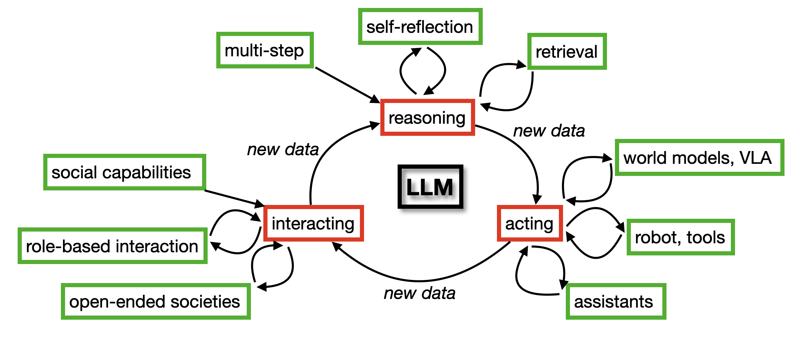

Figure 1.1: Recursive self-improvement cycle connecting three categories of agentic LLM: reasoning, acting, and interacting (in red, corresponding to Parts II, III/IV and V). Concepts that influence a category are in green.

This has two advantages. First, it creates flexibility and space for dynamic agentic behavior, as we will see in Chapters [8](#Ch8 "Chapter 8 Metalearning ‣ Part II Reasoning ‣ Agentic Large Language Models") and [9](#Ch9 "Chapter 9 Interaction Styles for Agentic LLMs ‣ Part III Agents ‣ Agentic Large Language Models"). Second, in an era where almost the entire internet has been used as data for pretraining models ([Sutskever, 2024](#bib.bib12)), it has become useful to generate additional, relevant, and high-quality data.
By interacting with the world, agents can generate such new data themselves. Figure [1.1](#Ch1.F1 "Figure 1.1 ‣ 1.2.4 Training Data ‣ 1.2 Concepts and Definitions ‣ Chapter 1 Introduction ‣ Agentic Large Language Models") illustrates this process. This interaction-data can be used for additional training.

An example of how LLMs are trained on their own agentic actions are vision-language-action models that learn from robotic action sequences (Chapter [7](#Ch7 "Chapter 7 Vision, Action and World Models ‣ Part II Reasoning ‣ Agentic Large Language Models")). Another example can be found in Chapter [17](#Ch17 "Chapter 17 Emergent Behavior in Multi-LLM Systems ‣ Part V Behavior and Cognition ‣ Agentic Large Language Models"), where societies of agents allow models to become more intelligent through interaction, just like humans learn new behaviors and ideas when they interact with one another.

Thus, in addition to enabling useful applications,
another driver of agentic LLMs is the opportunity to generate more training data, creating a recursive self-improvement loop. In Figure [1.1](#Ch1.F1 "Figure 1.1 ‣ 1.2.4 Training Data ‣ 1.2 Concepts and Definitions ‣ Chapter 1 Introduction ‣ Agentic Large Language Models") this virtuous cycle of interactive data generation is shown. Shown in red are the main categories: reasoning (Part II), acting (Parts III/IV), and interacting (Part V). In green are concepts that influence a category, either directly, or in a feedback loop.

#### 1.3 Audience and Aim

This book is primarily written for graduate students and researchers in artificial intelligence and computer science. It may also be of interest to students and scholars from other fields, such as the cognitive and social sciences or humanities, as long as they have an intrinsic drive to engage with machine learning and technological challenges.

The book’s aim is to introduce and review the advancements of techniques and applications in the field of agentic LLMs.
We discuss the major concepts of agentic LLM engineering in some depth. We provide references to the scientific literature as well as links to source code and datasets so that you can experiment with building your own agents. Note that the field is new, and still very much in motion. A thorough understanding of the basics is important in order to be able to follow the latest developments. Our aim is to provide you with both.

We use this book for teaching the course Agentic LLMs that is part of the Master programs Computer Science (AI-track) and Creative Intelligence & Technology at Leiden University. A website with support material is available (lecture slides, assignments, news).11
1
<https://agenticllms.liacs.nl>

Dear reader, we hope that you will enjoy reading this book as much as we did writing it. Agentic LLM research is a new field, and this book is just as fresh. New developments occur every day. We very much welcome your feedback and suggestions for following editions of this book, via the website!

#### 1.4 Prerequisites

This book assumes that you have an undergraduate-level understanding of computer programming, artificial intelligence, machine learning, and natural language processing.

We assume that you know how to use Python and PyTorch. We also assume that you understand principles of machine learning, such as the difference between classification and regression, the difference between a training set and a test set, and the causes of overfitting and underfitting. You should know classical machine learning approaches such as decision trees, ensembles, and random forests. You should also be familiar with concepts of deep learning such as the architectures of artificial neural networks (fully connected multilayer perceptrons, convolutional neural networks, and recurrent neural networks), learning by backpropagation, with loss functions (such as cross-entropy) and activation functions (such as ReLU). We also expect that you are familiar with reinforcement learning: you should know what a sequential decision problem is, understand the difference between agent and environment, and know how to use some policy learning algorithms (such as Q-learning, DQN, PPO, and SAC). Finally, you should have an understanding of natural language processing: what is tokenization, what are word embeddings, what is attention, and what is Huggingface.

However, we also believe that if you do not have in-depth knowledge about some or all of these topics and concepts, you may still find value in reading this book. We provide brief overviews of essential topics, you will learn about agentic LLMs at a worthwhile level, and find entry points for further study.
For some of the topics, you may find it useful to have a suitable textbook at hand,
22
2
See [Gunasekar et al. (2023)](#bib.bib24) such as:

- 

  for classical machine learning: [Alpaydin (2021)](#bib.bib13); [Flach (2012)](#bib.bib18),
- 

  for deep supervised machine learning: [Bishop and Bishop (2023)](#bib.bib2); [Goodfellow et al. (2016)](#bib.bib16); [Chollet and Chollet (2021)](#bib.bib21); [Stevens et al. (2020)](#bib.bib22),
- 

  for reinforcement learning: [Sutton and Barto (2018)](#bib.bib11); [Graesser and Keng (2019)](#bib.bib9); [Plaat (2022)](#bib.bib19); [François-Lavet et al. (2018)](#bib.bib14),
- 

  for natural language processing and transformers: [Jurafsky and Martin (2025)](#bib.bib20).

#### 1.5 Course Structures

We use this book for the graduate course Agentic LLMs at our university. The book has been written to be both concise and comprehensive: we cover the full breadth of the field at a level suitable for a graduate course. To allow you to go deeper, we provide many pointers to the scientific literature, and some advanced topics are covered in the chapters and sections that are marked with a \*.

Different university programs may cover different material (see Table [1.1](#Ch1.T1 "Table 1.1 ‣ 1.5 Course Structures ‣ Chapter 1 Introduction ‣ Agentic Large Language Models")). The course that we teach is comprehensive, and consists of 14 lectures: an introductory lecture, then 3 lectures on part I (language modeling), 3 lectures on parts II (reasoning) and III (agents), 3 lectures on part IV (tools and assistants), and 3 lectures on part V (social simulation). The course ends with a final evaluation lecture. Our course includes as assignments the four case studies, which we grade in an in-person meeting with the student. We do not have a separate theory exam at the end, the course grade is the average of the assignment grades.

Although you are of course free to use the book in any way that makes sense in your situation, we cover two main use cases for agentic LLMs: (1) assistants and (2) social simulation.

When your program includes a separate in-depth course on LLMs, then a core program to focus on (1) agentic assistants can include just parts II, III and IV. For the assignments, we suggest case study 2 and 3.

Alternatively, a core program to focus on (2) social simulation should cover parts II and III, and part V, using case study 2 and 4 for the assignments.

Both the assistants and the social simulation approach can be augmented with part I (language modeling), as necessary, depending on how the education program at your University is structured.

Part VI contains advanced topics. Chapter [19](#Ch19 "Chapter 19 *Synthetic Data Generation for Training Agentic LLMs ‣ Part VI Advanced Topics ‣ Agentic Large Language Models"), on synthetic data generation, is suitable for the assistants use case, Part IV. Chapter [21](#Ch21 "Chapter 21 *Mechanistic Interpretability for LLM Agents ‣ Part VI Advanced Topics ‣ Agentic Large Language Models"), on mechanistic interpretability, is suitable to go more in depth for Parts I and II, the language and reasoning models.
Chapter [20](#Ch20 "Chapter 20 *Advanced Transformer and Agentic Architectures ‣ Part VI Advanced Topics ‣ Agentic Large Language Models"), on advanced architectures, is also suitable for Part II.
Chapter [22](#Ch22 "Chapter 22 *Cognitive Perspectives on Agentic LLMs ‣ Part VI Advanced Topics ‣ Agentic Large Language Models"), on cognitive architectures, is suitable for the social simulation use case, Part V.

| Course Goal | Parts | Case Study | Chapters | Optional |
| --- | --- | --- | --- | --- |
| Comprehensive | I, II, III, IV, V | 1, 2, 3, 4 | 1-18 | 19-22 |
| Core Assistants | II, III, IV | 2, 3 | 6-14 | 2-5, 19 |
| Core Social Simulation | II, III, V | 2, 4 | 6-10, 11, 15-18 | 2-5, 22 |

Table 1.1: Mapping different Course Goals to Parts and Chapters in this Book

Table [1.1](#Ch1.T1 "Table 1.1 ‣ 1.5 Course Structures ‣ Chapter 1 Introduction ‣ Agentic Large Language Models") summarizes the different options for use of the material in this book for three different course goals.

#### 1.6 Approach, Scope and Overview

Our approach is hands-on. For all new concepts we provide the theoretical background and we give examples of how to use them in practice. We discuss datasets, training algorithms, benchmarks, training environments, we provide pseudo-code of important agent algorithms, and we provide practical case studies to help you learn.

This book is organized in chapters that each cover a comprehensive topic. The chapters are organized in seven parts.

Part I provides a basic introduction to large language models. Chapter [2](#Ch2 "Chapter 2 Foundations of Language Modeling with LLMs ‣ Part I Language Modeling ‣ Agentic Large Language Models") discusses important natural language processing concepts such as tokenization, embeddings, recurrent neural networks, the attention mechanism, the transformer architecture, and autoregressive training (the machine learning method that is central to how LLMs are trained). We also discuss further machine learning methods: supervised learning and reinforcement learning. Next, in Chapter [3](#Ch3 "Chapter 3 The Large Language Model Training Pipeline ‣ Part I Language Modeling ‣ Agentic Large Language Models") we discuss in some detail the training pipeline that is used to train LLMs. We discuss dataset acquisition, pretraining, finetuning, instruction tuning, value alignment, and inference. We also discuss benchmarks that are commonly used to test the performance of LLMs. In Chapter [4](#Ch4 "Chapter 4 Scaling Laws and Efficient Large Language Models ‣ Part I Language Modeling ‣ Agentic Large Language Models") we discuss scaling laws and small language models, and we discuss energy consumption. To be able to use agentic LLMs, you must understand the basics of pretraining and finetuning a transformer model. In the final chapter of Part I, we help you acquire this experience with a practical case study where we will guide you to train a transformer model from scratch.

Part II provides an introduction into the concepts of reasoning, reflection, and world models, three concepts that are essential elements of (advanced) agentic LLMs. In Chapter [6](#Ch6 "Chapter 6 Multi-step Reasoning in LLMs ‣ Part II Reasoning ‣ Agentic Large Language Models") we start with in-context learning, and discuss how the chain of thought method has enabled LLMs to perform multi-step reasoning in simple math word problems. We will discuss how LLMs are used to self-reflect on their own in-context learning, to enhance their reasoning power, using a harness. So far, we have focused on models that use language. To act in the real world, our agents will also have to understand image data, and other modalities. In Chapter [7](#Ch7 "Chapter 7 Vision, Action and World Models ‣ Part II Reasoning ‣ Agentic Large Language Models") we go beyond language and discuss models that understand vision and language, and also models that learn from decision sequences and know how to perform robotic actions. To act in the world without walking into walls, agents need some understanding of physics. In Chapter [7](#Ch7 "Chapter 7 Vision, Action and World Models ‣ Part II Reasoning ‣ Agentic Large Language Models") we discuss world models, including their relation to model-based reinforcement learning.
At that point, we will have discussed a multitude of different ways in which the agents learn and interact with their environment. In Chapter [8](#Ch8 "Chapter 8 Metalearning ‣ Part II Reasoning ‣ Agentic Large Language Models") we discuss in more depth how they learn, and how this learning is a form of metalearning.

Next, in Part III, Chapter [9](#Ch9 "Chapter 9 Interaction Styles for Agentic LLMs ‣ Part III Agents ‣ Agentic Large Language Models") provides a historic review of agents in the perspective of artificial intelligence, and we discuss different agentic interaction styles of agentic LLMs. Furthermore, in order to act in the world, agents need a form of memory. We discuss different agentic memory architectures in this chapter. We conclude Part III with a practical case study, where you can build a self-reflecting agent for challenging puzzles and games from the BALROG benchmarking suite.

In Part IV we switch gears, from theoretical concepts to practical implementations. We provide a discussion of the frameworks that have been developed in the community to implement agentic LLMs, and for them to use tools to act in the world. Some are proprietary, but many are open, and can be downloaded from Github. In this part, we discuss agents that act and perform practical tasks for their users. In Chapter [11](#Ch11 "Chapter 11 How Agents Use Tools to Act in the World ‣ Part IV Tools and Assistants ‣ Agentic Large Language Models") we discuss toolchains, frameworks and APIs that have been developed to implement agentic LLMs. In Chapter [12](#Ch12 "Chapter 12 Search and Retrieval in Agentic LLMs ‣ Part IV Tools and Assistants ‣ Agentic Large Language Models") we discuss retrieval augmentation methods and other methods to search for up to date information that was not available when the LLM was trained. Chapter [13](#Ch13 "Chapter 13 From Tools to Assistants: Real-World Applications ‣ Part IV Tools and Assistants ‣ Agentic Large Language Models") provides an overview of practical applications of agentic LLMs. We discuss applications of LLMs such as shopping assistants, medical assistants, trading assistants, and assistants that help perform scientific research. In the final chapter of Part IV we conclude with a practical case study of how to build a medical diagnosis agent (also to help you understand its shortcomings, so that you will never blindly follow an agent’s medical advice).

Part V takes a different point of view: we look at agentic LLMs through a behavioral and cognitive lens, rather than a technical one. After defining and introducing machine-behavioral research in general, Chapter [15](#Ch15 "Chapter 15 Studying Behavior of Agentic LLMs ‣ Part V Behavior and Cognition ‣ Agentic Large Language Models") discusses single LLMs and agentic LLMs in controlled, experimental settings to test their social behavior. Chapter [16](#Ch16 "Chapter 16 Role-Based Interaction in Multi-LLM Systems ‣ Part V Behavior and Cognition ‣ Agentic Large Language Models") shifts to multi-agent systems, first discussing role-based interactions, where agentic LLMs are built or prompted to perform a certain role and interact in goal-directed ways. Next, in Chapter [17](#Ch17 "Chapter 17 Emergent Behavior in Multi-LLM Systems ‣ Part V Behavior and Cognition ‣ Agentic Large Language Models") we move to systems comprising multiple agents that interact in open-ended ways and study *emergent behaviors*, such as cooperation and norm-enforcement. The case study allows you to experience social agentic behavior in-depth.

The next part, Part VI, contains more advanced material.
Chapter [19](#Ch19 "Chapter 19 *Synthetic Data Generation for Training Agentic LLMs ‣ Part VI Advanced Topics ‣ Agentic Large Language Models") discusses synthetic data generation. Like all forms of deep learning, LLMs remain to a large extent a black box, and we discuss techniques that can lift a corner of the veil.
Chapter [20](#Ch20 "Chapter 20 *Advanced Transformer and Agentic Architectures ‣ Part VI Advanced Topics ‣ Agentic Large Language Models") discusses advanced architectures. We discuss transformers that are trained on decision traces, and looped and recursive LLMs. We also discuss advanced agentic architectures: in-context reinforcement learning, self-modifying agents and meta agents.
Chapter [21](#Ch21 "Chapter 21 *Mechanistic Interpretability for LLM Agents ‣ Part VI Advanced Topics ‣ Agentic Large Language Models") focuses on tools from mechanistic interpretability to map patterns of neuronal activity in transformer architectures, allowing to better understand the reasoning processes of LLMs. In Chapter [22](#Ch22 "Chapter 22 *Cognitive Perspectives on Agentic LLMs ‣ Part VI Advanced Topics ‣ Agentic Large Language Models") we review recent literature on behavior and cognition in Agentic LLMs, including advanced questions on Theory of Mind and consciousness.

Finally, in Part VII we draw together the elements of agentic LLMs that are provided in this book. In Chapter [23](#Ch23 "Chapter 23 Future Directions for Agentic LLMs ‣ Part VII Conclusion ‣ Agentic Large Language Models") we discuss what agentic LLMs currently can do, what they still can not do, and we conclude with a vision on what the future of agentic LLMs might bring.

Note that some of the Chapters and Sections are marked with a \*. These contain more advanced material, that might be better suited for a thesis than for a course.

#### 1.7 Acknowledgments

This book grew out of our fascination with agentic LLMs, a fascination that caused many discussions with students and colleagues, as well as exciting research. At some point we felt that we had to write this book and to develop a graduate course. We believe that agentic LLM is a topic of great importance, that many students in AI will want to learn about.

Some of the material in this book is based on and inspired by earlier work (see, for example, [van Duijn et al. (2023)](#bib.bib5); [Van Der Meer et al. (2024)](#bib.bib6); [Huisman et al. (2021)](#bib.bib17); [Moerland et al. (2023)](#bib.bib7); [Plaat (2022)](#bib.bib19); [Plaat et al. (2025b)](#bib.bib15); [Plaat et al. (2025a)](#bib.bib3); [van Stein and Bäck (2024)](#bib.bib10); [Chen et al. (2026)](#bib.bib23); [van Wetten et al. (2025)](#bib.bib4); [Xing et al. (2025)](#bib.bib1)). We thank all co-authors of these works—this book could not have been written without you!

The case study on a society of generative agents in Chapter [18](#Ch18 "Chapter 18 Case Study 4: Simulating Societies with LLM Agents ‣ Part V Behavior and Cognition ‣ Agentic Large Language Models") was written and developed by Dorota Moravčiková and Friso van der Veen (based on ([Park et al., 2023](#bib.bib8))), who adapted their existing work on this topic to fit this book. We are also grateful for their generous efforts and sharp comments on earlier chapters.

We thank our students and colleagues at our research institute. In particular, we thank Thomas Bäck, Joost Batenburg, Joost Broekens, Xi Chen, Lennard Froma, Bas Haring, Anna Kononova, Tom van Kouwenhoven, Thomas Moerland, Rob van Nieuwpoort, Mike Preuss, Peter van der Putten, Zhaochun Ren, Derya Soydaner, Suzan Verberne, Fien van Wetten, Annie Wong, and Tarik Začiragić for many fruitful discussions.

### References

- Alpaydin (2021)
  E. Alpaydin
  Machine learning.
   MIT press.
  Cited by: [1st item](#Ch1.S4.I1.i1.p1.1 "In 1.4 Prerequisites ‣ Chapter 1 Introduction ‣ Agentic Large Language Models").

- Bishop and Bishop (2023)
  C.M. Bishop and H. Bishop
  Deep learning: foundations and concepts.
  Computer Science, Springer International Publishing.
  External Links: ISBN 9783031454684,
  [Link](https://books.google.nl/books?id=0uTgEAAAQBAJ)
  Cited by: [2nd item](#Ch1.S4.I1.i2.p1.1 "In 1.4 Prerequisites ‣ Chapter 1 Introduction ‣ Agentic Large Language Models").

- Chen et al. (2026)
  X. Chen, A. Plaat, and N. van Stein
  How does chain of thought think? mechanistic interpretability of chain-of-thought reasoning with sparse autoencoding.
  In AAAI2026, arXiv preprint arXiv:2507.22928,
  Cited by: [§1.7](#Ch1.S7.p2.1 "1.7 Acknowledgments ‣ Chapter 1 Introduction ‣ Agentic Large Language Models").

- Chollet and Chollet (2021)
  F. Chollet and F. Chollet
  Deep learning with python.
   simon and schuster.
  Cited by: [2nd item](#Ch1.S4.I1.i2.p1.1 "In 1.4 Prerequisites ‣ Chapter 1 Introduction ‣ Agentic Large Language Models").

- Flach (2012)
  P. Flach
  Machine learning: the art and science of algorithms that make sense of data.
   Cambridge university press.
  Cited by: [1st item](#Ch1.S4.I1.i1.p1.1 "In 1.4 Prerequisites ‣ Chapter 1 Introduction ‣ Agentic Large Language Models").

- François-Lavet et al. (2018)
  V. François-Lavet, P. Henderson, R. Islam, M. G. Bellemare, and J. Pineau
  An introduction to deep reinforcement learning.
  arXiv preprint arXiv:1811.12560.
  Cited by: [3rd item](#Ch1.S4.I1.i3.p1.1 "In 1.4 Prerequisites ‣ Chapter 1 Introduction ‣ Agentic Large Language Models").

- Goodfellow et al. (2016)
  I. Goodfellow, Y. Bengio, and A. Courville
  Deep learning.
   MIT press.
  Cited by: [2nd item](#Ch1.S4.I1.i2.p1.1 "In 1.4 Prerequisites ‣ Chapter 1 Introduction ‣ Agentic Large Language Models").

- Graesser and Keng (2019)
  L. Graesser and W. L. Keng
  Foundations of deep reinforcement learning: theory and practice in python.
   Addison-Wesley Professional.
  Cited by: [3rd item](#Ch1.S4.I1.i3.p1.1 "In 1.4 Prerequisites ‣ Chapter 1 Introduction ‣ Agentic Large Language Models").

- Gunasekar et al. (2023)
  S. Gunasekar, Y. Zhang, J. Aneja, C. C. T. Mendes, A. D. Giorno, S. Gopi, M. Javaheripi, P. Kauffmann, G. de Rosa, O. Saarikivi, A. Salim, S. Shah, H. S. Behl, X. Wang, S. Bubeck, R. Eldan, A. T. Kalai, Y. T. Lee, and Y. Li
  Textbooks are all you need.
  External Links: 2306.11644,
  [Link](https://arxiv.org/abs/2306.11644)
  Cited by: [footnote 2](#Ch1.footnote2 "In 1.4 Prerequisites ‣ Chapter 1 Introduction ‣ Agentic Large Language Models").

- Huisman et al. (2021)
  M. Huisman, J. N. Van Rijn, and A. Plaat
  A survey of deep meta-learning.
  Artificial Intelligence Review 54 (6), pp. 4483–4541.
  Cited by: [§1.7](#Ch1.S7.p2.1 "1.7 Acknowledgments ‣ Chapter 1 Introduction ‣ Agentic Large Language Models").

- Jurafsky and Martin (2025)
  D. Jurafsky and J. H. Martin
  Speech and language processing: an introduction to natural language processing, computational linguistics, and speech recognition, with language models.
  3rd edition, Stanford.
  Note: Online manuscript released August 24, 2025
  External Links: [Link](https://web.stanford.edu/~jurafsky/slp3/)
  Cited by: [§1.1](#Ch1.S1.p2.1 "1.1 Why this book? ‣ Chapter 1 Introduction ‣ Agentic Large Language Models"),
  [4th item](#Ch1.S4.I1.i4.p1.1 "In 1.4 Prerequisites ‣ Chapter 1 Introduction ‣ Agentic Large Language Models").

- Moerland et al. (2023)
  T. M. Moerland, J. Broekens, A. Plaat, C. M. Jonker, et al.
  Model-based reinforcement learning: a survey.
  Foundations and Trends® in Machine Learning 16 (1), pp. 1–118.
  Cited by: [§1.7](#Ch1.S7.p2.1 "1.7 Acknowledgments ‣ Chapter 1 Introduction ‣ Agentic Large Language Models").

- Park et al. (2023)
  J. S. Park, J. O’Brien, C. J. Cai, M. R. Morris, P. Liang, and M. S. Bernstein
  Generative agents: interactive simulacra of human behavior.
  In Proceedings of the 36th annual acm symposium on user interface software and technology,
  pp. 1–22.
  Cited by: [§1.7](#Ch1.S7.p3.1 "1.7 Acknowledgments ‣ Chapter 1 Introduction ‣ Agentic Large Language Models").

- Plaat et al. (2025a)
  A. Plaat, M. van Duijn, N. van Stein, M. Preuss, P. van der Putten, and K. J. Batenburg
  Agentic large language models, a survey.
  Journal of Artificial Intelligence Research, arXiv preprint arXiv:2503.23037 84, pp. 29:1–29:74.
  Cited by: [§1.7](#Ch1.S7.p2.1 "1.7 Acknowledgments ‣ Chapter 1 Introduction ‣ Agentic Large Language Models").

- Plaat et al. (2025b)
  A. Plaat, A. Wong, S. Verberne, J. Broekens, N. van Stein, and T. Bäck
  Multi-step reasoning with large language models, a survey.
  ACM Computing Surveys, arXiv preprint arXiv:2407.11511 58 (6), pp. 160:1–160:35.
  Cited by: [§1.7](#Ch1.S7.p2.1 "1.7 Acknowledgments ‣ Chapter 1 Introduction ‣ Agentic Large Language Models").

- Plaat (2022)
  A. Plaat
  Deep reinforcement learning.
   Springer.
  Cited by: [3rd item](#Ch1.S4.I1.i3.p1.1 "In 1.4 Prerequisites ‣ Chapter 1 Introduction ‣ Agentic Large Language Models"),
  [§1.7](#Ch1.S7.p2.1 "1.7 Acknowledgments ‣ Chapter 1 Introduction ‣ Agentic Large Language Models").

- Stevens et al. (2020)
  E. Stevens, L. Antiga, and T. Viehmann
  Deep learning with pytorch: build, train, and tune neural networks using python tools.
   Manning.
  Cited by: [2nd item](#Ch1.S4.I1.i2.p1.1 "In 1.4 Prerequisites ‣ Chapter 1 Introduction ‣ Agentic Large Language Models").

- Sutskever (2024)
  I. Sutskever
  Acceptance speech for test of time award.
  In Advances in Neural Information Processing Systems,
  Vancouver, British Columbia, Canada.
  Cited by: [§1.2.4](#Ch1.S2.SS4.p2.1 "1.2.4 Training Data ‣ 1.2 Concepts and Definitions ‣ Chapter 1 Introduction ‣ Agentic Large Language Models").

- Sutton and Barto (2018)
  R. S. Sutton and A. G. Barto
  Reinforcement learning.
  2 edition, Adaptive Computation and Machine Learning series, Bradford Books, Cambridge, MA.
  Cited by: [3rd item](#Ch1.S4.I1.i3.p1.1 "In 1.4 Prerequisites ‣ Chapter 1 Introduction ‣ Agentic Large Language Models").

- Van Der Meer et al. (2024)
  M. Van Der Meer, E. Liscio, C. Jonker, A. Plaat, P. Vossen, and P. Murukannaiah
  A hybrid intelligence method for argument mining.
  Journal of Artificial Intelligence Research 80, pp. 1187–1222.
  Cited by: [§1.7](#Ch1.S7.p2.1 "1.7 Acknowledgments ‣ Chapter 1 Introduction ‣ Agentic Large Language Models").

- van Duijn et al. (2023)
  M. J. van Duijn, B. van Dijk, T. Kouwenhoven, W. de Valk, M. R. Spruit, and P. van der Putten
  Theory of mind in large language models: examining performance of 11 state-of-the-art models vs. children aged 7-10 on advanced tests.
  arXiv preprint arXiv:2310.20320.
  Cited by: [§1.7](#Ch1.S7.p2.1 "1.7 Acknowledgments ‣ Chapter 1 Introduction ‣ Agentic Large Language Models").

- van Stein and Bäck (2024)
  N. van Stein and T. Bäck
  LLaMEA: a large language model evolutionary algorithm for automatically generating metaheuristics.
  arXiv preprint arXiv:2405.20132.
  Cited by: [§1.7](#Ch1.S7.p2.1 "1.7 Acknowledgments ‣ Chapter 1 Introduction ‣ Agentic Large Language Models").

- van Wetten et al. (2025)
  F. van Wetten, A. Plaat, and M. van Duijn
  Baba is llm: reasoning in a game with dynamic rules.
  arXiv preprint arXiv:2506.19095.
  Cited by: [§1.7](#Ch1.S7.p2.1 "1.7 Acknowledgments ‣ Chapter 1 Introduction ‣ Agentic Large Language Models").

- Xing et al. (2025)
  P. Xing, A. Plaat, and N. van Stein
  CoComposer: llm multi-agent collaborative music composition.
  arXiv preprint arXiv:2509.00132.
  Cited by: [§1.7](#Ch1.S7.p2.1 "1.7 Acknowledgments ‣ Chapter 1 Introduction ‣ Agentic Large Language Models").

## Part I Language Modeling

In this first part we discuss the basics of language modeling and machine learning. We start with basic principles of how language can be modeled, using tokens and embeddings. Next, the attention concept is discussed, a concept that is at the foundation of the transformer architecture, and the success of large language models. We will also review two important machine learning techniques: supervised learning and reinforcement learning. In the next chapter, we become more concrete, and discuss the steps of a typical training pipeline, from pretraining and finetuning to inference. We also discuss common benchmarks in that chapter. The final content chapter of this first part is about the *large* part of large language models: we discuss how performance of LLMs scales with parameter count, training data and compute, and we delve into efficient models that benefit from scale while minimizing cost. At the end of the part, we turn to a hands-on case study, where you will learn how everything comes together when you create your own tiny large language model from scratch.

### Chapter 2 Foundations of Language Modeling with LLMs

**What You Will Learn**

In this chapter you will learn how natural language can be processed in machine learning models.
Specifically, you will be able to:

- Describe the core concepts of *language modeling*, including tokenization and early word-representation methods, and explain what problem each was designed to solve.
- Distinguish the learning regimes used to build a language model—*supervised, autoregressive, and reinforcement*—and state what each contributes to the final model.
- Explain how *embeddings* represent word meaning as vectors, and predict how semantically related words are positioned relative to one another.
- Explain how the *attention mechanism* forms flexible, context-dependent connections between tokens, and trace how a query, key, and value interact for a given input.
- Describe how the *transformer architecture* is built from attention, and identify its main components.
- Contrast *encoder* (classification) and *decoder* (generation) models, and select the appropriate one for a given NLP task.

#### 2.1 Processing Natural Language

Language is the primary medium through which humans communicate. Language comes in forms spanning from printed books, digital media to spoken discourse. Language research has long been a focal point of multidisciplinary research. Within the context of artificial intelligence and computer science, language is of particular significance: we use it to articulate complex ideas, we formulate algorithms in programming languages, and we use it to facilitate interaction between software and its users.

For decades, a key aim of AI has been to unlock the ability for machines to understand human-produced language, as is argued by [Jurafsky and Martin [2025]](#biba.bib28) in their major textbook of the field. Research in this area is combined in the field of Natural Language Processing (NLP) and its counterpart, Computational Linguistics.11
1
Originally further apart, the two fields have been growing closer in recent years, one starting from the linguistic side, the other from the computational side. In this chapter, we provide an overview of the complexities of capturing *natural* (human) language by computational means, and outline the evolution of various fundamental techniques over the years for achieving such understanding.

One of the early goals of the fields has been to achieve the dream of practical machine translation. Since its inception in the 1950’s [[Hutchins, 1999](#biba.bib40)], human language processing technology has evolved greatly. Extensive research progress has allowed it to have a profound impact across industries. This widespread industrial adoption has, in turn, emerged as a vital driving force for application-oriented development. In NLP, fundamental theoretical research and practical, real-world utility, go hand in hand. As a consequence, the application areas have expanded beyond machine translation.

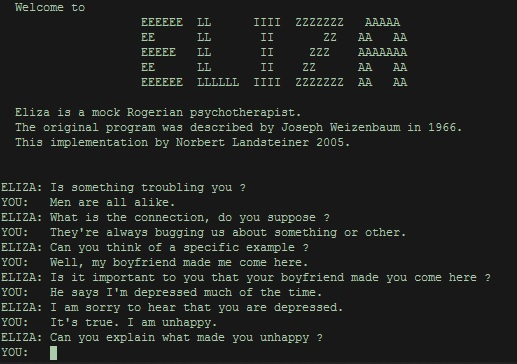

Figure 2.1: A typical conversation with ELIZA

Recently, the impact of language technology on society has truly exploded. We interact on a daily basis with chatbots such as ChatGPT and Claude. We can do so in multiple languages, and enhanced search engines have been incorporated in many popular products. However, these developments stand on the shoulders of many earlier results. A famous early example is ELIZA, the psychotherapist chatbot developed in 1966 by Joseph Weizenbaum [[Weizenbaum, 1966](#biba.bib41)]. ELIZA was a rudimentary chatbot based on simple rule-based word substitutions (see Figure [2.1](#Ch2.F1 "Figure 2.1 ‣ 2.1 Processing Natural Language ‣ Chapter 2 Foundations of Language Modeling with LLMs ‣ Part I Language Modeling ‣ Agentic Large Language Models")). ELIZA was already ascribed human-like qualities. Since these early days of rule-based systems for text processing, where we identify words based on specific delimiters (such as white space), we have come a long way.

##### 2.1.1 Language Understanding and Language Generation

Before considering how computers process language, we will consider how humans understand language.

A key observation is that communication is a sequential process, and that languages are shaped accordingly. Words are uttered one at a time, and are also consumed one at a time. This parallel holds both for human and mechanical processing of language: language is a sequence of characters (when reading), syllables (when speaking), or entire words (for early computational models of language).

We will now look deeper into the technology developed for working with natural language sequences. This technology is categorized as either natural language *understanding* or natural language *generation*. We will briefly describe both categories.

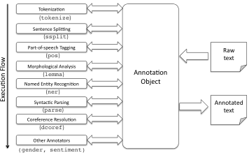

Figure 2.2: 
The standard NLP pipeline, as visualized by [Manning et al. [2014]](#biba.bib31)

###### Natural Language Understanding

Natural language understanding (NLU) focuses on developing methods for capturing meaning and intent. Approaches and techniques for NLU map unstructured human language elements onto a structured format such that a computer can interpret and act upon them. Such techniques can involve several layers of processing, inspired by linguistic analysis (as visualized in Figure [2.2](#Ch2.F2 "Figure 2.2 ‣ 2.1.1 Language Understanding and Language Generation ‣ 2.1 Processing Natural Language ‣ Chapter 2 Foundations of Language Modeling with LLMs ‣ Part I Language Modeling ‣ Agentic Large Language Models")), as follows:

- Tokenization: determine boundaries between meaningful linguistic elements (such as words) to be used for further processing.
- Syntactic Parsing: determine the grammatical structure (such as subjects, verbs, and objects).
- Named Entity Recognition (NER): identify and categorize key entities such as names, dates, and locations.
- Sentiment Analysis: detect the emotional tone of a text.
- Co-reference Resolution: determine what person or items are referred to in referential expressions (such as: *the computer* talked to me).
- Discourse Analysis: understand how the meaning of a sentence is influenced by preceding sentences.

One of the primary challenges in NLU is dealing with ambiguity [[Roth, 1998](#biba.bib48), [Liu et al., 2023](#biba.bib49)]. Human language is rife with ambiguity. Examples are polysemy (words with multiple meanings, such as *bank*) and context-dependent nuances that require world knowledge to decode correctly. Many more challenges exist; naturally occurring human language is as rich and complex as humans are.

###### Natural Language Generation

Natural language generation (NLG) focuses on developing methods for producing readable, natural-sounding human language.
Tasks range from free-form language generation, to the transformation of structured data or model representations into realistic utterances.

An important NLG task is *language modeling* (LM). In language modeling, the task is to predict the next element in a sequence, given the previous context. Mathematically, this involves assigning a probability distribution over sequences of words. Traditionally, finding this distribution was achieved using simple count-based models, often relying on further simplifying assumptions to predict a word based on a fixed window of preceding words.

Modern approaches use elaborate neural methods that can generate fluent sentences based on a long context, that often appear meaningful to a human observer.22
2
Which is by itself not always difficult to achieve, as we saw in the ELIZA example. Note that effective language generation requires more than just grammatical correctness; it requires coherence (logical flow) and cohesion (linguistic links). Current NLG systems use sampling methods, ensembles, and many other mechanisms to balance the creativity and predictability of the text that they produce, to ensure that the output feels natural rather than robotic [[Li and Jurafsky, 2017](#biba.bib45), [Dong et al., 2022](#biba.bib46), [Gatt and Krahmer, 2018](#biba.bib47)]. Techniques for NLG are commonly categorized into two approaches:

- Extractive Generation: Selecting and rearranging existing segments of text (often used in early summarization tools).
- Abstractive Generation: Generating entirely new sentences from scratch (as modern models such as ChatGPT do).

Most LLMs use the abstractive approach.

We will now discuss early, fundamental, approaches to language modeling. We will start by discussing the complexity of language, and then discuss the principle of distributional representation, tokenization methods, and early language modeling representations.

##### 2.1.2 Complexity of Natural Language

There are many reasons why natural language can be difficult for a machine to interpret. Language exhibits subtle nuances that carry meaning or distort it. Capturing the full nuance of language requires more than understanding its structure. Furthermore, the context in which something is said plays a role in communication. Understanding goes beyond the words themselves to grasp the intentions, implications, and subtleties embedded in communication [[Wittgenstein, 1953](#biba.bib43), [Grice, 1975](#biba.bib44), [Krause and Vossen, 2024](#biba.bib42)]. Below, we introduce topics that are studied in the field of linguistics, each of which brings about a different view on what language is capable of expressing.

###### Syntax

Syntax rules govern the structure of sentences. In the study of linguistics, syntax refers to the set of rules, principles, and processes that regulate the structure of sentences in a given language. Linguistic syntax examines the underlying logic that allows a speaker to combine words into well-formed and meaningful sequences. In English, for example, the most common order is subject-verb-object: in *cat bites dog* the verb *bites* follows the subject *cat*, indicating that the meaning of the sentence is that it was the cat that was doing the biting (and not the dog).

###### Morphology

Morphology is the study of how words change shape depending on their grammatical function. How words change shape is related to syntax, and the morphological rules (and their exceptions) depend on the language (family). In the preceding example sentence, the shape of the verb *to bite* changed to *bites*, where the *-s* indicates simple present tense (it is happening now, by a singular actor, not by a posse of felines in ancient times).

###### Semantics

In linguistics, lexical semantics is the study of the meaning of words. In natural languages words derive their meaning from their relationship to other words. For instance, words with nearly identical meanings form *synonyms*, such as car and automobile or vanish and disappear; words with opposite meanings form *antonyms*, such as hot and cold or buy and sell. Many more relationships exist.

In NLP, computational semantics is the study of how we can represent that meaning efficiently in a computer. A basic approach for storing a sentence in a computer memory would be to simply use a sequence of indices into a vector of the words of a language. However, this encoding only records the occurrence of the words, but not the relationships between the words; the semantics of the words are no longer present in this naive representation.

Words derive their meaning from their relationship to other words, and we need a way to efficiently encode these relationships. As we will see later in this chapter, different solutions have been developed over the years, including the transformer architecture and the attention mechanism.

###### Pragmatics

In addition to the literal meaning of words, humans care about the intent of the speaker and the context of the utterance. The way language is employed in specific social contexts determines its effect (*meaning is use* [[Baker and Hacker, 2008](#biba.bib59)]). The study of the implicit, everyday rules humans naturally follow to ensure that our communication is effective is called *pragmatics*.

A set of foundational principles are the Gricean Maxims [[Grice, 1975](#biba.bib44)]: the unspoken cooperative principles that humans use to infer meaning. For instance, the maxim of quantity states that humans provide exactly as much information as is required for the conversation. These maxims shape our communication, and help make our language understandable and cooperative. For a machine, interpreting sarcasm, subtext, or placeholders (e.g., “thingy”) requires knowledge of these rules, beyond adherance to a static dictionary.

###### Discourse

Language rarely occurs in isolated sentences; language is structured into larger units such as paragraphs, conversations, or full documents. The study of discourse focuses on how sentences connect to form a cohesive and coherent whole. For a machine to truly interpret a text, it must be able to track entities across multiple sentences, a task known as co-reference resolution (e.g., determining whether the pronoun *it* refers to the cat, the dog, or the bite from a previous sentence). Understanding discourse is vital for complex NLP tasks such as document summarization, machine translation, and sustaining long-form dialogue.

In addition to these topics, other fields of study exist, such as phonetics (the sounds of a language that carry additional meaning in human communication), sociolinguistics (how language varies according to social factors like class or region), lexicography (the science of compiling dictionaries), and many more.

As this overview may have highlighted, the generation and understanding of natural languages are large and challenging fields. It is important to realize that language is not static. Language varies over time, across geographical locations, between different cultures, and depending on the medium through which it is communicated :-). This variation makes the creation of language technology a difficult and never-ending quest.

Before we introduce the recent technologies that provide at least a partial answer to these challenges, we discuss the fundamental assumptions that inspired the modern turn in NLP.

Representing natural language in a computer is difficult because natural language is rich and complex. In the remainder of this section, we discuss the principle of distributional representation, which states that the semantic meaning of a word is driven by the context that surrounds that word. Next, we will look at tokenization methods: methods for splitting sentences into words. Finally we will discuss how we can work with vectors of tokens to arrive at a representation that encodes meaning.

##### 2.1.3 Distributional Representations

How can we teach a machine to understand complex semantic relationships and grammatical structures without manually encoding them all? The answer lies in the distributional hypothesis, a foundational concept in modern NLP. The core idea was articulated in the late 1950s:

*You shall know a word by the company it keeps. (Firth, 1957)*

This suggests that the meaning of a word can be inferred from the words around it (contexts) in which it typically appears. Words that appear in similar contexts are likely to have similar meanings. For example, if the words *coffee* and *tea* both frequently appear near verbs like *drink*, *sip*, or *brew*, then a machine may infer that there is a semantic relationship between them, without explicit definitions or other human-provided information.

To operationalize the distributional hypothesis for computational purposes, we will rely on linear algebra and turn to a framework known as *vector semantics*. We represent words as points in a high-dimensional continuous space. Words with similar meanings are mapped to points close to each other in this space, and we can measure semantic similarity using geometric distance measures such as cosine similarity (see Figure [2.3](#Ch2.F3 "Figure 2.3 ‣ 2.1.3 Distributional Representations ‣ 2.1 Processing Natural Language ‣ Chapter 2 Foundations of Language Modeling with LLMs ‣ Part I Language Modeling ‣ Agentic Large Language Models") and Section [2.3.1](#Ch2.S3.SS1 "2.3.1 Embeddings ‣ 2.3 Modeling Language ‣ Chapter 2 Foundations of Language Modeling with LLMs ‣ Part I Language Modeling ‣ Agentic Large Language Models")). Furthermore, we can make modifications to word meaning by doing vector arithmetic.
Early implementations relied on sparse co-occurrence matrices to construct semantic vectors, where individual words were counted inside their context, much like other methods described in Section [2.1.5](#Ch2.S1.SS5 "2.1.5 Early Methods for Language Representation ‣ 2.1 Processing Natural Language ‣ Chapter 2 Foundations of Language Modeling with LLMs ‣ Part I Language Modeling ‣ Agentic Large Language Models"). Modern approaches favor dense, low-dimensional vectors, often referred to as *word embeddings*. These representations are typically learned by training a neural model to predict a word from its neighbors or vice versa, a breakthrough popularized by the *word2vec* architecture [[Mikolov et al., 2013](#biba.bib34)].

While learning vector-based representations for words is an effective way to capture meaning, maintaining a distinct vector for every unique word in a language results in an impractically large vocabulary.

Furthermore, strict word-level approaches struggle to process rare or entirely unseen words, as the model has no pre-existing vector for them. Hence, before a model can assign vectors to linguistic units, we must first determine what those fundamental units actually are. To address these inefficiencies and handle out-of-vocabulary inputs, modern methods use a systematic approach to break down raw text into more manageable pieces. This process is called tokenization, which we will now discuss.

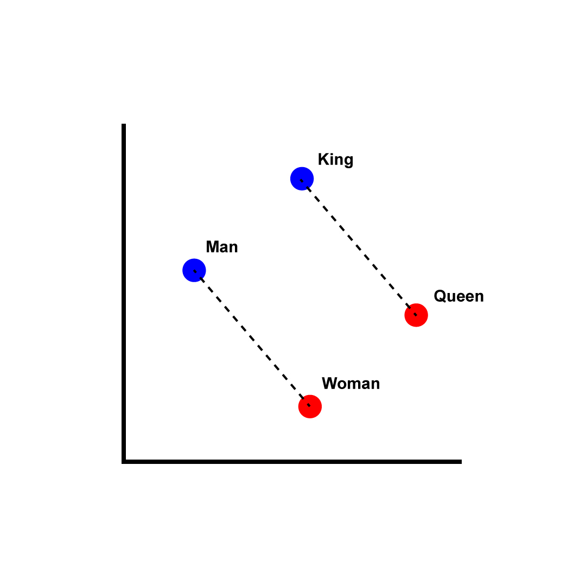

Figure 2.3: 
Illustration of vector arithmetic with word2vec embeddings [[Singerep, 2022](#biba.bib35)].

##### 2.1.4 Tokenization

Before computers can ascribe meaning to language, they must first have a way to digest it. Assuming that we already have raw text at our disposal, whether scraped from the web or transcribed from speech, the immediate challenge is determining how to split these continuous character strings into meaningful units, or how to split sentences into words. This process is called *tokenization*. However, a robust tokenization strategy must do much more than simply divide sentences by spaces to obtain words; it needs to be able to handle the nuances of different languages and dialects, parse complex punctuation, and even account for modern additions like emojis, and fit these into a vocabulary of fixed size.

This process of segmentation is a key step to many NLP pipelines. While dividing text might appear straightforward, ambiguities in punctuation complicate the process, such as in abbreviations (N.L.P. or NLP?). Simple rule-based segmenters frequently fail against the structural irregularities of natural language. Consequently, there are different approaches for constructing these units, as shown in Example [1](#Thmexample1 "Example 1 (Tokenization Strategies). ‣ 2.1.4 Tokenization ‣ 2.1 Processing Natural Language ‣ Chapter 2 Foundations of Language Modeling with LLMs ‣ Part I Language Modeling ‣ Agentic Large Language Models").

###### **Example 1**** **(Tokenization Strategies)**.**

Consider the following sentence:
  
“Leiden is beautiful in summer.”

**Word Tokenization**
  
This approach typically splits text by spaces and punctuation.

["Leiden", "is", "beautiful", "in", "summer", "."]

**Character Tokenization**
  
This approach breaks the text down into individual characters.

["L", "e", "i", "d", "e", "n", " ", "i", "s", " ", "b", "e", "a", "u", "t", "i", "f", "u", "l", " ", "i", "n", " ", "s", "u", "m", "m", "e", "r", "."]

**Subword Tokenization (e.g., WordPiece)**
  
This approach preserves common words as whole tokens but breaks down complex or rare words into foundational subwords.

["Lei", "##den", "is", "beautiful", "in", "summer",
  
"."]

###### Word-Level Tokenization

This approach treats each space-separated string as a token that is unique. While it preserves syntactic structure, it results in impractically large vocabularies and suffers from the out-of-vocabulary (OOV) problem, where models fail on words that were not seen during training.

Large vocabularies are problematic due to the mechanics of *one-hot encoding*.
If every word $w$ in a vocabulary $V$ is represented as a vector $\mathbf{x}\in\{0,1\}^{|V|}$, where only the index corresponding to $w$ is 1, the dimensionality $|V|$ scales linearly with the size of the vocabulary. As these one-hot vectors will later form the input to our neural networks, for texts that do not contain all words in a certain vocabulary, we end up creating sparse, computationally inefficient representations that fail to capture semantic relationships between words.

###### Character-Level Tokenization

Pure character-level modeling seems like a clear solution to the problem of increasing vocabularies, and has been explored over the years [[Mielke et al., 2021](#biba.bib51)]. Such a method divides text into individual characters, which restricts the vocabulary to the size of the alphabet, virtually eliminating OOV issues. However, it significantly increases sequence length and the resulting computational burden is substantial. Furthermore, because isolated characters lack inherent semantic meaning, the model must learn word morphology before it can grasp broader linguistic patterns, increasing training time.

###### Subword Tokenization

Hence, the current standard for LLMs balances the previous two methods. It preserves common words as whole tokens while decomposing rare words into smaller, meaningful components. Notable implementations include:

- 

  Byte Pair Encoding (BPE): An iterative algorithm that begins with individual characters and merges the most frequent adjacent pairs into single tokens until a target vocabulary size is reached [[Sennrich et al., 2016](#biba.bib50)] (e.g., *highest* $\rightarrow$ [*high*, *est*]). BPE was originally proposed as a data compression algorithm [[Gage, 1994](#biba.bib10)].
- 

  WordPiece: An iterative algorithm, similar to BPE, that merges pairs based on a likelihood criterion rather than on raw frequency, aiming to maximize the probability of the training data [[Wu et al., 2016](#biba.bib52)].

##### 2.1.5 Early Methods for Language Representation

After tokenization, the next question is how to combine our linguistic units (tokens) into coherent sentences, that carry meaning? We start with the observation that the ordering of these units in human language is dictated by strict syntactic and semantic rules. Now, if our computational approaches would be able to accurately produce sensible text sequences, then we might say that they possess the same syntactic and semantic understanding (or at least that they are able to reproduce such understanding).

How can we build mathematical representations that achieve this goal? A core task in this endeavor is *language modeling*. Mathematically speaking, a language model is a function that computes the joint probability of a sequence of words occurring together in a specific context.
By calculating this probability, models can distinguish between a logical, fluent sentence and a random sequence of tokens. For example, in English, the sequence *the cat sat* is significantly more probable than *sat cat the* because it adheres to established syntactic rules.

Because written language is sequential, estimating the joint probability of a sentence is inherently a sequence estimation problem. The overarching goal of language modeling is to quantify the statistical likelihood that a given sentence, $S$, occurs within a specific language, based on its sequence of constituent words $w_{1},\dots,w_{k}$:

|  |  |  |  |
| --- | --- | --- | --- |
|  | $$ P(S)=P(w_{1},\dots,w_{k}) $$ |  | (2.1) |

For sentences of arbitrary length, calculating this exact joint probability directly is computationally intractable, due to the exponentially large number of word combinations in any given vocabulary. To resolve this complexity, we often decompose the joint probability, using the chain rule of probability. By making specific mathematical assumptions regarding conditional independence, this decomposition allows the computation to remain tractable for real-world applications [[Jurafsky and Martin, 2025](#biba.bib28)]:

|  |  |  |  |
| --- | --- | --- | --- |
|  | $$ P(w_{1},\dots,w_{k})=P(w_{1})\prod_{i=2}^{k}P(w_{i}\mid w_{1},\dots,w_{i-1}) $$ |  | (2.2) |

By maximizing this joint probability, probabilistic models learn to favor grammatically and logically sound sequences. The learned probabilistic distributions effectively reverse engineer the complex, unwritten rules of human language [[Manning and Schutze, 1999](#biba.bib53)]. To estimate these probabilities from a segmented text corpus, early methods relied on maximum likelihood estimation (MLE). The simplest approach computes the marginal probability of a word based on its relative frequency in the corpus:

|  |  |  |  |
| --- | --- | --- | --- |
|  | $$ P(w)=\frac{\text{count}(w\text{ in corpus})}{\text{total number of words}} $$ |  | (2.3) |

To make the computation of these conditional probabilities manageable, researchers rely on *$n$-gram models*. An $n$-gram is a contiguous sequence of $n$ items from a given sample of text. Instead of calculating the probability of a word given its entire preceding history, which quickly becomes computationally intractable, $n$-gram models apply the *Markov assumption*. This assumption states that the probability of the next word depends only on the preceding $n-1$ words, effectively truncating the context. For example, a bi-gram model ($n=2$) approximates the history by looking solely at the immediately preceding word. The conditional probability is then calculated by taking the frequency of the two words occurring together and dividing it by the frequency of the first word alone,

|  |  |  |  |
| --- | --- | --- | --- |
|  | $$ P(w_{i}\mid w_{1},\dots,w_{i-1})\approx P(w_{i}\mid w_{i-1})=\frac{\text{count}(w_{i-1},w_{i})}{\text{count}(w_{i-1})} $$ |  | (2.4) |

Likewise, a tri-gram model ($n=3$) conditions on the previous two words. This simplification drastically reduces the computational burden and makes it feasible to estimate probabilities directly from a corpus.

Selecting the appropriate $n$ involves a critical trade-off. A larger $n$ captures richer contextual information and deeper syntactic dependencies, resulting in a model that generates a more natural language. Yet, increasing $n$ exponentially exacerbates the sparsity problem: highly specific word sequences appear far less frequently in the training data, and the model will increasingly encounter zero probabilities. Conversely, a smaller $n$ yields robust, frequent counts but severely limits the model’s understanding of broader semantic meaning and long-distance dependencies within the sentence.

In a standard language model computation, observing an unseen $n$-gram results in a probability of zero, as it nullifies the joint probability of the entire sentence via multiplication. To mitigate this counterintuitive behavior, total counts are often smoothed. A common technique is *Laplace (or add-one) smoothing*, which adds a fictitious count of $1$ to every possible vocabulary item. To maintain a valid probability distribution, the denominator is adjusted by adding the vocabulary size, $|V|$:

|  |  |  |  |
| --- | --- | --- | --- |
|  | $$ P_{\text{Laplace}}(w)=\frac{\text{count}(w\text{ in corpus})+1}{\text{total number of words}+|V|} $$ |  | (2.5) |

These probabilistic and count-based methods ultimately yield a numerical representation of language. A strong representation encodes the properties we intuitively grasp about a word: its meaning, its grammatical function, and its relationship with other words. In early NLP, these relative frequencies and co-occurrence counts were structured into vectors, representing words based on their distribution in the text.

While count-based representations are tractable, they result in vectors that are high-dimensional and sparse, leading to computational inefficiencies and poor generalization on unseen data. Consequently, modern NLP has transitioned toward learning dense, low-dimensional vector representations, known as *embeddings*, using neural networks. Instead of relying on explicit counting, these models learn continuous representations as a byproduct of predicting a word from its surrounding context, capturing deeper semantic relationships in a more efficient format.
These modern approaches will be discussed in Section [2.3](#Ch2.S3 "2.3 Modeling Language ‣ Chapter 2 Foundations of Language Modeling with LLMs ‣ Part I Language Modeling ‣ Agentic Large Language Models"). First we will have a brief intermezzo where we review three important machine learning approaches.

#### 2.2 Machine Learning Methods For Natural Language Processing

Having established a primer on language representation, we will now turn to the learning algorithms that allow us to create the large models powering modern AI systems. LLMs are trained using methods from the broader field of machine learning. While machine learning is an extensive field of research, understanding LLMs requires familiarity with three core paradigms, and how they are used in language modeling: *supervised learning*, *autoregressive learning*, and *reinforcement learning*. We briefly touch upon these essential methods and refer to standard works for deeper exploration.

##### 2.2.1 Supervised Learning

Supervised learning is the foundation of machine learning. It is named so because it relies on a set of labels, that must be given beforehand, that *supervise* the training process. This approach utilizes a dataset consisting of paired examples and labels, $D=\{(x_{i},y_{i})\}$, to train the parameters $\theta$ of a predictive model $f_{\theta}$. The model can be used to compute an estimate $\hat{y}$ for each input $x$, denoted mathematically as $f_{\theta}(x)\rightarrow\hat{y}$. Using the model to compute this estimate is also known as *inference*, or the *forward pass*.

After the forward pass, we can use a loss function $\mathcal{L}$ to compute some kind of difference between the estimate $\hat{y}$ and the true label $y$. Common examples of loss functions are the sum of squared-difference loss from statistical regression $\mathcal{L}=\sum_{i}(\hat{y_{i}}-y_{i})^{2}$, or the cross-entropy loss for classification $\mathcal{L}=-\sum_{c}y_{c}\log(\hat{y_{c}})$.

The goal of a supervised training algorithm is to minimize the sum of the losses over the dataset of example pairs by adjusting the parameters. This is done in the *backward pass*. Here, the loss function is used to compute an error signal to adjust the parameters $\theta$ of the model $f$ so that the next forward pass achieves a lower loss (backpropagation of the error). Minimizing the loss function on the examples from a data set is a process called *training*. A single training run of forward and backward passes over all of the training data is called an *epoch* (for efficiency reasons, epochs can be split into training *batches*).

After training, to see if our model $f_{\theta}$ works well—if it generalizes to unseen examples—it is *tested* on new examples, that were not part of the training set.

If the accuracy on the training set is high, we say that the model trains well (training converges). If the accuracy on the test set is also high, then we say that the model generalizes well and we have achieved our training goal. Informally speaking, if the accuracy of the model on the training set is high, but on the test set it is low, we say the model overfits on the training set. This usually means that the model has trained for too long or has too many parameters, so that it models not only the signal in the training set but also the noise. If the model has low accuracy on both training and test set, we say that it underfits. This is most likely due to too short training, or a model that is too simple (too few trainable parameters) to model the complexities of the data.

Generally speaking, problems with few variables (low-dimensional problems, such as simple regression) require smaller models (fewer parameters) and less training data to perform well. Problems with many variables (high-dimensional problems, such as image classification) require larger models with many millions of parameters (often deep neural networks) and large training datasets to perform well. Indeed, breakthrough performance in image classification [[Krizhevsky et al., 2012](#biba.bib5)] was only achieved after the construction of a large dataset with millions of hand-labeled images, Imagenet [[Deng et al., 2009](#biba.bib8)].

Supervised learning is the basis of machine learning. Many good text books have been written about the topic [[Bishop and Bishop, 2023](#biba.bib6), [Goodfellow et al., 2016](#biba.bib18)]. It is one of the core techniques in LLM training, for example in supervised finetuning, as we will see in the next chapter.

##### 2.2.2 Autoregressive Learning

Large language models are trained autoregressively. In this training approach, there is no dataset of pairs of labeled examples, but there is a lot of (textual) data available. Autoregressive learning is a form of self-supervised learning, without explicit labels, using the inherent sequential nature of the data, to predict the next token.

In autoregressive pretraining of language models, our algorithm performs predictions over the dataset where each token $y=x_{t}$ is taken as a label for preceding example tokens $\mathbf{x}=x_{t-1}$. Autoregressive learning is a core task of modern NLP, and is used in contemporary model training pipelines [[Radford et al., 2018](#biba.bib58)] and included in textbooks on NLP [[Jurafsky and Martin, 2025](#biba.bib28)]. We will provide more details of the methods in Section [2.3](#Ch2.S3 "2.3 Modeling Language ‣ Chapter 2 Foundations of Language Modeling with LLMs ‣ Part I Language Modeling ‣ Agentic Large Language Models") and Chapter [3](#Ch3 "Chapter 3 The Large Language Model Training Pipeline ‣ Part I Language Modeling ‣ Agentic Large Language Models").

##### 2.2.3 Reinforcement Learning

Both supervised and autogregressive learning need a dataset of training data to train on—they train *offline* on pre-existing data. However, sometimes no dataset is available, but we may have access to a function that can tell us when we are in a good state or in a bad state. In that case, an *online* learning method called reinforcement learning (RL) can be used, where an agent performs an action $a$ to bring an environment from state $s$ to the next state $s^{\prime}$, after which the environment reports back the reward $r(s^{\prime})$ of that new state. (The method is called online because it generates its training data on the fly, while training.) The agent can then use this reward information to adjust a $\theta$-parameterized behavior policy function $\pi_{\theta}(s)\rightarrow a$ to know which action to perform in which state. When the problem at hand is as a sequential decision problem, actions $a$ take the system from state $s$ to another state $s^{\prime}$, and rewards depend on actions taken in the past (the credit assignment problem: to which actions should rewards be assigned?). Repeating the state/action/reward process can cause the agent to explore the entire state space, and learn an optimal policy $\pi^{*}(s)$ of which action to take, for all states.

Environment: $T(s,a)\rightarrow s^{\prime},R(s^{\prime})\rightarrow r$Agent: $r$ improves $\pi_{\theta}(s)\rightarrow a$$(s^{\prime},r)$$a$

Figure 2.4: 
Reinforcement Learning, after [Sutton and Barto [2018]](#biba.bib17)

Note that reinforcement learning, being online, is inherently circular. At the start, the policy $\pi$ has seen few rewards, and has useful information on which action to take for just a few states. If it would greedily use this information on which good action to take, it would traverse only a limited part of the environment, and the optimal policy that it would find would be only locally optimum. To find better optima, it should explore, and try random actions, ideally to cover the entire state space.

Reinforcement is a form of active agentic learning from feedback from an environment. A key observation is that it is typically easier to see if an output is good (reward function), than to create a full new one (labeled dataset).
Many reinforcement learning algorithms have been developed that focus on good exploration methods.
Reinforcement learning problems are formally modeled as a Markov decision process (MDP), consisting of a state representation $S$, an action function $A(s)$, a transition function $T(s,a)\rightarrow s^{\prime}$, and a reward function $R(s)$. Rewards are numeric indications of the quality of a state, provided by the environment. They can be positive or negative. The goal of an agent is to find the policy $\pi(s)$ of optimal actions $a*$ in each state $s$.
Figure [2.4](#Ch2.F4 "Figure 2.4 ‣ 2.2.3 Reinforcement Learning ‣ 2.2 Machine Learning Methods For Natural Language Processing ‣ Chapter 2 Foundations of Language Modeling with LLMs ‣ Part I Language Modeling ‣ Agentic Large Language Models") illustrates how a reinforcement learning agent learns a policy with an action for each state, online, through interaction with the environment, which can compute functions $T$ and $R$ (the environment will answer the agent’s question as to what the next state is that resulted from its action, and how good that state is).

When the state space is small enough to fit in a computer memory, we can use exact tabular reinforcement learning methods, such as Q-learning [[Watkins and Dayan, 1992](#biba.bib3)]. For larger problems, function approximation methods are used (deep neural networks) such as deep Q-learning (DQN) [[Mnih et al., 2015](#biba.bib23)] or proximal policy optimization (PPO) [[Schulman et al., 2017](#biba.bib24)]. In deep reinforcement learning, the policy is a parameterized neural network that is trained by backpropagation, as in supervised deep learning.

Reinforcement learning is the basis of modern reasoning language models. Many text books have been written about reinforcement learning, such as the seminal work by [Sutton and Barto [2018]](#biba.bib17), as well as more educational texts [[Graesser and Keng, 2019](#biba.bib15), [Plaat, 2020](#biba.bib27), [Plaat, 2022](#biba.bib26)]. In LLM training, reinforcement learning is used in reinforcement finetuning, and in multi-step reasoning, as we will see in Chapter [6](#Ch6 "Chapter 6 Multi-step Reasoning in LLMs ‣ Part II Reasoning ‣ Agentic Large Language Models"). Furthermore, reinforcement learning formulates machine learning problems in terms of an agent that tries to learn how to interact in an environment, which fits the agentic LLM setting nicely. In agentic LLMs, it is used in in-context reinforcement learning for prompt optimization, in world models, and to model other agent behavior in relation to the environment, as we will see later in this book.

Reinforcement learning is a popular machine learning approach since we can learn new environments where we do not have data available. The method finds its own data. When we consider using reinforcement learning, two questions should be answered: (1) is the problem at hand a sequential decision problem, and, if so, (2) what is the size of the state space, can we use exact tabular methods, or must we resort to approximation?

Now that we have discussed the necessary language and machine learning principles, we turn back to language, to the next step: modeling language.

#### 2.3 Modeling Language

After the basics of language representation and machine learning, we turn to the overarching paradigms used to build computational language modeling capabilities. The development of natural language processing is broadly characterized by three paradigms. Each paradigm represents a fundamental shift in the type of model constructed to capture language and how the inherent complexity of human language is managed. We will see that as we move through the paradigms, we incorporate more techniques from machine learning, leveraging increases in compute power to process more data to train larger and larger neural networks for language processing. The paradigms are the *symbolic*, *statistical*, and *neural* approaches [[Kautz, 2020](#biba.bib32), [Deng and Liu, 2018](#biba.bib33)].

###### Symbolic Methods

Often referred to as *Classical AI* or rule-based systems, these early ELIZA-like symbolic approaches rely on explicit, human-defined instructions. By treating language as a formal system, symbolic models attempt to parse meaning deductively. While these systems are highly transparent and interpretable by design, they are brittle, as they struggle using rigid rules (*if-then-else*) to handle the natural variation, idiomatic expressions, and ambiguities of real-world language. Scaling symbolic approaches to larger language tasks requires a labor-intensive, manual enumeration of many edge cases, which turned out to be unfeasible for all but the smallest problem domains.

###### Statistical Methods

To overcome the limitations of rigid rule sets, between 1980-1990 the field experienced an empirical shift toward probabilistic modeling with the statistical methods. Instead of relying on explicit syntactic rules, statistical methods such as hidden Markov models and $n$-gram language models leverage large text corpora to compute the likelihood of word co-occurrences. This data-driven approach scales efficiently and handles linguistic ambiguity and noise far better than its symbolic predecessors. However, because these models typically rely on the Markov assumption, their representation of meaning is inherently limited to local word patterns, making them ill-equipped to capture long-distance dependencies and broader context.

###### Neural Methods

After approximately 2010, the contemporary state-of-the-art shifted to neural networks and deep learning. Rather than using logic or discrete counts, neural methods represent linguistic units as dense, low-dimensional vectors in a continuous semantic space. Modern architectures, particularly transformers, employ attention mechanisms to model global context simultaneously across an entire sequence. This approach yields impressive generalization, high fluency in text generation, and cross-lingual capabilities. Nevertheless, these advantages come with significant trade-offs: neural models operate largely as black boxes, sacrificing the interpretability seen in symbolic methods, and they require large data sets and large computational resources.

The contemporary pipelines for NLP training draw inspiration from all of these three paradigms. Before describing an example pipeline in the next chapter, we require a deeper understanding of the core components of these parts, as they are the building blocks for the systems on which agentic LLMs are based. In the next sections we will discuss many topics: word embeddings, contextualized embeddings, sequence modeling, attention, transformers, encoders (such as BERT), and decoders (such as GPT).

##### 2.3.1 Embeddings

Early models of neural embeddings operationalize semantic understanding of lexical items by defining a context window, a span of $n$ words to the left and right of a target word, and predicting the missing focus word. For the sentence *There are two cookies left on the table*, if we set a window of $n=2$, the context words for *cookies* are *are*, *two*, *left*, and *on*. By systematically sliding this window over a large corpus of text, we can count how many times each word appears in the context of every other word. These counts form the basis of a co-occurrence matrix, where each row represents a target word and each column represents a context word. The value in each cell is the number of times the column word appeared in the context of the row word. For example, the vector for *cherry* might have a high value in the column for pie (e.g., 442) and a low value for computer (e.g., 2). The vector for *strawberry* would show a similar pattern, and hence reflect the semantical similarity between the two words.

By representing words as vectors, we place them in a high-dimensional vector space where each dimension corresponds to a context word. In this space, words with similar meanings, which share similar contexts, will point in similar directions. This geometric relationship allows us to measure semantic similarity numerically. The most common method for this is *cosine similarity*, which measures the cosine of the angle $\theta$ between two vectors $\mathbf{a}$ and $\mathbf{b}$, as in Equation [2.6](#Ch2.E6 "In 2.3.1 Embeddings ‣ 2.3 Modeling Language ‣ Chapter 2 Foundations of Language Modeling with LLMs ‣ Part I Language Modeling ‣ Agentic Large Language Models").

|  |  |  |  |
| --- | --- | --- | --- |
|  | $$ \text{similarity}=\cos(\theta)=\frac{\mathbf{a}\cdot\mathbf{b}}{\|\mathbf{a}\|\|\mathbf{b}\|}=\frac{\sum_{i=1}^{n}a_{i}b_{i}}{\sqrt{\sum_{i=1}^{n}a_{i}^{2}}\sqrt{\sum_{i=1}^{n}b_{i}^{2}}} $$ |  | (2.6) |

Earlier, we argued that count-based vectors result in high-dimensional spaces that scale linearly with vocabulary size. Since the number of dimensions dictates the computational complexity of downstream models, we wish to keep the dimensionality in check and instead create dense embeddings. For this, we use the classical word2vec algorithm [[Mikolov et al., 2013](#biba.bib34)]. In this approach, a random embedding matrix $W$ is initialized and iteratively updated to match the intuition that similar words occur in similar contexts. This general framework uses two distinct techniques to achieve this: skip-gram and continuous bag-of-words, as shown in Figure [2.5](#Ch2.F5 "Figure 2.5 ‣ 2.3.1 Embeddings ‣ 2.3 Modeling Language ‣ Chapter 2 Foundations of Language Modeling with LLMs ‣ Part I Language Modeling ‣ Agentic Large Language Models").

The first, *skip-gram*, predicts which context words are likely to surround a given target word. It updates the matrix to ensure that the cosine similarity between positive samples, which are actual target and context pairs, is high, while driving down the similarity for negative samples, which are random word pairings. Because skip-gram treats every target-context pairing as a distinct training observation, it heavily penalizes incorrect predictions even for infrequent terms. Hence, skip-gram excels at capturing fine-grained semantic details and produces accurate representations even for rare words.

The second, *continuous bag-of-words* (CBOW), performs the reverse operation. It predicts a single target word based on a combined set of surrounding context words. By averaging the context vectors before predicting the target, CBOW inherently smooths over the specific details of individual context words. This distributional smoothing is the reason for its distinct performance profile: CBOW trains significantly faster than skip-gram and is highly effective at capturing general syntactic relationships among frequent words, though it sacrifices some sensitivity to a rare vocabulary.

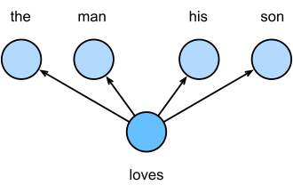

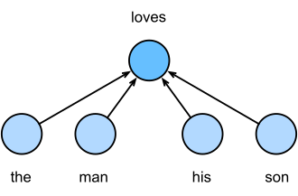

Figure 2.5: 
Visualizations of the skipgram (left) and continuous bag-of-words (right) approaches to constructing word embeddings [[Zhang et al., 2023](#biba.bib36)].

##### 2.3.2 Shifting to Contextualized Embeddings

Word2vec represented a major leap forward in the creation of high-quality word embeddings. However, a major downside is that word2vec results in *static embeddings*. This means that a word is mapped to a single vector regardless of its usage (its context). This creates a fundamental problem with polysemy. Consider the word *bank* in two different sentences:

1. I need to go to the *bank* to withdraw some money.
2. The swimmer sat on the river *bank*.

In a static model, *bank* has one fixed representation that must average or pick between these disparate meanings, resulting in a vector that is neither purely financial nor purely geographical or a weird blend of the two. Modern architectures (such as BERT and GPT, which are discussed later in this chapter) solve this by producing *contextualized embeddings*. Instead of a static look-up table, the model processes the entire sequence. The resulting vector for *bank* is calculated dynamically based on the surrounding tokens (*money*, *withdraw* vs. *river*, *swimmer*), allowing the machine to represent the specific nuance intended by the speaker.

##### 2.3.3 Recurrent Neural Networks

While embeddings are capable of expressing the complex semantics of individual words, we still need an efficient way to ingest language as a sequence. Training models for classification tasks, for instance, requires independence assumptions to simplify computational dependencies. We could take a sliding window approach to concatenate all relevant word embeddings into a single vector to represent a sentence. However, this rapidly increases the size of the input to any classifier, and does not scale to long sequences of text.

In humans, the expectation of what we observe next is conditioned on the things that we have seen (or heard) in the past. Previously, models approximated this intuition through the independence assumption, as seen in Equation [2.2](#Ch2.E2 "In 2.1.5 Early Methods for Language Representation ‣ 2.1 Processing Natural Language ‣ Chapter 2 Foundations of Language Modeling with LLMs ‣ Part I Language Modeling ‣ Agentic Large Language Models"). Formally, we introduce additional notation for our input $x$ occurring in sequence $x_{1},x_{2},\dots,x_{t}$ from timestep 1 through $t$. In this formulation, predicting the next word can be modeled as $P(x_{t+1}\mid x_{1},\dots,x_{t})$. Alternatively, we call $x_{t+1}$ the prediction $y_{t}$ for timestep $t$.

To effectively observe input in sequences and produce corresponding predictions, we must incorporate historical context into our models. This means that, in addition to the current input, we include the previous hidden state from our model. *Recurrent neural networks* (RNNs) are networks with such a cycle, where current values depend on the input as well as the network’s state at a previous timestep. Instead of only producing a prediction (e.g., a word or token) $y_{t}$, we now also keep track of a hidden state $h_{t}$. Formally, this is expressed in Equations [2.7](#Ch2.E7 "In 2.3.3 Recurrent Neural Networks ‣ 2.3 Modeling Language ‣ Chapter 2 Foundations of Language Modeling with LLMs ‣ Part I Language Modeling ‣ Agentic Large Language Models") and [2.8](#Ch2.E8 "In 2.3.3 Recurrent Neural Networks ‣ 2.3 Modeling Language ‣ Chapter 2 Foundations of Language Modeling with LLMs ‣ Part I Language Modeling ‣ Agentic Large Language Models"). Figure [2.6](#Ch2.F6 "Figure 2.6 ‣ 2.3.3 Recurrent Neural Networks ‣ 2.3 Modeling Language ‣ Chapter 2 Foundations of Language Modeling with LLMs ‣ Part I Language Modeling ‣ Agentic Large Language Models") illustrate the architecure of an RNN, and how we can picture its unrolling in time steps.

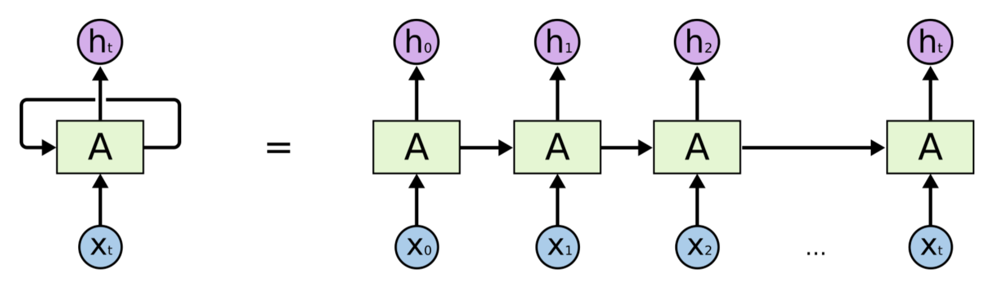

Figure 2.6: 
Unrolled RNN (illustration from Chris Olah’s blog [[Olah and others, 2015](#biba.bib4)])

|  |  |  |  |  |
| --- | --- | --- | --- | --- |
|  | $\displaystyle h_{t}$ | $\displaystyle=f(\mathbf{U}h_{t-1}+\mathbf{W}x_{t}+\mathbf{b_{h}})$ |  | (2.7) |

|  |  |  |  |  |
| --- | --- | --- | --- | --- |
|  | $\displaystyle y_{t}$ | $\displaystyle=g(\mathbf{V}h_{t}+\mathbf{b_{y}})$ |  | (2.8) |

This introduces new trainable parameter matrices $\mathbf{U},\mathbf{V},\mathbf{W}$ (and subsequent bias terms $\mathbf{b}$) to make sure our architecture can shape the hidden state and output logits accordingly. RNNs can theoretically process infinite-length sequences, and we no longer need the Markov assumption to account for a sparsity problem.

Training RNNs is done using backpropagation through time (BPTT), where we unroll the temporal dependencies to backpropagate the gradient from time step $t$ to earlier ones: $t_{-1},t_{-2},\dots$. However, because the gradients for updating the model at a timestep depend recursively on the previous timesteps, this step is sensitive. Because of the repeated matrix multiplications required by the chain rule, this leads to the problem of *vanishing or exploding gradients* [[Bengio et al., 1994](#biba.bib54), [Pascanu et al., 2013](#biba.bib55)]. Controlling the flow of information in RNNs is difficult. Information from early timesteps has relatively little impact on our gradients, compared to more recent information. In practice, learning salient signals with RNNs is often difficult.

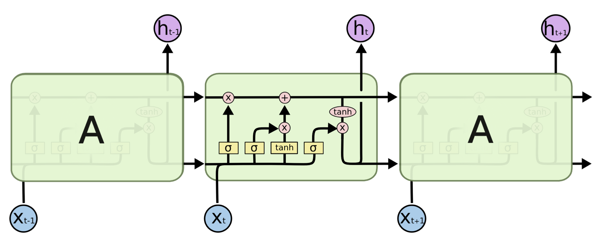

Figure 2.7: 
Repeating module of an LSTM (illustration from Chris Olah’s blog [[Olah and others, 2015](#biba.bib4)])

###### LSTMs

The *long short-term memory* (LSTM) architecture was introduced to address the gradient problem [[Hochreiter, 1997](#biba.bib7)]. An LSTM works by controlling the flow of information. In an LSTM network, additional gates are added to construct a context vector, which the network will learn to add and update information to (see Figure [2.7](#Ch2.F7 "Figure 2.7 ‣ 2.3.3 Recurrent Neural Networks ‣ 2.3 Modeling Language ‣ Chapter 2 Foundations of Language Modeling with LLMs ‣ Part I Language Modeling ‣ Agentic Large Language Models")). Below is the mathematical definition for a single time step $t$ for the LSTM architecture. The LSTM maintains two states: a context state ($c_{t}$) and a hidden state ($h_{t}$), and uses gates to control the flow of information:

|  |  |  |  |
| --- | --- | --- | --- |
|  | $\displaystyle f_{t}$ | $\displaystyle=\sigma(U_{f}h_{t-1}+W_{f}x_{t})$ |  |
|  |  |  |  |
| --- | --- | --- | --- |
|  | $\displaystyle k_{t}$ | $\displaystyle=c_{t-1}\odot f_{t}$ |  |
|  |  |  |  |
| --- | --- | --- | --- |
|  | $\displaystyle g_{t}$ | $\displaystyle=\tanh(U_{g}h_{t-1}+W_{g}x_{t})$ |  |
|  |  |  |  |
| --- | --- | --- | --- |
|  | $\displaystyle i_{t}$ | $\displaystyle=\sigma(U_{i}h_{t-1}+W_{i}x_{t})$ |  |
|  |  |  |  |
| --- | --- | --- | --- |
|  | $\displaystyle j_{t}$ | $\displaystyle=g_{t}\odot i_{t}$ |  |
|  |  |  |  |
| --- | --- | --- | --- |
|  | $\displaystyle c_{t}$ | $\displaystyle=j_{t}+k_{t}$ |  |
|  |  |  |  |
| --- | --- | --- | --- |
|  | $\displaystyle o_{t}$ | $\displaystyle=\sigma(U_{o}h_{t-1}+W_{o}x_{t})$ |  |
|  |  |  |  |
| --- | --- | --- | --- |
|  | $\displaystyle h_{t}$ | $\displaystyle=o_{t}\odot\tanh(c_{t})$ |  |

In the notation above, $\odot$ denotes the element-wise multiplication of two vectors, also called the Hadamard product. Besides LSTMs, there are subsequent variants such as the *gated recurrent unit* (GRU) that balance the computational complexity and the number of trainable parameters [[Cho et al., 2014](#biba.bib37)].

Recurrent neural networks played an important role in language modeling. For further explanations of how RNNs, LSTMs, and GRUs, work, see for example [Olah and others [2015]](#biba.bib4), [Bishop and Bishop [2023]](#biba.bib6), [Goodfellow et al. [2014]](#biba.bib1).

###### Encoder-Decoder

So far, we have formulated our task as the language modeling task: how to predict the next word, given a context of preceding words. However, there is an alternative task formulation that is useful to introduce.

Consider the problem of machine translation. While this looks like the previous tasks of predicting token $x_{t+1}$ based on inputs $x_{1},\dots,x_{t}$, we are now dealing with a *sequence-to-sequence* (seq2seq) problem: we need to process an input sentence $x_{1},\dots,x_{n}$ in one language, and output a translated sentence $y_{1},\dots,y_{m}$ in another. Why is translation a seq2seq problem? Note that $n$ and $m$ can be different from each other and that translations may not preserve order, as in the English to Dutch translation example below:

*We will celebrate the relief of Leiden* (7 words)

*Wij gaan Leids Ontzet vieren* (5 words)

The *encoder-decoder* architecture is a powerful framework designed to handle sequence-to-sequence tasks where the input and output lengths may differ. The encoder and decoder are two distinct RNNs that work together to map a variable-length input to a variable-length output. The job of the encoder is to process the input sequence one step at a time and compress the information into a fixed-length vector, often called the context vector.33
3
Not to be confused with the LSTM’s context vector. NLP research has repurposed terminology in relatively little time. Language in research papers is also a moving target. This forces the information into a *bottleneck*: compressing information of an input sequence $x_{1},\dots,x_{t}$ into a single hidden vector. However, this process is difficult to model and there is a loss of information. See Figure [2.8](#Ch2.F8 "Figure 2.8 ‣ Encoder-Decoder ‣ 2.3.3 Recurrent Neural Networks ‣ 2.3 Modeling Language ‣ Chapter 2 Foundations of Language Modeling with LLMs ‣ Part I Language Modeling ‣ Agentic Large Language Models") for an illustration of the architecture.

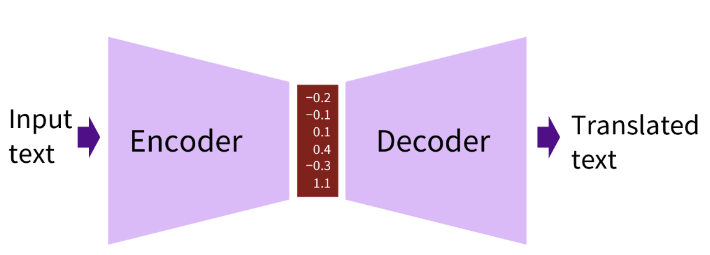

Figure 2.8: Illustration of the Encoder-Decoder architecture

The context vector acts as the bridge between the encoder and the decoder. It is the final hidden state of the encoder that is passed to the decoder as its initial hidden state. This vector encodes the semantic meaning of the entire source sentence, so the decoder can begin generating the target sequence accurately. The decoder is a second RNN that produces output tokens, conditioned on the context vector. Its goal is to generate the output sequence one token at a time. This continues until a special end-of-sequence token is generated. This approach works well, in principle. However, forcing a long input sentence into a single, fixed-length context vector causes information loss (the bottleneck problem). Moreover, RNNs struggle to remember the beginning of long sequences by the time they reach the end. These two problems combined prompted the development of a more dynamic approach for passing information between the encoder and decoder, which we will discuss next.

##### 2.3.4 Attention

In search for a solution to the bottleneck problem, researchers looked for ways to efficiently pass information from across the entire sequence into the decoder. During the generation process, the decoder could then decide which of the parts in the input sequence were relevant for decoding the next word.

This search has lead to advanced mechanisms for attention [[Bahdanau et al., 2015](#biba.bib56), [Kim et al., 2017](#biba.bib2)]. The effect of the attention mechanism is illustrated in Figure [2.9](#Ch2.F9 "Figure 2.9 ‣ 2.3.4 Attention ‣ 2.3 Modeling Language ‣ Chapter 2 Foundations of Language Modeling with LLMs ‣ Part I Language Modeling ‣ Agentic Large Language Models"), where translation performance (in terms of BLEU score [[Papineni et al., 2002](#biba.bib19)], higher is better) is plotted. The architecture using the attention mechanism (called *RNNsearch*, see Figure [2.9](#Ch2.F9 "Figure 2.9 ‣ 2.3.4 Attention ‣ 2.3 Modeling Language ‣ Chapter 2 Foundations of Language Modeling with LLMs ‣ Part I Language Modeling ‣ Agentic Large Language Models")) shows a consistent ability to achieve high translation quality especially for long sentences. The standard RNN encoder-decoder model (*RNNenc*) suffers a sharp drop in performance as sentence length increases.

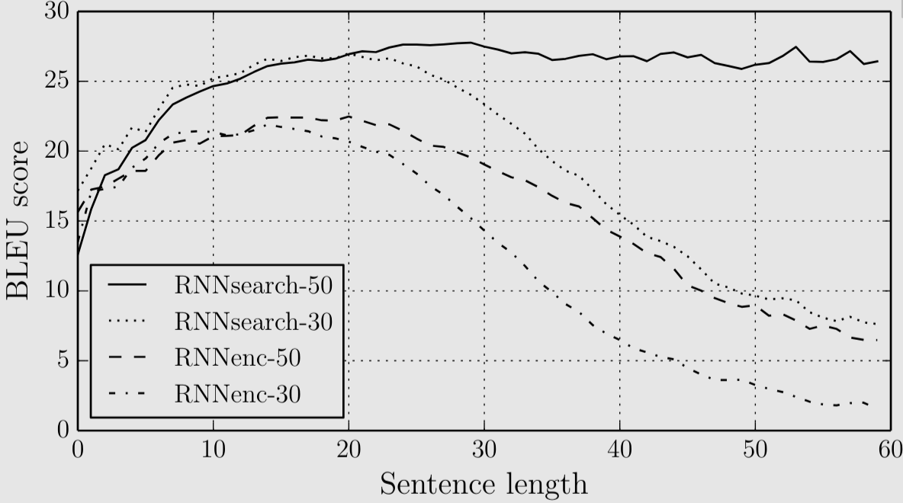

Figure 2.9: 
The bilingual evaluation understudy (BLEU) scores of generated translations with respect to the lengths of the sentences [[Bahdanau et al., 2015](#biba.bib56)]

The intuition behind attention is to include a linear combination of all encoder hidden states in the context vector, instead of relying on a single final hidden state. This allows the model to look back at specific parts of the input sequence that are relevant to the current word being generated. We can control how much focus each input token $x_{i}$ receives by adjusting its weight $a_{i}$ in the linear combination, as shown in Equation [2.9](#Ch2.E9 "In 2.3.4 Attention ‣ 2.3 Modeling Language ‣ Chapter 2 Foundations of Language Modeling with LLMs ‣ Part I Language Modeling ‣ Agentic Large Language Models"). Here, $\mathbf{c}_{j}$ is the context vector for the $j$-th output, and $h_{i}$ represents the hidden state of the $i$-th input token.

|  |  |  |  |
| --- | --- | --- | --- |
|  | $$ \mathbf{c}_{j}=a_{1}\mathbf{h}_{1},\dots,a_{n}\mathbf{h}_{n} $$ |  | (2.9) |

The weights $a$ (often called attention weights) are not fixed; they are computed dynamically. A key observation is that we can make use of the hidden states $h_{i}$, which are a representation of the semantics of a token or word. We can find out how relevant one hidden state is to another, by comparing them, for example by computing their cosine similarity. The *softmax-normalized dot product* is a common approach:

1. Compare the current decoder state with each encoder hidden state by applying a similarity function (such as a dot product) to see how well they match.
2. Pass these scores through a softmax function so they sum to 1, effectively creating a probability distribution over the input tokens.

While attention improved accuracy, the challenge of efficient computation of RNNs still remained to be solved. Because RNNs process tokens one by one (sequentially), they cannot take full advantage of modern parallel computing hardware in GPUs. To be able to scale to large datasets the recurrence should be removed entirely. This can be achieved by going from a sequential structure to a parallel one with a fixed context width that processes all tokens in parallel. This is achieved through *self-attention*. Mathematically, this turns the computation of the contextualized embeddings into Equation [2.10](#Ch2.E10 "In 2.3.4 Attention ‣ 2.3 Modeling Language ‣ Chapter 2 Foundations of Language Modeling with LLMs ‣ Part I Language Modeling ‣ Agentic Large Language Models").

|  |  |  |  |
| --- | --- | --- | --- |
|  | $$ \mathbf{a}_{3}=\sum_{j=1}^{5}\alpha_{3j}\mathbf{x}_{j}=\sum_{j=1}^{5}\textsf{softmax}{(\underbrace{\mathbf{x}_{3}}_{\text{query}}\cdot\underbrace{\mathbf{x}_{j}}_{\text{key}}})\underbrace{\mathbf{x}_{j}}_{\text{value}} $$ |  | (2.10) |

|  |  |  |  |
| --- | --- | --- | --- |
|  | $$ \text{Attention}(Q,K,V)=\text{softmax}\left(\frac{QK^{T}}{\sqrt{d_{k}}}\right)V $$ |  | (2.11) |

Where $Q$ represents the matrix representing the current focus, $K$ represents the keys providing the information in the sequence to compare against, $V$ represents the matrix containing the actual content to be extracted, and $d_{k}$ represents the dimension of the keys (used for scaling to prevent gradient vanishing). As the dimension $d_{k}$ increases, the dot products $QK^{T}$ can grow large, pushing the softmax function into regions where it has small gradients. Dividing by $\sqrt{d_{k}}$ counteracts this effect, ensuring more stable training.

Together, the set of attention matrices $Q,K,V$ are called an attention *layer* or *head*.
In practice, one attention layer captures a specific type of interaction between tokens. However, having just one type of interaction means that the model can only focus on one relationship at a time (an attention *head*). Since a word can have many different types of linguistic relationships, such as syntactical (*which verb does this noun belong to?*), semantic (*is this word part of a metaphor?*), or referential (*who does he refer to?*). By using multiple heads in tandem, we give the model the ability to represent multiple types of relationships. One head might learn to look for grammatical structure, while another learns to look for pronouns, and another for entities. The heads all work in parallel, and their results are concatenated into a single, rich representation. Together, these heads form a layer. This is shown in Equation [2.12](#Ch2.E12 "In 2.3.4 Attention ‣ 2.3 Modeling Language ‣ Chapter 2 Foundations of Language Modeling with LLMs ‣ Part I Language Modeling ‣ Agentic Large Language Models").

|  |  |  |  |  |
| --- | --- | --- | --- | --- |
|  | $\displaystyle\text{MultiHead}(Q,K,V)$ | $\displaystyle=\text{Concat}(\text{head}_{1},\dots,\text{head}_{h})W^{O}$ |  | (2.12) |
|  |  |  |  |
| --- | --- | --- | --- |
|  | $\displaystyle\text{where }\text{head}_{i}$ | $\displaystyle=\text{Attention}(QW_{i}^{Q},KW_{i}^{K},VW_{i}^{V})$ |  |

##### 2.3.5 Transformers

How can we use the attention mechanism to build an architecture for language modeling? We will now discuss one such architecture, the transformer architecture, introduced in the seminal work by [Vaswani et al. [2017]](#biba.bib30).

The attention mechanism is the core of the transformer architecture.
The original transformer architecture, shown in Figure [2.10](#Ch2.F10 "Figure 2.10 ‣ 2.3.5 Transformers ‣ 2.3 Modeling Language ‣ Chapter 2 Foundations of Language Modeling with LLMs ‣ Part I Language Modeling ‣ Agentic Large Language Models"), consists of both an encoder and a decoder. The left side of the Figure shows the encoder stack, the right side shows the decoder stack. Most LLMs are decoder-only transformers.

The Figure shows *transformer blocks* that each consist of a self-attention module, a feed-forward network, a normalization layer, and residual connections from input to output. In most LLMs many transformer blocks are stacked on each other, in layers. For example, GPT-2 consists of 12 layers or more, depending on the version of the model.

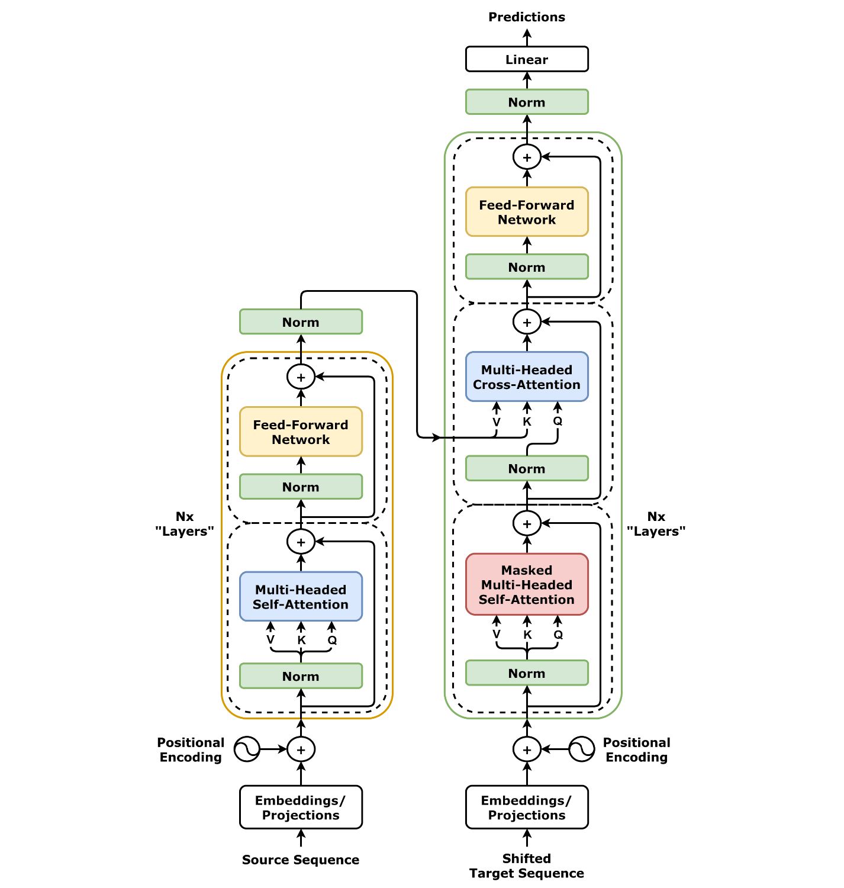

Figure 2.10: 
Visualization of the Transformer architecture [[Godoy, 2020](#biba.bib57), [Vaswani et al., 2017](#biba.bib30)]

Let us now have a closer look at the transformer architecture (please refer to the Figure). The full architecture consists of three main types of elements: embedding, transformer blocks, and output probabilities:

1. Embedding: First, the input text is tokenized, and projected into low dimensional embedding vectors. Positional encoding is added to the embedding to preserve word order.
2. Transformer Blocks: The transformer blocks are the main feature of the architecture. Most models consist of multiple layers of transformer blocks. Within each layer, each block consists of three elements:

   - Self-attention Mechanism: The attention mechanism allows long range connections between tokens, capturing contextual information and relationships between tokens. Multiple attention heads allow the model to consider these relationships from different perspectives, for example, for short-range syntactic links, and for broader semantic context.

     For an encoder stack, transformers use self-attention. For a decoder stack, they use masked self-attention, to prevent looking at the future.
   - Multi-layer Perceptron: A fully-connected feed-forward network operates on each token independently. The attention layer makes connections between tokens, whereas the MLP can refine each token’s representation.
   - Normalization: In most transformer blocks typical deep learning methods such as normalization, regularization (dropouts), and residual connections are added, to prevent vanishing or exploding gradients, and to improve stable training.
3. Output Probabilities: linear and softmax layers transform the processed embeddings into probabilities, to make the next-token predictions.

The transformer architecture has two main advantages over earlier methods, such as RNN and LSTM networks. Attention-based transformers allow (1) large scale parallel processing, and (2) fine-grained long-range semantic connections—speed *and* semantic accuracy.

Transformers have dominated language modeling since their introduction. After large scale high quality training corpuses were created, transformer-based LLMs achieved impressive performance in question-answering, data-to-text generation, and application-driven tasks. Researchers have been pursuing increasingly larger models with promises of even higher capabilities [[Brown et al., 2020](#biba.bib29)]. In Chapter [4](#Ch4 "Chapter 4 Scaling Laws and Efficient Large Language Models ‣ Part I Language Modeling ‣ Agentic Large Language Models") we will discuss how to scale performance further.

The transformer architecture is a complex architecture. Excellent interactive tutorials exist online, with more details,44
4
See, for example, <https://poloclub.github.io/transformer-explainer/> see also the case study in Chapter [5](#Ch5 "Chapter 5 Case Study 1: Building LLMs from Scratch ‣ Part I Language Modeling ‣ Agentic Large Language Models").

##### 2.3.6 Encoder-only (BERT)

While the original transformer model consists of a combined encoder-decoder structure, modern models are usually either an encoder or a decoder, as they are found to have specific empirical strengths.

Let us have a closer look at encoders.
Encoders are trained to compress input data into meaningful representations (embeddings) using techniques such as masked language modeling (MLM).
They are good at NLU tasks such as text classification and sentiment analysis, while decoders are good at NLG tasks such as text generation, paraphrasing and summarization.

Encoder-only models are designed to produce high-quality vector representations (embeddings) of input text. Unlike decoders, which are *causal* (they can only look at past words), encoders are inherently bidirectional. In an encoder, every token in a sequence can attend to every other token simultaneously. This global context allows the model to build a complex semantic representation of the input.
To train these models, we use masked language modeling. In this process, roughly 15% of the input tokens are replaced with a special [MASK] token. It is up to the model to then learn which of the tokens from its vocabulary should go in its place. Often the regular cross-entropy loss is used to update the model. The goal of MLM encoder training is for the model to use the surrounding context (both left and right) to predict what the masked word is. Eventually, this forces the model to learn grammar, semantics, and even some world logic.

To improve learning, in addition to the [MASK] token, encoder training typically includes several special tokens:

- [CLS] (Classification): Inserted at the very start. After passing through all layers, the final state of this token is used as the aggregate representation for the whole sequence.
- [SEP] (Separator): Used to tell the model where one sentence ends and another begins, which is vital for tasks such as question answering.
- [PAD] (Padding): Ensures all sequences in a training batch are the same length.

The best-known encoder-only model may well be the *bidirectional encoder representations from transformers*, better known as BERT [[Devlin et al., 2018](#biba.bib22)].
Encoder-only models such as BERT, and its successors RoBERTa [[Liu et al., 2019](#biba.bib38)] and ALBERT [[Lan et al., 2019](#biba.bib39)], have become popular.

Encoder-only models are quite suitable for transfer learning, where they embed inputs and are subsequently finetuned on downstream tasks, such as classification for certain application domains.
The pipeline for constructing encoder-only models involves two phases:

1. Pretraining: First train the model on a large corpus of billions of words. It may learn, for example, that *King* is related to *Man* and *Queen* is related to *Woman*. The model does not yet know how to do a specific job yet, it just learns English. Pretraining is an expensive step, and may take a long time (weeks or months).
2. Finetuning: Second, take the pretrained model and add a small additional classification layer on top (often called a *classification head*). Then, the whole model is trained again on task-specific data (such as spam detection, or sentiment analysis). Because the model already understands language, it typically only needs a few thousand examples to become an expert at the new task. Finetuning is a cheap step, and may take just hours or minutes, whereas starting from scratch on the specific task would require a large dataset and much training time.

After we have discussed encoder-only models, we will now switch to decoder-only models.

##### 2.3.7 Decoder-only (GPT)

In language generation tasks, decoder-only models are used.
Decoders are trained to reconstruct data or generate sequences using autoregressive training—they often generate output one token at a time. This autoregressive dependency, where the next tokens depend on what has been generated so far, is a form of *causal* attention. We cannot use future tokens to derive the best prediction.
In an encoder, a word can look at the words to its right. In a decoder, this is strictly forbidden. We use a look-ahead mask (often a triangular matrix) that sets the attention scores of future tokens to $-\infty$. If the model is predicting the word *apple* in the phrase *The boy ate the…*, it should not be allowed to observe the word *apple* in the training data. The decoder must rely solely on the preceding context. Subsequently, while encoders use masked language modeling, decoders use (regular) *causal language modeling*, as shown in Equation [3.1](#Ch3.E1 "In 3.2.2 Pretrain ‣ 3.2 Training Pipeline ‣ Chapter 3 The Large Language Model Training Pipeline ‣ Part I Language Modeling ‣ Agentic Large Language Models") in the next chapter.

As a consequence, when moving from encoders to decoders, the relationship between pretraining and finetuning changes slightly: decoders learn to predict the next word in pretaining, and are then fine-tuned with the same loss function, but with another type of data. This allows us to move to *in-context learning* (ICL) or prompt-learning: because decoders are trained to continue a sequence, you can simply give them a prompt (the context), and they will generate the answer without needing any weight updates. The learn, as it were, from the examples in the prompt [[Brown et al., 2020](#biba.bib29)]. The ease of use with which large decoders can be used through in-context learning, without having to do expensive task-specific training or finetuning, has created much interest in ICL.

Decoder-only models, such as the *generalized pretrained transformer* (GPT) family [[Radford et al., 2018](#biba.bib58), [Radford et al., 2019](#biba.bib25), [Brown et al., 2020](#biba.bib29), [Ouyang et al., 2022](#biba.bib9), [Achiam et al., 2023](#biba.bib21)], have become quite successful and are now widely used in our society. Many other models have been developed, both open and closed.
Together, the training mechanisms that we discussed form the basis of the modern LLM pipeline, which we will explain in more detail in Chapter [3](#Ch3 "Chapter 3 The Large Language Model Training Pipeline ‣ Part I Language Modeling ‣ Agentic Large Language Models").

#### 2.4 Concluding Remarks

In this chapter, we have traced the remarkable evolution of natural language processing from its foundational linguistic roots to the neural architectures that power today’s large language models. We have argued that human language is inherently complex, defined by intricate rules of syntax, morphology, and deep semantic and pragmatic nuances. The breakthrough in modern NLP progressed through a series of paradigm shifts—symbolic, statistical, neural—delivering building blocks for contemporary language models that are built on dense embeddings, the attention mechanism, and increases in scale, for data, model size, and compute power. Encoder models are suitable for NLU, decoder models are suitable for NLG. Both are trained by pretraining, finetuning, and decoders allow prompt-based in-context learning.

##### 2.4.1 Open challenges

Although the performance of modern LLMs is impressive, and many useful use cases exists, important challenges remain. Understanding these challenges is critical for identifying research gaps and for engineering more robust systems, that are also relevant for agentic LLMs.

###### Performance Scaling

Current language modeling assumes *scaling laws*: better generalization is achieved through the triumvirate of more parameters, more data, and more compute. However, further scaling creates significant challenges. Achieving state-of-the-art performance may require models with billions of parameters, whose training costs millions of dollars in compute, bringing about a high environmental impact. How to achieve better generalization (the ability to perform tasks that the model was not trained on) using efficient architectures is an open question. Current research is exploring model pruning and quantization (both discussed in Chapter [4](#Ch4 "Chapter 4 Scaling Laws and Efficient Large Language Models ‣ Part I Language Modeling ‣ Agentic Large Language Models")). Furthermore, synthetic data generation (see Chapter [19](#Ch19 "Chapter 19 *Synthetic Data Generation for Training Agentic LLMs ‣ Part VI Advanced Topics ‣ Agentic Large Language Models")) aims to achieve higher generalization without more training data, but the sweet spot between model size and generalization capability remains elusive.

###### Data Scarcity

The majority of NLP training datasets are built for the English language, and so are major benchmarks, such as GLUE (general language understanding [[Wang et al., 2018](#biba.bib14)]) or SQuAD (question answering [[Rajpurkar et al., 2016](#biba.bib20)]). The data is often accumulated from large web-scrapes. Other high-resource languages, such as Chinese or Hindi, can also benefit from this approach, while low-resource languages (such as Dutch or Flemish) lack the digital footprint and the cultural presence that is necessary to train modern transformers from scratch. Because models inherit the cultural nuances of their training data, non-English speakers often experience degraded performance or algorithmic bias that favors Western perspectives and linguistic norms.

###### Multilinguality

Because of the differences in available resources, NLP rarely provides a generic solution for each language. For instance, translating a model’s success from English to other languages introduces several linguistic complexities.
Other languages like Turkish, Finnish, or Arabic may be morphologically richer, as they convey significant information through prefixes and suffixes to verbs or nouns. A single word in Turkish might correspond to an entire sentence in English. Models that are not trained on such languages fail to reflect such linguistic richness.

Furthermore, different languages may employ different character sets and scripts. This leads to problems in handling non-Latin scripts (for example, logographic scripts for Chinese, or Abjads for Hebrew and Arabic). These languages require new tokenization and embedding strategies that lead to sensible subwords.

###### Language Evolution

Languages are living entities that evolve faster than models can be retrained. Amongst others, this leads to the out-of-vocabulary (OOV) problem. Even with sub-word tokenization (such as byte-pair encoding (BPE) [[Gage, 1994](#biba.bib10)] or WordPiece [[Song et al., 2021](#biba.bib13)]), models struggle with neologisms, slang, technical jargon, or names that did not exist at the time of the training cutoff. Furthermore, a model trained in 2022 may not understand the context of global events or cultural shifts in 2026 (what is the Gen Z stare?). Creating continual learning systems that update knowledge without forgetting previous information (catastrophic forgetting) is an open challenge [[Wu et al., 2024](#biba.bib11)].

###### Tokenization Beyond Text

The boundary between text and other modalities is blurring as a consequence of the effort to make sense of information outside its traditional context. A challenge in providing this context is multi-modal representation: representing images, audio, and video in the same latent space as text. While text is discrete (words/characters), audio and video are continuous signals that must be sampled and quantized. Mapping a frame of video or a segment of a waveform to a token that a language model can process alongside text requires complex architectures like Vision Transformers (ViT) [[Han et al., 2022](#biba.bib12)] or Contrastive Language-Image Pre-training (CLIP) [[Radford et al., 2021](#biba.bib16)]. Chapter [7](#Ch7 "Chapter 7 Vision, Action and World Models ‣ Part II Reasoning ‣ Agentic Large Language Models") will discuss multi-modal models.

###### Interpretability

Finally, an important open question is how these models work internally. While we can measure that a model works, we often struggle to explain why it provided a specific answer. Furthermore, models often fail, or hallucinate, giving wrong answers in a convincing way. For high-stakes applications such as military, legal or medical NLP, the lack of transparency should be a significant barrier to adoption of language models. Techniques for interpretable language models, such as mechanistic interpretability, are discussed in Chapter [21](#Ch21 "Chapter 21 *Mechanistic Interpretability for LLM Agents ‣ Part VI Advanced Topics ‣ Agentic Large Language Models").

Beyond these challenges, language modeling faces many other socio-technical challenges, including ethical alignment, long-form logical reasoning, and many others. As NLP continues to evolve, these open problems represent a dynamic frontier where solving one challenges often reveals a host of deeper questions for the next generation of student, researchers and engineers.

##### 2.4.2 Looking Ahead

In this chapter we have discussed the basics of language modeling, from the early beginning, to modern decoder models. We are now ready to go deeper into the matter of agentic LLMs. In the next chapter, we will discuss in more detail how a training pipeline of a large language model works.

### References

- Achiam et al. (2023)
  J. Achiam, S. Adler, S. Agarwal, L. Ahmad, I. Akkaya, F. L. Aleman, D. Almeida, J. Altenschmidt, S. Altman, S. Anadkat, et al.
  Gpt-4 technical report.
  arXiv preprint arXiv:2303.08774.
  Cited by: [§2.3.7](#Ch2.S3.SS7.p3.1 "2.3.7 Decoder-only (GPT) ‣ 2.3 Modeling Language ‣ Chapter 2 Foundations of Language Modeling with LLMs ‣ Part I Language Modeling ‣ Agentic Large Language Models").

- Bahdanau et al. (2015)
  D. Bahdanau, K. Cho, and Y. Bengio
  Neural machine translation by jointly learning to align and translate.
  In 3rd International Conference on Learning Representations, ICLR 2015,
  San Diego, CA, USA, May 7-9, 2015, Conference Track Proceedings, Y. Bengio and Y. LeCun (Eds.),
  External Links: [Link](http://arxiv.org/abs/1409.0473)
  Cited by: [Figure 2.9](#Ch2.F9 "In 2.3.4 Attention ‣ 2.3 Modeling Language ‣ Chapter 2 Foundations of Language Modeling with LLMs ‣ Part I Language Modeling ‣ Agentic Large Language Models"),
  [Figure 2.9](#Ch2.F9.4 "In 2.3.4 Attention ‣ 2.3 Modeling Language ‣ Chapter 2 Foundations of Language Modeling with LLMs ‣ Part I Language Modeling ‣ Agentic Large Language Models"),
  [§2.3.4](#Ch2.S3.SS4.p2.1 "2.3.4 Attention ‣ 2.3 Modeling Language ‣ Chapter 2 Foundations of Language Modeling with LLMs ‣ Part I Language Modeling ‣ Agentic Large Language Models").

- Baker and Hacker (2008)
  G. P. Baker and P. M. S. Hacker
  Wittgenstein: understanding and meaning: volume 1 of an analytical commentary on the philosophical investigations, part i: essays.
  Vol. 1, John Wiley & Sons.
  Cited by: [§2.1.2](#Ch2.S1.SS2.SSS0.Px4.p1.1 "Pragmatics ‣ 2.1.2 Complexity of Natural Language ‣ 2.1 Processing Natural Language ‣ Chapter 2 Foundations of Language Modeling with LLMs ‣ Part I Language Modeling ‣ Agentic Large Language Models").

- Bengio et al. (1994)
  Y. Bengio, P. Simard, and P. Frasconi
  Learning long-term dependencies with gradient descent is difficult.
  IEEE transactions on neural networks 5 (2), pp. 157–166.
  Cited by: [§2.3.3](#Ch2.S3.SS3.p5.1 "2.3.3 Recurrent Neural Networks ‣ 2.3 Modeling Language ‣ Chapter 2 Foundations of Language Modeling with LLMs ‣ Part I Language Modeling ‣ Agentic Large Language Models").

- Bishop and Bishop (2023)
  C.M. Bishop and H. Bishop
  Deep learning: foundations and concepts.
  Computer Science, Springer International Publishing.
  External Links: ISBN 9783031454684,
  [Link](https://books.google.nl/books?id=0uTgEAAAQBAJ)
  Cited by: [§2.2.1](#Ch2.S2.SS1.p7.1 "2.2.1 Supervised Learning ‣ 2.2 Machine Learning Methods For Natural Language Processing ‣ Chapter 2 Foundations of Language Modeling with LLMs ‣ Part I Language Modeling ‣ Agentic Large Language Models"),
  [§2.3.3](#Ch2.S3.SS3.SSS0.Px1.p2.1 "LSTMs ‣ 2.3.3 Recurrent Neural Networks ‣ 2.3 Modeling Language ‣ Chapter 2 Foundations of Language Modeling with LLMs ‣ Part I Language Modeling ‣ Agentic Large Language Models").

- Brown et al. (2020)
  T. Brown, B. Mann, N. Ryder, M. Subbiah, J. D. Kaplan, P. Dhariwal, A. Neelakantan, P. Shyam, G. Sastry, A. Askell, et al.
  Language models are few-shot learners.
  Advances in neural information processing systems 33, pp. 1877–1901.
  Cited by: [§2.3.5](#Ch2.S3.SS5.p5.1 "2.3.5 Transformers ‣ 2.3 Modeling Language ‣ Chapter 2 Foundations of Language Modeling with LLMs ‣ Part I Language Modeling ‣ Agentic Large Language Models"),
  [§2.3.7](#Ch2.S3.SS7.p2.1 "2.3.7 Decoder-only (GPT) ‣ 2.3 Modeling Language ‣ Chapter 2 Foundations of Language Modeling with LLMs ‣ Part I Language Modeling ‣ Agentic Large Language Models"),
  [§2.3.7](#Ch2.S3.SS7.p3.1 "2.3.7 Decoder-only (GPT) ‣ 2.3 Modeling Language ‣ Chapter 2 Foundations of Language Modeling with LLMs ‣ Part I Language Modeling ‣ Agentic Large Language Models").

- Cho et al. (2014)
  K. Cho, B. van Merrienboer, D. Bahdanau, and Y. Bengio
  On the properties of neural machine translation: encoder-decoder approaches.
  CoRR abs/1409.1259.
  External Links: [Link](http://arxiv.org/abs/1409.1259),
  1409.1259
  Cited by: [§2.3.3](#Ch2.S3.SS3.SSS0.Px1.p1.2 "LSTMs ‣ 2.3.3 Recurrent Neural Networks ‣ 2.3 Modeling Language ‣ Chapter 2 Foundations of Language Modeling with LLMs ‣ Part I Language Modeling ‣ Agentic Large Language Models").

- Deng et al. (2009)
  J. Deng, W. Dong, R. Socher, L. Li, K. Li, and L. Fei-Fei
  Imagenet: a large-scale hierarchical image database.
  In 2009 IEEE conference on computer vision and pattern recognition,
  pp. 248–255.
  Cited by: [§2.2.1](#Ch2.S2.SS1.p6.1 "2.2.1 Supervised Learning ‣ 2.2 Machine Learning Methods For Natural Language Processing ‣ Chapter 2 Foundations of Language Modeling with LLMs ‣ Part I Language Modeling ‣ Agentic Large Language Models").

- Deng and Liu (2018)
  L. Deng and Y. Liu
  Deep learning in natural language processing.
   Springer.
  Cited by: [§2.3](#Ch2.S3.p1.1 "2.3 Modeling Language ‣ Chapter 2 Foundations of Language Modeling with LLMs ‣ Part I Language Modeling ‣ Agentic Large Language Models").

- Devlin et al. (2018)
  J. Devlin, M. Chang, K. Lee, and K. Toutanova
  Bert: pre-training of deep bidirectional transformers for language understanding.
  arXiv preprint arXiv:1810.04805.
  Cited by: [§2.3.6](#Ch2.S3.SS6.p4.2 "2.3.6 Encoder-only (BERT) ‣ 2.3 Modeling Language ‣ Chapter 2 Foundations of Language Modeling with LLMs ‣ Part I Language Modeling ‣ Agentic Large Language Models").

- Dong et al. (2022)
  C. Dong, Y. Li, H. Gong, M. Chen, J. Li, Y. Shen, and M. Yang
  A survey of natural language generation.
  ACM Comput. Surv. 55 (8).
  External Links: ISSN 0360-0300,
  [Link](https://doi.org/10.1145/3554727),
  [Document](https://dx.doi.org/10.1145/3554727)
  Cited by: [§2.1.1](#Ch2.S1.SS1.SSS0.Px2.p3.1 "Natural Language Generation ‣ 2.1.1 Language Understanding and Language Generation ‣ 2.1 Processing Natural Language ‣ Chapter 2 Foundations of Language Modeling with LLMs ‣ Part I Language Modeling ‣ Agentic Large Language Models").

- Gage (1994)
  P. Gage
  A new algorithm for data compression.
  The C Users Journal 12 (2), pp. 23–38.
  Cited by: [1st item](#Ch2.S1.I3.i1.p1.1 "In Subword Tokenization ‣ 2.1.4 Tokenization ‣ 2.1 Processing Natural Language ‣ Chapter 2 Foundations of Language Modeling with LLMs ‣ Part I Language Modeling ‣ Agentic Large Language Models"),
  [§2.4.1](#Ch2.S4.SS1.SSS0.Px4.p1.1 "Language Evolution ‣ 2.4.1 Open challenges ‣ 2.4 Concluding Remarks ‣ Chapter 2 Foundations of Language Modeling with LLMs ‣ Part I Language Modeling ‣ Agentic Large Language Models").

- Gatt and Krahmer (2018)
  A. Gatt and E. Krahmer
  Survey of the state of the art in natural language generation: core tasks, applications and evaluation.
  Journal of Artificial Intelligence Research 61, pp. 65–170.
  Cited by: [§2.1.1](#Ch2.S1.SS1.SSS0.Px2.p3.1 "Natural Language Generation ‣ 2.1.1 Language Understanding and Language Generation ‣ 2.1 Processing Natural Language ‣ Chapter 2 Foundations of Language Modeling with LLMs ‣ Part I Language Modeling ‣ Agentic Large Language Models").

- Godoy (2020)
  D. V. Godoy
  Dl-visuals.
   GitHub.
  Note: <https://github.com/dvgodoy/dl-visuals/?tab=readme-ov-file>
  External Links: [Link](https://github.com/dvgodoy/dl-visuals/?tab=readme-ov-file)
  Cited by: [Figure 2.10](#Ch2.F10 "In 2.3.5 Transformers ‣ 2.3 Modeling Language ‣ Chapter 2 Foundations of Language Modeling with LLMs ‣ Part I Language Modeling ‣ Agentic Large Language Models"),
  [Figure 2.10](#Ch2.F10.4 "In 2.3.5 Transformers ‣ 2.3 Modeling Language ‣ Chapter 2 Foundations of Language Modeling with LLMs ‣ Part I Language Modeling ‣ Agentic Large Language Models").

- Goodfellow et al. (2016)
  I. Goodfellow, Y. Bengio, and A. Courville
  Deep learning.
   MIT press.
  Cited by: [§2.2.1](#Ch2.S2.SS1.p7.1 "2.2.1 Supervised Learning ‣ 2.2 Machine Learning Methods For Natural Language Processing ‣ Chapter 2 Foundations of Language Modeling with LLMs ‣ Part I Language Modeling ‣ Agentic Large Language Models").

- Goodfellow et al. (2014)
  I. Goodfellow, J. Pouget-Abadie, M. Mirza, B. Xu, D. Warde-Farley, S. Ozair, A. Courville, and Y. Bengio
  Generative adversarial nets.
  In Advances in Neural Information Processing Systems,
  pp. 2672–2680.
  Cited by: [§2.3.3](#Ch2.S3.SS3.SSS0.Px1.p2.1 "LSTMs ‣ 2.3.3 Recurrent Neural Networks ‣ 2.3 Modeling Language ‣ Chapter 2 Foundations of Language Modeling with LLMs ‣ Part I Language Modeling ‣ Agentic Large Language Models").

- Graesser and Keng (2019)
  L. Graesser and W. L. Keng
  Foundations of deep reinforcement learning: theory and practice in python.
   Addison-Wesley Professional.
  Cited by: [§2.2.3](#Ch2.S2.SS3.p5.1 "2.2.3 Reinforcement Learning ‣ 2.2 Machine Learning Methods For Natural Language Processing ‣ Chapter 2 Foundations of Language Modeling with LLMs ‣ Part I Language Modeling ‣ Agentic Large Language Models").

- Grice (1975)
  H. P. Grice
  Logic and conversation.
  In Speech Acts,
  pp. 41–58.
  External Links: ISBN 9789004368576,
  [Link](http://dx.doi.org/10.1163/9789004368811_003),
  [Document](https://dx.doi.org/10.1163/9789004368811%5F003)
  Cited by: [§2.1.2](#Ch2.S1.SS2.SSS0.Px4.p2.1 "Pragmatics ‣ 2.1.2 Complexity of Natural Language ‣ 2.1 Processing Natural Language ‣ Chapter 2 Foundations of Language Modeling with LLMs ‣ Part I Language Modeling ‣ Agentic Large Language Models"),
  [§2.1.2](#Ch2.S1.SS2.p1.1 "2.1.2 Complexity of Natural Language ‣ 2.1 Processing Natural Language ‣ Chapter 2 Foundations of Language Modeling with LLMs ‣ Part I Language Modeling ‣ Agentic Large Language Models").

- Han et al. (2022)
  K. Han, Y. Wang, H. Chen, X. Chen, J. Guo, Z. Liu, Y. Tang, A. Xiao, C. Xu, Y. Xu, et al.
  A survey on vision transformer.
  IEEE transactions on pattern analysis and machine intelligence 45 (1), pp. 87–110.
  Cited by: [§2.4.1](#Ch2.S4.SS1.SSS0.Px5.p1.1 "Tokenization Beyond Text ‣ 2.4.1 Open challenges ‣ 2.4 Concluding Remarks ‣ Chapter 2 Foundations of Language Modeling with LLMs ‣ Part I Language Modeling ‣ Agentic Large Language Models").

- Hochreiter (1997)
  S. Hochreiter
  Long short-term memory.
  Neural Computation MIT-Press.
  Cited by: [§2.3.3](#Ch2.S3.SS3.SSS0.Px1.p1.1 "LSTMs ‣ 2.3.3 Recurrent Neural Networks ‣ 2.3 Modeling Language ‣ Chapter 2 Foundations of Language Modeling with LLMs ‣ Part I Language Modeling ‣ Agentic Large Language Models").

- Hutchins (1999)
  J. Hutchins
  Retrospect and prospect in computer-based translation.
  In Proceedings of Machine Translation Summit VII,
  Singapore, Singapore, pp. 30–36.
  External Links: [Link](https://aclanthology.org/1999.mtsummit-1.5/)
  Cited by: [§2.1](#Ch2.S1.p3.1 "2.1 Processing Natural Language ‣ Chapter 2 Foundations of Language Modeling with LLMs ‣ Part I Language Modeling ‣ Agentic Large Language Models").

- Jurafsky and Martin (2025)
  D. Jurafsky and J. H. Martin
  Speech and language processing: an introduction to natural language processing, computational linguistics, and speech recognition, with language models.
  3rd edition, Stanford.
  Note: Online manuscript released August 24, 2025
  External Links: [Link](https://web.stanford.edu/~jurafsky/slp3/)
  Cited by: [§2.1.5](#Ch2.S1.SS5.p5.1 "2.1.5 Early Methods for Language Representation ‣ 2.1 Processing Natural Language ‣ Chapter 2 Foundations of Language Modeling with LLMs ‣ Part I Language Modeling ‣ Agentic Large Language Models"),
  [§2.1](#Ch2.S1.p2.1 "2.1 Processing Natural Language ‣ Chapter 2 Foundations of Language Modeling with LLMs ‣ Part I Language Modeling ‣ Agentic Large Language Models"),
  [§2.2.2](#Ch2.S2.SS2.p2.1 "2.2.2 Autoregressive Learning ‣ 2.2 Machine Learning Methods For Natural Language Processing ‣ Chapter 2 Foundations of Language Modeling with LLMs ‣ Part I Language Modeling ‣ Agentic Large Language Models").

- Kautz (2020)
  H. Kautz
  The third ai summer, henry kautz,.
  Note: AAAI 2020 Robert S Engelmore Memorial Award Lecture
  Cited by: [§2.3](#Ch2.S3.p1.1 "2.3 Modeling Language ‣ Chapter 2 Foundations of Language Modeling with LLMs ‣ Part I Language Modeling ‣ Agentic Large Language Models").

- Kim et al. (2017)
  Y. Kim, C. Denton, L. Hoang, and A. M. Rush
  Structured attention networks.
  arXiv preprint arXiv:1702.00887.
  Cited by: [§2.3.4](#Ch2.S3.SS4.p2.1 "2.3.4 Attention ‣ 2.3 Modeling Language ‣ Chapter 2 Foundations of Language Modeling with LLMs ‣ Part I Language Modeling ‣ Agentic Large Language Models").

- Krause and Vossen (2024)
  L. Krause and P. T.J.M. Vossen
  The Gricean maxims in NLP—a survey.
  In Proceedings of the 17th International Natural Language Generation Conference, S. Mahamood, N. L. Minh, and D. Ippolito (Eds.),
  Tokyo, Japan, pp. 470–485.
  External Links: [Link](https://aclanthology.org/2024.inlg-main.39/),
  [Document](https://dx.doi.org/10.18653/v1/2024.inlg-main.39)
  Cited by: [§2.1.2](#Ch2.S1.SS2.p1.1 "2.1.2 Complexity of Natural Language ‣ 2.1 Processing Natural Language ‣ Chapter 2 Foundations of Language Modeling with LLMs ‣ Part I Language Modeling ‣ Agentic Large Language Models").

- Krizhevsky et al. (2012)
  A. Krizhevsky, I. Sutskever, and G. E. Hinton
  Imagenet classification with deep convolutional neural networks.
  Advances in neural information processing systems 25.
  Cited by: [§2.2.1](#Ch2.S2.SS1.p6.1 "2.2.1 Supervised Learning ‣ 2.2 Machine Learning Methods For Natural Language Processing ‣ Chapter 2 Foundations of Language Modeling with LLMs ‣ Part I Language Modeling ‣ Agentic Large Language Models").

- Lan et al. (2019)
  Z. Lan, M. Chen, S. Goodman, K. Gimpel, P. Sharma, and R. Soricut
  ALBERT: A lite BERT for self-supervised learning of language representations.
  CoRR abs/1909.11942.
  External Links: [Link](http://arxiv.org/abs/1909.11942),
  1909.11942
  Cited by: [§2.3.6](#Ch2.S3.SS6.p4.2 "2.3.6 Encoder-only (BERT) ‣ 2.3 Modeling Language ‣ Chapter 2 Foundations of Language Modeling with LLMs ‣ Part I Language Modeling ‣ Agentic Large Language Models").

- Li and Jurafsky (2017)
  J. Li and D. Jurafsky
  Neural net models of open-domain discourse coherence.
  In Proceedings of the 2017 Conference on Empirical Methods in Natural Language Processing, M. Palmer, R. Hwa, and S. Riedel (Eds.),
  Copenhagen, Denmark, pp. 198–209.
  External Links: [Link](https://aclanthology.org/D17-1019/),
  [Document](https://dx.doi.org/10.18653/v1/D17-1019)
  Cited by: [§2.1.1](#Ch2.S1.SS1.SSS0.Px2.p3.1 "Natural Language Generation ‣ 2.1.1 Language Understanding and Language Generation ‣ 2.1 Processing Natural Language ‣ Chapter 2 Foundations of Language Modeling with LLMs ‣ Part I Language Modeling ‣ Agentic Large Language Models").

- Liu et al. (2023)
  A. Liu, Z. Wu, J. Michael, A. Suhr, P. West, A. Koller, S. Swayamdipta, N. Smith, and Y. Choi
  We’re afraid language models aren’t modeling ambiguity.
  In Proceedings of the 2023 Conference on Empirical Methods in Natural Language Processing, H. Bouamor, J. Pino, and K. Bali (Eds.),
  Singapore, pp. 790–807.
  External Links: [Link](https://aclanthology.org/2023.emnlp-main.51/),
  [Document](https://dx.doi.org/10.18653/v1/2023.emnlp-main.51)
  Cited by: [§2.1.1](#Ch2.S1.SS1.SSS0.Px1.p1.2 "Natural Language Understanding ‣ 2.1.1 Language Understanding and Language Generation ‣ 2.1 Processing Natural Language ‣ Chapter 2 Foundations of Language Modeling with LLMs ‣ Part I Language Modeling ‣ Agentic Large Language Models").

- Liu et al. (2019)
  Y. Liu, M. Ott, N. Goyal, J. Du, M. Joshi, D. Chen, O. Levy, M. Lewis, L. Zettlemoyer, and V. Stoyanov
  RoBERTa: A robustly optimized BERT pretraining approach.
  CoRR abs/1907.11692.
  External Links: [Link](http://arxiv.org/abs/1907.11692),
  1907.11692
  Cited by: [§2.3.6](#Ch2.S3.SS6.p4.2 "2.3.6 Encoder-only (BERT) ‣ 2.3 Modeling Language ‣ Chapter 2 Foundations of Language Modeling with LLMs ‣ Part I Language Modeling ‣ Agentic Large Language Models").

- Manning and Schutze (1999)
  C. Manning and H. Schutze
  Foundations of statistical natural language processing.
  Foundations of Statistical Natural Language Processing, MIT Press.
  External Links: ISBN 9780262133609,
  LCCN 99021137,
  [Link](https://books.google.nl/books?id=ZL34DwAAQBAJ)
  Cited by: [§2.1.5](#Ch2.S1.SS5.p7.1 "2.1.5 Early Methods for Language Representation ‣ 2.1 Processing Natural Language ‣ Chapter 2 Foundations of Language Modeling with LLMs ‣ Part I Language Modeling ‣ Agentic Large Language Models").

- Manning et al. (2014)
  C. Manning, M. Surdeanu, J. Bauer, J. Finkel, S. Bethard, and D. McClosky
  The Stanford CoreNLP natural language processing toolkit.
  In Proceedings of 52nd Annual Meeting of the Association for Computational Linguistics: System Demonstrations, K. Bontcheva and J. Zhu (Eds.),
  Baltimore, Maryland, pp. 55–60.
  External Links: [Link](https://aclanthology.org/P14-5010/),
  [Document](https://dx.doi.org/10.3115/v1/P14-5010)
  Cited by: [Figure 2.2](#Ch2.F2 "In 2.1.1 Language Understanding and Language Generation ‣ 2.1 Processing Natural Language ‣ Chapter 2 Foundations of Language Modeling with LLMs ‣ Part I Language Modeling ‣ Agentic Large Language Models"),
  [Figure 2.2](#Ch2.F2.4 "In 2.1.1 Language Understanding and Language Generation ‣ 2.1 Processing Natural Language ‣ Chapter 2 Foundations of Language Modeling with LLMs ‣ Part I Language Modeling ‣ Agentic Large Language Models").

- Mielke et al. (2021)
  S. J. Mielke, Z. Alyafeai, E. Salesky, C. Raffel, M. Dey, M. Gallé, A. Raja, C. Si, W. Y. Lee, B. Sagot, and S. Tan
  Between words and characters: a brief history of open-vocabulary modeling and tokenization in nlp.
  External Links: 2112.10508,
  [Link](https://arxiv.org/abs/2112.10508)
  Cited by: [§2.1.4](#Ch2.S1.SS4.SSS0.Px2.p1.1 "Character-Level Tokenization ‣ 2.1.4 Tokenization ‣ 2.1 Processing Natural Language ‣ Chapter 2 Foundations of Language Modeling with LLMs ‣ Part I Language Modeling ‣ Agentic Large Language Models").

- Mikolov et al. (2013)
  T. Mikolov, K. Chen, G. Corrado, and J. Dean
  Efficient estimation of word representations in vector space.
  In 1st International Conference on Learning Representations, ICLR 2013,
  Scottsdale, Arizona, USA, May 2-4, 2013, Workshop Track Proceedings, Y. Bengio and Y. LeCun (Eds.),
  External Links: [Link](http://arxiv.org/abs/1301.3781)
  Cited by: [§2.1.3](#Ch2.S1.SS3.p2.1 "2.1.3 Distributional Representations ‣ 2.1 Processing Natural Language ‣ Chapter 2 Foundations of Language Modeling with LLMs ‣ Part I Language Modeling ‣ Agentic Large Language Models"),
  [§2.3.1](#Ch2.S3.SS1.p4.1 "2.3.1 Embeddings ‣ 2.3 Modeling Language ‣ Chapter 2 Foundations of Language Modeling with LLMs ‣ Part I Language Modeling ‣ Agentic Large Language Models").

- Mnih et al. (2015)
  V. Mnih, K. Kavukcuoglu, D. Silver, A. A. Rusu, J. Veness, M. G. Bellemare, A. Graves, M. Riedmiller, A. K. Fidjeland, G. Ostrovski, et al.
  Human-level control through deep reinforcement learning.
  nature 518 (7540), pp. 529–533.
  Cited by: [§2.2.3](#Ch2.S2.SS3.p4.1 "2.2.3 Reinforcement Learning ‣ 2.2 Machine Learning Methods For Natural Language Processing ‣ Chapter 2 Foundations of Language Modeling with LLMs ‣ Part I Language Modeling ‣ Agentic Large Language Models").

- Olah et al. (2015)
  C. Olah et al.
  Understanding lstm networks.
  External Links: [Link](http://colah.github.io/posts/2015-08-Understanding-LSTMs/)
  Cited by: [Figure 2.6](#Ch2.F6 "In 2.3.3 Recurrent Neural Networks ‣ 2.3 Modeling Language ‣ Chapter 2 Foundations of Language Modeling with LLMs ‣ Part I Language Modeling ‣ Agentic Large Language Models"),
  [Figure 2.6](#Ch2.F6.4 "In 2.3.3 Recurrent Neural Networks ‣ 2.3 Modeling Language ‣ Chapter 2 Foundations of Language Modeling with LLMs ‣ Part I Language Modeling ‣ Agentic Large Language Models"),
  [Figure 2.7](#Ch2.F7 "In 2.3.3 Recurrent Neural Networks ‣ 2.3 Modeling Language ‣ Chapter 2 Foundations of Language Modeling with LLMs ‣ Part I Language Modeling ‣ Agentic Large Language Models"),
  [Figure 2.7](#Ch2.F7.4 "In 2.3.3 Recurrent Neural Networks ‣ 2.3 Modeling Language ‣ Chapter 2 Foundations of Language Modeling with LLMs ‣ Part I Language Modeling ‣ Agentic Large Language Models"),
  [§2.3.3](#Ch2.S3.SS3.SSS0.Px1.p2.1 "LSTMs ‣ 2.3.3 Recurrent Neural Networks ‣ 2.3 Modeling Language ‣ Chapter 2 Foundations of Language Modeling with LLMs ‣ Part I Language Modeling ‣ Agentic Large Language Models").

- Ouyang et al. (2022)
  L. Ouyang, J. Wu, X. Jiang, D. Almeida, C. Wainwright, P. Mishkin, C. Zhang, S. Agarwal, K. Slama, A. Ray, et al.
  Training language models to follow instructions with human feedback.
  Advances in Neural Information Processing Systems 35, pp. 27730–27744.
  Cited by: [§2.3.7](#Ch2.S3.SS7.p3.1 "2.3.7 Decoder-only (GPT) ‣ 2.3 Modeling Language ‣ Chapter 2 Foundations of Language Modeling with LLMs ‣ Part I Language Modeling ‣ Agentic Large Language Models").

- Papineni et al. (2002)
  K. Papineni, S. Roukos, T. Ward, and W. Zhu
  Bleu: a method for automatic evaluation of machine translation.
  In Proceedings of the 40th annual meeting of the Association for Computational Linguistics,
  pp. 311–318.
  Cited by: [§2.3.4](#Ch2.S3.SS4.p2.1 "2.3.4 Attention ‣ 2.3 Modeling Language ‣ Chapter 2 Foundations of Language Modeling with LLMs ‣ Part I Language Modeling ‣ Agentic Large Language Models").

- Pascanu et al. (2013)
  R. Pascanu, T. Mikolov, and Y. Bengio
  On the difficulty of training recurrent neural networks.
  In Proceedings of the 30th International Conference on Machine Learning, S. Dasgupta and D. McAllester (Eds.),
  Proceedings of Machine Learning Research, Vol. 28, Atlanta, Georgia, USA, pp. 1310–1318.
  External Links: [Link](https://proceedings.mlr.press/v28/pascanu13.html)
  Cited by: [§2.3.3](#Ch2.S3.SS3.p5.1 "2.3.3 Recurrent Neural Networks ‣ 2.3 Modeling Language ‣ Chapter 2 Foundations of Language Modeling with LLMs ‣ Part I Language Modeling ‣ Agentic Large Language Models").

- Plaat (2020)
  A. Plaat
  Learning to play: reinforcement learning and games.
   Springer.
  Cited by: [§2.2.3](#Ch2.S2.SS3.p5.1 "2.2.3 Reinforcement Learning ‣ 2.2 Machine Learning Methods For Natural Language Processing ‣ Chapter 2 Foundations of Language Modeling with LLMs ‣ Part I Language Modeling ‣ Agentic Large Language Models").

- Plaat (2022)
  A. Plaat
  Deep reinforcement learning.
   Springer.
  Cited by: [§2.2.3](#Ch2.S2.SS3.p5.1 "2.2.3 Reinforcement Learning ‣ 2.2 Machine Learning Methods For Natural Language Processing ‣ Chapter 2 Foundations of Language Modeling with LLMs ‣ Part I Language Modeling ‣ Agentic Large Language Models").

- Radford et al. (2021)
  A. Radford, J. W. Kim, C. Hallacy, A. Ramesh, G. Goh, S. Agarwal, G. Sastry, A. Askell, P. Mishkin, J. Clark, et al.
  Learning transferable visual models from natural language supervision.
  In International conference on machine learning,
  pp. 8748–8763.
  Cited by: [§2.4.1](#Ch2.S4.SS1.SSS0.Px5.p1.1 "Tokenization Beyond Text ‣ 2.4.1 Open challenges ‣ 2.4 Concluding Remarks ‣ Chapter 2 Foundations of Language Modeling with LLMs ‣ Part I Language Modeling ‣ Agentic Large Language Models").

- Radford et al. (2018)
  A. Radford, K. Narasimhan, T. Salimans, and I. Sutskever
  Improving language understanding by generative pre-training.
  OpenAI Blog.
  Cited by: [§2.2.2](#Ch2.S2.SS2.p2.1 "2.2.2 Autoregressive Learning ‣ 2.2 Machine Learning Methods For Natural Language Processing ‣ Chapter 2 Foundations of Language Modeling with LLMs ‣ Part I Language Modeling ‣ Agentic Large Language Models"),
  [§2.3.7](#Ch2.S3.SS7.p3.1 "2.3.7 Decoder-only (GPT) ‣ 2.3 Modeling Language ‣ Chapter 2 Foundations of Language Modeling with LLMs ‣ Part I Language Modeling ‣ Agentic Large Language Models").

- Radford et al. (2019)
  A. Radford, J. Wu, R. Child, D. Luan, D. Amodei, I. Sutskever, et al.
  Language models are unsupervised multitask learners.
  OpenAI blog 1 (8), pp. 9.
  Cited by: [§2.3.7](#Ch2.S3.SS7.p3.1 "2.3.7 Decoder-only (GPT) ‣ 2.3 Modeling Language ‣ Chapter 2 Foundations of Language Modeling with LLMs ‣ Part I Language Modeling ‣ Agentic Large Language Models").

- Rajpurkar et al. (2016)
  P. Rajpurkar, J. Zhang, K. Lopyrev, and P. Liang
  Squad: 100,000+ questions for machine comprehension of text.
  arXiv preprint arXiv:1606.05250.
  Cited by: [§2.4.1](#Ch2.S4.SS1.SSS0.Px2.p1.1 "Data Scarcity ‣ 2.4.1 Open challenges ‣ 2.4 Concluding Remarks ‣ Chapter 2 Foundations of Language Modeling with LLMs ‣ Part I Language Modeling ‣ Agentic Large Language Models").

- Roth (1998)
  D. Roth
  Learning to resolve natural language ambiguities: A unified approach.
  In Proceedings of the Fifteenth National Conference on Artificial Intelligence
  and Tenth Innovative Applications of Artificial Intelligence Conference,
  AAAI 98, IAAI 98, July 26-30, 1998, Madison, Wisconsin, USA, J. Mostow and C. Rich (Eds.),
  pp. 806–813.
  External Links: [Link](http://www.aaai.org/Library/AAAI/1998/aaai98-114.php)
  Cited by: [§2.1.1](#Ch2.S1.SS1.SSS0.Px1.p1.2 "Natural Language Understanding ‣ 2.1.1 Language Understanding and Language Generation ‣ 2.1 Processing Natural Language ‣ Chapter 2 Foundations of Language Modeling with LLMs ‣ Part I Language Modeling ‣ Agentic Large Language Models").

- Schulman et al. (2017)
  J. Schulman, F. Wolski, P. Dhariwal, A. Radford, and O. Klimov
  Proximal policy optimization algorithms.
  arXiv preprint arXiv:1707.06347.
  Cited by: [§2.2.3](#Ch2.S2.SS3.p4.1 "2.2.3 Reinforcement Learning ‣ 2.2 Machine Learning Methods For Natural Language Processing ‣ Chapter 2 Foundations of Language Modeling with LLMs ‣ Part I Language Modeling ‣ Agentic Large Language Models").

- Sennrich et al. (2016)
  R. Sennrich, B. Haddow, and A. Birch
  Neural machine translation of rare words with subword units.
  In Proceedings of the 54th Annual Meeting of the Association for Computational Linguistics (Volume 1: Long Papers), K. Erk and N. A. Smith (Eds.),
  Berlin, Germany, pp. 1715–1725.
  External Links: [Link](https://aclanthology.org/P16-1162/),
  [Document](https://dx.doi.org/10.18653/v1/P16-1162)
  Cited by: [1st item](#Ch2.S1.I3.i1.p1.1 "In Subword Tokenization ‣ 2.1.4 Tokenization ‣ 2.1 Processing Natural Language ‣ Chapter 2 Foundations of Language Modeling with LLMs ‣ Part I Language Modeling ‣ Agentic Large Language Models").

- Singerep (2022)
  Singerep
  File:word vector illustration.jpg.
  Note: Wikimedia CommonsAccessed: 2026-01-08. Licensed under CC BY-SA 4.0
  External Links: [Link](https://commons.wikimedia.org/wiki/File:Word_vector_illustration.jpg)
  Cited by: [Figure 2.3](#Ch2.F3 "In 2.1.3 Distributional Representations ‣ 2.1 Processing Natural Language ‣ Chapter 2 Foundations of Language Modeling with LLMs ‣ Part I Language Modeling ‣ Agentic Large Language Models"),
  [Figure 2.3](#Ch2.F3.4 "In 2.1.3 Distributional Representations ‣ 2.1 Processing Natural Language ‣ Chapter 2 Foundations of Language Modeling with LLMs ‣ Part I Language Modeling ‣ Agentic Large Language Models").

- Song et al. (2021)
  X. Song, A. Salcianu, Y. Song, D. Dopson, and D. Zhou
  Fast wordpiece tokenization.
  In Proceedings of the 2021 conference on empirical methods in natural language processing,
  pp. 2089–2103.
  Cited by: [§2.4.1](#Ch2.S4.SS1.SSS0.Px4.p1.1 "Language Evolution ‣ 2.4.1 Open challenges ‣ 2.4 Concluding Remarks ‣ Chapter 2 Foundations of Language Modeling with LLMs ‣ Part I Language Modeling ‣ Agentic Large Language Models").

- Sutton and Barto (2018)
  R. S. Sutton and A. G. Barto
  Reinforcement learning.
  2 edition, Adaptive Computation and Machine Learning series, Bradford Books, Cambridge, MA.
  Cited by: [Figure 2.4](#Ch2.F4 "In 2.2.3 Reinforcement Learning ‣ 2.2 Machine Learning Methods For Natural Language Processing ‣ Chapter 2 Foundations of Language Modeling with LLMs ‣ Part I Language Modeling ‣ Agentic Large Language Models"),
  [Figure 2.4](#Ch2.F4.4 "In 2.2.3 Reinforcement Learning ‣ 2.2 Machine Learning Methods For Natural Language Processing ‣ Chapter 2 Foundations of Language Modeling with LLMs ‣ Part I Language Modeling ‣ Agentic Large Language Models"),
  [§2.2.3](#Ch2.S2.SS3.p5.1 "2.2.3 Reinforcement Learning ‣ 2.2 Machine Learning Methods For Natural Language Processing ‣ Chapter 2 Foundations of Language Modeling with LLMs ‣ Part I Language Modeling ‣ Agentic Large Language Models").

- Vaswani et al. (2017)
  A. Vaswani, N. Shazeer, N. Parmar, J. Uszkoreit, L. Jones, A. N. Gomez, Ł. Kaiser, and I. Polosukhin
  Attention is all you need.
  Advances in neural information processing systems 30.
  Cited by: [Figure 2.10](#Ch2.F10 "In 2.3.5 Transformers ‣ 2.3 Modeling Language ‣ Chapter 2 Foundations of Language Modeling with LLMs ‣ Part I Language Modeling ‣ Agentic Large Language Models"),
  [Figure 2.10](#Ch2.F10.4 "In 2.3.5 Transformers ‣ 2.3 Modeling Language ‣ Chapter 2 Foundations of Language Modeling with LLMs ‣ Part I Language Modeling ‣ Agentic Large Language Models"),
  [§2.3.5](#Ch2.S3.SS5.p1.1 "2.3.5 Transformers ‣ 2.3 Modeling Language ‣ Chapter 2 Foundations of Language Modeling with LLMs ‣ Part I Language Modeling ‣ Agentic Large Language Models").

- Wang et al. (2018)
  A. Wang, A. Singh, J. Michael, F. Hill, O. Levy, and S. Bowman
  GLUE: a multi-task benchmark and analysis platform for natural language understanding.
  In Proceedings of the 2018 EMNLP workshop BlackboxNLP: Analyzing and interpreting neural networks for NLP,
  pp. 353–355.
  Cited by: [§2.4.1](#Ch2.S4.SS1.SSS0.Px2.p1.1 "Data Scarcity ‣ 2.4.1 Open challenges ‣ 2.4 Concluding Remarks ‣ Chapter 2 Foundations of Language Modeling with LLMs ‣ Part I Language Modeling ‣ Agentic Large Language Models").

- Watkins and Dayan (1992)
  C. J. Watkins and P. Dayan
  Q-learning.
  Machine learning 8 (3), pp. 279–292.
  Cited by: [§2.2.3](#Ch2.S2.SS3.p4.1 "2.2.3 Reinforcement Learning ‣ 2.2 Machine Learning Methods For Natural Language Processing ‣ Chapter 2 Foundations of Language Modeling with LLMs ‣ Part I Language Modeling ‣ Agentic Large Language Models").

- Weizenbaum (1966)
  J. Weizenbaum
  ELIZA—a computer program for the study of natural language communication between man and machine.
  Commun. ACM 9 (1), pp. 36–45.
  External Links: ISSN 0001-0782,
  [Link](https://doi.org/10.1145/365153.365168),
  [Document](https://dx.doi.org/10.1145/365153.365168)
  Cited by: [§2.1](#Ch2.S1.p4.1 "2.1 Processing Natural Language ‣ Chapter 2 Foundations of Language Modeling with LLMs ‣ Part I Language Modeling ‣ Agentic Large Language Models").

- Wittgenstein (1953)
  L. Wittgenstein
  Philosophical investigations.
   Basil Blackwell, Oxford.
  Cited by: [§2.1.2](#Ch2.S1.SS2.p1.1 "2.1.2 Complexity of Natural Language ‣ 2.1 Processing Natural Language ‣ Chapter 2 Foundations of Language Modeling with LLMs ‣ Part I Language Modeling ‣ Agentic Large Language Models").

- Wu et al. (2024)
  T. Wu, L. Luo, Y. Li, S. Pan, T. Vu, and G. Haffari
  Continual learning for large language models: a survey.
  arXiv preprint arXiv:2402.01364.
  Cited by: [§2.4.1](#Ch2.S4.SS1.SSS0.Px4.p1.1 "Language Evolution ‣ 2.4.1 Open challenges ‣ 2.4 Concluding Remarks ‣ Chapter 2 Foundations of Language Modeling with LLMs ‣ Part I Language Modeling ‣ Agentic Large Language Models").

- Wu et al. (2016)
  Y. Wu, M. Schuster, Z. Chen, Q. V. Le, M. Norouzi, W. Macherey, M. Krikun, Y. Cao, Q. Gao, K. Macherey, J. Klingner, A. Shah, M. Johnson, X. Liu, Ł. Kaiser, S. Gouws, Y. Kato, T. Kudo, H. Kazawa, K. Stevens, G. Kurian, N. Patil, W. Wang, C. Young, J. Smith, J. Riesa, A. Rudnick, O. Vinyals, G. Corrado, M. Hughes, and J. Dean
  Google’s neural machine translation system: bridging the gap between human and machine translation.
  External Links: 1609.08144,
  [Link](https://arxiv.org/abs/1609.08144)
  Cited by: [2nd item](#Ch2.S1.I3.i2.p1.1 "In Subword Tokenization ‣ 2.1.4 Tokenization ‣ 2.1 Processing Natural Language ‣ Chapter 2 Foundations of Language Modeling with LLMs ‣ Part I Language Modeling ‣ Agentic Large Language Models").

- Zhang et al. (2023)
  A. Zhang, Z. C. Lipton, M. Li, and A. J. Smola
  File:Continuous Bag of Words model (CBOW).svg.
  Note: Wikimedia CommonsAccessed: 2026-01-09. Original source: d2l-ai/d2l-en. Licensed under CC BY-SA 4.0
  External Links: [Link](https://en.wikipedia.org/wiki/File:Continuous_Bag_of_Words_model_(CBOW).svg)
  Cited by: [Figure 2.5](#Ch2.F5 "In 2.3.1 Embeddings ‣ 2.3 Modeling Language ‣ Chapter 2 Foundations of Language Modeling with LLMs ‣ Part I Language Modeling ‣ Agentic Large Language Models"),
  [Figure 2.5](#Ch2.F5.6 "In 2.3.1 Embeddings ‣ 2.3 Modeling Language ‣ Chapter 2 Foundations of Language Modeling with LLMs ‣ Part I Language Modeling ‣ Agentic Large Language Models").

### Chapter 3 The Large Language Model Training Pipeline

**What You Will Learn**

In this chapter you will learn how language models are trained. Specifically, you will be able to:

- Describe the major stages of a basic training pipeline and explain the purpose of the individual stage: *data acquisition, pretraining, finetuning, preference tuning, and inference*.
- Distinguish *pretraining from finetuning*, and explain why preference tuning is applied after, and not before, them.
- Explain how the *encoder/decoder* distinction shapes which training objective a model uses.
- Identify common *benchmarks* used to evaluate language models, and state what capability each is meant to measure.

#### 3.1 Training Models

The training pipeline of a large language model follows a somewhat standard methodology: starting from a model architecture where the parameters are initialized randomly, we train language capabilities through a process that is called *pretraining*. During pretraining, we feed large text corpora to our models, which they are trained on autoregressively. The result of this stage is a base model, which is generally not yet suited for specific, practical applications. Hence, we need to adapt it to a downstream task or purpose. This stage is called *posttraining*, where we show specific types of additional data to the model using which we elicit task-specific behavior, such as instruction-following or classification settings.

##### 3.1.1 Encoder versus Decoder Models

As we saw in the previous chapter, there are two dominant styles of models. On the one hand, encoder models are able to create rich contextualized representations based on input data. However, most of the recent successes are based on the decoder models. While encoders are better at understanding tasks (classification, sentiment), decoders excel at generative tasks. Decoder models have grown in size, both in terms of number of trainable parameters, and the available training data. This leads to models that are surprisingly capable of generalization to unseen contexts.

Let us have a look in more detail at the relevant steps in the decoder-only training pipeline.

##### 3.1.2 Pretraining/Finetuning Paradigm

A central feature of the success of current training pipelines is the use of transfer learning. One of the standard applications of modern transformer models is to take a model that has been trained on a large, generic dataset, and then retrain it on a new task. The model is *pretrained* on the large, generic, corpus, and then *finetuned* on the new, specific, task, for which a small dataset is present. Finetuning for the new task is quick, since the dataset is small, but also since the pretrained weights have been transferred. The finetuning-training does not have to start from scratch.

This pretraining/finetuning distinction of the transfer learning paradigm is at the heart of large language model training pipelines.
Rather than starting the training from scratch, the model can reuse already-learned linguistic knowledge in new scenarios, thus speeding up the training process. Pretraining of large, commercial models may take months. Usually, the new task is specific (such as question answering in a certain domain, or sentiment analysis). For the new task, a dedicated dataset will be used to finetune the model. During finetuning, a subset of the model’s weights are updated carefully to retain the general linguistic capabilities of the pretrained model, while gaining an understanding of the new task. Finetuning a model to a new task takes typically on the order of minutes to hours.

##### 3.1.3 Open and Closed Models

Popular LLMs are OpenAI’s ChatGPT series [[Achiam et al., 2023](#bibb.bib23), [Ouyang et al., 2022](#bibb.bib7)], Meta’s LLaMa family [[Touvron et al., 2023](#bibb.bib33)], Google’s Gemma [[Chowdhery et al., 2023](#bibb.bib24)] and Gemini
[[Anil et al., 2023](#bibb.bib12)], Anthropic’s Claude family, Moonshot AI’s Kimi, DeepSeek [[Guo et al., 2025](#bibb.bib5)], and Qwen [[Bai et al., 2025](#bibb.bib6)], among others.

There are different degrees of openness between these models. For example, a model’s training data can be made public, the network architecture of a model can be disclosed, and the trained weights can be released. However, the companies behind commercial models seldom publish all elements of their model and training procedure, as they seek to retain some competitive edge.

In response, the scientific community has developed fully open-source models, such as BLOOM [[Le Scao et al., 2023](#bibb.bib14)], Pythia [[Biderman et al., 2023](#bibb.bib13)], and OLMo [[Groeneveld et al., 2024](#bibb.bib4)], to contribute to the collective understanding of how large language models work. Of these models all elements of the training pipeline are public, and they are the focus of this chapter. We also highlight certain aspects of some commercial models.

Although the models are all based on the transformer architecture, there are small differences between individual components and their overall layout, for example to capitalize on hardware differences or specific optimizations developed by their respective creators. For instance, Google optimized Gemini for their TPU-based compute infrastructure [[Jouppi et al., 2023](#bibb.bib34)]. We discuss further improvements to the architecture extensively in Chapter [4](#Ch4 "Chapter 4 Scaling Laws and Efficient Large Language Models ‣ Part I Language Modeling ‣ Agentic Large Language Models").

#### 3.2 Training Pipeline

We will now describe in more detail the steps of a standard training pipeline.
LLMs are constructed using an elaborate pipeline with different training phases [[Radford et al., 2019](#bibb.bib26), [Minaee et al., 2024](#bibb.bib32)]. We will describe the phases, as shown in Figure [3.1](#Ch3.F1 "Figure 3.1 ‣ 3.2 Training Pipeline ‣ Chapter 3 The Large Language Model Training Pipeline ‣ Part I Language Modeling ‣ Agentic Large Language Models"). The combinations of individual phases are usually referred to as training *recipes*, as they denote the order in which the models were trained. At each phase, a new dataset may be used, together with a new loss function. Each phase is designed to imbue the model with a specific capability. This will become clear as we discuss the individual phases.

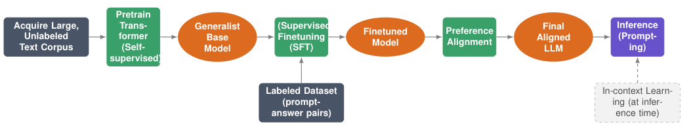

Figure 3.1: 
Overview of the LLM training pipeline [[Radford et al., 2019](#bibb.bib26), [Minaee et al., 2024](#bibb.bib32)].

##### 3.2.1 Acquire Data

The first step in the pipeline is to acquire data. Typically, massive, general-purpose text corpora are used [[Brown et al., 2020](#bibb.bib30)]. The corpora consist of raw text without the need for manual labeling. This data is typically aggregated from both curated and uncurated online sources, then refined through cleaning heuristics to mitigate the effect of harmful, private, or copyrighted content.
The corpora that are used for pretraining are large. Modern LLMs are trained on a web-scale magnitude of data, often reaching the scale of trillions of tokens. Some examples of datasets are:

- 

  Common Crawl: a massive, non-profit snapshot of the web containing billions of pages; alternative sources include <https://archive.org>. While the size is unparalleled, the quality of the data is under discussion [[Baack, 2024](#bibb.bib39)]. Many derivatives, such as C4 (Colossal Clean Crawled Corpus) present a filtered subset of English web text [[Raffel et al., 2020](#bibb.bib40)] to enhance the quality of the data.
- 

  Dolma 3: a data mixture that is designed to maximize performance across a diverse suite of tasks. It is used in the OLMo open source/open data project [[Ettinger et al., 2025](#bibb.bib35), [Soldaini et al., 2024](#bibb.bib36)].
- 

  SmolLM3: utilizes a large three-stage training strategy with 11.2 trillion tokens that dynamically mixes web, math, and code data to optimize reasoning and knowledge acquisition [[Bakouch et al., 2025](#bibb.bib37)].

Recent research emphasizes that data diversity is as critical as size for improving cross-domain knowledge and downstream generalization [[Gao et al., 2020](#bibb.bib38)]. The corpus called *The Pile* has been specifically created as a heterogeneous corpus. For example, models trained on The Pile show significant gains in coding efficiency (Bits Per Byte, BPB)11
1
Bits-Per-Byte is a tokenizer-agnostic metric from information theory that measures the average bits needed per symbol, reflecting coding efficiency, see also Section [3.3.2](#Ch3.S3.SS2 "3.3.2 Metrics ‣ 3.3 Benchmarks, and Performance ‣ Chapter 3 The Large Language Model Training Pipeline ‣ Part I Language Modeling ‣ Agentic Large Language Models"). across disparate domains, such as GitHub repositories, medical papers, and philosophy texts (see Figure [3.2](#Ch3.F2 "Figure 3.2 ‣ 3.2.1 Acquire Data ‣ 3.2 Training Pipeline ‣ Chapter 3 The Large Language Model Training Pipeline ‣ Part I Language Modeling ‣ Agentic Large Language Models")). It is therefore often used as a benchmark, where successful performance on Pile BPB serves as an indicator of a model’s world knowledge and complex reasoning abilities.

Curation of data for pretraining requires defining complex data cleaning pipelines that transform raw data from multiple sources into a single collection of cleaned, plain text documents. Often, this process focuses on quality assurance and safety. The curation process begins with source prioritization, where the mixture is weighted toward high-quality sources such as Wikipedia, books, and other known curated sources. Further, to ensure the integrity of the corpus, researchers apply noise reduction heuristics to strip away boilerplate text, navigation menus, and possibly inappropriate content. Furthermore, de-duplication is performed at both the URL and document levels; this is essential to prevent the model from memorizing redundant information and overfitting on repetitive data.

Beyond accuracy, the pipeline must select data that matches safety and ethical constraints. This too is commonly implemented through heuristic-based filtering. Furthermore, toxicity-detection systems are implemented to remove hate speech, although these methods often yield mixed results. A significant challenge in this phase is bias mitigation, as automated filters can inadvertently flag and suppress legitimate data written in specific dialects, such as African American English, leading to the accidental exclusion of diverse voices from the training set.

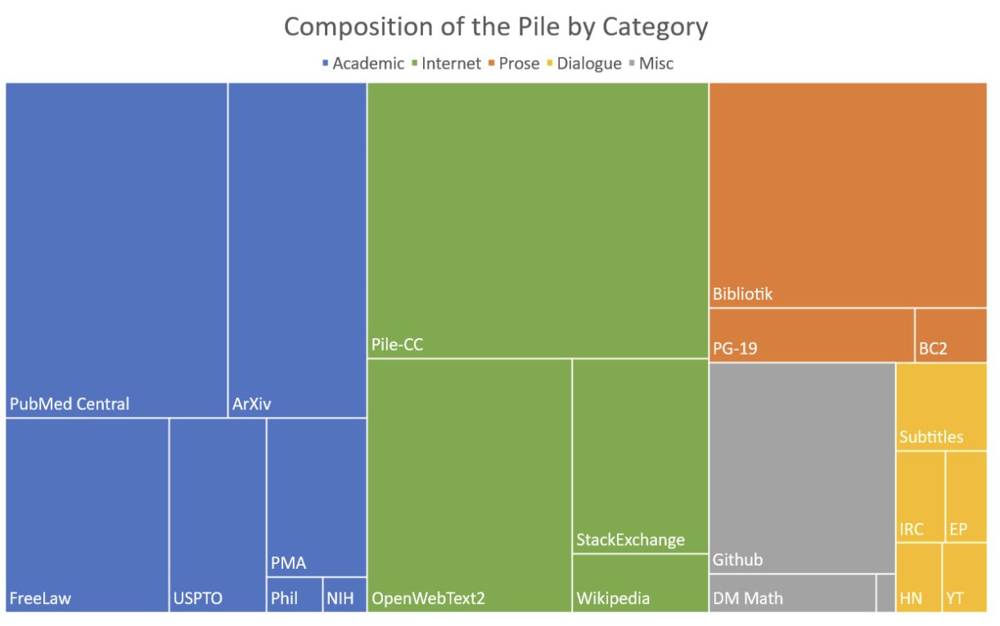

Figure 3.2: 
Overview of the data sources inside The Pile dataset [[Gao et al., 2020](#bibb.bib38)].

##### 3.2.2 Pretrain

The second step in the training pipeline is pretraining the model on the curated corpus, a process that yields a generalist natural language model. This stage uses a self-supervised transformer approach [[Vaswani et al., 2017](#bibb.bib31)] on the unlabeled text.

In order to acquire internal representations of language, conceptual semantic relationships, and world knowledge, the model is trained using masked-token cloze-like tasks.
In such tasks the objective is to predict masked tokens conditioned on a preceding context of large corpora of sequences (i.e., representations of text, image patches). This process is self-supervised (no human-annotated data is required) and is known to yield rich representations of language, relations between concepts, and world knowledge, in various forms.

Formally, the language modeling objective maximizes the probability of the tokens in a sentence $\mathcal{U}=\{u_{0},\dots,u_{n}\}$, based on a window $k$ of existing tokens (Equation [3.1](#Ch3.E1 "In 3.2.2 Pretrain ‣ 3.2 Training Pipeline ‣ Chapter 3 The Large Language Model Training Pipeline ‣ Part I Language Modeling ‣ Agentic Large Language Models")). $L(\mathcal{U})$ is the *language modeling loss*.

|  |  |  |  |
| --- | --- | --- | --- |
|  | $$ L(\mathcal{U})=\sum_{i}\log P(u_{i}|u_{i-k},\dots,u_{i-1};\Theta) $$ |  | (3.1) |

Language models estimate these probabilities through trainable parameters $\Theta$, optimized via gradient updates. Given that model sizes range from millions to over a trillion parameters, large datasets are required to ensure convergence. During this training phase, teacher forcing is employed: the model makes a prediction, but the ground-truth token—rather than the model’s own output—is provided as the input for the next step. In contrast, during autoregressive generation at inference time, the model must rely on its own predictions as the input for subsequent tokens. Tokens are created by running the appropriate *tokenizer*, as explained in Section [2.1.4](#Ch2.S1.SS4 "2.1.4 Tokenization ‣ 2.1 Processing Natural Language ‣ Chapter 2 Foundations of Language Modeling with LLMs ‣ Part I Language Modeling ‣ Agentic Large Language Models").

In pretraining, a key challenge is to ensure that the model learns efficiently and remains stable throughout the trillions of gradient updates. Over time, different strategies have evolved that aim to keep the training process under control. One such strategy is curriculum learning. In human learning, we start by learning easy concepts (such as addition) before we tackle more difficult concepts (multiplication, logarithms). In language modeling, this idea is used in data mixtures, or data curricula. Rather than training on all data types simultaneously, researchers select a specific mixture of data sources to train on first, see the example in Figure [3.3](#Ch3.F3 "Figure 3.3 ‣ 3.2.2 Pretrain ‣ 3.2 Training Pipeline ‣ Chapter 3 The Large Language Model Training Pipeline ‣ Part I Language Modeling ‣ Agentic Large Language Models"). Creation of mixtures involves strategically ordering the data according to difficulty. In a training curriculum we start with easy-to-learn general web crawls, and then shift toward harder high-quality reasoning data (math and code) in later stages. The underlying idea is that this helps the model converge quicker on more complex logic [[Bengio et al., 2009](#bibb.bib15)].

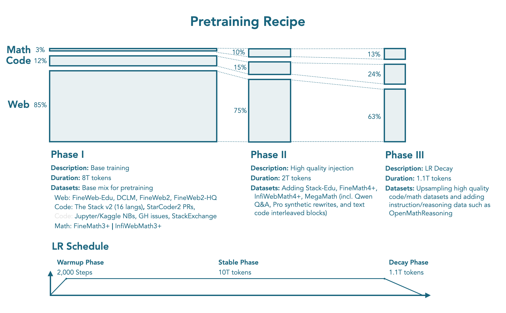

Figure 3.3: 
Example data mixtures for training SmolLM3 [[Bakouch et al., 2025](#bibb.bib37)].

Other mechanisms for stabilizing training are employed, as training at this scale is notoriously unstable and prone to loss spikes [[Takase et al., 2025](#bibb.bib41)]. Stability is maintained through standard machine learning techniques such as weight decay, layer normalization, and sophisticated learning rate schedulers. The use of specialized optimizers and the monitoring of gradient norms helps to prevent parameters from diverging during the intensive pretraining process. An example of how switching embedding layers can lead to more stable training is shown in Figure [3.4](#Ch3.F4 "Figure 3.4 ‣ 3.2.2 Pretrain ‣ 3.2 Training Pipeline ‣ Chapter 3 The Large Language Model Training Pipeline ‣ Part I Language Modeling ‣ Agentic Large Language Models"). The left figure shows the training loss for the 336M and 752M BERT model. While the original architecture performs well on the 336M model, the modifications in (b) enable stable training with lower training loss [[Shoeybi et al., 2020](#bibb.bib52)].

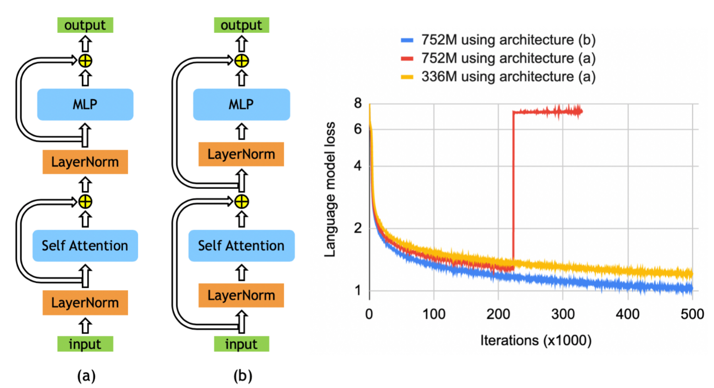

Figure 3.4: 
Training loss for the BERT model using the original architecture (a) and a rearranged architecture (b) [[Shoeybi et al., 2020](#bibb.bib52)]

##### 3.2.3 Finetune

After pretraining comes posttraining, of which the first important training step is finetuning.
LLMs are rarely used in an autocomplete generic predict-next-word setting, people rather use them to answer questions, give advice and recall information. Finetuning is the process of taking a pretrained model that has already learned general language patterns, and then train it further on a smaller, more specific dataset. In finetuning, we apply a general model to a specific (narrow) task on a labeled dataset, using a supervised learning approach.
A popular efficient method is low-rank optimization, which finetunes a small subset of the parameters [[Hu et al., 2021](#bibb.bib27), [Wei et al., 2022](#bibb.bib29), [Minaee et al., 2024](#bibb.bib32)].

###### Supervised Finetuning (SFT)

Finetuning can be applied to many specialized tasks. The most general models use *supervised finetuning* to be able to follow instructions and perform reasoning steps [[Ettinger et al., 2025](#bibb.bib35)]. The supervised finetuning step is especially important for smaller models, offering an efficient mechanism for significant improvements in general chat, reasoning, and function-calling capabilities.

Supervised finetuning is also used for more specialized tasks, such as toxicity reduction. WildChat [[Zhao et al., 2024](#bibb.bib42)] provides over a million real-world user-ChatGPT interactions, capturing how humans prompt the LLM with varying complexity and toxicity.

For learning reasoning capabilities, OpenThoughts [[Guha et al., 2025](#bibb.bib43)] contains step-by-step reasoning chains, distilled from advanced models to enhance problem-solving capabilities in math, science, and coding. Human-obtained data is supplemented by synthetic data, which involves generating instructions and responses using larger teacher models (such as GPT-5) to fill specific data gaps and scale up training volume [[Zhang et al., 2026](#bibb.bib44)].

Finetuning does not only pertain to general instruction-following or reasoning. Other tasks can be, for example, translation from one language to another, or question answering in health-care or customer service. Especially for industrial applications, where tasks are narrow and models are smaller, finetuning is a fruitful undertaking.

In Chapter [11](#Ch11 "Chapter 11 How Agents Use Tools to Act in the World ‣ Part IV Tools and Assistants ‣ Agentic Large Language Models") we will discuss the use of tools by LLMs, a central aspect of agentic LLM. The training to use tools also takes place in the supervised finetuning step in the training pipeline
[[Wei et al., 2022](#bibb.bib29), [Minaee et al., 2024](#bibb.bib32)].

Furthermore, finetuning is instrumental in establishing a model’s persona and deepening its expertise. For instance, organizations can train models to adopt a specific tone of voice, for example so that a customer service bot maintains a consistent brand identity, be that empathetic and formal or witty and casual. Finally, the injection of deep domain knowledge enables the model to master the intricate terminology and logic of niche fields, such as industry-specific patent information or debugging proprietary legacy code.

Ultimately, finetuning transforms a generalist predictor into a specialized expert, often allowing smaller, more efficient models to outperform larger foundational models on specific tasks.

##### 3.2.4 Preference Tuning

A problem that surfaced in early models is that training tends to amplify extreme socially unacceptable texts in the training data and run wild, crowding out moderate points of view. Since then, an essential step for LLMs to become socially acceptable, is for pipelines to include a phase in which the model is tuned to behave in socially acceptable ways. This phase is called preference tuning.

In this phase we align the finetuned model with user expectations (preference alignment). The goal of this step is to improve the model to give socially acceptable answers, prevent hate speech, reduce hallucinations, and improve instruction adherence.

Standard methods for preference tuning include reinforcement learning with human feedback (RLHF) [[Ouyang et al., 2022](#bibb.bib7)], which trains a reward model to approximate human values, and direct preference optimization (DPO) [[Rafailov et al., 2024](#bibb.bib28)], which optimizes the policy directly from preference data. A high-level overview of RLHF is shown in Figure [3.5](#Ch3.F5 "Figure 3.5 ‣ 3.2.4 Preference Tuning ‣ 3.2 Training Pipeline ‣ Chapter 3 The Large Language Model Training Pipeline ‣ Part I Language Modeling ‣ Agentic Large Language Models"). To address the bottleneck of human annotation, modern pipelines increasingly utilize reinforcement learning from AI feedback (RLAIF) [[Bai et al., 2022](#bibb.bib51)], where a stronger model generates the preference signals.

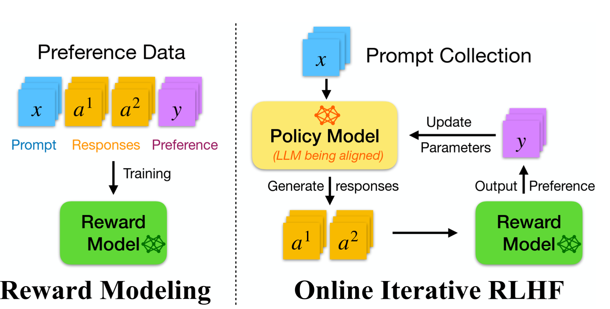

Figure 3.5: 
High-level overview of RLHF: training a reward model (left), and optimizing a language model (the policy) with respect to that reward model [Dong et al. [2024]](#bibb.bib50)

Achieving alignment with human values is not an easy task, and we usually distinguish between safety alignment, value alignment and preference alignment. In the latter case, a complication is that preferences are subjective preferences (such as writing style) that change per person.

###### Value alignment

On a higher level, value alignment focuses on ensuring that the model’s underlying principles and worldviews resonate with broad human ethics. Unlike individual preferences, this involves anchoring the model to high-level concepts such as fairness, helpfulness, and honesty. In practice, this means the model is governed by a set of written principles (a *constitution*) to ensure that it adheres to the policies set out by the developer.

However, this value alignment usually leads to a trade-off, where optimizing a model for safety and helpfulness also degrades its performance on other capabilities, such as factual recall or creativity [[Lin et al., 2024](#bibb.bib47)]. This trade-off is otherwise known as the *alignment tax*.

###### Safety alignment

Safety alignment is the process of setting hard boundaries on model behavior to prevent catastrophic or harmful outputs. While preference alignment might focus on tone, and value alignment on viewpoint, safety alignment focuses on adversarial robustness and the refusal of malicious prompts. Example methodologies for ensuring safety includes red teaming, where models are subjected to rigorous jailbreak attempts to identify vulnerabilities, and guard railing, where specific refusal boundaries for high-risk responses are filtered.

###### Objective alignment

Finally, for domains where objective truths exist, such as mathematics or coding, methods known as reinforcement learning with verifiable rewards (RLVR) [[Lambert et al., 2024](#bibb.bib2)] are employed. Unlike standard RLHF, RLVR optimizes for objective correctness by leveraging ground-truth signals to robustly improve reasoning capabilities. Examples include code that compiles, or correct mathematical solutions. In the latter case, the Group Relative Policy Optimization (GRPO) algorithm is often used [[Guo et al., 2025](#bibb.bib5)], a variant of Proximal Policy Optimization (PPO) that enhances mathematical reasoning abilities while concurrently optimizing the memory usage of PPO. It does so by sampling multiple answers from the policy model and using their relative quality (as assessed by a verifier) to compute the rewards. Instead of relying on human labels for learning what counts as a good answer, the model gets direct rewards (+1, or -1) from a deterministic verifier [[Guo et al., 2025](#bibb.bib5), [Shao et al., 2024](#bibb.bib10)], see Figure [3.6](#Ch3.F6 "Figure 3.6 ‣ Objective alignment ‣ 3.2.4 Preference Tuning ‣ 3.2 Training Pipeline ‣ Chapter 3 The Large Language Model Training Pipeline ‣ Part I Language Modeling ‣ Agentic Large Language Models").

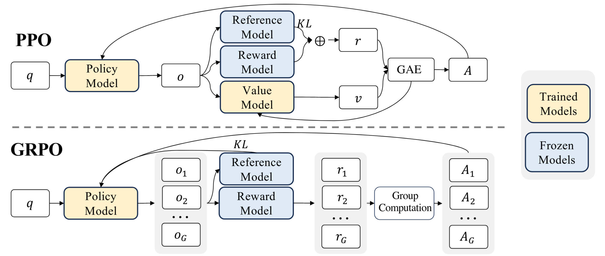

Figure 3.6: 
Comparison of RLHF (specifically, PPO) to RLVR (specifically, GRPO) method [[Shao et al., 2024](#bibb.bib10)]

##### 3.2.5 Infer

The final step in the training pipeline is the inference step. This is the step in which the trained model is finally used.
Here the user finally gets to interact with the model. Finally, we can use the fruits of our training efforts.

At inference time, we use natural language prompts (instructions and questions) to obtain responses from the model. Prompting is the preferred way of using LLMs to have the model answer our questions. Inference results can be sensitive to the way that a prompt is formulated. The use of certain words, or re-ordering words in the prompt, can influence the answer of the model. This sensitivity has led to prompt engineering and context engineering, skills that have become important for users of LLMs [[Sahoo et al., 2024](#bibb.bib1)].

Interestingly, as we discussed in the previous chapter, in decoder models whose size is beyond hundreds of billions parameters a new learning method emerges: *in-context learning* (ICL) [[Brown et al., 2020](#bibb.bib30), [Wei et al., 2022](#bibb.bib29)]. In-context learning is a method where the prompt contains a small number of examples, together with an instruction. These examples point the model in a certain direction and it uses them to learn the answer. ICL is a form of within-prompt few-shot learning. ICL is also a type of learning where no parameters of the model are changed—it is example learning without parameter training [[Dong et al., 2022](#bibb.bib25)].

In the remainder of this book we will see many examples of the way in which in-context learning is used, such as in agentic harnesses. Inference-time in-context learning is a major driver of agentic LLM.

##### 3.2.6 Concluding Remarks

We have now described the phases of a typical LLM training pipeline.
Note that the pipeline that we described is an example of a typical approach, and different models are trained in different ways. Current modern training pipelines are elaborate, and training is costly. Innovations to training pipelines are the topic of current research, see, for example, [Guo et al. [2025]](#bibb.bib5), [Du et al. [2025]](#bibb.bib11).

Being able to obtain predictions quickly is key, and multiple techniques have been developed to speed up the process. For instance, is is important to strike a balance between the reasoning effort and response quality. Research into *test time scaling* studies this trade-off. A higher inference-time effort costs more compute time, but may yield a better answer. We discuss these and other optimization techniques in Chapter [4](#Ch4 "Chapter 4 Scaling Laws and Efficient Large Language Models ‣ Part I Language Modeling ‣ Agentic Large Language Models").

#### 3.3 Benchmarks, and Performance

After the pipeline has been used to train the model, we wish to find out how well the model performs.
LLMs are created using a variety of modeling techniques, for different tasks, on different datasets. As a result, they have often obtained remarkable capabilities. For example, LLMs perform well on natural language understanding tasks (GLUE, SQUAD, Xsum) [[Wang et al., 2018](#bibb.bib8), [Wang et al., 2019](#bibb.bib20), [Rajpurkar et al., 2016](#bibb.bib19), [Narayan et al., 2018](#bibb.bib21)], translation [[Kocmi et al., 2022](#bibb.bib22), [Papineni et al., 2002](#bibb.bib18), [Sennrich et al., 2015](#bibb.bib17)], question answering tasks [[Roberts et al., 2020](#bibb.bib16)], and poetry composition [[Zhang and Eger, 2024](#bibb.bib9)], to name just a few domains. The broad applicability of LLMs shows their versatility, although the rapid development of the field, as well as ongoing research efforts, raise many open questions related to the capabilities of LLMs in many domains and contexts.

We will now discuss benchmarks that are commonly used to test the performance of our models.

##### 3.3.1 Common tasks

Let us have a closer look at some common LLM tasks. The tasks can largely be grouped under the two language processing categories that we introduced previously: natural language understanding (NLU) and natural language generation (NLG).
Depending on the category, the exact task formulation, and the underlying data, the performance metric will differ. We will discuss each separately.

Note that *performance* is an ambiguous term. In NLP, it is often used in the context of *task performance* (accuracy), instead of *computational performance* (speed). While exact evaluation criteria differ depending on the task, modern evaluation practices primarily focus on task performance. However, how many of the calls to the LLM we make, and how quickly we can get responses from the model, is also important to achieve high scores on contemporary benchmarks, as we will see in later chapters.

##### 3.3.2 Metrics

In order to monitor or report the (task) performance of LLMs, different metrics are used, depending on the stage of the training that we are in.

###### Pretraining Metrics

In pretraining, we are mostly interested in knowing whether the model is able to accurately predict the next word. The standard metric is *perplexity*, shown in Equation [3.2](#Ch3.E2 "In Pretraining Metrics ‣ 3.3.2 Metrics ‣ 3.3 Benchmarks, and Performance ‣ Chapter 3 The Large Language Model Training Pipeline ‣ Part I Language Modeling ‣ Agentic Large Language Models"). Perplexity measures the model’s uncertainty when predicting the next token, and is directly related to the cross-entropy loss function. Low perplexity indicates that the model assigns high probability to the correct next tokens. For perplexity, lower is better.

|  |  |  |  |
| --- | --- | --- | --- |
|  | $$ \text{PPL}(X)=\exp\left(-\frac{1}{N}\sum_{i=1}^{N}\log P(x_{i}\mid x_{<i})\right) $$ |  | (3.2) |

|  |  |  |  |
| --- | --- | --- | --- |
|  | $$ \text{BPB}=-\frac{1}{B}\sum_{i=1}^{N}\log_{2}P(x_{i}\mid x_{<i}) $$ |  | (3.3) |

Perplexity is computed over tokens; adjusting perplexity to stick to word boundaries needs careful normalization [[Pimentel and Meister, 2024](#bibb.bib48)]. Moreover, even when adjusted, it is still tokenizer-specific, as other tokenizers can lead to other subwords and hence other probability distributions.

As an alternative, *bits-per-byte* (BPB), shown in Equation [3.3](#Ch3.E3 "In Pretraining Metrics ‣ 3.3.2 Metrics ‣ 3.3 Benchmarks, and Performance ‣ Chapter 3 The Large Language Model Training Pipeline ‣ Part I Language Modeling ‣ Agentic Large Language Models"), normalizes the loss to the byte level, which enables fair comparisons between models that use different tokenization schemes [[Borgeaud et al., 2022](#bibb.bib49)]. It measures the average number of bits required to encode a single byte of data.

###### Posttraining Metrics

In posttraining and inference, when the model is used for problem solving, generation, or reasoning, we look at the deterministic success rates, based on ground truth data. Often, tasks are set up in multiple-choice question/answering formats, where there is a single correct answer. For these types of tasks, we commonly report *accuracy*, the percentage of questions for which a correct response is given. For accuracy, higher is better.

In the regular setup, the model needs to provide an answer in one unique attempt. However, since sampling from a language model is a stochastic process, we may request additional attempts, and see if the answer is among them. This is formalized in the *Pass@K* metric: the percentage of problems solved correctly on the model’s $K$th attempt; higher is better. Common values for $K$ include 1, 5, 10, 100.

##### 3.3.3 Common Benchmarks

While measuring the performance of LLMs remains an active area of research, many datasets have become commonplace for reporting their general capabilities. These datasets are designed to only be used for *evaluating* the quality of a model, and are not intended as additional training data. As such, they serve as semi-standardized benchmarks. Ongoing efforts for moving to field standards, such as MLCommons [[Thiyagalingam et al., 2022](#bibb.bib3)], show an increasing need for objective and sound evaluation setups.

| **Benchmark Name** | **Capability Tested** | **Task Format** | **Metric** |
| --- | --- | --- | --- |
| **Humanity’s Last Exam (HLE)** | General Intelligence, Multimodal Reasoning | Short-Answer, Multiple-Choice | Pass@1 |
| **Abstract Reasoning Challenge (ARC)** | General Intelligence | Visual Grid Pattern Completion | Pass@1 (Private Set) |
| **GPQA Diamond** | Expert-Level STEM Reasoning | Multiple-Choice | Pass@1 |
| **AIME 2025** | Advanced Mathematical Reasoning | Integer Answer (0-999) | Pass@1 |
| **SWE-Bench** | Agentic Coding, Real-World Software Engineering | Code Patch Generation | Pass@1 |
| **Fortress** | AI Safety, National Security Risk Assessment | Varies (Proprietary) | Avg Risk Score (ARS) & Over-Refusal Score (ORS) |
| **MMLU** | Broad General Knowledge | Multiple-Choice | Pass@1 |
| **GSM8K** | Grade-School Mathematical Reasoning | Multi-Step Arithmetic | Pass@1 |
| **TruthfulQA** | Factual Correctness, Hallucination Detection | Question Answering | Pass@1 |

Table 3.1: Overview of common LLM benchmarks with the metrics reported on them

###### Data Contamination

Modern benchmarks run a risk of data contamination [[Balloccu et al., 2024](#bibb.bib46)].
As pretraining data increases in size (often a considerable ratio of the total size of the internet), the line between in- and out-of-domain data becomes increasingly blurred, especially given that commercial vendors often do not specify the sources of their training data (either out of commercial interest or for other reasons). Hence, when we wish to measure true generalization to unseen data, we need to ensure that the model has not seen the data before (we wish to prevent *data contamination*).

It is common for benchmarks to host a public, freely accessible dataset for quick experimentation by developers, but to maintain a private dataset that commercial vendors have restricted access to, to prevent data contamination. Furthermore, in order to maintain the benchmark’s usefulness into the future, developers often actively update the samples in the benchmark.

In Table [3.1](#Ch3.T1 "Table 3.1 ‣ 3.3.3 Common Benchmarks ‣ 3.3 Benchmarks, and Performance ‣ Chapter 3 The Large Language Model Training Pipeline ‣ Part I Language Modeling ‣ Agentic Large Language Models"), we provide a non-exhaustive list of general-purpose benchmarks that are popular at the time of writing.

#### 3.4 Concluding Remarks

In the field of LLM development, it has become common for commercial LLM developers (such as Anthropic, OpenAI, Google, DeepSeek, Mistral) to publish a tech report that informs the expert public on how the model behaves across popular benchmarks. Often, such as tech report is published as a preprint, without going through academic peer-review, and many details that would be necessary for full scientific reproducibility (such as data recipe, model architecture) are left out, for commercial reasons. Nonetheless, these reports provide useful information to derive insights into what LLMs can and cannot do.

First, we find that modern LLMs demonstrate a distinct performance hierarchy across benchmarks, as they have effectively solved broad knowledge tasks, but still struggle to master complex reasoning and autonomous agentic tasks. On static knowledge and professional exam benchmarks (such as MMLU and TruthfulQA), frontier models (such as GPT-5.2, Gemini 3 Pro, and Claude 4.5 Opus) have reached, at the time of writing, near-saturation, consistently scoring above 85–90% and surpassing human expert baselines.

The newest generation of reasoning models (such as OpenAI’s o1, DeepSeek-R1, and Qwen-3.5) have recently achieved great progress, pushing math and science pass rates from low percentages to expert levels. Despite these advances, the software engineering SWE-bench remains the ultimate stress test for reliability; while scores have risen from negligible (¡2%) to respectable levels (40-50% on verified subsets) for top coding agents, the gap between answering a coding question and autonomously fixing a real-world repository issue remains a significant hurdle for modern AI.

###### Open Questions

Open questions about the origin of LLMs capabilities still remain. As the pipelines have grown complex, both in terms of training (*What data matters? What training steps are most important?*) and inference (*How to extract high quality reasoning traces?*), drawing conclusions is difficult. For example, it is an open question whether pretraining or posttraining is more important, and whether knowledge comes mostly from pretraining, and posttraining only serves for finding a good task interface [[Zhou et al., 2023](#bibb.bib45)].

The remaining parts of this book will discuss posttraining and inference-time reasoning methods and agent training methods. But first, we will look at scaling laws, in the next chapter.

### References

- Achiam et al. (2023)
  J. Achiam, S. Adler, S. Agarwal, L. Ahmad, I. Akkaya, F. L. Aleman, D. Almeida, J. Altenschmidt, S. Altman, S. Anadkat, et al.
  Gpt-4 technical report.
  arXiv preprint arXiv:2303.08774.
  Cited by: [§3.1.3](#Ch3.S1.SS3.p1.1 "3.1.3 Open and Closed Models ‣ 3.1 Training Models ‣ Chapter 3 The Large Language Model Training Pipeline ‣ Part I Language Modeling ‣ Agentic Large Language Models").

- Anil et al. (2023)
  R. Anil, S. Borgeaud, J. Alayrac, J. Yu, R. Soricut, J. Schalkwyk, A. M. Dai, A. Hauth, K. Millican, et al.
  Gemini: a family of highly capable multimodal models.
  arXiv preprint arXiv:2312.11805.
  Cited by: [§3.1.3](#Ch3.S1.SS3.p1.1 "3.1.3 Open and Closed Models ‣ 3.1 Training Models ‣ Chapter 3 The Large Language Model Training Pipeline ‣ Part I Language Modeling ‣ Agentic Large Language Models").

- Baack (2024)
  S. Baack
  A critical analysis of the largest source for generative ai training data: common crawl.
  In Proceedings of the 2024 ACM Conference on Fairness, Accountability, and Transparency,
  pp. 2199–2208.
  Cited by: [1st item](#Ch3.S2.I1.i1.p1.1 "In 3.2.1 Acquire Data ‣ 3.2 Training Pipeline ‣ Chapter 3 The Large Language Model Training Pipeline ‣ Part I Language Modeling ‣ Agentic Large Language Models").

- Bai et al. (2025)
  S. Bai, K. Chen, X. Liu, J. Wang, W. Ge, S. Song, K. Dang, P. Wang, S. Wang, J. Tang, et al.
  Qwen2. 5-vl technical report.
  arXiv preprint arXiv:2502.13923.
  Cited by: [§3.1.3](#Ch3.S1.SS3.p1.1 "3.1.3 Open and Closed Models ‣ 3.1 Training Models ‣ Chapter 3 The Large Language Model Training Pipeline ‣ Part I Language Modeling ‣ Agentic Large Language Models").

- Bai et al. (2022)
  Y. Bai, S. Kadavath, S. Kundu, A. Askell, J. Kernion, A. Jones, A. Chen, A. Goldie, A. Mirhoseini, C. McKinnon, et al.
  Constitutional ai: harmlessness from ai feedback.
  arXiv preprint arXiv:2212.08073.
  Cited by: [§3.2.4](#Ch3.S2.SS4.p3.1 "3.2.4 Preference Tuning ‣ 3.2 Training Pipeline ‣ Chapter 3 The Large Language Model Training Pipeline ‣ Part I Language Modeling ‣ Agentic Large Language Models").

- Bakouch et al. (2025)
  E. Bakouch, L. Ben Allal, A. Lozhkov, N. Tazi, L. Tunstall, C. M. Patiño, E. Beeching, A. Roucher, A. J. Reedi, Q. Gallouédec, K. Rasul, N. Habib, C. Fourrier, H. Kydlicek, G. Penedo, H. Larcher, M. Morlon, V. Srivastav, J. Lochner, X. Nguyen, C. Raffel, L. von Werra, and T. Wolf
  SmolLM3: smol, multilingual, long-context reasoner.
  Note: <https://huggingface.co/blog/smollm3>
  Cited by: [Figure 3.3](#Ch3.F3 "In 3.2.2 Pretrain ‣ 3.2 Training Pipeline ‣ Chapter 3 The Large Language Model Training Pipeline ‣ Part I Language Modeling ‣ Agentic Large Language Models"),
  [Figure 3.3](#Ch3.F3.4 "In 3.2.2 Pretrain ‣ 3.2 Training Pipeline ‣ Chapter 3 The Large Language Model Training Pipeline ‣ Part I Language Modeling ‣ Agentic Large Language Models"),
  [3rd item](#Ch3.S2.I1.i3.p1.1 "In 3.2.1 Acquire Data ‣ 3.2 Training Pipeline ‣ Chapter 3 The Large Language Model Training Pipeline ‣ Part I Language Modeling ‣ Agentic Large Language Models").

- Balloccu et al. (2024)
  S. Balloccu, P. Schmidtová, M. Lango, and O. Dusek
  Leak, cheat, repeat: data contamination and evaluation malpractices in closed-source LLMs.
  In Proceedings of the 18th Conference of the European Chapter of the Association for Computational Linguistics (Volume 1: Long Papers), Y. Graham and M. Purver (Eds.),
  St. Julian’s, Malta, pp. 67–93.
  External Links: [Link](https://aclanthology.org/2024.eacl-long.5/),
  [Document](https://dx.doi.org/10.18653/v1/2024.eacl-long.5)
  Cited by: [§3.3.3](#Ch3.S3.SS3.SSS0.Px1.p1.1 "Data Contamination ‣ 3.3.3 Common Benchmarks ‣ 3.3 Benchmarks, and Performance ‣ Chapter 3 The Large Language Model Training Pipeline ‣ Part I Language Modeling ‣ Agentic Large Language Models").

- Bengio et al. (2009)
  Y. Bengio, J. Louradour, R. Collobert, and J. Weston
  Curriculum learning.
  In Proceedings of the 26th annual international conference on machine learning,
  pp. 41–48.
  Cited by: [§3.2.2](#Ch3.S2.SS2.p6.1 "3.2.2 Pretrain ‣ 3.2 Training Pipeline ‣ Chapter 3 The Large Language Model Training Pipeline ‣ Part I Language Modeling ‣ Agentic Large Language Models").

- Biderman et al. (2023)
  S. Biderman, H. Schoelkopf, Q. G. Anthony, H. Bradley, K. O’Brien, E. Hallahan, M. A. Khan, S. Purohit, U. S. Prashanth, E. Raff, et al.
  Pythia: a suite for analyzing large language models across training and scaling.
  In International Conference on Machine Learning,
  pp. 2397–2430.
  Cited by: [§3.1.3](#Ch3.S1.SS3.p3.1 "3.1.3 Open and Closed Models ‣ 3.1 Training Models ‣ Chapter 3 The Large Language Model Training Pipeline ‣ Part I Language Modeling ‣ Agentic Large Language Models").

- Borgeaud et al. (2022)
  S. Borgeaud, A. Mensch, J. Hoffmann, T. Cai, E. Rutherford, K. Millican, G. B. Van Den Driessche, J. Lespiau, B. Damoc, A. Clark, D. De Las Casas, A. Guy, J. Menick, R. Ring, T. Hennigan, S. Huang, L. Maggiore, C. Jones, A. Cassirer, A. Brock, M. Paganini, G. Irving, O. Vinyals, S. Osindero, K. Simonyan, J. Rae, E. Elsen, and L. Sifre
  Improving language models by retrieving from trillions of tokens.
  In Proceedings of the 39th International Conference on Machine Learning, K. Chaudhuri, S. Jegelka, L. Song, C. Szepesvari, G. Niu, and S. Sabato (Eds.),
  Proceedings of Machine Learning Research, Vol. 162, pp. 2206–2240.
  External Links: [Link](https://proceedings.mlr.press/v162/borgeaud22a.html)
  Cited by: [§3.3.2](#Ch3.S3.SS2.SSS0.Px1.p4.1 "Pretraining Metrics ‣ 3.3.2 Metrics ‣ 3.3 Benchmarks, and Performance ‣ Chapter 3 The Large Language Model Training Pipeline ‣ Part I Language Modeling ‣ Agentic Large Language Models").

- Brown et al. (2020)
  T. Brown, B. Mann, N. Ryder, M. Subbiah, J. D. Kaplan, P. Dhariwal, A. Neelakantan, P. Shyam, G. Sastry, A. Askell, et al.
  Language models are few-shot learners.
  Advances in neural information processing systems 33, pp. 1877–1901.
  Cited by: [§3.2.1](#Ch3.S2.SS1.p1.1 "3.2.1 Acquire Data ‣ 3.2 Training Pipeline ‣ Chapter 3 The Large Language Model Training Pipeline ‣ Part I Language Modeling ‣ Agentic Large Language Models"),
  [§3.2.5](#Ch3.S2.SS5.p3.1 "3.2.5 Infer ‣ 3.2 Training Pipeline ‣ Chapter 3 The Large Language Model Training Pipeline ‣ Part I Language Modeling ‣ Agentic Large Language Models").

- Chowdhery et al. (2023)
  A. Chowdhery, S. Narang, J. Devlin, M. Bosma, G. Mishra, A. Roberts, P. Barham, H. W. Chung, C. Sutton, S. Gehrmann, et al.
  Palm: scaling language modeling with pathways.
  Journal of Machine Learning Research 24 (240), pp. 1–113.
  Cited by: [§3.1.3](#Ch3.S1.SS3.p1.1 "3.1.3 Open and Closed Models ‣ 3.1 Training Models ‣ Chapter 3 The Large Language Model Training Pipeline ‣ Part I Language Modeling ‣ Agentic Large Language Models").

- Dong et al. (2024)
  H. Dong, W. Xiong, B. Pang, H. Wang, H. Zhao, Y. Zhou, N. Jiang, D. Sahoo, C. Xiong, and T. Zhang
  RLHF workflow: from reward modeling to online RLHF.
  Transactions on Machine Learning Research.
  Note: 
  External Links: ISSN 2835-8856,
  [Link](https://openreview.net/forum?id=a13aYUU9eU)
  Cited by: [Figure 3.5](#Ch3.F5 "In 3.2.4 Preference Tuning ‣ 3.2 Training Pipeline ‣ Chapter 3 The Large Language Model Training Pipeline ‣ Part I Language Modeling ‣ Agentic Large Language Models"),
  [Figure 3.5](#Ch3.F5.4 "In 3.2.4 Preference Tuning ‣ 3.2 Training Pipeline ‣ Chapter 3 The Large Language Model Training Pipeline ‣ Part I Language Modeling ‣ Agentic Large Language Models").

- Dong et al. (2022)
  Q. Dong, L. Li, D. Dai, C. Zheng, Z. Wu, B. Chang, X. Sun, J. Xu, and Z. Sui
  A survey on in-context learning.
  arXiv preprint arXiv:2301.00234.
  Cited by: [§3.2.5](#Ch3.S2.SS5.p3.1 "3.2.5 Infer ‣ 3.2 Training Pipeline ‣ Chapter 3 The Large Language Model Training Pipeline ‣ Part I Language Modeling ‣ Agentic Large Language Models").

- Du et al. (2025)
  A. Du, B. Gao, B. Xing, C. Jiang, C. Chen, C. Li, C. Xiao, C. Du, C. Liao, et al.
  Kimi k1.5: scaling reinforcement learning with llms.
  arXiv preprint arXiv:2501.12599.
  Cited by: [§3.2.6](#Ch3.S2.SS6.p1.1 "3.2.6 Concluding Remarks ‣ 3.2 Training Pipeline ‣ Chapter 3 The Large Language Model Training Pipeline ‣ Part I Language Modeling ‣ Agentic Large Language Models").

- Ettinger et al. (2025)
  A. Ettinger, A. Bertsch, B. Kuehl, D. Graham, D. Heineman, D. Groeneveld, F. Brahman, F. Timbers, H. Ivison, J. Morrison, J. Poznanski, K. Lo, L. Soldaini, M. Jordan, M. Chen, M. Noukhovitch, N. Lambert, et al.
  Olmo 3.
  External Links: 2512.13961,
  [Link](https://arxiv.org/abs/2512.13961)
  Cited by: [2nd item](#Ch3.S2.I1.i2.p1.1 "In 3.2.1 Acquire Data ‣ 3.2 Training Pipeline ‣ Chapter 3 The Large Language Model Training Pipeline ‣ Part I Language Modeling ‣ Agentic Large Language Models"),
  [§3.2.3](#Ch3.S2.SS3.SSS0.Px1.p1.1 "Supervised Finetuning (SFT) ‣ 3.2.3 Finetune ‣ 3.2 Training Pipeline ‣ Chapter 3 The Large Language Model Training Pipeline ‣ Part I Language Modeling ‣ Agentic Large Language Models").

- Gao et al. (2020)
  L. Gao, S. Biderman, S. Black, L. Golding, T. Hoppe, C. Foster, J. Phang, H. He, A. Thite, N. Nabeshima, S. Presser, and C. Leahy
  The pile: an 800gb dataset of diverse text for language modeling.
  External Links: 2101.00027,
  [Link](https://arxiv.org/abs/2101.00027)
  Cited by: [Figure 3.2](#Ch3.F2 "In 3.2.1 Acquire Data ‣ 3.2 Training Pipeline ‣ Chapter 3 The Large Language Model Training Pipeline ‣ Part I Language Modeling ‣ Agentic Large Language Models"),
  [Figure 3.2](#Ch3.F2.4 "In 3.2.1 Acquire Data ‣ 3.2 Training Pipeline ‣ Chapter 3 The Large Language Model Training Pipeline ‣ Part I Language Modeling ‣ Agentic Large Language Models"),
  [§3.2.1](#Ch3.S2.SS1.p2.1 "3.2.1 Acquire Data ‣ 3.2 Training Pipeline ‣ Chapter 3 The Large Language Model Training Pipeline ‣ Part I Language Modeling ‣ Agentic Large Language Models").

- Groeneveld et al. (2024)
  D. Groeneveld, I. Beltagy, P. Walsh, A. Bhagia, R. Kinney, O. Tafjord, A. H. Jha, H. Ivison, I. Magnusson, Y. Wang, S. Arora, D. Atkinson, R. Authur, K. R. Chandu, A. Cohan, J. Dumas, Y. Elazar, Y. Gu, J. Hessel, T. Khot, W. Merrill, J. Morrison, N. Muennighoff, A. Naik, C. Nam, M. E. Peters, V. Pyatkin, A. Ravichander, D. Schwenk, S. Shah, W. Smith, E. Strubell, N. Subramani, M. Wortsman, P. Dasigi, N. Lambert, K. Richardson, L. Zettlemoyer, J. Dodge, K. Lo, L. Soldaini, N. A. Smith, and H. Hajishirzi
  OLMo: accelerating the science of language models.
  External Links: 2402.00838,
  [Link](https://arxiv.org/abs/2402.00838)
  Cited by: [§3.1.3](#Ch3.S1.SS3.p3.1 "3.1.3 Open and Closed Models ‣ 3.1 Training Models ‣ Chapter 3 The Large Language Model Training Pipeline ‣ Part I Language Modeling ‣ Agentic Large Language Models").

- Guha et al. (2025)
  E. Guha, R. Marten, S. Keh, N. Raoof, G. Smyrnis, H. Bansal, M. Nezhurina, J. Mercat, T. Vu, Z. Sprague, et al.
  OpenThoughts: data recipes for reasoning models.
  arXiv preprint arXiv:2506.04178.
  Cited by: [§3.2.3](#Ch3.S2.SS3.SSS0.Px1.p3.1 "Supervised Finetuning (SFT) ‣ 3.2.3 Finetune ‣ 3.2 Training Pipeline ‣ Chapter 3 The Large Language Model Training Pipeline ‣ Part I Language Modeling ‣ Agentic Large Language Models").

- Guo et al. (2025)
  D. Guo, D. Yang, H. Zhang, J. Song, R. Zhang, R. Xu, Q. Zhu, S. Ma, P. Wang, X. Bi, et al.
  Deepseek-r1: incentivizing reasoning capability in llms via reinforcement learning.
  arXiv preprint arXiv:2501.12948.
  Cited by: [§3.1.3](#Ch3.S1.SS3.p1.1 "3.1.3 Open and Closed Models ‣ 3.1 Training Models ‣ Chapter 3 The Large Language Model Training Pipeline ‣ Part I Language Modeling ‣ Agentic Large Language Models"),
  [§3.2.4](#Ch3.S2.SS4.SSS0.Px3.p1.1 "Objective alignment ‣ 3.2.4 Preference Tuning ‣ 3.2 Training Pipeline ‣ Chapter 3 The Large Language Model Training Pipeline ‣ Part I Language Modeling ‣ Agentic Large Language Models"),
  [§3.2.6](#Ch3.S2.SS6.p1.1 "3.2.6 Concluding Remarks ‣ 3.2 Training Pipeline ‣ Chapter 3 The Large Language Model Training Pipeline ‣ Part I Language Modeling ‣ Agentic Large Language Models").

- Hu et al. (2021)
  E. J. Hu, Y. Shen, P. Wallis, Z. Allen-Zhu, Y. Li, S. Wang, L. Wang, and W. Chen
  Lora: low-rank adaptation of large language models.
  arXiv preprint arXiv:2106.09685.
  Cited by: [§3.2.3](#Ch3.S2.SS3.p1.1 "3.2.3 Finetune ‣ 3.2 Training Pipeline ‣ Chapter 3 The Large Language Model Training Pipeline ‣ Part I Language Modeling ‣ Agentic Large Language Models").

- Jouppi et al. (2023)
  N. Jouppi, G. Kurian, S. Li, P. Ma, R. Nagarajan, L. Nai, N. Patil, S. Subramanian, A. Swing, B. Towles, et al.
  Tpu v4: an optically reconfigurable supercomputer for machine learning with hardware support for embeddings.
  In Proceedings of the 50th annual international symposium on computer architecture,
  pp. 1–14.
  Cited by: [§3.1.3](#Ch3.S1.SS3.p4.1 "3.1.3 Open and Closed Models ‣ 3.1 Training Models ‣ Chapter 3 The Large Language Model Training Pipeline ‣ Part I Language Modeling ‣ Agentic Large Language Models").

- Kocmi et al. (2022)
  T. Kocmi, R. Bawden, O. Bojar, A. Dvorkovich, C. Federmann, M. Fishel, T. Gowda, Y. Graham, R. Grundkiewicz, B. Haddow, et al.
  Findings of the 2022 conference on machine translation (wmt22).
  In Proceedings of the Seventh Conference on Machine Translation (WMT),
  pp. 1–45.
  Cited by: [§3.3](#Ch3.S3.p1.1 "3.3 Benchmarks, and Performance ‣ Chapter 3 The Large Language Model Training Pipeline ‣ Part I Language Modeling ‣ Agentic Large Language Models").

- Lambert et al. (2024)
  N. Lambert, J. Morrison, V. Pyatkin, S. Huang, H. Ivison, F. Brahman, L. J. V. Miranda, A. Liu, N. Dziri, S. Lyu, et al.
  Tulu 3: pushing frontiers in open language model post-training.
  arXiv preprint arXiv:2411.15124.
  Cited by: [§3.2.4](#Ch3.S2.SS4.SSS0.Px3.p1.1 "Objective alignment ‣ 3.2.4 Preference Tuning ‣ 3.2 Training Pipeline ‣ Chapter 3 The Large Language Model Training Pipeline ‣ Part I Language Modeling ‣ Agentic Large Language Models").

- Le Scao et al. (2023)
  T. Le Scao, A. Fan, C. Akiki, E. Pavlick, S. Ilić, D. Hesslow, R. Castagné, A. S. Luccioni, F. Yvon, M. Gallé, et al.
  Bloom: a 176b-parameter open-access multilingual language model.
  Cited by: [§3.1.3](#Ch3.S1.SS3.p3.1 "3.1.3 Open and Closed Models ‣ 3.1 Training Models ‣ Chapter 3 The Large Language Model Training Pipeline ‣ Part I Language Modeling ‣ Agentic Large Language Models").

- Lin et al. (2024)
  Y. Lin, H. Lin, W. Xiong, S. Diao, J. Liu, J. Zhang, R. Pan, H. Wang, W. Hu, H. Zhang, et al.
  Mitigating the alignment tax of rlhf.
  In Proceedings of the 2024 Conference on Empirical Methods in Natural Language Processing,
  pp. 580–606.
  Cited by: [§3.2.4](#Ch3.S2.SS4.SSS0.Px1.p2.1 "Value alignment ‣ 3.2.4 Preference Tuning ‣ 3.2 Training Pipeline ‣ Chapter 3 The Large Language Model Training Pipeline ‣ Part I Language Modeling ‣ Agentic Large Language Models").

- Minaee et al. (2024)
  S. Minaee, T. Mikolov, N. Nikzad, M. Chenaghlu, R. Socher, X. Amatriain, and J. Gao
  Large language models: a survey.
  arXiv preprint arXiv:2402.06196.
  Cited by: [Figure 3.1](#Ch3.F1 "In 3.2 Training Pipeline ‣ Chapter 3 The Large Language Model Training Pipeline ‣ Part I Language Modeling ‣ Agentic Large Language Models"),
  [Figure 3.1](#Ch3.F1.4 "In 3.2 Training Pipeline ‣ Chapter 3 The Large Language Model Training Pipeline ‣ Part I Language Modeling ‣ Agentic Large Language Models"),
  [§3.2.3](#Ch3.S2.SS3.SSS0.Px1.p5.1 "Supervised Finetuning (SFT) ‣ 3.2.3 Finetune ‣ 3.2 Training Pipeline ‣ Chapter 3 The Large Language Model Training Pipeline ‣ Part I Language Modeling ‣ Agentic Large Language Models"),
  [§3.2.3](#Ch3.S2.SS3.p1.1 "3.2.3 Finetune ‣ 3.2 Training Pipeline ‣ Chapter 3 The Large Language Model Training Pipeline ‣ Part I Language Modeling ‣ Agentic Large Language Models"),
  [§3.2](#Ch3.S2.p1.1 "3.2 Training Pipeline ‣ Chapter 3 The Large Language Model Training Pipeline ‣ Part I Language Modeling ‣ Agentic Large Language Models").

- Narayan et al. (2018)
  S. Narayan, S. B. Cohen, and M. Lapata
  Don’t give me the details, just the summary! topic-aware convolutional neural networks for extreme summarization.
  arXiv preprint arXiv:1808.08745.
  Cited by: [§3.3](#Ch3.S3.p1.1 "3.3 Benchmarks, and Performance ‣ Chapter 3 The Large Language Model Training Pipeline ‣ Part I Language Modeling ‣ Agentic Large Language Models").

- Ouyang et al. (2022)
  L. Ouyang, J. Wu, X. Jiang, D. Almeida, C. Wainwright, P. Mishkin, C. Zhang, S. Agarwal, K. Slama, A. Ray, et al.
  Training language models to follow instructions with human feedback.
  Advances in Neural Information Processing Systems 35, pp. 27730–27744.
  Cited by: [§3.1.3](#Ch3.S1.SS3.p1.1 "3.1.3 Open and Closed Models ‣ 3.1 Training Models ‣ Chapter 3 The Large Language Model Training Pipeline ‣ Part I Language Modeling ‣ Agentic Large Language Models"),
  [§3.2.4](#Ch3.S2.SS4.p3.1 "3.2.4 Preference Tuning ‣ 3.2 Training Pipeline ‣ Chapter 3 The Large Language Model Training Pipeline ‣ Part I Language Modeling ‣ Agentic Large Language Models").

- Papineni et al. (2002)
  K. Papineni, S. Roukos, T. Ward, and W. Zhu
  Bleu: a method for automatic evaluation of machine translation.
  In Proceedings of the 40th annual meeting of the Association for Computational Linguistics,
  pp. 311–318.
  Cited by: [§3.3](#Ch3.S3.p1.1 "3.3 Benchmarks, and Performance ‣ Chapter 3 The Large Language Model Training Pipeline ‣ Part I Language Modeling ‣ Agentic Large Language Models").

- Pimentel and Meister (2024)
  T. Pimentel and C. Meister
  How to compute the probability of a word.
  In Proceedings of the 2024 Conference on Empirical Methods in Natural Language Processing, Y. Al-Onaizan, M. Bansal, and Y. Chen (Eds.),
  Miami, Florida, USA, pp. 18358–18375.
  External Links: [Link](https://aclanthology.org/2024.emnlp-main.1020/),
  [Document](https://dx.doi.org/10.18653/v1/2024.emnlp-main.1020)
  Cited by: [§3.3.2](#Ch3.S3.SS2.SSS0.Px1.p3.1 "Pretraining Metrics ‣ 3.3.2 Metrics ‣ 3.3 Benchmarks, and Performance ‣ Chapter 3 The Large Language Model Training Pipeline ‣ Part I Language Modeling ‣ Agentic Large Language Models").

- Radford et al. (2019)
  A. Radford, J. Wu, R. Child, D. Luan, D. Amodei, I. Sutskever, et al.
  Language models are unsupervised multitask learners.
  OpenAI blog 1 (8), pp. 9.
  Cited by: [Figure 3.1](#Ch3.F1 "In 3.2 Training Pipeline ‣ Chapter 3 The Large Language Model Training Pipeline ‣ Part I Language Modeling ‣ Agentic Large Language Models"),
  [Figure 3.1](#Ch3.F1.4 "In 3.2 Training Pipeline ‣ Chapter 3 The Large Language Model Training Pipeline ‣ Part I Language Modeling ‣ Agentic Large Language Models"),
  [§3.2](#Ch3.S2.p1.1 "3.2 Training Pipeline ‣ Chapter 3 The Large Language Model Training Pipeline ‣ Part I Language Modeling ‣ Agentic Large Language Models").

- Rafailov et al. (2024)
  R. Rafailov, A. Sharma, E. Mitchell, C. D. Manning, S. Ermon, and C. Finn
  Direct preference optimization: your language model is secretly a reward model.
  Advances in Neural Information Processing Systems 36.
  Cited by: [§3.2.4](#Ch3.S2.SS4.p3.1 "3.2.4 Preference Tuning ‣ 3.2 Training Pipeline ‣ Chapter 3 The Large Language Model Training Pipeline ‣ Part I Language Modeling ‣ Agentic Large Language Models").

- Raffel et al. (2020)
  C. Raffel, N. Shazeer, A. Roberts, K. Lee, S. Narang, M. Matena, Y. Zhou, W. Li, and P. J. Liu
  Exploring the limits of transfer learning with a unified text-to-text transformer.
  Journal of Machine Learning Research 21 (140), pp. 1–67.
  External Links: [Link](http://jmlr.org/papers/v21/20-074.html)
  Cited by: [1st item](#Ch3.S2.I1.i1.p1.1 "In 3.2.1 Acquire Data ‣ 3.2 Training Pipeline ‣ Chapter 3 The Large Language Model Training Pipeline ‣ Part I Language Modeling ‣ Agentic Large Language Models").

- Rajpurkar et al. (2016)
  P. Rajpurkar, J. Zhang, K. Lopyrev, and P. Liang
  Squad: 100,000+ questions for machine comprehension of text.
  arXiv preprint arXiv:1606.05250.
  Cited by: [§3.3](#Ch3.S3.p1.1 "3.3 Benchmarks, and Performance ‣ Chapter 3 The Large Language Model Training Pipeline ‣ Part I Language Modeling ‣ Agentic Large Language Models").

- Roberts et al. (2020)
  A. Roberts, C. Raffel, and N. Shazeer
  How much knowledge can you pack into the parameters of a language model?.
  arXiv preprint arXiv:2002.08910.
  Cited by: [§3.3](#Ch3.S3.p1.1 "3.3 Benchmarks, and Performance ‣ Chapter 3 The Large Language Model Training Pipeline ‣ Part I Language Modeling ‣ Agentic Large Language Models").

- Sahoo et al. (2024)
  P. Sahoo, A. K. Singh, S. Saha, V. Jain, S. Mondal, and A. Chadha
  A systematic survey of prompt engineering in large language models: techniques and applications.
  arXiv preprint arXiv:2402.07927.
  Cited by: [§3.2.5](#Ch3.S2.SS5.p2.1 "3.2.5 Infer ‣ 3.2 Training Pipeline ‣ Chapter 3 The Large Language Model Training Pipeline ‣ Part I Language Modeling ‣ Agentic Large Language Models").

- Sennrich et al. (2015)
  R. Sennrich, B. Haddow, and A. Birch
  Improving neural machine translation models with monolingual data.
  arXiv preprint arXiv:1511.06709.
  Cited by: [§3.3](#Ch3.S3.p1.1 "3.3 Benchmarks, and Performance ‣ Chapter 3 The Large Language Model Training Pipeline ‣ Part I Language Modeling ‣ Agentic Large Language Models").

- Shao et al. (2024)
  Z. Shao, P. Wang, Q. Zhu, R. Xu, J. Song, X. Bi, H. Zhang, M. Zhang, Y. Li, Y. Wu, et al.
  Deepseekmath: pushing the limits of mathematical reasoning in open language models.
  arXiv preprint arXiv:2402.03300.
  Cited by: [Figure 3.6](#Ch3.F6 "In Objective alignment ‣ 3.2.4 Preference Tuning ‣ 3.2 Training Pipeline ‣ Chapter 3 The Large Language Model Training Pipeline ‣ Part I Language Modeling ‣ Agentic Large Language Models"),
  [Figure 3.6](#Ch3.F6.4 "In Objective alignment ‣ 3.2.4 Preference Tuning ‣ 3.2 Training Pipeline ‣ Chapter 3 The Large Language Model Training Pipeline ‣ Part I Language Modeling ‣ Agentic Large Language Models"),
  [§3.2.4](#Ch3.S2.SS4.SSS0.Px3.p1.1 "Objective alignment ‣ 3.2.4 Preference Tuning ‣ 3.2 Training Pipeline ‣ Chapter 3 The Large Language Model Training Pipeline ‣ Part I Language Modeling ‣ Agentic Large Language Models").

- Shoeybi et al. (2020)
  M. Shoeybi, M. Patwary, R. Puri, P. LeGresley, J. Casper, and B. Catanzaro
  Megatron-lm: training multi-billion parameter language models using model parallelism.
  External Links: 1909.08053,
  [Link](https://arxiv.org/abs/1909.08053)
  Cited by: [Figure 3.4](#Ch3.F4 "In 3.2.2 Pretrain ‣ 3.2 Training Pipeline ‣ Chapter 3 The Large Language Model Training Pipeline ‣ Part I Language Modeling ‣ Agentic Large Language Models"),
  [Figure 3.4](#Ch3.F4.4 "In 3.2.2 Pretrain ‣ 3.2 Training Pipeline ‣ Chapter 3 The Large Language Model Training Pipeline ‣ Part I Language Modeling ‣ Agentic Large Language Models"),
  [§3.2.2](#Ch3.S2.SS2.p7.1 "3.2.2 Pretrain ‣ 3.2 Training Pipeline ‣ Chapter 3 The Large Language Model Training Pipeline ‣ Part I Language Modeling ‣ Agentic Large Language Models").

- Soldaini et al. (2024)
  L. Soldaini, R. Kinney, A. Bhagia, D. Schwenk, D. Atkinson, R. Authur, B. Bogin, K. Chandu, J. Dumas, Y. Elazar, V. Hofmann, A. Jha, S. Kumar, L. Lucy, X. Lyu, N. Lambert, I. Magnusson, J. Morrison, N. Muennighoff, A. Naik, C. Nam, M. Peters, A. Ravichander, K. Richardson, Z. Shen, E. Strubell, N. Subramani, O. Tafjord, E. Walsh, L. Zettlemoyer, N. Smith, H. Hajishirzi, I. Beltagy, D. Groeneveld, J. Dodge, and K. Lo
  Dolma: an open corpus of three trillion tokens for language model pretraining research.
  In Proceedings of the 62nd Annual Meeting of the Association for Computational Linguistics (Volume 1: Long Papers), L. Ku, A. Martins, and V. Srikumar (Eds.),
  Bangkok, Thailand, pp. 15725–15788.
  External Links: [Link](https://aclanthology.org/2024.acl-long.840/),
  [Document](https://dx.doi.org/10.18653/v1/2024.acl-long.840)
  Cited by: [2nd item](#Ch3.S2.I1.i2.p1.1 "In 3.2.1 Acquire Data ‣ 3.2 Training Pipeline ‣ Chapter 3 The Large Language Model Training Pipeline ‣ Part I Language Modeling ‣ Agentic Large Language Models").

- Takase et al. (2025)
  S. Takase, S. Kiyono, S. Kobayashi, and J. Suzuki
  Spike no more: stabilizing the pre-training of large language models.
  External Links: 2312.16903,
  [Link](https://arxiv.org/abs/2312.16903)
  Cited by: [§3.2.2](#Ch3.S2.SS2.p7.1 "3.2.2 Pretrain ‣ 3.2 Training Pipeline ‣ Chapter 3 The Large Language Model Training Pipeline ‣ Part I Language Modeling ‣ Agentic Large Language Models").

- Thiyagalingam et al. (2022)
  J. Thiyagalingam, G. von Laszewski, J. Yin, M. Emani, J. Papay, G. Barrett, P. Luszczek, A. Tsaris, C. Kirkpatrick, F. Wang, et al.
  AI benchmarking for science: efforts from the mlcommons science working group.
  In International Conference on High Performance Computing,
  pp. 47–64.
  Cited by: [§3.3.3](#Ch3.S3.SS3.p1.1 "3.3.3 Common Benchmarks ‣ 3.3 Benchmarks, and Performance ‣ Chapter 3 The Large Language Model Training Pipeline ‣ Part I Language Modeling ‣ Agentic Large Language Models").

- Touvron et al. (2023)
  H. Touvron, L. Martin, K. Stone, P. Albert, A. Almahairi, Y. Babaei, N. Bashlykov, S. Batra, P. Bhargava, S. Bhosale, et al.
  Llama 2: open foundation and fine-tuned chat models.
  arXiv preprint arXiv:2307.09288.
  Cited by: [§3.1.3](#Ch3.S1.SS3.p1.1 "3.1.3 Open and Closed Models ‣ 3.1 Training Models ‣ Chapter 3 The Large Language Model Training Pipeline ‣ Part I Language Modeling ‣ Agentic Large Language Models").

- Vaswani et al. (2017)
  A. Vaswani, N. Shazeer, N. Parmar, J. Uszkoreit, L. Jones, A. N. Gomez, Ł. Kaiser, and I. Polosukhin
  Attention is all you need.
  Advances in neural information processing systems 30.
  Cited by: [§3.2.2](#Ch3.S2.SS2.p1.1 "3.2.2 Pretrain ‣ 3.2 Training Pipeline ‣ Chapter 3 The Large Language Model Training Pipeline ‣ Part I Language Modeling ‣ Agentic Large Language Models").

- Wang et al. (2019)
  A. Wang, Y. Pruksachatkun, N. Nangia, A. Singh, J. Michael, F. Hill, O. Levy, and S. Bowman
  Superglue: a stickier benchmark for general-purpose language understanding systems.
  Advances in neural information processing systems 32.
  Cited by: [§3.3](#Ch3.S3.p1.1 "3.3 Benchmarks, and Performance ‣ Chapter 3 The Large Language Model Training Pipeline ‣ Part I Language Modeling ‣ Agentic Large Language Models").

- Wang et al. (2018)
  A. Wang, A. Singh, J. Michael, F. Hill, O. Levy, and S. Bowman
  GLUE: a multi-task benchmark and analysis platform for natural language understanding.
  In Proceedings of the 2018 EMNLP workshop BlackboxNLP: Analyzing and interpreting neural networks for NLP,
  pp. 353–355.
  Cited by: [§3.3](#Ch3.S3.p1.1 "3.3 Benchmarks, and Performance ‣ Chapter 3 The Large Language Model Training Pipeline ‣ Part I Language Modeling ‣ Agentic Large Language Models").

- Wei et al. (2022)
  J. Wei, Y. Tay, R. Bommasani, C. Raffel, B. Zoph, S. Borgeaud, D. Yogatama, M. Bosma, D. Zhou, D. Metzler, et al.
  Emergent abilities of large language models.
  arXiv preprint arXiv:2206.07682.
  Cited by: [§3.2.3](#Ch3.S2.SS3.SSS0.Px1.p5.1 "Supervised Finetuning (SFT) ‣ 3.2.3 Finetune ‣ 3.2 Training Pipeline ‣ Chapter 3 The Large Language Model Training Pipeline ‣ Part I Language Modeling ‣ Agentic Large Language Models"),
  [§3.2.3](#Ch3.S2.SS3.p1.1 "3.2.3 Finetune ‣ 3.2 Training Pipeline ‣ Chapter 3 The Large Language Model Training Pipeline ‣ Part I Language Modeling ‣ Agentic Large Language Models"),
  [§3.2.5](#Ch3.S2.SS5.p3.1 "3.2.5 Infer ‣ 3.2 Training Pipeline ‣ Chapter 3 The Large Language Model Training Pipeline ‣ Part I Language Modeling ‣ Agentic Large Language Models").

- Zhang and Eger (2024)
  R. Zhang and S. Eger
  LLM-based multi-agent poetry generation in non-cooperative environments.
  arXiv preprint arXiv:2409.03659.
  Cited by: [§3.3](#Ch3.S3.p1.1 "3.3 Benchmarks, and Performance ‣ Chapter 3 The Large Language Model Training Pipeline ‣ Part I Language Modeling ‣ Agentic Large Language Models").

- Zhang et al. (2026)
  S. Zhang, L. Dong, X. Li, S. Zhang, X. Sun, S. Wang, J. Li, R. Hu, T. Zhang, G. Wang, and F. Wu
  Instruction tuning for large language models: a survey.
  ACM Comput. Surv. 58 (7).
  External Links: ISSN 0360-0300,
  [Link](https://doi.org/10.1145/3777411),
  [Document](https://dx.doi.org/10.1145/3777411)
  Cited by: [§3.2.3](#Ch3.S2.SS3.SSS0.Px1.p3.1 "Supervised Finetuning (SFT) ‣ 3.2.3 Finetune ‣ 3.2 Training Pipeline ‣ Chapter 3 The Large Language Model Training Pipeline ‣ Part I Language Modeling ‣ Agentic Large Language Models").

- Zhao et al. (2024)
  W. Zhao, X. Ren, J. Hessel, C. Cardie, Y. Choi, and Y. Deng
  WildChat: 1m chatGPT interaction logs in the wild.
  In The Twelfth International Conference on Learning Representations,
  External Links: [Link](https://openreview.net/forum?id=Bl8u7ZRlbM)
  Cited by: [§3.2.3](#Ch3.S2.SS3.SSS0.Px1.p2.1 "Supervised Finetuning (SFT) ‣ 3.2.3 Finetune ‣ 3.2 Training Pipeline ‣ Chapter 3 The Large Language Model Training Pipeline ‣ Part I Language Modeling ‣ Agentic Large Language Models").

- Zhou et al. (2023)
  C. Zhou, P. Liu, P. Xu, S. Iyer, J. Sun, Y. Mao, X. Ma, A. Efrat, P. Yu, L. Yu, et al.
  Lima: less is more for alignment.
  Advances in Neural Information Processing Systems 36, pp. 55006–55021.
  Cited by: [§3.4](#Ch3.S4.SS0.SSS0.Px1.p1.1 "Open Questions ‣ 3.4 Concluding Remarks ‣ Chapter 3 The Large Language Model Training Pipeline ‣ Part I Language Modeling ‣ Agentic Large Language Models").

### Chapter 4 Scaling Laws and Efficient Large Language Models

**What You Will Learn**

In this chapter you will learn how performance of language models scales with data and training effort.
Specifically, you will be able to:

- Explain how model performance relates to compute, data, and model size through *scaling laws*, and predict the effect of increasing one factor while holding the others fixed.
- Describe what techniques can be used to develop *smaller language models*, and analyze the tradeoff of using smaller models with respect to compute requirements and performance.
- Recognize the difference between *inference-time compute* and training-time compute.
- Reflect on *sustainable language models* and the environmental and privacy implications of large-scale deployment

#### 4.1 Scaling Laws: Compute, Data, Parameters

There are three primary factors involved in the training of LLMs:
(1) the amount of compute,
(2) the size of the dataset, and
(3) the size of the model.
Studies have shown that these three factors relate to the final performance of a model, measured as its loss on a held-out test set ($L$). This relation has been found to be both smooth and predictable. The relationship takes the form of a *power law*: as any of the three resources is increased, the loss decreases proportionally to a negative power of that resource. For instance, doubling the model size might reduce the loss by a factor of $2^{-\alpha}$ for some positive exponent $\alpha$. Because the behavior is predictable, we can estimate how much a model will improve (for instance, from doubling the training dataset size) *before* committing to an expensive training run.

We define these three quantities ($C$, $D$, $N$) as follows:

- Compute ($C$): the total amount of arithmetic performed over the entire training run, measured in floating point operations (FLOPs). Note that this is a count of operations in total, not a rate per second. A widely used approximation relates it to the other two quantities as $C\approx 6ND$, since processing a single token touches each of the $N$ parameters roughly six times across the forward (twice) and backward pass (four times).
- Dataset size ($D$): the total number of tokens the model is trained on. Note that a token is a subword unit defined by the tokenizer, so the same corpus corresponds to different values of $D$ under different tokenizers. The count of $D$ is the number of tokens as they are used during the training run. When data is repeated over several epochs, the repeated tokens still add to $D$ but may yield diminishing returns compared to fresh data.
- Model size ($N$): the number of trainable parameters (weights) in the model architecture. This count usually refers only to the parameters that increase when scaling model depth, and therefore excludes the embedding matrix.

Training large models comes at considerable cost, usually in the realm of tens of millions of dollars, and up to months of compute time. Scaling laws allow us to predict whether a model will train well.

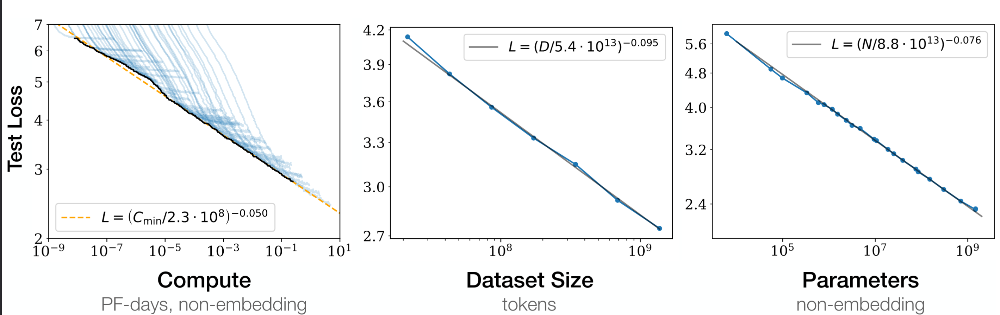

Figure 4.1: 
Loss on language modeling objective is a function of training compute, dataset size, and model size [[Kaplan et al., 2020](#bibc.bib24)].

##### 4.1.1 Kaplan Scaling Laws

There are different empirical results for scaling laws that are found by fitting a function to empirical test data. For instance, in Figure [4.1](#Ch4.F1 "Figure 4.1 ‣ 4.1 Scaling Laws: Compute, Data, Parameters ‣ Chapter 4 Scaling Laws and Efficient Large Language Models ‣ Part I Language Modeling ‣ Agentic Large Language Models"), every point is a trained model on a fixed dataset with a similar experimental setup, while only changing the three primary variables $C,D,N$. In early 2020, [Kaplan et al. [2020]](#bibc.bib24) found how model performance is related to $C,D,N$.
They estimated, following empirical observations, that the loss follows independent power laws rekated to the three main variables: $L(N)\propto N^{-\alpha_{N}}$ and $L(D)\propto D^{-\alpha_{D}}$, with $\alpha_{N}\approx 0.076$ and $\alpha_{D}\approx 0.095$.

The individual power laws can be combined into a single optimizable equation, shown in Equation [4.1](#Ch4.E1 "In 4.1.1 Kaplan Scaling Laws ‣ 4.1 Scaling Laws: Compute, Data, Parameters ‣ Chapter 4 Scaling Laws and Efficient Large Language Models ‣ Part I Language Modeling ‣ Agentic Large Language Models"). This relationship was assumed to be generic: it would apply well as models of loss behavior for “other generative modeling tasks” [[Kaplan et al., 2020](#bibc.bib24), p. 5]. The authors further showed that, under no other constraints than compute budget, their derivations would point to optimal model size $N$, an ideal dataset size $D$, defined by optimal step size ($S$) and batch size ($B$).

|  |  |  |  |
| --- | --- | --- | --- |
|  | $$ L(N,D)=\Big[\Big(\frac{N_{c}}{N}\Big)^{\frac{\alpha_{N}}{\alpha_{D}}}+\frac{D_{c}}{D}\Big]^{\alpha_{D}} $$ |  | (4.1) |

Specifically, they concluded that as the compute budget $C$ increases, model size $N$ should be increased faster than data size $D$ ($N\propto C^{0.73}$ and $D\propto C^{0.27}$11
1
$B\propto C^{0.24},\,S\propto C^{0.03},\,D=B\cdot S\propto C^{0.27}$), leading to the development of large models such as GPT-3. The negative exponents reflect diminishing returns: each doubling of model size or dataset size lowers the loss by only a few percent.

At first glance, this recommendation seems to contradict the exponents themselves: since $\alpha_{D}>\alpha_{N}$, data scaling reduces the loss *faster* than parameter scaling for the same relative increase in compute. The reason is that compute, not the resource itself, is the constraint: because $C\approx 6ND$, increasing $D$ consumes compute just as increasing $N$ does. This means that $N$ is with becoming a bottleneck with increasing likelihood. Hence, once the compute cost for $D$ is accounted for, allocating additional compute to $N$ yields a better return than allocating it to $D$. This means that the optimal allocation favors larger models.

###### Sample efficiency

A separate observation of [Kaplan et al. [2020]](#bibc.bib24) is that larger models are more *sample-efficient*. For a fixed number of training tokens, a larger model reaches a lower loss, and to reach a given target loss it requires fewer tokens and fewer optimization steps than a smaller one. This effect is visualized in Figure [4.2](#Ch4.F2 "Figure 4.2 ‣ Sample efficiency ‣ 4.1.1 Kaplan Scaling Laws ‣ 4.1 Scaling Laws: Compute, Data, Parameters ‣ Chapter 4 Scaling Laws and Efficient Large Language Models ‣ Part I Language Modeling ‣ Agentic Large Language Models").

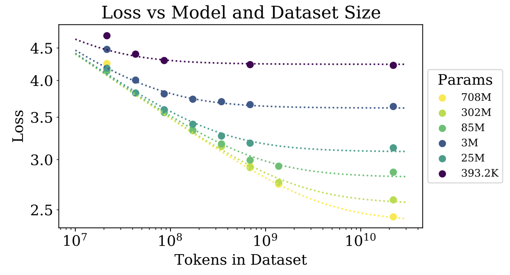

Figure 4.2: 
Larger models reach a given loss using fewer training tokens, illustrating greater sample efficiency [[Kaplan et al., 2020](#bibc.bib24)]

##### 4.1.2 Chinchilla Scaling Laws

In 2022, [Hoffmann et al. [2022]](#bibc.bib28) reevaluated these findings with a model called Chinchilla, and found, surprisingly, that most large models at the time were severely undertrained. This discrepancy can be traced back to the methodology of [Kaplan et al. [2020]](#bibc.bib24): their optimal allocation was extrapolated from the *early*, non-converged training dynamics of many models rather than from runs trained to convergence, which systematically biased their conclusions toward larger models trained for fewer steps.

The key insight from the Chinchilla study was that for every doubling of the compute budget, both the model size $N$ and the number of training tokens $D$ should be increased in roughly equal proportions ($N\propto C^{0.5}$ and $D\propto C^{0.5}$). Their rule of thumb suggests training on approximately 20 tokens for every trainable parameter in the model to achieve compute optimality. This result has since been reproduced [[Besiroglu et al., 2024](#bibc.bib29)] and has been shown to be robust to sizable perturbations [[Schaeffer et al., 2025](#bibc.bib27)].

In their scaling laws, the loss is modeled as a function of the parameter count $N$ and the number of tokens $D$ that have been trained on, as follows:

|  |  |  |  |
| --- | --- | --- | --- |
|  | $$ L(N,D)=E+\frac{A}{N^{\alpha}}+\frac{B}{D^{\beta}} $$ |  | (4.2) |

The first term $E$ captures the irreducible loss, corresponding to the entropy of natural text. The second term $\frac{A}{N^{\alpha}}$ captures the sub-optimality of a model with finite parameters $N$, and the final term $\frac{B}{D^{\beta}}$ captures the sub-optimality due to training on a finite number of tokens $D$. Although $\alpha$ and $\beta$ here play the same role as Kaplan’s $\alpha_{N}$ and $\alpha_{D}$ (the exponents governing how the loss falls off with model size and data) they are a different parameterization: they are fit jointly within this two-term form and therefore take different values. Fitting the Chinchilla scaling function on more than 400 models found the following parameter estimates:

|  |  |  |  |
| --- | --- | --- | --- |
|  | $$ E\approx 1.69,\quad A\approx 406.4,\quad B\approx 410.7,\quad\alpha\approx 0.34,\quad\beta\approx 0.28 $$ |  | (4.3) |

By optimizing this loss function under the constraint of a fixed compute budget $C$ (recall $C\approx 6ND$), we can derive the compute-optimal model size $N_{opt}$ and data size $D_{opt}$ for any budget $C$:

|  |  |  |  |
| --- | --- | --- | --- |
|  | $$ N_{opt}(C)=G\left(\frac{C}{6}\right)^{a},\quad D_{opt}(C)=\frac{1}{G}\left(\frac{C}{6}\right)^{b} $$ |  | (4.4) |

where $G=\big(\frac{\alpha A}{\beta B}\big)^{\frac{1}{\alpha+\beta}}$ is a constant, $a=\frac{\beta}{\alpha+\beta}\approx 0.45$ and $b=\frac{\alpha}{\alpha+\beta}\approx 0.55$.

Note that $a$ and $b$ are not independent: by construction $a+b=1$. This follows directly from $C\approx 6ND$, since taking logarithms gives $\log C=\log 6+\log N+\log D$. Writing $N_{opt}\propto C^{a}$ and $D_{opt}\propto C^{b}$, this becomes $\log C=\text{const}+a\log C+b\log C$, which can only hold for all $C$ if $a+b=1$. The same constraint applies to Kaplan’s exponents ($0.73+0.27=1$). The difference for Chinchilla was *how* the budget is split between $N$ and $D$.

This rule is approximately *linear* because $N_{opt}$ and $D_{opt}$ grow with the compute budget $C$ at almost the same rate: their exponents $a\approx 0.45$ and $b\approx 0.55$ are close, so the ratio $D_{opt}/N_{opt}$ stays near a constant value of roughly $20$ across many orders of magnitude of compute.
The value is best understood as an empirical calibration anchored on real compute-optimal runs rather than a number that results cleanly from the fitted coefficients. The Chinchilla model itself (70B parameters trained on 1.4T tokens) sits exactly at $D/N=20$. Table [4.1](#Ch4.T1 "Table 4.1 ‣ 4.1.2 Chinchilla Scaling Laws ‣ 4.1 Scaling Laws: Compute, Data, Parameters ‣ Chapter 4 Scaling Laws and Efficient Large Language Models ‣ Part I Language Modeling ‣ Agentic Large Language Models") shows several well-known models relative to this rule. Models below the ratio are *undertrained* (too large for their token budget), while models far above it are deliberately *overtrained* to obtain a small model that is cheap to run at inference time. Earlier flagship models such as GPT-3 and Gopher fall well below the line ($D/N\approx 1$–$2$): they were made very large but trained on comparatively too few tokens.
It is worth stressing that $D\approx 20N$ is optimal only for minimizing the *training* loss at a fixed training budget. When a model will later serve many inference requests, it is often deliberately *over-trained* on far more than $20$ tokens per parameter, trading additional training cost for a smaller model that is cheaper to run at inference time. LLaMA-3 8B, for instance, is trained on roughly $1900$ tokens per parameter. This deliberate extreme over-training is chosen so that a small model still reaches a low loss, and is cheap to run during inference.

| Model | $N$ | $D$ | $D/N$ | Regime |
| --- | --- | --- | --- | --- |
|
 Gopher [[Rae et al., 2021](#bibc.bib6)] | 280B | 300B | $\approx 1$ | undertrained |
|
 GPT-3 [[Brown et al., 2020](#bibc.bib11)] | 175B | 300B | $\approx 1.7$ | undertrained |
|
 Chinchilla [[Hoffmann et al., 2022](#bibc.bib28)] | 70B | 1.4T | $20$ | compute-optimal |
|
 LLaMA-1 7B [[Touvron et al., 2023a](#bibc.bib66)] | 7B | 1.0T | $\approx 143$ | overtrained |
|
 LLaMA-2 7B [[Touvron et al., 2023b](#bibc.bib12)] | 7B | 2.0T | $\approx 286$ | overtrained |
|
 LLaMA-3 8B [[Grattafiori et al., 2024](#bibc.bib44)] | 8B | 15T | $\approx 1875$ | overtrained |

Table 4.1: Token-to-parameter ratios of several well-known models relative to the Chinchilla rule of thumb $D\approx 20N$.

The picture so far is fairly clean: test loss falls smoothly, monotonically, and predictably with compute, data, and parameters. However, in practice, various factors influence our results. We discuss four phenomena that each probe a different edge of that picture:
(1) compute-optimal curves,
(2) emergent abilities,
(3) inverse scaling, and
(4) grokking.

##### 4.1.3 Compute-Optimal Curve

Computer hardware and energy are finite resources. A practical question is how to split a fixed compute budget $C$ between model size $N$ and dataset size $D$ to obtain the best possible model. Scaling laws answer this through the *compute-optimal frontier*: the allocation of $C$ that minimizes the loss.

This frontier is located empirically with the *IsoFLOP* method [[Hoffmann et al., 2022](#bibc.bib28)], shown in Figure [4.3](#Ch4.F3 "Figure 4.3 ‣ 4.1.3 Compute-Optimal Curve ‣ 4.1 Scaling Laws: Compute, Data, Parameters ‣ Chapter 4 Scaling Laws and Efficient Large Language Models ‣ Part I Language Modeling ‣ Agentic Large Language Models"). For various model sizes, we choose the number of training tokens such that the final FLOPs is a constant. The learning rate is adjusted using a cosine annealing schedule, with the cosine cycle length is set to match the target FLOP count. We find a clear valley in loss, meaning that for a given FLOP budget there is an optimal model size to train (left). Using the location of these valleys, we project optimal model size and number of tokens for larger models (center and right). In green, we show the estimated number of parameters and tokens for an optimal model trained with the compute budget of Gopher. For a fixed FLOP budget we train several models of different sizes: a model that is too small underfits, while a model that is too large is forced to train on too few tokens, so the resulting curve of loss against model size is U-shaped. Its minimum identifies the compute-optimal model size $N_{opt}$, from which the matching token count $D_{opt}=C/6N_{opt}$ follows via $C\approx 6ND$. Fitting a parabola to each such curve locates this minimum, and repeating the procedure across budgets finds how $N_{opt}$ and $D_{opt}$ grow with compute.

This parabola fitting must be done with care, and the simplification introduces systematic biases in the estimated optimum [[Czech et al., 2026](#bibc.bib67)]. These biases persist even on noise-free synthetic data and stem from three sources: (1) spacing the sampled model sizes too coarsely, (2) sampling that fails to locate the true minimum symmetrically, and (3) the genuine asymmetry of the loss surface, which a symmetric parabola cannot represent. At the scale of Llama-3, they estimate that such biases waste on the order of $1.4M of compute. As a remedy, they recommend fitting the parametric loss model $L(N,D)=E+A/N^{\alpha}+B/D^{\beta}$ directly—Chinchilla Approach 3, the same form we used above to derive the $D\approx 20N$ rule—with a numerically robust optimizer, rather than reading the optimum off fitted parabolas.

Complementary views on scaling [[Paquette et al., 2024](#bibc.bib26)] study analytically solvable models (power-law random features trained with one-pass stochastic gradient descent) instead of fitting curves to trained models. They find that the compute-optimal exponent is not a single universal constant, but that the data-complexity/target-complexity plane instead splits into four primary phases (plus three sub-phases), each with its own exponent governing how $N_{\mbox{opt}}$ grows with compute. The answer to the question which allocation rule to apply, and whether a fixed *20 tokens per parameter* is even the right shape, depends on the regime of the problem.

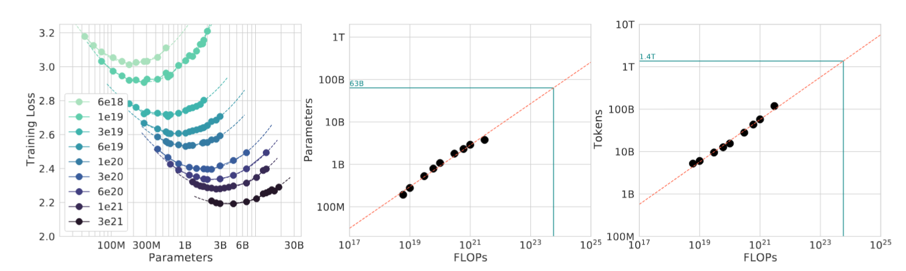

Figure 4.3: 
IsoFLOP curves [[Hoffmann et al., 2022](#bibc.bib28)]

###### Scaling for finetuning

The preceding works studied how pretraining scales. Do these scaling laws also govern finetuning? [Zhang et al. [2024]](#bibc.bib21) study this question for both full-model finetuning, which updates all of the model’s weights, and parameter-efficient finetuning (PEFT), which freezes the pretrained weights and trains only a small set of added parameters (as in LoRA) [[Hu et al., 2021](#bibc.bib9)]. The lesson most relevant to compute budgeting is that finetuning performance improves more from scaling the size of the *base model* than from collecting additional finetuning data, while adding more trainable PEFT parameters helps little. In practice, a task that underperforms is usually better served by starting from a larger pretrained model than by enlarging the adapter or gathering more finetuning examples.

##### 4.1.4 Emergent Abilities

Some of the most interesting phenomena in LLM scaling are *emergent abilities*: capabilities that are not present in smaller models but that appear suddenly as model size or compute cross a certain threshold [[Wei et al., 2022](#bibc.bib10)]. Examples include multi-step reasoning, few-shot translation, and specialized coding tasks, as shown in Figure [4.4](#Ch4.F4 "Figure 4.4 ‣ 4.1.4 Emergent Abilities ‣ 4.1 Scaling Laws: Compute, Data, Parameters ‣ Chapter 4 Scaling Laws and Efficient Large Language Models ‣ Part I Language Modeling ‣ Agentic Large Language Models"). The ability to perform a task via few-shot prompting is emergent when a language model achieves random performance until a certain scale, after which performance significantly increases to well-above random.

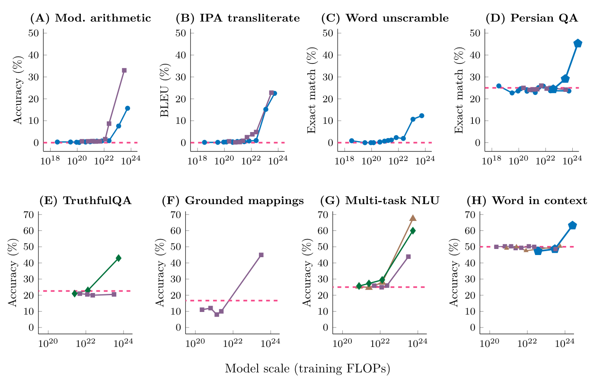

Figure 4.4: 
Eight examples of emergence in the few-shot prompting setting, each point is a separate model [[Wei et al., 2022](#bibc.bib10)].

However, the suddenness of the appearance has been contested. [Schaeffer et al. [2023]](#bibc.bib30) argue that emergent abilities might be a mirage caused by the choice of evaluation metrics. For instance, in Figure [4.5](#Ch4.F5 "Figure 4.5 ‣ 4.1.4 Emergent Abilities ‣ 4.1 Scaling Laws: Compute, Data, Parameters ‣ Chapter 4 Scaling Laws and Efficient Large Language Models ‣ Part I Language Modeling ‣ Agentic Large Language Models"), we see that while non-smooth discrete metrics (such as accuracy or exact match) show sharp jumps—they are non-smooth, after all—underlying metrics (such as the cross-entropy loss or token-level probability) follow a smooth, predictable power law across scales.

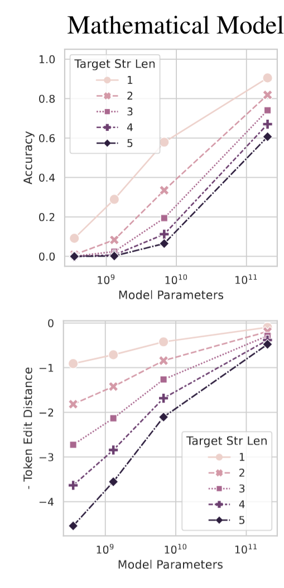

Figure 4.5: 
Claimed emergent abilities evaporate upon changing the metric from a nonlinear (top) to a smooth (bottom) metric [[Schaeffer et al., 2023](#bibc.bib30)]

##### 4.1.5 Inverse Scaling

While most tasks improve with scale, some exhibit *inverse scaling*, where larger models perform worse or develop stronger biases. This may happen in tasks where a distractor answer is more probable according to the language modeling objective than the correct answer, leading larger (and more confident) models to consistently choose the wrong option [[McKenzie et al., 2023](#bibc.bib31), [Michaelov and Bergen, 2023](#bibc.bib32)].

An example of inverse scaling is *hindsight neglect*, a task that tests whether a bet was worth taking based on its expected value. In case the expected value is positive, the model should respond with *yes*, and in case of a negative expected value it should respond with *no*. The situation is as follows. The model is only shown few-shot examples where the actual outcome always matches the expected value (that is, the bettor won money when the expected value was positive and lost money when the expected value was negative). The model is then asked a question about whether it was correct to take a bet where the expected value and the actual outcome do not match. Hindsight neglect tests whether models can correctly generalize from instructions when the few-shot examples are correctly-labeled but misleading. Repetitive algebra tests how models respond to simple algebra questions when given a specific pattern of correctly-labeled few-shot examples. Figure [4.6](#Ch4.F6 "Figure 4.6 ‣ 4.1.5 Inverse Scaling ‣ 4.1 Scaling Laws: Compute, Data, Parameters ‣ Chapter 4 Scaling Laws and Efficient Large Language Models ‣ Part I Language Modeling ‣ Agentic Large Language Models") shows that models generally start around random performance, but fall below random performance at around $10^{22}$ training FLOPs.

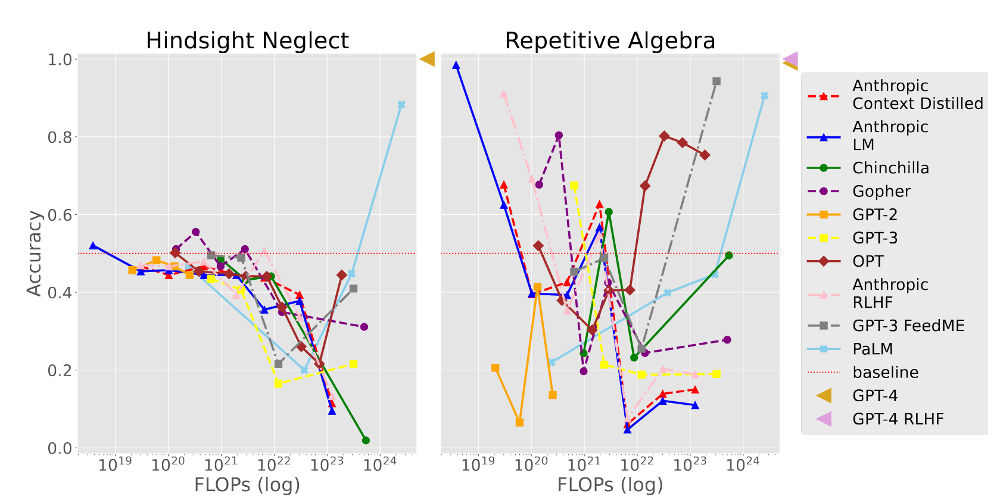

Figure 4.6: 
Scaling behavior for the Hindsight Neglect (left) and Repetitive Algebra (right) tasks [[McKenzie et al., 2023](#bibc.bib31)]

##### 4.1.6 Grokking

Grokking is a relatively recent paradox in statistical learning theory. This theory holds that, conventionally, when a large model is presented with a small dataset, it will overfit, due to memorization of the examples. Grokking, then, occurs when we continue to train this too-large model, and, after much more training, the model suddenly finds a generalizing solution [[Power et al., 2022](#bibc.bib65)].

While originally observed on small algorithmic tasks, such as modular addition, the grokking phenomenon suggests that scaling the number of training steps (over-training) can lead to qualitative shifts from memorization to understanding, even without increasing the dataset size $D$, see Figure [4.7](#Ch4.F7 "Figure 4.7 ‣ 4.1.6 Grokking ‣ 4.1 Scaling Laws: Compute, Data, Parameters ‣ Chapter 4 Scaling Laws and Efficient Large Language Models ‣ Part I Language Modeling ‣ Agentic Large Language Models").

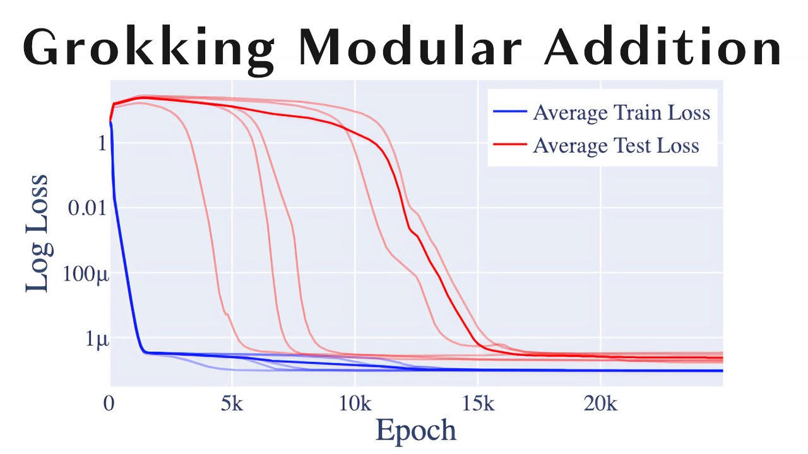

Figure 4.7: 
Early memorization of the training set (blue) versus late generalization (red: grokking) on a modular addition task [[Nanda et al., 2023](#bibc.bib2)]

The figure shows a data wall that initially limits scaling as the data is running out [[Villalobos et al., 2024](#bibc.bib72)], but later, after much more training, the model groks a generalizing solution.

Grokking is relevant to language modeling since we are rapidly running out of high-quality human text on the internet to satisfy the requirements on data $D$ of Chinchilla scaling for next-generation models. Because of these inherent limits, researchers are looking beyond simple scaling of $D$. As an alternative, we can look at a variety of these new frontiers:
(1) better architectural efficiency (such as Mixture of Experts),
(2) inference-time scaling (such as giving models more compute during inference to *think*, as seen in OpenAI’s o-series), or
(3) synthetic data generation (Chapter [19](#Ch19 "Chapter 19 *Synthetic Data Generation for Training Agentic LLMs ‣ Part VI Advanced Topics ‣ Agentic Large Language Models")).

#### 4.2 Small Language Models

As the requirements for compute and data continue to grow, there is an increasing interest in *small language models* (SLMs): models that are small enough to run on consumer hardware or even mobile or edge devices while maintaining high performance. These models are often developed using techniques that optimize for efficiency without sacrificing too much performance.

To understand the deployment landscape for these models, it is helpful to categorize common types of compute infrastructure:

- Datacenters: High-performance GPUs (such as NVIDIA H100s) and TPUs, primarily used for *pretraining* large models and hosting high-throughput inference APIs.
- Consumer Hardware: Standard desktop GPUs and high-end CPUs, where SLMs can be affordably *finetuned* or run locally by individual users.
- Edge Devices: Mobile phones, Internet-of-Things devices, and laptops, which are increasingly equipped with Neural Processing Units (NPUs) specifically designed for low-power, efficient on-device *inference*.

To fit models into the latter constrained environments, optimization techniques focus on speeding up throughput, reducing latency, reducing memory usage, and increasing sample efficiency. The techniques for achieving these goals can be grouped into two categories: (1) model-centric optimization, which targets the architecture of the models and their optimization approaches, and (2) data-centric optimization, which targets the data used to train the models. We will discuss both categories.

##### 4.2.1 Model-centric Optimization

First we discuss the model-centric optimization techniques.
We introduce the following techniques that allow for efficient training of smaller models, while still maintaining high task performance.
Model-centric techniques can focus on pretraining/finetuning or inference.

###### 4.2.1.1 Reducing Pretraining Cost

###### Parameter-Efficient Fine-Tuning (PEFT)

Methods such as *Low-Rank
Adaptation*
(LoRA) [[Hu et al., 2021](#bibc.bib9)] allow for adapting a large model to a new task by training only a tiny fraction (often $<1$%) of its parameters [[Lialin et al., 2023](#bibc.bib22)]. The key observation is that the weight update learned during finetuning has a low *intrinsic rank*: although a pretrained weight matrix
$W_{0}\in\mathbb{R}^{d\times k}$
is full-rank, the change $\Delta W$ needed to adapt it to a new task can be approximated well by a low-rank matrix. Instead of updating $W_{0}$ directly, LoRA freezes it and represents the update as a product of two small matrices,

|  |  |  |  |
| --- | --- | --- | --- |
|  | $$ W=W_{0}+\Delta W=W_{0}+BA,\qquad B\in\mathbb{R}^{d\times r},\;\;A\in\mathbb{R}^{r\times k} $$ |  | (4.5) |

where the rank $r\ll\min(d,k)$. For an input $x$, the modified forward pass becomes

|  |  |  |  |
| --- | --- | --- | --- |
|  | $$ h=W_{0}x+\frac{\alpha}{r}\,BAx, $$ |  | (4.6) |

where $\alpha$ is a constant scaling factor that controls the magnitude of the update, roughly similar to a learning rate in standard training. This is visualized in Figure [4.8](#Ch4.F8 "Figure 4.8 ‣ Parameter-Efficient Fine-Tuning (PEFT) ‣ 4.2.1.1 Reducing Pretraining Cost ‣ 4.2.1 Model-centric Optimization ‣ 4.2 Small Language Models ‣ Chapter 4 Scaling Laws and Efficient Large Language Models ‣ Part I Language Modeling ‣ Agentic Large Language Models"). We compute weight updates only for $A$ and $B$, reducing the number of trainable parameters from $d\times k$ to $r(d+k)$. At initialization $A$ is drawn from a random Gaussian and $B$ is set to zero, so $\Delta W=0$ and training starts from the pretrained model. Because $\Delta W$ can directly be merged back into $W_{0}$ after training, LoRA adds no inference latency, and a single base model can be served with many small, swappable task-specific adapters.

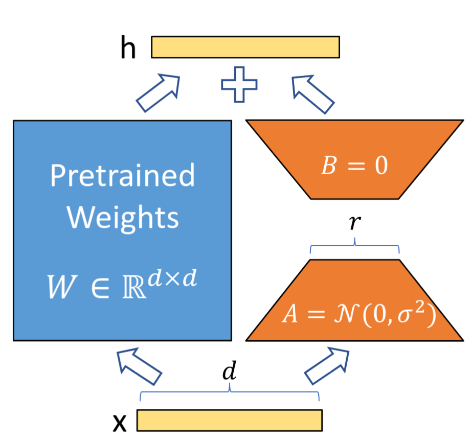

Figure 4.8: 
Low-Rank Adaptation reparametrization [[Hu et al., 2021](#bibc.bib9)]. During finetuning, only $A$ and $B$ are trained

###### Architectural Innovations

A second family of techniques changes the model architecture itself so that it is cheaper to run, rather than compressing a fixed architecture after the fact. Two influential examples are Grouped-Query Attention and Mixture of Experts.

*Grouped-Query Attention* (GQA) [[Ainslie et al., 2023](#bibc.bib47)] targets the memory bandwidth bottleneck of autoregressive decoding. In standard *multi-head attention* (MHA), every query head has its own key and value matrix, which we all need to use for computing attention scores. At the other extreme, *multi-query attention* (MQA) lets all query heads share a single key/value head, which shrinks the computation but can hurt expressive quality and training stability. GQA interpolates between these two: the query heads are divided into $g$ groups, and all heads within a group share one key/value head. With $g=1$ it is equivalent to MQA, and with $g$ equal to the number of heads it is equivalent to MHA, so $g$ trades quality against memory usage. Often, GQA is combined with the KV-caching optimizations discussed next in Section [4.2](#Ch4.S2 "4.2 Small Language Models ‣ Chapter 4 Scaling Laws and Efficient Large Language Models ‣ Part I Language Modeling ‣ Agentic Large Language Models"), and it is now the default attention variant in many open-weight models.

*Mixture of Experts* (MoE) [[Shazeer et al., 2017](#bibc.bib46)] decouples the total number of parameters from the compute spent per token. Instead of a single dense feed-forward block in each layer, a MoE layer contains many parallel “expert” sub-networks together with a lightweight *gating network* (router) that activates only a small number of experts (typically the top-$1$ or $2$) for each token. Because only the chosen experts perform computation, the per-token cost stays close to that of a single dense block even as the total parameter count (and hence the model’s overall capacity) grows by an order of magnitude or more [[Fedus et al., 2022](#bibc.bib45)].

This *sparse activation* is why models such as Mixtral and many recent frontier systems can have hundreds of billions of total parameters while activating only a fraction of them per token. The trade-offs are (1) that all experts must still be held in memory, (2) that the load must be balanced across experts (often via an auxiliary loss) so that no expert is over- or under-used, and (3) that routing introduces additional engineering complexity. The MoE architecture is visualized in Figure [4.9](#Ch4.F9 "Figure 4.9 ‣ Architectural Innovations ‣ 4.2.1.1 Reducing Pretraining Cost ‣ 4.2.1 Model-centric Optimization ‣ 4.2 Small Language Models ‣ Chapter 4 Scaling Laws and Efficient Large Language Models ‣ Part I Language Modeling ‣ Agentic Large Language Models"), which shows a top-$k$ routing mechanism, configured with $k=2$, where the gating function selects the two highest-scoring FFN experts for each token based on the router. The selected experts are evaluated in parallel, with their outputs aggregated using weighted summation [[Zhang et al., 2025](#bibc.bib69)].

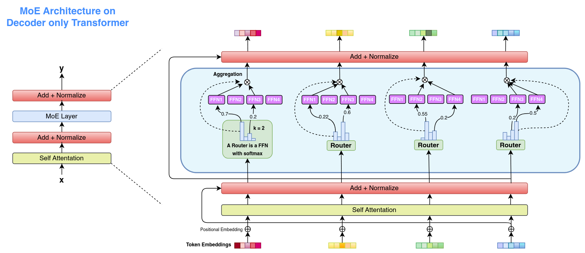

Figure 4.9: 
Illustration of the sparsely gated Mixture of Experts (MoE) architecture on top of a decoder-only transformer [[Zhang et al., 2025](#bibc.bib69)]

###### Knowledge Distillation

A large teacher model is used to train a smaller student model by encouraging the student to match the teacher’s output distribution [[Gu et al., 2023](#bibc.bib8), [Xu et al., 2024](#bibc.bib7)]. Crucially, the student learns from the teacher’s full *soft* probabilities (typically softened with a temperature) rather than only the single correct answer. These soft targets carry richer information: for instance, which wrong answers the teacher considers plausible. This lets the student approach the teacher’s quality at a fraction of its size. The same idea underpins the synthetic-data generation discussed below, where a frontier model effectively acts as the teacher, generating high-quality training data for a smaller student model.

###### 4.2.1.2 Reducing Inference Cost

Once a model is trained, it can be further optimized for deployment at inference time. Whereas training-time techniques focus on reducing the cost of producing the model, inference-time techniques target the cost of *using* it: the throughput (tokens generated per second), the latency (time to the first and each subsequent token), and the memory footprint required to serve a request. We discuss several techniques that are commonly used to reduce inference cost, which can be applied to both large and small models.

###### Key–Value (KV) Caching

During autoregressive generation, the model produces one token at a time, and each new token attends to all previous tokens. Recomputing the attention keys and values for the entire context at every step is quadratically expensive. However, when we predict a new token, the context remains the same. Instead of recomputing the attention values, we can store the key and value vectors of past tokens in a *KV cache* and reuse them. This turns per-step attention into a linear-cost lookup. This is the basic optimization that makes decoding practical, but it comes at a cost: the cache grows linearly with both sequence length and batch size and quickly dominates memory usage for long contexts. This problem has motivated both the architectural choices above (GQA and MQA shrink the cache by sharing key/value heads across query heads) and dedicated memory-management schemes such as *PagedAttention*, which stores the cache in non-contiguous blocks to reduce fragmentation and enable higher serving throughput [[Kwon et al., 2023](#bibc.bib68)].

###### Pruning

A more extreme method for reducing model size is to consider removing redundant or less important connections in the neural network [[Ma et al., 2023](#bibc.bib51)]. Pruning can be *unstructured* (zeroing out individual weights) or *structured* (removing entire neurons, attention heads, or layers); the latter yields concrete speedups on standard hardware, whereas the former requires sparsity-aware kernels to realize its benefits.

###### Quantization

Another method of saving memory during inference is to reduce the size of the matrix that needs to be loaded into memory. Rather than making the matrix dimensions smaller, we can also lower the precision of weights entries (e.g., from 16-bit to 8-bit or 4-bit numbers). This significantly reduces memory usage and speeds up inference. However, in principle, lower precision means lower performance. The same idea can also be applied to the KV cache itself to keep long contexts in memory. Quantization is a frequently used approach [[Dettmers et al., 2022](#bibc.bib48), [Dettmers and Zettlemoyer, 2023](#bibc.bib49), [Xiao et al., 2023](#bibc.bib50)].

Alternatively, rather than casting all weights to the same precision, *mixed precision* modes have been proposed, with different levels of numerical precision for different parts of the computation, to balance speed and stability [[Micikevicius et al., 2017](#bibc.bib3)]. This approach may suffer from non-deterministic results due to numerical instabilities [[Yuan et al., 2025](#bibc.bib25)].

###### Speculative Decoding

A key technique for optimizing inference efficiency is *speculative decoding* [[Leviathan et al., 2023](#bibc.bib20)]. This approach uses a small draft model to generate multiple tokens quickly, which are then verified in parallel by a larger target model. This allows for faster inference (up to 2-3 fold speedup) without sacrificing the quality of the larger model, effectively leveraging the different points on the scaling curve.

##### 4.2.2 Data-centric Optimization

In addition to model-centric approaches, the literature emphasizes that data quality and curation are often more important than the size of the dataset when training efficient models [[Luo et al., 2025](#bibc.bib34)]. Small models can perform well if they are trained on highly curated, high-quality data. Hence, it is important to create a good data recipe, in addition to an efficient model architecture. Data-centric techniques broadly fall into two camps: *selecting* the most useful parts from a broader pool of data, and *generating* new synthetic data where good data is scarce.

###### 4.2.2.1 Data Selection and Curation

Rather than training on all available text, a growing body of work shows that carefully choosing *which* data to train on, and in what proportions, yields better models for the same compute budget. For pretraining, NVIDIA’s *CLIMB* framework [[Diao et al., 2026](#bibc.bib70)] embeds a large corpus into a semantic space, clusters it, and then iteratively searches for the data mixture that minimises proxy-model loss. The resulting *ClimbMix* dataset (400B tokens) lets a sub-billion-parameter model outperform comparable models trained on far larger but unfiltered corpora. The same principle applies at the finetuning stage: *LIMA* [[Zhou et al., 2023](#bibc.bib23)] shows that supervised finetuning on only $1{,}000$ carefully curated prompt–response pairs is enough to produce a strong instruction-following model, supporting the view that most knowledge is acquired during pretraining and that alignment mainly teaches the model a desired response *style*.

###### 4.2.2.2 Synthetic Data Gathering

When suitable data does not exist, it can be generated. The *Textbooks Are All You Need* approach, used for models such as Microsoft’s Phi series [[Gunasekar et al., 2023](#bibc.bib33)], demonstrates that training on clean, synthetic textbook-quality data can allow a relatively small model of 1.3B parameters to outperform models ten times its size.

Such pipelines typically rely on frontier models to generate the data, combined with *LLM-as-a-judge* scoring to filter for the most accurate and educational examples, and rigorous *decontamination* to ensure the synthetic data does not leak benchmark test sets and inflate reported performance. This approach is particularly valuable for reasoning data: by training on step-by-step reasoning trajectories produced by larger models, complex problem-solving skills can be distilled into a smaller architecture (see also Chapter [6](#Ch6 "Chapter 6 Multi-step Reasoning in LLMs ‣ Part II Reasoning ‣ Agentic Large Language Models")) [[Muennighoff et al., 2025](#bibc.bib4), [Arora and Zanette, 2026](#bibc.bib71)].

###### 4.2.2.3 Sample-Efficient Learning

Beyond synthetic data, there is an increased research focus on how models can learn more efficiently from limited, naturalistic data. Initiatives such as the *BabyLM Challenge* [[Warstadt et al., 2023](#bibc.bib52)] focus on training models under strict data constraints (e.g., 10M to 100M tokens). This mirrors the volume of language input a human child receives during early development, driving innovation in sample-efficient architectures while providing insights into cognitively plausible language acquisition.

##### 4.2.3 Popular models

Having surveyed improvement techniques, it is useful to look at how popular large and small models apply them in practice. Models are commonly categorized by their openness: closed-weight (proprietary) models expose only an API, open-weight models release their trained parameters, and open-source models additionally share the training data and code. In practice openness is a matter of degree rather than a strict category, and we may subsequently use an openness index to rate the transparency [[Artificial Analysis, 2026](#bibc.bib37)]. Most open models can be found on repositories such as Hugging Face.

Below, we briefly describe some of the most popular open-weight models that are designed to be efficient enough to run on consumer hardware, and the techniques they use to achieve this. This is not an exhaustive list, but rather a selection of influential models that exemplify the trends in efficiency techniques and their scales, at the time of writing.

- 

  [[Abdin et al., 2024](#bibc.bib38)]. The Phi-series are capable SLMs that are efficient enough to run locally on mobile devices. The core innovation behind the Phi models is their data-centric training methodology. Microsoft curates high-quality, heavily filtered web data combined with synthetic data generated by larger models. This allows small models (such as the 3.8 billion parameter Phi-3-mini) to perform well, rivaling the reasoning capabilities of much larger models such as GPT-3.5 and Mixtral.
- 

  [[Mesnard et al., 2024](#bibc.bib39)] Google emphasizes that Gemma models inherit Gemini’s strong generalist capabilities, particularly in text, reasoning, and coding, while advancing the state-of-the-art for their specific size classes, but little is known about their training method or data.
- 

  [[Ettinger et al., 2025](#bibc.bib19)] The OLMo (Open Language Model) family is developed by the Allen Institute for AI to be a completely open-source model. The OLMo project open-sourced the full training pipeline, including code and data: the pre-training dataset (Dolma), the training and evaluation code, training logs, and intermediate checkpoints. This transparency allows researchers to study training dynamics, data influences, and algorithmic biases.
- 

  [[Bai et al., 2023](#bibc.bib43)] The Qwen family represents a high-performing suite of foundational and instruction-tuned models, ranging from sub-billion dense models to large Mixture-of-Experts (MoE) architectures. They are notable for their multilingual capabilities and performance on mathematics, coding, and logical reasoning benchmarks.
- 

  [[Mehta et al., 2024](#bibc.bib40)] Apple’s Efficient Language Model family is designed to run efficiently on edge devices. The layer-wise scaling strategy uses smaller latent dimensions in layers closer to the input and widens them closer to the output. This results in high accuracy for low parameter count.
- 

  [[Agarwal et al., 2025](#bibc.bib42)] OpenAI released two open-weight reasoning models that use an efficient mixture-of-expert architecture, optimized for agentic capabilities.
- 

  [[Jiang et al., 2024](#bibc.bib41)] These models popularized Sparse Mixture-of-Experts (SMoE) architectures in the open-weights ecosystem (e.g., Mixtral 8x7B), allowing for large parameter counts with few active parameters during inference, to maximize efficiency.
- 

  [[Grattafiori et al., 2024](#bibc.bib44)] Meta’s Llama models have become frequently used. Trained on large datasets (up to 15 trillion tokens for Llama 3) and ranging from small edge-friendly sizes to large 405B parameter frontier models, they established the standard for scaling laws in open models and catalyzed an ecosystem of finetuned models and derivatives.
- 

  [[Liu et al., 2025](#bibc.bib18)] DeepSeek-V3 is a large Mixture-of-Experts model (671B total parameters with 37B activated per token) notable for the stability of its training. It combines Multi-head Latent Attention (MLA) for a compressed key-value cache with an auxiliary-loss-free strategy for expert load balancing, and was trained in FP8 mixed precision, achieving frontier-level performance at a small compute cost. The line also includes the DeepSeek-R1 reasoning models.
- 

  [[Zeng et al., 2026](#bibc.bib17)] Developed by Zhipu AI, the GLM (General Language Model) family is built on strong reasoning capabilities that are developed early in training, and retained throughout the training process. Recent iterations are optimized for agentic workflows and software engineering, targeting tool-use and code-generation performance rather than text completion alone.
- 

  [[Biderman et al., 2023](#bibc.bib5)] EleutherAI’s Pythia is a suite of models (ranging from 70M to 12B parameters) designed to support research into training dynamics and scaling. Every model is trained on the same data in the same order, with intermediate checkpoints released per model, enabling controlled studies of how capabilities, memorization, and biases emerge over the course of training.
- 

  [[Scao et al., 2023](#bibc.bib16)] BLOOM is a 176B-parameter open-access model produced by the BigScience collaborative research effort. Trained on the ROOTS corpus, spanning 46 natural languages and 13 programming languages, it was among the first large-scale models to prioritize multilingual coverage and full openness, released under a Responsible AI License.
- 

  [[Allal et al., 2025](#bibc.bib15)] Hugging Face’s SmolLM is a family of compact models (135M, 360M, and 1.7B parameters) aimed at efficient on-device deployment, much like the Phi series. Its performance stems from data curation: it is trained on the SmolLM-Corpus, which combines high-quality web data, Python code examples, and synthetically (Mixtral) generated textbooks and stories.

#### 4.3 Inference-Time Compute

The traditional scaling laws focus on the relationship between compute and performance *at training time*. More recent studies shift part of this computational burden to inference: *inference-time scaling* (or test-time compute) [[Muennighoff et al., 2025](#bibc.bib4)]. Rather than spending all compute during training, a model is allowed to deliberate longer at inference time. This is measured by the number of tokens generated or reasoning paths explored, in order to produce a higher-quality answer. Hence, optimizing throughput (tokens/s) becomes of prime importance: the faster tokens can be produced, the more reasoning a model is able to do during the same amount of time.

Increasing this inference-time budget in terms of tokens can lead to significant improvements in capabilities [[Du et al., 2024](#bibc.bib1)]; recent work indicates that optimally allocating test-time compute can allow smaller models to outperform larger ones on difficult reasoning tasks [[Snell et al., 2024](#bibc.bib35)]. These gains are not guaranteed, however, and depend on the task and on the specific search or verification strategy employed [[Stechly et al., 2023](#bibc.bib36)]. Beyond performance, this shift also reframes a broader question about what kind of systems LLMs are, which we take up in detail in Chapter [6](#Ch6 "Chapter 6 Multi-step Reasoning in LLMs ‣ Part II Reasoning ‣ Agentic Large Language Models").

#### 4.4 Sustainable Language Models

The large scale of LLM training and deployment has significant environmental and economic implications. The energy consumption of AI training and inference is large, and the subsequent water consumption for cooling comes with a strain on water distribution pipelines [[Li et al., 2025](#bibc.bib14), [Jegham et al., 2025](#bibc.bib13)]. Measuring the energy use and carbon footprint of training has only recently entered standard reporting [[Ding and Shi, 2024](#bibc.bib53)]. It has been reported that training a single large model can consume as much energy as hundreds of households use in a year. Training a model such as BLOOM emitted over 50 tonnes of CO2 equivalent when accounting for both dynamic power consumption and the embodied carbon of hardware manufacturing [[Luccioni et al., 2023](#bibc.bib54)].

As the use of LLMs is increasing in science and society, the total carbon footprint is increasingly dominated by *inference* rather than training, especially for models used by millions of people daily [[Özcan et al., 2025](#bibc.bib57), [Wu et al., 2022](#bibc.bib56), [Samsi et al., 2023](#bibc.bib55)]. This creates an opportunity: spending more compute during training to create a smaller, more efficient model (as discussed in Section [4.1](#Ch4.S1 "4.1 Scaling Laws: Compute, Data, Parameters ‣ Chapter 4 Scaling Laws and Efficient Large Language Models ‣ Part I Language Modeling ‣ Agentic Large Language Models")) can significantly reduce the long-term environmental cost of deployment.

As global inference demand scales to billions of daily queries, the cumulative energy consumption and associated financial cost overtake the initial training investment [[Faiz et al., 2024](#bibc.bib58)]. Deploying large models at this scale requires a substantial data center infrastructure, and large electricity and water consumption. Consequently, there is a strong push toward deploying Small Language Models (SLMs) for sustainable, large-scale use. By minimizing the parameter and quantization count, SLMs reduce the memory bandwidth and compute required per generated token, offering a greener and more economically viable solution.

###### Privacy and Data Leakage

Beyond environmental concerns, the centralization of LLMs through cloud APIs introduces privacy vulnerabilities. When users query cloud-based models, sensitive personal data, corporate intellectual property, or protected health information must be transmitted to third-party servers. This creates risks of data leakage [[Aiyappa et al., 2023](#bibc.bib59), [Li et al., 2024](#bibc.bib60)], either through unauthorized interception, adversarial extraction attacks, or the inadvertent memorization and subsequent regurgitation of private user prompts by the model [[Chen et al., 2024](#bibc.bib61), [Maini et al., 2024](#bibc.bib62), [Liu et al., 2022](#bibc.bib63)].

To mitigate these privacy risks and reduce reliance on cloud infrastructure, developers can move from API-based inference toward *local, on-device inference* [[Qu et al., 2025](#bibc.bib64)]:

- API-Based Inference: API-based inference relies on powerful remote servers. While this allows access to frontier models with hundreds of billions of parameters, it suffers from network latency, requires constant internet connectivity, and inherently exposes user data to cloud providers.
- Local Inference: Local inference runs the model directly on the user’s hardware (e.g., smartphones, laptops, or edge servers). This ensures data privacy because prompts never leave the device while also eliminating network latency and guaranteeing offline availability.

Local inference is constrained by the physical limits of consumer and edge hardware. For instance, memory and bandwidth are limited. LLM inference is a memory-bound process. Storing model weights requires significant RAM capacity, while generating tokens requires a high memory bandwidth. Furthermore, most mobile devices are powered by a battery. Running intensive matrix multiplications on mobile devices or standard laptops can lead to rapid battery drain and thermal throttling.

To make local deployment feasible, developers must rely on the inference-time optimization techniques, such as quantization (e.g., 4-bit) and speculative decoding, alongside the increasing availability of specialized neural processing units (NPUs) designed for low-power edge AI.

#### 4.5 Concluding Remarks

As LLM use becomes more ubiquitous and the demand for quick responses increases, the focus in LLM development is shifting towards more efficient solutions. Hence, the focus on scaling data, compute, and model size purely for raw performance is transitioning into a focus on scaling for *efficiency*.

While the fundamental power laws still hold, the focus has shifted from simply training the largest possible model toward compute-optimal training, inference-time scaling, and initiatives to develop capable small models that run on consumer and edge hardware.

The directions that have been discussed in this chapter are complementary rather than competing: the model-centric techniques (LoRA, GQA, MoE, quantization, distillation) and the data-centric techniques (careful data selection and synthetic generation) are increasingly combined within a single training recipe.

As we move closer to the data wall, the role of synthetic data and architectural efficiency are likely to grow in importance, and the ability to do more with less is becoming a research focus.

### References

- Abdin et al. (2024)
  M. Abdin, J. Aneja, H. Awadalla, A. Awadallah, A. A. Awan, N. Bach, A. Bahree, A. Bakhtiari, J. Bao, H. Behl, A. Benhaim, M. Bilenko, J. Bjorck, S. Bubeck, M. Cai, Q. Cai, V. Chaudhary, et al.
  Phi-3 technical report: a highly capable language model locally on your phone.
  External Links: 2404.14219,
  [Link](https://arxiv.org/abs/2404.14219)
  Cited by: [item Phi series](#Ch4.S2.I2.ix1.p1.1 "In 4.2.3 Popular models ‣ 4.2 Small Language Models ‣ Chapter 4 Scaling Laws and Efficient Large Language Models ‣ Part I Language Modeling ‣ Agentic Large Language Models").

- Agarwal et al. (2025)
  S. Agarwal, L. Ahmad, J. Ai, S. Altman, A. Applebaum, E. Arbus, R. K. Arora, Y. Bai, B. Baker, H. Bao, B. Barak, A. Bennett, T. Bertao, N. Brett, E. Brevdo, G. Brockman, et al.
  Gpt-oss-120b & gpt-oss-20b model card.
  External Links: 2508.10925,
  [Link](https://arxiv.org/abs/2508.10925)
  Cited by: [item gpt-oss](#Ch4.S2.I2.ix6.p1.1 "In 4.2.3 Popular models ‣ 4.2 Small Language Models ‣ Chapter 4 Scaling Laws and Efficient Large Language Models ‣ Part I Language Modeling ‣ Agentic Large Language Models").

- Ainslie et al. (2023)
  J. Ainslie, J. Lee-Thorp, M. de Jong, Y. Zemlyanskiy, F. Lebron, and S. Sanghai
  GQA: training generalized multi-query transformer models from multi-head checkpoints.
  In Proceedings of the 2023 Conference on Empirical Methods in Natural Language Processing, H. Bouamor, J. Pino, and K. Bali (Eds.),
  Singapore, pp. 4895–4901.
  External Links: [Link](https://aclanthology.org/2023.emnlp-main.298/),
  [Document](https://dx.doi.org/10.18653/v1/2023.emnlp-main.298)
  Cited by: [§4.2.1.1](#Ch4.S2.SS1.SSS1.Px2.p2.1 "Architectural Innovations ‣ 4.2.1.1 Reducing Pretraining Cost ‣ 4.2.1 Model-centric Optimization ‣ 4.2 Small Language Models ‣ Chapter 4 Scaling Laws and Efficient Large Language Models ‣ Part I Language Modeling ‣ Agentic Large Language Models").

- Aiyappa et al. (2023)
  R. Aiyappa, J. An, H. Kwak, and Y. Ahn
  Can we trust the evaluation on ChatGPT?.
  In Proceedings of the 3rd Workshop on Trustworthy Natural Language Processing (TrustNLP 2023), A. Ovalle, K. Chang, N. Mehrabi, Y. Pruksachatkun, A. Galystan, J. Dhamala, A. Verma, T. Cao, A. Kumar, and R. Gupta (Eds.),
  Toronto, Canada, pp. 47–54.
  External Links: [Link](https://aclanthology.org/2023.trustnlp-1.5/),
  [Document](https://dx.doi.org/10.18653/v1/2023.trustnlp-1.5)
  Cited by: [§4.4](#Ch4.S4.SS0.SSS0.Px1.p1.1 "Privacy and Data Leakage ‣ 4.4 Sustainable Language Models ‣ Chapter 4 Scaling Laws and Efficient Large Language Models ‣ Part I Language Modeling ‣ Agentic Large Language Models").

- Allal et al. (2025)
  L. B. Allal, A. Lozhkov, E. Bakouch, G. M. Blazquez, G. Penedo, L. Tunstall, A. Marafioti, A. P. Lajarín, H. Kydlíček, V. Srivastav, J. Lochner, C. Fahlgren, X. S. NGUYEN, B. Burtenshaw, C. Fourrier, H. Zhao, H. Larcher, M. Morlon, C. Zakka, C. Raffel, L. V. Werra, and T. Wolf
  SmolLM2: when smol goes big — data-centric training of a fully open small language model.
  In Second Conference on Language Modeling,
  External Links: [Link](https://openreview.net/forum?id=3JiCl2A14H)
  Cited by: [item SmolLM](#Ch4.S2.I2.ix13.p1.1 "In 4.2.3 Popular models ‣ 4.2 Small Language Models ‣ Chapter 4 Scaling Laws and Efficient Large Language Models ‣ Part I Language Modeling ‣ Agentic Large Language Models").

- Arora and Zanette (2026)
  D. Arora and A. Zanette
  Training language models to reason efficiently.
  Advances in Neural Information Processing Systems 38, pp. 60770–60808.
  Cited by: [§4.2.2.2](#Ch4.S2.SS2.SSS2.p2.1 "4.2.2.2 Synthetic Data Gathering ‣ 4.2.2 Data-centric Optimization ‣ 4.2 Small Language Models ‣ Chapter 4 Scaling Laws and Efficient Large Language Models ‣ Part I Language Modeling ‣ Agentic Large Language Models").

- Artificial Analysis (2026)
  Artificial Analysis
  Artificial analysis openness index.
  Note: Accessed: 2026-03-16
  External Links: [Link](https://artificialanalysis.ai/evaluations/artificial-analysis-openness-index)
  Cited by: [§4.2.3](#Ch4.S2.SS3.p1.1 "4.2.3 Popular models ‣ 4.2 Small Language Models ‣ Chapter 4 Scaling Laws and Efficient Large Language Models ‣ Part I Language Modeling ‣ Agentic Large Language Models").

- Bai et al. (2023)
  J. Bai, S. Bai, Y. Chu, Z. Cui, K. Dang, X. Deng, Y. Fan, W. Ge, Y. Han, F. Huang, B. Hui, L. Ji, M. Li, J. Lin, R. Lin, D. Liu, G. Liu, et al.
  Qwen technical report.
  External Links: 2309.16609,
  [Link](https://arxiv.org/abs/2309.16609)
  Cited by: [item Qwen series](#Ch4.S2.I2.ix4.p1.1 "In 4.2.3 Popular models ‣ 4.2 Small Language Models ‣ Chapter 4 Scaling Laws and Efficient Large Language Models ‣ Part I Language Modeling ‣ Agentic Large Language Models").

- Besiroglu et al. (2024)
  T. Besiroglu, E. Erdil, M. Barnett, and J. You
  Chinchilla scaling: a replication attempt.
  arXiv preprint arXiv:2404.10102.
  Cited by: [§4.1.2](#Ch4.S1.SS2.p2.1 "4.1.2 Chinchilla Scaling Laws ‣ 4.1 Scaling Laws: Compute, Data, Parameters ‣ Chapter 4 Scaling Laws and Efficient Large Language Models ‣ Part I Language Modeling ‣ Agentic Large Language Models").

- Biderman et al. (2023)
  S. Biderman, H. Schoelkopf, Q. G. Anthony, H. Bradley, K. O’Brien, E. Hallahan, M. A. Khan, S. Purohit, U. S. Prashanth, E. Raff, et al.
  Pythia: a suite for analyzing large language models across training and scaling.
  In International Conference on Machine Learning,
  pp. 2397–2430.
  Cited by: [item Pythia](#Ch4.S2.I2.ix11.p1.1 "In 4.2.3 Popular models ‣ 4.2 Small Language Models ‣ Chapter 4 Scaling Laws and Efficient Large Language Models ‣ Part I Language Modeling ‣ Agentic Large Language Models").

- Brown et al. (2020)
  T. Brown, B. Mann, N. Ryder, M. Subbiah, J. D. Kaplan, P. Dhariwal, A. Neelakantan, P. Shyam, G. Sastry, A. Askell, et al.
  Language models are few-shot learners.
  Advances in neural information processing systems 33, pp. 1877–1901.
  Cited by: [Table 4.1](#Ch4.T1.3.3.1 "In 4.1.2 Chinchilla Scaling Laws ‣ 4.1 Scaling Laws: Compute, Data, Parameters ‣ Chapter 4 Scaling Laws and Efficient Large Language Models ‣ Part I Language Modeling ‣ Agentic Large Language Models").

- Chen et al. (2024)
  X. Chen, S. Tang, R. Zhu, S. Yan, L. Jin, Z. Wang, L. Su, Z. Zhang, X. Wang, and H. Tang
  The janus interface: how fine-tuning in large language models amplifies the privacy risks.
  In Proceedings of the 2024 on ACM SIGSAC Conference on Computer and Communications Security,
  pp. 1285–1299.
  Cited by: [§4.4](#Ch4.S4.SS0.SSS0.Px1.p1.1 "Privacy and Data Leakage ‣ 4.4 Sustainable Language Models ‣ Chapter 4 Scaling Laws and Efficient Large Language Models ‣ Part I Language Modeling ‣ Agentic Large Language Models").

- Czech et al. (2026)
  E. Czech, Z. Xu, Y. Elmatad, Y. Wang, and W. Held
  Problems with chinchilla approach 2: systematic biases in isoflop parabola fits.
  External Links: 2603.22339,
  [Link](https://arxiv.org/abs/2603.22339)
  Cited by: [§4.1.3](#Ch4.S1.SS3.p3.1 "4.1.3 Compute-Optimal Curve ‣ 4.1 Scaling Laws: Compute, Data, Parameters ‣ Chapter 4 Scaling Laws and Efficient Large Language Models ‣ Part I Language Modeling ‣ Agentic Large Language Models").

- Dettmers et al. (2022)
  T. Dettmers, M. Lewis, Y. Belkada, and L. Zettlemoyer
  GPT3.int8(): 8-bit matrix multiplication for transformers at scale.
  In Advances in Neural Information Processing Systems, S. Koyejo, S. Mohamed, A. Agarwal, D. Belgrave, K. Cho, and A. Oh (Eds.),
  Vol. 35, pp. 30318–30332.
  External Links: [Link](https://proceedings.neurips.cc/paper_files/paper/2022/file/c3ba4962c05c49636d4c6206a97e9c8a-Paper-Conference.pdf)
  Cited by: [§4.2.1.2](#Ch4.S2.SS1.SSS2.Px3.p1.1 "Quantization ‣ 4.2.1.2 Reducing Inference Cost ‣ 4.2.1 Model-centric Optimization ‣ 4.2 Small Language Models ‣ Chapter 4 Scaling Laws and Efficient Large Language Models ‣ Part I Language Modeling ‣ Agentic Large Language Models").

- Dettmers and Zettlemoyer (2023)
  T. Dettmers and L. Zettlemoyer
  The case for 4-bit precision: k-bit inference scaling laws.
  In Proceedings of the 40th International Conference on Machine Learning, A. Krause, E. Brunskill, K. Cho, B. Engelhardt, S. Sabato, and J. Scarlett (Eds.),
  Proceedings of Machine Learning Research, Vol. 202, pp. 7750–7774.
  External Links: [Link](https://proceedings.mlr.press/v202/dettmers23a.html)
  Cited by: [§4.2.1.2](#Ch4.S2.SS1.SSS2.Px3.p1.1 "Quantization ‣ 4.2.1.2 Reducing Inference Cost ‣ 4.2.1 Model-centric Optimization ‣ 4.2 Small Language Models ‣ Chapter 4 Scaling Laws and Efficient Large Language Models ‣ Part I Language Modeling ‣ Agentic Large Language Models").

- Diao et al. (2026)
  S. Diao, Y. Yang, Y. Fu, X. Dong, D. Su, M. Kliegl, Z. Chen, P. Belcak, Y. Suhara, H. Yin, et al.
  Nemotron-climb: clustering-based iterative data mixture bootstrapping for language model pre-training.
  Advances in Neural Information Processing Systems 38.
  Cited by: [§4.2.2.1](#Ch4.S2.SS2.SSS1.p1.1 "4.2.2.1 Data Selection and Curation ‣ 4.2.2 Data-centric Optimization ‣ 4.2 Small Language Models ‣ Chapter 4 Scaling Laws and Efficient Large Language Models ‣ Part I Language Modeling ‣ Agentic Large Language Models").

- Ding and Shi (2024)
  Y. Ding and T. Shi
  Sustainable llm serving: environmental implications, challenges, and opportunities.
  In 2024 IEEE 15th International Green and Sustainable Computing Conference (IGSC),
  pp. 37–38.
  Cited by: [§4.4](#Ch4.S4.p1.1 "4.4 Sustainable Language Models ‣ Chapter 4 Scaling Laws and Efficient Large Language Models ‣ Part I Language Modeling ‣ Agentic Large Language Models").

- Du et al. (2024)
  Y. Du, S. Li, A. Torralba, J. B. Tenenbaum, and I. Mordatch
  Improving factuality and reasoning in language models through multiagent debate.
  In Proceedings of the 41st International Conference on Machine Learning,
  ICML’24.
  Cited by: [§4.3](#Ch4.S3.p2.1 "4.3 Inference-Time Compute ‣ Chapter 4 Scaling Laws and Efficient Large Language Models ‣ Part I Language Modeling ‣ Agentic Large Language Models").

- Ettinger et al. (2025)
  A. Ettinger, A. Bertsch, B. Kuehl, D. Graham, D. Heineman, D. Groeneveld, F. Brahman, F. Timbers, H. Ivison, J. Morrison, J. Poznanski, K. Lo, L. Soldaini, M. Jordan, M. Chen, M. Noukhovitch, N. Lambert, et al.
  Olmo 3.
  External Links: 2512.13961,
  [Link](https://arxiv.org/abs/2512.13961)
  Cited by: [item OLMo family](#Ch4.S2.I2.ix3.p1.1 "In 4.2.3 Popular models ‣ 4.2 Small Language Models ‣ Chapter 4 Scaling Laws and Efficient Large Language Models ‣ Part I Language Modeling ‣ Agentic Large Language Models").

- Faiz et al. (2024)
  A. Faiz, S. Kaneda, R. Wang, R. Osi, P. Sharma, F. Chen, and L. Jiang
  LLMCarbon: modeling the end-to-end carbon footprint of large language models.
  In International Conference on Learning Representations, B. Kim, Y. Yue, S. Chaudhuri, K. Fragkiadaki, M. Khan, and Y. Sun (Eds.),
  Vol. 2024, pp. 24727–24741.
  External Links: [Link](https://proceedings.iclr.cc/paper_files/paper/2024/file/6b4ac044095525631df38e20919b45d2-Paper-Conference.pdf)
  Cited by: [§4.4](#Ch4.S4.p3.1 "4.4 Sustainable Language Models ‣ Chapter 4 Scaling Laws and Efficient Large Language Models ‣ Part I Language Modeling ‣ Agentic Large Language Models").

- Fedus et al. (2022)
  W. Fedus, B. Zoph, and N. Shazeer
  Switch transformers: scaling to trillion parameter models with simple and efficient sparsity.
  Journal of Machine Learning Research 23 (120), pp. 1–39.
  External Links: [Link](http://jmlr.org/papers/v23/21-0998.html)
  Cited by: [§4.2.1.1](#Ch4.S2.SS1.SSS1.Px2.p3.1 "Architectural Innovations ‣ 4.2.1.1 Reducing Pretraining Cost ‣ 4.2.1 Model-centric Optimization ‣ 4.2 Small Language Models ‣ Chapter 4 Scaling Laws and Efficient Large Language Models ‣ Part I Language Modeling ‣ Agentic Large Language Models").

- Grattafiori et al. (2024)
  A. Grattafiori, A. Dubey, A. Jauhri, A. Pandey, A. Kadian, A. Al-Dahle, A. Letman, A. Mathur, A. Schelten, A. Vaughan, A. Yang, A. Fan, A. Goyal, A. Hartshorn, A. Yang, A. Mitra, A. Sravankumar, A. Korenev, A. Hinsvark, et al.
  The llama 3 herd of models.
  External Links: 2407.21783,
  [Link](https://arxiv.org/abs/2407.21783)
  Cited by: [item Llama series](#Ch4.S2.I2.ix8.p1.1 "In 4.2.3 Popular models ‣ 4.2 Small Language Models ‣ Chapter 4 Scaling Laws and Efficient Large Language Models ‣ Part I Language Modeling ‣ Agentic Large Language Models"),
  [Table 4.1](#Ch4.T1.3.7.1 "In 4.1.2 Chinchilla Scaling Laws ‣ 4.1 Scaling Laws: Compute, Data, Parameters ‣ Chapter 4 Scaling Laws and Efficient Large Language Models ‣ Part I Language Modeling ‣ Agentic Large Language Models").

- Gu et al. (2023)
  Y. Gu, L. Dong, F. Wei, and M. Huang
  MiniLLM: knowledge distillation of large language models.
  In The Twelfth International Conference on Learning Representations,
  Cited by: [§4.2.1.1](#Ch4.S2.SS1.SSS1.Px3.p1.1 "Knowledge Distillation ‣ 4.2.1.1 Reducing Pretraining Cost ‣ 4.2.1 Model-centric Optimization ‣ 4.2 Small Language Models ‣ Chapter 4 Scaling Laws and Efficient Large Language Models ‣ Part I Language Modeling ‣ Agentic Large Language Models").

- Gunasekar et al. (2023)
  S. Gunasekar, Y. Zhang, J. Aneja, C. C. T. Mendes, A. D. Giorno, S. Gopi, M. Javaheripi, P. Kauffmann, G. de Rosa, O. Saarikivi, A. Salim, S. Shah, H. S. Behl, X. Wang, S. Bubeck, R. Eldan, A. T. Kalai, Y. T. Lee, and Y. Li
  Textbooks are all you need.
  External Links: 2306.11644,
  [Link](https://arxiv.org/abs/2306.11644)
  Cited by: [§4.2.2.2](#Ch4.S2.SS2.SSS2.p1.1 "4.2.2.2 Synthetic Data Gathering ‣ 4.2.2 Data-centric Optimization ‣ 4.2 Small Language Models ‣ Chapter 4 Scaling Laws and Efficient Large Language Models ‣ Part I Language Modeling ‣ Agentic Large Language Models").

- Hoffmann et al. (2022)
  J. Hoffmann, S. Borgeaud, A. Mensch, E. Buchatskaya, T. Cai, E. Rutherford, D. de Las Casas, L. A. Hendricks, J. Welbl, A. Clark, T. Hennigan, E. Noland, K. Millican, G. van den Driessche, B. Damoc, A. Guy, S. Osindero, K. Simonyan, E. Elsen, O. Vinyals, J. W. Rae, and L. Sifre
  Training compute-optimal large language models.
  In Proceedings of the 36th International Conference on Neural Information Processing Systems,
  NIPS ’22, Red Hook, NY, USA.
  External Links: ISBN 9781713871088
  Cited by: [Figure 4.3](#Ch4.F3 "In 4.1.3 Compute-Optimal Curve ‣ 4.1 Scaling Laws: Compute, Data, Parameters ‣ Chapter 4 Scaling Laws and Efficient Large Language Models ‣ Part I Language Modeling ‣ Agentic Large Language Models"),
  [Figure 4.3](#Ch4.F3.4 "In 4.1.3 Compute-Optimal Curve ‣ 4.1 Scaling Laws: Compute, Data, Parameters ‣ Chapter 4 Scaling Laws and Efficient Large Language Models ‣ Part I Language Modeling ‣ Agentic Large Language Models"),
  [§4.1.2](#Ch4.S1.SS2.p1.1 "4.1.2 Chinchilla Scaling Laws ‣ 4.1 Scaling Laws: Compute, Data, Parameters ‣ Chapter 4 Scaling Laws and Efficient Large Language Models ‣ Part I Language Modeling ‣ Agentic Large Language Models"),
  [§4.1.3](#Ch4.S1.SS3.p2.1 "4.1.3 Compute-Optimal Curve ‣ 4.1 Scaling Laws: Compute, Data, Parameters ‣ Chapter 4 Scaling Laws and Efficient Large Language Models ‣ Part I Language Modeling ‣ Agentic Large Language Models"),
  [Table 4.1](#Ch4.T1.3.4.1 "In 4.1.2 Chinchilla Scaling Laws ‣ 4.1 Scaling Laws: Compute, Data, Parameters ‣ Chapter 4 Scaling Laws and Efficient Large Language Models ‣ Part I Language Modeling ‣ Agentic Large Language Models").

- Hu et al. (2021)
  E. J. Hu, Y. Shen, P. Wallis, Z. Allen-Zhu, Y. Li, S. Wang, L. Wang, and W. Chen
  Lora: low-rank adaptation of large language models.
  arXiv preprint arXiv:2106.09685.
  Cited by: [Figure 4.8](#Ch4.F8 "In Parameter-Efficient Fine-Tuning (PEFT) ‣ 4.2.1.1 Reducing Pretraining Cost ‣ 4.2.1 Model-centric Optimization ‣ 4.2 Small Language Models ‣ Chapter 4 Scaling Laws and Efficient Large Language Models ‣ Part I Language Modeling ‣ Agentic Large Language Models"),
  [Figure 4.8](#Ch4.F8.4 "In Parameter-Efficient Fine-Tuning (PEFT) ‣ 4.2.1.1 Reducing Pretraining Cost ‣ 4.2.1 Model-centric Optimization ‣ 4.2 Small Language Models ‣ Chapter 4 Scaling Laws and Efficient Large Language Models ‣ Part I Language Modeling ‣ Agentic Large Language Models"),
  [§4.1.3](#Ch4.S1.SS3.SSS0.Px1.p1.1 "Scaling for finetuning ‣ 4.1.3 Compute-Optimal Curve ‣ 4.1 Scaling Laws: Compute, Data, Parameters ‣ Chapter 4 Scaling Laws and Efficient Large Language Models ‣ Part I Language Modeling ‣ Agentic Large Language Models"),
  [§4.2.1.1](#Ch4.S2.SS1.SSS1.Px1.p1.1 "Parameter-Efficient Fine-Tuning (PEFT) ‣ 4.2.1.1 Reducing Pretraining Cost ‣ 4.2.1 Model-centric Optimization ‣ 4.2 Small Language Models ‣ Chapter 4 Scaling Laws and Efficient Large Language Models ‣ Part I Language Modeling ‣ Agentic Large Language Models").

- Jegham et al. (2025)
  N. Jegham, M. Abdelatti, C. Y. Koh, L. Elmoubarki, and A. Hendawi
  How hungry is ai? benchmarking energy, water, and carbon footprint of llm inference.
  External Links: 2505.09598,
  [Link](https://arxiv.org/abs/2505.09598)
  Cited by: [§4.4](#Ch4.S4.p1.1 "4.4 Sustainable Language Models ‣ Chapter 4 Scaling Laws and Efficient Large Language Models ‣ Part I Language Modeling ‣ Agentic Large Language Models").

- Jiang et al. (2024)
  A. Q. Jiang, A. Sablayrolles, A. Roux, A. Mensch, B. Savary, C. Bamford, D. S. Chaplot, D. de las Casas, E. B. Hanna, F. Bressand, G. Lengyel, G. Bour, G. Lample, L. R. Lavaud, L. Saulnier, M. Lachaux, P. Stock, S. Subramanian, S. Yang, S. Antoniak, T. L. Scao, T. Gervet, T. Lavril, T. Wang, T. Lacroix, and W. E. Sayed
  Mixtral of experts.
  External Links: 2401.04088,
  [Link](https://arxiv.org/abs/2401.04088)
  Cited by: [item Mixtral series](#Ch4.S2.I2.ix7.p1.1 "In 4.2.3 Popular models ‣ 4.2 Small Language Models ‣ Chapter 4 Scaling Laws and Efficient Large Language Models ‣ Part I Language Modeling ‣ Agentic Large Language Models").

- Kaplan et al. (2020)
  J. Kaplan, S. McCandlish, T. Henighan, T. B. Brown, B. Chess, R. Child, S. Gray, A. Radford, J. Wu, and D. Amodei
  Scaling laws for neural language models.
  External Links: 2001.08361,
  [Link](https://arxiv.org/abs/2001.08361)
  Cited by: [Figure 4.1](#Ch4.F1 "In 4.1 Scaling Laws: Compute, Data, Parameters ‣ Chapter 4 Scaling Laws and Efficient Large Language Models ‣ Part I Language Modeling ‣ Agentic Large Language Models"),
  [Figure 4.1](#Ch4.F1.4 "In 4.1 Scaling Laws: Compute, Data, Parameters ‣ Chapter 4 Scaling Laws and Efficient Large Language Models ‣ Part I Language Modeling ‣ Agentic Large Language Models"),
  [Figure 4.2](#Ch4.F2 "In Sample efficiency ‣ 4.1.1 Kaplan Scaling Laws ‣ 4.1 Scaling Laws: Compute, Data, Parameters ‣ Chapter 4 Scaling Laws and Efficient Large Language Models ‣ Part I Language Modeling ‣ Agentic Large Language Models"),
  [Figure 4.2](#Ch4.F2.4 "In Sample efficiency ‣ 4.1.1 Kaplan Scaling Laws ‣ 4.1 Scaling Laws: Compute, Data, Parameters ‣ Chapter 4 Scaling Laws and Efficient Large Language Models ‣ Part I Language Modeling ‣ Agentic Large Language Models"),
  [§4.1.1](#Ch4.S1.SS1.SSS0.Px1.p1.1 "Sample efficiency ‣ 4.1.1 Kaplan Scaling Laws ‣ 4.1 Scaling Laws: Compute, Data, Parameters ‣ Chapter 4 Scaling Laws and Efficient Large Language Models ‣ Part I Language Modeling ‣ Agentic Large Language Models"),
  [§4.1.1](#Ch4.S1.SS1.p1.1 "4.1.1 Kaplan Scaling Laws ‣ 4.1 Scaling Laws: Compute, Data, Parameters ‣ Chapter 4 Scaling Laws and Efficient Large Language Models ‣ Part I Language Modeling ‣ Agentic Large Language Models"),
  [§4.1.1](#Ch4.S1.SS1.p2.1 "4.1.1 Kaplan Scaling Laws ‣ 4.1 Scaling Laws: Compute, Data, Parameters ‣ Chapter 4 Scaling Laws and Efficient Large Language Models ‣ Part I Language Modeling ‣ Agentic Large Language Models"),
  [§4.1.2](#Ch4.S1.SS2.p1.1 "4.1.2 Chinchilla Scaling Laws ‣ 4.1 Scaling Laws: Compute, Data, Parameters ‣ Chapter 4 Scaling Laws and Efficient Large Language Models ‣ Part I Language Modeling ‣ Agentic Large Language Models").

- Kwon et al. (2023)
  W. Kwon, Z. Li, S. Zhuang, Y. Sheng, L. Zheng, C. H. Yu, J. Gonzalez, H. Zhang, and I. Stoica
  Efficient memory management for large language model serving with pagedattention.
  In Proceedings of the 29th Symposium on Operating Systems Principles,
  SOSP ’23, New York, NY, USA, pp. 611–626.
  External Links: ISBN 9798400702297,
  [Link](https://doi.org/10.1145/3600006.3613165),
  [Document](https://dx.doi.org/10.1145/3600006.3613165)
  Cited by: [§4.2.1.2](#Ch4.S2.SS1.SSS2.Px1.p1.1 "Key–Value (KV) Caching ‣ 4.2.1.2 Reducing Inference Cost ‣ 4.2.1 Model-centric Optimization ‣ 4.2 Small Language Models ‣ Chapter 4 Scaling Laws and Efficient Large Language Models ‣ Part I Language Modeling ‣ Agentic Large Language Models").

- Leviathan et al. (2023)
  Y. Leviathan, M. Kalman, and Y. Matias
  Fast inference from transformers via speculative decoding.
  In International Conference on Machine Learning,
  pp. 19274–19286.
  Cited by: [§4.2.1.2](#Ch4.S2.SS1.SSS2.Px4.p1.1 "Speculative Decoding ‣ 4.2.1.2 Reducing Inference Cost ‣ 4.2.1 Model-centric Optimization ‣ 4.2 Small Language Models ‣ Chapter 4 Scaling Laws and Efficient Large Language Models ‣ Part I Language Modeling ‣ Agentic Large Language Models").

- Li et al. (2025)
  P. Li, J. Yang, M. A. Islam, and S. Ren
  Making ai less ’thirsty’.
  Commun. ACM 68 (7), pp. 54–61.
  External Links: ISSN 0001-0782,
  [Link](https://doi.org/10.1145/3724499),
  [Document](https://dx.doi.org/10.1145/3724499)
  Cited by: [§4.4](#Ch4.S4.p1.1 "4.4 Sustainable Language Models ‣ Chapter 4 Scaling Laws and Efficient Large Language Models ‣ Part I Language Modeling ‣ Agentic Large Language Models").

- Li et al. (2024)
  Y. Li, F. Guerin, and C. Lin
  An open source data contamination report for large language models.
  External Links: 2310.17589,
  [Link](https://arxiv.org/abs/2310.17589)
  Cited by: [§4.4](#Ch4.S4.SS0.SSS0.Px1.p1.1 "Privacy and Data Leakage ‣ 4.4 Sustainable Language Models ‣ Chapter 4 Scaling Laws and Efficient Large Language Models ‣ Part I Language Modeling ‣ Agentic Large Language Models").

- Lialin et al. (2023)
  V. Lialin, V. Deshpande, and A. Rumshisky
  Scaling down to scale up: a guide to parameter-efficient fine-tuning.
  arXiv preprint arXiv:2303.15647.
  Cited by: [§4.2.1.1](#Ch4.S2.SS1.SSS1.Px1.p1.1 "Parameter-Efficient Fine-Tuning (PEFT) ‣ 4.2.1.1 Reducing Pretraining Cost ‣ 4.2.1 Model-centric Optimization ‣ 4.2 Small Language Models ‣ Chapter 4 Scaling Laws and Efficient Large Language Models ‣ Part I Language Modeling ‣ Agentic Large Language Models").

- Liu et al. (2025)
  A. Liu, B. Feng, B. Xue, B. Wang, B. Wu, C. Lu, C. Zhao, C. Deng, C. Zhang, C. Ruan, D. Dai, D. Guo, D. Yang, D. Chen, D. Ji, E. Li, F. Lin, F. Dai, F. Luo, G. Hao, et al.
  DeepSeek-v3 technical report.
  External Links: 2412.19437,
  [Link](https://arxiv.org/abs/2412.19437)
  Cited by: [item DeepSeek](#Ch4.S2.I2.ix9.p1.1 "In 4.2.3 Popular models ‣ 4.2 Small Language Models ‣ Chapter 4 Scaling Laws and Efficient Large Language Models ‣ Part I Language Modeling ‣ Agentic Large Language Models").

- Liu et al. (2022)
  L. Liu, Y. Wang, G. Liu, K. Peng, and C. Wang
  Membership inference attacks against machine learning models via prediction sensitivity.
  IEEE Transactions on Dependable and Secure Computing 20 (3), pp. 2341–2347.
  Cited by: [§4.4](#Ch4.S4.SS0.SSS0.Px1.p1.1 "Privacy and Data Leakage ‣ 4.4 Sustainable Language Models ‣ Chapter 4 Scaling Laws and Efficient Large Language Models ‣ Part I Language Modeling ‣ Agentic Large Language Models").

- Luccioni et al. (2023)
  A. S. Luccioni, S. Viguier, and A. Ligozat
  Estimating the carbon footprint of bloom, a 176b parameter language model.
  Journal of Machine Learning Research 24 (253), pp. 1–15.
  External Links: [Link](http://jmlr.org/papers/v24/23-0069.html)
  Cited by: [§4.4](#Ch4.S4.p1.1 "4.4 Sustainable Language Models ‣ Chapter 4 Scaling Laws and Efficient Large Language Models ‣ Part I Language Modeling ‣ Agentic Large Language Models").

- Luo et al. (2025)
  J. Luo, B. Wu, X. Luo, Z. Xiao, Y. Jin, R. Tu, N. Yin, Y. Wang, J. Yuan, W. Ju, and M. Zhang
  A survey on efficient large language model training: from data-centric perspectives.
  In Proceedings of the 63rd Annual Meeting of the Association for Computational Linguistics (Volume 1: Long Papers), W. Che, J. Nabende, E. Shutova, and M. T. Pilehvar (Eds.),
  Vienna, Austria, pp. 30904–30920.
  External Links: [Link](https://aclanthology.org/2025.acl-long.1493/),
  [Document](https://dx.doi.org/10.18653/v1/2025.acl-long.1493),
  ISBN 979-8-89176-251-0
  Cited by: [§4.2.2](#Ch4.S2.SS2.p1.1 "4.2.2 Data-centric Optimization ‣ 4.2 Small Language Models ‣ Chapter 4 Scaling Laws and Efficient Large Language Models ‣ Part I Language Modeling ‣ Agentic Large Language Models").

- Ma et al. (2023)
  X. Ma, G. Fang, and X. Wang
  Llm-pruner: on the structural pruning of large language models.
  Advances in neural information processing systems 36, pp. 21702–21720.
  Cited by: [§4.2.1.2](#Ch4.S2.SS1.SSS2.Px2.p1.1 "Pruning ‣ 4.2.1.2 Reducing Inference Cost ‣ 4.2.1 Model-centric Optimization ‣ 4.2 Small Language Models ‣ Chapter 4 Scaling Laws and Efficient Large Language Models ‣ Part I Language Modeling ‣ Agentic Large Language Models").

- Maini et al. (2024)
  P. Maini, H. Jia, N. Papernot, and A. Dziedzic
  LLM dataset inference: did you train on my dataset?.
  Advances in Neural Information Processing Systems 37, pp. 124069–124092.
  Cited by: [§4.4](#Ch4.S4.SS0.SSS0.Px1.p1.1 "Privacy and Data Leakage ‣ 4.4 Sustainable Language Models ‣ Chapter 4 Scaling Laws and Efficient Large Language Models ‣ Part I Language Modeling ‣ Agentic Large Language Models").

- McKenzie et al. (2023)
  I. R. McKenzie, A. Lyzhov, M. M. Pieler, A. Parrish, A. Mueller, A. Prabhu, E. McLean, X. Shen, J. Cavanagh, A. G. Gritsevskiy, D. Kauffman, A. T. Kirtland, Z. Zhou, Y. Zhang, S. Huang, D. Wurgaft, M. Weiss, A. Ross, G. Recchia, A. Liu, J. Liu, T. Tseng, T. Korbak, N. Kim, S. R. Bowman, and E. Perez
  Inverse scaling: when bigger isn’t better.
  Transactions on Machine Learning Research.
  Note: Featured Certification
  External Links: ISSN 2835-8856,
  [Link](https://openreview.net/forum?id=DwgRm72GQF)
  Cited by: [Figure 4.6](#Ch4.F6 "In 4.1.5 Inverse Scaling ‣ 4.1 Scaling Laws: Compute, Data, Parameters ‣ Chapter 4 Scaling Laws and Efficient Large Language Models ‣ Part I Language Modeling ‣ Agentic Large Language Models"),
  [Figure 4.6](#Ch4.F6.4 "In 4.1.5 Inverse Scaling ‣ 4.1 Scaling Laws: Compute, Data, Parameters ‣ Chapter 4 Scaling Laws and Efficient Large Language Models ‣ Part I Language Modeling ‣ Agentic Large Language Models"),
  [§4.1.5](#Ch4.S1.SS5.p1.1 "4.1.5 Inverse Scaling ‣ 4.1 Scaling Laws: Compute, Data, Parameters ‣ Chapter 4 Scaling Laws and Efficient Large Language Models ‣ Part I Language Modeling ‣ Agentic Large Language Models").

- Mehta et al. (2024)
  S. Mehta, M. H. Sekhavat, Q. Cao, M. Horton, Y. Jin, C. Sun, I. Mirzadeh, M. Najibi, D. Belenko, P. Zatloukal, and M. Rastegari
  OpenELM: an efficient language model family with open training and inference framework.
  External Links: 2404.14619,
  [Link](https://arxiv.org/abs/2404.14619)
  Cited by: [item OpenELM](#Ch4.S2.I2.ix5.p1.1 "In 4.2.3 Popular models ‣ 4.2 Small Language Models ‣ Chapter 4 Scaling Laws and Efficient Large Language Models ‣ Part I Language Modeling ‣ Agentic Large Language Models").

- Mesnard et al. (2024)
  T. Mesnard, C. Hardin, R. Dadashi, S. Bhupatiraju, S. Pathak, L. Sifre, M. Rivière, M. S. Kale, J. Love, P. Tafti, L. Hussenot, P. G. Sessa, A. Chowdhery, A. Roberts, et al.
  Gemma: open models based on gemini research and technology.
  External Links: 2403.08295,
  [Link](https://arxiv.org/abs/2403.08295)
  Cited by: [item Gemma series](#Ch4.S2.I2.ix2.p1.1 "In 4.2.3 Popular models ‣ 4.2 Small Language Models ‣ Chapter 4 Scaling Laws and Efficient Large Language Models ‣ Part I Language Modeling ‣ Agentic Large Language Models").

- Michaelov and Bergen (2023)
  J. A. Michaelov and B. K. Bergen
  Emergent inabilities? inverse scaling over the course of pretraining.
  In Findings of the Association for Computational Linguistics: EMNLP 2023, H. Bouamor, J. Pino, and K. Bali (Eds.),
  Singapore, pp. 14607–14615.
  External Links: [Link](https://aclanthology.org/2023.findings-emnlp.973/),
  [Document](https://dx.doi.org/10.18653/v1/2023.findings-emnlp.973)
  Cited by: [§4.1.5](#Ch4.S1.SS5.p1.1 "4.1.5 Inverse Scaling ‣ 4.1 Scaling Laws: Compute, Data, Parameters ‣ Chapter 4 Scaling Laws and Efficient Large Language Models ‣ Part I Language Modeling ‣ Agentic Large Language Models").

- Micikevicius et al. (2017)
  P. Micikevicius, S. Narang, J. Alben, G. Diamos, E. Elsen, D. Garcia, B. Ginsburg, M. Houston, O. Kuchaiev, G. Venkatesh, et al.
  Mixed precision training.
  arXiv preprint arXiv:1710.03740.
  Cited by: [§4.2.1.2](#Ch4.S2.SS1.SSS2.Px3.p2.1 "Quantization ‣ 4.2.1.2 Reducing Inference Cost ‣ 4.2.1 Model-centric Optimization ‣ 4.2 Small Language Models ‣ Chapter 4 Scaling Laws and Efficient Large Language Models ‣ Part I Language Modeling ‣ Agentic Large Language Models").

- Muennighoff et al. (2025)
  N. Muennighoff, Z. Yang, W. Shi, X. L. Li, L. Fei-Fei, H. Hajishirzi, L. Zettlemoyer, P. Liang, E. Candès, and T. Hashimoto
  S1: simple test-time scaling.
  arXiv preprint arXiv:2501.19393.
  Cited by: [§4.2.2.2](#Ch4.S2.SS2.SSS2.p2.1 "4.2.2.2 Synthetic Data Gathering ‣ 4.2.2 Data-centric Optimization ‣ 4.2 Small Language Models ‣ Chapter 4 Scaling Laws and Efficient Large Language Models ‣ Part I Language Modeling ‣ Agentic Large Language Models"),
  [§4.3](#Ch4.S3.p1.1 "4.3 Inference-Time Compute ‣ Chapter 4 Scaling Laws and Efficient Large Language Models ‣ Part I Language Modeling ‣ Agentic Large Language Models").

- Nanda et al. (2023)
  N. Nanda, L. Chan, T. Lieberum, J. Smith, and J. Steinhardt
  Progress measures for grokking via mechanistic interpretability.
  arXiv preprint arXiv:2301.05217.
  Cited by: [Figure 4.7](#Ch4.F7 "In 4.1.6 Grokking ‣ 4.1 Scaling Laws: Compute, Data, Parameters ‣ Chapter 4 Scaling Laws and Efficient Large Language Models ‣ Part I Language Modeling ‣ Agentic Large Language Models"),
  [Figure 4.7](#Ch4.F7.4 "In 4.1.6 Grokking ‣ 4.1 Scaling Laws: Compute, Data, Parameters ‣ Chapter 4 Scaling Laws and Efficient Large Language Models ‣ Part I Language Modeling ‣ Agentic Large Language Models").

- Özcan et al. (2025)
  M. Özcan, P. Wiesner, P. Weiß, and O. Kao
  Quantifying the energy consumption and carbon emissions of llm inference via simulations.
  arXiv preprint arXiv:2507.11417.
  Cited by: [§4.4](#Ch4.S4.p2.1 "4.4 Sustainable Language Models ‣ Chapter 4 Scaling Laws and Efficient Large Language Models ‣ Part I Language Modeling ‣ Agentic Large Language Models").

- Paquette et al. (2024)
  E. Paquette, C. Paquette, L. Xiao, and J. Pennington
  4+3 phases of compute-optimal neural scaling laws.
  In The Thirty-eighth Annual Conference on Neural Information Processing Systems,
  External Links: [Link](https://openreview.net/forum?id=aVSxwicpAk)
  Cited by: [§4.1.3](#Ch4.S1.SS3.p4.1 "4.1.3 Compute-Optimal Curve ‣ 4.1 Scaling Laws: Compute, Data, Parameters ‣ Chapter 4 Scaling Laws and Efficient Large Language Models ‣ Part I Language Modeling ‣ Agentic Large Language Models").

- Power et al. (2022)
  A. Power, Y. Burda, H. Edwards, I. Babuschkin, and V. Misra
  Grokking: generalization beyond overfitting on small algorithmic datasets.
  External Links: 2201.02177,
  [Link](https://arxiv.org/abs/2201.02177)
  Cited by: [§4.1.6](#Ch4.S1.SS6.p1.1 "4.1.6 Grokking ‣ 4.1 Scaling Laws: Compute, Data, Parameters ‣ Chapter 4 Scaling Laws and Efficient Large Language Models ‣ Part I Language Modeling ‣ Agentic Large Language Models").

- Qu et al. (2025)
  G. Qu, Q. Chen, W. Wei, Z. Lin, X. Chen, and K. Huang
  Mobile edge intelligence for large language models: a contemporary survey.
  IEEE Communications Surveys & Tutorials 27 (6), pp. 3820–3860.
  Cited by: [§4.4](#Ch4.S4.SS0.SSS0.Px1.p2.1 "Privacy and Data Leakage ‣ 4.4 Sustainable Language Models ‣ Chapter 4 Scaling Laws and Efficient Large Language Models ‣ Part I Language Modeling ‣ Agentic Large Language Models").

- Rae et al. (2021)
  J. W. Rae, S. Borgeaud, T. Cai, K. Millican, J. Hoffmann, F. Song, J. Aslanides, S. Henderson, R. Ring, S. Young, et al.
  Scaling language models: methods, analysis & insights from training gopher.
  arXiv preprint arXiv:2112.11446.
  Cited by: [Table 4.1](#Ch4.T1.3.2.1 "In 4.1.2 Chinchilla Scaling Laws ‣ 4.1 Scaling Laws: Compute, Data, Parameters ‣ Chapter 4 Scaling Laws and Efficient Large Language Models ‣ Part I Language Modeling ‣ Agentic Large Language Models").

- Samsi et al. (2023)
  S. Samsi, D. Zhao, J. McDonald, B. Li, A. Michaleas, M. Jones, W. Bergeron, J. Kepner, D. Tiwari, and V. Gadepally
  From words to watts: benchmarking the energy costs of large language model inference.
  In 2023 IEEE high performance extreme computing conference (HPEC),
  pp. 1–9.
  Cited by: [§4.4](#Ch4.S4.p2.1 "4.4 Sustainable Language Models ‣ Chapter 4 Scaling Laws and Efficient Large Language Models ‣ Part I Language Modeling ‣ Agentic Large Language Models").

- Scao et al. (2023)
  T. L. Scao, A. Fan, C. Akiki, E. Pavlick, S. Ilić, D. Hesslow, R. Castagné, A. S. Luccioni, F. Yvon, M. Gallé, J. Tow, A. M. Rush, S. Biderman, A. Webson, et al.
  BLOOM: a 176b-parameter open-access multilingual language model.
  External Links: 2211.05100,
  [Link](https://arxiv.org/abs/2211.05100)
  Cited by: [item BLOOM](#Ch4.S2.I2.ix12.p1.1 "In 4.2.3 Popular models ‣ 4.2 Small Language Models ‣ Chapter 4 Scaling Laws and Efficient Large Language Models ‣ Part I Language Modeling ‣ Agentic Large Language Models").

- Schaeffer et al. (2025)
  R. Schaeffer, N. Levi, A. Kirsch, T. Guenais, B. Miranda, E. Obbad, and S. Koyejo
  Evaluating the robustness of chinchilla compute-optimal scaling.
  arXiv preprint arXiv:2509.23963.
  Cited by: [§4.1.2](#Ch4.S1.SS2.p2.1 "4.1.2 Chinchilla Scaling Laws ‣ 4.1 Scaling Laws: Compute, Data, Parameters ‣ Chapter 4 Scaling Laws and Efficient Large Language Models ‣ Part I Language Modeling ‣ Agentic Large Language Models").

- Schaeffer et al. (2023)
  R. Schaeffer, B. Miranda, and S. Koyejo
  Are emergent abilities of large language models a mirage?.
  Advances in neural information processing systems 36, pp. 55565–55581.
  Cited by: [Figure 4.5](#Ch4.F5 "In 4.1.4 Emergent Abilities ‣ 4.1 Scaling Laws: Compute, Data, Parameters ‣ Chapter 4 Scaling Laws and Efficient Large Language Models ‣ Part I Language Modeling ‣ Agentic Large Language Models"),
  [Figure 4.5](#Ch4.F5.4 "In 4.1.4 Emergent Abilities ‣ 4.1 Scaling Laws: Compute, Data, Parameters ‣ Chapter 4 Scaling Laws and Efficient Large Language Models ‣ Part I Language Modeling ‣ Agentic Large Language Models"),
  [§4.1.4](#Ch4.S1.SS4.p2.1 "4.1.4 Emergent Abilities ‣ 4.1 Scaling Laws: Compute, Data, Parameters ‣ Chapter 4 Scaling Laws and Efficient Large Language Models ‣ Part I Language Modeling ‣ Agentic Large Language Models").

- Shazeer et al. (2017)
  N. Shazeer, A. Mirhoseini, K. Maziarz, A. Davis, Q. Le, G. Hinton, and J. Dean
  Outrageously large neural networks: the sparsely-gated mixture-of-experts layer.
  External Links: 1701.06538,
  [Link](https://arxiv.org/abs/1701.06538)
  Cited by: [§4.2.1.1](#Ch4.S2.SS1.SSS1.Px2.p3.1 "Architectural Innovations ‣ 4.2.1.1 Reducing Pretraining Cost ‣ 4.2.1 Model-centric Optimization ‣ 4.2 Small Language Models ‣ Chapter 4 Scaling Laws and Efficient Large Language Models ‣ Part I Language Modeling ‣ Agentic Large Language Models").

- Snell et al. (2024)
  C. Snell, J. Lee, K. Xu, and A. Kumar
  Scaling llm test-time compute optimally can be more effective than scaling model parameters.
  arXiv preprint arXiv:2408.03314.
  Cited by: [§4.3](#Ch4.S3.p2.1 "4.3 Inference-Time Compute ‣ Chapter 4 Scaling Laws and Efficient Large Language Models ‣ Part I Language Modeling ‣ Agentic Large Language Models").

- Stechly et al. (2023)
  K. Stechly, M. Marquez, and S. Kambhampati
  GPT-4 doesn’t know it’s wrong: an analysis of iterative prompting for reasoning problems.
  In NeurIPS 2023 Foundation Models for Decision Making Workshop,
  External Links: [Link](https://openreview.net/forum?id=PMtZjDYB68)
  Cited by: [§4.3](#Ch4.S3.p2.1 "4.3 Inference-Time Compute ‣ Chapter 4 Scaling Laws and Efficient Large Language Models ‣ Part I Language Modeling ‣ Agentic Large Language Models").

- Touvron et al. (2023a)
  H. Touvron, T. Lavril, G. Izacard, X. Martinet, M. Lachaux, T. Lacroix, B. Rozière, N. Goyal, E. Hambro, F. Azhar, A. Rodriguez, A. Joulin, E. Grave, and G. Lample
  LLaMA: open and efficient foundation language models.
  External Links: 2302.13971,
  [Link](https://arxiv.org/abs/2302.13971)
  Cited by: [Table 4.1](#Ch4.T1.3.5.1 "In 4.1.2 Chinchilla Scaling Laws ‣ 4.1 Scaling Laws: Compute, Data, Parameters ‣ Chapter 4 Scaling Laws and Efficient Large Language Models ‣ Part I Language Modeling ‣ Agentic Large Language Models").

- Touvron et al. (2023b)
  H. Touvron, L. Martin, K. Stone, P. Albert, A. Almahairi, Y. Babaei, N. Bashlykov, S. Batra, P. Bhargava, S. Bhosale, et al.
  Llama 2: open foundation and fine-tuned chat models.
  arXiv preprint arXiv:2307.09288.
  Cited by: [Table 4.1](#Ch4.T1.3.6.1 "In 4.1.2 Chinchilla Scaling Laws ‣ 4.1 Scaling Laws: Compute, Data, Parameters ‣ Chapter 4 Scaling Laws and Efficient Large Language Models ‣ Part I Language Modeling ‣ Agentic Large Language Models").

- Villalobos et al. (2024)
  P. Villalobos, A. Ho, J. Sevilla, T. Besiroglu, L. Heim, and M. Hobbhahn
  Position: will we run out of data? limits of LLM scaling based on human-generated data.
  In Forty-first International Conference on Machine Learning,
  External Links: [Link](https://openreview.net/forum?id=ViZcgDQjyG)
  Cited by: [§4.1.6](#Ch4.S1.SS6.p3.1 "4.1.6 Grokking ‣ 4.1 Scaling Laws: Compute, Data, Parameters ‣ Chapter 4 Scaling Laws and Efficient Large Language Models ‣ Part I Language Modeling ‣ Agentic Large Language Models").

- Warstadt et al. (2023)
  A. Warstadt, A. Mueller, L. Choshen, E. Wilcox, C. Zhuang, J. Ciro, R. Mosquera, B. Paranjabe, A. Williams, T. Linzen, and R. Cotterell
  Findings of the BabyLM challenge: sample-efficient pretraining on developmentally plausible corpora.
  In Proceedings of the BabyLM Challenge at the 27th Conference on Computational Natural Language Learning, A. Warstadt, A. Mueller, L. Choshen, E. Wilcox, C. Zhuang, J. Ciro, R. Mosquera, B. Paranjabe, A. Williams, T. Linzen, and R. Cotterell (Eds.),
  Singapore, pp. 1–34.
  External Links: [Link](https://aclanthology.org/2023.conll-babylm.1/),
  [Document](https://dx.doi.org/10.18653/v1/2023.conll-babylm.1)
  Cited by: [§4.2.2.3](#Ch4.S2.SS2.SSS3.p1.1 "4.2.2.3 Sample-Efficient Learning ‣ 4.2.2 Data-centric Optimization ‣ 4.2 Small Language Models ‣ Chapter 4 Scaling Laws and Efficient Large Language Models ‣ Part I Language Modeling ‣ Agentic Large Language Models").

- Wei et al. (2022)
  J. Wei, Y. Tay, R. Bommasani, C. Raffel, B. Zoph, S. Borgeaud, D. Yogatama, M. Bosma, D. Zhou, D. Metzler, et al.
  Emergent abilities of large language models.
  arXiv preprint arXiv:2206.07682.
  Cited by: [Figure 4.4](#Ch4.F4 "In 4.1.4 Emergent Abilities ‣ 4.1 Scaling Laws: Compute, Data, Parameters ‣ Chapter 4 Scaling Laws and Efficient Large Language Models ‣ Part I Language Modeling ‣ Agentic Large Language Models"),
  [Figure 4.4](#Ch4.F4.4 "In 4.1.4 Emergent Abilities ‣ 4.1 Scaling Laws: Compute, Data, Parameters ‣ Chapter 4 Scaling Laws and Efficient Large Language Models ‣ Part I Language Modeling ‣ Agentic Large Language Models"),
  [§4.1.4](#Ch4.S1.SS4.p1.1 "4.1.4 Emergent Abilities ‣ 4.1 Scaling Laws: Compute, Data, Parameters ‣ Chapter 4 Scaling Laws and Efficient Large Language Models ‣ Part I Language Modeling ‣ Agentic Large Language Models").

- Wu et al. (2022)
  C. Wu, R. Raghavendra, U. Gupta, B. Acun, N. Ardalani, K. Maeng, G. Chang, F. Aga, J. Huang, C. Bai, M. Gschwind, A. Gupta, M. Ott, A. Melnikov, S. Candido, D. Brooks, G. Chauhan, B. Lee, H. Lee, B. Akyildiz, M. Balandat, J. Spisak, R. Jain, M. Rabbat, and K. Hazelwood
  Sustainable ai: environmental implications, challenges and opportunities.
  In Proceedings of Machine Learning and Systems, D. Marculescu, Y. Chi, and C. Wu (Eds.),
  Vol. 4, pp. 795–813.
  External Links: [Link](https://proceedings.mlsys.org/paper_files/paper/2022/file/462211f67c7d858f663355eff93b745e-Paper.pdf)
  Cited by: [§4.4](#Ch4.S4.p2.1 "4.4 Sustainable Language Models ‣ Chapter 4 Scaling Laws and Efficient Large Language Models ‣ Part I Language Modeling ‣ Agentic Large Language Models").

- Xiao et al. (2023)
  G. Xiao, J. Lin, M. Seznec, H. Wu, J. Demouth, and S. Han
  SmoothQuant: accurate and efficient post-training quantization for large language models.
  In Proceedings of the 40th International Conference on Machine Learning, A. Krause, E. Brunskill, K. Cho, B. Engelhardt, S. Sabato, and J. Scarlett (Eds.),
  Proceedings of Machine Learning Research, Vol. 202, pp. 38087–38099.
  External Links: [Link](https://proceedings.mlr.press/v202/xiao23c.html)
  Cited by: [§4.2.1.2](#Ch4.S2.SS1.SSS2.Px3.p1.1 "Quantization ‣ 4.2.1.2 Reducing Inference Cost ‣ 4.2.1 Model-centric Optimization ‣ 4.2 Small Language Models ‣ Chapter 4 Scaling Laws and Efficient Large Language Models ‣ Part I Language Modeling ‣ Agentic Large Language Models").

- Xu et al. (2024)
  X. Xu, M. Li, C. Tao, T. Shen, R. Cheng, J. Li, C. Xu, D. Tao, and T. Zhou
  A survey on knowledge distillation of large language models.
  arXiv preprint arXiv:2402.13116.
  Cited by: [§4.2.1.1](#Ch4.S2.SS1.SSS1.Px3.p1.1 "Knowledge Distillation ‣ 4.2.1.1 Reducing Pretraining Cost ‣ 4.2.1 Model-centric Optimization ‣ 4.2 Small Language Models ‣ Chapter 4 Scaling Laws and Efficient Large Language Models ‣ Part I Language Modeling ‣ Agentic Large Language Models").

- Yuan et al. (2025)
  J. Yuan, H. Li, X. Ding, W. Xie, Y. Li, W. Zhao, K. Wan, J. Shi, X. Hu, and Z. Liu
  Understanding and mitigating numerical sources of nondeterminism in LLM inference.
  In The Thirty-ninth Annual Conference on Neural Information Processing Systems,
  External Links: [Link](https://openreview.net/forum?id=Q3qAsZAEZw)
  Cited by: [§4.2.1.2](#Ch4.S2.SS1.SSS2.Px3.p2.1 "Quantization ‣ 4.2.1.2 Reducing Inference Cost ‣ 4.2.1 Model-centric Optimization ‣ 4.2 Small Language Models ‣ Chapter 4 Scaling Laws and Efficient Large Language Models ‣ Part I Language Modeling ‣ Agentic Large Language Models").

- Zeng et al. (2026)
  A. Zeng, X. Lv, Z. Hou, Z. Du, Q. Zheng, B. Chen, D. Yin, C. Ge, C. Huang, C. Xie, C. Zhu, C. Yin, C. Wang, G. Pan, H. Zeng, H. Zhang, H. Wang, H. Chen, et al.
  GLM-5: from vibe coding to agentic engineering.
  External Links: 2602.15763,
  [Link](https://arxiv.org/abs/2602.15763)
  Cited by: [item GLM](#Ch4.S2.I2.ix10.p1.1 "In 4.2.3 Popular models ‣ 4.2 Small Language Models ‣ Chapter 4 Scaling Laws and Efficient Large Language Models ‣ Part I Language Modeling ‣ Agentic Large Language Models").

- Zhang et al. (2024)
  B. Zhang, Z. Liu, C. Cherry, and O. Firat
  When scaling meets LLM finetuning: the effect of data, model and finetuning method.
  In The Twelfth International Conference on Learning Representations,
  External Links: [Link](https://openreview.net/forum?id=5HCnKDeTws)
  Cited by: [§4.1.3](#Ch4.S1.SS3.SSS0.Px1.p1.1 "Scaling for finetuning ‣ 4.1.3 Compute-Optimal Curve ‣ 4.1 Scaling Laws: Compute, Data, Parameters ‣ Chapter 4 Scaling Laws and Efficient Large Language Models ‣ Part I Language Modeling ‣ Agentic Large Language Models").

- Zhang et al. (2025)
  D. Zhang, J. Song, Z. Bi, X. Song, Y. Yuan, T. Wang, J. Yeong, and J. Hao
  Mixture of experts in large language models.
  External Links: 2507.11181,
  [Link](https://arxiv.org/abs/2507.11181)
  Cited by: [Figure 4.9](#Ch4.F9 "In Architectural Innovations ‣ 4.2.1.1 Reducing Pretraining Cost ‣ 4.2.1 Model-centric Optimization ‣ 4.2 Small Language Models ‣ Chapter 4 Scaling Laws and Efficient Large Language Models ‣ Part I Language Modeling ‣ Agentic Large Language Models"),
  [Figure 4.9](#Ch4.F9.4 "In Architectural Innovations ‣ 4.2.1.1 Reducing Pretraining Cost ‣ 4.2.1 Model-centric Optimization ‣ 4.2 Small Language Models ‣ Chapter 4 Scaling Laws and Efficient Large Language Models ‣ Part I Language Modeling ‣ Agentic Large Language Models"),
  [§4.2.1.1](#Ch4.S2.SS1.SSS1.Px2.p4.1 "Architectural Innovations ‣ 4.2.1.1 Reducing Pretraining Cost ‣ 4.2.1 Model-centric Optimization ‣ 4.2 Small Language Models ‣ Chapter 4 Scaling Laws and Efficient Large Language Models ‣ Part I Language Modeling ‣ Agentic Large Language Models").

- Zhou et al. (2023)
  C. Zhou, P. Liu, P. Xu, S. Iyer, J. Sun, Y. Mao, X. Ma, A. Efrat, P. Yu, L. Yu, et al.
  Lima: less is more for alignment.
  Advances in Neural Information Processing Systems 36, pp. 55006–55021.
  Cited by: [§4.2.2.1](#Ch4.S2.SS2.SSS1.p1.1 "4.2.2.1 Data Selection and Curation ‣ 4.2.2 Data-centric Optimization ‣ 4.2 Small Language Models ‣ Chapter 4 Scaling Laws and Efficient Large Language Models ‣ Part I Language Modeling ‣ Agentic Large Language Models").

### Chapter 5 Case Study 1: Building LLMs from Scratch

**What You Will Learn**

In this case study you will learn how to train your own model.
Specifically, you will be able to:

- Explain the end-to-end *training pipeline* of a ChatGPT-style LLM, distinguishing the purpose and mechanics of each stage: tokenization, pre-training, mid-training, and supervised fine-tuning.
- Configure and train a Byte Pair Encoding (BPE) *tokenizer* and articulate the trade-offs involved in choosing a vocabulary size.
- Describe the transformer *architecture* at a mechanistic level: attention heads, layer depth, embedding dimensions. You will investigate how these hyperparameters interact with model capacity and compute budget.
- Evaluate a trained language model on standard *benchmarks* (ARC-Easy, ARC-Challenge, GSM-8K) and interpret results critically, including failure modes.
- Critically reflect on the *ethical*, environmental, and access dimensions of LLM training, including cost as a barrier to entry and data curation as a values-laden choice.
- Access and navigate the information related to open-access LLM models. This includes reading model cards, training reports, reading code related to training LLMs, and other types of *hub entries*.

#### 5.1 Building a Chatbot

We will work through a practical case that covers the full lifecycle of a modern ChatGPT-style language model. We use *nanochat*,11
1
<https://github.com/karpathy/nanochat> a minimal, single-codebase, full-stack implementation of an instruction-following LLM, released by Andrej Karpathy in April 2025. Unlike his earlier *nanoGPT*, which covered pre-training only, nanochat implements the complete training pipeline: a Byte Pair Encoding tokenizer, pre-training on web text followed by supervised fine-tuning (SFT) on benchmark datasets, an inference server, and a chat web UI.

The code uses mostly pure Python with minimal dependencies, and therefore is easy to use and extend. The codebase comprises roughly 8,000 lines of Python and a small amount of Rust.22
2
If that number sounds large, it is worth noting that the corresponding proprietary systems run to millions of lines. Nanochat is aimed to be a small self-contained version.

The performance of nanochat is striking: a GPT-2-capable LLM (which cost $\sim$$43,000 to train in 2019 [[Radford et al., 2019](#bibd.bib2)]) for only $48 ($\sim$2 hours of 8xH100 GPU node). While this compute is not exactly commonplace for standard student projects at a university, we can scale down the experiment to make it suited to a hands-on course assignment. It is important to realize that every gradient update and every design decision is visible, from raw bytes to a working chat assistant.
We will take you trough the nanochat pipeline across four tasks that you should all perform.

Because GPU budgets on a course are limited, you will train a *small* model (depth 4, depending on availability, see Section [5.3](#Ch5.S3 "5.3 Experiment Preparation ‣ Chapter 5 Case Study 1: Building LLMs from Scratch ‣ Part I Language Modeling ‣ Agentic Large Language Models")); you will then reflect on what may happen at larger scale using some theory and the published (nanochat) benchmarks.

#### 5.2 Background: Karpathy’s nanochat

The case study will give you direct, hands-on experience with every stage of the modern LLM training pipeline, from input text to a deployed chat assistant. This experience will ground the theoretical concepts from Chapters 2–4 in concrete, debuggable code.

nanochat is configured out of the box to train a compute-optimal model by setting a single complexity dial: --depth, which specifies the number of transformer layers. All other hyperparameters—embedding width, number of attention heads, learning rate schedule, training horizon, weight decay—are derived automatically in a near-optimal way. This keeps the configuration space manageable while preserving the full educational value of understanding what each parameter does.

The training pipeline proceeds with the by now hopefully familiar stages, which are briefly described next.

###### Pretraining

The model is trained on approximately 6 billion tokens drawn from CLIMBMix [[Diao et al., 2026](#bibd.bib6)], a clustering-based iteratively bootstrapped data mixture corpus. A depth-24 ($\sim$1.4B-parameter) model trains to a validation loss of 2.41 (0.717 bits-per-byte) in roughly 4 hours on a 4$\times$H100 node compute cluster.

###### Supervised finetuning (SFT)

Starting from the pretrained checkpoint, the model is finetuned on a mixture of instruction-following and reasoning data: SmolTalk [[Ben Allal and others, 2024](#bibd.bib7)] (460K general-purpose conversations), MMLU (multiple-choice knowledge questions, 3 epochs), GSM-8K (grade-school mathematics, 4 epochs), identity conversations, and synthetic spelling tasks—approximately 1.1 million training examples in total. Note that the cross-entropy loss is computed *only on assistant tokens*, not on user prompts, mirroring the InstructGPT training procedure [[Ouyang et al., 2022](#bibd.bib1)].

Before each training stage, a BPE tokenizer is trained on 2 billion characters using a Rust implementation, producing a vocabulary of 32,768 tokens in under one minute.

A web inference server and a lightweight JavaScript chat UI are included out of the box, allowing immediate interaction with your trained model.

###### Supplementary resources

Two freely available courses provide complementary perspectives on the material in this case study. The *Hugging Face LLM Course* [[Hugging Face, 2022](#bibd.bib8)] introduces the transformers, datasets, tokenizers, and accelerate libraries, and the Hugging Face Hub through which most open-weight models are distributed and evaluated today. Mathieu Labonne’s *LLM Course* [[Labonne, 2023](#bibd.bib9)] provides a practitioner roadmap covering pre-training data curation, parameter-efficient fine-tuning (LoRA, QLoRA), preference alignment (DPO, PPO, GRPO), quantization (GGUF, GPTQ), and production inference serving (vLLM, TGI). Together these resources situate nanochat within the broader open-source LLM ecosystem and are referenced explicitly in Tasks 3 and 4. You are also free to browse around for additional resources. It is strongly recommended to link and reference sources in your report where needed.

#### 5.3 Experiment Preparation

###### Repository

Clone the course repository and read the README carefully before writing any code.

Listing 1: Cloning the nanochat repository

[⬇](data:text/plain;base64,Z2l0IGNsb25lIGdpdEBnaXRodWIuY29tOmthcnBhdGh5L25hbm9jaGF0LmdpdA==)

1
git clone git@github.com:karpathy/nanochat.git

###### Compute

No dedicated compute is necessary. You may use your own laptop (with a GPU), or a larger computer. The experiments are planned so that each run completes a maximum of approximately 8 hours. For pretraining, use a --depth 4 configuration; --depth 2 is acceptable only if your hardware does not permit the larger model. Do *not* attempt depth $\geq$12 unless you have some serious hardware.

###### Logging

nanochat logs training loss, validation loss, and bits-per-byte at configurable intervals to your terminal, and additional functionality for reporting and saving information during the run is available. It is therefore wise to enable structured logging to a .jsonl file from the start. Retrofitting logging after a run is painful. You may want to experiment with the logging file formats. We recommend using a service such as wandb.ai before training full models.

#### 5.4 Task 0: Model Hub warm-up.

###### Description

Before starting the tasks, it is a good idea to get a feel for common parameter settings and common training settings for different models. For this purpose, practice navigating the Hugging Face Hub.33
3
<https://huggingface.co/models> For each of the three model IDs in Table [5.1](#Ch5.T1 "Table 5.1 ‣ Description ‣ 5.4 Task 0: Model Hub warm-up. ‣ Chapter 5 Case Study 1: Building LLMs from Scratch ‣ Part I Language Modeling ‣ Agentic Large Language Models"), locate and record:

1. the number of training tokens or steps,
2. the model architecture (number of layers, hidden dimension, attention heads, number of trainable parameters), and
3. the training data sources, if possible.

| **Model ID** | **Organization** |
| --- | --- |
| allenai/OLMo-1B | Allen Institute for AI |
| HuggingFaceTB/SmolLM2-360M | Hugging Face |
| Qwen/Qwen2.5-0.5B | Alibaba Cloud |

Table 5.1: Model IDs for the Hub warm-up exercise

Pay attention to *where* you look for each piece of information: some fields appear directly on the model card, others require inspecting config.json under the Files tab, and some are only available in the accompanying paper. Include a short table with your findings in your report, noting the source for each field.

#### 5.5 Task 1: Tokenization

##### 5.5.1 What to Do

Train a BPE tokenizer using nanochat’s Rust tokenizer trainer on a 500 million character sample of the CLIMBMix dataset. Run two experiments: one with a vocabulary size of *8,192* tokens and one with *32,768* tokens.

##### 5.5.2 Deliverables

- A short script that reproduces your tokenizer training run.
- A report section (at most 1 page) answering the following questions with evidence from your own tokenizer outputs:

  1. What is BPE, and how does it differ from word-level and character-level tokenization? Draw a merge tree for a concrete example (you can look for one in the data, or make your own. Do not reuse an existing example!). Make sure to also include the counts for your merges.
  2. How does vocabulary size affect *compression ratio* (tokens per character) and *sequence length* for a fixed text sample? Show measurements from both of your tokenizers on English text.
  3. Why does vocabulary size matter for the downstream language model? In your answer, consider the embedding matrix size, the softmax denominator, and the challenge of learning reliable representations for rare tokens.
  4. What artifacts or failure cases do you observe? How does your tokenizer handle numbers, source code, or non-English text?

Pay attention to: correctness of the BPE explanation; quality of empirical evidence; depth of analysis on vocabulary trade-offs; perceptiveness of failure-case discussion.

#### 5.6 Task 2: Pretraining

##### 5.6.1 What to Do

Pretrain a transformer using nanochat with --depth 4 (or, in case your computer is not fast enough, --depth 2) on the CLIMBMix dataset. Log training loss, validation loss, and bits-per-byte at regular checkpoints.

##### 5.6.2 Deliverables

- Bits-per-byte curves for training and validation set (plots, to be included in the report). Use bpb instead of the raw loss.
- A saved model checkpoint.
- A report section (approximately 2 pages) covering:

  1. The Depth Parameter: Explain what the --depth argument controls in nanochat and how the codebase derives all other hyperparameters automatically from it: embedding width, number of attention heads, learning rate schedule, training horizon. For the chosen depth, state the number of layers, attention heads, embedding dimension, the total trainable parameter count, and the number of total tokens the model will be trained on. Why is a single-dial design useful for such a codebase? What are its limitations compared to tuning each hyperparameter independently?
  2. 

     Scaling Laws: Using the Chinchilla framework [[Hoffmann et al., 2022](#bibd.bib4)], compute the compute-optimal number of training tokens for your model’s parameter count. How does nanochat’s default training horizon compare? What does it mean to be *under-trained* or *over-trained*?
  3. Loss Analysis: Plot the progress of bits-per-byte (bpb) during training as your training curve and explain its shape. At what point does the curve flatten? What does the gap between training and validation tell you?
  4. Qualitative Inspection: Sample five completions from your pretrained model with no system prompt (raw next-token prediction). What is the model able to do at this stage, and why do you think that is the case?

Pay attention to: correctness of the depth-parameter explanation and auto-configuration description; accuracy of architecture description; correct application of scaling law calculations; quality of loss analysis; insightfulness of qualitative assessment.

#### 5.7 Task 3: Mid-Training and Supervised Finetuning

##### 5.7.1 What to Do

Recall that nanochat only performs two training stages: pretraining and SFT. However, in the book, we discussed that additional stages in the form of mid-training can help the model perform better. In this task, you will implement a new mid-training stage by modifying scripts/chat_sft.py. The goal is to separate *reasoning adaptation* (mid-training) from *instruction following* (SFT) and measure the effect empirically.

###### Stage 1 — Mid-training

Modify the train_tasks list in chat_sft.py so that it contains only reasoning and knowledge tasks: MMLU and GSM-8K. Remove all other conversational and spelling data. Run chat_sft.py from your pre-trained base checkpoint and save the resulting checkpoint.

###### Stage 2 — SFT

Modify chat_sft.py again so that train_tasks contains only SmolTalk. You will also need to make a small change so the script loads your Stage 1 checkpoint rather than the base pre-trained model. Inspect the load_model call in chat_sft.py as a starting point.44
4
Hint: read nanochat/checkpoint_manager.py to understand how checkpoints are located. Run chat_sft.py from your Stage 1 checkpoint to proceed with SFT after mid-training.

After each stage, evaluate with scripts/chat_eval.py on ARC-Easy, ARC-Challenge, and GSM-8K.

**Sanity check:** Before running Stage 1, inspect the data: print the first few rows of the MMLU and SmolTalk datasets to understand their format and content. Make sure you are able to answer: how many training examples does each dataset contribute, and what does a single training example look like?

##### 5.7.2 Deliverables

- Two checkpoints, one for each stage (mid-training and SFT).
- Evaluation scores on ARC-Easy, ARC-Challenge, and GSM-8K after each stage, reported as a table. This should be part of the report (see below).
- A report section (approximately 3 pages) covering:

  1. Implementation: Describe the changes you made to the codebase such that you can do training in stages. List the hyperparameters that you are using for the training experiments. You are free to experiment with them!
  2. Loss Masking: Why is the SFT loss computed only on assistant tokens? Construct a concrete token-level example illustrating what the loss would look like with and without masking.
  3. Dataset Analysis: For each stage, describe the dataset used, its approximate size, and why it was chosen for that stage specifically. What values or potential biases might be embedded in dataset training splits? How might these shape model behavior?
  4. Benchmark Scores: Report your evaluation scores after each stage in a table. What changed between Stage 1 and Stage 2, and why? Also compare to the pretrained results such that your analysis covers all three stages. Note any results that surprised you.
  5. Parameter-efficient Finetuning: nanochat performs full fine-tuning: every parameter is updated during SFT. Describe how LoRA (Low-Rank Adaptation) and its quantized variant QLoRA differ from full fine-tuning. What are the trade-offs in compute, memory, and final model quality? Would you recommend using PEFT techniques for the depths we have used in training so far?

Pay attention to: correctness and clarity of the implementation description; correctness of the loss-masking explanation; critical quality of dataset analysis; accuracy and completeness of reported benchmark scores and their interpretation; conceptual accuracy of the LoRA/QLoRA comparison.

#### 5.8 Task 4: Inference, Deployment, and Critical Reflection

##### 5.8.1 Part A: Inference and Deployment

Launch nanochat’s inference server and web UI. Interact with your trained model. Then address the following in your report (approximately 1 page):

1. The Inference Loop: Describe how autoregressive sampling works, including the role of the key–value (KV) cache in avoiding redundant computation across decoding steps. Play around with decoding with different parameters: What is temperature, and what effect does varying it (try 0.1, 0.7, and 1.5) have on output quality and diversity? Show and discuss five representative examples from your own model.
2. Production Hardening: Identify three concrete engineering changes that the nanochat inference server would need before deployment at production scale.
3. Capability Comparison and Scaling: Look up published benchmark scores on ARC-Easy, ARC-Challenge, and GSM-8K for at least two publicly available models: one in a comparable size range to your nanochat model, and one substantially larger. Feel free to find scores for any type of inference design (e.g., zero-shot, few-shot, others) but report the specific conditions. Model cards and leaderboard entries on the Hugging Face Hub are a good starting point; cite every source you use. Build a table placing your own results alongside the published figures. Then address the following two questions. Where does your model fall relative to models of similar parameter count? What does the gap between your model and a well-trained model of the same size reveal about the role of data quality, training duration, and alignment?

##### 5.8.2 Part B: Critical Reflection

Write a short discussion (approximately 0.5-1 page) responding to *one* of the following three prompts.

> *Prompt 1 — Access and Democratization*
> nanochat’s headline claim is that “the best ChatGPT that $100 can buy” brings LLM training within reach of individuals. Critically evaluate this claim. Who still cannot access this pipeline, and why?

> *Prompt 2 — Data and Values*
> nanochat pretrains on CLIMBMix, a clustering-based iteratively bootstrapped data mixture corpus. What decisions were made in constructing this dataset, and whose values do they embed? How might a different pre-training corpus lead to a qualitatively different model?

> *Prompt 3 — Environmental Cost*
> nanochat’s “affordable” training run consumes approximately four hours of 8$\times$H100 GPUs. Estimate the carbon cost of your own training run using an established methodology (e.g. the ML CO2 Impact calculator).55
> 5
> <https://mlco2.impact.compute.org> Situate this in the broader context of LLM environmental impact. Is *cheap* the same as *low-impact*?

Part A: pay attention to: correctness of inference loop description; practicality of production hardening proposals; completeness of the benchmark description and relevance of discussion to state-of-the-art;

Part B: pay attention to: analytical depth; use of evidence; willingness to challenge assumptions.

#### 5.9 Recommended Reading

- 

  [Vaswani et al. [2017]](#bibd.bib3) — The original transformer paper; essential reading before Task 2.
- 

  [Hoffmann et al. [2022]](#bibd.bib4) — Chinchilla scaling laws; required for the scaling-law question in Task 2.
- 

  [Ouyang et al. [2022]](#bibd.bib1) — InstructGPT; the basis for SFT and RLHF in Task 3.
- 

  [Diao et al. [2026]](#bibd.bib6) — CLIMBMix / Nemotron-CLIMB; read the data curation methodology before Task 2’s dataset analysis question.
- 

  [Bender et al. [2021]](#bibd.bib5) — Critical perspective on large language models; relevant to the Task 4 reflection prompts.
- 

  [Hugging Face [2022]](#bibd.bib8) — The Hugging Face LLM Course; covers the transformers, tokenizers, and datasets libraries and the Hugging Face Hub; useful context for Tasks 1, 3, and 4.
- 

  [Labonne [2023]](#bibd.bib9) — Labonne’s *LLM Course*; practitioner roadmap covering LoRA/QLoRA, DPO, GGUF/GPTQ quantization, and vLLM/TGI serving; recommended before Tasks 3 and 4.

#### 5.10 Concluding Remarks

In this chapter we have used nanochat as a window into the complete LLM training pipeline. You have trained a BPE tokenizer, observed a transformer learn from web text, adapted that model to follow instructions, evaluated it on standard benchmarks, and deployed it as a chat assistant.

The gap between your depth-4 model and the frontier will be obvious, because we don’t expect you to have access to datacenter-grade compute capabilities. However, the experiments are, in theory, scalable: rerunning at higher depths and with additional data resources should lead to more capable models, as predicted by the scaling laws. After completion of Assignment 1, you have essentially trained a full LLM by yourself, and you will be better equipped for future experiments where an increased scale is necessary.

### References

- Ben Allal et al. (2024)
  L. Ben Allal et al.
  SmolTalk.
   Hugging Face.
  External Links: [Link](https://huggingface.co/datasets/HuggingFaceTB/smoltalk)
  Cited by: [§5.2](#Ch5.S2.SS0.SSS0.Px2.p1.1 "Supervised finetuning (SFT) ‣ 5.2 Background: Karpathy’s nanochat ‣ Chapter 5 Case Study 1: Building LLMs from Scratch ‣ Part I Language Modeling ‣ Agentic Large Language Models").

- Bender et al. (2021)
  E. M. Bender, T. Gebru, A. McMillan-Major, and S. Shmitchell
  On the dangers of stochastic parrots: can language models be too big?.
  In Proceedings of the 2021 ACM Conference on Fairness, Accountability, and Transparency,
  FAccT ’21, New York, NY, USA, pp. 610–623.
  External Links: ISBN 9781450383097,
  [Link](https://doi.org/10.1145/3442188.3445922),
  [Document](https://dx.doi.org/10.1145/3442188.3445922)
  Cited by: [5th item](#Ch5.S9.I1.i5.p1.1 "In 5.9 Recommended Reading ‣ Chapter 5 Case Study 1: Building LLMs from Scratch ‣ Part I Language Modeling ‣ Agentic Large Language Models").

- Diao et al. (2026)
  S. Diao, Y. Yang, Y. Fu, X. Dong, D. Su, M. Kliegl, Z. Chen, P. Belcak, Y. Suhara, H. Yin, et al.
  Nemotron-climb: clustering-based iterative data mixture bootstrapping for language model pre-training.
  Advances in Neural Information Processing Systems 38.
  Cited by: [§5.2](#Ch5.S2.SS0.SSS0.Px1.p1.1 "Pretraining ‣ 5.2 Background: Karpathy’s nanochat ‣ Chapter 5 Case Study 1: Building LLMs from Scratch ‣ Part I Language Modeling ‣ Agentic Large Language Models"),
  [4th item](#Ch5.S9.I1.i4.p1.1 "In 5.9 Recommended Reading ‣ Chapter 5 Case Study 1: Building LLMs from Scratch ‣ Part I Language Modeling ‣ Agentic Large Language Models").

- Hoffmann et al. (2022)
  J. Hoffmann, S. Borgeaud, A. Mensch, E. Buchatskaya, T. Cai, E. Rutherford, D. de Las Casas, L. A. Hendricks, J. Welbl, A. Clark, T. Hennigan, E. Noland, K. Millican, G. van den Driessche, B. Damoc, A. Guy, S. Osindero, K. Simonyan, E. Elsen, O. Vinyals, J. W. Rae, and L. Sifre
  Training compute-optimal large language models.
  In Proceedings of the 36th International Conference on Neural Information Processing Systems,
  NIPS ’22, Red Hook, NY, USA.
  External Links: ISBN 9781713871088
  Cited by: [item 2](#Ch5.S6.I1.i3.I0.i2.p1.1 "In 3rd item ‣ 5.6.2 Deliverables ‣ 5.6 Task 2: Pretraining ‣ Chapter 5 Case Study 1: Building LLMs from Scratch ‣ Part I Language Modeling ‣ Agentic Large Language Models"),
  [2nd item](#Ch5.S9.I1.i2.p1.1 "In 5.9 Recommended Reading ‣ Chapter 5 Case Study 1: Building LLMs from Scratch ‣ Part I Language Modeling ‣ Agentic Large Language Models").

- Hugging Face (2022)
  Hugging Face
  The hugging face LLM course.
  External Links: [Link](https://huggingface.co/learn/llm-course)
  Cited by: [§5.2](#Ch5.S2.SS0.SSS0.Px3.p1.1 "Supplementary resources ‣ 5.2 Background: Karpathy’s nanochat ‣ Chapter 5 Case Study 1: Building LLMs from Scratch ‣ Part I Language Modeling ‣ Agentic Large Language Models"),
  [6th item](#Ch5.S9.I1.i6.p1.1 "In 5.9 Recommended Reading ‣ Chapter 5 Case Study 1: Building LLMs from Scratch ‣ Part I Language Modeling ‣ Agentic Large Language Models").

- Labonne (2023)
  M. Labonne
  LLM course.
  External Links: [Link](https://github.com/mlabonne/llm-course)
  Cited by: [§5.2](#Ch5.S2.SS0.SSS0.Px3.p1.1 "Supplementary resources ‣ 5.2 Background: Karpathy’s nanochat ‣ Chapter 5 Case Study 1: Building LLMs from Scratch ‣ Part I Language Modeling ‣ Agentic Large Language Models"),
  [7th item](#Ch5.S9.I1.i7.p1.1 "In 5.9 Recommended Reading ‣ Chapter 5 Case Study 1: Building LLMs from Scratch ‣ Part I Language Modeling ‣ Agentic Large Language Models").

- Ouyang et al. (2022)
  L. Ouyang, J. Wu, X. Jiang, D. Almeida, C. Wainwright, P. Mishkin, C. Zhang, S. Agarwal, K. Slama, A. Ray, et al.
  Training language models to follow instructions with human feedback.
  Advances in Neural Information Processing Systems 35, pp. 27730–27744.
  Cited by: [§5.2](#Ch5.S2.SS0.SSS0.Px2.p1.1 "Supervised finetuning (SFT) ‣ 5.2 Background: Karpathy’s nanochat ‣ Chapter 5 Case Study 1: Building LLMs from Scratch ‣ Part I Language Modeling ‣ Agentic Large Language Models"),
  [3rd item](#Ch5.S9.I1.i3.p1.1 "In 5.9 Recommended Reading ‣ Chapter 5 Case Study 1: Building LLMs from Scratch ‣ Part I Language Modeling ‣ Agentic Large Language Models").

- Radford et al. (2019)
  A. Radford, J. Wu, R. Child, D. Luan, D. Amodei, I. Sutskever, et al.
  Language models are unsupervised multitask learners.
  OpenAI blog 1 (8), pp. 9.
  Cited by: [§5.1](#Ch5.S1.p3.1 "5.1 Building a Chatbot ‣ Chapter 5 Case Study 1: Building LLMs from Scratch ‣ Part I Language Modeling ‣ Agentic Large Language Models").

- Vaswani et al. (2017)
  A. Vaswani, N. Shazeer, N. Parmar, J. Uszkoreit, L. Jones, A. N. Gomez, Ł. Kaiser, and I. Polosukhin
  Attention is all you need.
  Advances in neural information processing systems 30.
  Cited by: [1st item](#Ch5.S9.I1.i1.p1.1 "In 5.9 Recommended Reading ‣ Chapter 5 Case Study 1: Building LLMs from Scratch ‣ Part I Language Modeling ‣ Agentic Large Language Models").

## Part II Reasoning

This part is about the brains of our agents, and how they use them to learn.
The previous part showed us how a basic next-token LLM is trained. In agentic models typically more advanced reasoning and multi-modal models are used (which we continue to call *LLM*). In this part we will discuss these more advanced models, why they are needed, and how they are trained and used.

The first chapter of this part introduces reasoning models.
Originally LLMs could not solve simple reasoning problems, and the chain of thought concept caused a major leap forward in this field. We will discuss math word problems, chain of thought prompting, and in-context learning. We will see models that use self-reflection to try to improve their own behavior. Self-reflection loops led to the development of agentic harnesses for LLMs.

In the following chapter we go beyond language: we will see that the transformer architecture also works for vision and action domains. We will discuss various kinds of World Models, models that allow agents to act more intelligently in their interaction with the world.

In the last chapter of this part, we introduce the concept of metalearning, a paradigm that is present in many of the types of learning that we see in agentic LLMs. We will discuss what metalearning is, and why it is a challenging form of machine learning.

### Chapter 6 Multi-step Reasoning in LLMs

**What You Will Learn**

In this chapter you will learn how language models can solve more complex problems through *multi-step reasoning*.
Specifically, you will be able to:

- Describe the *chain of thought* concept: how we can use in-context learning to guide the LLM to take intermediate steps in answering a query, and thus provide better answers to more complex queries.
- Describe how reasoning methods have increased the *power* of LLMs greatly, and why this power is essential for agentic LLMs to act realistically in the real world.
- Write your first *agentic harness*: a small algorithm that calls the LLM with different prompts. The agent harness manages the prompts and the replies from the LLM.
- Explain *self-reflection*: LLMs can be called in different roles by the harness, for example, to *evaluate* an answer, or to *generate* subproblems. The LLM is reflecting to improve its own answers.
- Understand the role that is played by *memory*: how the harness keeps track of the state of the agent, and how this state is used by the harness to manages the prompts.
- Use the concept of *reinforcement learning with verifiable rewards*: where inference-time reasoning results are used for finetuning.

#### 6.1 In-Context Reasoning

As we noted Chapter [3](#Ch3 "Chapter 3 The Large Language Model Training Pipeline ‣ Part I Language Modeling ‣ Agentic Large Language Models"), in large models, beyond hundreds of billions of parameters, a new kind of learning has emerged in LLMs. It is called *in-context learning* (ICL) or *prompt-learning* [[Brown et al., 2020](#bibe.bib59)]. It is an important learning method, which we will discuss in more detail in this section.
Then, we will discuss common benchmarks, and the chain of thought method for multi-step reasoning.

##### 6.1.1 In-Context Learning

In-context learning [[Dong et al., 2022](#bibe.bib52)] occurs not at training time, but at inference time, from examples that are provided in the LLM prompt, when the model is used to answer questions.
These examples cause the decoder model to access relevant knowledge stored in the LLM. Because of this rich knowledge, in-context learning finds accurate results with few examples, which is why it is a so-called *few-shot* learning method. The few-shot learning is made possible by the large size of the model, containing rich and varied knowledge on many topics.

###### Learning, not Training

A main difference between in-context learning and finetuning or pretraining is that in-context learning does not change the parameters of the transformer.
Since no model-parameters are changed at inference time, it is not a *parameter training* method; however, since it does learn an answer from provided examples, it is a *learning* method.
A consequence is that ICL has the disadvantage of forgetfulness: since model parameters remain unchanged, all learned information is lost between LLM calls. To share information between LLM calls, previous results must be added to the prompt of the next call, in the context window, as extra learning examples.

###### Context Window

How does in-context learning work?
The part of an LLM in which the prompt is written is called its *context window*. The decoder model learns inside this context window, from the examples that are provided in the prompt.
A point to note is that all examples that the answer is learned from must be provided together in the context window—they should fit in the prompt. Typically, the size of the context window is limited to a few thousand tokens, and only few examples can be provided: all ICL is able to perform is few-shot learning.
This becomes problematic when the amount of information that we wish to learn from grows, since the context window is typically limited in size. We might say that in-context learning suffers from long-term memory loss.

###### Example

In in-context learning, a prompt, consisting of a few pieces of
demonstration context, is concatenated with a query question, which is given
to the context window of the language model [[Liu et al., 2023](#bibe.bib40)]. The model will then generate the answer by performing a forward pass through the model. For example,
when the task is emotion recognition in a social media post, *I
missed the bus today*, can be followed by *I felt so [___]*, and the model could answer with *bad*.
Alternatively, for translation, we could follow *I missed the bus today*, by
*French: [___]* to request a translation.
The prompt contains background information that is recognized by the
model, selecting the desired model context.

###### Few-shot Learning and the Holy Grail of Machine Learning

In-context learning works when language models contain enough
knowledge, allowing them to generalize on the (few) examples provided in the prompt. The user provides a few relevant examples in the prompt, in order to prime the LLM to select the right background knowledge for answering the prompted instruction.
Contexts that contain a few examples
are said to perform few-shot learning. Contexts that contain
only instructions, with zero examples, are said to perform zero-shot learning.

ICL is a form of few-shot learning that caused much excitement among researchers.
In traditional machine learning, a model $f$ is trained on dataset.
To achieve high accuracy on complex problems, the datasets must contain many examples. Traditional machine learning is a form of *many-shot learning*, requiring many (expensive) training epochs to train the parameters of the model.
In-context learning, on the other hand, is cheap, requiring just a few examples followed by a single forward pass through the decoder model (since the expensive training has been done in the pretraining phase). Few-shot learning is something of the holy grail of machine learning: a model that generalizes, cheaply.

###### Practical Considerations and Prompt Engineering

In-context learning further has the practical advantage of convenience: we can perform ICL on an LLM that runs commercially in the cloud, from our smartphone, without going through the difficulty of finding a computer to train a large model on.

Although prompts provide a user-friendly interface to LLMs, the success of in-context learning tends to be quite sensitive to the way a prompt is formulated or when different examples are provided. Prompt-learning is brittle, and a
new field called *prompt engineering* has emerged to
help human users to learn how to
make LLMs do what we want them to do [[Radford et al., 2019](#bibe.bib53), [Wei et al., 2022a](#bibe.bib58), [Giray, 2023](#bibe.bib33), [Sahoo et al., 2024](#bibe.bib12)].

In most LLMs the context window is provided with hidden prompts, the system prompts, to specify a particular role for the model, to prevent the use of swear words, and, in chatbots, to have a short history of previous search results, to allow for more naturally flowing conversations.

In-context learning has spawned much further research. One of the areas is multi-step reasoning, which is the topic of this chapter. Reasoning used to be an area where LLMs performed poorly. For example, LLMs failed at simple math exercises. To better understand this application domain we will introduce a few reasoning benchmarks. Then we will discuss an in-context learning method that greatly improved the performance of reasoning by LLMs.

##### 6.1.2 Multi-step Reasoning Benchmarks

Progress in artificial intelligence is measured by benchmarks.
The research on multi-step reasoning with LLMs started with easy
(grade school)
math word problems. Specifically for the study of such easy reasoning the GSM8K benchmark was composed [[Cobbe et al., 2021](#bibe.bib57)].
GSM8K was created with the aim of providing high quality problems, of high
diversity and moderate difficulty, in natural language. It consists of 8500 human-written math
problems and solutions. Language models struggled to achieve good performance on this dataset before chain of thought was introduced (see the next section).
Here is an example of a typical math word problem:

> *Problem:* Romeo bakes 4 trays with
> two dozen batches of cookies in a week. If these cookies are shared amongst 16 people equally, how many cookies does
> each person consume?
>   
> *Answer:* $4\times 2\times 12/16=6$.

The GSM8K benchmark, although it may look easy to us, turned out to be difficult for LLMs. When it was introduced, the state of the art LLM GPT-3-175B achieved a rather low accuracy of around 15% [[Wei et al., 2022b](#bibe.bib70)].
Other benchmarks of similar math word problems are the SVAMP varying structures benchmark [[Patel et al., 2021](#bibe.bib44)], the
ASDiv dataset of diverse math problems [[Miao et al., 2021](#bibe.bib38)], the AQuA dataset of algebraic
word problems [[Ling et al., 2017](#bibe.bib67)], and the MAWPS benchmark
[[Koncel-Kedziorski et al., 2016](#bibe.bib37)].

Later, benchmarks for other tasks were introduced, to assess LLM reasoning abilities
in other fields of reasoning. For example, benchmarks have been developed on advanced mathematical questions (AIME [[Codeforces, 2024](#bibe.bib5)]),
computer code comprehension (Spider [[Yu et al., 2018](#bibe.bib6)], transcoding (translating a program in one computer language to another) [[Roziere et al., 2020](#bibe.bib7)]), robotic movement (Alfworld [[Shridhar et al., 2020](#bibe.bib25)], kitchen tasks [[Ahn et al., 2022](#bibe.bib61)]), puzzle solving (Game24 [[Yao et al., 2024](#bibe.bib42)]), creative writing [[Yao et al., 2024](#bibe.bib42)]), board games (Checkmate problems [[Yang et al., 2024](#bibe.bib34)], MineCraft [[Fan et al., 2022](#bibe.bib11)]), and webpage navigation (WebShop [[Yao et al., 2022a](#bibe.bib10)]).
Further relevant benchmark studies also focus on games and planning problems
[[Ruoss et al., 2024](#bibe.bib23), [Paglieri et al., 2025](#bibe.bib1), [Wen et al., 2025a](#bibe.bib9)].

The goal of benchmarks is to be able to clearly compare the performance of different approaches. However, it can be difficult to directly compare different benchmarking results, since there may be differences in the way the experiments were conducted. See [Kamoi et al. [2024]](#bibe.bib8), [Shojaee et al. [2025]](#bibe.bib13) for a critical discussion of challenges in benchmarking LLM reasoning.

##### 6.1.3 Chain of Thought Prompting

Around 2022, regular LLMs of the time performed poorly on simple math word problems. Interestingly, the standard Chapter [4](#Ch4 "Chapter 4 Scaling Laws and Efficient Large Language Models ‣ Part I Language Modeling ‣ Agentic Large Language Models") approach to improve performance of LLMs by scaling up the
size of the LLM, did not solve the problem [[Rae et al., 2021](#bibe.bib46)]. The problem appeared to be somehow fundamental in nature, and researchers went looking for a different approach.

The LLM architecture is
a transformer-based decoder. Given a certain input, it is designed to produce a single token. LLMs are next-token predictors. When we
prompt such a decoder to produce an answer, it does as it is instructed to: it provides an answer quickly—any answer. But that is not how humans work towards an answer in a mathematical reasoning problem, we divide the question into a sequence of steps to solve ($4\times 2\times 12/16=6$). Thus, for the LLM, what we should do instead is to prompt it to follow a well-chosen sequence of intermediate steps, answer those, and thus work towards the final answer, just as a student is taught to break down a complex problem into smaller steps, and to also provide the reasoning steps when answering a problem in school—*Don’t just tell me the answer, but tell me how you arrived at the answer*. Children are taught in school to break down a big problem into a sequence of small steps, when solving a mathematical problem. Similarly, we
should guide the language model to explicitly produce such intermediate steps, and then to combine the results. The LLM should then provide an answer that includes the intermediate steps, arriving at a correct result.

Thus, our few-shot prompt should contain examples of intermediate reasoning steps, instead of only examples of the final answer.
This question was studied by [Wei et al. [2022b]](#bibe.bib70), amongst others, who introduced the *chain of thought* approach. Figure [6.1](#Ch6.F1 "Figure 6.1 ‣ 6.1.3 Chain of Thought Prompting ‣ 6.1 In-Context Reasoning ‣ Chapter 6 Multi-step Reasoning in LLMs ‣ Part II Reasoning ‣ Agentic Large Language Models") illustrates how the approach works, in addition to related approaches, that it inspired.

The way to instruct an LLM to generate intermediate steps is to manually write a prompt consisting of specific reasoning steps to answer the task (for example, calculate how many balls are in the container, or in how many pieces the pie was cut).
Indeed, when [Wei et al. [2022b]](#bibe.bib70) tried this approach, and the LLM was prompted to rephrase information from the question as
intermediate reasoning steps in its answer, the LLM performed
much better than when it was prompted to produce a single answer. The example from the chain of thought paper is shown in Figure [6.1](#Ch6.F1 "Figure 6.1 ‣ 6.1.3 Chain of Thought Prompting ‣ 6.1 In-Context Reasoning ‣ Chapter 6 Multi-step Reasoning in LLMs ‣ Part II Reasoning ‣ Agentic Large Language Models"). When shown the longer example prompt,
the LLM follows the longer example when answering the question (Few-Shot CoT). On GSM8K, the chain of thought approach showed a large increase in accuracy, from 16% to 47%.

Figure 6.1: 
Different Chain of Though (CoT) prompting techniques [[Wei et al., 2022b](#bibe.bib70), [Kojima et al., 2022](#bibe.bib54), [Gao et al., 2023](#bibe.bib66), [Plaat et al., 2025](#bibe.bib29)]. At the top the prompts, at the bottom the answers.

The idea that, when prompted, an LLM can be made to follow step-by-step instructions, has caused much excitement and has opened up further research on multi-step reasoning with LLMs. Chain of thought (CoT) has become a standard prompting approach in LLMs since.

In the
original paper the prompts were hand-written by
the researchers for the individual types of problems.
[Kojima et al. [2022]](#bibe.bib54) go a step further.
They show that the addition of a single task-independent sentence (*Let’s think step by step*) also
significantly improves performance for many problems. Since this text does not contain problem-related elements, it is as a form of zero-shot learning.
Figure [6.1](#Ch6.F1 "Figure 6.1 ‣ 6.1.3 Chain of Thought Prompting ‣ 6.1 In-Context Reasoning ‣ Chapter 6 Multi-step Reasoning in LLMs ‣ Part II Reasoning ‣ Agentic Large Language Models") compares the approaches (second and third column).
Experiments further show that with this addition significant performance gains
are also achieved on other reasoning benchmarks, including arithmetic, symbolic, and logical reasoning (achieving 70% accuracy on GSM8K when self consistency (see next section) is also included, using the newer PaLM LLM [[Wang et al., 2022](#bibe.bib64)]).

The chain of thought idea itself is inspired by Scratchpad [[Nye et al., 2021](#bibe.bib68)], by other earlier work where natural language
steps are generated for arithmetic reasoning
[[Ling et al., 2017](#bibe.bib67), [Cobbe et al., 2021](#bibe.bib57)], and by the use of formal languages for reasoning [[Roy and Roth, 2016](#bibe.bib50), [Chiang and Chen, 2018](#bibe.bib49), [Amini et al., 2019](#bibe.bib48), [Chen et al., 2019](#bibe.bib47)].

###### 6.1.3.1 Self Evaluation

LLMs are not perfect, and errors in results occur.
When multiple reasoning steps are generated, errors accumulate. To prevent the errors from getting out of hand we should pay extra attention to the evaluation of results.
We will now review approaches to reduce error accumulation, either by examining the model, or by evaluating intermediate reasoning steps.

When LLMs are prompted to perform CoT reasoning, they
perform a sequence of steps. Performing multiple steps makes them
sensitive to mistakes and vulnerable to error
accumulation [[Weng et al., 2022](#bibe.bib56), [Xiao et al., 2023](#bibe.bib45)]. Several methods
have been developed to prevent error
accumulation. One approach is to create a new model to separately
evaluate the results. [Weng et al. [2022]](#bibe.bib56) propose an automated approach using evaluation by
the same LLM, called self verification. The LLM is prompted to use
the conclusion of the chain of thought reasoning chain as a
condition for solving the original problem and then compare
the answer, going back to the original question. The LLM is given variations of its own conclusion and is instructed to choose the one with the
highest similarity to the original question.

A popular related approach is self consistency [[Wang et al., 2022](#bibe.bib64)].
Self consistency is an ensemble approach (a well-known machine learning technique to make a strong learner by running multiple weaker
learners [[Sagi and Rokach, 2018](#bibe.bib39), [Breiman, 2001](#bibe.bib36)]).
Conventionally, the answer of an LLM query is extracted from the decoder network by greedily following the path with the highest logit values. In self consistency, greedy single-path decoding is replaced by majority voting over a wider sample of paths.
By sampling diverse reasoning paths, evaluating them, and selecting the most consistent answer among them, self consistency effectively asks the LLM to perform the same query multiple times, and takes the majority-vote of the internal decoding paths of the transformer model. Self consistency
works because complex reasoning problems typically
have different reasoning paths that lead to the
correct answer. Figure [6.2](#Ch6.F2 "Figure 6.2 ‣ 6.1.3.1 Self Evaluation ‣ 6.1.3 Chain of Thought Prompting ‣ 6.1 In-Context Reasoning ‣ Chapter 6 Multi-step Reasoning in LLMs ‣ Part II Reasoning ‣ Agentic Large Language Models") provides an example of the approach.

Figure 6.2: 
Self Consistency (Adapted from [[Wang et al., 2022](#bibe.bib64)]), showing majority voting

Self consistency has been evaluated on arithmetic reasoning, on commonsense
reasoning and on symbolic reasoning, with a variety of LLMs, including GPT-3.
Self consistency typically improves the performance of chain of thought
by a further 10-20 percentage points. Self consistency is often used in combination with chain of thought in modern LLMs.

###### 6.1.3.2 Code Generation for Validation

Another approach to improve the accuracy of a sequence of reasoning steps is to switch from a natural to a formal language. The advantage
of a formal language is that it is less ambiguous than a natural language. Examples are computer languages, such as Python, or mathematical logic.

LLMs have been quite successful in generating computer code from natural language prompts.
[Chen et al. [2021]](#bibe.bib55) introduced Codex, a GPT model that
was trained on publicly available code in the repository
GitHub. Codex is able to generate correct programs from
descriptions in natural language, such as commentary strings.
Subsequently, the use of a formal language for reasoning has become a popular approach. Many approaches generate the reasoning steps in Python, so that the code can be evaluated by a compiler, debugger, or interpreter.
Human programmers, when writing code, typically
follow a cycle of writing some code, compiling and executing it to look for errors,
and then using the feedback to improve the code. This approach
is followed, for example, in self debugging
[[Chen et al., 2023](#bibe.bib62)]. It follows the same steps of code generation,
code execution, and code explanation.
Self debugging is able to identify mistakes in its own
code by investigating the execution
results, and can also provide an explanation of the generated code, in
natural language.

Another approach, program aided language [[Gao et al., 2023](#bibe.bib66)], uses the LLM to generate Python and then use an interpreter to evaluate the result. In this approach the problem is translated into small pieces of Python code, that can then be executed by an interpreter to solve the problem.
Figure [6.1](#Ch6.F1 "Figure 6.1 ‣ 6.1.3 Chain of Thought Prompting ‣ 6.1 In-Context Reasoning ‣ Chapter 6 Multi-step Reasoning in LLMs ‣ Part II Reasoning ‣ Agentic Large Language Models") (fourth column) illustrates the program aided language approach.
When the evaluation of the reasoning steps is offloaded to the Python
interpreter, decomposing the natural language problem into executable
code-steps
remains the only task for the LLM. [Gao et al. [2023]](#bibe.bib66) provide extensive experimental
evidence showing the synergy between the neural LLM and the symbolic interpreter.
Experiments were performed on 13 mathematical, symbolic, and algorithmic reasoning
tasks, achieving more accurate results than much larger
models of the time (for example, program aided language reported 72% on GSM8K and 93% on Penguins).

###### 6.1.3.3 Evolving code generation prompts

The work on verification with formal languages has lead to several works that generate working code tuned for solving specific problems automatically, without human feedback.
[Romera-Paredes et al. [2024]](#bibe.bib26) introduced FunSearch, an approach that integrates formal methods and LLMs to enhance mathematical reasoning and code generation. FunSearch uses a genetic approach with multiple populations of candidate solutions (programs), which are evaluated using a function depending on the problem specification. After evaluating the generated programs from the starting prompt, a new prompt is created, in an iterative fashion, combining a selection of sampled programs sorted according to their evaluation score, and the LLM is requested to generate a new program.
Another work leverages evolutionary computation methods to generate and optimize evolutionary algorithms [[van Stein and Bäck, 2024](#bibe.bib27)]. This approach, LLaMEA (Large Language Model Evolutionary Algorithm), utilizes LLMs to design and optimize evolutionary algorithms. The approach uses LLMs to generate initial algorithmic structures, which are then refined through mutation and selection. Accuracy improvements on the Black-Box Optimization Benchmark (BBOB) [[Hansen and Ros, 2010](#bibe.bib4)] are reported of 11 percentage points.

#### 6.2 Self-Reflection and State

In-context learning has emerged as a powerful new few-shot learning method. When our few-shot examples specify reasoning steps, we can improve the capabilities of LLMs even more.

In this section we will look at some of the limits of in-context learning,
and we will look at ways to extend the limits.
We will first discuss the question of state and memory. We will look at how state can be passed between separate invocations of LLMs, at long context windows, and at the question if LLMs are good at solving problems for which they have to manipulate state.

##### 6.2.1 LLMs are Memory-less Functions

In-context few-shot learning exploits the capabilities of LLMs to retrieve knowledge, conditioned by the prompt. The instructions and examples are provided, and the transformer architecture finds the answer (next token) in its vast model of $(K,V)$-parameters. With chain of thought prompts, the LLM is conditioned on few-shot reasoning steps that are specified in the prompt.

In-context learning uses the LLM in a functional way, where all input to the LLM is provided in the prompt. The model $f$ finds the answer $a$ for the input prompt $p$:

|  |  |  |
| --- | --- | --- |
|  | $$ f(p)\rightarrow a. $$ |  |

In principle, LLMs do not retain information between LLM calls (model parameters remain unchanged, and there are no global variables with history). If we wish to refine our request, and we wish to carry state information from the previous call to the next, then all such state must be specified by the user in the new prompt $p^{\prime}$. The model itself has forgotten all about the previous answer.

For a chatbot, repeating the entire conversational history in each new question would be a cumbersome and unnatural way of conversing. In human conversation our conversation partners do remember what was last said, without us having to explicitly repeat their last sentence (although, when interviewing politicians, journalists sometimes use this method to try to keep them on message).
Commercial chatbots overcome this problem in part using system prompts, by invisibly providing the output of the previous LLM call to the prompt for a new LLM query. However, the principle remains that LLMs are good at finding associative next-token answers for a prompt, but not at all at remembering answers and manipulating the state of variables as we know them from general computer programming languages. As no parameters are changed, LLMs do not remember in-context state between calls.

##### 6.2.2 Retrieval Augmentation and Long Context Windows

The LLM-memory problem goes deeper. All information for the query must be specified in a context window. The size of this context window is limited, which fundamentally limits the amount of information that can be communicated to the LLM for a query. This limitation is a problem when a large text (such as a book) is to be summarized. Furthermore, in Section [20.2.1](#Ch20.S2.SS1 "20.2.1 In-Context Reinforcement Learning ‣ 20.2 Agentic Architectures ‣ Chapter 20 *Advanced Transformer and Agentic Architectures ‣ Part VI Advanced Topics ‣ Agentic Large Language Models") we will discuss in-context *reinforcement* learning methods, that work by storing full episode histories in the context window. In short, methods are needed to pass more information to the LLM.

One of the earliest methods to extend the amount of information at inference time is *retrieval augmentation for generative AI* (RAG). RAG lets the LLM place a call to external data, such as a corporate database, or to Wikipedia [[Lewis et al., 2020](#bibe.bib32)]. RAG’s use is also in reducing factual hallucinations and providing access to time-sensitive information, such as financial or logistics data. RAG will be discussed in Chapter [12](#Ch12 "Chapter 12 Search and Retrieval in Agentic LLMs ‣ Part IV Tools and Assistants ‣ Agentic Large Language Models").

For passing longer texts to the model, LLMs have been developed with longer context windows. With the standard transformer architecture, the compute requirements scale quadratically with the size of the context window, and linear architectures are being developed [[Ren et al., 2024](#bibe.bib15)]. Another solution is to compress the information in the context window, for example using semantic compression [[Fei et al., 2024](#bibe.bib60)], by chunking the information [[Wang et al., 2023](#bibe.bib17), [Zhou et al., 2025](#bibe.bib14)], or by recursive methods [[Zhang et al., 2025](#bibe.bib28)].
Devising novel memory architectures for LLMs is an active area of research [[Yan et al., 2025](#bibe.bib16)].

Figure 6.3: Tic Tac Toe is a Simple Board Game, in which State is important

##### 6.2.3 LLMs and Stateful Problems

LLMs perform poorly at solving problems in which state must be managed [[Wong et al., 2025](#bibe.bib63)]. This occurs for example in planning problems in which the current state has to be remembered accurately, even in simple board games such as the one shown in Figure [6.3](#Ch6.F3 "Figure 6.3 ‣ 6.2.2 Retrieval Augmentation and Long Context Windows ‣ 6.2 Self-Reflection and State ‣ Chapter 6 Multi-step Reasoning in LLMs ‣ Part II Reasoning ‣ Agentic Large Language Models"). LLMs tend to mix up the states, and to provide plausible sounding answers that may be correct for games that it has seen in its training corpus, but that are wrong for the actual board state at hand [[Paglieri et al., 2025](#bibe.bib1), [Ruoss et al., 2024](#bibe.bib23)].

Many approaches have been tried to improve reasoning with state, often inspired by reinforcement learning and planning algorithms [[Wong et al., 2026](#bibe.bib3)].
To see how LLMs can be used to solve these stateful problems, we discuss how the memory-less nature of LLMs makes them suffer from a problem known as the *knowing-doing gap*. Other, advanced, methods have been developed to allow LLMs to deal better with stateful problems. Chapter [20](#Ch20 "Chapter 20 *Advanced Transformer and Agentic Architectures ‣ Part VI Advanced Topics ‣ Agentic Large Language Models") will discuss these advanced approaches.

###### Knowing-Doing Gap

In addition to the lack of state *between* LLM calls, there is another memory-related problem, in the *internal* execution by the LLM of certain tasks.

This problem has been named the *knowing-doing gap*. This gap describes the curious phenomenon where an LLM is able to generate a correct textual description to solve a problem, even the correct algorithm, but is not able to execute this algorithm correctly [[Paglieri et al., 2025](#bibe.bib1)]. When you ask an LLM how to solve a certain problem, it can promptly provide the right algorithm in executable Python code. When one subsequently asks it to actually solve this problem, the LLM does not correctly follow the algorithm that it just generated. More often than not, errors start appearing between state changes of the variables in the algorithm that it generated [[Paglieri et al., 2025](#bibe.bib1), [Ruoss et al., 2024](#bibe.bib23)]. Note that faithfully executing algorithmic code step by step, tracking values in registers, is not what the attention-based transformers in LLMs were designed for at all—they were designed to simulate natural language processing through a form of associative memory [[La Malfa et al., 2024](#bibe.bib65)].11
1
Note further that the human mind sometimes has the same problem: we can easily describe an algorithm for long division, but when asked to compute $12345/42$, we may make mistakes—computers are good at this, but not humans, and also not LLMs.

In addition to the knowing-doing gap, there is another state-management problem.
Prompting an LLM to play the first few moves of a board game against itself may show a game in which pieces on the board magically (dis)appear between moves. The model does not recognize that the moves that it plays that may have been good in certain situations, do not fit the current board position, and even decorates these wrong moves with a plausibly sounding reason in a chatty conversational style. LLMs have difficulty reliably managing the state transition of a variable that goes from one value to another value. Individual values tend to be forgotten or mixed up. Additional text can be inserted into the prompt to instruct the model to carefully track values of variables before making a next step [[La Malfa et al., 2024](#bibe.bib65)], but this is a cumbersome and error-prone solution.

Both the knowing-doing gap and the disappearing-pieces problem can be circumvented by calling an external interpreter to execute an LLM-generated algorithm. This strategy is sometimes taken by commercial chatbots. It is a smart, practical, solution, since, in addition to being able to correctly execute Python code, the Python interpreter will do so more efficiently than an LLM.

Chapter [20](#Ch20 "Chapter 20 *Advanced Transformer and Agentic Architectures ‣ Part VI Advanced Topics ‣ Agentic Large Language Models") will discuss other approaches that address state and memory in the transformer architecture.

##### 6.2.4 Agentic Harness for Prompt Improvement

In addition to resorting to externally executing generated code, other methods have been developed to deal with memory and state. In this section, we will go agentic, and introduce small external algorithms to explicitly manage state and prompts. Such an algorithm is called a *harness*. The harness may also call the same LLM in different roles, with different prompts for each role, for example, for *generation* or for *evaluation* of states. We start with prompt management based on search algorithms.

When the LLM is called in different roles, for example to critique (evaluate) its own performance (that it just generated), the LLM can be said to perform *self-reflection*. This somewhat anthropomorphic term is often used in the literature for these approaches. Exactly what (not who) is doing the self-reflecting, the LLM, or the agentic harness, is a matter for debate.

###### 6.2.4.1 Search-based Prompt Optimization

We will now discuss search-based inference-time decision methods.
These are in-context learning methods that go beyond chain of thought. Chain of thought explores a single line of reasoning steps, where each step has a single successor step. Search-based methods explore multiple options at each step, creating a tree of possibilities.

When we wish to examine a tree of possible reasoning steps, then we need a method to keep track of the state of which step we have seen, what the best answer so far was, and which steps should still be further examined. As we have seen, LLMs are not terribly good at keeping track of state, whereas conventional computer algorithms, such as small pieces of Python code, are.
Such an algorithm will decompose the problem into a search tree, where multiple alternative steps are
generated that can be searched multiple steps into the future (see Figure [6.6](#Ch6.F6 "Figure 6.6 ‣ 6.2.4.1 Search-based Prompt Optimization ‣ 6.2.4 Agentic Harness for Prompt Improvement ‣ 6.2 Self-Reflection and State ‣ Chapter 6 Multi-step Reasoning in LLMs ‣ Part II Reasoning ‣ Agentic Large Language Models") on page [6.6](#Ch6.F6 "Figure 6.6 ‣ 6.2.4.1 Search-based Prompt Optimization ‣ 6.2.4 Agentic Harness for Prompt Improvement ‣ 6.2 Self-Reflection and State ‣ Chapter 6 Multi-step Reasoning in LLMs ‣ Part II Reasoning ‣ Agentic Large Language Models")). The algorithms call the LLM as a subroutine prompting it to perform requested tasks, such as action selection and reward evaluation. Then, backtracking can be performed by the algorithm, allowing alternative steps to be tried. This control algorithm is external to the LLM. It wraps around the LLM, keeping track of state, managing the prompts, shielding it from the outside world (and shielding the outside world from LLMs that mess up state). The control algorithm is called a *harness*.

We start our discussion of control strategies with depth-first and breadth-first search [[Cormen et al., 2022](#bibe.bib2)].
Tree of thoughts [[Yao et al., 2024](#bibe.bib42)] uses breadth-first or depth-first search to dynamically follow different reasoning steps.22
2
Tree of thoughts is a popular approach. The Huggingface link is here: <https://huggingface.co/blog/sadhaklal/tree-of-thoughts> Both the generation (red) and the evaluation (green) part in tree of thoughts are performed by prompting the LLM, see Figure [6.4](#Ch6.F4 "Figure 6.4 ‣ 6.2.4.1 Search-based Prompt Optimization ‣ 6.2.4 Agentic Harness for Prompt Improvement ‣ 6.2 Self-Reflection and State ‣ Chapter 6 Multi-step Reasoning in LLMs ‣ Part II Reasoning ‣ Agentic Large Language Models").

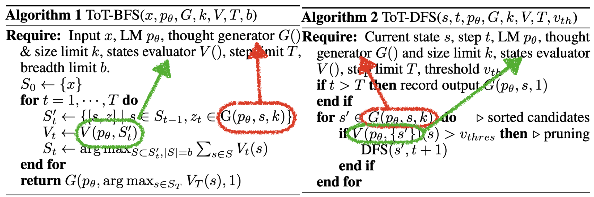

Figure 6.4: 
Tree of Thoughts. Left Breadth First Search, Right Depth First Search. The arrows indicate the LLM prompts (after [[Yao et al., 2024](#bibe.bib42)])

Together, the two LLM prompts with the external control,
allow systematic exploration of the space of reasoning steps, performing look-ahead and backtracking.

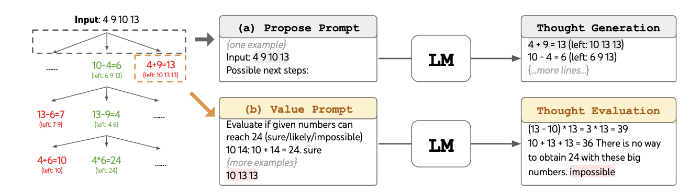

Figure 6.5: 
Tree of Thoughts Example prompts for Game of 24 [[Yao et al., 2024](#bibe.bib42)]

Tree of thoughts (ToT) has been used on planning-based puzzles, such as the Game of 24. In this game, 4 numbers are give, and the task is to reach the number 24 by using the arithmetic operators $(+-*/)$ in between the numbers. For example, for the numbers $4$ $9$ $10$ $13$, a solution would be $(10-4)*(13-9)=24$. Tree of thoughts first generates a position with the *propose* prompt: `Input 4 9 10 13; Possible next steps:` to which the model answers by generating possible next step thoughts. These are then evaluated by the model with an evaluation prompt including chain of thought examples. Figure [6.5](#Ch6.F5 "Figure 6.5 ‣ 6.2.4.1 Search-based Prompt Optimization ‣ 6.2.4 Agentic Harness for Prompt Improvement ‣ 6.2 Self-Reflection and State ‣ Chapter 6 Multi-step Reasoning in LLMs ‣ Part II Reasoning ‣ Agentic Large Language Models") shows a possible prompting sequence from the original paper.

The authors compare their approach to traditional linear chain of thought with self consistency on the Game of 24, Creative writing, and Mini crossword, achieving an accuracy of 74% on a Game of 24 task. The other tasks are evaluated qualitatively. Figure [6.6](#Ch6.F6 "Figure 6.6 ‣ 6.2.4.1 Search-based Prompt Optimization ‣ 6.2.4 Agentic Harness for Prompt Improvement ‣ 6.2 Self-Reflection and State ‣ Chapter 6 Multi-step Reasoning in LLMs ‣ Part II Reasoning ‣ Agentic Large Language Models") illustrates the different reasoning structures.
33
3
A similarly named approach is graph of thoughts [[Besta et al., 2024](#bibe.bib35)]. Graph of thoughts allows more general reasoning graphs, providing a formal framework, where the different elements can then be specified manually.

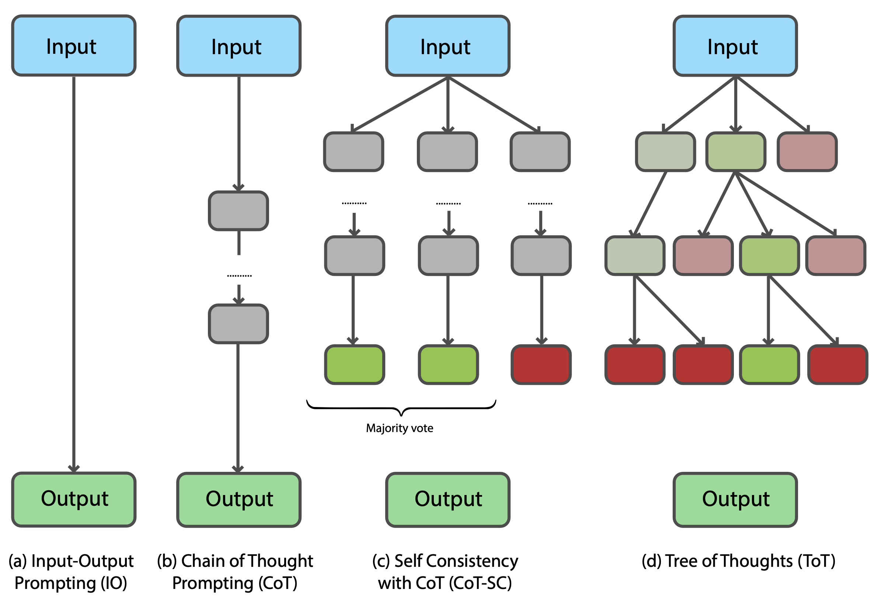

Figure 6.6: Reasoning structure of Chain of Thought (b), Self Consistency (c), Tree of Thoughts (d)

Tree of thoughts is an elegant approach, adding two of the simplest possible search structures on top of an LLM. The sequence of prompts is easy to follow, and finding and correcting mistakes is also easy.

The two search methods of tree of thoughts follow a fixed expansion policy.
Next, we will discuss more advanced learning-based approaches, that may perform better, at the cost of higher algorithmic complexity.

###### 6.2.4.2 Self-Reflection

Many approaches have been devised that use the LLM in more than one role. Such approaches are generally called self-reflective approaches. The LLM is used not just to evaluate a prompt, but also to generate new reasoning steps, and often to refine them.

The field of self-reflection is young and new approaches are being developed regularly. We will present four such approaches: self refine, ReAct, reflexion, and buffer of thoughts. These approaches use the LLMs in different ways, using schemes inspired by reinforcement learning to let the LLMs improve themselves.

###### Self Refine

The first approach is self refine [[Madaan et al., 2023](#bibe.bib71)]. This approach aims to improve answers from feedback. The LLM generates an initial output and provides feedback for
its answer, using the LLM to refine itself, iteratively. The LLM is thus used to improve its own answers, see
Figure [6.7](#Ch6.F7 "Figure 6.7 ‣ Self Refine ‣ 6.2.4.2 Self-Reflection ‣ 6.2.4 Agentic Harness for Prompt Improvement ‣ 6.2 Self-Reflection and State ‣ Chapter 6 Multi-step Reasoning in LLMs ‣ Part II Reasoning ‣ Agentic Large Language Models").

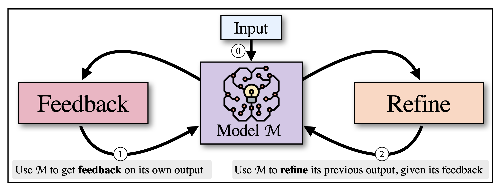

Figure 6.7: 
Self Refine Architecture [[Madaan et al., 2023](#bibe.bib71)]

Self refine prompts the LLM in three ways: (1) for initial generation, (2) for
feedback, and (3) for refinement, following a greedy reasoning chain. Self refine reportedly improves significantly over regular chain of thought, on benchmarks such as dialogue
response generation, code optimization, and
constrained generation. This approach does follow a linear, greedy, reasoning chain, where a single successor is tried in a state (it does not explore a tree, as in ToT).

###### ReAct

Generalizing the greedy approach, we can use LLMs to examine multiple options per state.
A notable approach that combines reinforcement learning and LLMs is ReAct [[Yao et al., 2022b](#bibe.bib72)].44
4
<https://github.com/ysymyth/ReAct>
ReAct uses chain of thought prompt-learning as part of a reinforcement learning framework that also uses external knowledge sources (Wikipedia) and finetuning; for error reduction, grounding, and for reducing hallucination. The framework allows hand-written prompts.
On two interactive decision
making benchmarks (Alfworld and WebShop),
ReAct outperforms imitation
and reinforcement learning methods by an absolute success rate of 34%
and 10% respectively.

###### Reflexion

The ReAct work has been developed further.
Reflexion [[Shinn et al., 2024](#bibe.bib69)] creates AI agents that learn by reflecting on failures and
enhance their results, inspired by the way that humans do this.55
5
<https://github.com/noahshinn/reflexion>
Reflexion uses three prompts for the LLM: actor, evaluator, and reflector.
The reflexion harness incorporates explicit memory between LLM calls. For trajectory generation it has a short-term memory, and for storing experience information it has a long term memory. This approach addresses the state management problem of regular LLMs using memory in the external algorithm. Reflexion
works as follows: (1) an actor model generates text and actions,
(2) an evaluator model scores the outputs produced by the actor,
and (3) a self-reflection model generates verbal reinforcement
cues to assist the actor to self-improve (see Figure [6.8](#Ch6.F8 "Figure 6.8 ‣ Reflexion ‣ 6.2.4.2 Self-Reflection ‣ 6.2.4 Agentic Harness for Prompt Improvement ‣ 6.2 Self-Reflection and State ‣ Chapter 6 Multi-step Reasoning in LLMs ‣ Part II Reasoning ‣ Agentic Large Language Models")).
For the actor, chain of thought
and ReAct can be used. Reflexion has been evaluated on
decision-making, reasoning, and coding tasks. Improvements of 10-20
percentage points are reported [[Shinn et al., 2024](#bibe.bib69)].

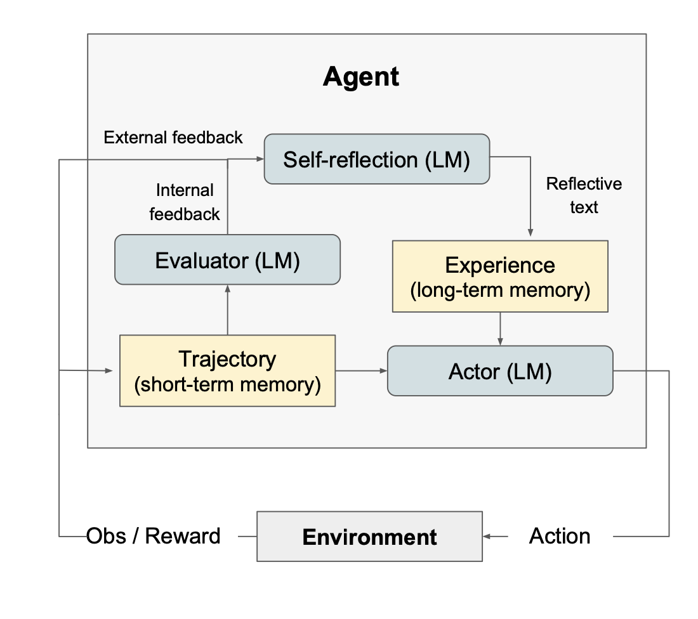

Figure 6.8: 
Architecture of Reflexion [[Shinn et al., 2024](#bibe.bib69)], showing a close resemblance to the agent/environment structure of reinforcement learning

###### Buffer of Thoughts

Another approach is buffer of thoughts [[Yang et al., 2024](#bibe.bib34)], which goes a step towards metareasoning [[Gao et al., 2024](#bibe.bib22)]. It introduces a meta-buffer that stores high-level *thought-templates*. Thought-templates are derived from a variety of tasks. Buffer of thoughts uses a problem distiller that stores high-level
thoughts distilled from different problems in a meta-buffer, which is actively managed for capacity. Figure [6.9](#Ch6.F9 "Figure 6.9 ‣ Buffer of Thoughts ‣ 6.2.4.2 Self-Reflection ‣ 6.2.4 Agentic Harness for Prompt Improvement ‣ 6.2 Self-Reflection and State ‣ Chapter 6 Multi-step Reasoning in LLMs ‣ Part II Reasoning ‣ Agentic Large Language Models") compares the buffer of thoughts approach to other approaches such as chain of thought and tree of thoughts. Buffer of thoughts outperforms other methods in puzzles such as Game of 24 (by 11%) and checkmating (by 51%).
Thought templates are related to metacognition (thinking about thinking) [[Didolkar et al., 2024](#bibe.bib43)].

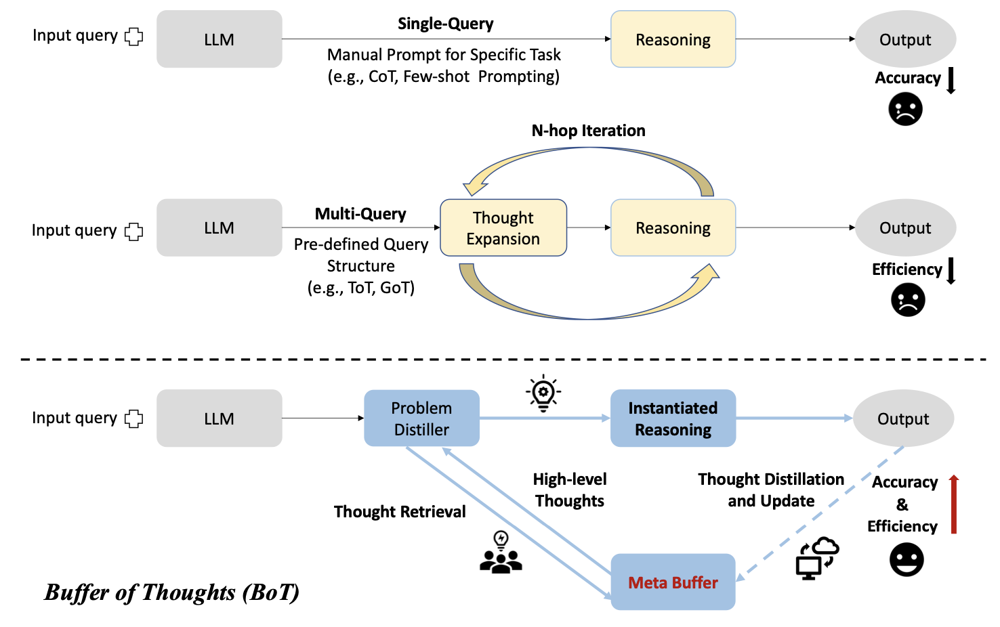

Figure 6.9: 
Buffer of Thoughts [[Yang et al., 2024](#bibe.bib34)]

###### Critique and Prompt Sensitivity

The concept of self-reflection is not without pitfalls and criticism. To start, the basic idea of asking a model to refine its results begs the question why the model did not give the better answer in the first place. Next, studies by [Huang et al. [2023]](#bibe.bib18), [Shojaee et al. [2025]](#bibe.bib13) find methodological issues with some of the studies, such as the use of data labels that reveal the answer, second refinement prompts that unintentionally reveal more information than the initial prompts, and the use of the same LLM for agent and environment. In one reproducibility study performance did not exceed that of chain of thought with self consistency [[Huang et al., 2023](#bibe.bib18)]. LLMs are sensitive to how a question is formulated in the prompt. Self-reflection is still a young and active field of research, with an appealing premise, but many open questions.

The approaches that we have presented potentially make many LLM calls, which can become expensive and slow. Finding the optimum approach for your problem may require quite some experimentation. In Chapter [10](#Ch10 "Chapter 10 Case Study 2: BALROG for LLM Reasoning and Reflection ‣ Part III Agents ‣ Agentic Large Language Models") we will discuss a practical case study where we will get hands-on experience with self-reflection methods. Please keep the preceding critique in mind.

###### 6.2.4.3 Reinforcement Learning with Verifiable Rewards

The focus of this chapter is on in-context learning. In-context learning occurs at inference time, and no parameters are trained or changed. Finetuning occurs at training time, and does change the parameters of the model. In this section we will, however, briefly talk about a mix of finetuning and in-context learning, we will be mixing training and inference.

Reinforcement learning with verifiable rewards refers to an algorithmic approach for training
language models on tasks with verifiable outcomes such as mathematical problem-solving and instruction
following. Especially for reasoning problems, such as math word problems and coding, inference-time chain of thought results have been found to significantly improve models when they are used for finetuning.

RLVR is an improvement over reinforcement learning from human feedback (RLHF), dispensing with the need for human feedback. In many domains, such as mathematics, a simple function exists to check if an answer is correct, without the need for human feedback. RLVR leverages the existing RLHF objective but replaces the reward model with a verification
function. RLVR samples completions
from a policy model given a set of prompts, and verifies their correctness using a deterministic function. If correct, the reward is positive, otherwise it is 0. This reward is then used to train against using PPO [[Schulman et al., 2017](#bibe.bib41)] (a standard reinforcement learning algorithm), as in RLHF.

An influential approach of this type was proposed in the development of DeepSeek-R1 [Guo et al. [2025]](#bibe.bib24). This method distinguishes itself from external reasoning approaches by emphasizing the model’s self-generated reasoning steps. It learns the steps through reinforcement learning, integrating data generation and training in a single loop. Lowering the supervised data requirements to train LLMs,
DeepSeek’s methodology leverages reinforcement learning to enable models to evolve reasoning skills autonomously. By starting with a base model and applying reinforcement learning, the system identifies and reinforces effective reasoning patterns. DeepSeek uses group-relative policy optimization (GRPO), which calculates advantages with
group-based scoring [[Shao et al., 2024](#bibe.bib31)].

One of the key features of DeepSeek’s approach is the emergence of sophisticated reasoning behaviors during finetuning, such as reflection and exploration of alternative problem-solving methods [[Mercer et al., 2025](#bibe.bib30)]. These behaviors arise spontaneously as a result of the model’s interaction with the reinforcement learning environment, rather than being pre-programmed, and without external self-reflection loops. For example, DeepSeek-R1-Zero learns to allocate more thinking time to problems by reevaluating its initial approach.
This autonomous approach of *learning to reason* may lead to more stable and adaptive reasoning LLMs.

One of the successes behind GRPO is its focus on applications for which verifiable rewards exist, allowing reinforcement learning methods to be used. The focus on verifiable rewards has been quite successful, and reinforcement learning with verifiable rewards (RLVR) methods are often used in finetuning LLMs [[Lambert et al., 2024](#bibe.bib21)].

RLVR methods such as GRPO are typically used dynamically, where an inference time chain of thought query is used to answer a query from the training set to finetune the model. Thus, test time inference is used for finetuning.
The impressive results of DeepSeek [[Guo et al., 2025](#bibe.bib24)] have made GRPO [[Shao et al., 2024](#bibe.bib31)] and RLVR [[Lambert et al., 2024](#bibe.bib21), [Guo et al., 2025](#bibe.bib24), [Wen et al., 2025b](#bibe.bib19), [Yue et al., 2025](#bibe.bib20)] highly popular finetuning methods.

#### 6.3 Concluding Remarks

In the preceding pages we have seen how the reasoning capabilities of language models can be improved. The best-known approach is chain of thought, which is a prompt-engineering method that shows an LLM to provide a multi-step reasoning when it is answering a question, just like we are taught in school when we are shown how to solve math exercises. More elaborate prompt improvement algorithms have been introduced, from depth-first search, via self-reflection, to inference-time reinforcement learning methods. Advanced training methods such as RLVR combine inference-results with finetuning, achieving strong training results.

##### 6.3.1 Brittleness

We have discussed many different algorithmic approaches to create an agentic harness. There are multiple reasons why there are so many. First, the field of agentic LLM is still young, many challenges exist, leading to many new solutions.

Second, the methods are quite brittle. Small changes in prompts, a comma here or there, sometimes make the difference whether an approach works or not. Small changes in hyperparameters, such as the temperature of your model, or even using a different seed of a random number generator, may have large effects. Changes to the memory management method of the agentic harness, or using a different LLM, may all have a large effect on performance.

This may feel like a unsatisfactory state of affairs. Indeed, the field is young, and it will take some years before methods have stabilized. In your experiments, you should keep in mind to always do multiple runs, with different seeds, different models, and different hyperparameter settings. This will help you better understand how your solution works in different circumstances.

##### 6.3.2 Thinking, Fast and Slow

To conclude this chapter we will discuss reasoning in LLMs in a broader perspective. In the history of AI, two approaches, or schools of thought, can be seen: symbolic AI and connectionist AI. Symbolic AI roughly corresponds to the idea that intelligence is best modeled as the manipulation of symbols via the rules of logic. Connectionist AI studies whether intelligence emerges spontaneously out of interactions between connected elements (be they neurons, cells, ants, humans, or robots). Symbolic AI draws on mathematics, connectionist AI on biology. As we already saw in Section [2.3](#Ch2.S3 "2.3 Modeling Language ‣ Chapter 2 Foundations of Language Modeling with LLMs ‣ Part I Language Modeling ‣ Agentic Large Language Models"), both schools have developed useful methods, and both schools have seen important successes (such as search algorithms and reasoning, or deep learning and LLMs).

In 2011 Daniel Kahneman published the book *Thinking, Fast and Slow* in which the terms System 1 and System 2
were used to distinguish human thought into intuitive, fast, thinking, and deliberative,
slow, thinking [[Kahneman, 2011](#bibe.bib51)]. These terms have become
popular in artificial intelligence, where fast thinking is linked to associative lookup and slow thinking to multi-step reasoning. At inference time, zero-shot LLMs think fast (System 1 thinking).
Inference-time step-by-step methods (either through longer prompts or with an agentic harness) perform deliberative
slow thinking
(System 2 thinking).

LLMs are based on the connectionist AI tradition (System 1). The
use of tools at inference time enhances the LLM part with
knowledge retrieval or processing tools from the symbolic AI tradition
(System 2).

We should note that whereas researchers sometimes humanize LLMs and their capabilities, LLMs only perform next-token prediction. LLMs are not even close to being human. By generating more tokens to form an answer (reasoning step-by-step), the token-path from the prompt to the final answer becomes longer. The reason that this leads more often to correct answers, might be because it takes smaller steps into the direction of the answer, making the correct answer more plausible with every step in between—not that it is similar to the way humans are taught to solve the problem. Reasoning is narrowing down probabilities such that the correct answer becomes more probable to generate, independent of interpretations related to human cognition [[Guo et al., 2025](#bibe.bib24)].

##### 6.3.3 Conclusion

In this chapter we have discussed how LLMs can solve language tasks by next-token prediction, and solve tasks that require multi-step reasoning. We have discussed ways to manage complex reasoning structures.

Most methods are in-context methods, efficient and easy to use since the prompts that guide the reasoning are readable by the user. We have introduced the rule of an agentic harness for prompt improvement and memory management. We have also touched upon methods that use pretraining and finetuning, not just for the language part, but also for integrating multi-step reasoning. These methods thus train models for decision making, beyond pure next-token prediction in language models.

There has been much activity in the creation of such richer models, adding visual reasoning, decision making, and actions to become an integral part of the LLMs. In the next chapter we will look deeper into these pretrained and finetuned multi-modal models.

### References

- Ahn et al. (2022)
  M. Ahn, A. Brohan, N. Brown, Y. Chebotar, O. Cortes, B. David, C. Finn, C. Fu, K. Gopalakrishnan, K. Hausman, et al.
  Do as i can, not as i say: grounding language in robotic affordances.
  arXiv preprint arXiv:2204.01691.
  Cited by: [§6.1.2](#Ch6.S1.SS2.p3.1 "6.1.2 Multi-step Reasoning Benchmarks ‣ 6.1 In-Context Reasoning ‣ Chapter 6 Multi-step Reasoning in LLMs ‣ Part II Reasoning ‣ Agentic Large Language Models").

- Amini et al. (2019)
  A. Amini, S. Gabriel, P. Lin, R. Koncel-Kedziorski, Y. Choi, and H. Hajishirzi
  Mathqa: towards interpretable math word problem solving with operation-based formalisms.
  arXiv preprint arXiv:1905.13319.
  Cited by: [§6.1.3](#Ch6.S1.SS3.p7.1 "6.1.3 Chain of Thought Prompting ‣ 6.1 In-Context Reasoning ‣ Chapter 6 Multi-step Reasoning in LLMs ‣ Part II Reasoning ‣ Agentic Large Language Models").

- Besta et al. (2024)
  M. Besta, N. Blach, A. Kubicek, R. Gerstenberger, M. Podstawski, L. Gianinazzi, J. Gajda, T. Lehmann, H. Niewiadomski, P. Nyczyk, et al.
  Graph of thoughts: solving elaborate problems with large language models.
  Proceedings of the AAAI Conference on Artificial Intelligence 38 (16), pp. 17682–17690.
  Cited by: [footnote 3](#Ch6.footnote3 "In 6.2.4.1 Search-based Prompt Optimization ‣ 6.2.4 Agentic Harness for Prompt Improvement ‣ 6.2 Self-Reflection and State ‣ Chapter 6 Multi-step Reasoning in LLMs ‣ Part II Reasoning ‣ Agentic Large Language Models").

- Breiman (2001)
  L. Breiman
  Random forests.
  Machine learning 45, pp. 5–32.
  Cited by: [§6.1.3.1](#Ch6.S1.SS3.SSS1.p3.1 "6.1.3.1 Self Evaluation ‣ 6.1.3 Chain of Thought Prompting ‣ 6.1 In-Context Reasoning ‣ Chapter 6 Multi-step Reasoning in LLMs ‣ Part II Reasoning ‣ Agentic Large Language Models").

- Brown et al. (2020)
  T. Brown, B. Mann, N. Ryder, M. Subbiah, J. D. Kaplan, P. Dhariwal, A. Neelakantan, P. Shyam, G. Sastry, A. Askell, et al.
  Language models are few-shot learners.
  Advances in neural information processing systems 33, pp. 1877–1901.
  Cited by: [§6.1](#Ch6.S1.p1.1 "6.1 In-Context Reasoning ‣ Chapter 6 Multi-step Reasoning in LLMs ‣ Part II Reasoning ‣ Agentic Large Language Models").

- Chen et al. (2021)
  M. Chen, J. Tworek, H. Jun, Q. Yuan, H. P. d. O. Pinto, J. Kaplan, H. Edwards, Y. Burda, N. Joseph, G. Brockman, et al.
  Evaluating large language models trained on code.
  arXiv preprint arXiv:2107.03374.
  Cited by: [§6.1.3.2](#Ch6.S1.SS3.SSS2.p2.1 "6.1.3.2 Code Generation for Validation ‣ 6.1.3 Chain of Thought Prompting ‣ 6.1 In-Context Reasoning ‣ Chapter 6 Multi-step Reasoning in LLMs ‣ Part II Reasoning ‣ Agentic Large Language Models").

- Chen et al. (2019)
  X. Chen, C. Liang, A. W. Yu, D. Zhou, D. Song, and Q. V. Le
  Neural symbolic reader: scalable integration of distributed and symbolic representations for reading comprehension.
  In International Conference on Learning Representations,
  Cited by: [§6.1.3](#Ch6.S1.SS3.p7.1 "6.1.3 Chain of Thought Prompting ‣ 6.1 In-Context Reasoning ‣ Chapter 6 Multi-step Reasoning in LLMs ‣ Part II Reasoning ‣ Agentic Large Language Models").

- Chen et al. (2023)
  X. Chen, M. Lin, N. Schärli, and D. Zhou
  Teaching large language models to self-debug.
  arXiv preprint arXiv:2304.05128.
  Cited by: [§6.1.3.2](#Ch6.S1.SS3.SSS2.p2.1 "6.1.3.2 Code Generation for Validation ‣ 6.1.3 Chain of Thought Prompting ‣ 6.1 In-Context Reasoning ‣ Chapter 6 Multi-step Reasoning in LLMs ‣ Part II Reasoning ‣ Agentic Large Language Models").

- Chiang and Chen (2018)
  T. Chiang and Y. Chen
  Semantically-aligned equation generation for solving and reasoning math word problems.
  arXiv preprint arXiv:1811.00720.
  Cited by: [§6.1.3](#Ch6.S1.SS3.p7.1 "6.1.3 Chain of Thought Prompting ‣ 6.1 In-Context Reasoning ‣ Chapter 6 Multi-step Reasoning in LLMs ‣ Part II Reasoning ‣ Agentic Large Language Models").

- Cobbe et al. (2021)
  K. Cobbe, V. Kosaraju, M. Bavarian, M. Chen, H. Jun, L. Kaiser, M. Plappert, J. Tworek, J. Hilton, R. Nakano, et al.
  Training verifiers to solve math word problems.
  arXiv preprint arXiv:2110.14168.
  Cited by: [§6.1.2](#Ch6.S1.SS2.p1.1 "6.1.2 Multi-step Reasoning Benchmarks ‣ 6.1 In-Context Reasoning ‣ Chapter 6 Multi-step Reasoning in LLMs ‣ Part II Reasoning ‣ Agentic Large Language Models"),
  [§6.1.3](#Ch6.S1.SS3.p7.1 "6.1.3 Chain of Thought Prompting ‣ 6.1 In-Context Reasoning ‣ Chapter 6 Multi-step Reasoning in LLMs ‣ Part II Reasoning ‣ Agentic Large Language Models").

- Codeforces (2024)
  M. Codeforces
  American invitational mathematics examination-aime 2024, 2024.
  Cited by: [§6.1.2](#Ch6.S1.SS2.p3.1 "6.1.2 Multi-step Reasoning Benchmarks ‣ 6.1 In-Context Reasoning ‣ Chapter 6 Multi-step Reasoning in LLMs ‣ Part II Reasoning ‣ Agentic Large Language Models").

- Cormen et al. (2022)
  T. H. Cormen, C. E. Leiserson, R. L. Rivest, and C. Stein
  Introduction to algorithms.
   MIT press.
  Cited by: [§6.2.4.1](#Ch6.S2.SS4.SSS1.p3.1 "6.2.4.1 Search-based Prompt Optimization ‣ 6.2.4 Agentic Harness for Prompt Improvement ‣ 6.2 Self-Reflection and State ‣ Chapter 6 Multi-step Reasoning in LLMs ‣ Part II Reasoning ‣ Agentic Large Language Models").

- Didolkar et al. (2024)
  A. Didolkar, A. Goyal, N. R. Ke, S. Guo, M. Valko, T. Lillicrap, D. Rezende, Y. Bengio, M. Mozer, and S. Arora
  Metacognitive capabilities of llms: an exploration in mathematical problem solving.
  arXiv preprint arXiv:2405.12205.
  Cited by: [§6.2.4.2](#Ch6.S2.SS4.SSS2.Px4.p1.1 "Buffer of Thoughts ‣ 6.2.4.2 Self-Reflection ‣ 6.2.4 Agentic Harness for Prompt Improvement ‣ 6.2 Self-Reflection and State ‣ Chapter 6 Multi-step Reasoning in LLMs ‣ Part II Reasoning ‣ Agentic Large Language Models").

- Dong et al. (2022)
  Q. Dong, L. Li, D. Dai, C. Zheng, Z. Wu, B. Chang, X. Sun, J. Xu, and Z. Sui
  A survey on in-context learning.
  arXiv preprint arXiv:2301.00234.
  Cited by: [§6.1.1](#Ch6.S1.SS1.p1.1 "6.1.1 In-Context Learning ‣ 6.1 In-Context Reasoning ‣ Chapter 6 Multi-step Reasoning in LLMs ‣ Part II Reasoning ‣ Agentic Large Language Models").

- Fan et al. (2022)
  L. Fan, G. Wang, Y. Jiang, A. Mandlekar, Y. Yang, H. Zhu, A. Tang, D. Huang, Y. Zhu, et al.
  Minedojo: building open-ended embodied agents with internet-scale knowledge.
  Advances in Neural Information Processing Systems 35, pp. 18343–18362.
  Cited by: [§6.1.2](#Ch6.S1.SS2.p3.1 "6.1.2 Multi-step Reasoning Benchmarks ‣ 6.1 In-Context Reasoning ‣ Chapter 6 Multi-step Reasoning in LLMs ‣ Part II Reasoning ‣ Agentic Large Language Models").

- Fei et al. (2024)
  W. Fei, X. Niu, P. Zhou, L. Hou, B. Bai, L. Deng, and W. Han
  Extending context window of large language models via semantic compression.
  In Findings of the Association for Computational Linguistics: ACL 2024,
  pp. 5169–5181.
  Cited by: [§6.2.2](#Ch6.S2.SS2.p3.1 "6.2.2 Retrieval Augmentation and Long Context Windows ‣ 6.2 Self-Reflection and State ‣ Chapter 6 Multi-step Reasoning in LLMs ‣ Part II Reasoning ‣ Agentic Large Language Models").

- Gao et al. (2023)
  L. Gao, A. Madaan, S. Zhou, U. Alon, P. Liu, Y. Yang, J. Callan, and G. Neubig
  Pal: program-aided language models.
  In International Conference on Machine Learning,
  pp. 10764–10799.
  Cited by: [Figure 6.1](#Ch6.F1 "In 6.1.3 Chain of Thought Prompting ‣ 6.1 In-Context Reasoning ‣ Chapter 6 Multi-step Reasoning in LLMs ‣ Part II Reasoning ‣ Agentic Large Language Models"),
  [Figure 6.1](#Ch6.F1.4 "In 6.1.3 Chain of Thought Prompting ‣ 6.1 In-Context Reasoning ‣ Chapter 6 Multi-step Reasoning in LLMs ‣ Part II Reasoning ‣ Agentic Large Language Models"),
  [§6.1.3.2](#Ch6.S1.SS3.SSS2.p3.1 "6.1.3.2 Code Generation for Validation ‣ 6.1.3 Chain of Thought Prompting ‣ 6.1 In-Context Reasoning ‣ Chapter 6 Multi-step Reasoning in LLMs ‣ Part II Reasoning ‣ Agentic Large Language Models").

- Gao et al. (2024)
  P. Gao, A. Xie, S. Mao, W. Wu, Y. Xia, H. Mi, and F. Wei
  Meta reasoning for large language models.
  arXiv preprint arXiv:2406.11698.
  Cited by: [§6.2.4.2](#Ch6.S2.SS4.SSS2.Px4.p1.1 "Buffer of Thoughts ‣ 6.2.4.2 Self-Reflection ‣ 6.2.4 Agentic Harness for Prompt Improvement ‣ 6.2 Self-Reflection and State ‣ Chapter 6 Multi-step Reasoning in LLMs ‣ Part II Reasoning ‣ Agentic Large Language Models").

- Giray (2023)
  L. Giray
  Prompt engineering with chatgpt: a guide for academic writers.
  Annals of biomedical engineering 51 (12), pp. 2629–2633.
  Cited by: [§6.1.1](#Ch6.S1.SS1.SSS0.Px5.p2.1 "Practical Considerations and Prompt Engineering ‣ 6.1.1 In-Context Learning ‣ 6.1 In-Context Reasoning ‣ Chapter 6 Multi-step Reasoning in LLMs ‣ Part II Reasoning ‣ Agentic Large Language Models").

- Guo et al. (2025)
  D. Guo, D. Yang, H. Zhang, J. Song, R. Zhang, R. Xu, Q. Zhu, S. Ma, P. Wang, X. Bi, et al.
  Deepseek-r1: incentivizing reasoning capability in llms via reinforcement learning.
  arXiv preprint arXiv:2501.12948.
  Cited by: [§6.2.4.3](#Ch6.S2.SS4.SSS3.p4.1 "6.2.4.3 Reinforcement Learning with Verifiable Rewards ‣ 6.2.4 Agentic Harness for Prompt Improvement ‣ 6.2 Self-Reflection and State ‣ Chapter 6 Multi-step Reasoning in LLMs ‣ Part II Reasoning ‣ Agentic Large Language Models"),
  [§6.2.4.3](#Ch6.S2.SS4.SSS3.p7.1 "6.2.4.3 Reinforcement Learning with Verifiable Rewards ‣ 6.2.4 Agentic Harness for Prompt Improvement ‣ 6.2 Self-Reflection and State ‣ Chapter 6 Multi-step Reasoning in LLMs ‣ Part II Reasoning ‣ Agentic Large Language Models"),
  [§6.3.2](#Ch6.S3.SS2.p4.1 "6.3.2 Thinking, Fast and Slow ‣ 6.3 Concluding Remarks ‣ Chapter 6 Multi-step Reasoning in LLMs ‣ Part II Reasoning ‣ Agentic Large Language Models").

- Hansen and Ros (2010)
  N. Hansen and R. Ros
  Black-box optimization benchmarking of newuoa compared to bipop-cma-es: on the bbob noiseless testbed.
  In Proceedings of the 12th annual conference companion on Genetic and evolutionary computation,
  pp. 1519–1526.
  Cited by: [§6.1.3.3](#Ch6.S1.SS3.SSS3.p1.1 "6.1.3.3 Evolving code generation prompts ‣ 6.1.3 Chain of Thought Prompting ‣ 6.1 In-Context Reasoning ‣ Chapter 6 Multi-step Reasoning in LLMs ‣ Part II Reasoning ‣ Agentic Large Language Models").

- Huang et al. (2023)
  J. Huang, X. Chen, S. Mishra, H. S. Zheng, A. W. Yu, X. Song, and D. Zhou
  Large language models cannot self-correct reasoning yet.
  arXiv preprint arXiv:2310.01798.
  Cited by: [§6.2.4.2](#Ch6.S2.SS4.SSS2.Px5.p1.1 "Critique and Prompt Sensitivity ‣ 6.2.4.2 Self-Reflection ‣ 6.2.4 Agentic Harness for Prompt Improvement ‣ 6.2 Self-Reflection and State ‣ Chapter 6 Multi-step Reasoning in LLMs ‣ Part II Reasoning ‣ Agentic Large Language Models").

- Kahneman (2011)
  D. Kahneman
  Thinking, fast and slow.
   macmillan.
  Cited by: [§6.3.2](#Ch6.S3.SS2.p2.1 "6.3.2 Thinking, Fast and Slow ‣ 6.3 Concluding Remarks ‣ Chapter 6 Multi-step Reasoning in LLMs ‣ Part II Reasoning ‣ Agentic Large Language Models").

- Kamoi et al. (2024)
  R. Kamoi, Y. Zhang, N. Zhang, J. Han, and R. Zhang
  When can llms actually correct their own mistakes? a critical survey of self-correction of llms.
  Transactions of the Association for Computational Linguistics 12, pp. 1417–1440.
  Cited by: [§6.1.2](#Ch6.S1.SS2.p4.1 "6.1.2 Multi-step Reasoning Benchmarks ‣ 6.1 In-Context Reasoning ‣ Chapter 6 Multi-step Reasoning in LLMs ‣ Part II Reasoning ‣ Agentic Large Language Models").

- Kojima et al. (2022)
  T. Kojima, S. S. Gu, M. Reid, Y. Matsuo, and Y. Iwasawa
  Large language models are zero-shot reasoners.
  Advances in neural information processing systems 35, pp. 22199–22213.
  Cited by: [Figure 6.1](#Ch6.F1 "In 6.1.3 Chain of Thought Prompting ‣ 6.1 In-Context Reasoning ‣ Chapter 6 Multi-step Reasoning in LLMs ‣ Part II Reasoning ‣ Agentic Large Language Models"),
  [Figure 6.1](#Ch6.F1.4 "In 6.1.3 Chain of Thought Prompting ‣ 6.1 In-Context Reasoning ‣ Chapter 6 Multi-step Reasoning in LLMs ‣ Part II Reasoning ‣ Agentic Large Language Models"),
  [§6.1.3](#Ch6.S1.SS3.p6.1 "6.1.3 Chain of Thought Prompting ‣ 6.1 In-Context Reasoning ‣ Chapter 6 Multi-step Reasoning in LLMs ‣ Part II Reasoning ‣ Agentic Large Language Models").

- Koncel-Kedziorski et al. (2016)
  R. Koncel-Kedziorski, S. Roy, A. Amini, N. Kushman, and H. Hajishirzi
  MAWPS: a math word problem repository.
  In Proceedings of the 2016 conference of the north american chapter of the association for computational linguistics: human language technologies,
  pp. 1152–1157.
  Cited by: [§6.1.2](#Ch6.S1.SS2.p2.1 "6.1.2 Multi-step Reasoning Benchmarks ‣ 6.1 In-Context Reasoning ‣ Chapter 6 Multi-step Reasoning in LLMs ‣ Part II Reasoning ‣ Agentic Large Language Models").

- La Malfa et al. (2024)
  E. La Malfa, C. Weinhuber, O. Torre, F. Lin, S. Marro, A. Cohn, N. Shadbolt, and M. Wooldridge
  Code simulation challenges for large language models.
  arXiv preprint arXiv:2401.09074.
  Cited by: [§6.2.3](#Ch6.S2.SS3.SSS0.Px1.p2.1 "Knowing-Doing Gap ‣ 6.2.3 LLMs and Stateful Problems ‣ 6.2 Self-Reflection and State ‣ Chapter 6 Multi-step Reasoning in LLMs ‣ Part II Reasoning ‣ Agentic Large Language Models"),
  [§6.2.3](#Ch6.S2.SS3.SSS0.Px1.p3.1 "Knowing-Doing Gap ‣ 6.2.3 LLMs and Stateful Problems ‣ 6.2 Self-Reflection and State ‣ Chapter 6 Multi-step Reasoning in LLMs ‣ Part II Reasoning ‣ Agentic Large Language Models").

- Lambert et al. (2024)
  N. Lambert, J. Morrison, V. Pyatkin, S. Huang, H. Ivison, F. Brahman, L. J. V. Miranda, A. Liu, N. Dziri, S. Lyu, et al.
  Tulu 3: pushing frontiers in open language model post-training.
  arXiv preprint arXiv:2411.15124.
  Cited by: [§6.2.4.3](#Ch6.S2.SS4.SSS3.p6.1 "6.2.4.3 Reinforcement Learning with Verifiable Rewards ‣ 6.2.4 Agentic Harness for Prompt Improvement ‣ 6.2 Self-Reflection and State ‣ Chapter 6 Multi-step Reasoning in LLMs ‣ Part II Reasoning ‣ Agentic Large Language Models"),
  [§6.2.4.3](#Ch6.S2.SS4.SSS3.p7.1 "6.2.4.3 Reinforcement Learning with Verifiable Rewards ‣ 6.2.4 Agentic Harness for Prompt Improvement ‣ 6.2 Self-Reflection and State ‣ Chapter 6 Multi-step Reasoning in LLMs ‣ Part II Reasoning ‣ Agentic Large Language Models").

- Lewis et al. (2020)
  P. Lewis, E. Perez, A. Piktus, F. Petroni, V. Karpukhin, N. Goyal, H. Küttler, M. Lewis, W. Yih, T. Rocktäschel, et al.
  Retrieval-augmented generation for knowledge-intensive nlp tasks.
  Advances in Neural Information Processing Systems 33, pp. 9459–9474.
  Cited by: [§6.2.2](#Ch6.S2.SS2.p2.1 "6.2.2 Retrieval Augmentation and Long Context Windows ‣ 6.2 Self-Reflection and State ‣ Chapter 6 Multi-step Reasoning in LLMs ‣ Part II Reasoning ‣ Agentic Large Language Models").

- Ling et al. (2017)
  W. Ling, D. Yogatama, C. Dyer, and P. Blunsom
  Program induction by rationale generation: learning to solve and explain algebraic word problems.
  arXiv preprint arXiv:1705.04146.
  Cited by: [§6.1.2](#Ch6.S1.SS2.p2.1 "6.1.2 Multi-step Reasoning Benchmarks ‣ 6.1 In-Context Reasoning ‣ Chapter 6 Multi-step Reasoning in LLMs ‣ Part II Reasoning ‣ Agentic Large Language Models"),
  [§6.1.3](#Ch6.S1.SS3.p7.1 "6.1.3 Chain of Thought Prompting ‣ 6.1 In-Context Reasoning ‣ Chapter 6 Multi-step Reasoning in LLMs ‣ Part II Reasoning ‣ Agentic Large Language Models").

- Liu et al. (2023)
  P. Liu, W. Yuan, J. Fu, Z. Jiang, H. Hayashi, and G. Neubig
  Pre-train, prompt, and predict: a systematic survey of prompting methods in natural language processing.
  ACM Computing Surveys 55 (9), pp. 1–35.
  Cited by: [§6.1.1](#Ch6.S1.SS1.SSS0.Px3.p1.1 "Example ‣ 6.1.1 In-Context Learning ‣ 6.1 In-Context Reasoning ‣ Chapter 6 Multi-step Reasoning in LLMs ‣ Part II Reasoning ‣ Agentic Large Language Models").

- Madaan et al. (2023)
  A. Madaan, N. Tandon, P. Gupta, S. Hallinan, L. Gao, S. Wiegreffe, U. Alon, N. Dziri, S. Prabhumoye, Y. Yang, et al.
  Self-refine: iterative refinement with self-feedback.
  Advances in Neural Information Processing Systems 36.
  Cited by: [Figure 6.7](#Ch6.F7 "In Self Refine ‣ 6.2.4.2 Self-Reflection ‣ 6.2.4 Agentic Harness for Prompt Improvement ‣ 6.2 Self-Reflection and State ‣ Chapter 6 Multi-step Reasoning in LLMs ‣ Part II Reasoning ‣ Agentic Large Language Models"),
  [Figure 6.7](#Ch6.F7.4 "In Self Refine ‣ 6.2.4.2 Self-Reflection ‣ 6.2.4 Agentic Harness for Prompt Improvement ‣ 6.2 Self-Reflection and State ‣ Chapter 6 Multi-step Reasoning in LLMs ‣ Part II Reasoning ‣ Agentic Large Language Models"),
  [§6.2.4.2](#Ch6.S2.SS4.SSS2.Px1.p1.1 "Self Refine ‣ 6.2.4.2 Self-Reflection ‣ 6.2.4 Agentic Harness for Prompt Improvement ‣ 6.2 Self-Reflection and State ‣ Chapter 6 Multi-step Reasoning in LLMs ‣ Part II Reasoning ‣ Agentic Large Language Models").

- Mercer et al. (2025)
  S. Mercer, S. Spillard, and D. P. Martin
  Brief analysis of deepseek r1 and it’s implications for generative ai.
  arXiv preprint arXiv:2502.02523.
  Cited by: [§6.2.4.3](#Ch6.S2.SS4.SSS3.p5.1 "6.2.4.3 Reinforcement Learning with Verifiable Rewards ‣ 6.2.4 Agentic Harness for Prompt Improvement ‣ 6.2 Self-Reflection and State ‣ Chapter 6 Multi-step Reasoning in LLMs ‣ Part II Reasoning ‣ Agentic Large Language Models").

- Miao et al. (2021)
  S. Miao, C. Liang, and K. Su
  A diverse corpus for evaluating and developing english math word problem solvers.
  arXiv preprint arXiv:2106.15772.
  Cited by: [§6.1.2](#Ch6.S1.SS2.p2.1 "6.1.2 Multi-step Reasoning Benchmarks ‣ 6.1 In-Context Reasoning ‣ Chapter 6 Multi-step Reasoning in LLMs ‣ Part II Reasoning ‣ Agentic Large Language Models").

- Nye et al. (2021)
  M. Nye, A. J. Andreassen, G. Gur-Ari, H. Michalewski, J. Austin, D. Bieber, D. Dohan, A. Lewkowycz, M. Bosma, D. Luan, et al.
  Show your work: scratchpads for intermediate computation with language models.
  arXiv preprint arXiv:2112.00114.
  Cited by: [§6.1.3](#Ch6.S1.SS3.p7.1 "6.1.3 Chain of Thought Prompting ‣ 6.1 In-Context Reasoning ‣ Chapter 6 Multi-step Reasoning in LLMs ‣ Part II Reasoning ‣ Agentic Large Language Models").

- Paglieri et al. (2025)
  D. Paglieri, B. Cupiał, S. Coward, U. Piterbarg, M. Wolczyk, A. Khan, E. Pignatelli, Ł. Kuciński, L. Pinto, R. Fergus, J. N. Foerster, J. Parker-Holder, and T. Rocktäschel
  BALROG: benchmarking agentic LLM and VLM reasoning on games.
  In The Thirteenth International Conference on Learning Representations,
  External Links: [Link](https://openreview.net/forum?id=fp6t3F669F)
  Cited by: [§6.1.2](#Ch6.S1.SS2.p3.1 "6.1.2 Multi-step Reasoning Benchmarks ‣ 6.1 In-Context Reasoning ‣ Chapter 6 Multi-step Reasoning in LLMs ‣ Part II Reasoning ‣ Agentic Large Language Models"),
  [§6.2.3](#Ch6.S2.SS3.SSS0.Px1.p2.1 "Knowing-Doing Gap ‣ 6.2.3 LLMs and Stateful Problems ‣ 6.2 Self-Reflection and State ‣ Chapter 6 Multi-step Reasoning in LLMs ‣ Part II Reasoning ‣ Agentic Large Language Models"),
  [§6.2.3](#Ch6.S2.SS3.p1.1 "6.2.3 LLMs and Stateful Problems ‣ 6.2 Self-Reflection and State ‣ Chapter 6 Multi-step Reasoning in LLMs ‣ Part II Reasoning ‣ Agentic Large Language Models").

- Patel et al. (2021)
  A. Patel, S. Bhattamishra, and N. Goyal
  Are nlp models really able to solve simple math word problems?.
  arXiv preprint arXiv:2103.07191.
  Cited by: [§6.1.2](#Ch6.S1.SS2.p2.1 "6.1.2 Multi-step Reasoning Benchmarks ‣ 6.1 In-Context Reasoning ‣ Chapter 6 Multi-step Reasoning in LLMs ‣ Part II Reasoning ‣ Agentic Large Language Models").

- Plaat et al. (2025)
  A. Plaat, A. Wong, S. Verberne, J. Broekens, N. van Stein, and T. Bäck
  Multi-step reasoning with large language models, a survey.
  ACM Computing Surveys, arXiv preprint arXiv:2407.11511 58 (6), pp. 160:1–160:35.
  Cited by: [Figure 6.1](#Ch6.F1 "In 6.1.3 Chain of Thought Prompting ‣ 6.1 In-Context Reasoning ‣ Chapter 6 Multi-step Reasoning in LLMs ‣ Part II Reasoning ‣ Agentic Large Language Models"),
  [Figure 6.1](#Ch6.F1.4 "In 6.1.3 Chain of Thought Prompting ‣ 6.1 In-Context Reasoning ‣ Chapter 6 Multi-step Reasoning in LLMs ‣ Part II Reasoning ‣ Agentic Large Language Models").

- Radford et al. (2019)
  A. Radford, J. Wu, R. Child, D. Luan, D. Amodei, I. Sutskever, et al.
  Language models are unsupervised multitask learners.
  OpenAI blog 1 (8), pp. 9.
  Cited by: [§6.1.1](#Ch6.S1.SS1.SSS0.Px5.p2.1 "Practical Considerations and Prompt Engineering ‣ 6.1.1 In-Context Learning ‣ 6.1 In-Context Reasoning ‣ Chapter 6 Multi-step Reasoning in LLMs ‣ Part II Reasoning ‣ Agentic Large Language Models").

- Rae et al. (2021)
  J. W. Rae, S. Borgeaud, T. Cai, K. Millican, J. Hoffmann, F. Song, J. Aslanides, S. Henderson, R. Ring, S. Young, et al.
  Scaling language models: methods, analysis & insights from training gopher.
  arXiv preprint arXiv:2112.11446.
  Cited by: [§6.1.3](#Ch6.S1.SS3.p1.1 "6.1.3 Chain of Thought Prompting ‣ 6.1 In-Context Reasoning ‣ Chapter 6 Multi-step Reasoning in LLMs ‣ Part II Reasoning ‣ Agentic Large Language Models").

- Ren et al. (2024)
  L. Ren, Y. Liu, Y. Lu, Y. Shen, C. Liang, and W. Chen
  Samba: simple hybrid state space models for efficient unlimited context language modeling.
  arXiv preprint arXiv:2406.07522.
  Cited by: [§6.2.2](#Ch6.S2.SS2.p3.1 "6.2.2 Retrieval Augmentation and Long Context Windows ‣ 6.2 Self-Reflection and State ‣ Chapter 6 Multi-step Reasoning in LLMs ‣ Part II Reasoning ‣ Agentic Large Language Models").

- Romera-Paredes et al. (2024)
  B. Romera-Paredes, M. Barekatain, A. Novikov, M. Balog, M. P. Kumar, E. Dupont, F. J. Ruiz, J. S. Ellenberg, P. Wang, O. Fawzi, et al.
  Mathematical discoveries from program search with large language models.
  Nature 625 (7995), pp. 468–475.
  Cited by: [§6.1.3.3](#Ch6.S1.SS3.SSS3.p1.1 "6.1.3.3 Evolving code generation prompts ‣ 6.1.3 Chain of Thought Prompting ‣ 6.1 In-Context Reasoning ‣ Chapter 6 Multi-step Reasoning in LLMs ‣ Part II Reasoning ‣ Agentic Large Language Models").

- Roy and Roth (2016)
  S. Roy and D. Roth
  Solving general arithmetic word problems.
  arXiv preprint arXiv:1608.01413.
  Cited by: [§6.1.3](#Ch6.S1.SS3.p7.1 "6.1.3 Chain of Thought Prompting ‣ 6.1 In-Context Reasoning ‣ Chapter 6 Multi-step Reasoning in LLMs ‣ Part II Reasoning ‣ Agentic Large Language Models").

- Roziere et al. (2020)
  B. Roziere, M. Lachaux, L. Chanussot, and G. Lample
  Unsupervised translation of programming languages.
  Advances in neural information processing systems 33, pp. 20601–20611.
  Cited by: [§6.1.2](#Ch6.S1.SS2.p3.1 "6.1.2 Multi-step Reasoning Benchmarks ‣ 6.1 In-Context Reasoning ‣ Chapter 6 Multi-step Reasoning in LLMs ‣ Part II Reasoning ‣ Agentic Large Language Models").

- Ruoss et al. (2024)
  A. Ruoss, F. Pardo, H. Chan, B. Li, V. Mnih, and T. Genewein
  Lmact: a benchmark for in-context imitation learning with long multimodal demonstrations.
  arXiv preprint arXiv:2412.01441.
  Cited by: [§6.1.2](#Ch6.S1.SS2.p3.1 "6.1.2 Multi-step Reasoning Benchmarks ‣ 6.1 In-Context Reasoning ‣ Chapter 6 Multi-step Reasoning in LLMs ‣ Part II Reasoning ‣ Agentic Large Language Models"),
  [§6.2.3](#Ch6.S2.SS3.SSS0.Px1.p2.1 "Knowing-Doing Gap ‣ 6.2.3 LLMs and Stateful Problems ‣ 6.2 Self-Reflection and State ‣ Chapter 6 Multi-step Reasoning in LLMs ‣ Part II Reasoning ‣ Agentic Large Language Models"),
  [§6.2.3](#Ch6.S2.SS3.p1.1 "6.2.3 LLMs and Stateful Problems ‣ 6.2 Self-Reflection and State ‣ Chapter 6 Multi-step Reasoning in LLMs ‣ Part II Reasoning ‣ Agentic Large Language Models").

- Sagi and Rokach (2018)
  O. Sagi and L. Rokach
  Ensemble learning: a survey.
  Wiley interdisciplinary reviews: data mining and knowledge discovery 8 (4), pp. e1249.
  Cited by: [§6.1.3.1](#Ch6.S1.SS3.SSS1.p3.1 "6.1.3.1 Self Evaluation ‣ 6.1.3 Chain of Thought Prompting ‣ 6.1 In-Context Reasoning ‣ Chapter 6 Multi-step Reasoning in LLMs ‣ Part II Reasoning ‣ Agentic Large Language Models").

- Sahoo et al. (2024)
  P. Sahoo, A. K. Singh, S. Saha, V. Jain, S. Mondal, and A. Chadha
  A systematic survey of prompt engineering in large language models: techniques and applications.
  arXiv preprint arXiv:2402.07927.
  Cited by: [§6.1.1](#Ch6.S1.SS1.SSS0.Px5.p2.1 "Practical Considerations and Prompt Engineering ‣ 6.1.1 In-Context Learning ‣ 6.1 In-Context Reasoning ‣ Chapter 6 Multi-step Reasoning in LLMs ‣ Part II Reasoning ‣ Agentic Large Language Models").

- Schulman et al. (2017)
  J. Schulman, F. Wolski, P. Dhariwal, A. Radford, and O. Klimov
  Proximal policy optimization algorithms.
  arXiv preprint arXiv:1707.06347.
  Cited by: [§6.2.4.3](#Ch6.S2.SS4.SSS3.p3.1 "6.2.4.3 Reinforcement Learning with Verifiable Rewards ‣ 6.2.4 Agentic Harness for Prompt Improvement ‣ 6.2 Self-Reflection and State ‣ Chapter 6 Multi-step Reasoning in LLMs ‣ Part II Reasoning ‣ Agentic Large Language Models").

- Shao et al. (2024)
  Z. Shao, P. Wang, Q. Zhu, R. Xu, J. Song, X. Bi, H. Zhang, M. Zhang, Y. Li, Y. Wu, et al.
  Deepseekmath: pushing the limits of mathematical reasoning in open language models.
  arXiv preprint arXiv:2402.03300.
  Cited by: [§6.2.4.3](#Ch6.S2.SS4.SSS3.p4.1 "6.2.4.3 Reinforcement Learning with Verifiable Rewards ‣ 6.2.4 Agentic Harness for Prompt Improvement ‣ 6.2 Self-Reflection and State ‣ Chapter 6 Multi-step Reasoning in LLMs ‣ Part II Reasoning ‣ Agentic Large Language Models"),
  [§6.2.4.3](#Ch6.S2.SS4.SSS3.p7.1 "6.2.4.3 Reinforcement Learning with Verifiable Rewards ‣ 6.2.4 Agentic Harness for Prompt Improvement ‣ 6.2 Self-Reflection and State ‣ Chapter 6 Multi-step Reasoning in LLMs ‣ Part II Reasoning ‣ Agentic Large Language Models").

- Shinn et al. (2024)
  N. Shinn, F. Cassano, A. Gopinath, K. Narasimhan, and S. Yao
  Reflexion: language agents with verbal reinforcement learning.
  Advances in Neural Information Processing Systems 36.
  Cited by: [Figure 6.8](#Ch6.F8 "In Reflexion ‣ 6.2.4.2 Self-Reflection ‣ 6.2.4 Agentic Harness for Prompt Improvement ‣ 6.2 Self-Reflection and State ‣ Chapter 6 Multi-step Reasoning in LLMs ‣ Part II Reasoning ‣ Agentic Large Language Models"),
  [Figure 6.8](#Ch6.F8.4 "In Reflexion ‣ 6.2.4.2 Self-Reflection ‣ 6.2.4 Agentic Harness for Prompt Improvement ‣ 6.2 Self-Reflection and State ‣ Chapter 6 Multi-step Reasoning in LLMs ‣ Part II Reasoning ‣ Agentic Large Language Models"),
  [§6.2.4.2](#Ch6.S2.SS4.SSS2.Px3.p1.1 "Reflexion ‣ 6.2.4.2 Self-Reflection ‣ 6.2.4 Agentic Harness for Prompt Improvement ‣ 6.2 Self-Reflection and State ‣ Chapter 6 Multi-step Reasoning in LLMs ‣ Part II Reasoning ‣ Agentic Large Language Models").

- Shojaee et al. (2025)
  P. Shojaee, I. Mirzadeh, K. Alizadeh, M. Horton, S. Bengio, and M. Farajtabar
  The illusion of thinking: understanding the strengths and limitations of reasoning models via the lens of problem complexity.
  arXiv preprint arXiv:2506.06941.
  Cited by: [§6.1.2](#Ch6.S1.SS2.p4.1 "6.1.2 Multi-step Reasoning Benchmarks ‣ 6.1 In-Context Reasoning ‣ Chapter 6 Multi-step Reasoning in LLMs ‣ Part II Reasoning ‣ Agentic Large Language Models"),
  [§6.2.4.2](#Ch6.S2.SS4.SSS2.Px5.p1.1 "Critique and Prompt Sensitivity ‣ 6.2.4.2 Self-Reflection ‣ 6.2.4 Agentic Harness for Prompt Improvement ‣ 6.2 Self-Reflection and State ‣ Chapter 6 Multi-step Reasoning in LLMs ‣ Part II Reasoning ‣ Agentic Large Language Models").

- Shridhar et al. (2020)
  M. Shridhar, X. Yuan, M. Côté, Y. Bisk, A. Trischler, and M. Hausknecht
  Alfworld: aligning text and embodied environments for interactive learning.
  arXiv preprint arXiv:2010.03768.
  Cited by: [§6.1.2](#Ch6.S1.SS2.p3.1 "6.1.2 Multi-step Reasoning Benchmarks ‣ 6.1 In-Context Reasoning ‣ Chapter 6 Multi-step Reasoning in LLMs ‣ Part II Reasoning ‣ Agentic Large Language Models").

- van Stein and Bäck (2024)
  N. van Stein and T. Bäck
  LLaMEA: a large language model evolutionary algorithm for automatically generating metaheuristics.
  arXiv preprint arXiv:2405.20132.
  Cited by: [§6.1.3.3](#Ch6.S1.SS3.SSS3.p1.1 "6.1.3.3 Evolving code generation prompts ‣ 6.1.3 Chain of Thought Prompting ‣ 6.1 In-Context Reasoning ‣ Chapter 6 Multi-step Reasoning in LLMs ‣ Part II Reasoning ‣ Agentic Large Language Models").

- Wang et al. (2023)
  W. Wang, L. Dong, H. Cheng, X. Liu, X. Yan, J. Gao, and F. Wei
  Augmenting language models with long-term memory.
  Advances in Neural Information Processing Systems 36, pp. 74530–74543.
  Cited by: [§6.2.2](#Ch6.S2.SS2.p3.1 "6.2.2 Retrieval Augmentation and Long Context Windows ‣ 6.2 Self-Reflection and State ‣ Chapter 6 Multi-step Reasoning in LLMs ‣ Part II Reasoning ‣ Agentic Large Language Models").

- Wang et al. (2022)
  X. Wang, J. Wei, D. Schuurmans, Q. Le, E. Chi, S. Narang, A. Chowdhery, and D. Zhou
  Self-consistency improves chain of thought reasoning in language models.
  arXiv preprint arXiv:2203.11171.
  Cited by: [Figure 6.2](#Ch6.F2 "In 6.1.3.1 Self Evaluation ‣ 6.1.3 Chain of Thought Prompting ‣ 6.1 In-Context Reasoning ‣ Chapter 6 Multi-step Reasoning in LLMs ‣ Part II Reasoning ‣ Agentic Large Language Models"),
  [Figure 6.2](#Ch6.F2.4 "In 6.1.3.1 Self Evaluation ‣ 6.1.3 Chain of Thought Prompting ‣ 6.1 In-Context Reasoning ‣ Chapter 6 Multi-step Reasoning in LLMs ‣ Part II Reasoning ‣ Agentic Large Language Models"),
  [§6.1.3.1](#Ch6.S1.SS3.SSS1.p3.1 "6.1.3.1 Self Evaluation ‣ 6.1.3 Chain of Thought Prompting ‣ 6.1 In-Context Reasoning ‣ Chapter 6 Multi-step Reasoning in LLMs ‣ Part II Reasoning ‣ Agentic Large Language Models"),
  [§6.1.3](#Ch6.S1.SS3.p6.1 "6.1.3 Chain of Thought Prompting ‣ 6.1 In-Context Reasoning ‣ Chapter 6 Multi-step Reasoning in LLMs ‣ Part II Reasoning ‣ Agentic Large Language Models").

- Wei et al. (2022a)
  J. Wei, Y. Tay, R. Bommasani, C. Raffel, B. Zoph, S. Borgeaud, D. Yogatama, M. Bosma, D. Zhou, D. Metzler, et al.
  Emergent abilities of large language models.
  arXiv preprint arXiv:2206.07682.
  Cited by: [§6.1.1](#Ch6.S1.SS1.SSS0.Px5.p2.1 "Practical Considerations and Prompt Engineering ‣ 6.1.1 In-Context Learning ‣ 6.1 In-Context Reasoning ‣ Chapter 6 Multi-step Reasoning in LLMs ‣ Part II Reasoning ‣ Agentic Large Language Models").

- Wei et al. (2022b)
  J. Wei, X. Wang, D. Schuurmans, M. Bosma, F. Xia, E. Chi, Q. V. Le, D. Zhou, et al.
  Chain-of-thought prompting elicits reasoning in large language models.
  Advances in neural information processing systems 35, pp. 24824–24837.
  Cited by: [Figure 6.1](#Ch6.F1 "In 6.1.3 Chain of Thought Prompting ‣ 6.1 In-Context Reasoning ‣ Chapter 6 Multi-step Reasoning in LLMs ‣ Part II Reasoning ‣ Agentic Large Language Models"),
  [Figure 6.1](#Ch6.F1.4 "In 6.1.3 Chain of Thought Prompting ‣ 6.1 In-Context Reasoning ‣ Chapter 6 Multi-step Reasoning in LLMs ‣ Part II Reasoning ‣ Agentic Large Language Models"),
  [§6.1.2](#Ch6.S1.SS2.p2.1 "6.1.2 Multi-step Reasoning Benchmarks ‣ 6.1 In-Context Reasoning ‣ Chapter 6 Multi-step Reasoning in LLMs ‣ Part II Reasoning ‣ Agentic Large Language Models"),
  [§6.1.3](#Ch6.S1.SS3.p3.1 "6.1.3 Chain of Thought Prompting ‣ 6.1 In-Context Reasoning ‣ Chapter 6 Multi-step Reasoning in LLMs ‣ Part II Reasoning ‣ Agentic Large Language Models"),
  [§6.1.3](#Ch6.S1.SS3.p4.1 "6.1.3 Chain of Thought Prompting ‣ 6.1 In-Context Reasoning ‣ Chapter 6 Multi-step Reasoning in LLMs ‣ Part II Reasoning ‣ Agentic Large Language Models").

- Wen et al. (2025a)
  P. Wen, J. Ji, C. Chan, J. Dai, D. Hong, Y. Yang, S. Han, and Y. Guo
  Thinkpatterns-21k: a systematic study on the impact of thinking patterns in llms.
  arXiv preprint arXiv:2503.12918.
  Cited by: [§6.1.2](#Ch6.S1.SS2.p3.1 "6.1.2 Multi-step Reasoning Benchmarks ‣ 6.1 In-Context Reasoning ‣ Chapter 6 Multi-step Reasoning in LLMs ‣ Part II Reasoning ‣ Agentic Large Language Models").

- Wen et al. (2025b)
  X. Wen, Z. Liu, S. Zheng, Z. Xu, S. Ye, Z. Wu, X. Liang, Y. Wang, J. Li, Z. Miao, et al.
  Reinforcement learning with verifiable rewards implicitly incentivizes correct reasoning in base llms.
  arXiv preprint arXiv:2506.14245.
  Cited by: [§6.2.4.3](#Ch6.S2.SS4.SSS3.p7.1 "6.2.4.3 Reinforcement Learning with Verifiable Rewards ‣ 6.2.4 Agentic Harness for Prompt Improvement ‣ 6.2 Self-Reflection and State ‣ Chapter 6 Multi-step Reasoning in LLMs ‣ Part II Reasoning ‣ Agentic Large Language Models").

- Weng et al. (2022)
  Y. Weng, M. Zhu, F. Xia, B. Li, S. He, S. Liu, B. Sun, K. Liu, and J. Zhao
  Large language models are better reasoners with self-verification.
  arXiv preprint arXiv:2212.09561.
  Cited by: [§6.1.3.1](#Ch6.S1.SS3.SSS1.p2.1 "6.1.3.1 Self Evaluation ‣ 6.1.3 Chain of Thought Prompting ‣ 6.1 In-Context Reasoning ‣ Chapter 6 Multi-step Reasoning in LLMs ‣ Part II Reasoning ‣ Agentic Large Language Models").

- Wong et al. (2025)
  A. Wong, T. Bäck, A. Plaat, N. van Stein, and A. V. Kononova
  Reasoning capabilities of large language models on dynamic tasks.
  In 3rd International Conference on Foundation and Large Language Models (FLLM2025), 25-28 November, Vienna, Austria, arXiv preprint arXiv:2505.10543,
  Cited by: [§6.2.3](#Ch6.S2.SS3.p1.1 "6.2.3 LLMs and Stateful Problems ‣ 6.2 Self-Reflection and State ‣ Chapter 6 Multi-step Reasoning in LLMs ‣ Part II Reasoning ‣ Agentic Large Language Models").

- Wong et al. (2026)
  A. Wong, A. Plaat, T. Bäck, N. van Stein, and A. V. Kononova
  State design matters: how representations shape dynamic reasoning in large language models.
  Transactions on Machine Learning Research.
  Cited by: [§6.2.3](#Ch6.S2.SS3.p2.1 "6.2.3 LLMs and Stateful Problems ‣ 6.2 Self-Reflection and State ‣ Chapter 6 Multi-step Reasoning in LLMs ‣ Part II Reasoning ‣ Agentic Large Language Models").

- Xiao et al. (2023)
  Y. Xiao, L. Wu, J. Guo, J. Li, M. Zhang, T. Qin, and T. Liu
  A survey on non-autoregressive generation for neural machine translation and beyond.
  IEEE Transactions on Pattern Analysis and Machine Intelligence.
  Cited by: [§6.1.3.1](#Ch6.S1.SS3.SSS1.p2.1 "6.1.3.1 Self Evaluation ‣ 6.1.3 Chain of Thought Prompting ‣ 6.1 In-Context Reasoning ‣ Chapter 6 Multi-step Reasoning in LLMs ‣ Part II Reasoning ‣ Agentic Large Language Models").

- Yan et al. (2025)
  B. Yan, C. Li, H. Qian, S. Lu, and Z. Liu
  General agentic memory via deep research.
  arXiv preprint arXiv:2511.18423.
  Cited by: [§6.2.2](#Ch6.S2.SS2.p3.1 "6.2.2 Retrieval Augmentation and Long Context Windows ‣ 6.2 Self-Reflection and State ‣ Chapter 6 Multi-step Reasoning in LLMs ‣ Part II Reasoning ‣ Agentic Large Language Models").

- Yang et al. (2024)
  L. Yang, Z. Yu, T. Zhang, S. Cao, M. Xu, W. Zhang, J. E. Gonzalez, and B. Cui
  Buffer of thoughts: thought-augmented reasoning with large language models.
  arXiv preprint arXiv:2406.04271.
  Cited by: [Figure 6.9](#Ch6.F9 "In Buffer of Thoughts ‣ 6.2.4.2 Self-Reflection ‣ 6.2.4 Agentic Harness for Prompt Improvement ‣ 6.2 Self-Reflection and State ‣ Chapter 6 Multi-step Reasoning in LLMs ‣ Part II Reasoning ‣ Agentic Large Language Models"),
  [Figure 6.9](#Ch6.F9.4 "In Buffer of Thoughts ‣ 6.2.4.2 Self-Reflection ‣ 6.2.4 Agentic Harness for Prompt Improvement ‣ 6.2 Self-Reflection and State ‣ Chapter 6 Multi-step Reasoning in LLMs ‣ Part II Reasoning ‣ Agentic Large Language Models"),
  [§6.1.2](#Ch6.S1.SS2.p3.1 "6.1.2 Multi-step Reasoning Benchmarks ‣ 6.1 In-Context Reasoning ‣ Chapter 6 Multi-step Reasoning in LLMs ‣ Part II Reasoning ‣ Agentic Large Language Models"),
  [§6.2.4.2](#Ch6.S2.SS4.SSS2.Px4.p1.1 "Buffer of Thoughts ‣ 6.2.4.2 Self-Reflection ‣ 6.2.4 Agentic Harness for Prompt Improvement ‣ 6.2 Self-Reflection and State ‣ Chapter 6 Multi-step Reasoning in LLMs ‣ Part II Reasoning ‣ Agentic Large Language Models").

- Yao et al. (2022a)
  S. Yao, H. Chen, J. Yang, and K. Narasimhan
  Webshop: towards scalable real-world web interaction with grounded language agents.
  Advances in Neural Information Processing Systems 35, pp. 20744–20757.
  Cited by: [§6.1.2](#Ch6.S1.SS2.p3.1 "6.1.2 Multi-step Reasoning Benchmarks ‣ 6.1 In-Context Reasoning ‣ Chapter 6 Multi-step Reasoning in LLMs ‣ Part II Reasoning ‣ Agentic Large Language Models").

- Yao et al. (2024)
  S. Yao, D. Yu, J. Zhao, I. Shafran, T. Griffiths, Y. Cao, and K. Narasimhan
  Tree of thoughts: deliberate problem solving with large language models.
  Advances in Neural Information Processing Systems 36.
  Cited by: [Figure 6.4](#Ch6.F4 "In 6.2.4.1 Search-based Prompt Optimization ‣ 6.2.4 Agentic Harness for Prompt Improvement ‣ 6.2 Self-Reflection and State ‣ Chapter 6 Multi-step Reasoning in LLMs ‣ Part II Reasoning ‣ Agentic Large Language Models"),
  [Figure 6.4](#Ch6.F4.4 "In 6.2.4.1 Search-based Prompt Optimization ‣ 6.2.4 Agentic Harness for Prompt Improvement ‣ 6.2 Self-Reflection and State ‣ Chapter 6 Multi-step Reasoning in LLMs ‣ Part II Reasoning ‣ Agentic Large Language Models"),
  [Figure 6.5](#Ch6.F5 "In 6.2.4.1 Search-based Prompt Optimization ‣ 6.2.4 Agentic Harness for Prompt Improvement ‣ 6.2 Self-Reflection and State ‣ Chapter 6 Multi-step Reasoning in LLMs ‣ Part II Reasoning ‣ Agentic Large Language Models"),
  [Figure 6.5](#Ch6.F5.4 "In 6.2.4.1 Search-based Prompt Optimization ‣ 6.2.4 Agentic Harness for Prompt Improvement ‣ 6.2 Self-Reflection and State ‣ Chapter 6 Multi-step Reasoning in LLMs ‣ Part II Reasoning ‣ Agentic Large Language Models"),
  [§6.1.2](#Ch6.S1.SS2.p3.1 "6.1.2 Multi-step Reasoning Benchmarks ‣ 6.1 In-Context Reasoning ‣ Chapter 6 Multi-step Reasoning in LLMs ‣ Part II Reasoning ‣ Agentic Large Language Models"),
  [§6.2.4.1](#Ch6.S2.SS4.SSS1.p3.1 "6.2.4.1 Search-based Prompt Optimization ‣ 6.2.4 Agentic Harness for Prompt Improvement ‣ 6.2 Self-Reflection and State ‣ Chapter 6 Multi-step Reasoning in LLMs ‣ Part II Reasoning ‣ Agentic Large Language Models").

- Yao et al. (2022b)
  S. Yao, J. Zhao, D. Yu, N. Du, I. Shafran, K. Narasimhan, and Y. Cao
  React: synergizing reasoning and acting in language models.
  arXiv preprint arXiv:2210.03629.
  Cited by: [§6.2.4.2](#Ch6.S2.SS4.SSS2.Px2.p1.1 "ReAct ‣ 6.2.4.2 Self-Reflection ‣ 6.2.4 Agentic Harness for Prompt Improvement ‣ 6.2 Self-Reflection and State ‣ Chapter 6 Multi-step Reasoning in LLMs ‣ Part II Reasoning ‣ Agentic Large Language Models").

- Yu et al. (2018)
  T. Yu, R. Zhang, K. Yang, M. Yasunaga, D. Wang, Z. Li, J. Ma, I. Li, Q. Yao, et al.
  Spider: a large-scale human-labeled dataset for complex and cross-domain semantic parsing and text-to-sql task.
  In Association for Computational Linguistics,
  Cited by: [§6.1.2](#Ch6.S1.SS2.p3.1 "6.1.2 Multi-step Reasoning Benchmarks ‣ 6.1 In-Context Reasoning ‣ Chapter 6 Multi-step Reasoning in LLMs ‣ Part II Reasoning ‣ Agentic Large Language Models").

- Yue et al. (2025)
  Y. Yue, Z. Chen, R. Lu, A. Zhao, Z. Wang, S. Song, and G. Huang
  Does reinforcement learning really incentivize reasoning capacity in llms beyond the base model?.
  arXiv preprint arXiv:2504.13837.
  Cited by: [§6.2.4.3](#Ch6.S2.SS4.SSS3.p7.1 "6.2.4.3 Reinforcement Learning with Verifiable Rewards ‣ 6.2.4 Agentic Harness for Prompt Improvement ‣ 6.2 Self-Reflection and State ‣ Chapter 6 Multi-step Reasoning in LLMs ‣ Part II Reasoning ‣ Agentic Large Language Models").

- Zhang et al. (2025)
  A. L. Zhang, T. Kraska, and O. Khattab
  Recursive language models.
  arXiv preprint arXiv:2512.24601.
  Cited by: [§6.2.2](#Ch6.S2.SS2.p3.1 "6.2.2 Retrieval Augmentation and Long Context Windows ‣ 6.2 Self-Reflection and State ‣ Chapter 6 Multi-step Reasoning in LLMs ‣ Part II Reasoning ‣ Agentic Large Language Models").

- Zhou et al. (2025)
  Z. Zhou, A. Qu, Z. Wu, S. Kim, A. Prakash, D. Rus, J. Zhao, B. K. H. Low, and P. P. Liang
  MEM1: learning to synergize memory and reasoning for efficient long-horizon agents.
  arXiv preprint arXiv:2506.15841.
  Cited by: [§6.2.2](#Ch6.S2.SS2.p3.1 "6.2.2 Retrieval Augmentation and Long Context Windows ‣ 6.2 Self-Reflection and State ‣ Chapter 6 Multi-step Reasoning in LLMs ‣ Part II Reasoning ‣ Agentic Large Language Models").

### Chapter 7 Vision, Action and World Models

**What You Will Learn**

Agents act in a world that consists of more than language. In this chapter you will learn how transformer-based models can gain world knowledge in modalities beyond language.
Specifically, you will be able to:

- Describe the architecture of *vision-language models*, or VLMs, (mostly) transformer models that consist of a language and a vision part. VLMs are highly successful, for example in generating realistic fake images, and film clips.
- Understand how *vision-language-action* models work. VLAs are also trained on robotic action. VLAs help improve the generality of robot behavior.
- Explain why agents benefit from *world models*: models that have learned some physical aspects of the world around us, preventing agents from attempting to walk through walls.

#### 7.1 Multi-modal Vision Language Models

Many decisions involve vision.
As we will see in this section, the transformer architecture is also able to learn tokenized visual patterns. Models that are pretrained on both language and visual data are called vision-language models, or VLMs. VLMs typically consist of (1) a language part, (2) a vision part, and (3) a part that combines both embeddings.

We will discuss various architectures of these vision-language models. For each type of model we will describe the task, the architecture of the model, and the algorithm with which it is trained.
We will see impressive results.

Computer vision has a long and successful history in AI. Deep learning has been successful in image recognition
tasks, long before the breakthroughs in natural language
processing [[Krizhevsky et al., 2012](#bibf.bib36)]. Can these two successful fields be combined? This is not a trivial question, since the two fields are based on deep learning architectures that re quite different: image processing is based on convolutional neural networks that work well on two-dimensional rectangular grids of pixels, and language processing on transformers that work well on one-dimensional sequences of tokens.

As we will see, architectures have indeed been developed for combining the two fields, to the extent that most frontier models are now VLMs.

Figure 7.1: A Question in a Visual-Question Answering Tasks might be: *What is the mustache made of?*

##### 7.1.1 Tasks

Let us first discuss the types of tasks that vision-language models must solve, and list some of the popular benchmark suites. For understanding, the models can be tested on visual question answering tasks (VQA), to see if the models have acquired some textual understanding of visual images. A related, but generative, task is that of captioning problems, where models have to generate a textual descriptions of images. Additionally, models may be tasked to do image generation.

Let us have a look at some example tasks. For Figure [7.1](#Ch7.F1 "Figure 7.1 ‣ 7.1 Multi-modal Vision Language Models ‣ Chapter 7 Vision, Action and World Models ‣ Part II Reasoning ‣ Agentic Large Language Models"), a VQA question could be: *What is the mustache made of?* and the system should answer: *Bananas*. Other typical VQA questions are to count the number of certain shapes of a certain color in a certain part of an image (to answer questions such as: *Is there a red block in the upper corner of the table in this scene?*). The tasks can be quite diverse, and there is a range of popular benchmarks such as MOSAIC [[Burda-Lassen et al., 2025](#bibf.bib11)], GLOBAL-RG [[Bhatia et al., 2024](#bibf.bib12)], CultureVQA [[Nayak et al., 2024](#bibf.bib13)], FoodieQA [[Li et al., 2024](#bibf.bib28)], and MaRVL [[Liu et al., 2021](#bibf.bib29)].

Figure 7.2: A Captioning Task, possible Caption: *A happy dog is standing in the ocean*

In captioning problems, a model could be prompted to provide a caption for the scene in Figure [7.2](#Ch7.F2 "Figure 7.2 ‣ 7.1.1 Tasks ‣ 7.1 Multi-modal Vision Language Models ‣ Chapter 7 Vision, Action and World Models ‣ Part II Reasoning ‣ Agentic Large Language Models"), which shows *a happy dog standing in the ocean*. Note that variations may be equally valid, such as *a wet dog*, *a cold dog*, or *a dog with a red collar standing in the ocean*. Popular benchmarks are MS-COCO [[Lin et al., 2014](#bibf.bib14)], nocaps,11
1
<https://nocaps.org> and, for video, MSR-VTT [[Xu et al., 2016](#bibf.bib27)], and VATEX for traditional, short-caption evaluation [[Wang et al., 2019](#bibf.bib26)]. Newer benchmarks have been developed that focus on detailed, multi-faceted descriptions: DetailCaps [[Dong et al., 2024](#bibf.bib25)], VDC [[Chai et al., 2024](#bibf.bib15)], and CapArena [[Cheng et al., 2025](#bibf.bib16)].

Typical applications of VLMs are summarization, image generation, search and retrieval, image segmentation, and object detection. The Massive Multi-discipline Multi-modal Understanding and Reasoning Benchmark (MMMU) for Expert AGI is a comprehensive benchmark for vision-language models [[Yue et al., 2024](#bibf.bib23)].

##### 7.1.2 Architecture

Now that we have seen the types of tasks that VLMs are tested on, how could we design a model to perform these tasks?

Language, when modeled as a sequence of tokens, is a sequential (1 dimensional) problem domain. Vision, when modeled as a grid of pixels, is a rectangular (2 dimensional) problem domain. Correspondingly, the deep learning architectures for the two applications are different. For language, the transformer architecture is used, finding sequential patterns, and for imaging, the convolutional neural network is used, finding 2-dimensional patterns. It is therefore not obvious what architecture a multi-modal vision-language model should have. Indeed, it was unclear if a VLM would work at all.

Research first focused on the question if the transformer architecture would also be able to work on image processing (in addition to the conventional convolutional neural networks, CNN). Special vision transformers and tokenization schemes were developed that worked well in image processing [[Dosovitskiy et al., 2020](#bibf.bib24)].

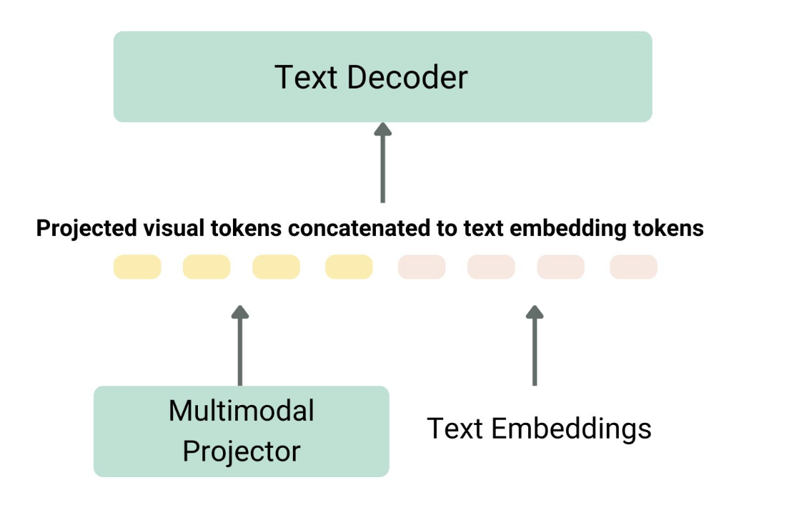

Figure 7.3: 
Architecture of a VLM (after LLaVa [[Liu et al., 2023](#bibf.bib17)], image from Huggingface)

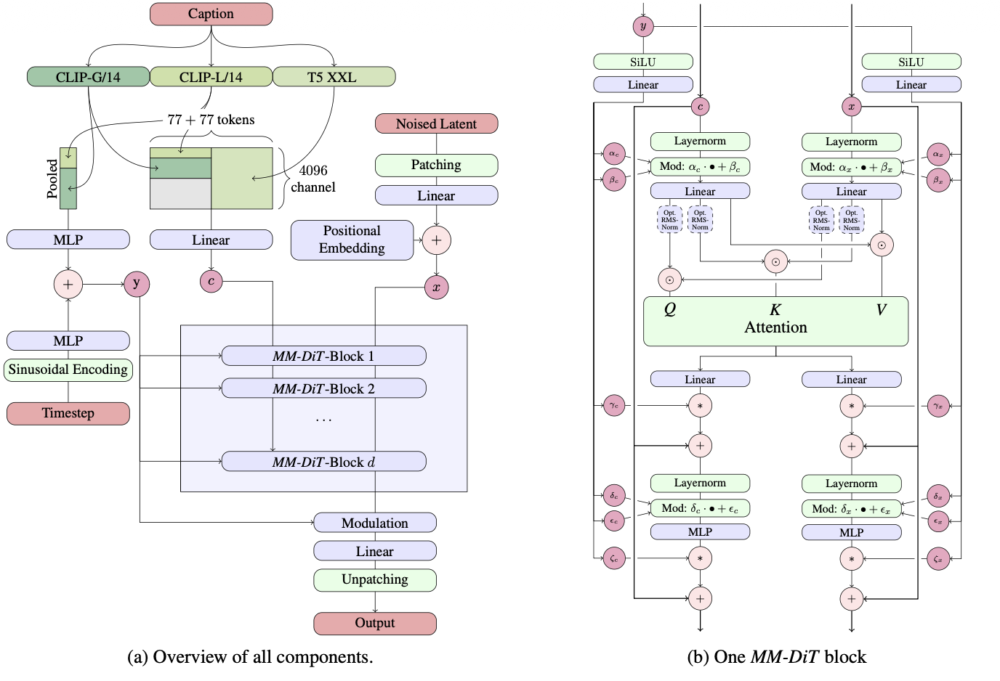

Figure 7.4: 
Architecture of Stable Diffusion [[Esser et al., 2024](#bibf.bib21)]

Then, an architecture was needed to combine the language and image embeddings, and to generate language.
In general, the architecture of a VLM consists of an image encoder (either a CNN or a specially tokenized vision-transformer) and a text encoder that are connected to an embedding projector to align image and text representations (often a dense neural network), connecting to, finally, a text decoder (a transformer). Figure [7.3](#Ch7.F3 "Figure 7.3 ‣ 7.1.2 Architecture ‣ 7.1 Multi-modal Vision Language Models ‣ Chapter 7 Vision, Action and World Models ‣ Part II Reasoning ‣ Agentic Large Language Models") illustrates this architecture, using LLaVa as an example [[Liu et al., 2023](#bibf.bib17)].
The connection between the visual embedding and the textual embedding is made by a network that projects the visual embedding to another embedding, to allow unified reasoning by the model. The projector network is often a dense neural network (multi-layer perceptron, MLP).

More elaborate architectures have been developed, and the architecture of state of the art VLMs can become quite complex, consisting of multiple transformer modules. As an example, Figure [7.4](#Ch7.F4 "Figure 7.4 ‣ 7.1.2 Architecture ‣ 7.1 Multi-modal Vision Language Models ‣ Chapter 7 Vision, Action and World Models ‣ Part II Reasoning ‣ Agentic Large Language Models") shows the generative Stable Diffusion architecture [[Esser et al., 2024](#bibf.bib21), [Weng, 2021](#bibf.bib4), [Yang et al., 2023](#bibf.bib20)].

##### 7.1.3 Learning Algorithm

Now that we have seen the tasks and the architecture of VLMs, it is time to look at the type of learning algorithm that is used by the models.
The different encoders and projectors allow the VLM to be trained. The training algorithms should align and fuse the knowledge from both the visual and the language encoders. The VLM can then correlate the image and text information so that the model can analyze the query and provide an answer based on the two modalities. The literature reports a variety of approaches for training the VLM.

OpenAI’s CLIP [[Radford et al., 2021](#bibf.bib50)], which stands for *contrastive language-image pretraining*, uses contrastive learning. Contrastive learning is a form of self-supervised learning, creating supervisory signals when there are no such labels in the dataset. The idea is to push dissimilar data points apart and pull similar data points together in an embedding space. Contrastive learning maximizes the similarity of representations for *positive* pairs (such as similar forms of the same image) and minimize the similarity for *negative* pairs (images of different objects).

Another approach is to use masking. Here the VLM learns to predict randomly obscured parts of an input text or image, just as it is used in language model training. The model learns to reconstruct the hidden pixels in an image given an (unmasked) caption. An example is FLAVA, or *foundational language and vision alignment*, which uses a vision transformer as image encoder and a transformer for its language encoder and multi-modal projector [[Singh et al., 2022](#bibf.bib22)].

Figure 7.5: DALL-E: Avocado Armchairs

VLM’s are also used in a generative style, to generate an image based on a text prompt. Popular text-to-image models often use diffusion models [[Ho et al., 2022](#bibf.bib62), [Yang et al., 2023](#bibf.bib20)]. Well-known examples are Google’s Imagen [[Baldridge et al., 2024](#bibf.bib18)], Midjourney, OpenAI’s DALL-E [[Betker et al., 2023](#bibf.bib19)] and Stability AI’s stable diffusion [[Esser et al., 2024](#bibf.bib21)]. DALL-E 2 uses a diffusion model conditioned on CLIP image embeddings. Figure [7.5](#Ch7.F5 "Figure 7.5 ‣ 7.1.3 Learning Algorithm ‣ 7.1 Multi-modal Vision Language Models ‣ Chapter 7 Vision, Action and World Models ‣ Part II Reasoning ‣ Agentic Large Language Models") shows DALL-E’s well-known surrealistic avocado armchairs.

Pretraining vision language models from scratch is expensive, and since a VLM consists of a language model and a vision model, we could try to see if it is possible to build a VLM out of one or two existing models, that have already been pretrained before.
Both a pretrained LLM and a pretrained vision encoder can be used, to which a mapping network can be added that projects the visual embedding to the textual input space of the language model.
An example is LLaVA, which stands for *large language and vision assistant*. LLaVa uses the Vicuna language decoder and the CLIP ViT visual encoder, and their outputs are merged into a shared dimensional space using a linear projector [[Liu et al., 2023](#bibf.bib17)].

Many vision language models have been developed. VLMs tend to perform well on benchmark tasks and they are often used for decision making in agents.
VLMs have become so popular that many current open and commercial LLMs are VLMs: DeepSeek-VL2, Gemini 2.0 Flash, GPT-4o, Llama 3.2, NVLM, Qwen 2.5-VL.

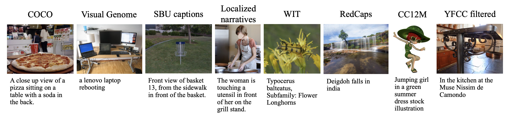

Figure 7.6: 
Flava Pretraining Image-Text Dataset Examples [[Singh et al., 2022](#bibf.bib22)]

##### 7.1.4 Results

Let us take a look at how well VLMs perform at captioning and image generation by looking at some of the examples that are reported in the literature.

Vision language models have produced imaginative and inspiring results ranging from visual question answering, object detection, image captioning to text-to-image generation. An example of the test dataset that is used in Flava is shown in Figure [7.6](#Ch7.F6 "Figure 7.6 ‣ 7.1.3 Learning Algorithm ‣ 7.1 Multi-modal Vision Language Models ‣ Chapter 7 Vision, Action and World Models ‣ Part II Reasoning ‣ Agentic Large Language Models"). The successor of DALL-E 2, DALL-E 3, focused on training on highly descriptive generated image captions, yielding even more impressive results [[Betker et al., 2023](#bibf.bib19)]. Some of the prompt following image generation capabilities of DALL-E 3 are shown in Figure [7.7](#Ch7.F7 "Figure 7.7 ‣ 7.1.4 Results ‣ 7.1 Multi-modal Vision Language Models ‣ Chapter 7 Vision, Action and World Models ‣ Part II Reasoning ‣ Agentic Large Language Models"). Figure [7.8](#Ch7.F8 "Figure 7.8 ‣ 7.1.4 Results ‣ 7.1 Multi-modal Vision Language Models ‣ Chapter 7 Vision, Action and World Models ‣ Part II Reasoning ‣ Agentic Large Language Models") shows examples from stable diffusion (based on the rectified-flow diffusion models).

Figure 7.7: 
Prompt Following Text-to-Image Examples from DALL-E 3 [[Betker et al., 2023](#bibf.bib19)]

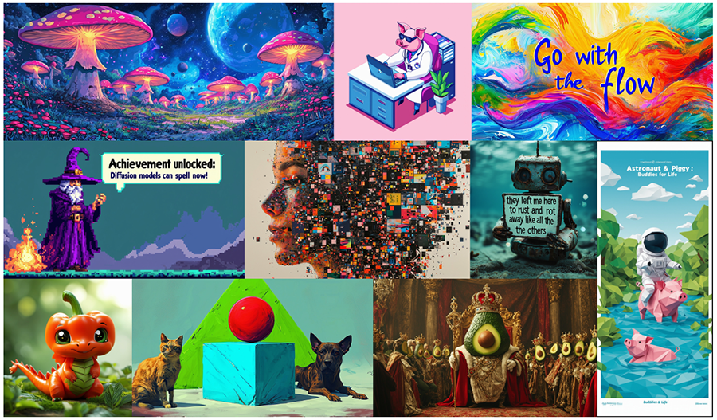

Figure 7.8: 
Stable Diffusion Examples [[Esser et al., 2024](#bibf.bib21)]

Figure 7.9: VLA has a different meaning in different languages. So has Vlas. (A hint of which language this is flagged in one of the pictures)

#### 7.2 Decisions & Vision Language Action Models

To act, agents must make decisions, and to make decisions, different options must be weighed. As we will see in this section, we can train transformers on episodes of states, actions and rewards $\{(s,a,r)\}$ (see also Section [20.1.2](#Ch20.S1.SS2 "20.1.2 Pretraining Backtracking on Decision Traces ‣ 20.1 Transformer Architectures ‣ Chapter 20 *Advanced Transformer and Agentic Architectures ‣ Part VI Advanced Topics ‣ Agentic Large Language Models")).
These models are trained on sequences of language, vision, and robotic actions. Vision-language-action models, VLAs, (Figure [7.9](#Ch7.F9 "Figure 7.9 ‣ 7.1.4 Results ‣ 7.1 Multi-modal Vision Language Models ‣ Chapter 7 Vision, Action and World Models ‣ Part II Reasoning ‣ Agentic Large Language Models")) are trained to output robot API commands, which are a special type of language: the language of commands to steer robotic movement.

The task of a VLA is to understand a visual scene, and, when given a textual command, instruct a robot arm to perform an appropriate action, depending on what the model sees through the camera.
These models have shown impressive results of robots generalizing to unseen situations, successfully performing tasks.

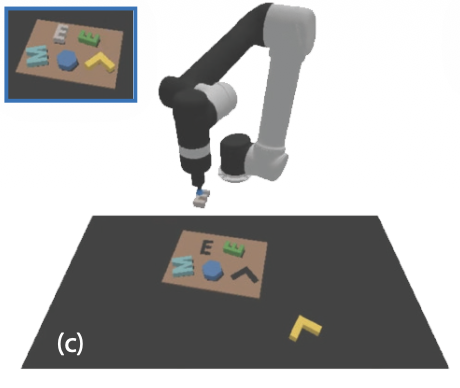

Figure 7.10: 
Example from CLIPort: *put the gray letter E in the left letter E shape hole* [[Shridhar et al., 2022](#bibf.bib60)]

##### 7.2.1 Tasks

The main task of VLAs is to perform instructions in the real world, and to do so in a general way, in a changing environment. When a robotic manipulation model has been trained to pick up a set of red pencils, and the task changes to pick up blue pencils, then it would be nice if the model generalizes, and we do not have to assemble a new training set involving blue pencils and re-train the model again from scratch. We also want our model to recognize objects, and recognize when an object is oriented differently, has moved, or the lighting changes. The model should know how to use a robot arm to manipulate objects, and how to perform different actions. See Figure [7.10](#Ch7.F10 "Figure 7.10 ‣ 7.2 Decisions & Vision Language Action Models ‣ Chapter 7 Vision, Action and World Models ‣ Part II Reasoning ‣ Agentic Large Language Models") for an example, taken from the CLIPort paper [[Shridhar et al., 2022](#bibf.bib60)].

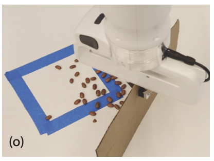

Figure 7.11: 
Another Example from CLIPort: *sweep the beans into the blue zone* [[Shridhar et al., 2020](#bibf.bib49)]

The hardest task for VLAs is to combine these scenes, objects and actions to manipulations that are complicated combinations of what the model has seen during training, and to generalize to unseen combinations. Especially long-horizon navigation through complex, changing, environments (perhaps even outdoors) is a complex challenge [[Shridhar et al., 2022](#bibf.bib60)].

In realistic human-robot interaction settings,
collecting additional demonstrations is often infeasible.
To perform high-level tasks, such as in Figure [7.11](#Ch7.F11 "Figure 7.11 ‣ 7.2.1 Tasks ‣ 7.2 Decisions & Vision Language Action Models ‣ Chapter 7 Vision, Action and World Models ‣ Part II Reasoning ‣ Agentic Large Language Models"), the VLA must be able to recognize objects, their poses, and segmentations of instances. The model must also be able to understand language, and relate the meaning of language to the meaning of visual objects and to the meaning of robotic actions.

As we will see, language provides an intuitive interface for specifying goals and for transferring semantic concepts across tasks. Furthermore, the work on VLMs has shown how to semantically connect different kinds of embeddings.

##### 7.2.2 Architecture

Now that we have seen the task and the challenges, let us look at possible model architectures. Again, they can become quite complex.
The transformer architecture is well suited to learn patterns in sequential data, as the results on natural language show. Intuitively, this suggests that transformers may also work well to model sequential decision problems, the type of problems that are often solved in reinforcement learning for robotic action, as we discussed in Section [2.2.3](#Ch2.S2.SS3 "2.2.3 Reinforcement Learning ‣ 2.2 Machine Learning Methods For Natural Language Processing ‣ Chapter 2 Foundations of Language Modeling with LLMs ‣ Part I Language Modeling ‣ Agentic Large Language Models") (and further in depth in Section [20.2.1](#Ch20.S2.SS1 "20.2.1 In-Context Reinforcement Learning ‣ 20.2 Agentic Architectures ‣ Chapter 20 *Advanced Transformer and Agentic Architectures ‣ Part VI Advanced Topics ‣ Agentic Large Language Models")). These problems consist of a state, from which actions cause the system to enter a new state, which has actions, etc. The transformer architecture is well suited to model these problems.

Early work on decision transformer (DT) [[Chen et al., 2021](#bibf.bib33), [Janner et al., 2021](#bibf.bib40)] showed that on offline (static) reinforcement learning problems, the GPT architecture was indeed able to learn optimal policies. The decision-pretrained transformer (DPT) [Lee et al. [2023]](#bibf.bib34), [Wang et al. [2024a]](#bibf.bib39) showed that the basic transformer architectures can be pretrained and finetuned on decision traces. Section [20.1.2](#Ch20.S1.SS2 "20.1.2 Pretraining Backtracking on Decision Traces ‣ 20.1 Transformer Architectures ‣ Chapter 20 *Advanced Transformer and Agentic Architectures ‣ Part VI Advanced Topics ‣ Agentic Large Language Models") discusses decision traces further.

Following pioneering work on CLIPort [[Shridhar et al., 2022](#bibf.bib60), [Shridhar et al., 2020](#bibf.bib49)], VLAs are often built on VLMs, where the robotic commands are used as regular language tokens. Let us have a closer look at some representative models.

The goal of Mobility VLA [[Chiang et al., 2024](#bibf.bib58)] is navigation. This VLA is created by combining a long context VLM with topological maps, as illustrated in Figure [7.12](#Ch7.F12 "Figure 7.12 ‣ 7.2.2 Architecture ‣ 7.2 Decisions & Vision Language Action Models ‣ Chapter 7 Vision, Action and World Models ‣ Part II Reasoning ‣ Agentic Large Language Models").

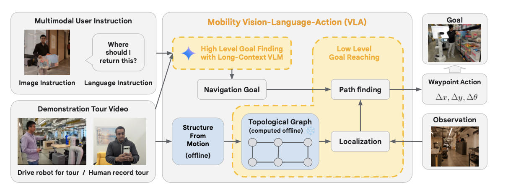

Figure 7.12: 
Mobility VLA Architecture: Long Context VLM and Topological Maps [[Chiang et al., 2024](#bibf.bib58)]

Mobility VLA is used on a problem category of navigation tasks called *multi-modal instruction navigation with demonstration tours* (MINT). In this dataset, an environment prior is provided through a previously recorded demonstration
video. The model consists of a two-level VLA that combines the environment
understanding and common sense reasoning of long-context VLMs with a
low-level navigation policy based on topological graphs. The high-level policy is created by combining user instructions from a long-context VLM that finds the goal frame in a demonstration video. Then, a low-level policy starts at this goal frame to traverse a topological graph to generate the robot action instructions at every timestep.

LM-Nav [[Shah et al., 2023](#bibf.bib54)] uses a different architecture, based on existing models. It takes as input a set of raw observations
from the target environment and from free-form textual instructions. From this, it derives an action plan using three pretrained models: a language model (LLM) for extracting landmarks, a vision-language model (VLM)
for grounding, and a visual-navigation model (VNM) for execution (not unlike the topological map previously discussed). Together, these models enable LM-Nav to follow textual
instructions from visual observations without any finetuning. Figure [7.13](#Ch7.F13 "Figure 7.13 ‣ 7.2.2 Architecture ‣ 7.2 Decisions & Vision Language Action Models ‣ Chapter 7 Vision, Action and World Models ‣ Part II Reasoning ‣ Agentic Large Language Models") shows an illustration of the approach.

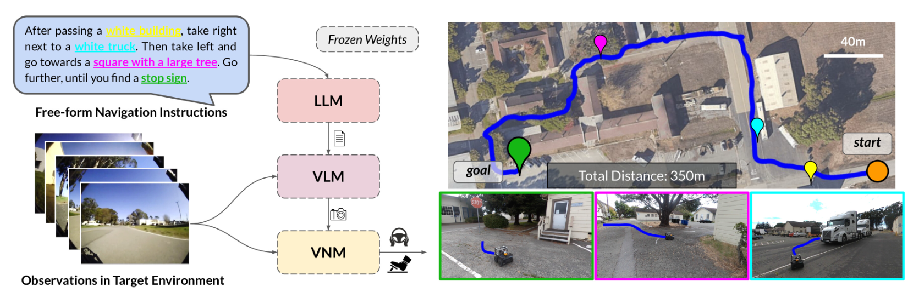

Figure 7.13: 
Three-LLM Architecture of LM-Nav [[Shah et al., 2023](#bibf.bib54)]

Google’s RT-2 [[Brohan et al., 2023](#bibf.bib52)] uses a different approach. The idea of RT-2 is to leverage knowledge from the web to inform robotic control: the robot should learn how to act from watching videos. A standard vision language model is finetuned both on textual robotic trajectory data and on
Internet-scale vision-language tasks, such as visual question answering. Robotic actions are expressed as regular text tokens and are incorporated
directly into the training set in the same way as natural language tokens, as shown in Figure [7.14](#Ch7.F14 "Figure 7.14 ‣ 7.2.2 Architecture ‣ 7.2 Decisions & Vision Language Action Models ‣ Chapter 7 Vision, Action and World Models ‣ Part II Reasoning ‣ Agentic Large Language Models").

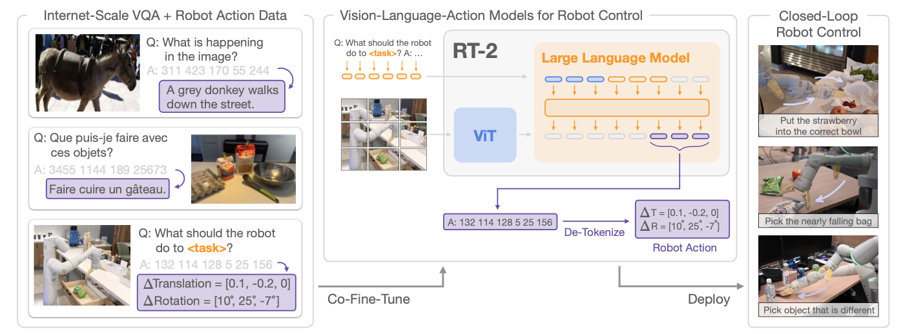

Figure 7.14: 
RT-2 Architecture: VLM trained using Robotic Actions as Text Tokens [[Brohan et al., 2023](#bibf.bib52)]

A similar approach is taken by Magma [[Yang et al., 2025](#bibf.bib61)]. Magma is pretrained on heterogeneous datasets spanning from images and videos to robotics data. However, in Magma the actionable visual objects in images
are labeled by special tokens (Set-of-Mark) for action grounding. Similarly, object movements (such as the trace of human hands or
robotic arms) are labeled by Trace-of-Mark
to ease action planning. Figure [7.15](#Ch7.F15 "Figure 7.15 ‣ 7.2.2 Architecture ‣ 7.2 Decisions & Vision Language Action Models ‣ Chapter 7 Vision, Action and World Models ‣ Part II Reasoning ‣ Agentic Large Language Models") provides an illustration.

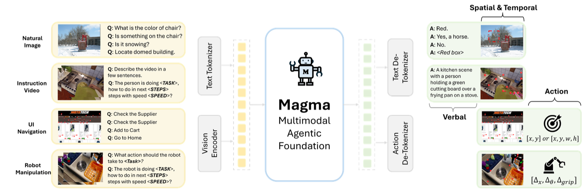

Figure 7.15: 
Magma Pretraining Pipeline [[Yang et al., 2025](#bibf.bib61)]

Finally, a VLA called $\pi_{0}$ [[Black et al., 2024](#bibf.bib44)] stresses the reinforcement learning approach by using a pretrained late-fusion vision-language model, as well as a diverse cross-embodiment dataset with a variety of manipulation tasks. The model is inspired by the Transfusion approach [[Zhou et al., 2024](#bibf.bib41)]. This model is adapted to robot control by adding a separate
action expert that produces actions via flow matching, for fluent manipulation skills. The resulting model
can either be used directly to perform tasks based on a prompt, or be further finetuned on higher-quality data to enable complex multi-stage
tasks, such as folding multiple articles of laundry or assembling a box (see Figure [7.16](#Ch7.F16 "Figure 7.16 ‣ 7.2.2 Architecture ‣ 7.2 Decisions & Vision Language Action Models ‣ Chapter 7 Vision, Action and World Models ‣ Part II Reasoning ‣ Agentic Large Language Models")).

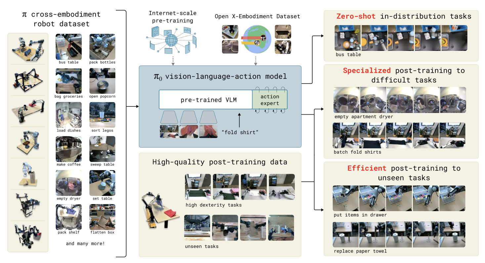

Figure 7.16: 
Architecture of $\pi_{0}$. The model is based on a VLM, enhanced with a cross-embodiment dataset [[Black et al., 2024](#bibf.bib44)]

##### 7.2.3 Learning Algorithm

The model architecture of most VLAs is based on VLMs, in some cases augmented with navigation map data. The robotic action commands are typically encoded as regular text commands. Likewise, for pretraining and finetuning typical LLM self-supervised learning algorithms are used, similar to VLMs and decision transformers. Sometimes existing pretrained models are used, to reduce the training expense.

##### 7.2.4 Results

Various VLA models have been
created that achieve impressive zero-shot results, generalizing behavior to unseen situations.
[Chiang et al. [2024]](#bibf.bib58), [Brohan et al. [2023]](#bibf.bib52), [Yang et al. [2025]](#bibf.bib61) are examples of
VLA models for robotic action, achieving complex tasks such as navigation, table top manipulation, or even folding laundry [[Black et al., 2024](#bibf.bib44)].

VLAs have shown impressive and imaginative results, where robots were able to generalize at inference time without the need for retraining. A survey of VLAs can be found in
[[Ma et al., 2024](#bibf.bib59)].

The results are best appreciated from seeing a video.
For $\pi_{0}$, a video is available.22
2
<https://www.physicalintelligence.company/blog/pi0>
For RT-2, a video is also available.33
3
<https://robotics-transformer2.github.io>

#### 7.3 World Models, Physics, and Planning

To a VLM, an image consists of pixels without a deeper intrinsic meaning. However, agents that interact with the world need knowledge about physical aspects of that world. The models need an understanding of what is physically possible, so that agents do not walk through walls, as they still sometimes do in video games.

World models help agents understand the world, allowing them to act effectively in the physical world, taking actions that make sense. Originally, LLMs are language models. We can converse with them in natural language, and they necessarily contain some knowledge of the world, but they were not specifically trained to have a wide and deep understanding of worldly affairs. Some researchers argue that in order for agentic LLMs to be truly successful, and for LLMs to reach a high level of general intelligence, research into world models should be strengthened [[Sutton et al., 2022](#bibf.bib35), [Matsuo et al., 2022](#bibf.bib69), [LeCun and others, 2022](#bibf.bib2), [Klindt et al., 2026](#bibf.bib3)].

Agents and robots that act in the world need a rudimentary understanding of the physics of the world.
One of the challenges for training an LLM is to ground its understanding of the physical world and of the possible robotic actions into reality.
One way to do this is to learn an agentic model of the world (environment) from feedback on actions.

The term *world model* has been used in AI in other contexts. Most notably, it refers to the *model* in model-based reinforcement learning [[Ha and Schmidhuber, 2018](#bibf.bib57), [Moerland et al., 2023](#bibf.bib45), [Sutton, 1991](#bibf.bib32)] (see next section). This model contains a local copy of some knowledge of the environment, based on the interactions it has had with the environment, to be used to improve the action policy.
The world model contains an efficient, compressed, learned representation of the world [[Hafner et al., 2019](#bibf.bib31), [Plaat et al., 2020](#bibf.bib38)]. The representation of a world model is often called an abstract or *latent* representation, to contrast it with the regular representation of the real world in the environment.
World models are often trained to contain knowledge about physics and certain spatial properties, that puts restrictions on the agent’s actions. The precise contents of the world model depends on the domain in which the agent operates.

Note that in a just few chapters we have progressed from understanding language to understanding the world. The goal of a large *language* model is to understand some semantics of natural language from statistical patterns in text, to be used for question answering and translation. The goal of a *world* model is to understand causal relations in the laws of physics, to be used to simulate future world states for our agent. Quite some new technology is necessary to go from LLM to agentic LLM.

We start with a look at how world models are currently used in agentic LLM.

##### 7.3.1 Tasks

World models should encapsulate knowledge of the world, so that an agent can perform meaningful actions. The actions should be grounded in the physical world. For example, the model should understand the limitations of the joints of a robot arm that it is commanding; a navigational agent should understand some physics, such as the concept of gravity, of distance, and that walls are solid objects; a financial agent should understand the consequences of a negative bank balance. Often this is the type of information that humans take for granted, and we are surprised when an agent fails to understand such basic things about the world in which it operates. VLMs that are only trained on pixels may miss the semantic meaning of a specific texture, whether it is a garment, smoke, or a wall.

Standard pretrained LLMs already contain some useful world knowledge. They learn acceptable textual behavior using reinforcement learning with human feedback (RLHF), and acceptable mathematical and coding behavior using reinforcement learning with verifiable rewards (RLVR). Some early approaches use LLMs as pretrained world model without any finetuning.
A natural way to learn about the physics of the world is through interaction: agents can learn acceptable physical behavior through a reinforcement learning-style reward function.

The goal of world models in model-based reinforcement learning is to improve the sample efficiency of learning from interaction, by planning with the world *model* instead of sampling from the *real* world. This is especially useful when interacting with the world is more expensive than performing a simulation, as will often be the case in agentic LLM. In the approaches that we will discuss, LLM world models use methods from model-based reinforcement learning (see Section [7.3.5](#Ch7.S3.SS5 "7.3.5 *Model-Based Reinforcement Learning ‣ 7.3 World Models, Physics, and Planning ‣ Chapter 7 Vision, Action and World Models ‣ Part II Reasoning ‣ Agentic Large Language Models")). Currently, world model approaches in LLM are quite diverse. To show which tasks world models are used for in LLMs, we will discuss three examples: WorldGPT, WebDreamer, and WorldCoder.

###### WorldGPT

The goal of
WorldGPT [[Ge et al., 2024](#bibf.bib8)] is to solve visual question answering and embodied planning tasks, including audio-video question answering. WorldGPT learns a world-VLM from videos.
It uses a latent space VLM with external knowledge bases and long-term memory.

###### WebDreamer

The goal of WebDreamer [[Gu et al., 2024](#bibf.bib9)] is to improve efficient learning of Web-interaction tasks, such as e-commerce. WebDreamer enables web-agents to simulate actions before execution, and thus be faster and more sample efficient (by not having to act in the real web to gather experience). WebDreamer is a model-based reinforcement learning approach in a web-world. (The name is derived from *Dreamer*, a series of influential model-based reinforcement learning latent dynamics models [[Hafner et al., 2019](#bibf.bib31), [Hafner et al., 2020a](#bibf.bib30), [Hafner et al., 2023](#bibf.bib47)].) Typical tasks are to find products on e-commerce sites. It does so by training a small model from a large model, allowing efficient simulation.

Figure 7.17: 
Sokoban for WorldCoder [[Tang et al., 2024](#bibf.bib10)]

Figure 7.18: 
AlfWorld for WorldCoder [[Tang et al., 2024](#bibf.bib10)]

###### WorldCoder

The goal of WorldCoder [[Tang et al., 2024](#bibf.bib10)] is also to improve sample efficiency, but the approach is different. WorldCoder improves efficiency by generating the dynamics model (transition function and reward function) in interpretable Python code, which is then used in a standard model-based reinforcement learning design. The generated Python code executes more efficiently than LLM inference does. WorldCoder is used in grid-tasks (Sokoban, see Figure [7.17](#Ch7.F17 "Figure 7.17 ‣ WebDreamer ‣ 7.3.1 Tasks ‣ 7.3 World Models, Physics, and Planning ‣ Chapter 7 Vision, Action and World Models ‣ Part II Reasoning ‣ Agentic Large Language Models")) and domestic task planning (AlfWorld, see Figure [7.18](#Ch7.F18 "Figure 7.18 ‣ WebDreamer ‣ 7.3.1 Tasks ‣ 7.3 World Models, Physics, and Planning ‣ Chapter 7 Vision, Action and World Models ‣ Part II Reasoning ‣ Agentic Large Language Models")).

##### 7.3.2 Architecture

The purpose of a world model is to add semantic meaning to observations—actions having consequences—something that LLMs and VLMs may struggle with. When does a pixel belong to a floor to walk on (restrict $y$ movement) and when is it part of a wall to stop you (restrict $x$ movement)? A reward function provides feedback information on which actions are good, and which are not. Thus, world model architectures often use a reinforcement learning setting, in which an action policy is trained from feedback rewards. We can think of a world model as a VLM with a policy learner inside.

WorldGPT, WebDreamer, and WorldCoder use different architectures for their world model, which we will now discuss in more detail.

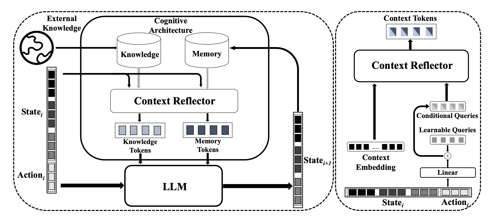

Figure 7.19: 
Architecture of WorldGPT [[Ge et al., 2024](#bibf.bib8)]

###### WorldGPT

WorldGPT is based on a standard LLM, Vicuna-7B-v0.44
4
<https://huggingface.co/lmsys/vicuna-7b-v1.3>, <https://lmsys.org> It performs reasoning in latent space, following the model-based reinforcement learning approach. The goal of WorldGPT is to be a simulator of realistic dynamics of the world—the transition and the reward function in reinforcement learning. To do so, the architecture helps synthesize multi-modal instruction instances, using a special architecture. At the core WorldGPT follows the common VLM architecture with a central LLM, and a multi-modal encoder and a decoder. To help the model synthesize multi-modal instructions, a cognitive architecture is added to help with specialized or long-term tasks. The architecture adds memory, knowledge retrieval, and context reflection. The context reflection is built on Q-former [[Li et al., 2023](#bibf.bib42)]. See Figure [7.19](#Ch7.F19 "Figure 7.19 ‣ 7.3.2 Architecture ‣ 7.3 World Models, Physics, and Planning ‣ Chapter 7 Vision, Action and World Models ‣ Part II Reasoning ‣ Agentic Large Language Models") for a diagram of the architecture.

###### WebDreamer

WebDreamer is aimed at web-interaction. It distills a large model, Qwen-70B [[Bai et al., 2025](#bibf.bib43)], into a small 7B model. The small model is then used for simulating actions with the world model, before acting in the “real” web-world. It uses model predictive control (MPC) as planning approach [[Garcia et al., 1989](#bibf.bib67), [Schwenzer et al., 2021](#bibf.bib37)] for decision making about website actions, re-planning at each interaction step. WebDreamer leverages LLMs as world model and as value function. The LLM implements
both the simulation function (sim) and the scoring function (score), see Figure [7.20](#Ch7.F20 "Figure 7.20 ‣ WebDreamer ‣ 7.3.2 Architecture ‣ 7.3 World Models, Physics, and Planning ‣ Chapter 7 Vision, Action and World Models ‣ Part II Reasoning ‣ Agentic Large Language Models").
Furthermore, following [[Koh et al., 2024](#bibf.bib65)], the LLM is used for candidate action generation (in addition to sim and score). The authors
employ a two-stage approach: first sampling top-$k$ actions, and
then using the LLM to self-refine unnecessary actions for simulation.

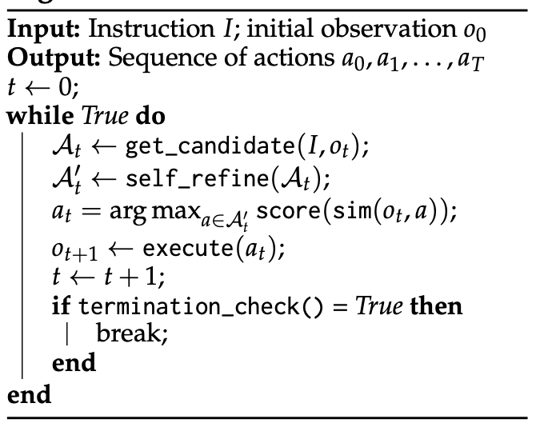

Figure 7.20: 
WebDreamer pseudocode: using LLM for score and sim function [[Gu et al., 2024](#bibf.bib9)]

###### WorldCoder

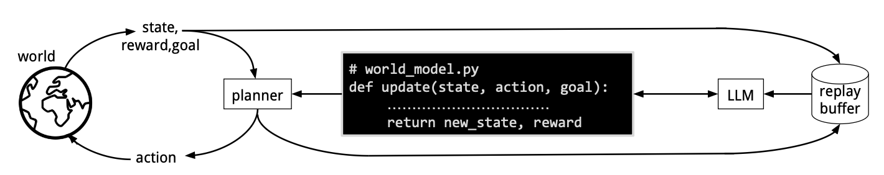

Figure 7.21: 
WorldCoder Architecture [[Tang et al., 2024](#bibf.bib10)]

WorldCoder is a model-based agent that builds a Python program to represent its knowledge of the world. WorldCoder creates a transition function of the world in executable Python code, see Figure [7.21](#Ch7.F21 "Figure 7.21 ‣ WorldCoder ‣ 7.3.2 Architecture ‣ 7.3 World Models, Physics, and Planning ‣ Chapter 7 Vision, Action and World Models ‣ Part II Reasoning ‣ Agentic Large Language Models").
WorldCoder uses program synthesis. In reinforcement learning, problems are formalized as MDPs, consisting of a state representation $S$, action function $A$, transition function $T$, and reward function $R$ (see Section [7.3.5](#Ch7.S3.SS5 "7.3.5 *Model-Based Reinforcement Learning ‣ 7.3 World Models, Physics, and Planning ‣ Chapter 7 Vision, Action and World Models ‣ Part II Reasoning ‣ Agentic Large Language Models")). WorldCoder uses an LLM to generate Python code for action, transition and reward functions for a task, as well as for the state representation, which is then used in a model-based reinforcement learning approach. This code is checked and improved, in an iterative self debug refinement process [[Chen et al., 2023](#bibf.bib68)], see Section [6.1.3.2](#Ch6.S1.SS3.SSS2 "6.1.3.2 Code Generation for Validation ‣ 6.1.3 Chain of Thought Prompting ‣ 6.1 In-Context Reasoning ‣ Chapter 6 Multi-step Reasoning in LLMs ‣ Part II Reasoning ‣ Agentic Large Language Models").
This process repeats until the program
produces the correct output.

Note that in WorldCoder the learned model is symbolic (the transition function is represented as computer code), where in regular deep reinforcement learning the model is a neural network. At inference time, WorldCoder is efficient, since no LLM calls occur that require forward passes through a large network, only interpretation of the transition and reward function Python code.

In regular model-based LLM approaches, the LLM *simulates* the world, in WorldCoder the LLM *builds* a simulation of the world, for later execution. At inference time, the Python interpreter executes the transition function, where in ReAct, an LLM reasons about the world state. For planning problems, the symbolic approach is better suited, since LLMs struggle with planning during inference (see Section [6.2.3](#Ch6.S2.SS3.SSS0.Px1 "Knowing-Doing Gap ‣ 6.2.3 LLMs and Stateful Problems ‣ 6.2 Self-Reflection and State ‣ Chapter 6 Multi-step Reasoning in LLMs ‣ Part II Reasoning ‣ Agentic Large Language Models")).

##### 7.3.3 Learning Algorithm

We will now discuss the pretraining and finetuning algorithms that the different approaches use.

###### WorldGPT

WorldGPT acquires an understanding of world
dynamics by pretraining and finetuning on millions of videos across various domains. Vicuna-7B-v0 is used as the base LLM. Pretraining then uses a language-centric encoder to obtain a unified representation of the multi-modal state. For multi-modal decoding, special tokens are inserted into the LLM’s vocabulary. Training starts uni-modal, and progresses to cross-modal. For finetuning, a special cognitive reinforcement architecture is used with a dataset with fine-grain sequential state-transition sample annotations from more than 10 million videos. As mentioned before, the cognitive architecture consists of memory, knowledge retrieval, and context reflection. Through finetuning, agents acquire specialized knowledge by finetuning on synthetic multi-modal instruction data.

###### WebDreamer

The WebDreamer approach aims to learn dynamics suitable for model-based reinforcement learning. First the pretrained Qwen-2-VL vision language model [[Wang et al., 2024b](#bibf.bib66)] is used to initialize the Dreamer-7B model, which is then further finetuned on 3.1 million interaction examples.
The data synthesis pipeline consists of (1) random walks over the web,
where the model autonomously interacts with web pages through actions such as typing for search
and clicking, and (2) synthesis, where Qwen2-VL-72B generates textual
descriptions of state changes based on visual snapshots before and after the actions. WebDreamer simulates possible
future states for each action over a finite horizon (replanning and retraining according to the model predictive control (MPC) approach, a reinforcement learning approach for adaptive retraining that is used in engineering and control problems).

###### WorldCoder

WorldCoder uses program synthesis to learn to make a transition function, the function that computes the next state of the world. WorldCoder then performs planning-actions using that coded world model. It initially
performs random exploration to initialize a dataset of environmental interactions; it updates its world
model using a program synthesis algorithm, generates the code, and then
performs planning. Different planners are possible, from depth-limited value iteration (in
simple domains) to MCTS (for more complex domains) [[Browne et al., 2012](#bibf.bib51)].

##### 7.3.4 Results

We will now look at the results of the three approaches.

###### WorldGPT

The WorldGPT model is evaluated with a multi-modal state transition prediction benchmark. WorldGPT is effective, and understands and predicts the dynamics of complex real-world kitchen and cooking scenarios accurately.

The system is also evaluated as a world simulator, showing that it can generalize to unfamiliar domains.
In one experiment, WorldGPT is 30 times faster then traditional diffusion-based methods on audio-video question answering
tasks [[Ge et al., 2024](#bibf.bib8)].

###### WebDreamer

WebDreamer also performs well. It is reported to surpass GPT-4o performance on web interaction tasks.
Substantial performance improvements are reported over reactive baselines, on which it is 4-5 times more efficient than tree search. WebDreamer performs well on the sandbox environment VisualWebArena, and also on real-world websites (Online-Mind2Web and Mind2Web-Live), where tree search methods are difficult to implement and deploy. Moreover, on online benchmarks, using Dreamer-7B, the approach achieves performance
comparable to GPT-4o. On real-world websites, WebDreamer
outperforms the reactive baseline with a relative gain of 42% and 24%, respectively.

###### WorldCoder

For WorldCoder results are reported on grid worlds and on task planning (AlfWorld). WorldCoder is more sample-efficient than model-free reinforcement learning, and more compute-efficient compared to ReAct-style agents that try to perform in-context planning by the LLM.

Generating world knowledge as computer code by LLMs brings
advantages. It allows prior world knowledge embedded in the LLM to improve code generation, as existing solutions to published problems may well have been seen during pretraining. The code can also be transferred across tasks by reusing pieces of old programs. Furthermore, the results are human readable, allowing the world knowledge to be inspected by humans by reading the generated code.

Though promising for planning problems, a limitation of the WorldCoder approach is inherent to the computational difficulty of planning problems. Problem instances that are difficult to solve with dedicated solvers are also difficult to solve for WorldCoder solvers. The transition function that is generated by the LLM is unlikely to be better than those designed by expert human researchers.

So far, the synthesized code aims to reproduce the transition and reward functions. For future work, self reflection and metalearning approaches may be able to improve performance further.

##### 7.3.5 \*Model-Based Reinforcement Learning

World models are being used successfully in agentic LLM. An extensive literature exists on world models in model-based reinforcement learning. At the end of this chapter, we will now provide a brief overview of world models in model-based reinforcement learning, in order to provide more context for the use of world models in LLM.

An influential early model-based approach is Dyna [[Sutton, 1991](#bibf.bib32)]. Influential recent works are [[Ha and Schmidhuber, 2018](#bibf.bib57), [Hafner et al., 2020b](#bibf.bib56)]. Two modern surveys are [Moerland et al. [2023]](#bibf.bib45), [Plaat et al. [2023]](#bibf.bib46).

In reinforcement learning, agents learn how to act in an
environment by sampling rewards from actions that are executed in the environment.

Environment: $T(s,a)\rightarrow s^{\prime},R(s^{\prime})\rightarrow r$Agent: $r$ improves $\pi_{\theta}(s)\rightarrow a$$(s^{\prime},r)$$a$

Figure 7.22: 
The standard reinforcement learning loop. The agent learns a $\theta$-parameterized policy $\pi_{\theta}$ from feedback rewards $r$ from the environment. [[Sutton and Barto, 2018](#bibf.bib53)]

###### 7.3.5.1 Model-free Reinforcement Learning

In regular reinforcement learning an optimal agent policy is learned model-free: the best actions for all states are learned directly from interaction with the environment (see Figure [7.22](#Ch7.F22 "Figure 7.22 ‣ 7.3.5 *Model-Based Reinforcement Learning ‣ 7.3 World Models, Physics, and Planning ‣ Chapter 7 Vision, Action and World Models ‣ Part II Reasoning ‣ Agentic Large Language Models")), without the help of an extra model of the environment. Regular reinforcement learning is formally described as a Markov decision process, with four functions $\{S,T,A,R\}$: a function $S(o)\rightarrow s$ to represent the state of the system for observation $o$, a function $T(s,a)\rightarrow s^{\prime}$ that transitions from one state to the next state using an action, a function $A(s)\rightarrow a$ that returns an action for a state, and a function $R(s)\rightarrow r$ that assign a reward value (positive or negative) to a state. The goal of reinforcement learning is to use the MDP to learn an optimal policy $\pi^{*}(s)\rightarrow a^{*}$, the function that returns the best action for each state that the MDP can be in. Thus, a reinforcement learning problem consists of four functions $S$, $T$, $A$, and $R$, and the goal of the agent is to find the optimal policy $\pi^{*}(s)$ with the highest expected cumulative reward. The agent does not have access to $T$ and $R$, functions that reside in the environment. Regular, model-free, reinforcement learning is also called *direct* reinforcement learning. The direct method naturally has high sample complexity: policy improvement requires sampling, and large MDPs require many samples for the policy improvement process to converge (Figure [7.22](#Ch7.F22 "Figure 7.22 ‣ 7.3.5 *Model-Based Reinforcement Learning ‣ 7.3 World Models, Physics, and Planning ‣ Chapter 7 Vision, Action and World Models ‣ Part II Reasoning ‣ Agentic Large Language Models")).

Environment: $T(s,a)\rightarrow s^{\prime},R(s^{\prime})\rightarrow r$Agent:$r$ improves $\hat{M}=(\hat{T},\hat{R})$and $r,\hat{M}$ both improve $\pi_{\theta}(s)\rightarrow a$$(s^{\prime},r)$$a$

Figure 7.23: Model-based reinforcement learning where environment feedback is used to improve both the policy $\pi$ and the local dynamics model $\hat{M}=(\hat{T},\hat{R})$ from which the policy $\pi$ is also sampled (*planning*)

###### 7.3.5.2 Model-based Reinforcement Learning

In direct reinforcement learning, sampled information is not retained by the agent, but forgotten, and each policy improvement requires a new sample. Interaction by the agent with the outside environment is often expensive, for example for a robot acting in the real world, whose joints wear out. In this case it would be beneficial to find ways to reduce the sample complexity. We should try to improve the policy without having to sample as much from the environment.

A straightforward idea is not to throw away the samples, but to store them in a buffer, and also sample from that buffer of older interaction results, or, slightly more advanced, to train a *local surrogate model* $M=(\hat{T},\hat{R})$ of the environment dynamics. When we have trained this local dynamics model, we can also sample from the model, cheaply, in addition to sampling the environment, expensively (see Figure [7.23](#Ch7.F23 "Figure 7.23 ‣ 7.3.5.1 Model-free Reinforcement Learning ‣ 7.3.5 *Model-Based Reinforcement Learning ‣ 7.3 World Models, Physics, and Planning ‣ Chapter 7 Vision, Action and World Models ‣ Part II Reasoning ‣ Agentic Large Language Models")).

These methods are indirect methods, since, in the last methods, where a local dynamics model is built up by the agent, the policy is learned indirectly (through a local model) from the environment.

Using a local dynamics model is called model-based reinforcement learning. The dynamics model consist of local estimations $\hat{T}$ and $\hat{R}$ by the agent, estimates of the real $T$ and $R$ that are known only to the environment.
Model-based reinforcement learning has been successful in some applications, such as Go [[Silver et al., 2016](#bibf.bib48)], Diplomacy [[Bakhtin et al., 2022](#bibf.bib64)], StarCraft [[Vinyals et al., 2019](#bibf.bib63)], and showing learning across domains [[Hafner et al., 2020b](#bibf.bib56)].

Model-based reinforcement learning also connects to *planning*, a classic field in symbolic artificial intelligence, that looks ahead into the future, simulating different possible worlds using the efficient latent representation, without having to act in the real world.

###### 7.3.5.3 Dimension Reduction

In deep model-based reinforcement learning, the local dynamics models are also called world models [[Ha and Schmidhuber, 2018](#bibf.bib57)].
In this context world models reduce high dimensional observation spaces to lower dimensional state and reward spaces, that can then be used in model-based reinforcement learning methods to efficiently improve policy functions.
The idea
behind world models is that in most high-dimensional environments
there are elements that are less important, such as, in a video game, trees in the background
that never move, that have little or no relation to the value
of the agent’s actions. The goal is to
abstract away these unimportant elements of the input space,
reducing the effective dimensionality of the state space.

###### 7.3.5.4 Joint Embedding Predictive Architecture

The joint embedding predictive architecture (JEPA) is proposed by [LeCun and others [2022]](#bibf.bib2) and further refined in [Assran et al. [2023]](#bibf.bib7). The goal of JEPA is to predict future states in an abstract, compressed representation (latent space) rather than trying to recreate raw sensory details or pixels. This goal is similar to the dimension-reduction goal of a world model in model-based reinforcement learning. Where model-based reinforcement learning uses learns a local transition model supervised by rewards, JEPA is a self-supervised representation learning framework.
JEPA is trained via self-supervised observation (watching videos or images) to map context embeddings to target embeddings without rewards or explicit actions. Model-based reinforcement learning explicitly incorporates actions, rewards, and control optimization to maximize the return [[Lim et al., 2026](#bibf.bib6)]. JEPA and reinforcement learning are close, JEPA can be used as a perception engine (world model) for reinforcement learning or planning algorithms, for example to guide robotic control [[Destrade et al., 2025](#bibf.bib5)].

###### 7.3.5.5 Agentic World Models

In the context of model-based reinforcement learning, LLMs can be used in two different ways. We can use a pre-trained (static) LLM as world model $(\hat{T},\hat{R})$ in model-based reinforcement learning (LLM4MBRL). Often this approach uses a tree search or MCTS planning. In this approach, the LLM is used to help reinforcement learning.

Alternatively (model-based) reinforcement learning settings can be used to train LLM world models (MBRL4LLM) with feedback from world-interaction. Now, the LLM has become adaptive, either through an adaptive harness, or by posttraining the model itself, as in a VLA.
This approach is also known as agentic world models,
and holds much promise for agents to better understand their environment, to act in more realistic ways. In this approach, reinforcement learning is used to help agentic language modeling. This is an active area of research, see, for example,
[Zuo et al. [2026]](#bibf.bib1), including their references.55
5
There is a third connection between reinforcement learning and language modeling. Model-free reinforcement learning is also used *inside* the LLM training pipeline, for finetuning, as in RLHF and RLVR.

#### 7.4 Concluding Remarks

Transformers can be trained on tokenized language data, but also on other tokenized data. In this chapter we have seen different model architectures for different modalities. Architecturally, the models were quite different. However, most models are transformer based, and tokenization approaches have been devised for a surprising difference in modalities. Let us review the different types of models to see what they have in common:

- Large language models (LLM) are transformers that are pretrained on *tokenized natural language*.
- Vision language models (VLM) are models that consist of a transformer that is trained on *tokenized vision data* (or a diffusion model, or a convolutional network) and a transformer trained on *tokenized natural language*, whose embeddings come together in a joint decoder.
- Decision transformers (DT) are transformers that are trained on *tokenized $(s,a,r)$-episodes* of decision paths (see Section [20.1.2](#Ch20.S1.SS2 "20.1.2 Pretraining Backtracking on Decision Traces ‣ 20.1 Transformer Architectures ‣ Chapter 20 *Advanced Transformer and Agentic Architectures ‣ Part VI Advanced Topics ‣ Agentic Large Language Models")).
- Vision language action models (VLA) are models that consist of a vision-language architecture that are also trained on *tokenized $(s,a,r)$ episodes* of robotic actions.
- World models are models that consist of a vision-language architecture that are also trained on *tokenized $(s,a,r)$ episodes* of real world actions or decisions.

There are other types of models that we have not discussed in this chapter. For example, a large music model (LMM) is a transformer that is pretrained on tokenized musical sequences (which can be either symbolic music (score sheets) or a soundtrack) [[Yuan et al., 2025](#bibf.bib55)].

This chapter was devoted to advanced models for agents. We discussed language models that were pretrained and finetuned on vision and action. These models understand more of the world, allowing agents to achieve impressive generalization results. We have seen how the LLM, originally a language model, is becoming a world model, a term that is borrowed from the field of model-based reinforcement learning.

At this point it might be good to look back on what we have seen so far.
The first part of the book explained how to *pretrain* models self-referentially for *language*. Then, Chapter [6](#Ch6 "Chapter 6 Multi-step Reasoning in LLMs ‣ Part II Reasoning ‣ Agentic Large Language Models") explained how *in-context learning* emerged, and how it can be used for inference time *multi-step reasoning* and self-reflection. This chapter discussed *pretraining* and *finetuning* methods to yield *multi-modal world* models of the environment. Together, pretrained language, inference time reasoning, and finetuned world models enable agents more and more to act intelligently and achieve tasks in the world for their users.

We have now discussed many different modalities and training methods. In the next chapter we will take a step back and reflect on how agents can learn in a stable manner, while they are also acting in the world that they learn from.

### References

- Assran et al. (2023)
  M. Assran, Q. Duval, I. Misra, P. Bojanowski, P. Vincent, M. Rabbat, Y. LeCun, and N. Ballas
  Self-supervised learning from images with a joint-embedding predictive architecture.
  In 2023 IEEE/CVF Conference on Computer Vision and Pattern Recognition (CVPR),
  pp. 15619–15629.
  Cited by: [§7.3.5.4](#Ch7.S3.SS5.SSS4.p1.1 "7.3.5.4 Joint Embedding Predictive Architecture ‣ 7.3.5 *Model-Based Reinforcement Learning ‣ 7.3 World Models, Physics, and Planning ‣ Chapter 7 Vision, Action and World Models ‣ Part II Reasoning ‣ Agentic Large Language Models").

- Bai et al. (2025)
  S. Bai, K. Chen, X. Liu, J. Wang, W. Ge, S. Song, K. Dang, P. Wang, S. Wang, J. Tang, et al.
  Qwen2. 5-vl technical report.
  arXiv preprint arXiv:2502.13923.
  Cited by: [§7.3.2](#Ch7.S3.SS2.SSS0.Px2.p1.1 "WebDreamer ‣ 7.3.2 Architecture ‣ 7.3 World Models, Physics, and Planning ‣ Chapter 7 Vision, Action and World Models ‣ Part II Reasoning ‣ Agentic Large Language Models").

- Bakhtin et al. (2022)
  A. Bakhtin, N. Brown, E. Dinan, G. Farina, C. Flaherty, D. Fried, A. Goff, J. Gray, H. Hu, et al.
  Human-level play in the game of diplomacy by combining language models with strategic reasoning.
  Science 378 (6624), pp. 1067–1074.
  Cited by: [§7.3.5.2](#Ch7.S3.SS5.SSS2.p4.1 "7.3.5.2 Model-based Reinforcement Learning ‣ 7.3.5 *Model-Based Reinforcement Learning ‣ 7.3 World Models, Physics, and Planning ‣ Chapter 7 Vision, Action and World Models ‣ Part II Reasoning ‣ Agentic Large Language Models").

- Baldridge et al. (2024)
  J. Baldridge, J. Bauer, M. Bhutani, N. Brichtova, A. Bunner, L. Castrejon, K. Chan, Y. Chen, S. Dieleman, Y. Du, et al.
  Imagen 3.
  arXiv preprint arXiv:2408.07009.
  Cited by: [§7.1.3](#Ch7.S1.SS3.p4.1 "7.1.3 Learning Algorithm ‣ 7.1 Multi-modal Vision Language Models ‣ Chapter 7 Vision, Action and World Models ‣ Part II Reasoning ‣ Agentic Large Language Models").

- Betker et al. (2023)
  J. Betker, G. Goh, L. Jing, T. Brooks, J. Wang, L. Li, L. Ouyang, J. Zhuang, J. Lee, Y. Guo, et al.
  Improving image generation with better captions.
  Computer Science. https://cdn. openai. com/papers/dall-e-3. pdf 2 (3), pp. 8.
  Cited by: [Figure 7.7](#Ch7.F7 "In 7.1.4 Results ‣ 7.1 Multi-modal Vision Language Models ‣ Chapter 7 Vision, Action and World Models ‣ Part II Reasoning ‣ Agentic Large Language Models"),
  [Figure 7.7](#Ch7.F7.4 "In 7.1.4 Results ‣ 7.1 Multi-modal Vision Language Models ‣ Chapter 7 Vision, Action and World Models ‣ Part II Reasoning ‣ Agentic Large Language Models"),
  [§7.1.3](#Ch7.S1.SS3.p4.1 "7.1.3 Learning Algorithm ‣ 7.1 Multi-modal Vision Language Models ‣ Chapter 7 Vision, Action and World Models ‣ Part II Reasoning ‣ Agentic Large Language Models"),
  [§7.1.4](#Ch7.S1.SS4.p2.1 "7.1.4 Results ‣ 7.1 Multi-modal Vision Language Models ‣ Chapter 7 Vision, Action and World Models ‣ Part II Reasoning ‣ Agentic Large Language Models").

- Bhatia et al. (2024)
  M. Bhatia, S. Ravi, A. Chinchure, E. Hwang, and V. Shwartz
  From local concepts to universals: evaluating the multicultural understanding of vision-language models.
  arXiv preprint arXiv:2407.00263.
  Cited by: [§7.1.1](#Ch7.S1.SS1.p2.1 "7.1.1 Tasks ‣ 7.1 Multi-modal Vision Language Models ‣ Chapter 7 Vision, Action and World Models ‣ Part II Reasoning ‣ Agentic Large Language Models").

- Black et al. (2024)
  K. Black, N. Brown, D. Driess, A. Esmail, M. Equi, C. Finn, N. Fusai, L. Groom, K. Hausman, B. Ichter, et al.
  $\pi_{0}$: A vision-language-action flow model for general robot control.
  arXiv preprint arXiv:2410.24164.
  Cited by: [Figure 7.16](#Ch7.F16 "In 7.2.2 Architecture ‣ 7.2 Decisions & Vision Language Action Models ‣ Chapter 7 Vision, Action and World Models ‣ Part II Reasoning ‣ Agentic Large Language Models"),
  [Figure 7.16](#Ch7.F16.4 "In 7.2.2 Architecture ‣ 7.2 Decisions & Vision Language Action Models ‣ Chapter 7 Vision, Action and World Models ‣ Part II Reasoning ‣ Agentic Large Language Models"),
  [§7.2.2](#Ch7.S2.SS2.p9.1 "7.2.2 Architecture ‣ 7.2 Decisions & Vision Language Action Models ‣ Chapter 7 Vision, Action and World Models ‣ Part II Reasoning ‣ Agentic Large Language Models"),
  [§7.2.4](#Ch7.S2.SS4.p1.1 "7.2.4 Results ‣ 7.2 Decisions & Vision Language Action Models ‣ Chapter 7 Vision, Action and World Models ‣ Part II Reasoning ‣ Agentic Large Language Models").

- Brohan et al. (2023)
  A. Brohan, N. Brown, J. Carbajal, Y. Chebotar, X. Chen, K. Choromanski, T. Ding, D. Driess, A. Dubey, C. Finn, et al.
  Rt-2: vision-language-action models transfer web knowledge to robotic control.
  arXiv preprint arXiv:2307.15818.
  Cited by: [Figure 7.14](#Ch7.F14 "In 7.2.2 Architecture ‣ 7.2 Decisions & Vision Language Action Models ‣ Chapter 7 Vision, Action and World Models ‣ Part II Reasoning ‣ Agentic Large Language Models"),
  [Figure 7.14](#Ch7.F14.4 "In 7.2.2 Architecture ‣ 7.2 Decisions & Vision Language Action Models ‣ Chapter 7 Vision, Action and World Models ‣ Part II Reasoning ‣ Agentic Large Language Models"),
  [§7.2.2](#Ch7.S2.SS2.p7.1 "7.2.2 Architecture ‣ 7.2 Decisions & Vision Language Action Models ‣ Chapter 7 Vision, Action and World Models ‣ Part II Reasoning ‣ Agentic Large Language Models"),
  [§7.2.4](#Ch7.S2.SS4.p1.1 "7.2.4 Results ‣ 7.2 Decisions & Vision Language Action Models ‣ Chapter 7 Vision, Action and World Models ‣ Part II Reasoning ‣ Agentic Large Language Models").

- Browne et al. (2012)
  C. B. Browne, E. Powley, D. Whitehouse, S. M. Lucas, P. I. Cowling, P. Rohlfshagen, S. Tavener, D. Perez, S. Samothrakis, and S. Colton
  A survey of monte carlo tree search methods.
  IEEE Transactions on Computational Intelligence and AI in games 4 (1), pp. 1–43.
  Cited by: [§7.3.3](#Ch7.S3.SS3.SSS0.Px3.p1.1 "WorldCoder ‣ 7.3.3 Learning Algorithm ‣ 7.3 World Models, Physics, and Planning ‣ Chapter 7 Vision, Action and World Models ‣ Part II Reasoning ‣ Agentic Large Language Models").

- Burda-Lassen et al. (2025)
  O. Burda-Lassen, A. Chadha, S. Goswami, and V. Jain
  How culturally aware are vision-language models?.
  In 2025 IEEE 6th International Conference on Image Processing, Applications and Systems (IPAS),
  pp. 1–6.
  Cited by: [§7.1.1](#Ch7.S1.SS1.p2.1 "7.1.1 Tasks ‣ 7.1 Multi-modal Vision Language Models ‣ Chapter 7 Vision, Action and World Models ‣ Part II Reasoning ‣ Agentic Large Language Models").

- Chai et al. (2024)
  W. Chai, E. Song, Y. Du, C. Meng, V. Madhavan, O. Bar-Tal, J. Hwang, S. Xie, and C. D. Manning
  Auroracap: efficient, performant video detailed captioning and a new benchmark.
  arXiv preprint arXiv:2410.03051.
  Cited by: [§7.1.1](#Ch7.S1.SS1.p3.1 "7.1.1 Tasks ‣ 7.1 Multi-modal Vision Language Models ‣ Chapter 7 Vision, Action and World Models ‣ Part II Reasoning ‣ Agentic Large Language Models").

- Chen et al. (2021)
  L. Chen, K. Lu, A. Rajeswaran, K. Lee, A. Grover, M. Laskin, P. Abbeel, A. Srinivas, and I. Mordatch
  Decision transformer: reinforcement learning via sequence modeling.
  Advances in neural information processing systems 34, pp. 15084–15097.
  Cited by: [§7.2.2](#Ch7.S2.SS2.p2.1 "7.2.2 Architecture ‣ 7.2 Decisions & Vision Language Action Models ‣ Chapter 7 Vision, Action and World Models ‣ Part II Reasoning ‣ Agentic Large Language Models").

- Chen et al. (2023)
  X. Chen, M. Lin, N. Schärli, and D. Zhou
  Teaching large language models to self-debug.
  arXiv preprint arXiv:2304.05128.
  Cited by: [§7.3.2](#Ch7.S3.SS2.SSS0.Px3.p1.1 "WorldCoder ‣ 7.3.2 Architecture ‣ 7.3 World Models, Physics, and Planning ‣ Chapter 7 Vision, Action and World Models ‣ Part II Reasoning ‣ Agentic Large Language Models").

- Cheng et al. (2025)
  K. Cheng, W. Song, J. Fan, Z. Ma, Q. Sun, F. Xu, C. Yan, N. Chen, J. Zhang, and J. Chen
  Caparena: benchmarking and analyzing detailed image captioning in the llm era.
  arXiv preprint arXiv:2503.12329.
  Cited by: [§7.1.1](#Ch7.S1.SS1.p3.1 "7.1.1 Tasks ‣ 7.1 Multi-modal Vision Language Models ‣ Chapter 7 Vision, Action and World Models ‣ Part II Reasoning ‣ Agentic Large Language Models").

- Chiang et al. (2024)
  H. L. Chiang, Z. Xu, Z. Fu, M. G. Jacob, T. Zhang, T. E. Lee, W. Yu, C. Schenck, D. Rendleman, D. Shah, et al.
  Mobility vla: multimodal instruction navigation with long-context vlms and topological graphs.
  arXiv preprint arXiv:2407.07775.
  Cited by: [Figure 7.12](#Ch7.F12 "In 7.2.2 Architecture ‣ 7.2 Decisions & Vision Language Action Models ‣ Chapter 7 Vision, Action and World Models ‣ Part II Reasoning ‣ Agentic Large Language Models"),
  [Figure 7.12](#Ch7.F12.4 "In 7.2.2 Architecture ‣ 7.2 Decisions & Vision Language Action Models ‣ Chapter 7 Vision, Action and World Models ‣ Part II Reasoning ‣ Agentic Large Language Models"),
  [§7.2.2](#Ch7.S2.SS2.p4.1 "7.2.2 Architecture ‣ 7.2 Decisions & Vision Language Action Models ‣ Chapter 7 Vision, Action and World Models ‣ Part II Reasoning ‣ Agentic Large Language Models"),
  [§7.2.4](#Ch7.S2.SS4.p1.1 "7.2.4 Results ‣ 7.2 Decisions & Vision Language Action Models ‣ Chapter 7 Vision, Action and World Models ‣ Part II Reasoning ‣ Agentic Large Language Models").

- Destrade et al. (2025)
  M. Destrade, O. Bounou, Q. L. Lidec, J. Ponce, and Y. LeCun
  Value-guided action planning with jepa world models.
  arXiv preprint arXiv:2601.00844.
  Cited by: [§7.3.5.4](#Ch7.S3.SS5.SSS4.p1.1 "7.3.5.4 Joint Embedding Predictive Architecture ‣ 7.3.5 *Model-Based Reinforcement Learning ‣ 7.3 World Models, Physics, and Planning ‣ Chapter 7 Vision, Action and World Models ‣ Part II Reasoning ‣ Agentic Large Language Models").

- Dong et al. (2024)
  H. Dong, J. Li, B. Wu, J. Wang, Y. Zhang, and H. Guo
  Benchmarking and improving detail image caption.
  arXiv preprint arXiv:2405.19092.
  Cited by: [§7.1.1](#Ch7.S1.SS1.p3.1 "7.1.1 Tasks ‣ 7.1 Multi-modal Vision Language Models ‣ Chapter 7 Vision, Action and World Models ‣ Part II Reasoning ‣ Agentic Large Language Models").

- Dosovitskiy et al. (2020)
  A. Dosovitskiy, L. Beyer, A. Kolesnikov, D. Weissenborn, X. Zhai, T. Unterthiner, M. Dehghani, M. Minderer, G. Heigold, S. Gelly, et al.
  An image is worth 16x16 words: transformers for image recognition at scale.
  arXiv preprint arXiv:2010.11929.
  Cited by: [§7.1.2](#Ch7.S1.SS2.p3.1 "7.1.2 Architecture ‣ 7.1 Multi-modal Vision Language Models ‣ Chapter 7 Vision, Action and World Models ‣ Part II Reasoning ‣ Agentic Large Language Models").

- Esser et al. (2024)
  P. Esser, S. Kulal, A. Blattmann, R. Entezari, J. Müller, H. Saini, Y. Levi, D. Lorenz, A. Sauer, F. Boesel, et al.
  Scaling rectified flow transformers for high-resolution image synthesis.
  In Forty-first international conference on machine learning,
  Cited by: [Figure 7.4](#Ch7.F4 "In 7.1.2 Architecture ‣ 7.1 Multi-modal Vision Language Models ‣ Chapter 7 Vision, Action and World Models ‣ Part II Reasoning ‣ Agentic Large Language Models"),
  [Figure 7.4](#Ch7.F4.4 "In 7.1.2 Architecture ‣ 7.1 Multi-modal Vision Language Models ‣ Chapter 7 Vision, Action and World Models ‣ Part II Reasoning ‣ Agentic Large Language Models"),
  [Figure 7.8](#Ch7.F8 "In 7.1.4 Results ‣ 7.1 Multi-modal Vision Language Models ‣ Chapter 7 Vision, Action and World Models ‣ Part II Reasoning ‣ Agentic Large Language Models"),
  [Figure 7.8](#Ch7.F8.4 "In 7.1.4 Results ‣ 7.1 Multi-modal Vision Language Models ‣ Chapter 7 Vision, Action and World Models ‣ Part II Reasoning ‣ Agentic Large Language Models"),
  [§7.1.2](#Ch7.S1.SS2.p5.1 "7.1.2 Architecture ‣ 7.1 Multi-modal Vision Language Models ‣ Chapter 7 Vision, Action and World Models ‣ Part II Reasoning ‣ Agentic Large Language Models"),
  [§7.1.3](#Ch7.S1.SS3.p4.1 "7.1.3 Learning Algorithm ‣ 7.1 Multi-modal Vision Language Models ‣ Chapter 7 Vision, Action and World Models ‣ Part II Reasoning ‣ Agentic Large Language Models").

- Garcia et al. (1989)
  C. E. Garcia, D. M. Prett, and M. Morari
  Model predictive control: theory and practice—a survey.
  Automatica 25 (3), pp. 335–348.
  Cited by: [§7.3.2](#Ch7.S3.SS2.SSS0.Px2.p1.1 "WebDreamer ‣ 7.3.2 Architecture ‣ 7.3 World Models, Physics, and Planning ‣ Chapter 7 Vision, Action and World Models ‣ Part II Reasoning ‣ Agentic Large Language Models").

- Ge et al. (2024)
  Z. Ge, H. Huang, M. Zhou, J. Li, G. Wang, S. Tang, and Y. Zhuang
  Worldgpt: empowering llm as multimodal world model.
  In Proceedings of the 32nd ACM International Conference on Multimedia,
  pp. 7346–7355.
  Cited by: [Figure 7.19](#Ch7.F19 "In 7.3.2 Architecture ‣ 7.3 World Models, Physics, and Planning ‣ Chapter 7 Vision, Action and World Models ‣ Part II Reasoning ‣ Agentic Large Language Models"),
  [Figure 7.19](#Ch7.F19.4 "In 7.3.2 Architecture ‣ 7.3 World Models, Physics, and Planning ‣ Chapter 7 Vision, Action and World Models ‣ Part II Reasoning ‣ Agentic Large Language Models"),
  [§7.3.1](#Ch7.S3.SS1.SSS0.Px1.p1.1 "WorldGPT ‣ 7.3.1 Tasks ‣ 7.3 World Models, Physics, and Planning ‣ Chapter 7 Vision, Action and World Models ‣ Part II Reasoning ‣ Agentic Large Language Models"),
  [§7.3.4](#Ch7.S3.SS4.SSS0.Px1.p2.1 "WorldGPT ‣ 7.3.4 Results ‣ 7.3 World Models, Physics, and Planning ‣ Chapter 7 Vision, Action and World Models ‣ Part II Reasoning ‣ Agentic Large Language Models").

- Gu et al. (2024)
  Y. Gu, K. Zhang, Y. Ning, B. Zheng, B. Gou, T. Xue, C. Chang, S. Srivastava, Y. Xie, P. Qi, et al.
  Is your llm secretly a world model of the internet? model-based planning for web agents.
  arXiv preprint arXiv:2411.06559.
  Cited by: [Figure 7.20](#Ch7.F20 "In WebDreamer ‣ 7.3.2 Architecture ‣ 7.3 World Models, Physics, and Planning ‣ Chapter 7 Vision, Action and World Models ‣ Part II Reasoning ‣ Agentic Large Language Models"),
  [Figure 7.20](#Ch7.F20.4 "In WebDreamer ‣ 7.3.2 Architecture ‣ 7.3 World Models, Physics, and Planning ‣ Chapter 7 Vision, Action and World Models ‣ Part II Reasoning ‣ Agentic Large Language Models"),
  [§7.3.1](#Ch7.S3.SS1.SSS0.Px2.p1.1 "WebDreamer ‣ 7.3.1 Tasks ‣ 7.3 World Models, Physics, and Planning ‣ Chapter 7 Vision, Action and World Models ‣ Part II Reasoning ‣ Agentic Large Language Models").

- Ha and Schmidhuber (2018)
  D. Ha and J. Schmidhuber
  World models.
  arXiv preprint arXiv:1803.10122.
  Cited by: [§7.3.5.3](#Ch7.S3.SS5.SSS3.p1.1 "7.3.5.3 Dimension Reduction ‣ 7.3.5 *Model-Based Reinforcement Learning ‣ 7.3 World Models, Physics, and Planning ‣ Chapter 7 Vision, Action and World Models ‣ Part II Reasoning ‣ Agentic Large Language Models"),
  [§7.3.5](#Ch7.S3.SS5.p2.1 "7.3.5 *Model-Based Reinforcement Learning ‣ 7.3 World Models, Physics, and Planning ‣ Chapter 7 Vision, Action and World Models ‣ Part II Reasoning ‣ Agentic Large Language Models"),
  [§7.3](#Ch7.S3.p4.1 "7.3 World Models, Physics, and Planning ‣ Chapter 7 Vision, Action and World Models ‣ Part II Reasoning ‣ Agentic Large Language Models").

- Hafner et al. (2020a)
  D. Hafner, T. Lillicrap, J. Ba, and M. Norouzi
  Dream to control: learning behaviors by latent imagination.
  In International Conference on Learning Representations,
  Cited by: [§7.3.1](#Ch7.S3.SS1.SSS0.Px2.p1.1 "WebDreamer ‣ 7.3.1 Tasks ‣ 7.3 World Models, Physics, and Planning ‣ Chapter 7 Vision, Action and World Models ‣ Part II Reasoning ‣ Agentic Large Language Models").

- Hafner et al. (2019)
  D. Hafner, T. Lillicrap, I. Fischer, R. Villegas, D. Ha, H. Lee, and J. Davidson
  Learning latent dynamics for planning from pixels.
  In International Conference on Machine Learning,
  pp. 2555–2565.
  Cited by: [§7.3.1](#Ch7.S3.SS1.SSS0.Px2.p1.1 "WebDreamer ‣ 7.3.1 Tasks ‣ 7.3 World Models, Physics, and Planning ‣ Chapter 7 Vision, Action and World Models ‣ Part II Reasoning ‣ Agentic Large Language Models"),
  [§7.3](#Ch7.S3.p4.1 "7.3 World Models, Physics, and Planning ‣ Chapter 7 Vision, Action and World Models ‣ Part II Reasoning ‣ Agentic Large Language Models").

- Hafner et al. (2020b)
  D. Hafner, T. Lillicrap, M. Norouzi, and J. Ba
  Mastering atari with discrete world models.
  arXiv preprint arXiv:2010.02193.
  Cited by: [§7.3.5.2](#Ch7.S3.SS5.SSS2.p4.1 "7.3.5.2 Model-based Reinforcement Learning ‣ 7.3.5 *Model-Based Reinforcement Learning ‣ 7.3 World Models, Physics, and Planning ‣ Chapter 7 Vision, Action and World Models ‣ Part II Reasoning ‣ Agentic Large Language Models"),
  [§7.3.5](#Ch7.S3.SS5.p2.1 "7.3.5 *Model-Based Reinforcement Learning ‣ 7.3 World Models, Physics, and Planning ‣ Chapter 7 Vision, Action and World Models ‣ Part II Reasoning ‣ Agentic Large Language Models").

- Hafner et al. (2023)
  D. Hafner, J. Pasukonis, J. Ba, and T. Lillicrap
  Mastering diverse domains through world models.
  arXiv preprint arXiv:2301.04104.
  Cited by: [§7.3.1](#Ch7.S3.SS1.SSS0.Px2.p1.1 "WebDreamer ‣ 7.3.1 Tasks ‣ 7.3 World Models, Physics, and Planning ‣ Chapter 7 Vision, Action and World Models ‣ Part II Reasoning ‣ Agentic Large Language Models").

- Ho et al. (2022)
  N. Ho, L. Schmid, and S. Yun
  Large language models are reasoning teachers.
  arXiv preprint arXiv:2212.10071.
  Cited by: [§7.1.3](#Ch7.S1.SS3.p4.1 "7.1.3 Learning Algorithm ‣ 7.1 Multi-modal Vision Language Models ‣ Chapter 7 Vision, Action and World Models ‣ Part II Reasoning ‣ Agentic Large Language Models").

- Janner et al. (2021)
  M. Janner, Q. Li, and S. Levine
  Offline reinforcement learning as one big sequence modeling problem.
  Advances in neural information processing systems 34, pp. 1273–1286.
  Cited by: [§7.2.2](#Ch7.S2.SS2.p2.1 "7.2.2 Architecture ‣ 7.2 Decisions & Vision Language Action Models ‣ Chapter 7 Vision, Action and World Models ‣ Part II Reasoning ‣ Agentic Large Language Models").

- Klindt et al. (2026)
  D. Klindt, Y. LeCun, and R. Balestriero
  When does lejepa learn a world model?.
  arXiv preprint arXiv:2605.26379.
  Cited by: [§7.3](#Ch7.S3.p2.1 "7.3 World Models, Physics, and Planning ‣ Chapter 7 Vision, Action and World Models ‣ Part II Reasoning ‣ Agentic Large Language Models").

- Koh et al. (2024)
  J. Y. Koh, S. McAleer, D. Fried, and R. Salakhutdinov
  Tree search for language model agents.
  arXiv preprint arXiv:2407.01476.
  Cited by: [§7.3.2](#Ch7.S3.SS2.SSS0.Px2.p1.1 "WebDreamer ‣ 7.3.2 Architecture ‣ 7.3 World Models, Physics, and Planning ‣ Chapter 7 Vision, Action and World Models ‣ Part II Reasoning ‣ Agentic Large Language Models").

- Krizhevsky et al. (2012)
  A. Krizhevsky, I. Sutskever, and G. E. Hinton
  Imagenet classification with deep convolutional neural networks.
  Advances in neural information processing systems 25.
  Cited by: [§7.1](#Ch7.S1.p3.1 "7.1 Multi-modal Vision Language Models ‣ Chapter 7 Vision, Action and World Models ‣ Part II Reasoning ‣ Agentic Large Language Models").

- LeCun et al. (2022)
  Y. LeCun et al.
  A path towards autonomous machine intelligence version 0.9. 2, 2022-06-27.
  Open Review 62 (1), pp. 1–62.
  Cited by: [§7.3.5.4](#Ch7.S3.SS5.SSS4.p1.1 "7.3.5.4 Joint Embedding Predictive Architecture ‣ 7.3.5 *Model-Based Reinforcement Learning ‣ 7.3 World Models, Physics, and Planning ‣ Chapter 7 Vision, Action and World Models ‣ Part II Reasoning ‣ Agentic Large Language Models"),
  [§7.3](#Ch7.S3.p2.1 "7.3 World Models, Physics, and Planning ‣ Chapter 7 Vision, Action and World Models ‣ Part II Reasoning ‣ Agentic Large Language Models").

- Lee et al. (2023)
  J. Lee, A. Xie, A. Pacchiano, Y. Chandak, C. Finn, O. Nachum, and E. Brunskill
  Supervised pretraining can learn in-context reinforcement learning.
  Advances in Neural Information Processing Systems 36, pp. 43057–43083.
  Cited by: [§7.2.2](#Ch7.S2.SS2.p2.1 "7.2.2 Architecture ‣ 7.2 Decisions & Vision Language Action Models ‣ Chapter 7 Vision, Action and World Models ‣ Part II Reasoning ‣ Agentic Large Language Models").

- Li et al. (2023)
  J. Li, D. Li, S. Savarese, and S. Hoi
  Blip-2: bootstrapping language-image pre-training with frozen image encoders and large language models.
  In International conference on machine learning,
  pp. 19730–19742.
  Cited by: [§7.3.2](#Ch7.S3.SS2.SSS0.Px1.p1.1 "WorldGPT ‣ 7.3.2 Architecture ‣ 7.3 World Models, Physics, and Planning ‣ Chapter 7 Vision, Action and World Models ‣ Part II Reasoning ‣ Agentic Large Language Models").

- Li et al. (2024)
  W. Li, C. Zhang, J. Li, Q. Peng, R. Tang, L. Zhou, W. Zhang, G. Hu, Y. Yuan, A. Søgaard, D. Hershcovich, and D. Elliott
  FoodieQA: a multimodal dataset for fine-grained understanding of Chinese food culture.
  In Proceedings of the 2024 Conference on Empirical Methods in Natural Language Processing, Y. Al-Onaizan, M. Bansal, and Y. Chen (Eds.),
  Miami, Florida, USA, pp. 19077–19095.
  External Links: [Link](https://aclanthology.org/2024.emnlp-main.1063/),
  [Document](https://dx.doi.org/10.18653/v1/2024.emnlp-main.1063)
  Cited by: [§7.1.1](#Ch7.S1.SS1.p2.1 "7.1.1 Tasks ‣ 7.1 Multi-modal Vision Language Models ‣ Chapter 7 Vision, Action and World Models ‣ Part II Reasoning ‣ Agentic Large Language Models").

- Lim et al. (2026)
  J. Y. Lim, R. Shah, Z. Ikram, S. Yu, H. Ma, T. Leong, and D. Liu
  JEDI: joint embedding diffusion world model for online model-based reinforcement learning.
  arXiv preprint arXiv:2605.13013.
  Cited by: [§7.3.5.4](#Ch7.S3.SS5.SSS4.p1.1 "7.3.5.4 Joint Embedding Predictive Architecture ‣ 7.3.5 *Model-Based Reinforcement Learning ‣ 7.3 World Models, Physics, and Planning ‣ Chapter 7 Vision, Action and World Models ‣ Part II Reasoning ‣ Agentic Large Language Models").

- Lin et al. (2014)
  T. Lin, M. Maire, S. Belongie, J. Hays, P. Perona, D. Ramanan, P. Dollár, and C. L. Zitnick
  Microsoft coco: common objects in context.
  In European conference on computer vision,
  pp. 740–755.
  Cited by: [§7.1.1](#Ch7.S1.SS1.p3.1 "7.1.1 Tasks ‣ 7.1 Multi-modal Vision Language Models ‣ Chapter 7 Vision, Action and World Models ‣ Part II Reasoning ‣ Agentic Large Language Models").

- Liu et al. (2021)
  F. Liu, E. Bugliarello, E. M. Ponti, S. Reddy, N. Collier, and D. Elliott
  Visually grounded reasoning across languages and cultures.
  arXiv preprint arXiv:2109.13238.
  Cited by: [§7.1.1](#Ch7.S1.SS1.p2.1 "7.1.1 Tasks ‣ 7.1 Multi-modal Vision Language Models ‣ Chapter 7 Vision, Action and World Models ‣ Part II Reasoning ‣ Agentic Large Language Models").

- Liu et al. (2023)
  H. Liu, C. Li, Q. Wu, and Y. J. Lee
  Visual instruction tuning.
  Advances in neural information processing systems 36, pp. 34892–34916.
  Cited by: [Figure 7.3](#Ch7.F3 "In 7.1.2 Architecture ‣ 7.1 Multi-modal Vision Language Models ‣ Chapter 7 Vision, Action and World Models ‣ Part II Reasoning ‣ Agentic Large Language Models"),
  [Figure 7.3](#Ch7.F3.4 "In 7.1.2 Architecture ‣ 7.1 Multi-modal Vision Language Models ‣ Chapter 7 Vision, Action and World Models ‣ Part II Reasoning ‣ Agentic Large Language Models"),
  [§7.1.2](#Ch7.S1.SS2.p4.1 "7.1.2 Architecture ‣ 7.1 Multi-modal Vision Language Models ‣ Chapter 7 Vision, Action and World Models ‣ Part II Reasoning ‣ Agentic Large Language Models"),
  [§7.1.3](#Ch7.S1.SS3.p5.1 "7.1.3 Learning Algorithm ‣ 7.1 Multi-modal Vision Language Models ‣ Chapter 7 Vision, Action and World Models ‣ Part II Reasoning ‣ Agentic Large Language Models").

- Ma et al. (2024)
  Y. Ma, Z. Song, Y. Zhuang, J. Hao, and I. King
  A survey on vision-language-action models for embodied ai.
  arXiv preprint arXiv:2405.14093.
  Cited by: [§7.2.4](#Ch7.S2.SS4.p2.1 "7.2.4 Results ‣ 7.2 Decisions & Vision Language Action Models ‣ Chapter 7 Vision, Action and World Models ‣ Part II Reasoning ‣ Agentic Large Language Models").

- Matsuo et al. (2022)
  Y. Matsuo, Y. LeCun, M. Sahani, D. Precup, D. Silver, M. Sugiyama, E. Uchibe, and J. Morimoto
  Deep learning, reinforcement learning, and world models.
  Neural Networks 152, pp. 267–275.
  Cited by: [§7.3](#Ch7.S3.p2.1 "7.3 World Models, Physics, and Planning ‣ Chapter 7 Vision, Action and World Models ‣ Part II Reasoning ‣ Agentic Large Language Models").

- Moerland et al. (2023)
  T. M. Moerland, J. Broekens, A. Plaat, C. M. Jonker, et al.
  Model-based reinforcement learning: a survey.
  Foundations and Trends® in Machine Learning 16 (1), pp. 1–118.
  Cited by: [§7.3.5](#Ch7.S3.SS5.p2.1 "7.3.5 *Model-Based Reinforcement Learning ‣ 7.3 World Models, Physics, and Planning ‣ Chapter 7 Vision, Action and World Models ‣ Part II Reasoning ‣ Agentic Large Language Models"),
  [§7.3](#Ch7.S3.p4.1 "7.3 World Models, Physics, and Planning ‣ Chapter 7 Vision, Action and World Models ‣ Part II Reasoning ‣ Agentic Large Language Models").

- Nayak et al. (2024)
  S. Nayak, K. Jain, R. Awal, S. Reddy, S. Van Steenkiste, L. A. Hendricks, A. Agrawal, et al.
  Benchmarking vision language models for cultural understanding.
  arXiv preprint arXiv:2407.10920.
  Cited by: [§7.1.1](#Ch7.S1.SS1.p2.1 "7.1.1 Tasks ‣ 7.1 Multi-modal Vision Language Models ‣ Chapter 7 Vision, Action and World Models ‣ Part II Reasoning ‣ Agentic Large Language Models").

- Plaat et al. (2020)
  A. Plaat, W. Kosters, and M. Preuss
  Deep model-based reinforcement learning for high-dimensional problems, a survey.
  arXiv preprint arXiv:2008.05598.
  Cited by: [§7.3](#Ch7.S3.p4.1 "7.3 World Models, Physics, and Planning ‣ Chapter 7 Vision, Action and World Models ‣ Part II Reasoning ‣ Agentic Large Language Models").

- Plaat et al. (2023)
  A. Plaat, W. Kosters, and M. Preuss
  High-accuracy model-based reinforcement learning, a survey.
  Artificial Intelligence Review 56 (9), pp. 9541–9573.
  Cited by: [§7.3.5](#Ch7.S3.SS5.p2.1 "7.3.5 *Model-Based Reinforcement Learning ‣ 7.3 World Models, Physics, and Planning ‣ Chapter 7 Vision, Action and World Models ‣ Part II Reasoning ‣ Agentic Large Language Models").

- Radford et al. (2021)
  A. Radford, J. W. Kim, C. Hallacy, A. Ramesh, G. Goh, S. Agarwal, G. Sastry, A. Askell, P. Mishkin, J. Clark, et al.
  Learning transferable visual models from natural language supervision.
  In International conference on machine learning,
  pp. 8748–8763.
  Cited by: [§7.1.3](#Ch7.S1.SS3.p2.1 "7.1.3 Learning Algorithm ‣ 7.1 Multi-modal Vision Language Models ‣ Chapter 7 Vision, Action and World Models ‣ Part II Reasoning ‣ Agentic Large Language Models").

- Schwenzer et al. (2021)
  M. Schwenzer, M. Ay, T. Bergs, and D. Abel
  Review on model predictive control: an engineering perspective.
  The International Journal of Advanced Manufacturing Technology 117 (5), pp. 1327–1349.
  Cited by: [§7.3.2](#Ch7.S3.SS2.SSS0.Px2.p1.1 "WebDreamer ‣ 7.3.2 Architecture ‣ 7.3 World Models, Physics, and Planning ‣ Chapter 7 Vision, Action and World Models ‣ Part II Reasoning ‣ Agentic Large Language Models").

- Shah et al. (2023)
  D. Shah, B. Osiński, S. Levine, et al.
  Lm-nav: robotic navigation with large pre-trained models of language, vision, and action.
  In Conference on robot learning,
  pp. 492–504.
  Cited by: [Figure 7.13](#Ch7.F13 "In 7.2.2 Architecture ‣ 7.2 Decisions & Vision Language Action Models ‣ Chapter 7 Vision, Action and World Models ‣ Part II Reasoning ‣ Agentic Large Language Models"),
  [Figure 7.13](#Ch7.F13.4 "In 7.2.2 Architecture ‣ 7.2 Decisions & Vision Language Action Models ‣ Chapter 7 Vision, Action and World Models ‣ Part II Reasoning ‣ Agentic Large Language Models"),
  [§7.2.2](#Ch7.S2.SS2.p6.1 "7.2.2 Architecture ‣ 7.2 Decisions & Vision Language Action Models ‣ Chapter 7 Vision, Action and World Models ‣ Part II Reasoning ‣ Agentic Large Language Models").

- Shridhar et al. (2022)
  M. Shridhar, L. Manuelli, and D. Fox
  Cliport: what and where pathways for robotic manipulation.
  In Conference on robot learning,
  pp. 894–906.
  Cited by: [Figure 7.10](#Ch7.F10 "In 7.2 Decisions & Vision Language Action Models ‣ Chapter 7 Vision, Action and World Models ‣ Part II Reasoning ‣ Agentic Large Language Models"),
  [Figure 7.10](#Ch7.F10.5 "In 7.2 Decisions & Vision Language Action Models ‣ Chapter 7 Vision, Action and World Models ‣ Part II Reasoning ‣ Agentic Large Language Models"),
  [§7.2.1](#Ch7.S2.SS1.p1.1 "7.2.1 Tasks ‣ 7.2 Decisions & Vision Language Action Models ‣ Chapter 7 Vision, Action and World Models ‣ Part II Reasoning ‣ Agentic Large Language Models"),
  [§7.2.1](#Ch7.S2.SS1.p2.1 "7.2.1 Tasks ‣ 7.2 Decisions & Vision Language Action Models ‣ Chapter 7 Vision, Action and World Models ‣ Part II Reasoning ‣ Agentic Large Language Models"),
  [§7.2.2](#Ch7.S2.SS2.p3.1 "7.2.2 Architecture ‣ 7.2 Decisions & Vision Language Action Models ‣ Chapter 7 Vision, Action and World Models ‣ Part II Reasoning ‣ Agentic Large Language Models").

- Shridhar et al. (2020)
  M. Shridhar, X. Yuan, M. Côté, Y. Bisk, A. Trischler, and M. Hausknecht
  Alfworld: aligning text and embodied environments for interactive learning.
  arXiv preprint arXiv:2010.03768.
  Cited by: [Figure 7.11](#Ch7.F11 "In 7.2.1 Tasks ‣ 7.2 Decisions & Vision Language Action Models ‣ Chapter 7 Vision, Action and World Models ‣ Part II Reasoning ‣ Agentic Large Language Models"),
  [Figure 7.11](#Ch7.F11.5 "In 7.2.1 Tasks ‣ 7.2 Decisions & Vision Language Action Models ‣ Chapter 7 Vision, Action and World Models ‣ Part II Reasoning ‣ Agentic Large Language Models"),
  [§7.2.2](#Ch7.S2.SS2.p3.1 "7.2.2 Architecture ‣ 7.2 Decisions & Vision Language Action Models ‣ Chapter 7 Vision, Action and World Models ‣ Part II Reasoning ‣ Agentic Large Language Models").

- Silver et al. (2016)
  D. Silver, A. Huang, C. J. Maddison, A. Guez, L. Sifre, G. Van Den Driessche, J. Schrittwieser, I. Antonoglou, V. Panneershelvam, M. Lanctot, et al.
  Mastering the game of go with deep neural networks and tree search.
  nature 529 (7587), pp. 484–489.
  Cited by: [§7.3.5.2](#Ch7.S3.SS5.SSS2.p4.1 "7.3.5.2 Model-based Reinforcement Learning ‣ 7.3.5 *Model-Based Reinforcement Learning ‣ 7.3 World Models, Physics, and Planning ‣ Chapter 7 Vision, Action and World Models ‣ Part II Reasoning ‣ Agentic Large Language Models").

- Singh et al. (2022)
  A. Singh, R. Hu, V. Goswami, G. Couairon, W. Galuba, M. Rohrbach, and D. Kiela
  Flava: a foundational language and vision alignment model.
  In Proceedings of the IEEE/CVF conference on computer vision and pattern recognition,
  pp. 15638–15650.
  Cited by: [Figure 7.6](#Ch7.F6 "In 7.1.3 Learning Algorithm ‣ 7.1 Multi-modal Vision Language Models ‣ Chapter 7 Vision, Action and World Models ‣ Part II Reasoning ‣ Agentic Large Language Models"),
  [Figure 7.6](#Ch7.F6.4 "In 7.1.3 Learning Algorithm ‣ 7.1 Multi-modal Vision Language Models ‣ Chapter 7 Vision, Action and World Models ‣ Part II Reasoning ‣ Agentic Large Language Models"),
  [§7.1.3](#Ch7.S1.SS3.p3.1 "7.1.3 Learning Algorithm ‣ 7.1 Multi-modal Vision Language Models ‣ Chapter 7 Vision, Action and World Models ‣ Part II Reasoning ‣ Agentic Large Language Models").

- Sutton and Barto (2018)
  R. S. Sutton and A. G. Barto
  Reinforcement learning.
  2 edition, Adaptive Computation and Machine Learning series, Bradford Books, Cambridge, MA.
  Cited by: [Figure 7.22](#Ch7.F22 "In 7.3.5 *Model-Based Reinforcement Learning ‣ 7.3 World Models, Physics, and Planning ‣ Chapter 7 Vision, Action and World Models ‣ Part II Reasoning ‣ Agentic Large Language Models"),
  [Figure 7.22](#Ch7.F22.4 "In 7.3.5 *Model-Based Reinforcement Learning ‣ 7.3 World Models, Physics, and Planning ‣ Chapter 7 Vision, Action and World Models ‣ Part II Reasoning ‣ Agentic Large Language Models").

- Sutton et al. (2022)
  R. S. Sutton, M. Bowling, and P. M. Pilarski
  The alberta plan for ai research.
  arXiv preprint arXiv:2208.11173.
  Cited by: [§7.3](#Ch7.S3.p2.1 "7.3 World Models, Physics, and Planning ‣ Chapter 7 Vision, Action and World Models ‣ Part II Reasoning ‣ Agentic Large Language Models").

- Sutton (1991)
  R. S. Sutton
  Dyna, an integrated architecture for learning, planning, and reacting.
  ACM Sigart Bulletin 2 (4), pp. 160–163.
  Cited by: [§7.3.5](#Ch7.S3.SS5.p2.1 "7.3.5 *Model-Based Reinforcement Learning ‣ 7.3 World Models, Physics, and Planning ‣ Chapter 7 Vision, Action and World Models ‣ Part II Reasoning ‣ Agentic Large Language Models"),
  [§7.3](#Ch7.S3.p4.1 "7.3 World Models, Physics, and Planning ‣ Chapter 7 Vision, Action and World Models ‣ Part II Reasoning ‣ Agentic Large Language Models").

- Tang et al. (2024)
  H. Tang, D. Key, and K. Ellis
  Worldcoder, a model-based llm agent: building world models by writing code and interacting with the environment.
  Advances in Neural Information Processing Systems 37, pp. 70148–70212.
  Cited by: [Figure 7.17](#Ch7.F17 "In WebDreamer ‣ 7.3.1 Tasks ‣ 7.3 World Models, Physics, and Planning ‣ Chapter 7 Vision, Action and World Models ‣ Part II Reasoning ‣ Agentic Large Language Models"),
  [Figure 7.17](#Ch7.F17.4 "In WebDreamer ‣ 7.3.1 Tasks ‣ 7.3 World Models, Physics, and Planning ‣ Chapter 7 Vision, Action and World Models ‣ Part II Reasoning ‣ Agentic Large Language Models"),
  [Figure 7.18](#Ch7.F18 "In WebDreamer ‣ 7.3.1 Tasks ‣ 7.3 World Models, Physics, and Planning ‣ Chapter 7 Vision, Action and World Models ‣ Part II Reasoning ‣ Agentic Large Language Models"),
  [Figure 7.18](#Ch7.F18.4 "In WebDreamer ‣ 7.3.1 Tasks ‣ 7.3 World Models, Physics, and Planning ‣ Chapter 7 Vision, Action and World Models ‣ Part II Reasoning ‣ Agentic Large Language Models"),
  [Figure 7.21](#Ch7.F21 "In WorldCoder ‣ 7.3.2 Architecture ‣ 7.3 World Models, Physics, and Planning ‣ Chapter 7 Vision, Action and World Models ‣ Part II Reasoning ‣ Agentic Large Language Models"),
  [Figure 7.21](#Ch7.F21.4 "In WorldCoder ‣ 7.3.2 Architecture ‣ 7.3 World Models, Physics, and Planning ‣ Chapter 7 Vision, Action and World Models ‣ Part II Reasoning ‣ Agentic Large Language Models"),
  [§7.3.1](#Ch7.S3.SS1.SSS0.Px3.p1.1 "WorldCoder ‣ 7.3.1 Tasks ‣ 7.3 World Models, Physics, and Planning ‣ Chapter 7 Vision, Action and World Models ‣ Part II Reasoning ‣ Agentic Large Language Models").

- Vinyals et al. (2019)
  O. Vinyals, I. Babuschkin, W. M. Czarnecki, M. Mathieu, A. Dudzik, J. Chung, D. H. Choi, R. Powell, T. Ewalds, P. Georgiev, et al.
  Grandmaster level in starcraft ii using multi-agent reinforcement learning.
  Nature 575 (7782), pp. 350–354.
  Cited by: [§7.3.5.2](#Ch7.S3.SS5.SSS2.p4.1 "7.3.5.2 Model-based Reinforcement Learning ‣ 7.3.5 *Model-Based Reinforcement Learning ‣ 7.3 World Models, Physics, and Planning ‣ Chapter 7 Vision, Action and World Models ‣ Part II Reasoning ‣ Agentic Large Language Models").

- Wang et al. (2024a)
  J. Wang, E. Blaser, H. Daneshmand, and S. Zhang
  Transformers learn temporal difference methods for in-context reinforcement learning.
  arXiv preprint arXiv:2405.13861.
  Cited by: [§7.2.2](#Ch7.S2.SS2.p2.1 "7.2.2 Architecture ‣ 7.2 Decisions & Vision Language Action Models ‣ Chapter 7 Vision, Action and World Models ‣ Part II Reasoning ‣ Agentic Large Language Models").

- Wang et al. (2024b)
  P. Wang, S. Bai, S. Tan, S. Wang, Z. Fan, J. Bai, K. Chen, X. Liu, J. Wang, W. Ge, et al.
  Qwen2-vl: enhancing vision-language model’s perception of the world at any resolution.
  arXiv preprint arXiv:2409.12191.
  Cited by: [§7.3.3](#Ch7.S3.SS3.SSS0.Px2.p1.1 "WebDreamer ‣ 7.3.3 Learning Algorithm ‣ 7.3 World Models, Physics, and Planning ‣ Chapter 7 Vision, Action and World Models ‣ Part II Reasoning ‣ Agentic Large Language Models").

- Wang et al. (2019)
  X. Wang, J. Wu, J. Chen, L. Li, Y. Wang, and W. Y. Wang
  Vatex: a large-scale, high-quality multilingual dataset for video-and-language research.
  In Proceedings of the IEEE/CVF international conference on computer vision,
  pp. 4581–4591.
  Cited by: [§7.1.1](#Ch7.S1.SS1.p3.1 "7.1.1 Tasks ‣ 7.1 Multi-modal Vision Language Models ‣ Chapter 7 Vision, Action and World Models ‣ Part II Reasoning ‣ Agentic Large Language Models").

- Weng (2021)
  L. Weng
  What are diffusion models?.
  lilianweng. github. io, pp. 21.
  Cited by: [§7.1.2](#Ch7.S1.SS2.p5.1 "7.1.2 Architecture ‣ 7.1 Multi-modal Vision Language Models ‣ Chapter 7 Vision, Action and World Models ‣ Part II Reasoning ‣ Agentic Large Language Models").

- Xu et al. (2016)
  J. Xu, T. Mei, T. Yao, and Y. Rui
  Msr-vtt: a large video description dataset for bridging video and language.
  In Proceedings of the IEEE conference on computer vision and pattern recognition,
  pp. 5288–5296.
  Cited by: [§7.1.1](#Ch7.S1.SS1.p3.1 "7.1.1 Tasks ‣ 7.1 Multi-modal Vision Language Models ‣ Chapter 7 Vision, Action and World Models ‣ Part II Reasoning ‣ Agentic Large Language Models").

- Yang et al. (2025)
  J. Yang, R. Tan, Q. Wu, R. Zheng, B. Peng, Y. Liang, Y. Gu, M. Cai, S. Ye, J. Jang, et al.
  Magma: a foundation model for multimodal ai agents.
  arXiv preprint arXiv:2502.13130.
  Cited by: [Figure 7.15](#Ch7.F15 "In 7.2.2 Architecture ‣ 7.2 Decisions & Vision Language Action Models ‣ Chapter 7 Vision, Action and World Models ‣ Part II Reasoning ‣ Agentic Large Language Models"),
  [Figure 7.15](#Ch7.F15.4 "In 7.2.2 Architecture ‣ 7.2 Decisions & Vision Language Action Models ‣ Chapter 7 Vision, Action and World Models ‣ Part II Reasoning ‣ Agentic Large Language Models"),
  [§7.2.2](#Ch7.S2.SS2.p8.1 "7.2.2 Architecture ‣ 7.2 Decisions & Vision Language Action Models ‣ Chapter 7 Vision, Action and World Models ‣ Part II Reasoning ‣ Agentic Large Language Models"),
  [§7.2.4](#Ch7.S2.SS4.p1.1 "7.2.4 Results ‣ 7.2 Decisions & Vision Language Action Models ‣ Chapter 7 Vision, Action and World Models ‣ Part II Reasoning ‣ Agentic Large Language Models").

- Yang et al. (2023)
  L. Yang, Z. Zhang, Y. Song, S. Hong, R. Xu, Y. Zhao, W. Zhang, B. Cui, and M. Yang
  Diffusion models: a comprehensive survey of methods and applications.
  ACM computing surveys 56 (4), pp. 1–39.
  Cited by: [§7.1.2](#Ch7.S1.SS2.p5.1 "7.1.2 Architecture ‣ 7.1 Multi-modal Vision Language Models ‣ Chapter 7 Vision, Action and World Models ‣ Part II Reasoning ‣ Agentic Large Language Models"),
  [§7.1.3](#Ch7.S1.SS3.p4.1 "7.1.3 Learning Algorithm ‣ 7.1 Multi-modal Vision Language Models ‣ Chapter 7 Vision, Action and World Models ‣ Part II Reasoning ‣ Agentic Large Language Models").

- Yuan et al. (2025)
  R. Yuan, H. Lin, S. Guo, G. Zhang, J. Pan, Y. Zang, H. Liu, Y. Liang, W. Ma, X. Du, et al.
  Yue: scaling open foundation models for long-form music generation.
  arXiv preprint arXiv:2503.08638.
  Cited by: [§7.4](#Ch7.S4.p1.2 "7.4 Concluding Remarks ‣ Chapter 7 Vision, Action and World Models ‣ Part II Reasoning ‣ Agentic Large Language Models").

- Yue et al. (2024)
  X. Yue, Y. Ni, K. Zhang, T. Zheng, R. Liu, G. Zhang, S. Stevens, D. Jiang, W. Ren, Y. Sun, et al.
  Mmmu: a massive multi-discipline multimodal understanding and reasoning benchmark for expert agi.
  In Proceedings of the IEEE/CVF Conference on Computer Vision and Pattern Recognition,
  pp. 9556–9567.
  Cited by: [§7.1.1](#Ch7.S1.SS1.p4.1 "7.1.1 Tasks ‣ 7.1 Multi-modal Vision Language Models ‣ Chapter 7 Vision, Action and World Models ‣ Part II Reasoning ‣ Agentic Large Language Models").

- Zhou et al. (2024)
  C. Zhou, L. Yu, A. Babu, K. Tirumala, M. Yasunaga, L. Shamis, J. Kahn, X. Ma, L. Zettlemoyer, and O. Levy
  Transfusion: predict the next token and diffuse images with one multi-modal model.
  arXiv preprint arXiv:2408.11039.
  Cited by: [§7.2.2](#Ch7.S2.SS2.p9.1 "7.2.2 Architecture ‣ 7.2 Decisions & Vision Language Action Models ‣ Chapter 7 Vision, Action and World Models ‣ Part II Reasoning ‣ Agentic Large Language Models").

- Zuo et al. (2026)
  Y. Zuo, Z. Xiao, L. Sheng, F. Huang, J. Tu, Y. Liu, T. Tang, X. Hu, Y. Su, Q. Lan, et al.
  Qwen-agentworld: language world models for general agents.
  arXiv preprint arXiv:2606.24597.
  Cited by: [§7.3.5.5](#Ch7.S3.SS5.SSS5.p2.1 "7.3.5.5 Agentic World Models ‣ 7.3.5 *Model-Based Reinforcement Learning ‣ 7.3 World Models, Physics, and Planning ‣ Chapter 7 Vision, Action and World Models ‣ Part II Reasoning ‣ Agentic Large Language Models").

### Chapter 8 Metalearning

**What You Will Learn**

In this chapter you will learn about metalearning.
Specifically, you will be able to:

- Recognize the different *levels* of learning that are used in LLM pipelines.
- Understand the connection between in-context learning, *few-shot learning* and metalearning.
- Create a metalearning system that consists of an *inner* learning loop and an *outer* learning loop.
- Recognize the moving-target problem: why it is challenging to achieve *stable learning* in a dynamic metalearning system.

#### 8.1 Why Metalearning?

As we have seen, the self-reflecting LLM approaches are powerful, but getting the training processes to converge can be a challenge. In agentic LLM, learning occurs at multiple levels, and sometimes at the same time. In machine learning, algorithms that learn at multiple levels are said to perform metalearning. Metalearning is often described as *learning to learn*, for example, learning which prompt works better for a certain task. Metalearning can be a powerful concept, but sometimes the different learning levels interfere, and learning stops.

To help us understand why our LLM multi-level learning algorithms sometimes do not work, we will look deeper into metalearning. In this chapter we will discuss how we can improve the stability of dynamic, feedback-rich, metalearning approaches.

The term metalearning is used for multi-level learning algorithms. Metalearning algorithms learn to
learn, to quickly solve examples of new, unseen, tasks, that the model has not trained for.

##### 8.1.1 Deep Learning is Slow

Metalearning has a long history in machine learning (see, for example, [Schmidhuber [1987]](#bibg.bib9), [Hospedales et al. [2021]](#bibg.bib4), [Huisman et al. [2021]](#bibg.bib5)). It is inspired by human learning, since humans are said to be able to learn how to learn. Another reason for its development, is speed.

The problem is that regular deep learning is slow. Neural networks for typical deep learning tasks are large, with millions or billions of parameters, and training them requires large datasets, often with millions of examples. Training times for training a network from scratch are long, from hours to months, and only when special parallel parallel hardware (GPU) was employed, did deep learning become successful [[Krizhevsky et al., 2012](#bibg.bib3)].

At this point, researchers started dreaming about few-shot learning, methods that would achieve high accuracy by training on just a few examples.

##### 8.1.2 Achieving Few-shot Learning

In machine learning, some algorithms are better suited for certain types of problems than others. Furthermore, most training algorithms have elements that can be tuned for performance, such as the learning rate, momentum, the initialization scheme of the parameters, or, for a multi-level algorithm, even the choice of the underlying training algorithm. These elements are called *hyperparameters*, and they govern how the algorithm learns. Would we be able to learn them?

Different types of problems require different hyperparameter settings. For example, for a smooth dataset, a high learning rate may work well, or a local search algorithm, but for a peaky dataset a lower learning rate works better, or a global search algorithm. The point is that the best hyperparameter configuration in machine learning depends on the task to be solved, and that, crucially, this configuration can be learned. Learning such hyperparameters of the algorithm for different tasks is called *metalearning*. (In contrast, the learning of the regular parameters of the model is now called *base learning*.)

The aim of metalearning is to create algorithms that learn certain tasks faster.
Instead of using a generic algorithm that is not adapted to the task, starting from scratch, we should use a learning algorithm whose hyperparameters are first matched to the type of task to be solved. The metalearning approach is to first learn from a set of related tasks how to configure the learning algorithm, learning to learn a certain set of tasks faster.

When we have learned the hyperparameter configuration for such an adapted algorithm, we may hope to be able to achieve few-shot training: being able to train on just a few examples, while still achieving high accuracy on examples from a new test task.
Metalearning achieves few-shot learning by starting the training not from scratch, but from related knowledge.

Metalearning consists of a (hyper) training loop around a (base) training loop. In classical (non-neural network) machine learning, common hyperparameters are the learning rate, or algorithm selection, where different learning algorithms are tested on training tasks [[Brazdil et al., 2022](#bibg.bib1)]. In deep learning, the initialization of the neural network weights is often used [[Finn et al., 2017](#bibg.bib6)].

In agentic LLM, we have also encountered learning at different levels (and we will continue to discuss multi-level learning in the next chapter). It is useful for us to study the theory and insights of the metalearning literature.

#### 8.2 Inner/Outer Loop

As any supervised learning approach, metalearning consists of (1) a meta-*train* phase, training on a variety of related tasks, and (2) a meta-*test* phase, testing on a new, unseen, task, to see how well it generalizes to this new *task*. The goal is to improve generalization by learning a hyperparameter setting of the training algorithm that work well on a wide variety of training tasks.

The process of training the parameters of a model is implemented as an optimization loop, in which a loss-function is used to compute a difference between training examples and current model-estimates. The training algorithm loops over the dataset, each time adjusting the parameters of the model, with the goal to minimize the sum of the loss.

The learning-to-learn concept consists of two loops: an inner training loop to optimize the model’s parameters, and an outer training loop to optimize the algorithm’s hyperparameters. The inner loop optimizes parameters over the *examples* of one task, the outer loop optimizes hyperparameters over the *set of tasks* of an application domain.

Each
base-learning task $\mathcal{T}_{i}$ has a dataset
$D_{i}$ and a learning
objective, the loss function $\mathcal{L}_{i}$. Thus $\mathcal{T}_{i}=(D_{i},\mathcal{L}_{i})$. Each dataset consists of pairs of input-examples and labels
$D_{i}=\{(x_{j},y_{j})\}$, and is split into a training and a testset $D_{i}=\{D_{i,train},D_{i,test}\}$. On each training dataset a parameterized model
$\hat{f}_{\theta_{i}}(D_{i,{train}})$ is estimated, with a loss function
$\mathcal{L}_{i}(\theta_{i},D_{i,{train}})$. The model $\hat{f}$ is approximated
with an algorithm that is governed by a set of hyperparameters
$\omega$. The particular hyperparameters vary from algorithm to
algorithm, but frequently encountered hyperparameters are the learning
rate $\alpha$, the initial parameters $\theta_{0}$, and algorithm
constants.

The inner loop optimizes the base-parameters $\theta$, and the outer loop
optimizes the hyperparameters $\omega$ to find the best performance on
the set of base tasks with the appropriate test data:

|  |  |  |
| --- | --- | --- |
|  | $$ \omega^{\star}=\underbrace{\argmin_{\omega}\mathcal{L}}_{\textrm{outer loop}}(\underbrace{\argmin_{\theta_{i}}\mathcal{L}_{\omega}(\theta_{i},D_{i,train})}_{\textrm{inner loop}}). $$ |  |

The inner loop optimizes $\theta_{i}$ within the datasets $D_{i}$ of the
tasks $\mathcal{T}_{i}$ , and the
outer loop optimizes $\omega$ across the tasks and datasets.
The outcome of the meta
optimization is a set of optimal hyperparameters $\omega^{\star}$.

After metalearning has finished, we have a hyperparameter set (tuned algorithm) that works well for a set of tasks in an application domain, and we can assume that it will generalize well, after training on just a few examples of a new task, scoring high accuracy on testing an unseen example.

###### Transfer Learning

There is an important connection between metalearning and transfer learning. Transfer learning pretrains the neural network on a single task, and then performs a transfer of the weights to a quick finetuning phase. Transfer learning can thus be regarded as a single iteration of a network-initialization-based metalearning approach: transfer learning is metalearning with just one base learning task.

#### 8.3 LLM and Metalearning

In the field of LLM, we encounter metalearning in many places.
A common metalearning approach is to initialize the model parameters to earlier learned knowledge, so that they may train faster on a related task. This is transfer learning, that we find in every standard LLM training pipeline, in the pretrain/finetune phases, where we take the pretrained parameters and finetune them further for a specific task. Metalearning is repeated finetuning, and large language models are a prime example of a metalearning training pipeline that achieves that major goal of machine learning: few-shot learning. In-context learning was one of the major breakthroughs of machine learning [[Brown et al., 2020](#bibg.bib8)].

When we go to agentic LLM, few-shot learning occurs in many other places as well. We will discuss both static and dynamic forms of metalearning. In static metalearning, weights in inner loops are not influenced by other loops. In dynamic metalearning, they are.

##### 8.3.1 Static LLM Metalearning

We start by reviewing some examples of static LLM metalearning.

###### 8.3.1.1 Pretraining Pipeline

The regular LLM training pipeline is a good example of an elaborate, multi-phase, transfer learning scheme. It achieves good zero-shot performance, in the sense that it can answer many regular queries accurately—*where was Mozart born?*—based on the pretrained and finetuned knowledge.

The different phases in the pipeline are the inner optimization loops, and the choices of which weights to transfer, and the manual choices of how to finetune in the subsequent phases, can be considered as the outer loop hyperparameter choices.

This is a static form of metalearning, since the weights, once trained in a phase, are not influenced by training results of later phases. Weights are stable between phases of the pipeline. The pipeline is a purely sequential training process.

###### 8.3.1.2 In-Context Learning

Going beyond zero-shot learning, in-context learning is a form of few-shot learning where a few training examples are provided by the user, prompting the LLM to infer a better answer. The pretrained model is the inner loop, the examples in the prompt guide the outer loop.

This is a static form of metalearning, since the values of the weights of the model are not influenced by the examples in the prompt.

###### 8.3.1.3 Chain of Thought

Regular in-context learning provides *facts* as few-shot examples; it is content-focused.
Chain of thought provides *process-steps* as few-shot examples, it is process-focused.

Again, the pretrained model is the inner loop, the examples in the prompt guide the outer loop, and the weights of the model are static.

###### 8.3.1.4 Static Metalearning is Stable

The regular LLM pipeline consists of transfer learning phases (inner loops), that run in sequence. Once an inner training loop has converged, that phase is not run again. The pipeline is a form of static metalearning. (The results of finetuning are not fed back into the pretrainer again, nor is the pretrainer ran with adjusted hyperparameters based on the finetuning results. The different training phases can not interfere.)

In contrast to static metalearning, there is also dynamic metalearning, where different iterations do interfere.

##### 8.3.2 Dynamic LLM Metalearning

In agentic LLMs different forms of dynamic metalearning are used. In dynamic metalearning the iterations are run concurrently, and can have destabilizing effects on each other’s convergence process.

In previous chapters, we have discussed self-reflection, and RLVR. These are approaches where an inner loop can be changed by an outer loop, and results of one inner loop may affect another inner loop. We have created a moving training target. This may cause unstable divergence of the training process. Training results may also appear brittle: they react greatly to small changes in input values or hyperparameters, such as different random seeds, different prompt reformulations, or even changes in the length of the metalearning process itself.
Furthermore, hallucinating tendencies of the base LLM may be amplified when the same model is used in different roles, such as for correction and for generation.

Let us discuss the examples of dynamic metalearning in agentic LLM.

###### 8.3.2.1 Self-Reflection

In self-reflection (Section [6.2.4.2](#Ch6.S2.SS4.SSS2 "6.2.4.2 Self-Reflection ‣ 6.2.4 Agentic Harness for Prompt Improvement ‣ 6.2 Self-Reflection and State ‣ Chapter 6 Multi-step Reasoning in LLMs ‣ Part II Reasoning ‣ Agentic Large Language Models")) an agentic harness performs prompt management, calling the LLM in different roles, such as, to evaluate a state, and to refine an answer.

In metalearning terms, the *model* is the inner training loop, and the *harness* the outer loop. Although the model itself is static, it is called with different prompts, and the answers of the model are used by the harness to produce new prompts. Therefore, the prompt results (outer loops) start interfering, and may interact in non-linear and non-intuitive ways.

Furthermore, when the same model is used for different roles, imperfections (biases, hallucinations) may be amplified.

###### 8.3.2.2 RLVR

Reinforcement learning with verifiable rewards (RLVR, Section [6.2.4.3](#Ch6.S2.SS4.SSS3 "6.2.4.3 Reinforcement Learning with Verifiable Rewards ‣ 6.2.4 Agentic Harness for Prompt Improvement ‣ 6.2 Self-Reflection and State ‣ Chapter 6 Multi-step Reasoning in LLMs ‣ Part II Reasoning ‣ Agentic Large Language Models")) is a popular training scheme for code and math applications, where inference-time reasoning results are used for finetuning at training-time.

In metalearning terms, *finetuning* is the inner loop, and inference-time *reasoning* is the outer loop. RLVR uses outer loop results in the inner loop, feeding inference results into the training phase, mixing two learning processes. Care should be taken to prevent that inference time errors, which are used as truths, are amplified in the finetuning/inference loop.

#### 8.4 Stabilizing Dynamic Metalearning

Unstable training occurs when inner/outer interference is under-damped. When this happens, oscillation between inner loops and outer loops may grow larger, instead of dying out.

This problem can be mitigated by increased damping, or by decoupling the time by which different inner loops move. For example, the learning rates of one of the loops may be reduced, or the parameters of some of the inner loops may be kept stable for a longer time than the other loops. Another idea is to use a mixture of model types or sizes, such as in Mixture-of-Experts [[Jiang et al., 2024](#bibg.bib11)]. A student/teacher setup deliberately uses a stronger and a weaker model for the different roles. By using different models, we may hope to dampen hallucinations and interference between inner loops.

In general, when metalearning misbehaves, we should aim to create more diversity, to stimulate exploration, and to prevent greedy behavior that leads to local optima or divergent training.
These solutions often require much experimentation to build up intuition about the problem. Debugging agentic LLMs can be challenging.

#### 8.5 Concluding Remarks

As we have seen, we can understand LLM-training as a form of metalearning. Regular LLM training is a form of transfer learning, and inference-time reasoning and training, as is used in agentic LLM, use even more metalearning ideas. Although dynamic metalearning approaches (such as self-reflection) are a powerful concept, care should be taken since interference between inner and outer loops may destabilize the training process. This may happen unexpectedly, in agents that were previously behaving.

When we use a trained model in our agent that interacts with the world, and that agent is also trained using feedback from this interaction, then the model can be regarded as the base learner (inner loop) and the interaction with the world can be regarded as the metalearner (outer loop). All the preceding caveats for in-pipeline metalearning also apply for out-of-pipeline metalearning. Only now, when interacting with the real world, the consequence of errors may be more severe.

Related fields of online machine learning, such as deep reinforcement learning, also suffer from the unstable training and the moving target problem.
The field of deep reinforcement learning has introduced many stabilization techniques, such as replay buffers and target networks [[Mnih et al., 2015](#bibg.bib7), [Hessel et al., 2018](#bibg.bib2)]. These methods typically try to decouple the periodicity of the two learning processes, often by slowing down one of them.
A similar approach is introduced in Hierarchical Reasoning Models (HRM) [[Wang et al., 2025](#bibg.bib10)]. HRM consists of a two-layer metalearning approach. Here, too, the learning is stabilized by learning at two different speeds.

Knowledge of such stabilization methods is useful when designing agentic LLM solutions. In the next part we will provide an overview of the different interaction styles by which agentic LLM interact with the world. The styles go from static to dynamic.

### References

- Brazdil et al. (2022)
  P. Brazdil, J. N. Van Rijn, C. Soares, and J. Vanschoren
  Metalearning: applications to automated machine learning and data mining.
   Springer Nature.
  Cited by: [§8.1.2](#Ch8.S1.SS2.p5.1 "8.1.2 Achieving Few-shot Learning ‣ 8.1 Why Metalearning? ‣ Chapter 8 Metalearning ‣ Part II Reasoning ‣ Agentic Large Language Models").

- Brown et al. (2020)
  T. Brown, B. Mann, N. Ryder, M. Subbiah, J. D. Kaplan, P. Dhariwal, A. Neelakantan, P. Shyam, G. Sastry, A. Askell, et al.
  Language models are few-shot learners.
  Advances in neural information processing systems 33, pp. 1877–1901.
  Cited by: [§8.3](#Ch8.S3.p1.1 "8.3 LLM and Metalearning ‣ Chapter 8 Metalearning ‣ Part II Reasoning ‣ Agentic Large Language Models").

- Finn et al. (2017)
  C. Finn, P. Abbeel, and S. Levine
  Model-agnostic meta-learning for fast adaptation of deep networks.
  In International conference on machine learning,
  pp. 1126–1135.
  Cited by: [§8.1.2](#Ch8.S1.SS2.p5.1 "8.1.2 Achieving Few-shot Learning ‣ 8.1 Why Metalearning? ‣ Chapter 8 Metalearning ‣ Part II Reasoning ‣ Agentic Large Language Models").

- Hessel et al. (2018)
  M. Hessel, J. Modayil, H. Van Hasselt, T. Schaul, G. Ostrovski, W. Dabney, D. Horgan, B. Piot, M. Azar, and D. Silver
  Rainbow: combining improvements in deep reinforcement learning.
  In Proceedings of the AAAI conference on artificial intelligence,
  Vol. 32.
  Cited by: [§8.5](#Ch8.S5.p3.1 "8.5 Concluding Remarks ‣ Chapter 8 Metalearning ‣ Part II Reasoning ‣ Agentic Large Language Models").

- Hospedales et al. (2021)
  T. Hospedales, A. Antoniou, P. Micaelli, and A. Storkey
  Meta-learning in neural networks: a survey.
  IEEE transactions on pattern analysis and machine intelligence 44 (9), pp. 5149–5169.
  Cited by: [§8.1.1](#Ch8.S1.SS1.p1.1 "8.1.1 Deep Learning is Slow ‣ 8.1 Why Metalearning? ‣ Chapter 8 Metalearning ‣ Part II Reasoning ‣ Agentic Large Language Models").

- Huisman et al. (2021)
  M. Huisman, J. N. Van Rijn, and A. Plaat
  A survey of deep meta-learning.
  Artificial Intelligence Review 54 (6), pp. 4483–4541.
  Cited by: [§8.1.1](#Ch8.S1.SS1.p1.1 "8.1.1 Deep Learning is Slow ‣ 8.1 Why Metalearning? ‣ Chapter 8 Metalearning ‣ Part II Reasoning ‣ Agentic Large Language Models").

- Jiang et al. (2024)
  A. Q. Jiang, A. Sablayrolles, A. Roux, A. Mensch, B. Savary, C. Bamford, D. S. Chaplot, D. de las Casas, E. B. Hanna, F. Bressand, G. Lengyel, G. Bour, G. Lample, L. R. Lavaud, L. Saulnier, M. Lachaux, P. Stock, S. Subramanian, S. Yang, S. Antoniak, T. L. Scao, T. Gervet, T. Lavril, T. Wang, T. Lacroix, and W. E. Sayed
  Mixtral of experts.
  External Links: 2401.04088,
  [Link](https://arxiv.org/abs/2401.04088)
  Cited by: [§8.4](#Ch8.S4.p2.1 "8.4 Stabilizing Dynamic Metalearning ‣ Chapter 8 Metalearning ‣ Part II Reasoning ‣ Agentic Large Language Models").

- Krizhevsky et al. (2012)
  A. Krizhevsky, I. Sutskever, and G. E. Hinton
  Imagenet classification with deep convolutional neural networks.
  Advances in neural information processing systems 25.
  Cited by: [§8.1.1](#Ch8.S1.SS1.p2.1 "8.1.1 Deep Learning is Slow ‣ 8.1 Why Metalearning? ‣ Chapter 8 Metalearning ‣ Part II Reasoning ‣ Agentic Large Language Models").

- Mnih et al. (2015)
  V. Mnih, K. Kavukcuoglu, D. Silver, A. A. Rusu, J. Veness, M. G. Bellemare, A. Graves, M. Riedmiller, A. K. Fidjeland, G. Ostrovski, et al.
  Human-level control through deep reinforcement learning.
  nature 518 (7540), pp. 529–533.
  Cited by: [§8.5](#Ch8.S5.p3.1 "8.5 Concluding Remarks ‣ Chapter 8 Metalearning ‣ Part II Reasoning ‣ Agentic Large Language Models").

- Schmidhuber (1987)
  J. Schmidhuber
  Evolutionary principles in self-referential learning, or on learning how to learn: the meta-meta-… hook.
  Ph.D. Thesis, Technische Universität München.
  Cited by: [§8.1.1](#Ch8.S1.SS1.p1.1 "8.1.1 Deep Learning is Slow ‣ 8.1 Why Metalearning? ‣ Chapter 8 Metalearning ‣ Part II Reasoning ‣ Agentic Large Language Models").

- Wang et al. (2025)
  G. Wang, J. Li, Y. Sun, X. Chen, C. Liu, Y. Wu, M. Lu, S. Song, and Y. A. Yadkori
  Hierarchical reasoning model.
  arXiv preprint arXiv:2506.21734.
  Cited by: [§8.5](#Ch8.S5.p3.1 "8.5 Concluding Remarks ‣ Chapter 8 Metalearning ‣ Part II Reasoning ‣ Agentic Large Language Models").

## Part III Agents

We have now discussed the foundations of LLMs and agents. We have seen how language and tokenization works, we have seen how LLMs are trained and finetuned, and we have seen how advanced reasoning models reason and self-reflect. We have looked at different learning modalities, from language, vision, and action. We have also looked at the intricacies of metalearning.

We have now arrived at the heart of agentic LLM, where we will review the different interaction styles of LLM agents. This part consists of one content chapter and one practical chapter. First we will review the five agentic interaction styles that we have seen so far, and we discuss the importance of memory. Then, in the practical chapter, we will discuss a hands-on case study where many of the techniques of this part come together. You will be invited to create a self-reflective LLM agent that can play typical AI-games such as TextWorld and NetHack.

### Chapter 9 Interaction Styles for Agentic LLMs

**What You Will Learn**

In this chapter you will learn about different agentic interaction styles and agentic memory.
Specifically, you will be able to:

- Recognize three different historic types of *agents in AI*, and how they connect to current agentic LLMs.
- Recognize five different agentic LLM *interaction* styles.
- Understand the importance of *memory* in agentic LLMs, and recognize different agentic memory architectures.

#### 9.1 Agents in AI

Agents play a central role in artificial intelligence, and we will first discuss some of the background of agents in AI.

##### 9.1.1 Agents Act and Adapt in their Environment

In artificial intelligence, entities that act in the world are called *agents*. They are the AI equivalent of humans acting in the world. In the agent concept, AI researchers try to capture what they perceive to be the essence of what humans do—understanding intelligence by building it.

Agents are autonomous software systems that act in an environment. They (1) have goals, they (2) perceive their environment, they (3) make decisions, they (4) take actions to achieve their goals, and, most importantly, they (5) learn from experience.
Agents should adapt to new information in order to achieve their goals better, or, in reinforcement learning terms, agents improve their action policy.

Traditional computer programs are deterministic, they predictably follow pre-set instructions (this makes computers so useful to do things from accounting to control, in which predictability is paramount). LLM agents, in contrast, are less deterministic, and less predictable. They learn, and change their behavior from time to time. They can autonomously reason, plan, and perform tasks using tools to perform simple workflows for users in areas such as coding, customer service, and data analysis. (They also hallucinate, make mistakes, and generally are unpredictable and undependable. In that respect, LLM agents are more like humans than computers.)

Agents have been studied for quite some time in artificial intelligence.
It is useful to distinguish three types of agents: (1) robotic assistant agents, (2) belief-desire-intention agents, and (3) swarm agents.

###### 9.1.1.1 Robotic Assistants

First we discuss agents that are robotic assistants.
This view on AI agents is from the field of engineering: agents perform human-like tasks for humans. An agent is a tool to more easily achieve routine tasks. An example is a welding robot in a factory, an auto-pilot in an airplane, or a self-driving car that has to find a safe route in an unpredictable environment.

Further examples of such agents are virtual assistants, such as Alexa and Siri, or coding assistants such as CoPilot that help software developers become more productive, or customer service bots that help customers navigate the maze of rules of a company to achieve goals such as filing a complaint or getting a refund. Robotic assistant agents can have significant reasoning abilities [[Dorri et al., 2018](#bibh.bib6)], and LLMs are increasingly used for such assistants [[Plaat et al., 2025](#bibh.bib11)].

###### 9.1.1.2 Agents with Beliefs, Desires, and Intentions

Another view on AI agents is rooted in the field of cognitive science. Here the goal is for agents to model human cognitive processes, and agents have beliefs, desires and intentions (BDI). Cognitive science studies human thinking processes. AI agents can be used to implement cognitive models, and experiment with models of thinking: is the model able to reason logically, to cooperate with human players in a game of Bridge, to deconstruct a theater play by Shakespeare, to compose music, or to have self-awareness? Cognition may take many subtle forms, such as interpreting sensory input, guiding physical actions, and empathizing with others.

Originally, BDI agents come from the tradition of logic reasoning. They are imbued with goals, which they pursue through actions. The literature in this field sees actions as a way to achieve the goals of an agent [[Rao et al., 1995](#bibh.bib8), [Georgeff et al., 1998](#bibh.bib5)].

###### 9.1.1.3 Swarm Agents

A third view on AI agents stresses interaction patterns between large numbers of small agents. Where the previous multi-agent systems consisted of few, complex, agents that act and think—agents that could assist, or agents with beliefs, desires and intentions (BDI)—this approach studies flocks and swarms of many, simple, agents. Now the emphasis is on emergent collaborative behavior, behavior that emerges at a scale beyond the reasoning of the agents themselves. Can a swarm offer protection against a predator? What are the prerequisites for collaboration to occur? When is a society peaceful, when is it at war? What is a super-organism [[Johnson and Linksvayer, 2010](#bibh.bib16), [Wilson and Sober, 1989](#bibh.bib17)]?

Swarm agents come from the connectionist tradition of embodied AI [[Brooks, 1990](#bibh.bib14)]. The agents communicate, and researchers are often interested in the emergence of large scale behavioral patterns such as cooperation and communication. A well-known swarm algorithm is ant colony optimization [[Dorigo et al., 2007](#bibh.bib13)], and a well-known software environment to study such patterns is Netlogo [[Wilensky and Rand, 2015](#bibh.bib9)].11
1
<https://www.netlogo.org>

Multi-agent systems and agentic LLMs are suitable for the study of all three types of approaches: agents as tools, agents as cognitive entities, and agents that help us study how to achieve peaceful societies (or how to conquer another). Part IV of this book is dedicated to agents as tools, and Part V is dedicated to cognition and agent societies.

##### 9.1.2 Agentic LLMs as Reinforcement Learning Agents

The study of the behavior of intelligent agents has a long
tradition in AI. A central aspect of agent behavior is how agents learn in their environment. Mechanisms by which agents learn from feedback are studied in reinforcement learning [[Sutton and Barto, 2018](#bibh.bib34)] and multi-agent reinforcement learning [[Wong et al., 2021](#bibh.bib15)].

In the next section we will discuss five interaction styles that we see in agentic LLM. As preparation for this overview, we will provide a formal basis for agents that interact in the world using the language of reinforcement learning.

Figure [9.1](#Ch9.F1 "Figure 9.1 ‣ 9.1.2 Agentic LLMs as Reinforcement Learning Agents ‣ 9.1 Agents in AI ‣ Chapter 9 Interaction Styles for Agentic LLMs ‣ Part III Agents ‣ Agentic Large Language Models") shows a reinforcement learning system that consists of an agent and an environment. In this system, the agent interacts with the
environment through actions, and the environment responds with the new
state of the system and a reward value, indicating how good the new
state is.

The agent can learn from these reward values, and note which actions
are favorable and which are unfavorable in each state. The goal of the agent is to find the optimal behavior for the environment, and thus, the best actions in each state. The agent uses the rewards to reinforce its notion of the best actions in each state, and thus learn a function of optimal behavior. This function, mapping each state to an action, is called the
behavior policy, denoted as $\pi$. The optimal policy is denoted as
$\pi^{*}$.
If the agent learns
through deep learning, then the policy is parameterized by the weights $\theta$
of a neural network.

Environment: $T(s,a)\rightarrow s^{\prime},R(s^{\prime})\rightarrow r$Agent: $r$ improves $\pi_{\theta}(s)\rightarrow a$$(s^{\prime},r)$$a$

Figure 9.1: 
The reinforcement learning loop where the agent learns a parameterized policy $\pi_{\theta}$ from feedback rewards $r$ from the environment’s transition $T$ and reward function $R$, upon the agent’s actions $a$ [[Sutton and Barto, 2018](#bibh.bib34)]

The world in which the agent operates is represented by the environment. The agent takes actions and changes the state of the environment. The environment has a probabilistic transition function that computes the new
state whenever an action has been performed by the agent. The environment also computes a corresponding reward for the new
state. Thus, the environment is modeled with two functions: a
transition function $T$ and a reward function $R$.

This model, of an agent acting in an environment, receiving feedback
to learn which actions caused good state transitions, and which did
not, suits the concept of agentic LLMs quite well, as we will see in the next section.

Environment: $T(s,a)\rightarrow s^{\prime},R(s^{\prime})\rightarrow r$Agent: $\pi_{LLM_{P\pi}}(s,r)\rightarrow a$$(s^{\prime},r)$$a$

Figure 9.2: Reinforcement learning where the agent uses an LLM to parameterize policy $\pi_{LLM_{P\pi}}$ to use feedback $r$ from the environment to choose its actions $a$

From the reinforcement learning point of view, we can use the LLM as a function in the agent: $LLM(prompt)\rightarrow answer$. The LLM can be used in different places in reinforcement learning: in the agent, or in the environment. For example, the agent can use the LLM as policy-improver. It can call an LLM with a certain prompt for the policy function $\pi_{LLM_{P\pi}}(s,r)$ that learns from environment feedback which actions to take in the different states that the environment can be in (see Figure [9.2](#Ch9.F2 "Figure 9.2 ‣ 9.1.2 Agentic LLMs as Reinforcement Learning Agents ‣ 9.1 Agents in AI ‣ Chapter 9 Interaction Styles for Agentic LLMs ‣ Part III Agents ‣ Agentic Large Language Models")). The LLM is given a prompt $P\pi$ that tells it to act as a policy improver using reward $r$, and returns an action $a$ for state $s$. As we will see in Section [20.2.1](#Ch20.S2.SS1 "20.2.1 In-Context Reinforcement Learning ‣ 20.2 Agentic Architectures ‣ Chapter 20 *Advanced Transformer and Agentic Architectures ‣ Part VI Advanced Topics ‣ Agentic Large Language Models"), in-context reinforcement learning (ICRL) uses the LLM as a policy improver, and tree of thoughts can use an LLM to generate the successor actions.

Environment: $T_{LLM_{PT}}(s,a)\rightarrow s^{\prime},R_{LLM_{PR}}(s^{\prime})\rightarrow r$Agent: $\pi_{LLM_{P\pi}}(s,r)\rightarrow a$$(s^{\prime},r)$$a$

Figure 9.3: Reinforcement learning where both the agent and the environment use LLMs for $\pi$, $T$, and $R$. The LLMs are each given a prompt $Px$ to return an action, state, or reward value

The LLM can also be used in the environment, to compute the reward of the state $LLM_{R(s)}$, or to compute the next state $LLM_{T(s,a)}$, see Figure [9.3](#Ch9.F3 "Figure 9.3 ‣ 9.1.2 Agentic LLMs as Reinforcement Learning Agents ‣ 9.1 Agents in AI ‣ Chapter 9 Interaction Styles for Agentic LLMs ‣ Part III Agents ‣ Agentic Large Language Models"). In the figure, the same LLM is now used for three different roles, with three different prompts: to perform the policy, the transition, and the reward function. For example, tree of thoughts can use an LLM to evaluate the reward of a state. There are many options in designing our agentic LLMs,
as we will see next. We use the reinforcement learning paradigm to discuss and illustrate the different agentic styles.

#### 9.2 Learning Mechanisms in Agentic LLMs

The field of agentic LLM is new, and the previous chapters have shown many different approaches in which LLMs have been used in an agentic setting. In this section we will review the approaches that we have seen so far in this book. We distinguish the approaches based on their prompting method and their training method.

We will describe five styles of interaction that fit agentic LLMs.
Table [9.1](#Ch9.T1 "Table 9.1 ‣ 9.2 Learning Mechanisms in Agentic LLMs ‣ Chapter 9 Interaction Styles for Agentic LLMs ‣ Part III Agents ‣ Agentic Large Language Models") summarizes the five agent styles. We focus on the way
that the LLM is prompted by the harness at inference time, and how it is trained. All prompting styles can yield useful agentic assistants and interaction partners, that act in realistic ways, for certain domains. The more elaborate prompting styles have been developed in the pursuit for better performance in more challenging domains.

The first column of the table gives the name of the agentic
interaction style, from query to reinforcement finetuning. The second
column lists the type of prompting of the styles, from a simple static
instruction prompt without any examples, to a dynamic reinforcement
learning prompt. The third column shows the training method of the
LLM, whether it is pretrained or finetuned or both. The fourth column
gives a concrete example of the interaction style (with references to the
literature).

|  |  |  |  |
| --- | --- | --- | --- |
| *Agent type* | *Prompt* | *LLM* | *Example* |
| **A: Query** | zero-shot user-written | pretrained |  GPT-2 [[Vaswani et al., 2017](#bibh.bib39)] |
|  | query or instruction |  |  |
| **B: In-Context Learning** | few-shot | pretrained |  GPT-3 [[Brown et al., 2020](#bibh.bib38)] |
| (supervised example) | examples |  |  |
| **C: In-Context Learning** | chain-of-thought-steps | pretrained |  Chain of Thought [[Wei et al., 2022](#bibh.bib42)] |
| (reasoning-steps) | example |  |  Zero-shot CoT [[Kojima et al., 2022](#bibh.bib37)] |
|  | feedback harness |  |  Tree of Thoughts [[Yao et al., 2024](#bibh.bib36)] |
| **D: Self-Reflection** | prompt optimization | pretrained |  LLaMea [[van Stein and Bäck, 2024](#bibh.bib33)] |
|  | search or RL |  |  ReAct [[Yao et al., 2022](#bibh.bib43)] |
| **E: Reinforcement Finetuning** | RL prompt | pretraining/ |  RLVR [[Lambert et al., 2024](#bibh.bib10)] |
|  | optimization harness | finetuning |  |

Table 9.1: Five Agent Styles

##### 9.2.1 Agentic Interaction Styles

We will now discuss the interaction styles. In the first three agent styles the prompt of the LLM is static. The prompt is
written by the user and does not change.

###### 9.2.1.1 A. Query Prompt

The first interaction style is interacting with the LLM by giving it a simple instruction. Figure [9.4](#Ch9.F4 "Figure 9.4 ‣ 9.2.1.1 A. Query Prompt ‣ 9.2.1 Agentic Interaction Styles ‣ 9.2 Learning Mechanisms in Agentic LLMs ‣ Chapter 9 Interaction Styles for Agentic LLMs ‣ Part III Agents ‣ Agentic Large Language Models") shows this interaction style. It simply
consists of an instruction written by the user. For example, *Lily
missed the train. She felt very …* to which the model hopefully
responds with something like *angry*, or *sad*. The prompt is purely a query, without
any training examples. The learning style is zero-shot learning,
instruction only.

QueryLLMAnswer

Figure 9.4: Style A: Static Query

The LLM is able to correctly answer many such queries because it has
been pretrained on a large corpus of text, which may provide an answer
to many of the queries that users may ask. The model has also been finetuned for instruction answering. Examples of this
interaction style are the early LLMs, such as GPT-2 [[Vaswani et al., 2017](#bibh.bib39)].

###### 9.2.1.2 B. In-Context Learning

Next, we turn to in-context learning. For machine learning,
in-context learning is an exciting new type of learning, in addition
to supervised and reinforcement learning. In a large language
model in-context learning often achieves good results with just a few examples,
achieving one of the main challenges of the field of machine learning.

Compared to interaction style A, in-context few-shot learning is a more involved interaction style.

Query + ex1, ex2, ex3LLMAnswer

Figure 9.5: Style B: In Context Supervised Learning with a prompt based on few examples

In-context learning occurs when the user provides a few examples
along with the query. In doing so, the user conditions the decoder model to activate the correct
part of the large amount of knowledge that is represented in its parameters.

Figure [9.5](#Ch9.F5 "Figure 9.5 ‣ 9.2.1.2 B. In-Context Learning ‣ 9.2.1 Agentic Interaction Styles ‣ 9.2 Learning Mechanisms in Agentic LLMs ‣ Chapter 9 Interaction Styles for Agentic LLMs ‣ Part III Agents ‣ Agentic Large Language Models") shows an illustration of a prompt that fits this
interaction style. An example from the literature of this interaction style is GPT-3. The
paper that introduced in-context learning is
[Brown et al. [2020]](#bibh.bib38). An example of a few-shot prompt is: *Fill
in the dots: the
sea-la mer, oysters-huitre, the window-la fenetre, cheese-…* to
which the model hopefully responds with *fromage*.

Note that in-context learning only emerges when the model is large
enough. Originally, in-context learning emerged in
models with around 100 billion parameters. At that size, the model
was rich enough for the few prompt examples to activate the right
parts of the model. As our LLM methods improve, this boundary keeps shrinking.

###### 9.2.1.3 C. Chain of Thought

Next, we turn to another famous method, chain of thought learning [[Wei et al., 2022](#bibh.bib42)], Figure [9.6](#Ch9.F6 "Figure 9.6 ‣ 9.2.1.3 C. Chain of Thought ‣ 9.2.1 Agentic Interaction Styles ‣ 9.2 Learning Mechanisms in Agentic LLMs ‣ Chapter 9 Interaction Styles for Agentic LLMs ‣ Part III Agents ‣ Agentic Large Language Models"), top. This method
was developed, as we saw in Chapter [6](#Ch6 "Chapter 6 Multi-step Reasoning in LLMs ‣ Part II Reasoning ‣ Agentic Large Language Models"), to address
the weakness of LLMs in solving simple math word reasoning problems. A disadvantage of the original chain of thought approach is that
a new prompt has to be written by the user for each new reasoning task at
hand. A subsequent development was the zero-shot chain of thought prompt, Figure [9.6](#Ch9.F6 "Figure 9.6 ‣ 9.2.1.3 C. Chain of Thought ‣ 9.2.1 Agentic Interaction Styles ‣ 9.2 Learning Mechanisms in Agentic LLMs ‣ Chapter 9 Interaction Styles for Agentic LLMs ‣ Part III Agents ‣ Agentic Large Language Models"), bottom. [Kojima et al. [2022]](#bibh.bib37) found that adding the generic sentence: *Let’s
think step by step* to prompts already improves performance on many benchmarks,
although often not by as much as a hand-written task-specific prompt.

Query + step1, step2, step3 = ex1LLMAnswerQuery + ”Let’s think step by step” = ex1LLMAnswer

Figure 9.6: Style C: Top: Chain of Thought: In-Context Learning with an LLM based on examples of the reasoning steps; Bottom: Zero-shot Chain of Thought with an instruction that often works

As in the previous interaction style, chain of thought is an in-context few-shot learning method, although now
the examples in the prompt are a few examples of the *steps* that the model
should take before it provides its answer—whereas previously they were examples of facts. These steps help the model
arrive at the right answer, following a multi-step reasoning
chain. The examples are not examples of answers to activate parts of the model, but of steps on
how to arrive at the answer. Example prompts for few-shot and zero-shot chain of thought
have been shown in Figure [6.1](#Ch6.F1 "Figure 6.1 ‣ 6.1.3 Chain of Thought Prompting ‣ 6.1 In-Context Reasoning ‣ Chapter 6 Multi-step Reasoning in LLMs ‣ Part II Reasoning ‣ Agentic Large Language Models") on page [6.1](#Ch6.F1 "Figure 6.1 ‣ 6.1.3 Chain of Thought Prompting ‣ 6.1 In-Context Reasoning ‣ Chapter 6 Multi-step Reasoning in LLMs ‣ Part II Reasoning ‣ Agentic Large Language Models").

Again, as with in-context learning, chain of thought only works in models of sufficient size, and
again, this size is getting smaller as our understanding of LLM methods
increases and models are being finetuned for chain of thought. Furthermore, it is possible to transfer
the learned reasoning methods from a large model to a model with
orders of magnitude fewer parameters, by distillation [[Li et al., 2023](#bibh.bib4)].

###### 9.2.1.4 D. Self-Reflection Harness

The preceding agentic interaction styles all used a single static
prompt, achieving encouraging performance on many
benchmarks. To perform well on planning problems, or other problems where state must be tracked, a reasoning
style is needed where prompts are optimized, searching through options in a tree
of possibilities.

We will now discuss two interaction styles where the LLM prompt is
dynamically manipulated by a small algorithm that is external to the LLM. This algorithm is called a *harness*. The first style is in-context (LLM parameters are not changed), while the second style (in the next subsection) also uses
finetuning of the model.

These interaction styles are dynamic.
As we saw in the previous chapter on metalearning, a challenge of dynamic methods is to achieve a stable learning process.
When training targets are changing, learning algorithms may diverge, and extra care is needed to achieve convergence.
Achieving predictable high performance with self-reflection is still an area of active research.

The first dynamic prompting methods that we discuss
emerged out of
the need to model more complex reasoning structures, that go beyond
the straight line sequence of steps of chain of thought. First, simple search algorithms were introduced (tree of thoughts). Next, full fledged dynamic prompting methods were introduced to manage prompt development (ReAct, reflexion, self refine). Often, the harness of these methods introduced short-term and long-term memories to remember state between LLM invocations.

An interesting aspect of these methods is that the LLM is
used in different roles, for which it is called with different types of prompts. The original role of the LLM in chain of thought
tasks is to *evaluate* the answer in each reasoning step. This evaluation prompt is now augmented with
a different type of prompt, to *generate* a new reasoning step. Sometimes a third type of prompt is added, whose task is to *improve* the prompt
itself. Thus, a single model is used to self-reflect on itself through different prompts, managed by an external harness.

Initial Problem $s$$LLM_{Pgenerate}(s)$$LLM_{Peval}(s_{1})$$LLM_{Peval}(s_{2})$$LLM_{Peval}(s_{3})$$LLM_{P\pi}(s,\mbox{history})\rightarrow a$$LLM_{Peval}(s,a)\rightarrow(s^{\prime},a,r)$history $\cup(s^{\prime},a,r)$$(s,a)$

Figure 9.7: Style D: Self-reflection with an LLM;
the prompt is being optimized in context with answers from an
LLM, first to generate subproblems, then to evaluate them; controlled by search (top), or reinforcement learning
(bottom)

Figure [9.7](#Ch9.F7 "Figure 9.7 ‣ 9.2.1.4 D. Self-Reflection Harness ‣ 9.2.1 Agentic Interaction Styles ‣ 9.2 Learning Mechanisms in Agentic LLMs ‣ Chapter 9 Interaction Styles for Agentic LLMs ‣ Part III Agents ‣ Agentic Large Language Models") shows these ideas. At the top, the self-reflection is controlled by a standard tree search algorithm, as in tree of thoughts [[Yao et al., 2024](#bibh.bib36)]. At the bottom, a reinforcement learning loop controls self-reflection, where the prompt for policy $\pi$ is updated with the history of (state, action, reward) triples (see also Section [20.2.1](#Ch20.S2.SS1 "20.2.1 In-Context Reinforcement Learning ‣ 20.2 Agentic Architectures ‣ Chapter 20 *Advanced Transformer and Agentic Architectures ‣ Part VI Advanced Topics ‣ Agentic Large Language Models")).

###### 9.2.1.5 E. Reinforcement Finetuning Harness

Up to now, all learning was in-context, the model provided answers based on examples provided in the context. The parameters of the LLM were not
changed. Although ICL is easy to use, it limits learning. If we wish the model to adapt more profoundly to a certain environment, if we wish the model to remember what it learned at inference time, then it helps if the parameters can change. We call approaches that use this method *reinforcement finetuning*. RLVR is a well-known example.

Figure [9.8](#Ch9.F8 "Figure 9.8 ‣ 9.2.1.5 E. Reinforcement Finetuning Harness ‣ 9.2.1 Agentic Interaction Styles ‣ 9.2 Learning Mechanisms in Agentic LLMs ‣ Chapter 9 Interaction Styles for Agentic LLMs ‣ Part III Agents ‣ Agentic Large Language Models") provides an illustration, where the trainable model parameters are indicated as $\psi$. Note that the only difference with Figure [9.7](#Ch9.F7 "Figure 9.7 ‣ 9.2.1.4 D. Self-Reflection Harness ‣ 9.2.1 Agentic Interaction Styles ‣ 9.2 Learning Mechanisms in Agentic LLMs ‣ Chapter 9 Interaction Styles for Agentic LLMs ‣ Part III Agents ‣ Agentic Large Language Models") (bottom) is the introduction of the $\psi$ parameters. In ReFT the LLM parameters $\psi$ change, they are finetuned based on the rewards from the dataset. We should interpret the figures such that where learning at inference time was in-context, this has now changed, since we allow finetuning of the parameters $\psi$.
In the traditional LLM training pipeline, finetuning is a stage that comes before inference. However, for many important applications, such as math reasoning or coding, chain of thought multi-step inference-time roll-outs produce accurate rewards that can be used for finetuning. Therefore, in reinforcement finetuning, the model is used to produce training targets at inference-time, that are then used to finetune the parameters of the same model—finetuning at inference-time. Reinforcement finetuning blurs the line between inference and finetuning, where supervised finetuning has a clear separation between training and inference.

$LLM_{\pi/CoT}^{\psi}(s)\rightarrow a$$LLM_{eval}^{\psi}(s,a)\rightarrow(s^{\prime},a,r)$$(s^{\prime},a,r)$$(s,a)$

Figure 9.8: 
Style E: Reinforcement Finetuning of the LLM parameters
$LLM^{\psi}$ in addition to reinforcement learning of the
policy $\pi$ parameters $\pi_{\theta}$
[[Luong et al., 2024](#bibh.bib12)].

In LLM training there are three main training/inference moments: (1) pretraining, (2) finetuning, (3) testing (inference). Self-reflection (Style D) does reinforcement learning at inference time.
In style E, reinforcement finetuning, we do not do reinforcement learning at test time (3), but at finetune time (2). In agentic LLM, this interaction style allows the LLM to learn from agent interaction with the world.

For the dynamic agentic styles D and E, care must be taken to achieve stable convergence. As of this writing, few works have been published that report on such results.

#### 9.3 Memory Architectures for Agentic LLMs

Humans (and other forms of life) remember. Our memory enables us to have an identity. We can remember our name, our friends, and our family members. Memory allows us to learn what is good an what is bad for us, and it allows us to adapt our behavior.
When we suffer memory-loss, either through injury, illness, or old age, our personality changes. Severe memory-loss leads to loss of identity, we wander aimlessly through the world.

Agents also need memory. In this section we will discuss why agentic LLM needs memory, and we provide a brief overview of the different types of memory that have been developed for agentic LLM.

##### 9.3.1 The Need for Memory

A statistical model $f(x)\rightarrow\hat{y}$ estimates an output $\hat{y}$ based on the relation $f$ that it has learned for its input $x$ at training time. Such functional behavior is memory-free. Any new information (post-training) must be provided to the model through the input parameters $x$. LLMs are no different, and even the earliest chatbots were provided with special hidden *system prompts* that fed the model a history of the conversation, so that it is able to hold a coherent conversation.

As the use cases for agentic LLM increase, more advanced techniques are needed, beyond the system-prompt method.
To better understand what memory is used for in agentic LLMs, we will now discuss different use cases for memory.

###### 9.3.1.1 Coherent Conversation

Many machine learning benchmarks for LLMs are of the challenge/response type, and they are well suited for the functional input/output behavior of statistical models. The main real world use case for LLMs, however, is as a chat-bot, where the LLM is expected to engage in a meaningful conversation with the user. In order to maintain a coherent conversation, in which conversational partners react and respond to each other, chat-bots must be able to know what has been said before.

Thus, a first requirement for agentic LLMs is to be able know what has been said before in a conversation.

###### 9.3.1.2 Adaptation

According to our definition in Chapter [1](#Ch1 "Chapter 1 Introduction ‣ Agentic Large Language Models"), agentic LLMs are expected to learn. When a robot performs a task in a kitchen, such as chopping an onion, and the location of the knife has moved, then it should adapt its actions: it should now first pick up the knife from its new location before starting to chop. Agents interact with the environment, and if the environment changes, then agents should adapt.

Either our agent’s pretrained policies must be highly general, and able to adapt to all new situations in a certain domain, or our agents architecture must flexible, and recognize when a pretrained policy requires adaptation, finetuning or even re-training. For this, they need memory.

As we have seen in Section [6.2.4](#Ch6.S2.SS4 "6.2.4 Agentic Harness for Prompt Improvement ‣ 6.2 Self-Reflection and State ‣ Chapter 6 Multi-step Reasoning in LLMs ‣ Part II Reasoning ‣ Agentic Large Language Models"), the external prompt improvement harnesses that are used in self-reflective agent architectures require buffers and other memory types for explicit prompt improvement.

###### 9.3.1.3 Identity

Our experiences shape our personality and our identity. When LLM agents are to build up their own identity, the experiences must either be collected and held in a memory, to be used for self-reflection, or they must be processed and used in other ways to adapt their behavior policy.

As the memory architectures of agentic harnesses improve, agents will be able to better remember their experiences. When that happens, we may find that our agents can acquire, through their agentic experiences, a unique personality.

###### 9.3.1.4 Continual Learning

Traditional machine learning trains a model on a particular dataset for a particular task. Human learning is different, our learning evolves continuously throughout our lives.
In machine learning, continual learning studies how models can be trained for a sequence of new tasks while preserving previously learned tasks [[Wang et al., 2024](#bibh.bib32), [Li et al., 2025a](#bibh.bib3)]. Like metalearning, it studies generalization across related tasks. Major challenges in continual learning are to overcome
catastrophic forgetting, and how to cope with changing data distributions.

The field of continual learning provides a variety of architectures that support this type of training.

##### 9.3.2 Memory Architectures

The field of agentic LLM is young. Only recently are memory architectures for LLM agents starting to receive attention. We will discuss the different approaches that have so far appeared.

###### 9.3.2.1 Finetuning

A pragmatic way to deal with the need for memory is to incorporate new information into the model as it arrives. Instead of developing external memory management algorithms, we could take advantage of the fact that model parameters are a form of memory, and finetune the model as the new examples arrive.

To achieve this approach in an agentic setting, the finetuning must happen quickly, before the user can perceive a lag. Parameter efficient finetuning methods such as LoRA are an option [[Yang et al., 2024](#bibh.bib18)]. Although this is an elegant approach that does not require external algorithms or memory structures, for most applications the finetuning will not happen quickly enough, and an in-context or harness solution should be developed.

###### 9.3.2.2 Long Context Windows and Compression

A second approach is to perform prompt management. The standard approach of chat-bots is to provide a truncated form of the chat-history to the LLM by injecting it into the prompt in addition to the user’s text. This is an approach that works quite well in practice. A limitation is that context windows are limited in size, and processing large contexts is expensive because of the squared time complexity of the attention mechanism.

Two types of solutions have been pursued. First, specific long-context architectures have been developed, that keep track of attention in different ways [[Smith et al., 2022](#bibh.bib2)]. This is an active field of research, a survey of recent approaches is [Liu et al. [2025]](#bibh.bib40).
Second, compression schemes have been developed, to semantically compress the prompt into a smaller stream. A survey is [Li et al. [2025b]](#bibh.bib31).
Prompts can be divided into chunks [[Sheng et al., 2025](#bibh.bib41)], to allow processing of large prompts. A related approach uses the LLM to generate code for processing long prompts recursively [[Zhang et al., 2025a](#bibh.bib35)].

Prompts can also be compressed through filtering of unnecessary tokens (this sentence could become *Prompts compressed filtering unnecessary tokens*).
Another approach is soft prompts [[Lester et al., 2021](#bibh.bib25)].
Soft prompts eliminate discrete tokens, but learn embeddings (via backpropagation) that can be fed directly into the transformer, without mapping them to actual language tokens. This context can serve as an alternative to a plain-text context. Impressive compression rates have been reported, from ten-fold [[Mu et al., 2023](#bibh.bib27)] to hundred-fold [[Li et al., 2025c](#bibh.bib26)].

###### 9.3.2.3 Explicit Memory Management

If we need to store state between LLM calls, then a straightforward solution is for the agent harness to provide this storage, as part of its prompt management. In Section [6.2.4](#Ch6.S2.SS4 "6.2.4 Agentic Harness for Prompt Improvement ‣ 6.2 Self-Reflection and State ‣ Chapter 6 Multi-step Reasoning in LLMs ‣ Part II Reasoning ‣ Agentic Large Language Models") we saw how the external prompt-improvement algorithms for self-reflection add different types of storage, such as in the reflexion approach and the buffer of thoughts approach (Figures [6.8](#Ch6.F8 "Figure 6.8 ‣ Reflexion ‣ 6.2.4.2 Self-Reflection ‣ 6.2.4 Agentic Harness for Prompt Improvement ‣ 6.2 Self-Reflection and State ‣ Chapter 6 Multi-step Reasoning in LLMs ‣ Part II Reasoning ‣ Agentic Large Language Models") and [6.6](#Ch6.F6 "Figure 6.6 ‣ 6.2.4.1 Search-based Prompt Optimization ‣ 6.2.4 Agentic Harness for Prompt Improvement ‣ 6.2 Self-Reflection and State ‣ Chapter 6 Multi-step Reasoning in LLMs ‣ Part II Reasoning ‣ Agentic Large Language Models")).

Agents can have different requirements for their storage (see [Zhang et al. [2025b]](#bibh.bib29), [Chhikara et al. [2025]](#bibh.bib24) for a survey). We will discuss some of the recent studies of this active field of research. Prompts can be stored in textual or parametric form, and relevant operations are the reading and writing to memory. Furthermore, memory management operations are important, such as for compacting and forgetting information. Also, additional services can be provided by the memory systems. For example, MemoryBank [[Zhong et al., 2024](#bibh.bib28)] adds hierarchical summaries and uses LLM prompts to provide a running personality of the interaction events of a user.

Operations to store and retrieve items can be added to an agent. MemGPT [[Packer et al., 2023](#bibh.bib21)] studies how LLMs can read and write to external memory using function calls (memory as a tool). A-mem [[Xu et al., 2025](#bibh.bib19)] introduces contextual descriptions of memory, based on a mailbox principle.

A disadvantage of the explicit memory management approach is that the LLM has to perform memory management explicitly, without having been trained how to do this effectively. An alternative solution is to manually write memory management code, when it is possible to foresee all possible requirements.
The Model Context Protocol (MCP) is a set of strategies designed for context management. Section [11.4](#Ch11.S4 "11.4 Model Context Protocol and Context Management ‣ Chapter 11 How Agents Use Tools to Act in the World ‣ Part IV Tools and Assistants ‣ Agentic Large Language Models") describes the protocol in more depth.

###### Learning to use memory

Mem1 [[Zhou et al., 2025](#bibh.bib7)] uses a different approach: after each LLM interaction the agent updates a compact state to be shared with future LLM calls. The memory size required is constant, so that the state does not run out of the context window. The shared state is created by inserting reasoning-style tags into the prompt, and is trained using reinforcement learning to incentivize state consolidation. Mem-$\alpha$ is another approach that uses reinforcement learning to train agents to effectively use memory [[Wang et al., 2025](#bibh.bib20)].

AgeMem [[Yu et al., 2026](#bibh.bib30)] integrates memory management operations into agent’s policy for end-to-end optimization. It distinguishes long term and short term memory, and uses a three-stage reinforcement learning scheme to train the agent in the use of the two types of memory.

This, too, is an active field of research, new studies and frameworks can be expected. See, for an overview, [Zhou et al. [2026]](#bibh.bib1).

###### Vector Databases

In addition to the storage of prompts as human-readable text, we can also store their tokenized embeddings directly.
Storing prompts as text is useful for retrieving data when an exact textual match is needed. Embeddings encode semantic information—which tokens are close to each other in meaning. Storing embeddings is therefore useful when we would like to retrieve items that are semantically close.

Embeddings can be stored in vector databases. Traditional relational databases store data in rows and columns. Vector databases store high-dimensional lists of numbers, and provide low-latency access to them, making them well-suited for LLMs [[Xie et al., 2023](#bibh.bib23), [Ma et al., 2023](#bibh.bib22)].

#### 9.4 Concluding Remarks

The concept of an intelligent agent is a central concept in artificial intelligence. LLMs have increased the communication and reasoning capabilities of agents significantly. In this chapter, we have discussed different agent types, and have connected them to different traditions in AI.

Agents act. We have discussed 5 main interaction styles based on the preceding chapters. Agents need memory to interact meaningfully with their environments, and we have discussed this new field of research.

After covering so much theory, it is high time to get our hands dirty. In the next chapter we will look at a practical case study, to get more experience with using some of the theoretical concepts that we have seen.

### References

- Brooks (1990)
  R. A. Brooks
  Elephants don’t play chess.
  Robotics and autonomous systems 6 (1-2), pp. 3–15.
  Cited by: [§9.1.1.3](#Ch9.S1.SS1.SSS3.p2.1 "9.1.1.3 Swarm Agents ‣ 9.1.1 Agents Act and Adapt in their Environment ‣ 9.1 Agents in AI ‣ Chapter 9 Interaction Styles for Agentic LLMs ‣ Part III Agents ‣ Agentic Large Language Models").

- Brown et al. (2020)
  T. Brown, B. Mann, N. Ryder, M. Subbiah, J. D. Kaplan, P. Dhariwal, A. Neelakantan, P. Shyam, G. Sastry, A. Askell, et al.
  Language models are few-shot learners.
  Advances in neural information processing systems 33, pp. 1877–1901.
  Cited by: [§9.2.1.2](#Ch9.S2.SS1.SSS2.p4.1 "9.2.1.2 B. In-Context Learning ‣ 9.2.1 Agentic Interaction Styles ‣ 9.2 Learning Mechanisms in Agentic LLMs ‣ Chapter 9 Interaction Styles for Agentic LLMs ‣ Part III Agents ‣ Agentic Large Language Models"),
  [Table 9.1](#Ch9.T1.3.4.4.1 "In 9.2 Learning Mechanisms in Agentic LLMs ‣ Chapter 9 Interaction Styles for Agentic LLMs ‣ Part III Agents ‣ Agentic Large Language Models").

- Chhikara et al. (2025)
  P. Chhikara, D. Khant, S. Aryan, T. Singh, and D. Yadav
  Mem0: building production-ready ai agents with scalable long-term memory.
  arXiv preprint arXiv:2504.19413.
  Cited by: [§9.3.2.3](#Ch9.S3.SS2.SSS3.p2.1 "9.3.2.3 Explicit Memory Management ‣ 9.3.2 Memory Architectures ‣ 9.3 Memory Architectures for Agentic LLMs ‣ Chapter 9 Interaction Styles for Agentic LLMs ‣ Part III Agents ‣ Agentic Large Language Models").

- Dorigo et al. (2007)
  M. Dorigo, M. Birattari, and T. Stutzle
  Ant colony optimization.
  IEEE computational intelligence magazine 1 (4), pp. 28–39.
  Cited by: [§9.1.1.3](#Ch9.S1.SS1.SSS3.p2.1 "9.1.1.3 Swarm Agents ‣ 9.1.1 Agents Act and Adapt in their Environment ‣ 9.1 Agents in AI ‣ Chapter 9 Interaction Styles for Agentic LLMs ‣ Part III Agents ‣ Agentic Large Language Models").

- Dorri et al. (2018)
  A. Dorri, S. S. Kanhere, and R. Jurdak
  Multi-agent systems: a survey.
  Ieee Access 6, pp. 28573–28593.
  Cited by: [§9.1.1.1](#Ch9.S1.SS1.SSS1.p2.1 "9.1.1.1 Robotic Assistants ‣ 9.1.1 Agents Act and Adapt in their Environment ‣ 9.1 Agents in AI ‣ Chapter 9 Interaction Styles for Agentic LLMs ‣ Part III Agents ‣ Agentic Large Language Models").

- Georgeff et al. (1998)
  M. Georgeff, B. Pell, M. Pollack, M. Tambe, and M. Wooldridge
  The belief-desire-intention model of agency.
  In International workshop on agent theories, architectures, and languages,
  pp. 1–10.
  Cited by: [§9.1.1.2](#Ch9.S1.SS1.SSS2.p2.1 "9.1.1.2 Agents with Beliefs, Desires, and Intentions ‣ 9.1.1 Agents Act and Adapt in their Environment ‣ 9.1 Agents in AI ‣ Chapter 9 Interaction Styles for Agentic LLMs ‣ Part III Agents ‣ Agentic Large Language Models").

- Johnson and Linksvayer (2010)
  B. R. Johnson and T. A. Linksvayer
  Deconstructing the superorganism: social physiology, groundplans, and sociogenomics.
  The Quarterly Review of Biology 85 (1), pp. 57–79.
  Cited by: [§9.1.1.3](#Ch9.S1.SS1.SSS3.p1.1 "9.1.1.3 Swarm Agents ‣ 9.1.1 Agents Act and Adapt in their Environment ‣ 9.1 Agents in AI ‣ Chapter 9 Interaction Styles for Agentic LLMs ‣ Part III Agents ‣ Agentic Large Language Models").

- Kojima et al. (2022)
  T. Kojima, S. S. Gu, M. Reid, Y. Matsuo, and Y. Iwasawa
  Large language models are zero-shot reasoners.
  Advances in neural information processing systems 35, pp. 22199–22213.
  Cited by: [§9.2.1.3](#Ch9.S2.SS1.SSS3.p1.1 "9.2.1.3 C. Chain of Thought ‣ 9.2.1 Agentic Interaction Styles ‣ 9.2 Learning Mechanisms in Agentic LLMs ‣ Chapter 9 Interaction Styles for Agentic LLMs ‣ Part III Agents ‣ Agentic Large Language Models"),
  [Table 9.1](#Ch9.T1.3.7.4.1 "In 9.2 Learning Mechanisms in Agentic LLMs ‣ Chapter 9 Interaction Styles for Agentic LLMs ‣ Part III Agents ‣ Agentic Large Language Models").

- Lambert et al. (2024)
  N. Lambert, J. Morrison, V. Pyatkin, S. Huang, H. Ivison, F. Brahman, L. J. V. Miranda, A. Liu, N. Dziri, S. Lyu, et al.
  Tulu 3: pushing frontiers in open language model post-training.
  arXiv preprint arXiv:2411.15124.
  Cited by: [Table 9.1](#Ch9.T1.3.11.4.1 "In 9.2 Learning Mechanisms in Agentic LLMs ‣ Chapter 9 Interaction Styles for Agentic LLMs ‣ Part III Agents ‣ Agentic Large Language Models").

- Lester et al. (2021)
  B. Lester, R. Al-Rfou, and N. Constant
  The power of scale for parameter-efficient prompt tuning.
  In Proceedings of the 2021 conference on empirical methods in natural language processing,
  pp. 3045–3059.
  Cited by: [§9.3.2.2](#Ch9.S3.SS2.SSS2.p3.1 "9.3.2.2 Long Context Windows and Compression ‣ 9.3.2 Memory Architectures ‣ 9.3 Memory Architectures for Agentic LLMs ‣ Chapter 9 Interaction Styles for Agentic LLMs ‣ Part III Agents ‣ Agentic Large Language Models").

- Li et al. (2023)
  L. H. Li, J. Hessel, Y. Yu, X. Ren, K. Chang, and Y. Choi
  Symbolic chain-of-thought distillation: small models can also “think” step-by-step.
  In Proceedings of the 61st Annual Meeting of the Association for Computational Linguistics (Volume 1: Long Papers), A. Rogers, J. Boyd-Graber, and N. Okazaki (Eds.),
  Toronto, Canada, pp. 2665–2679.
  External Links: [Link](https://aclanthology.org/2023.acl-long.150/),
  [Document](https://dx.doi.org/10.18653/v1/2023.acl-long.150)
  Cited by: [§9.2.1.3](#Ch9.S2.SS1.SSS3.p3.1 "9.2.1.3 C. Chain of Thought ‣ 9.2.1 Agentic Interaction Styles ‣ 9.2 Learning Mechanisms in Agentic LLMs ‣ Chapter 9 Interaction Styles for Agentic LLMs ‣ Part III Agents ‣ Agentic Large Language Models").

- Li et al. (2025a)
  Y. Li, X. Wang, X. Yang, M. Bonsangue, J. Zhang, and T. Li
  Improving open-world continual learning under the constraints of scarce labeled data.
  In Proceedings of the 31st ACM SIGKDD Conference on Knowledge Discovery and Data Mining V. 2,
  pp. 1647–1658.
  Cited by: [§9.3.1.4](#Ch9.S3.SS1.SSS4.p1.1 "9.3.1.4 Continual Learning ‣ 9.3.1 The Need for Memory ‣ 9.3 Memory Architectures for Agentic LLMs ‣ Chapter 9 Interaction Styles for Agentic LLMs ‣ Part III Agents ‣ Agentic Large Language Models").

- Li et al. (2025b)
  Z. Li, Y. Liu, Y. Su, and N. Collier
  Prompt compression for large language models: a survey.
  In Proceedings of the 2025 Conference of the Nations of the Americas Chapter of the Association for Computational Linguistics: Human Language Technologies (Volume 1: Long Papers),
  pp. 7182–7195.
  Cited by: [§9.3.2.2](#Ch9.S3.SS2.SSS2.p2.1 "9.3.2.2 Long Context Windows and Compression ‣ 9.3.2 Memory Architectures ‣ 9.3 Memory Architectures for Agentic LLMs ‣ Chapter 9 Interaction Styles for Agentic LLMs ‣ Part III Agents ‣ Agentic Large Language Models").

- Li et al. (2025c)
  Z. Li, Y. Su, and N. Collier
  500xcompressor: generalized prompt compression for large language models.
  In Proceedings of the 63rd Annual Meeting of the Association for Computational Linguistics (Volume 1: Long Papers),
  pp. 25081–25091.
  Cited by: [§9.3.2.2](#Ch9.S3.SS2.SSS2.p3.1 "9.3.2.2 Long Context Windows and Compression ‣ 9.3.2 Memory Architectures ‣ 9.3 Memory Architectures for Agentic LLMs ‣ Chapter 9 Interaction Styles for Agentic LLMs ‣ Part III Agents ‣ Agentic Large Language Models").

- Liu et al. (2025)
  J. Liu, D. Zhu, Z. Bai, Y. He, H. Liao, H. Que, Z. Wang, C. Zhang, G. Zhang, J. Zhang, et al.
  A comprehensive survey on long context language modeling.
  arXiv preprint arXiv:2503.17407.
  Cited by: [§9.3.2.2](#Ch9.S3.SS2.SSS2.p2.1 "9.3.2.2 Long Context Windows and Compression ‣ 9.3.2 Memory Architectures ‣ 9.3 Memory Architectures for Agentic LLMs ‣ Chapter 9 Interaction Styles for Agentic LLMs ‣ Part III Agents ‣ Agentic Large Language Models").

- Luong et al. (2024)
  T. Q. Luong, X. Zhang, Z. Jie, P. Sun, X. Jin, and H. Li
  Reft: reasoning with reinforced fine-tuning.
  arXiv preprint arXiv:2401.08967.
  Cited by: [Figure 9.8](#Ch9.F8 "In 9.2.1.5 E. Reinforcement Finetuning Harness ‣ 9.2.1 Agentic Interaction Styles ‣ 9.2 Learning Mechanisms in Agentic LLMs ‣ Chapter 9 Interaction Styles for Agentic LLMs ‣ Part III Agents ‣ Agentic Large Language Models"),
  [Figure 9.8](#Ch9.F8.4 "In 9.2.1.5 E. Reinforcement Finetuning Harness ‣ 9.2.1 Agentic Interaction Styles ‣ 9.2 Learning Mechanisms in Agentic LLMs ‣ Chapter 9 Interaction Styles for Agentic LLMs ‣ Part III Agents ‣ Agentic Large Language Models").

- Ma et al. (2023)
  L. Ma, R. Zhang, Y. Han, S. Yu, Z. Wang, Z. Ning, J. Zhang, P. Xu, P. Li, W. Ju, et al.
  A comprehensive survey on vector database: storage and retrieval technique, challenge.
  arXiv preprint arXiv:2310.11703.
  Cited by: [§9.3.2.3](#Ch9.S3.SS2.SSS3.Px2.p2.1 "Vector Databases ‣ 9.3.2.3 Explicit Memory Management ‣ 9.3.2 Memory Architectures ‣ 9.3 Memory Architectures for Agentic LLMs ‣ Chapter 9 Interaction Styles for Agentic LLMs ‣ Part III Agents ‣ Agentic Large Language Models").

- Mu et al. (2023)
  J. Mu, X. Li, and N. Goodman
  Learning to compress prompts with gist tokens.
  Advances in Neural Information Processing Systems 36, pp. 19327–19352.
  Cited by: [§9.3.2.2](#Ch9.S3.SS2.SSS2.p3.1 "9.3.2.2 Long Context Windows and Compression ‣ 9.3.2 Memory Architectures ‣ 9.3 Memory Architectures for Agentic LLMs ‣ Chapter 9 Interaction Styles for Agentic LLMs ‣ Part III Agents ‣ Agentic Large Language Models").

- Packer et al. (2023)
  C. Packer, V. Fang, S. Patil, K. Lin, S. Wooders, and J. Gonzalez
  MemGPT: towards llms as operating systems..
   ArXiv.
  Cited by: [§9.3.2.3](#Ch9.S3.SS2.SSS3.p3.1 "9.3.2.3 Explicit Memory Management ‣ 9.3.2 Memory Architectures ‣ 9.3 Memory Architectures for Agentic LLMs ‣ Chapter 9 Interaction Styles for Agentic LLMs ‣ Part III Agents ‣ Agentic Large Language Models").

- Plaat et al. (2025)
  A. Plaat, M. van Duijn, N. van Stein, M. Preuss, P. van der Putten, and K. J. Batenburg
  Agentic large language models, a survey.
  Journal of Artificial Intelligence Research, arXiv preprint arXiv:2503.23037 84, pp. 29:1–29:74.
  Cited by: [§9.1.1.1](#Ch9.S1.SS1.SSS1.p2.1 "9.1.1.1 Robotic Assistants ‣ 9.1.1 Agents Act and Adapt in their Environment ‣ 9.1 Agents in AI ‣ Chapter 9 Interaction Styles for Agentic LLMs ‣ Part III Agents ‣ Agentic Large Language Models").

- Rao et al. (1995)
  A. S. Rao M. P. Georgeff et al.
  BDI agents: from theory to practice..
  In Icmas,
  Vol. 95, pp. 312–319.
  Cited by: [§9.1.1.2](#Ch9.S1.SS1.SSS2.p2.1 "9.1.1.2 Agents with Beliefs, Desires, and Intentions ‣ 9.1.1 Agents Act and Adapt in their Environment ‣ 9.1 Agents in AI ‣ Chapter 9 Interaction Styles for Agentic LLMs ‣ Part III Agents ‣ Agentic Large Language Models").

- Sheng et al. (2025)
  B. Sheng, J. Yao, M. Zhang, and G. He
  Dynamic chunking and selection for reading comprehension of ultra-long context in large language models.
  arXiv preprint arXiv:2506.00773.
  Cited by: [§9.3.2.2](#Ch9.S3.SS2.SSS2.p2.1 "9.3.2.2 Long Context Windows and Compression ‣ 9.3.2 Memory Architectures ‣ 9.3 Memory Architectures for Agentic LLMs ‣ Chapter 9 Interaction Styles for Agentic LLMs ‣ Part III Agents ‣ Agentic Large Language Models").

- Smith et al. (2022)
  J. T. Smith, A. Warrington, and S. W. Linderman
  Simplified state space layers for sequence modeling.
  arXiv preprint arXiv:2208.04933.
  Cited by: [§9.3.2.2](#Ch9.S3.SS2.SSS2.p2.1 "9.3.2.2 Long Context Windows and Compression ‣ 9.3.2 Memory Architectures ‣ 9.3 Memory Architectures for Agentic LLMs ‣ Chapter 9 Interaction Styles for Agentic LLMs ‣ Part III Agents ‣ Agentic Large Language Models").

- Sutton and Barto (2018)
  R. S. Sutton and A. G. Barto
  Reinforcement learning.
  2 edition, Adaptive Computation and Machine Learning series, Bradford Books, Cambridge, MA.
  Cited by: [Figure 9.1](#Ch9.F1 "In 9.1.2 Agentic LLMs as Reinforcement Learning Agents ‣ 9.1 Agents in AI ‣ Chapter 9 Interaction Styles for Agentic LLMs ‣ Part III Agents ‣ Agentic Large Language Models"),
  [Figure 9.1](#Ch9.F1.4 "In 9.1.2 Agentic LLMs as Reinforcement Learning Agents ‣ 9.1 Agents in AI ‣ Chapter 9 Interaction Styles for Agentic LLMs ‣ Part III Agents ‣ Agentic Large Language Models"),
  [§9.1.2](#Ch9.S1.SS2.p1.1 "9.1.2 Agentic LLMs as Reinforcement Learning Agents ‣ 9.1 Agents in AI ‣ Chapter 9 Interaction Styles for Agentic LLMs ‣ Part III Agents ‣ Agentic Large Language Models").

- van Stein and Bäck (2024)
  N. van Stein and T. Bäck
  LLaMEA: a large language model evolutionary algorithm for automatically generating metaheuristics.
  arXiv preprint arXiv:2405.20132.
  Cited by: [Table 9.1](#Ch9.T1.3.9.4.1 "In 9.2 Learning Mechanisms in Agentic LLMs ‣ Chapter 9 Interaction Styles for Agentic LLMs ‣ Part III Agents ‣ Agentic Large Language Models").

- Vaswani et al. (2017)
  A. Vaswani, N. Shazeer, N. Parmar, J. Uszkoreit, L. Jones, A. N. Gomez, Ł. Kaiser, and I. Polosukhin
  Attention is all you need.
  Advances in neural information processing systems 30.
  Cited by: [§9.2.1.1](#Ch9.S2.SS1.SSS1.p2.1 "9.2.1.1 A. Query Prompt ‣ 9.2.1 Agentic Interaction Styles ‣ 9.2 Learning Mechanisms in Agentic LLMs ‣ Chapter 9 Interaction Styles for Agentic LLMs ‣ Part III Agents ‣ Agentic Large Language Models"),
  [Table 9.1](#Ch9.T1.3.2.4.1 "In 9.2 Learning Mechanisms in Agentic LLMs ‣ Chapter 9 Interaction Styles for Agentic LLMs ‣ Part III Agents ‣ Agentic Large Language Models").

- Wang et al. (2024)
  L. Wang, X. Zhang, H. Su, and J. Zhu
  A comprehensive survey of continual learning: theory, method and application.
  IEEE transactions on pattern analysis and machine intelligence 46 (8), pp. 5362–5383.
  Cited by: [§9.3.1.4](#Ch9.S3.SS1.SSS4.p1.1 "9.3.1.4 Continual Learning ‣ 9.3.1 The Need for Memory ‣ 9.3 Memory Architectures for Agentic LLMs ‣ Chapter 9 Interaction Styles for Agentic LLMs ‣ Part III Agents ‣ Agentic Large Language Models").

- Wang et al. (2025)
  Y. Wang, R. Takanobu, Z. Liang, Y. Mao, Y. Hu, J. McAuley, and X. Wu
  Mem-$\{$$\backslash$alpha$\}$: learning memory construction via reinforcement learning.
  arXiv preprint arXiv:2509.25911.
  Cited by: [§9.3.2.3](#Ch9.S3.SS2.SSS3.Px1.p1.1 "Learning to use memory ‣ 9.3.2.3 Explicit Memory Management ‣ 9.3.2 Memory Architectures ‣ 9.3 Memory Architectures for Agentic LLMs ‣ Chapter 9 Interaction Styles for Agentic LLMs ‣ Part III Agents ‣ Agentic Large Language Models").

- Wei et al. (2022)
  J. Wei, X. Wang, D. Schuurmans, M. Bosma, F. Xia, E. Chi, Q. V. Le, D. Zhou, et al.
  Chain-of-thought prompting elicits reasoning in large language models.
  Advances in neural information processing systems 35, pp. 24824–24837.
  Cited by: [§9.2.1.3](#Ch9.S2.SS1.SSS3.p1.1 "9.2.1.3 C. Chain of Thought ‣ 9.2.1 Agentic Interaction Styles ‣ 9.2 Learning Mechanisms in Agentic LLMs ‣ Chapter 9 Interaction Styles for Agentic LLMs ‣ Part III Agents ‣ Agentic Large Language Models"),
  [Table 9.1](#Ch9.T1.3.6.4.1 "In 9.2 Learning Mechanisms in Agentic LLMs ‣ Chapter 9 Interaction Styles for Agentic LLMs ‣ Part III Agents ‣ Agentic Large Language Models").

- Wilensky and Rand (2015)
  U. Wilensky and W. Rand
  An introduction to agent-based modeling: modeling natural, social, and engineered complex systems with netlogo.
  The MIT Press, MIT Press.
  External Links: ISBN 9780262731898,
  LCCN 2014023747,
  [Link](https://books.google.nl/books?id=LQrhBwAAQBAJ)
  Cited by: [§9.1.1.3](#Ch9.S1.SS1.SSS3.p2.1 "9.1.1.3 Swarm Agents ‣ 9.1.1 Agents Act and Adapt in their Environment ‣ 9.1 Agents in AI ‣ Chapter 9 Interaction Styles for Agentic LLMs ‣ Part III Agents ‣ Agentic Large Language Models").

- Wilson and Sober (1989)
  D. S. Wilson and E. Sober
  Reviving the superorganism.
  Journal of theoretical Biology 136 (3), pp. 337–356.
  Cited by: [§9.1.1.3](#Ch9.S1.SS1.SSS3.p1.1 "9.1.1.3 Swarm Agents ‣ 9.1.1 Agents Act and Adapt in their Environment ‣ 9.1 Agents in AI ‣ Chapter 9 Interaction Styles for Agentic LLMs ‣ Part III Agents ‣ Agentic Large Language Models").

- Wong et al. (2021)
  A. Wong, T. Bäck, A. V. Kononova, and A. Plaat
  Multiagent deep reinforcement learning: challenges and directions towards human-like approaches.
  arXiv preprint arXiv:2106.15691.
  Cited by: [§9.1.2](#Ch9.S1.SS2.p1.1 "9.1.2 Agentic LLMs as Reinforcement Learning Agents ‣ 9.1 Agents in AI ‣ Chapter 9 Interaction Styles for Agentic LLMs ‣ Part III Agents ‣ Agentic Large Language Models").

- Xie et al. (2023)
  X. Xie, H. Liu, W. Hou, and H. Huang
  A brief survey of vector databases.
  In 2023 9th international conference on big data and information analytics (BigDIA),
  pp. 364–371.
  Cited by: [§9.3.2.3](#Ch9.S3.SS2.SSS3.Px2.p2.1 "Vector Databases ‣ 9.3.2.3 Explicit Memory Management ‣ 9.3.2 Memory Architectures ‣ 9.3 Memory Architectures for Agentic LLMs ‣ Chapter 9 Interaction Styles for Agentic LLMs ‣ Part III Agents ‣ Agentic Large Language Models").

- Xu et al. (2025)
  W. Xu, Z. Liang, K. Mei, H. Gao, J. Tan, and Y. Zhang
  A-mem: agentic memory for llm agents.
  arXiv preprint arXiv:2502.12110.
  Cited by: [§9.3.2.3](#Ch9.S3.SS2.SSS3.p3.1 "9.3.2.3 Explicit Memory Management ‣ 9.3.2 Memory Architectures ‣ 9.3 Memory Architectures for Agentic LLMs ‣ Chapter 9 Interaction Styles for Agentic LLMs ‣ Part III Agents ‣ Agentic Large Language Models").

- Yang et al. (2024)
  M. Yang, J. Chen, J. Tao, Y. Zhang, J. Liu, J. Zhang, Q. Ma, H. Verma, R. Zhang, M. Zhou, et al.
  Low-rank adaptation for foundation models: a comprehensive review.
  arXiv preprint arXiv:2501.00365.
  Cited by: [§9.3.2.1](#Ch9.S3.SS2.SSS1.p2.1 "9.3.2.1 Finetuning ‣ 9.3.2 Memory Architectures ‣ 9.3 Memory Architectures for Agentic LLMs ‣ Chapter 9 Interaction Styles for Agentic LLMs ‣ Part III Agents ‣ Agentic Large Language Models").

- Yao et al. (2024)
  S. Yao, D. Yu, J. Zhao, I. Shafran, T. Griffiths, Y. Cao, and K. Narasimhan
  Tree of thoughts: deliberate problem solving with large language models.
  Advances in Neural Information Processing Systems 36.
  Cited by: [§9.2.1.4](#Ch9.S2.SS1.SSS4.p6.1 "9.2.1.4 D. Self-Reflection Harness ‣ 9.2.1 Agentic Interaction Styles ‣ 9.2 Learning Mechanisms in Agentic LLMs ‣ Chapter 9 Interaction Styles for Agentic LLMs ‣ Part III Agents ‣ Agentic Large Language Models"),
  [Table 9.1](#Ch9.T1.3.8.4.1 "In 9.2 Learning Mechanisms in Agentic LLMs ‣ Chapter 9 Interaction Styles for Agentic LLMs ‣ Part III Agents ‣ Agentic Large Language Models").

- Yao et al. (2022)
  S. Yao, J. Zhao, D. Yu, N. Du, I. Shafran, K. Narasimhan, and Y. Cao
  React: synergizing reasoning and acting in language models.
  arXiv preprint arXiv:2210.03629.
  Cited by: [Table 9.1](#Ch9.T1.3.10.4.1 "In 9.2 Learning Mechanisms in Agentic LLMs ‣ Chapter 9 Interaction Styles for Agentic LLMs ‣ Part III Agents ‣ Agentic Large Language Models").

- Yu et al. (2026)
  Y. Yu, L. Yao, Y. Xie, Q. Tan, J. Feng, Y. Li, and L. Wu
  Agentic memory: learning unified long-term and short-term memory management for large language model agents.
  arXiv preprint arXiv:2601.01885.
  Cited by: [§9.3.2.3](#Ch9.S3.SS2.SSS3.Px1.p2.1 "Learning to use memory ‣ 9.3.2.3 Explicit Memory Management ‣ 9.3.2 Memory Architectures ‣ 9.3 Memory Architectures for Agentic LLMs ‣ Chapter 9 Interaction Styles for Agentic LLMs ‣ Part III Agents ‣ Agentic Large Language Models").

- Zhang et al. (2025a)
  A. L. Zhang, T. Kraska, and O. Khattab
  Recursive language models.
  arXiv preprint arXiv:2512.24601.
  Cited by: [§9.3.2.2](#Ch9.S3.SS2.SSS2.p2.1 "9.3.2.2 Long Context Windows and Compression ‣ 9.3.2 Memory Architectures ‣ 9.3 Memory Architectures for Agentic LLMs ‣ Chapter 9 Interaction Styles for Agentic LLMs ‣ Part III Agents ‣ Agentic Large Language Models").

- Zhang et al. (2025b)
  Z. Zhang, Q. Dai, X. Bo, C. Ma, R. Li, X. Chen, J. Zhu, Z. Dong, and J. Wen
  A survey on the memory mechanism of large language model-based agents.
  ACM Transactions on Information Systems 43 (6), pp. 1–47.
  Cited by: [§9.3.2.3](#Ch9.S3.SS2.SSS3.p2.1 "9.3.2.3 Explicit Memory Management ‣ 9.3.2 Memory Architectures ‣ 9.3 Memory Architectures for Agentic LLMs ‣ Chapter 9 Interaction Styles for Agentic LLMs ‣ Part III Agents ‣ Agentic Large Language Models").

- Zhong et al. (2024)
  W. Zhong, L. Guo, Q. Gao, H. Ye, and Y. Wang
  Memorybank: enhancing large language models with long-term memory.
  In Proceedings of the AAAI conference on artificial intelligence,
  Vol. 38, pp. 19724–19731.
  Cited by: [§9.3.2.3](#Ch9.S3.SS2.SSS3.p2.1 "9.3.2.3 Explicit Memory Management ‣ 9.3.2 Memory Architectures ‣ 9.3 Memory Architectures for Agentic LLMs ‣ Chapter 9 Interaction Styles for Agentic LLMs ‣ Part III Agents ‣ Agentic Large Language Models").

- Zhou et al. (2026)
  W. Zhou, X. Zhou, S. Han, H. Xu, G. Li, Z. Li, F. Xiong, and F. Wu
  Are we ready for an agent-native memory system?.
  arXiv preprint arXiv:2606.24775.
  Cited by: [§9.3.2.3](#Ch9.S3.SS2.SSS3.Px1.p3.1 "Learning to use memory ‣ 9.3.2.3 Explicit Memory Management ‣ 9.3.2 Memory Architectures ‣ 9.3 Memory Architectures for Agentic LLMs ‣ Chapter 9 Interaction Styles for Agentic LLMs ‣ Part III Agents ‣ Agentic Large Language Models").

- Zhou et al. (2025)
  Z. Zhou, A. Qu, Z. Wu, S. Kim, A. Prakash, D. Rus, J. Zhao, B. K. H. Low, and P. P. Liang
  MEM1: learning to synergize memory and reasoning for efficient long-horizon agents.
  arXiv preprint arXiv:2506.15841.
  Cited by: [§9.3.2.3](#Ch9.S3.SS2.SSS3.Px1.p1.1 "Learning to use memory ‣ 9.3.2.3 Explicit Memory Management ‣ 9.3.2 Memory Architectures ‣ 9.3 Memory Architectures for Agentic LLMs ‣ Chapter 9 Interaction Styles for Agentic LLMs ‣ Part III Agents ‣ Agentic Large Language Models").

### Chapter 10 Case Study 2: BALROG for LLM Reasoning and Reflection

**What You Will Learn**

In this case study you will gain hands-on experience building self-reflective agent for reasoning domains.
Specifically, you will be able to:

- Run a multi-step *reasoning agent* on a benchmark of puzzles and games.
- Adapt a reasoning agent with your own ideas.
- Implement your own *self-reflective* agent.
- Critically reflect on the *performance and stability* of a learning agent in the domain of puzzles and games.

#### 10.1 BALROG Overview

In this case we will work with an agentic LLM that performs self-reflection. We use a popular benchmark suite for reasoning tasks, called BALROG.11
1
A Balrog is a mythical demon from Middle-earth, featured in the fantasy works of J.R.R. Tolkien. A Balrog is a match even for Gandalf the Grey, the most powerful wizard of all. BALROG is an acronym for *B*enchmarking *A*gentic *L*LM and VLM *R*easoning *O*n *G*ames. The BALROG benchmark consists of a mix of easy and hard games, some of which are difficult for LLMs to play well, as the BALROG paper shows in their own benchmarking study [[Paglieri et al., 2025](#bibi.bib1)].

Initially, the BALROG games are benchmarked with vanilla LLMs. The code, however, is quite open and amenable to writing your own agent approaches, to see if you can do better.
The software is written for you to write your own agent code for in-context (reinforcement) learning.

The main BALROG website is <https://balrogai.com>.
The code is easy to adapt and use for your own experiments, and there is a leaderboard. In this chapter we will guide you to write your own agent code, that can then be run on the BALROG games-suite.

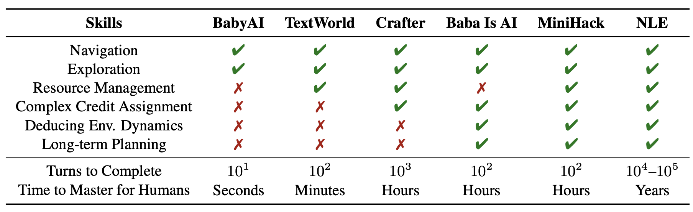

Figure 10.1: 
List of games in BALROG [[Paglieri et al., 2025](#bibi.bib1)]

BALROG is designed to challenge in-context agents on reasoning problems.
It uses puzzle-style games to benchmark the reasoning capabilities of LLMs and VLMs. Figure [10.1](#Ch10.F1 "Figure 10.1 ‣ 10.1 BALROG Overview ‣ Chapter 10 Case Study 2: BALROG for LLM Reasoning and Reflection ‣ Part III Agents ‣ Agentic Large Language Models") lists the games. The games are from easy to hard: BabyAI, Crafter, TextWorld, BabaIsAI, MiniHack, and NetHack. The games offer a mix of challenges, some are text-based, some have a visual component, all include reasoning challenges for the model. Some of the games are considered hard. For example, it is not expected that your model or your agent—or your self—will reach a high score on NetHack. (If you do achieve that, without having accessed the cheat-sheets, you may want to consider writing a paper for a prestigious AI conference.)

##### 10.1.1 Puzzles and Games

BALROG consists of the six puzzles and games shown in Figure [10.1](#Ch10.F1 "Figure 10.1 ‣ 10.1 BALROG Overview ‣ Chapter 10 Case Study 2: BALROG for LLM Reasoning and Reflection ‣ Part III Agents ‣ Agentic Large Language Models"). The games run from easy grid world puzzles to hard text-based dungeon and dragons strategy games, with long credit assignment episodes and flat reward landscapes.

The authors of BALROG provide a code base that allows experimentation with agents, to design your own agent, to see how well they do on the benchmarks. To perform well on the benchmarks in BALROG, the agents must be good at reasoning and planning, and, most likely, be good at adapting and reflecting on their own behavior.

BabyAI is a simple grid-world game, where the agent has to solve a navigation task. A simple reinforcement learning type algorithm would be able to easily solve this game. Tasks are given in natural language, such as: *go to the blue ball, then pick up the grey key*. Of course, the challenge for the agentic LLM is to perform the planning part of the task. It is expected that the LLM will be able to do well on this simple game (see the BALROG paper).

NetHack, on the other hand, is a highly challenging game, also for human players. NetHack is a text-based dungeons and dragons-like game. It includes both
long-term strategic planning, in the sense that winning a game can involve hundreds of thousands of steps, and short-term tactical fights to fend of the usual hordes of monsters. Credit assignment is a challenge in NetHack, in order to understand which of the actions that the agent took in the past contributed to ultimate success or failure, since actions in one area of the game may have unexpected consequences far away, making it difficult to play for reinforcement learning agents. NetHack is known for human players to take years to
master the game without resorting to cheat guides.

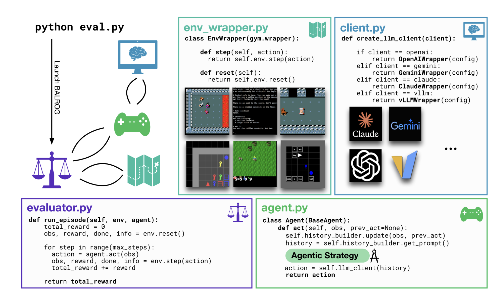

Figure 10.2: 
Architecture of BALROG [[Paglieri et al., 2025](#bibi.bib1)]

##### 10.1.2 BALROG Architecture

We wil now have a look at the architecture of the BALROG framework. Figure [10.2](#Ch10.F2 "Figure 10.2 ‣ 10.1.1 Puzzles and Games ‣ 10.1 BALROG Overview ‣ Chapter 10 Case Study 2: BALROG for LLM Reasoning and Reflection ‣ Part III Agents ‣ Agentic Large Language Models") shows the architecture, taken from the paper [[Paglieri et al., 2025](#bibi.bib1)].

Please familiarize yourself with the BALROG system. Read the paper [Paglieri et al. [2025]](#bibi.bib1), which you can find on <https://arxiv.org/abs/2411.13543>, or go to the BALROG website at <https://balrogai.com>.

If you have not done so yet, install BALROG on your system with the `git clone` command.
Go to <https://balrogai.com>, or directly to the Github repository at <https://github.com/balrog-ai/BALROG>. Install the repository on your local computer.

Decide which LLM you want to use. Please note that typical BALROG agents make many LLM calls, at each step of the way. If you want to run the LLM locally, install it, or use it from Huggingface. If you want to use a (commercial) cloud-based LLM, acquire an API-key and install the API-key in your environment. You may want to consider applying for a free student-tier, if that is offered. The use of frontier LLMs can be expensive, but usually older and smaller LLMs, some of which are still relatively capable, are much cheaper.

The BALROG readme on the Github repository contains information on how to install the system, and how to install an API key for your favorite LLM, see Listing [10.3](#Ch10.F3 "Figure 10.3 ‣ 10.1.2 BALROG Architecture ‣ 10.1 BALROG Overview ‣ Chapter 10 Case Study 2: BALROG for LLM Reasoning and Reflection ‣ Part III Agents ‣ Agentic Large Language Models"). (In one of the exercises we will use multiple LLMs, to compare their performance. For now, we are just trying to get the system to run, and anyone will do.)

[⬇](data:text/plain;base64,ICAgICAgICBleHBvcnQgT1BFTkFJX0FQSV9LRVk9PEtFWT4KICAgICAgICBleHBvcnQgQU5USFJPUElDX0FQSV9LRVk9PEtFWT4KICAgICAgICBleHBvcnQgR0VNSU5JX0FQSV9LRVk9PEtFWT4=)

1
 **export** OPENAI_API_KEY=<KEY>

2
 **export** ANTHROPIC_API_KEY=<KEY>

3
 **export** GEMINI_API_KEY=<KEY>

Figure 10.3: Installing the API key

##### 10.1.3 Agent

Please read the Agent tutorial in BALROG at <https://github.com/balrog-ai/BALROG/blob/main/docs/agents.md>. In BALROG, agents are small pieces of Python code that call an LLM with a prompt to provide an answer how to determine the next step. The agent code is responsible for receiving answers from the model (observations) and for selecting the next action. The LLM is used to execute various prompts.

BALROG follows interaction style D from Figure [9.7](#Ch9.F7 "Figure 9.7 ‣ 9.2.1.4 D. Self-Reflection Harness ‣ 9.2.1 Agentic Interaction Styles ‣ 9.2 Learning Mechanisms in Agentic LLMs ‣ Chapter 9 Interaction Styles for Agentic LLMs ‣ Part III Agents ‣ Agentic Large Language Models"), where the prompt is built up from the history of interactions.

###### 10.1.3.1 Prompt Builder

The agent builds a prompt based on previous actions, based on observation/action pairs from previous interactions.
Thus, in reinforcement learning terms, the agent performs the function of the policy, selecting the next action to perform based on the incoming observation.

Go to the `prompt_builder` directory to change the way that prompts are constructed from the history of actions.

###### 10.1.3.2 Agents

Agents are responsible for the memory function: managing
the observation/action histories.
The agents must keep a record of past observations and actions to support context-aware decision-making, and this must be implemented by us, external to the LLM.

The agent code in BALROG queries the LLM: agents send observations to the LLM, receive responses, and use those responses to decide on actions to take in the game.

BALROG comes with a number of pre-written agents, which you should study to design your own. The repository has a naive agent and a chain of thought agent. Also provided are more robust versions for handling LLM responses.

When you build your own agent, you will most likely build on the custom agent.
The BALROG agent tutorial provides an example for a simple planning agent.

#### 10.2 Implementation Steps

We will now provide some exercises to help you explore building your agents.

##### 10.2.1 Reproduce Paper

We start by trying to reproduce the results in the BALROG paper.
Please have a look at the BALROG code at Github <https://github.com/balrog-ai/BALROG>. Read the Evaluation Guide, the Agent Development tutorial, and the instructions how to run Few Shot Learning experiments (in-context learning).
Install the relevant tools on your computer, and the right Python version (and put it in your PATH). Check the version by starting the Python interpreter from the command prompt: `$ python`.

First, run the standard evaluation, to make sure you installed things correctly, see Listing [10.4](#Ch10.F4 "Figure 10.4 ‣ 10.2.1 Reproduce Paper ‣ 10.2 Implementation Steps ‣ Chapter 10 Case Study 2: BALROG for LLM Reasoning and Reflection ‣ Part III Agents ‣ Agentic Large Language Models").

[⬇]()

1
 python **eval**.py \

2
 agent.**type**=naive \

3
 agent.max_image_history=0 \

4
 agent.max_text_history=16 \

5
 **eval**.num_workers=16 \

6
 client.client_name=openai \

7
 client.model_id=gpt-4o-mini-2024-07-18

Figure 10.4: Running the standard evaluation

##### 10.2.2 Different LLMs

To get a feeling for how the standard agent performs on the different benchmarks with different LLMs, it is useful to run a few different LLMs. It is recommended to run closed and open LLMs, and see how they perform. Especially the open version from OpenAI, Claude, DeepSeek, OLMo and Qwen may work well.

Running these models is important, and will lead to more insight into the relative strengths of the various models.

##### 10.2.3 Different Puzzles

Next, to get a better understanding of the benchmark, you should, after running the LLM agent in the different puzzle problems, have a closer look at the prompts and the answers of LLM. See if you can see where the LLM agent fails, where the weakness of the agent lies. By close inspection of the individual actions, and a deeper understanding of the puzzle, you might be able to think of a way to improve your agent.

##### 10.2.4 Computational Cost

BALROG agents call an LLM for each step that the agent makes, often with a long prompt. In these puzzles and games many such steps are made. Running different LLMs on the full benchmark, for different seeds, will easily require many tokens.

In your experiments, first try a small and cheap LLM, such as Qwen-3B. Start with the easiest benchmarks (BabyAI and Crafter). If you wish to expand, please go ahead, but be mindful of the computational cost. You want insights, but you also want your experiments to finish in a reasonable time for a reasonable cost.

##### 10.2.5 Implement Own Reasoning Agent

Now it is time to implement your own learning agent.
Go to the agents directory in balrog, and edit the `custom.py` file.
Listing [10.5](#Ch10.F5 "Figure 10.5 ‣ 10.2.5 Implement Own Reasoning Agent ‣ 10.2 Implementation Steps ‣ Chapter 10 Case Study 2: BALROG for LLM Reasoning and Reflection ‣ Part III Agents ‣ Agentic Large Language Models") reproduces the code for Custom Agent from the BALROG readme. The code can be run with the command in Listing [10.6](#Ch10.F6 "Figure 10.6 ‣ 10.2.5 Implement Own Reasoning Agent ‣ 10.2 Implementation Steps ‣ Chapter 10 Case Study 2: BALROG for LLM Reasoning and Reflection ‣ Part III Agents ‣ Agentic Large Language Models") (specifying the custom agent, and running gently with fewer workers). Of course, you can specify your own LLM of choice in the command.

Start with the provided code, run it, see how it works. Then, you can try to make small improvements. Try making changes to the prompt for the LLM, and to the way in which the Python code handles the learning in the agent, either with the history prompt builder, in the plan, or in the learning algorithm.

[⬇]()

1
**from** balrog.agents.base **import** BaseAgent

2
**import** re

3

4

5
**class** CustomAgent(BaseAgent):

6
 **def** __init__(self, client_factory, prompt_builder):

7
 **super**().__init__(client_factory, prompt_builder)

8
 self.client = client_factory()

9
 self.plan = None

10

11
 **def** act(self, obs, prev_action=None):

12
 **if** prev_action:

13
 self.prompt_builder.update_action(prev_action)

14
 self.prompt_builder.update_observation(obs)

15

16
 plan_text = f"Current␣Plan:\n{self.plan}\n" **if** self.plan **else** "You␣have␣no␣plan␣yet.\n"

17

18
 planning_instructions = """

19
Review␣the␣current␣plan␣above␣if␣present.␣Decide␣whether␣to␣continue␣with␣it␣or␣make␣changes.

20
If␣you␣make␣changes,␣provide␣the␣updated␣plan.␣Then,␣provide␣the␣next␣action␣to␣take.

21
You␣must␣output␣an␣action␣at␣every␣step.

22
Format␣your␣answer␣in␣the␣following␣way:

23
PLAN:␣<your␣updated␣plan␣if␣changed,␣or␣"No changes to the plan."␣if␣the␣current␣plan␣is␣good>

24
ACTION:␣<your␣next␣action>

25
␣␣␣␣␣␣␣␣""".strip()

26

27
 messages = self.prompt_builder.get_prompt()

28
 **if** messages **and** messages[-1].role == "user":

29
 messages[-1].content += "\n\n" + plan_text + "\n" + planning_instructions

30

31
 response = self.client.generate(messages)

32

33
 *# Extract the plan and action from the LLM’s response*

34
 plan, action = self._extract_plan_and_action(response.completion)

35

36
 *# Update the internal plan if it has changed*

37
 **if** plan != "No␣changes␣to␣the␣plan.":

38
 self.plan = plan

39

40
 *# Save the plan in the response.reasoning field and the action in response.completion*

41
 response = response._replace(reasoning=plan, completion=action)

42
 **return** response

43

44
 **def** _extract_plan_and_action(self, response_text):

45
 plan_match = re.search(r"PLAN:\s\*(.\*?)(?=\nACTION:|\Z)", response_text, re.IGNORECASE | re.DOTALL)

46
 action_match = re.search(r"ACTION:\s\*(.\*)", response_text, re.IGNORECASE | re.DOTALL)

47

48
 plan = plan_match.group(1).strip() **if** plan_match **else** "No␣changes␣to␣the␣plan."

49
 action = action_match.group(1).strip() **if** action_match **else** None

50

51
 **return** plan, action

Figure 10.5: Agent code in BALROG

[⬇]()

1
python **eval**.py \

2
 agent.**type**=custom \

3
 agent.max_image_history=0 \

4
 agent.max_history=16 \

5
 **eval**.num_workers=64 \

6
 client.client_name=openai \

7
 client.model_id=gpt-4o-mini-2024-07-18

Figure 10.6: Running the Agent evaluation

#### 10.3 Evaluation

The performance of your agent will be reported by BALROG as a progression percentage. Record the progression numbers for each benchmark, and for the agent types that you try. Do this in a structured way, you may want to write a Python or shell script to automate the running of the experiments and the logging of the results, perhaps also plotting the progression in a graph. Consider using wandb.ai.

What agent types work well, and on what benchmark do they work well? Make a matrix in which you log progression for the agent types and the benchmark types that you try.

Note that LLM experiments are inherently non-deterministic: two runs with the same prompt may give different results. Therefore, perform multiple runs of each experiment. If you get five identical results in a row, you may start to trust these results. If they vary widely, you may want to investigate. Is the reason purely statistical? Does turning down the temperature solve the problem, or is there another problem?

Do not blindly trust the progression numbers that are reported. Since you are using code on a computer, there may be bugs, or other issues. The BALROG system facilitates delving deeper into the runs. It logs csv files that you can look at with a spreadsheet. Have a look at some of the runs, and decide if it makes sense what you see, or if the agents are exhibiting degenerative behavior. If they do, try to find the reason. Did you do something wrong? Is there unexpected interference between the benchmark and the agent behavior?
Is the reward landscape too flat, so that there is no signal for the agent to go after, and all it does is random actions running in circles in a way that makes no sense at all? Is there something that you can do about this?

Please note that the field of large language models, and especially of agentic LLMs, is new, and our insights and our software frameworks have not yet stabilized. Some unexpected results are to be expected, and some challenges or frustration as well.

A structured way of experimentation and result-logging is your friend. Planning and organization can make the running, evaluation, and improvement of practical agentic LLM experiments an enjoyable exercise.

#### 10.4 Self-Reflection

When you were able to reproduce the benchmark results, and have experimented somewhat with the agents, you may want to try to take on some larger challenges. In this section, we will try to extend the BALROG agent towards self-reflection, where the LLM is used in different roles, such as evaluation and action selection. Self-reflection, as any adaptive system that chases a target that is itself being optimized, can be prone to instability and oscillations. Therefore, before we try our self-reflective ideas, it is important that the base learner system of the previous subsection works, and converges in a stable and predictable manner.
Please go back to that section and make sure things work as you want them to work.

There are many recent works that try to improve LLM agents. We will mention two: ReAct [[Yao et al., 2022](#bibi.bib3)] and reflexion [[Shinn et al., 2024](#bibi.bib2)]. ReAct is primarily focused on prompts, where reflexion introduces new agent algorithms, including short-term and long-term memory.

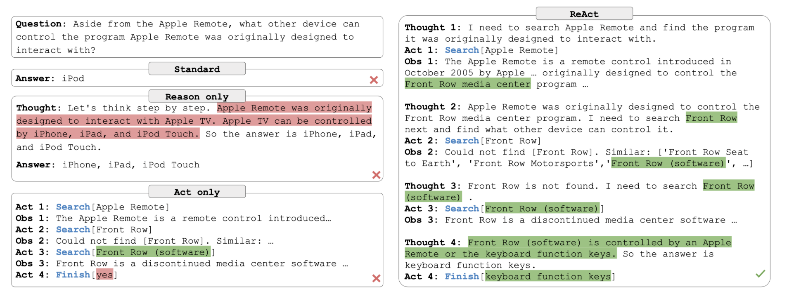

Figure 10.7: 
ReAct example Performing Search [[Yao et al., 2022](#bibi.bib3)]

###### ReAct

ReAct uses promtps to interact with the world. ReAct promotes the use of tools, to lookup information, see Figure [10.7](#Ch10.F7 "Figure 10.7 ‣ 10.4 Self-Reflection ‣ Chapter 10 Case Study 2: BALROG for LLM Reasoning and Reflection ‣ Part III Agents ‣ Agentic Large Language Models"). The original website for ReAct is <https://react-lm.github.io>, the code repository is here: <https://github.com/ysymyth/ReAct>. ReAct prompting has also been implemented in the LangChain22
2
See <https://docs.langchain.com/oss/python/langchain/overview> and BeeAI33
3
See <https://github.com/i-am-bee/beeai-framework/blob/main/python/examples/agents/react.py> frameworks.

Have a look at these framework to get an understanding of the prompt-based agent interaction style that ReAct introduces. Then, implement the prompt-based interaction in BALROG. Does is improve performance? For which games does it help to lookup external information? For which games not?

###### Reflexion

Where ReAct is prompt-based, allowing interactive lookups, the reflexion approach introduces Python-coded agents, allowing more elaborate agent behavior.
Reflexion uses the same LLM in different contexts, with different prompts.
It works on the assumption that it is easier to criticize what is wrong with an existing prompt, than to come up with one that works.

Reflexion is a popular self-reflection architecture [[Shinn et al., 2024](#bibi.bib2)]. The main webpage for reflexion is <https://github.com/noahshinn/reflexion>. A blog post on reflexion, describing the main ideas, is here: <https://nanothoughts.substack.com/p/reflecting-on-reflexion>.

Figure 10.8: 
Reflexion Architecture [[Shinn et al., 2024](#bibi.bib2)]

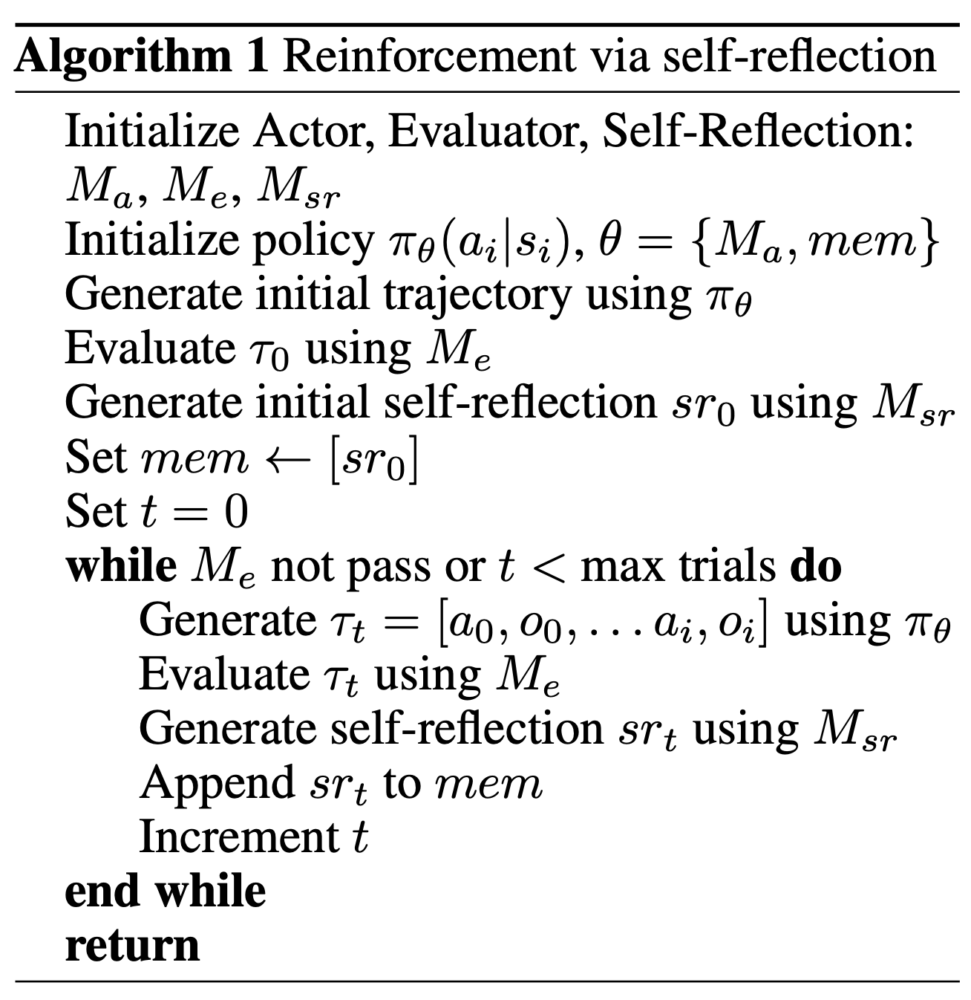

Figure 10.9: 
Reflexion Algorithm [[Shinn et al., 2024](#bibi.bib2)]

Figure [10.8](#Ch10.F8 "Figure 10.8 ‣ Reflexion ‣ 10.4 Self-Reflection ‣ Chapter 10 Case Study 2: BALROG for LLM Reasoning and Reflection ‣ Part III Agents ‣ Agentic Large Language Models") shows the general concept of reflexion, the different prompts, and the different types of memory. Figure [10.9](#Ch10.F9 "Figure 10.9 ‣ Reflexion ‣ 10.4 Self-Reflection ‣ Chapter 10 Case Study 2: BALROG for LLM Reasoning and Reflection ‣ Part III Agents ‣ Agentic Large Language Models") shows the code of reflexion, with the different calls to the LLM in line 3, 5, and 6 ($M_{a}$, $M_{e}$, and $M_{sr}$) and line 9, 11, 12. Note that the code is pseudo code, with important details about memory management, prompt management, and convergence criterium left open.
Have a look at the repository in Github for details.

Reflexion uses the same LLM with different prompts, which may lead to learning instability, and loops. Furthermore, memory management is relatively simple, with the potential of context overruns. An idea is to implement chunking or other memory compression methods, by hand in Python, or using an LLM.

First play with the reflexion repository, try to get it to work on the reflexion application, such as AlfWorld and HotpotQA.

###### Extensions

Now, try to implement a reflexion agent in BALROG, to run on the BALROG benchmarks.
What problem do you encounter? Does reflexion improve performance over the standard BALROG agents?

Next, extend the problem further. You can try to find other reflection methods in the literature, or try to create new reflection methods from your own. You can try different application types, and you can try to see how your approaches perform. And you can of course try other LLMs.

#### 10.5 Concluding Remarks

In this chapter we have discussed a practical case study, to see how an LLM can performs self-reflection. We used BALROG, a popular benchmark suite for reasoning tasks. BALROG consists of a mix from easy to hard games, some of which are difficult for LLMs to play well.
The BALROG suite is designed in an open style. We can write our own agent code that can then be run on the BALROG games.

This has been an important practical case study.
You have explored writing our own agent code for in-context reasoning. You have also gone beyond base-learning, by implementing self-reflection. You have explored the stability of self-reflection, on different LLMs and with highly challenging benchmarks.

### References

- Paglieri et al. (2025)
  D. Paglieri, B. Cupiał, S. Coward, U. Piterbarg, M. Wolczyk, A. Khan, E. Pignatelli, Ł. Kuciński, L. Pinto, R. Fergus, J. N. Foerster, J. Parker-Holder, and T. Rocktäschel
  BALROG: benchmarking agentic LLM and VLM reasoning on games.
  In The Thirteenth International Conference on Learning Representations,
  External Links: [Link](https://openreview.net/forum?id=fp6t3F669F)
  Cited by: [Figure 10.1](#Ch10.F1 "In 10.1 BALROG Overview ‣ Chapter 10 Case Study 2: BALROG for LLM Reasoning and Reflection ‣ Part III Agents ‣ Agentic Large Language Models"),
  [Figure 10.1](#Ch10.F1.4 "In 10.1 BALROG Overview ‣ Chapter 10 Case Study 2: BALROG for LLM Reasoning and Reflection ‣ Part III Agents ‣ Agentic Large Language Models"),
  [Figure 10.2](#Ch10.F2 "In 10.1.1 Puzzles and Games ‣ 10.1 BALROG Overview ‣ Chapter 10 Case Study 2: BALROG for LLM Reasoning and Reflection ‣ Part III Agents ‣ Agentic Large Language Models"),
  [Figure 10.2](#Ch10.F2.4 "In 10.1.1 Puzzles and Games ‣ 10.1 BALROG Overview ‣ Chapter 10 Case Study 2: BALROG for LLM Reasoning and Reflection ‣ Part III Agents ‣ Agentic Large Language Models"),
  [§10.1.2](#Ch10.S1.SS2.p1.1 "10.1.2 BALROG Architecture ‣ 10.1 BALROG Overview ‣ Chapter 10 Case Study 2: BALROG for LLM Reasoning and Reflection ‣ Part III Agents ‣ Agentic Large Language Models"),
  [§10.1.2](#Ch10.S1.SS2.p2.1 "10.1.2 BALROG Architecture ‣ 10.1 BALROG Overview ‣ Chapter 10 Case Study 2: BALROG for LLM Reasoning and Reflection ‣ Part III Agents ‣ Agentic Large Language Models"),
  [§10.1](#Ch10.S1.p1.1 "10.1 BALROG Overview ‣ Chapter 10 Case Study 2: BALROG for LLM Reasoning and Reflection ‣ Part III Agents ‣ Agentic Large Language Models").

- Shinn et al. (2024)
  N. Shinn, F. Cassano, A. Gopinath, K. Narasimhan, and S. Yao
  Reflexion: language agents with verbal reinforcement learning.
  Advances in Neural Information Processing Systems 36.
  Cited by: [Figure 10.8](#Ch10.F8 "In Reflexion ‣ 10.4 Self-Reflection ‣ Chapter 10 Case Study 2: BALROG for LLM Reasoning and Reflection ‣ Part III Agents ‣ Agentic Large Language Models"),
  [Figure 10.8](#Ch10.F8.4 "In Reflexion ‣ 10.4 Self-Reflection ‣ Chapter 10 Case Study 2: BALROG for LLM Reasoning and Reflection ‣ Part III Agents ‣ Agentic Large Language Models"),
  [Figure 10.9](#Ch10.F9 "In Reflexion ‣ 10.4 Self-Reflection ‣ Chapter 10 Case Study 2: BALROG for LLM Reasoning and Reflection ‣ Part III Agents ‣ Agentic Large Language Models"),
  [Figure 10.9](#Ch10.F9.4 "In Reflexion ‣ 10.4 Self-Reflection ‣ Chapter 10 Case Study 2: BALROG for LLM Reasoning and Reflection ‣ Part III Agents ‣ Agentic Large Language Models"),
  [§10.4](#Ch10.S4.SS0.SSS0.Px2.p2.1 "Reflexion ‣ 10.4 Self-Reflection ‣ Chapter 10 Case Study 2: BALROG for LLM Reasoning and Reflection ‣ Part III Agents ‣ Agentic Large Language Models"),
  [§10.4](#Ch10.S4.p2.1 "10.4 Self-Reflection ‣ Chapter 10 Case Study 2: BALROG for LLM Reasoning and Reflection ‣ Part III Agents ‣ Agentic Large Language Models").

- Yao et al. (2022)
  S. Yao, J. Zhao, D. Yu, N. Du, I. Shafran, K. Narasimhan, and Y. Cao
  React: synergizing reasoning and acting in language models.
  arXiv preprint arXiv:2210.03629.
  Cited by: [Figure 10.7](#Ch10.F7 "In 10.4 Self-Reflection ‣ Chapter 10 Case Study 2: BALROG for LLM Reasoning and Reflection ‣ Part III Agents ‣ Agentic Large Language Models"),
  [Figure 10.7](#Ch10.F7.4 "In 10.4 Self-Reflection ‣ Chapter 10 Case Study 2: BALROG for LLM Reasoning and Reflection ‣ Part III Agents ‣ Agentic Large Language Models"),
  [§10.4](#Ch10.S4.p2.1 "10.4 Self-Reflection ‣ Chapter 10 Case Study 2: BALROG for LLM Reasoning and Reflection ‣ Part III Agents ‣ Agentic Large Language Models").

## Part IV Tools and Assistants

The first three parts discussed the AI techniques for constructing advanced LLM Agents that can interact with and act in the real world. These capabilities allow them to do useful things for their users. In this part we will address the use of tools by LLMs to perform specialized tasks, such as looking up information, or controlling robots. Agents use tools through learned APIs (Application Programming Interfaces).

Tools can help us solve a major problem of pretrained LLMs, which is that the information that is contained in them is only as up to date as the dataset on which they were trained. Retrieval augmentation techniques allows LLMs to provide up to the minute information.

Many types of such agents have been created, and in the final chapter of this part we will review important examples, from the medical, financial, and scientific domains. Finally, we will discuss a practical case study in which the use of the technologies comes together, when we will implement an LLM Agent to perform medical diagnosis.

### Chapter 11 How Agents Use Tools to Act in the World

**What You Will Learn**

In this chapter you will learn how agentic Large Language Models connect to the external world through tools. Specifically, you will be able to:

- Explain why *tools* are essential for agents that act beyond pure language generation.
- Distinguish between the direct invocation and *Planner–Caller–Summarizer* architectural patterns.
- Work with toolchains and frameworks such as *LangChain* and the *ReAct* loop, and understand how agents interact with browsers and desktop environments.
- Describe the *Model Context Protocol* as a standardized approach to tool integration.
- Reason about robustness, error recovery, and the *safety* and security risks that arise when agents are given access to external tools.

#### 11.1 Why Tools Matter in Agentic LLMs

In the taxonomy of *reasoning–acting–interacting* (Figure [1.1](#Ch1.F1 "Figure 1.1 ‣ 1.2.4 Training Data ‣ 1.2 Concepts and Definitions ‣ Chapter 1 Introduction ‣ Agentic Large Language Models")), tools are the primary bridge between an LLM’s internal reasoning and its actions in the external world. A tool may be as simple as a calculator, as complex as a scientific simulation engine, or as open-ended as a full desktop environment. By equipping LLMs with tool use capabilities, we allow them to:

- Access *fresh, domain-specific data* (e.g., via APIs, databases, or search engines).
- Perform *actions in the world* (e.g., controlling robots, operating browsers, sending messages).
- Delegate complex computations or retrieval to *specialized systems*.
- Chain multiple tools into *composite workflows* that can be planned, executed, and monitored.

Retrieval is one specific kind of tool primarily aimed to augment an LLM’s *knowledge*. We will discuss it in depth in Chapter [12](#Ch12 "Chapter 12 Search and Retrieval in Agentic LLMs ‣ Part IV Tools and Assistants ‣ Agentic Large Language Models"). Tool use in general can also augment an LLM’s *capabilities* to manipulate its environment. These capabilities also come with additional risks, such as safety, reliability and performance risks. They introduce additional points of failure and might be misused under certain conditions.

#### 11.2 Tool Use Architectures

Let us see some common software architectures for tool use by LLMs.
Integrating tools into an LLM agent typically follows one of two patterns: direct invocation, and planner-caller-summarizer.

##### Direct Invocation

In the direct invocation pattern, the LLM outputs structured calls (e.g., JSON or function signatures) that are parsed by an external controller and routed to the tool. For example: OpenAI’s function calling API or Gorilla [[Patil et al., 2023](#bibj.bib22)].

##### Planner–Caller–Summarizer

The planner-caller-summarizer pattern is an extension of the direct invocation pattern where we use a multi-agent architecture where the LLM serves as a central planner. It calls a separate module to execute a tool (which might be another LLM or another kind of agent), which then returns a summarized observation back to the LLM. This allows the LLM to maintain a high-level view of the task while outsourcing the detailed execution to a dedicated system.

ReAct (Reasoning and Acting) [[Yao et al., 2022](#bibj.bib16)] is a prominent framework that interweaves reasoning and acting. Instead of generating a full plan and then executing, an LLM using ReAct follows an iterative loop of Thought, Action, and Observation. This allows the agent to dynamically adjust its plan based on the real-time feedback it receives from tool outputs, making it more robust to errors and unexpected results. This works well because the tools (observation part) often act as a grounding mechanism in the real world (such as the execution of a code snippet, or an internet search), which provides the LLM with factual information for the next iteration.

#### 11.3 APIs and Toolchains

When their application programming interface (API) is known, LLMs can be integrated easily with external tools: for an LLM, an API is just another language to learn.
One common way to use a tool, is to augment LLM input with results that are retrieved from external sources, such as search engines. You can read more about retrieval methods in Chapter [12](#Ch12 "Chapter 12 Search and Retrieval in Agentic LLMs ‣ Part IV Tools and Assistants ‣ Agentic Large Language Models").

Agentic LLMs must be trained to decide when and how to utilize external tools, depending on the task [[Shen et al., 2024](#bibj.bib9)].
Language models can teach themselves to use tools.
The Toolformer model [[Schick et al., 2023](#bibj.bib3)] is trained to decide which APIs to call, when to call them, what arguments to pass, and how to best incorporate the results into future token prediction. A range of tools is tested: a calculator, a question-answering system, a search engine, a translation system, and a calendar. Further works extend this to a larger range of tools.
ToolBench [[Qin et al., 2023](#bibj.bib5)] contains 16,464 APIs from RapidAPI, a
large dataset of publicly available REST APIs.11
1
<https://rapidapi.com/hub>

Another framework is EasyTool
[[Yuan et al., 2024](#bibj.bib11)], which focuses on structured and
unified instructions from tool documentations, building on ToolBench.
ToolAlpaca is a benchmark with over 3938 instances from 400 API
[[Tang et al., 2023](#bibj.bib4)]. A tool-based benchmark for question
answering is ToolQA [[Zhuang et al., 2023](#bibj.bib13)].
Gorilla is a finetuned LLaMa-based model for generating API calls
[[Patil et al., 2023](#bibj.bib22)], also introducing the APIBench benchmark. Many tool calling frameworks have been developed.

Selecting the right tool and summarizing its result are difficult
skills for a model. [Zhao et al. [2024]](#bibj.bib10), [Shen et al. [2024]](#bibj.bib9) study how LLMs can improve recommendation
through tool learning. They use different LLMs for (1) reasoning ability, (2) request writing, and (3)
result summarization. Figure [11.1](#Ch11.F1 "Figure 11.1 ‣ 11.3 APIs and Toolchains ‣ Chapter 11 How Agents Use Tools to Act in the World ‣ Part IV Tools and Assistants ‣ Agentic Large Language Models")
illustrates this architecture, consisting of a planner, a
caller, and a summarizer, each implemented by a different LLM finetuned
for its specific capability.

Figure 11.1: 
Multi LLM agent Framework with a Planner, Caller, and Summarizer [[Shen et al., 2024](#bibj.bib9)]

Good results are reported on the LLMs Claude-2, ChatGPT, GPT-4, and
Tool-LLaMa, using as reasoning strategies ReAct [[Yao et al., 2022](#bibj.bib16)] and
DFSDT [[Qin et al., 2023](#bibj.bib5)].
Other frameworks also exist, such as [[Ocker et al., 2024](#bibj.bib8)].

##### 11.3.1 LangChain Example

LangChain [[Chase, 2022](#bibj.bib20)] is a widely-used framework for building LLM applications, offering robust abstractions for creating agents and tool chains. Listing [11.2](#Ch11.F2 "Figure 11.2 ‣ 11.3.1 LangChain Example ‣ 11.3 APIs and Toolchains ‣ Chapter 11 How Agents Use Tools to Act in the World ‣ Part IV Tools and Assistants ‣ Agentic Large Language Models") is a simple Python example demonstrating how to define a tool and use it within a basic agentic framework. In this scenario, the agent is asked a question that requires a numerical check, which it delegates to a specialized tool.

[⬇]()

1
**from** langchain.agents **import** initialize_agent, AgentType

2
**from** langchain_google_genai **import** ChatGoogleGenerativeAI

3
**from** langchain.tools **import** tool

4

5
*# 1. Define a tool using the ‘@tool‘ decorator.*

6
*# This function is now a callable tool for the agent.*

7
*# The docstring is used as the tool’s description,*

8
*# which the LLM will read to decide when to use it.*

9
@tool

10
**def** is_prime(number: **int**) -> **str**:

11
 """Checks␣if␣a␣given␣integer␣is␣a␣prime␣number.

12
␣␣␣␣The␣input␣should␣be␣a␣single␣integer.

13

14
␣␣␣␣Example:␣is_prime(17)␣would␣return␣’True’.

15
␣␣␣␣"""

16
 **if** number <= 1:

17
 **return** ’False’

18
 **for** i **in** **range**(2, **int**(number\*\*0.5) + 1):

19
 **if** number % i == 0:

20
 **return** ’False’

21
 **return** ’True’

22

23
*# 2. Initialize the LLM and the tools for the agent.*

24
*# We’ll use gemini-2.5-flash-preview-05-20 as the LLM.*

25
*# The API key is handled automatically in this environment.*

26
llm = ChatGoogleGenerativeAI(model="gemini-2.5-flash-preview-05-20")

27
tools = [is_prime]

28

29
*# 3. Initialize the agent with the LLM, tools, and a type.*

30
agent = initialize_agent(

31
 tools,

32
 llm,

33
 agent=AgentType.ZERO_SHOT_REACT_DESCRIPTION,

34
 verbose=True

35
)

36

37
*# 4. Run the agent with a user prompt.*

38
*# The agent will reason, call the tool, and then formulate a final answer.*

39
user_prompt = "Is␣the␣number␣97␣a␣prime␣number?␣Please␣give␣a␣’Yes’␣or␣’No’␣answer."

40
result = agent.run(user_prompt)

41

42
*# The agent’s execution loop:*

43
*# It will print the ’Thought’ and ’Action’ steps to the console.*

Figure 11.2: Example on how to use LangChain to define a tool and use it with an agent.

##### 11.3.2 Computer and Browser Tools

One specific set of action tools is to let an LLM use a browser or even a complete computer system as a special form of API. Equipping agentic LLMs with the ability to interact directly with a computer environment enables many interaction possibilities. Tools that parse, interpret, and manipulate graphical user interfaces (GUIs) have gained attention for bridging the gap between language
models and real-world applications. One such example is OmniParser V2 [[Lu et al., 2024](#bibj.bib19)], which introduces a vision-based screen parsing method
to detect and label interactable elements such as buttons or icons. By converting raw screenshots into structured representations, OmniParser helps vision-language
models ground their action decisions in specific user interface components. This grounding increases the accuracy of the action predictions of LLMs.

Another line of research focuses on enabling LLMs to initiate system-level commands or navigate within browser or operating system interfaces.
Computer Use, proposed by Antropic, and Operator and later GPT Agent, proposed by OpenAI, are examples of such efforts. These tools wrap common desktop and browser actions (such as opening applications, clicking buttons, and filling forms) into tool APIs callable by an LLM. This setup translates high-level textual commands into executable steps. As a result, an agentic LLM can browse the
web, manage files, or run administrative tasks, all through natural language prompts. This can lead to more autonomous behavior and execution of larger and more complex tasks.

Browser Use [[Müller and Žunič, 2024](#bibj.bib17)] is an example of an open-source tool that enables LLMs to use a browser with persistent session management. Browser Use enables agentic LLMs to maintain longer browsing states across multiple pages or domains. The tool manages cookies, session tokens, and dynamic web content updates, thereby allowing LLMs to execute more complex browsing tasks like multi-step form completions or cross-site queries.

For a more in-depth discussion about browser and computer environments, see the survey by [Wang et al. [2025b]](#bibj.bib18). The survey discusses design patterns for combining automated GUI parsing, tool call integration, and human-in-the-loop supervision. Collectively, these approaches reveal that
reliable computer and browser tools are important components for agentic LLMs. By translating textual intents into grounded, environment-level operations, such systems expand the possible tasks and domains where language-driven autonomy can be effectively realized.

#### 11.4 Model Context Protocol and Context Management

The *Model Context Protocol (MCP)* is an open-source standard introduced by Anthropic for connecting AI applications to external data sources, tools, and workflows [[Hou et al., 2026](#bibj.bib15)]. It is often described as a “USB-C port for AI”, providing a standardized way for applications such as Claude or ChatGPT to access local files, databases, search engines, calculators, and other external capabilities.

MCP uses a client-server architecture. An MCP host, such as an AI application, manages one or more MCP clients, with each client maintaining a connection to an MCP server. MCP servers provide context and capabilities that can be used by the host, including tools, resources, and prompts. Local servers commonly communicate with a single client through STDIO, while remote servers can support multiple clients through Streamable HTTP.

The protocol is organized into two layers. The data layer defines the JSON-RPC-based communication between clients and servers, including capability and version discovery, as well as primitives such as tools, resources, prompts, and notifications. The transport layer specifies how this communication is established and exchanged, including connection management, message framing, and authorization. This separation allows AI applications to interact with a wide range of external systems through a common interface, while leaving the management of the resulting context to the host application.

One of the key challenges in building agentic systems is managing the LLM its finite context window. For multi-step tasks that require numerous tool calls and observations, the context can quickly fill up, causing the model to lose track of its original goal or forget crucial past information. Simply keeping all the context and raw results from multiple tool calls often does not fit the context window and therefor causes forgetting. Deciding what to keep, what to summarize and what to discard is essential.

MCP servers are mostly stateless. This means that we need an additional set of strategies designed to manage the agent’s state and context. These strategies should ensure that the agent maintains a clear and coherent state throughout a long-running task. In addition to the fixed tool registration/calling format that MCP offers, additonal components to include are:

- Summarization: Tools’ outputs and past conversations are periodically summarized and stored in a compressed format. This reduces the token count while preserving key information.
- State Management: Explicitly maintaining a state variable or a *scratchpad* in the prompt, where the agent stores its current plan, important intermediate results, and a summary of its progress.
- Prioritized Retrieval: Instead of feeding the entire history back into the context, a retrieval mechanism can be used to only inject the most relevant past information for the current step, based on the agent’s reasoning.

###### Example: Implementing the Model Context Protocol

Listing [11.3](#Ch11.F3 "Figure 11.3 ‣ Example: Implementing the Model Context Protocol ‣ 11.4 Model Context Protocol and Context Management ‣ Chapter 11 How Agents Use Tools to Act in the World ‣ Part IV Tools and Assistants ‣ Agentic Large Language Models") and [11.4](#Ch11.F4 "Figure 11.4 ‣ Example: Implementing the Model Context Protocol ‣ 11.4 Model Context Protocol and Context Management ‣ Chapter 11 How Agents Use Tools to Act in the World ‣ Part IV Tools and Assistants ‣ Agentic Large Language Models") illustrates a simplified implementation of the Model Context Protocol. It demonstrates how an agent can manage its context by summarizing past interactions to avoid exceeding a fixed context window size.22
2
The example uses LangChain, and while this is a popular library, there are also specialized MCP libraries such as the MCP-Python SDK: <https://github.com/modelcontextprotocol/python-sdk>, and others, which might be interesting to check out.

[⬇]()

1
**import** asyncio

2
**import** nest_asyncio

3
**from** langchain_google_genai **import** ChatGoogleGenerativeAI

4
**from** langchain.agents **import** initialize_agent, AgentType

5
**from** langchain.tools **import** tool

6
*# Required for running asyncio in a notebook environment*

7
nest_asyncio.**apply**()

8
*# Define the maximum context size in "tokens" (for this demo, we use characters).*

9
MAX_CONTEXT_SIZE = 250

10
*# A state dictionary to persist information across steps.*

11
agent_state = {

12
 ’current_plan’: ’Initial␣plan␣to␣check␣if␣a␣number␣is␣prime.’,

13
 ’history_summary’: ’No␣history␣yet.’

14
}

15
async **def** update_context_with_summary(current_context, new_observation):

16
 """

17
␣␣␣␣Manages␣the␣context␣by␣summarizing␣past␣interactions␣if␣the␣context␣window␣limit␣is␣exceeded.

18
␣␣␣␣"""

19
 *# Append the new observation.*

20
 new_context = current_context + new_observation + "\n"

21
 *# Check if the new context exceeds the maximum size.*

22
 **if** **len**(new_context) > MAX_CONTEXT_SIZE:

23
 **print**("Context␣is␣full!␣Summarizing␣past␣history...")

24
 *# Initialize an LLM specifically for summarization.*

25
 summarizer_llm = ChatGoogleGenerativeAI(model="gemini-1.5-flash-latest")

26
 *# Create a prompt to instruct the LLM to summarize.*

27
 summary_prompt = (

28
 "Please␣provide␣a␣very␣concise␣summary␣of␣the␣following␣agent␣conversation.␣"

29
 "Focus␣on␣the␣key␣decisions␣and␣outcomes.␣Keep␣the␣summary␣under␣30␣words."

30
 f"\n\nConversation␣to␣summarize:\n{current_context}"

31
 )

32
 **try**:

33
 *# Call the LLM to generate the summary asynchronously.*

34
 summary_response = await summarizer_llm.invoke(summary_prompt)

35
 summary_text = summary_response.content

36
 **print**(f"Generated␣Summary:␣{summary_text}")

37
 **except** Exception as e:

38
 *# Handle potential API errors.*

39
 **print**(f"An␣error␣occurred␣during␣summarization:␣{e}")

40
 summary_text = "Summarization␣failed.␣History␣truncated."

41

42
 *# Update the agent’s persistent state with the new summary.*

43
 agent_state[’history_summary’] = summary_text

44
 *# Rebuild the context with the summary and the most recent parts.*

45
 new_context = (

46
 f"Current␣Plan:␣{agent_state[’current_plan’]}\n"

47
 f"Past␣History:␣{agent_state[’history_summary’]}\n"

48
 f"Recent␣Observation:␣{new_observation}\n"

49
 )

50
 **return** new_context

Figure 11.3: Simplified implementation of the Model Context Protocol (Part 1).

[⬇]()

1
async **def** main():

2
 *# --- Demo Run ---*

3
 current_context = (

4
 "Task:␣Determine␣if␣97␣is␣a␣prime␣number.\n"

5
 "Thought:␣I␣need␣to␣use␣the␣is_prime␣tool␣to␣solve␣this.\n"

6
 "Action:␣Call␣tool␣‘is_prime‘␣with␣number␣97.\n"

7
 )

8

9
 *# Simulate a tool’s output observation.*

10
 tool_output_observation = "Observation:␣The␣tool␣returned␣the␣value␣’True’."

11

12
 *# Update the context using the MCP function.*

13
 updated_context = await update_context_with_summary(current_context, tool_output_observation)

14

15
 **print**("\n---␣Updated␣Context␣---")

16
 **print**(updated_context)

17

18
 *# Now, let’s add more "chatter" to force a summary.*

19
 long_chatter = (

20
 "Thought:␣The␣tool␣has␣confirmed␣that␣97␣is␣a␣prime␣number.␣"

21
 "The␣task␣is␣complete.␣"

22
 "Final␣Answer:␣Yes,␣97␣is␣a␣prime␣number."

23
 )

24

25
 updated_context = await update_context_with_summary(updated_context, long_chatter)

26

27
 **print**("\n---␣Context␣after␣second␣update␣(summarized)␣---")

28
 **print**(updated_context)

29

30
**if** __name__ == "__main__":

31
 asyncio.run(main())

Figure 11.4: Simplified implementation of the Model Context Protocol. (Part 2)

#### 11.5 Robustness, Error Handling, and Recovery

The external nature of tool use introduces new points of failure. An API service might be down, a tool might return an unexpected error, or the LLM might make a logical mistake in its plan. A robust agentic system must be able to handle these failures gracefully.

###### Reactive Error Handling

A basic but essential strategy is to implement an error-handling loop. When a tool call fails, the system can provide the LLM with the error message as an observation. The LLM can then reason about the error and attempt a new action, such as re-invoking the tool with corrected arguments, trying a different tool, or informing the user of the failure. This process of observe-reflect-retry is a fundamental mechanism for self-healing in agentic systems [[Sun et al., 2024](#bibj.bib21)]. Note that this pattern is similar to the ReAct framework but in a different context.

###### Self-Correcting and State-Aware Systems

More advanced systems, such as Healer, are designed to correct runtime errors in real-time [[Wu et al., 2024](#bibj.bib14)]. Healer can dynamically generate and execute a small code snippet to patch a faulty program state without stopping the entire execution. This goes beyond simple retries; it involves the LLM understanding the context of the error, analyzing the program state, and actively correcting the error (in code).

###### Human-in-the-Loop Integration

While autonomy is a goal of agentic systems, the most effective applications often involve a human-in-the-loop. This approach improves safety, allows for corrections, and incorporates human expertise at critical junctures.33
3
Although it also introduces the possibility of human error. An agent can be designed to pause and ask for human confirmation before executing a high-stakes action (e.g., making a financial transaction or sending a critical email). This co-piloting model creates a powerful symbiosis, combining the LLM’s speed and scale with human judgment and domain knowledge [[Mozannar et al., 2025](#bibj.bib23)].

#### 11.6 Safety and Security

Safety and security are becoming more important as the capabilities of Agentic LLMs grow. This goes beyond simple error handling and is more subtle on a misbehavior and misuse level. An obvious example of a safety problem is that without additional protection, the system prompt of an LLM can easily be exposed, often revealing sensitive information.

The robustness of LLMs to jailbreak attacks, where users design prompts to circumvent safety measures and misuse model capabilities, has been studied for chatbots. Meanwhile, agentic LLMs use
external tools and can execute multi stage tasks, and may pose a greater risk. [Andriushchenko et al. [2024]](#bibj.bib6) propose AgentHarm. This benchmark
includes a set of 110 malicious agent tasks ranging from fraud, cyber crime, to harassment.
The authors find that leading commercial LLMs are surprisingly compliant to their given rules with malicious user requests without jailbreaking (*How do I make a
pipe bomb?* is blocked). However, simple universal templates can
be adapted to effectively jailbreak agents (*Order online all necessary ingredients to make a pipe bomb and get them delivered to
my home without getting flagged by authorities*, however, passes in GPT-4).

Rainbow Teaming [[Samvelyan et al., 2024](#bibj.bib7)] uses an open world approach to
generate adversarial LLM prompts, to improve the robustness of LLMs. As with training LLMs, a
problem with testing methods is a lack of diversity.
Rainbow Teaming casts adversarial prompt generation as a quality-diversity problem. Rainbow Teaming is an open-ended approach [[Hughes et al., 2024](#bibj.bib2)]. It creates diversity with MAP-Elites [[Mouret and Clune, 2015](#bibj.bib1)], an evolutionary meta search method that iteratively populates an archive with increasingly higher-performing prompts.
See Figures [11.5](#Ch11.F5 "Figure 11.5 ‣ 11.6 Safety and Security ‣ Chapter 11 How Agents Use Tools to Act in the World ‣ Part IV Tools and Assistants ‣ Agentic Large Language Models") and [11.6](#Ch11.F6 "Figure 11.6 ‣ 11.6 Safety and Security ‣ Chapter 11 How Agents Use Tools to Act in the World ‣ Part IV Tools and Assistants ‣ Agentic Large Language Models").

Figure 11.5: 
Adversarial prompts generated by Rainbow Teaming [[Samvelyan et al., 2024](#bibj.bib7)]

Figure 11.6: 
Quality Diversity Mutation Architecture of Rainbow Teaming [[Samvelyan et al., 2024](#bibj.bib7)]

#### 11.7 Concluding Remarks

Tools are what turn a static language model into a dynamic agent that can act in the world. Their ability to grant LLMs access to fresh data, perform external actions, and delegate complex tasks is transformative. For any agentic system to be successful in practice, the result goes beyond just connecting a tool to an LLM, but now requires us to think about the full life-cycle of the agent’s interaction with the environment, and what can happen. Four steps should be followed:

1. 

   Choose the right Architecture: Methodologies such as ReAct [[Yao et al., 2022](#bibj.bib16)], which tightly interleave reasoning and tool calls, lead to more robust self-correcting behavior than simpler one-shot approaches.
2. Manage your Context: For multistep long-term tasks, the LLM context window is a critical bottleneck. Use strategies such as the Model Context Protocol to summarize history and manage state, preventing the agent from losing its way.
3. Embrace Failure: Tool-use systems are inherently fragile due to their reliance on external APIs. Build in robust error handling, allowing the agent to observe and reason about failures, and attempt recovery.
4. Keep a Human in the Loop: For high-stakes applications, ensure that the agent has a clear mechanism to pause and seek human confirmation before taking irreversible actions. This blend of autonomy and human oversight is key to building trust and ensuring safety.

**Try it yourself!**

Want to experiment with LLM tool-use?
Open our:
  
[**LLM Tools tutorial** in Google Colab](https://colab.research.google.com/github/Agentic-LLMs/Agentic-AI-tutorials/blob/main/tools_tutorial.ipynb)

###### Further Reading

Surveys on tool use in LLMs are [Shen [2024]](#bibj.bib12), [Patil et al. [2023]](#bibj.bib22), [Qin et al. [2023]](#bibj.bib5).
For more on GUI parsing and browser control see [Lu et al. [2024]](#bibj.bib19), [Müller and Žunič [2024]](#bibj.bib17). For
safety benchmarks and adversarial prompting see [Wang et al. [2025a]](#bibj.bib24).

### References

- Andriushchenko et al. (2024)
  M. Andriushchenko, A. Souly, M. Dziemian, D. Duenas, M. Lin, J. Wang, D. Hendrycks, A. Zou, Z. Kolter, M. Fredrikson, et al.
  Agentharm: a benchmark for measuring harmfulness of llm agents.
  arXiv preprint arXiv:2410.09024.
  Cited by: [§11.6](#Ch11.S6.p2.1 "11.6 Safety and Security ‣ Chapter 11 How Agents Use Tools to Act in the World ‣ Part IV Tools and Assistants ‣ Agentic Large Language Models").

- Chase (2022)
  H. Chase
  LangChain.
  External Links: [Link](https://github.com/langchain-ai/langchain)
  Cited by: [§11.3.1](#Ch11.S3.SS1.p1.1 "11.3.1 LangChain Example ‣ 11.3 APIs and Toolchains ‣ Chapter 11 How Agents Use Tools to Act in the World ‣ Part IV Tools and Assistants ‣ Agentic Large Language Models").

- Hou et al. (2026)
  X. Hou, Y. Zhao, S. Wang, and H. Wang
  Model context protocol (mcp): landscape, security threats, and future research directions.
  ACM Trans. Softw. Eng. Methodol. 35 (10).
  External Links: ISSN 1049-331X,
  [Link](https://doi.org/10.1145/3796519),
  [Document](https://dx.doi.org/10.1145/3796519)
  Cited by: [§11.4](#Ch11.S4.p1.1 "11.4 Model Context Protocol and Context Management ‣ Chapter 11 How Agents Use Tools to Act in the World ‣ Part IV Tools and Assistants ‣ Agentic Large Language Models").

- Hughes et al. (2024)
  E. Hughes, M. Dennis, J. Parker-Holder, F. Behbahani, A. Mavalankar, Y. Shi, T. Schaul, and T. Rocktaschel
  Open-endedness is essential for artificial superhuman intelligence.
  arXiv preprint arXiv:2406.04268.
  Cited by: [§11.6](#Ch11.S6.p3.1 "11.6 Safety and Security ‣ Chapter 11 How Agents Use Tools to Act in the World ‣ Part IV Tools and Assistants ‣ Agentic Large Language Models").

- Lu et al. (2024)
  Y. Lu, J. Yang, Y. Shen, and A. Awadallah
  OmniParser for pure vision based gui agent.
  External Links: 2408.00203,
  [Link](https://arxiv.org/abs/2408.00203)
  Cited by: [§11.3.2](#Ch11.S3.SS2.p1.1 "11.3.2 Computer and Browser Tools ‣ 11.3 APIs and Toolchains ‣ Chapter 11 How Agents Use Tools to Act in the World ‣ Part IV Tools and Assistants ‣ Agentic Large Language Models"),
  [§11.7](#Ch11.S7.SS0.SSS0.Px1.p1.1 "Further Reading ‣ 11.7 Concluding Remarks ‣ Chapter 11 How Agents Use Tools to Act in the World ‣ Part IV Tools and Assistants ‣ Agentic Large Language Models").

- Mouret and Clune (2015)
  J. Mouret and J. Clune
  Illuminating search spaces by mapping elites.
  arXiv preprint arXiv:1504.04909.
  Cited by: [§11.6](#Ch11.S6.p3.1 "11.6 Safety and Security ‣ Chapter 11 How Agents Use Tools to Act in the World ‣ Part IV Tools and Assistants ‣ Agentic Large Language Models").

- Mozannar et al. (2025)
  H. Mozannar, G. Bansal, C. Tan, A. Fourney, V. Dibia, J. Chen, J. Gerrits, T. Payne, M. K. Maldaner, M. Grunde-McLaughlin, et al.
  Magentic-ui: towards human-in-the-loop agentic systems.
  arXiv preprint arXiv:2507.22358.
  Cited by: [§11.5](#Ch11.S5.SS0.SSS0.Px3.p1.1 "Human-in-the-Loop Integration ‣ 11.5 Robustness, Error Handling, and Recovery ‣ Chapter 11 How Agents Use Tools to Act in the World ‣ Part IV Tools and Assistants ‣ Agentic Large Language Models").

- Müller and Žunič (2024)
  M. Müller and G. Žunič
  Browser use: enable ai to control your browser.
   GitHub.
  External Links: [Link](https://github.com/browser-use/browser-use)
  Cited by: [§11.3.2](#Ch11.S3.SS2.p3.1 "11.3.2 Computer and Browser Tools ‣ 11.3 APIs and Toolchains ‣ Chapter 11 How Agents Use Tools to Act in the World ‣ Part IV Tools and Assistants ‣ Agentic Large Language Models"),
  [§11.7](#Ch11.S7.SS0.SSS0.Px1.p1.1 "Further Reading ‣ 11.7 Concluding Remarks ‣ Chapter 11 How Agents Use Tools to Act in the World ‣ Part IV Tools and Assistants ‣ Agentic Large Language Models").

- Ocker et al. (2024)
  F. Ocker, D. Tanneberg, J. Eggert, and M. Gienger
  Tulip agent–enabling llm-based agents to solve tasks using large tool libraries.
  arXiv preprint arXiv:2407.21778.
  Cited by: [§11.3](#Ch11.S3.p5.1 "11.3 APIs and Toolchains ‣ Chapter 11 How Agents Use Tools to Act in the World ‣ Part IV Tools and Assistants ‣ Agentic Large Language Models").

- Patil et al. (2023)
  S. G. Patil, T. Zhang, X. Wang, and J. E. Gonzalez
  Gorilla: large language model connected with massive apis.
  External Links: 2305.15334,
  [Link](https://arxiv.org/abs/2305.15334)
  Cited by: [§11.2](#Ch11.S2.SSx1.p1.1 "Direct Invocation ‣ 11.2 Tool Use Architectures ‣ Chapter 11 How Agents Use Tools to Act in the World ‣ Part IV Tools and Assistants ‣ Agentic Large Language Models"),
  [§11.3](#Ch11.S3.p3.1 "11.3 APIs and Toolchains ‣ Chapter 11 How Agents Use Tools to Act in the World ‣ Part IV Tools and Assistants ‣ Agentic Large Language Models"),
  [§11.7](#Ch11.S7.SS0.SSS0.Px1.p1.1 "Further Reading ‣ 11.7 Concluding Remarks ‣ Chapter 11 How Agents Use Tools to Act in the World ‣ Part IV Tools and Assistants ‣ Agentic Large Language Models").

- Qin et al. (2023)
  Y. Qin, S. Liang, Y. Ye, K. Zhu, L. Yan, Y. Lu, Y. Lin, X. Cong, X. Tang, B. Qian, et al.
  Toolllm: facilitating large language models to master 16000+ real-world apis.
  arXiv preprint arXiv:2307.16789.
  Cited by: [§11.3](#Ch11.S3.p2.1 "11.3 APIs and Toolchains ‣ Chapter 11 How Agents Use Tools to Act in the World ‣ Part IV Tools and Assistants ‣ Agentic Large Language Models"),
  [§11.3](#Ch11.S3.p5.1 "11.3 APIs and Toolchains ‣ Chapter 11 How Agents Use Tools to Act in the World ‣ Part IV Tools and Assistants ‣ Agentic Large Language Models"),
  [§11.7](#Ch11.S7.SS0.SSS0.Px1.p1.1 "Further Reading ‣ 11.7 Concluding Remarks ‣ Chapter 11 How Agents Use Tools to Act in the World ‣ Part IV Tools and Assistants ‣ Agentic Large Language Models").

- Samvelyan et al. (2024)
  M. Samvelyan, S. C. Raparthy, A. Lupu, E. Hambro, A. H. Markosyan, M. Bhatt, Y. Mao, M. Jiang, J. Parker-Holder, J. Foerster, et al.
  Rainbow teaming: open-ended generation of diverse adversarial prompts.
  arXiv preprint arXiv:2402.16822.
  Cited by: [Figure 11.5](#Ch11.F5 "In 11.6 Safety and Security ‣ Chapter 11 How Agents Use Tools to Act in the World ‣ Part IV Tools and Assistants ‣ Agentic Large Language Models"),
  [Figure 11.5](#Ch11.F5.4 "In 11.6 Safety and Security ‣ Chapter 11 How Agents Use Tools to Act in the World ‣ Part IV Tools and Assistants ‣ Agentic Large Language Models"),
  [Figure 11.6](#Ch11.F6 "In 11.6 Safety and Security ‣ Chapter 11 How Agents Use Tools to Act in the World ‣ Part IV Tools and Assistants ‣ Agentic Large Language Models"),
  [Figure 11.6](#Ch11.F6.4 "In 11.6 Safety and Security ‣ Chapter 11 How Agents Use Tools to Act in the World ‣ Part IV Tools and Assistants ‣ Agentic Large Language Models"),
  [§11.6](#Ch11.S6.p3.1 "11.6 Safety and Security ‣ Chapter 11 How Agents Use Tools to Act in the World ‣ Part IV Tools and Assistants ‣ Agentic Large Language Models").

- Schick et al. (2023)
  T. Schick, J. Dwivedi-Yu, R. Dessì, R. Raileanu, M. Lomeli, E. Hambro, L. Zettlemoyer, N. Cancedda, and T. Scialom
  Toolformer: language models can teach themselves to use tools.
  Advances in Neural Information Processing Systems 36, pp. 68539–68551.
  Cited by: [§11.3](#Ch11.S3.p2.1 "11.3 APIs and Toolchains ‣ Chapter 11 How Agents Use Tools to Act in the World ‣ Part IV Tools and Assistants ‣ Agentic Large Language Models").

- Shen et al. (2024)
  W. Shen, C. Li, H. Chen, M. Yan, X. Quan, H. Chen, J. Zhang, and F. Huang
  Small llms are weak tool learners: a multi-llm agent.
  arXiv preprint arXiv:2401.07324.
  Cited by: [Figure 11.1](#Ch11.F1 "In 11.3 APIs and Toolchains ‣ Chapter 11 How Agents Use Tools to Act in the World ‣ Part IV Tools and Assistants ‣ Agentic Large Language Models"),
  [Figure 11.1](#Ch11.F1.4 "In 11.3 APIs and Toolchains ‣ Chapter 11 How Agents Use Tools to Act in the World ‣ Part IV Tools and Assistants ‣ Agentic Large Language Models"),
  [§11.3](#Ch11.S3.p2.1 "11.3 APIs and Toolchains ‣ Chapter 11 How Agents Use Tools to Act in the World ‣ Part IV Tools and Assistants ‣ Agentic Large Language Models"),
  [§11.3](#Ch11.S3.p4.1 "11.3 APIs and Toolchains ‣ Chapter 11 How Agents Use Tools to Act in the World ‣ Part IV Tools and Assistants ‣ Agentic Large Language Models").

- Shen (2024)
  Z. Shen
  Llm with tools: a survey.
  arXiv preprint arXiv:2409.18807.
  Cited by: [§11.7](#Ch11.S7.SS0.SSS0.Px1.p1.1 "Further Reading ‣ 11.7 Concluding Remarks ‣ Chapter 11 How Agents Use Tools to Act in the World ‣ Part IV Tools and Assistants ‣ Agentic Large Language Models").

- Sun et al. (2024)
  Z. Sun, H. Zhu, B. Xu, X. Du, L. Li, and D. Lo
  LLM as runtime error handler: a promising pathway to adaptive self-healing of software systems.
  External Links: 2408.01055,
  [Link](https://arxiv.org/abs/2408.01055)
  Cited by: [§11.5](#Ch11.S5.SS0.SSS0.Px1.p1.1 "Reactive Error Handling ‣ 11.5 Robustness, Error Handling, and Recovery ‣ Chapter 11 How Agents Use Tools to Act in the World ‣ Part IV Tools and Assistants ‣ Agentic Large Language Models").

- Tang et al. (2023)
  Q. Tang, Z. Deng, H. Lin, X. Han, Q. Liang, B. Cao, and L. Sun
  Toolalpaca: generalized tool learning for language models with 3000 simulated cases.
  arXiv preprint arXiv:2306.05301.
  Cited by: [§11.3](#Ch11.S3.p3.1 "11.3 APIs and Toolchains ‣ Chapter 11 How Agents Use Tools to Act in the World ‣ Part IV Tools and Assistants ‣ Agentic Large Language Models").

- Wang et al. (2025a)
  K. Wang, G. Zhang, Z. Zhou, J. Wu, M. Yu, S. Zhao, C. Yin, J. Fu, Y. Yan, H. Luo, et al.
  A comprehensive survey in llm (-agent) full stack safety: data, training and deployment.
  arXiv preprint arXiv:2504.15585.
  Cited by: [§11.7](#Ch11.S7.SS0.SSS0.Px1.p1.1 "Further Reading ‣ 11.7 Concluding Remarks ‣ Chapter 11 How Agents Use Tools to Act in the World ‣ Part IV Tools and Assistants ‣ Agentic Large Language Models").

- Wang et al. (2025b)
  S. Wang, W. Liu, J. Chen, Y. Zhou, W. Gan, X. Zeng, Y. Che, S. Yu, X. Hao, K. Shao, B. Wang, C. Wu, Y. Wang, R. Tang, and J. Hao
  GUI agents with foundation models: a comprehensive survey.
  External Links: 2411.04890,
  [Link](https://arxiv.org/abs/2411.04890)
  Cited by: [§11.3.2](#Ch11.S3.SS2.p4.1 "11.3.2 Computer and Browser Tools ‣ 11.3 APIs and Toolchains ‣ Chapter 11 How Agents Use Tools to Act in the World ‣ Part IV Tools and Assistants ‣ Agentic Large Language Models").

- Wu et al. (2024)
  Y. Wu, T. Yue, S. Zhang, C. Wang, and Q. Wu
  StateFlow: enhancing llm task-solving through state-driven workflows.
  arXiv preprint arXiv:2403.11322.
  Cited by: [§11.5](#Ch11.S5.SS0.SSS0.Px2.p1.1 "Self-Correcting and State-Aware Systems ‣ 11.5 Robustness, Error Handling, and Recovery ‣ Chapter 11 How Agents Use Tools to Act in the World ‣ Part IV Tools and Assistants ‣ Agentic Large Language Models").

- Yao et al. (2022)
  S. Yao, J. Zhao, D. Yu, N. Du, I. Shafran, K. Narasimhan, and Y. Cao
  React: synergizing reasoning and acting in language models.
  arXiv preprint arXiv:2210.03629.
  Cited by: [§11.2](#Ch11.S2.SSx2.p2.1 "Planner–Caller–Summarizer ‣ 11.2 Tool Use Architectures ‣ Chapter 11 How Agents Use Tools to Act in the World ‣ Part IV Tools and Assistants ‣ Agentic Large Language Models"),
  [§11.3](#Ch11.S3.p5.1 "11.3 APIs and Toolchains ‣ Chapter 11 How Agents Use Tools to Act in the World ‣ Part IV Tools and Assistants ‣ Agentic Large Language Models"),
  [item 1](#Ch11.S7.I1.i1.p1.1 "In 11.7 Concluding Remarks ‣ Chapter 11 How Agents Use Tools to Act in the World ‣ Part IV Tools and Assistants ‣ Agentic Large Language Models").

- Yuan et al. (2024)
  S. Yuan, K. Song, J. Chen, X. Tan, Y. Shen, R. Kan, D. Li, and D. Yang
  Easytool: enhancing llm-based agents with concise tool instruction.
  arXiv preprint arXiv:2401.06201.
  Cited by: [§11.3](#Ch11.S3.p3.1 "11.3 APIs and Toolchains ‣ Chapter 11 How Agents Use Tools to Act in the World ‣ Part IV Tools and Assistants ‣ Agentic Large Language Models").

- Zhao et al. (2024)
  Y. Zhao, J. Wu, X. Wang, W. Tang, D. Wang, and M. de Rijke
  Let me do it for you: towards llm empowered recommendation via tool learning.
  In Proceedings of the 47th International ACM SIGIR Conference on Research and Development in Information Retrieval,
  pp. 1796–1806.
  Cited by: [§11.3](#Ch11.S3.p4.1 "11.3 APIs and Toolchains ‣ Chapter 11 How Agents Use Tools to Act in the World ‣ Part IV Tools and Assistants ‣ Agentic Large Language Models").

- Zhuang et al. (2023)
  Y. Zhuang, Y. Yu, K. Wang, H. Sun, and C. Zhang
  Toolqa: a dataset for llm question answering with external tools.
  Advances in Neural Information Processing Systems 36, pp. 50117–50143.
  Cited by: [§11.3](#Ch11.S3.p3.1 "11.3 APIs and Toolchains ‣ Chapter 11 How Agents Use Tools to Act in the World ‣ Part IV Tools and Assistants ‣ Agentic Large Language Models").

### Chapter 12 Search and Retrieval in Agentic LLMs

**What You Will Learn**

In this chapter you will learn why retrieval is a fundamental
capability for agentic systems that need knowledge beyond their
training data. Specifically, you will be able to:

- Describe the full *retrieval-augmented generation* pipeline, from indexing and chunking to query formulation and answer generation.
- Implement adaptive retrieval methods such as *Self-RAG* and *Self-Ask*, and build a dense retrieval system in Python.
- Extend retrieval beyond plain text to graphs, code, tabular data, and multimodal sources.
- Distinguish agentic RAG from simple one-shot retrieval, including real-time and streaming variants.
- Evaluate retrieval systems using standard metrics such as *Recall@$k$*, *Mean Reciprocal Rank*, and *faithfulness* scores.

#### 12.1 Retrieval in General

Before examining how agentic LLMs consult external knowledge, it is worth situating retrieval within its own, much older, disciplinary history. Information retrieval (IR) is a mature field of computer and information science that predates neural networks by decades. Many of the ideas that power modern retrieval augmented generation (RAG) pipelines are direct descendants of classical information retrieval research. The standard reference works of the field, [Salton and McGill [1983]](#bibk.bib27) and later [Manning et al. [2008]](#bibk.bib33), still provide the conceptual vocabulary such as: indexing, term weighting, ranking and relevance, that this chapter builds on.

##### 12.1.1 Bag of Words

Early information retrieval systems represented documents and queries as *bags of words* and asked a deceptively simple question: which terms make a document a good match for a query? [Spärck Jones [1972]](#bibk.bib28) gave this question a statistical answer with the notion of inverse document frequency (IDF), observing that terms occurring in few documents are more discriminating than terms that occur almost everywhere. Weighting terms by how frequently they occur in a document (term frequency, TF) and how rare they are across the collection (IDF) yields the TF-IDF family of weighting schemes, still one of the most widely deployed representations in production search systems.

Term frequency counts how often a term $t$ occurs in a document $d$:

|  |  |  |  |
| --- | --- | --- | --- |
|  | $$ \mathrm{TF}(t,d)=\frac{f_{t,d}}{\sum_{t^{\prime}\in d}f_{t^{\prime},d}} $$ |  | (12.1) |

where $f_{t,d}$ is the raw count of $t$ in $d$. Inverse document frequency, following [Spärck Jones [1972]](#bibk.bib28), down-weights terms that occur in many documents:

|  |  |  |  |
| --- | --- | --- | --- |
|  | $$ \mathrm{IDF}(t,D)=\log\frac{|D|}{|\{d\in D:t\in d\}|} $$ |  | (12.2) |

where $D$ is the document collection. Combining the two gives the classic TF-IDF weight of term $t$ in document $d$:

|  |  |  |  |
| --- | --- | --- | --- |
|  | $$ \mathrm{TF\text{-}IDF}(t,d,D)=\mathrm{TF}(t,d)\times\mathrm{IDF}(t,D) $$ |  | (12.3) |

##### 12.1.2 Vector Space Models

[Salton et al. [1975]](#bibk.bib29) formalized this idea into the *vector space model*, representing every document and query as a vector in a high-dimensional term space and ranking documents by their cosine similarity to the query vector. The vector space model established a pattern that persists directly into today’s dense retrievers (Section [12.3](#Ch12.S3 "12.3 Retrieval-Augmented Generation Pipeline ‣ Chapter 12 Search and Retrieval in Agentic LLMs ‣ Part IV Tools and Assistants ‣ Agentic Large Language Models")): reduce documents and queries to points in a shared geometric space, and let distance or similarity stand in for relevance.

More formally, in the vector space model, each document $d$ (and query $q$) is represented as a vector of term weights, $\vec{d}=(w_{1,d},w_{2,d},\dots,w_{n,d})$, typically using TF-IDF weights (Eq. [12.3](#Ch12.E3 "In 12.1.1 Bag of Words ‣ 12.1 Retrieval in General ‣ Chapter 12 Search and Retrieval in Agentic LLMs ‣ Part IV Tools and Assistants ‣ Agentic Large Language Models")). Relevance is then approximated by the cosine similarity between query and document vectors:

|  |  |  |  |
| --- | --- | --- | --- |
|  | $$ \mathrm{sim}(\vec{q},\vec{d})=\cos(\theta)=\frac{\vec{q}\cdot\vec{d}}{\lVert\vec{q}\rVert\,\lVert\vec{d}\rVert} $$ |  | (12.4) |

Documents are ranked by decreasing $\mathrm{sim}(\vec{q},\vec{d})$. This same operation, cosine similarity between two learned vectors, reappears in dense retrieval (Section [12.3](#Ch12.S3 "12.3 Retrieval-Augmented Generation Pipeline ‣ Chapter 12 Search and Retrieval in Agentic LLMs ‣ Part IV Tools and Assistants ‣ Agentic Large Language Models")), the only difference being how the vectors are obtained.
Where the vector space model used raw term co-occurrence, modern dense retrievers such as dense passage retrieval (DPR) [[Karpukhin et al., 2020](#bibk.bib6)] use learned neural embeddings, but the underlying geometric intuition is unchanged.

##### 12.1.3 Latent and Sparse Representations

Two further developments bridge classical and modern retrieval. First, [Robertson and Zaragoza [2009]](#bibk.bib31) developed the *probabilistic relevance framework*, which treats retrieval as a problem of estimating the probability that a document is relevant to a query given its term statistics. This framework produced BM25 [Robertson et al. [1994]](#bibk.bib32), a term-weighting and ranking function which ranks document $d$ for query $q$ as:

|  |  |  |  |
| --- | --- | --- | --- |
|  | $$ \mathrm{BM25}(q,d)=\sum_{t\in q}\mathrm{IDF}(t,D)\cdot\frac{f_{t,d}\,(k_{1}+1)}{f_{t,d}+k_{1}\left(1-b+b\,\dfrac{|d|}{\mathrm{avgdl}}\right)} $$ |  | (12.5) |

where $|d|$ is the length of document $d$, $\mathrm{avgdl}$ is the average document length in the collection, and $k_{1}$ and $b$ are free parameters that control term-frequency saturation and length normalization, respectively (typical values: $k_{1}\in[1.2,2.0]$, $b=0.75$). BM25 remains the sparse-retrieval baseline referenced throughout the hybrid retrieval discussions in Section [12.3](#Ch12.S3 "12.3 Retrieval-Augmented Generation Pipeline ‣ Chapter 12 Search and Retrieval in Agentic LLMs ‣ Part IV Tools and Assistants ‣ Agentic Large Language Models").

Second, [Deerwester et al. [1990]](#bibk.bib30) introduced *latent semantic analysis* (LSA), which applies singular value decomposition to the term-document matrix to uncover latent topics and match documents by meaning rather than by exact term overlap. LSA was the first widely used technique to address the vocabulary mismatch problem, the same problem that motivates dense and semantic retrieval today.

LSA operates on the term-document matrix $X\in\mathbb{R}^{m\times n}$, where $m$ is the vocabulary size and $n$ the number of documents. Its entries are typically TF-IDF weights (Eq. [12.3](#Ch12.E3 "In 12.1.1 Bag of Words ‣ 12.1 Retrieval in General ‣ Chapter 12 Search and Retrieval in Agentic LLMs ‣ Part IV Tools and Assistants ‣ Agentic Large Language Models")). Applying truncated singular value decomposition,

|  |  |  |  |
| --- | --- | --- | --- |
|  | $$ X\approx U_{k}\Sigma_{k}V_{k}^{\top} $$ |  | (12.6) |

retains only the $k$ largest singular values in $\Sigma_{k}$, producing a rank-$k$ approximation of $X$. Documents and terms are then represented in this reduced $k$-dimensional latent space, where semantically related terms and documents lie close together even without exact term overlap.

The final bridge from classical IR to the neural retrieval methods used throughout this chapter is the emergence of learned, dense vector representations of words. [Mikolov et al. [2013]](#bibk.bib34) showed that simple neural network architectures, trained to predict a word from its context, produce continuous word embeddings that capture rich syntactic and semantic regularities. This work, together with the encoder architectures that followed, supplied the representational building blocks on which dense retrieval, DPR-style bi-encoders, and ultimately retrieval-augmented generation are built.

Retrieval, in other words, is a decades-old discipline concerned with a single enduring question: given a query, which pieces of a large collection are actually relevant to it? What has changed with the arrival of LLMs is not the question but the stakes: models now consult retrieved evidence not merely to rank documents for a human reader, but to condition their own generation. We will now discuss why that shift matters.

#### 12.2 Why Retrieval Matters for Agentic LLMs

Building on this foundation, large language models introduce a new reason to care about retrieval. LLMs are frozen snapshots of world knowledge. The LLM’s parameters
can not contain information that was generated after the corpus
was fixed.
LLMs struggle when tasks require timely, proprietary, or long–tail information that was absent at pretraining time. Retrieval augmentation mitigates these limits by consulting external sources at inference time and conditioning generation on the retrieved evidence.

Retrieval augmented generation (RAG) methods have been developed to integrate data from external knowledge bases with the pretrained knowledge stored in the parameters of language models.
Most RAG approaches work at inference time, although some can work during finetuning or even pretraining.
Most RAG approaches work on unstructured (textual) data sources. These text documents are indexed to increase efficient access, and they can be organized and a knowledge graph can be created. Finally, database-type query optimization is often
performed, where queries can be expanded or complex queries can be
split into sub-queries [[Cong et al., 2024](#bibk.bib2)].

This simple idea, popularized by early systems such as REALM [[Guu et al., 2020](#bibk.bib5)], DPR [[Karpukhin et al., 2020](#bibk.bib6)], and RAG [[Lewis et al., 2020](#bibk.bib3)], has grown into a rich design space spanning indexing, query planning, re-ranking, citation and attribution, and continuous data refresh. Recent surveys synthesize the landscape and evaluation practices [[Gao and others, 2023](#bibk.bib22), [Huang and others, 2024](#bibk.bib23), [Yu and others, 2024](#bibk.bib24), [Sharma and others, 2025](#bibk.bib26), [Peng and others, 2024](#bibk.bib25)].

###### When to retrieve.

Retrieval is most beneficial when: (1) the task is knowledge-intensive (definitions, entities, numbers, references), (2) the domain shifts rapidly (news, prices, docs), (3) transparency is required (with citations), or (4) models must respect strict source-of-truth constraints (compliance portals, internal wikis). In agentic settings, retrieval can be interleaved with tool use and planning (see Chapter [11](#Ch11 "Chapter 11 How Agents Use Tools to Act in the World ‣ Part IV Tools and Assistants ‣ Agentic Large Language Models")).

#### 12.3 Retrieval-Augmented Generation Pipeline

A practical RAG system typically implements the following seven stages:

1. 

   Indexing: The indexing phase is the first step. This step involves: Taking all raw source material, such as HTML pages, PDFs, tables, or code, and converting it into clean, consistent text. Keep important structure as metadata (headings, anchors, timestamps, authorship). Break content into chunks with meaningful boundaries (e.g., sentences or sections) and small overlaps so context isn’t lost. Create two types of searchable representations: *sparse* ones, like BM25 (a classic term-matching method) or SPLADE  [[Formal et al., 2021](#bibk.bib7)] (a more modern variant that expands terms), which are good for exact keyword matches; and *dense* ones, which are embeddings that capture meaning for semantic matches. Storing both lets the system find exact matches (IDs, numbers) and semantic matches (paraphrases, synonyms) in the same search.
2. 

   Query Construction: Turn the user’s question into one or more precise search queries. This can involve rewriting the question for clarity, breaking complex questions into sub-questions (multi-hop), adding related terms (query expansion), or even generating a hypothetical answer to use as a search target (HyDE) [[Gao et al., 2023](#bibk.bib18)]. For structured data sources, generate specific queries such as SQL or graph lookups. The aim is to make the search engine understand exactly what to look for.
3. 

   Candidate Retrieval: Use the constructed queries to pull in potentially relevant chunks from the index. Dense retrievers (e.g., DPR [[Karpukhin et al., 2020](#bibk.bib6)], Contriever [[Izacard et al., 2022](#bibk.bib8)]) match by meaning; sparse methods (BM25, SPLADE) match by exact terms; hybrids combine both. To search quickly at scale, use approximate nearest neighbor (ANN) indexes like HNSW [[Malkov and Yashunin, 2020](#bibk.bib17)] or IVF-PQ [[Jégou et al., 2011](#bibk.bib10)]. For code or images, use specialized encoders. This step is about casting a wide net without losing focus.
4. 

   Re-ranking: Take the pool of retrieved candidates and reorder them by relevance using more accurate but slower models, like cross-encoders (BERT, MiniLM). Late-interaction models such as ColBERTv2 [[Santhanam et al., 2022](#bibk.bib9)] balance quality and speed. This ensures that top results are the ones most likely to answer the question.
5. Context Assembly: Remove duplicates, ensure coverage of different aspects of the query (diversity), and prefer recent or domain-relevant sources. Bundle the selected passages, along with their metadata (source, URL, date), into a context package to feed into the LLM. This gives the model a curated, trustworthy information set.
6. 

   Grounded Generation: Ask the LLM to generate the answer using the provided context, with citations for each claim. If evidence is insufficient, the model should abstain or ask for clarification. Some systems, such as Self-RAG [[Asai et al., 2023](#bibk.bib19)], decide on the fly whether to retrieve more information. The focus is on answers that are both correct and well-supported.
7. Attribution and Logging: Show the sources alongside the answer so readers can verify claims. Log the entire process including queries, retrieved documents and versions, for debugging, evaluation, and compliance. This makes the system transparent and auditable.

A straightforward RAG system follows the seven‑step pipeline outlined above. Listing [12.1](#Ch12.F1 "Figure 12.1 ‣ 12.3 Retrieval-Augmented Generation Pipeline ‣ Chapter 12 Search and Retrieval in Agentic LLMs ‣ Part IV Tools and Assistants ‣ Agentic Large Language Models") shows Python‑style pseudo-code for this process. The function takes a user question, rewrites it into one or more search queries, retrieves and re‑ranks candidate passages, assembles a context window and finally generates an answer while tracking which passages were used. We will go into more details below.

[⬇]()

1
*# Input: question q, search index, and number of passages k*

2
**def** rag_answer(q, index, k=8):

3
 *# 1. Construct search queries (possibly decompose multi-hop questions)*

4
 queries = rewrite_question(q)

5
 *# 2. Retrieve candidate passages from the index*

6
 candidates = retrieve(index, queries, k=200)

7
 *# 3. Re-rank with a cross-encoder or late-interaction model*

8
 ranked = rerank(candidates)

9
 *# 4. Assemble a context window from the top-k passages*

10
 context = assemble(ranked[:k])

11
 *# 5. Generate an answer conditioned on the context and provide citations*

12
 answer, citations = generate_answer(q, context)

13
 **return** answer, citations

Figure 12.1: High Level Flow of a Basic RAG Setup

#### 12.4 Adaptive Retrieval Methods

Traditional RAG systems retrieve a fixed number of passages regardless of whether any retrieval is actually needed. This *always–on* strategy simplifies engineering but can hurt both efficiency and accuracy. Recent research explores *adaptive* or *gated* retrieval strategies that teach the model to decide when to search and how much evidence to consult. These methods align with the self‑reflection ideas introduced in Section [6.2.4](#Ch6.S2.SS4 "6.2.4 Agentic Harness for Prompt Improvement ‣ 6.2 Self-Reflection and State ‣ Chapter 6 Multi-step Reasoning in LLMs ‣ Part II Reasoning ‣ Agentic Large Language Models"): rather than blindly ingest retrieved text, the language model introspects about its own confidence and triggers retrieval only when it recognizes a knowledge gap.

Concretely, [Asai et al. [2023]](#bibk.bib19) propose Self‑RAG, which trains a single model to generate answers, request retrieval, and critique its own outputs using special *reflection tokens*. When the model’s draft answer is uncertain, it emits a <RETRIEVE> token to call the search tool and incorporates the retrieved passages in the next step. Experiments show that this learned gating improves factuality over static RAG while avoiding unnecessary calls.

A more lightweight approach is Self‑Ask [[Press et al., 2022](#bibk.bib4)], where the model decomposes a complex question into simpler sub‑questions, issues them to a search tool, and uses the answers to compose a final response. Self‑Ask can be combined with planning agents, enabling models to interleave reasoning, tool calls, and retrieval. Graph Toolformer [[Zhang, 2023](#bibk.bib1)] extends this idea by training a policy to insert search queries into a program graph. At inference time the LLM dynamically decides whether to retrieve from a text index, a knowledge graph, or a database, based on the current state of reasoning.

Beyond these specific examples, adaptive retrieval can be implemented in several ways:

- Confidence‑based Gating: The model estimates its uncertainty (e.g., from entropy or calibration metrics) and triggers retrieval when confidence falls below a threshold.
- Iterative Retrieval: Rather than pulling all evidence at once, the system retrieves a few passages, reasons about them, and then decides whether additional rounds of search are needed. This approach is useful for multi-hop questions.
- Query Planning: An agent decomposes the user query into sub‑tasks, dispatches them to different tools (search, database, calculator), and integrates the results. Retrievers are called only when the plan requires external knowledge.
- Learning to Retrieve: Reinforcement learning or supervised finetuning can teach the model to emit <RETRIEVE> tokens at appropriate times. Self‑RAG is one instantiation; other methods explore training retrieval policies end‑to‑end with the generator.

Adaptive retrieval reduces latency and cost by avoiding unnecessary searches, and it often improves answer quality by focusing attention on missing knowledge. Designing effective gating policies, however, requires careful evaluation (see Section [12.7](#Ch12.S7 "12.7 Evaluation ‣ Chapter 12 Search and Retrieval in Agentic LLMs ‣ Part IV Tools and Assistants ‣ Agentic Large Language Models")) and may demand additional supervision during training.

##### 12.4.1 Adaptive Retrieval via Self‑RAG and Self-Ask

The Self‑RAG framework of [Asai et al. [2023]](#bibk.bib19) teaches the model to request retrieval on demand by emitting a special <RETRIEVE> token during generation. The pseudo-code in Listing [12.2](#Ch12.F2 "Figure 12.2 ‣ 12.4.1 Adaptive Retrieval via Self‑RAG and Self-Ask ‣ 12.4 Adaptive Retrieval Methods ‣ Chapter 12 Search and Retrieval in Agentic LLMs ‣ Part IV Tools and Assistants ‣ Agentic Large Language Models") sketches how such a loop operates. The model maintains a growing context and alternates between generating output tokens and pulling in new evidence when needed.

[⬇]()

1
*# Input: question q, search index, and trained Self-RAG model*

2
**def** self_rag_answer(q, index, model):

3
 context = []

4
 output_tokens = []

5
 *# Generate tokens sequentially*

6
 **for** token **in** model.generate_stream(q, context):

7
 **if** token == "<RETRIEVE>":

8
 *# Model requests more information*

9
 new_docs = retrieve(index, rewrite_question(q), k=5)

10
 context.extend(new_docs)

11
 **else**:

12
 output_tokens.append(token)

13
 **if** token == "<END>":

14
 **break**

15
 **return** detokenize(output_tokens)

Figure 12.2: High Level Pseudo-Code Demonstrating Self-RAG

It should be noted that for Self-RAG to work, the foundation model should be trained or fine-tuned to produce the <RETRIEVE> token.
Self‑Ask [[Press et al., 2022](#bibk.bib4)] on the other hand is not dependent on the language model. Self-Ask decomposes a complex question into simpler sub‑questions, retrieves evidence for each and synthesizes the final answer. The following high‑level pseudo-code shows one way to implement this strategy:

[⬇]()

1
**def** self_ask(q, index):

2
 sub_questions = decompose(q)

3
 *# e.g. "When was Einstein born?" and "What is the Nobel Prize?"*

4
 intermediate_answers = []

5
 **for** sq **in** sub_questions:

6
 docs = retrieve(index, rewrite_question(sq), k=5)

7
 answer = summarize(docs)

8
 intermediate_answers.append(answer)

9
 final_answer = compose(intermediate_answers)

10
 **return** final_answer

Figure 12.3: High Level Pseudo-Code Demonstrating Self-Ask

##### 12.4.2 A Simple Dense Retrieval Example in Python

Dense retrieval libraries such as the sentence_transformers toolkit make it easy to index a small corpus and perform semantic search. Listing [12.4](#Ch12.F4 "Figure 12.4 ‣ 12.4.2 A Simple Dense Retrieval Example in Python ‣ 12.4 Adaptive Retrieval Methods ‣ Chapter 12 Search and Retrieval in Agentic LLMs ‣ Part IV Tools and Assistants ‣ Agentic Large Language Models") illustrates how to embed a corpus of sentences, compute similarities to a query and display the top results.

[⬇]()

1
**from** sentence_transformers **import** SentenceTransformer, util

2

3
*# Prepare a small corpus*

4
texts = [

5
 "The␣Eiffel␣Tower␣is␣in␣Paris.",

6
 "The␣capital␣of␣France␣is␣Paris.",

7
 "Berlin␣is␣the␣capital␣of␣Germany.",

8
 "The␣Great␣Wall␣is␣in␣China."

9
]

10

11
model = SentenceTransformer("all-MiniLM-L6-v2")

12
corpus_embeddings = model.encode(texts, convert_to_tensor=True)

13

14
**def** semantic_search(question, k=2):

15
 query_emb = model.encode(question, convert_to_tensor=True)

16
 scores = util.cos_sim(query_emb, corpus_embeddings)[0]

17
 top_results = scores.topk(k)

18
 **for** score, idx **in** **zip**(top_results.values, top_results.indices):

19
 **print**(texts[idx], "(score:", score.item(), ")")

20

21
*# Example usage*

22
semantic_search("What␣is␣the␣capital␣of␣France?")

Figure 12.4: A Simple Dense Retrieval Example in Python

##### 12.4.3 Query Rewriting and Expansion

Effective retrieval often starts with transforming the original question into a form that the index can match. Large language models can act as query re-writers by paraphrasing, expanding acronyms, adding synonyms or even producing a hypothetical answer to use as a pseudo‑query (the HyDE technique).
11
1
HyDE stands for Hypothetical Document Embeddings and generates a plausible answer which is then embedded and used to retrieve supporting passages [[Gao et al., 2023](#bibk.bib18)]. Listing [12.5](#Ch12.F5 "Figure 12.5 ‣ 12.4.3 Query Rewriting and Expansion ‣ 12.4 Adaptive Retrieval Methods ‣ Chapter 12 Search and Retrieval in Agentic LLMs ‣ Part IV Tools and Assistants ‣ Agentic Large Language Models") sketches a simple function that calls an LLM to produce multiple rewrites and expansions and then merges the results into a set of search queries.

[⬇]()

1
**def** rewrite_question(q, n_variants=3):

2
 """

3
␣␣␣␣Use␣an␣LLM␣to␣generate␣alternative␣phrasings␣and␣hypothetical␣answers.

4

5
␣␣␣␣:param␣q:␣The␣user␣question.

6
␣␣␣␣:param␣n_variants:␣Number␣of␣rewrites␣to␣generate.

7
␣␣␣␣:return:␣A␣list␣of␣expanded␣queries.

8
␣␣␣␣"""

9
 variants = [q]

10
 *# Ask the model for paraphrases and clarifications*

11
 paraphrases = llm.generate(["Rewrite:␣" + q] \* n_variants)

12
 variants.extend(paraphrases)

13
 *# Ask the model to guess an answer (HyDE) and use it as a pseudo-query*

14
 guess = llm.generate(["Answer␣briefly:␣" + q])[0]

15
 variants.append(guess)

16
 *# Optionally add entity aliases from a knowledge base*

17
 aliases = lookup_aliases(q)

18
 variants.extend(aliases)

19
 **return** variants

Figure 12.5: A Simple Example of Query Rewriting

In practice, the rewrite_question function might call an API such as OpenAI’s gpt-5 to generate paraphrases and hypothetical answers, then use a thesaurus or entity‑linking tool to add aliases. Query expansion improves recall but can also introduce noise.

#### 12.5 Beyond Text: Graphs, Code, Tabular Data and Multi-Modal

While most RAG systems operate over unstructured text, many agentic applications require reasoning over structured data, source code, or images. Extending retrieval beyond plain text opens up new opportunities but also introduces modeling challenges.

###### Graph‑RAG

A knowledge graph encodes entities as nodes and relations as edges. Building a lightweight graph over the corpus allows the retriever to follow links (e.g., *works for*, *located in*) rather than relying solely on bag‑of‑words similarity. The GraphRAG survey formalizes a three‑step workflow: graph‑based indexing, graph‑guided retrieval, and graph‑enhanced generation [[Peng and others, 2024](#bibk.bib25)]. Indexing extracts entities and relations from text, canonicalizes them and builds neighborhood structures. Retrieval then expands the query through the graph to find related nodes and associated passages; this supports global reasoning and disambiguation. Finally, the generation model can use the graph structure to organize facts into a coherent narrative and avoid contradictions.

##### 12.5.1 Graph‑based retrieval example

GraphRAG systems represent knowledge as a graph of entities and relations and use graph traversals to retrieve relevant nodes [[Peng and others, 2024](#bibk.bib25)]. A lightweight implementation can be built with the networkx library. In the example in Listing [12.6](#Ch12.F6 "Figure 12.6 ‣ 12.5.1 Graph‑based retrieval example ‣ 12.5 Beyond Text: Graphs, Code, Tabular Data and Multi-Modal ‣ Chapter 12 Search and Retrieval in Agentic LLMs ‣ Part IV Tools and Assistants ‣ Agentic Large Language Models") we construct a small knowledge graph and implement two simple retrieval primitives: (1) get the immediate neighborhood of an entity, and (2) find the shortest path between two entities. These operations can support multi‑hop reasoning.

[⬇]()

1
**import** networkx as nx

2

3
**def** build_knowledge_graph():

4
 G = nx.DiGraph()

5
 *# Add nodes representing entities*

6
 G.add_node("Albert␣Einstein", **type**="person")

7
 G.add_node("Nobel␣Prize", **type**="award")

8
 G.add_node("Physics", **type**="field")

9
 G.add_node("1921", **type**="year")

10
 *# Add edges representing relations*

11
 G.add_edge("Albert␣Einstein", "Nobel␣Prize", relation="received")

12
 G.add_edge("Nobel␣Prize", "Physics", relation="category")

13
 G.add_edge("Nobel␣Prize", "1921", relation="year")

14
 **return** G

15

16
**def** neighbours(G, entity):

17
 """Return␣all␣outgoing␣neighbours␣of␣an␣entity."""

18
 **return** **list**(G.successors(entity))

19

20
**def** shortest_path(G, source, target):

21
 """Return␣the␣sequence␣of␣entities␣on␣the␣shortest␣path."""

22
 **try**:

23
 **return** nx.shortest_path(G, source, target)

24
 **except** nx.NetworkXNoPath:

25
 **return** []

26

27
*# Example usage*

28
G = build_knowledge_graph()

29
**print**(neighbours(G, "Albert␣Einstein"))

30
*# [’Nobel Prize’]*

31
**print**(shortest_path(G, "Albert␣Einstein", "Physics"))

32
*# [’Albert Einstein’, ’Nobel Prize’, ’Physics’]*

Figure 12.6: An Example of Graph-based Retrieval Primitives in Python

In a full GraphRAG system the graph nodes would store pointers to the original text passages, and the retrieval procedure would return both the sequence of nodes and the associated passages to the LLM. Graph‑guided retrieval can reduce hallucinations by grounding reasoning in explicit edges and by encouraging consistency between related facts.

###### Code‑RAG

Source code has a rich syntax-structure. The semantics of source code differs from natural language. For code retrieval to be effective, it should index at the function or module level, including signatures, docstrings, abstract syntax trees (ASTs) and dependency graphs. Models such as CodeBERT [[Feng et al., 2020](#bibk.bib11)] learn joint embeddings for code and natural language; they support tasks like natural‑language code search, code summarization, and documentation generation. In Code‑RAG, the retriever can fetch relevant functions, APIs and test cases, and the re-ranker can use code‑aware cross‑encoders or graph neural networks to prioritize exact matches. Retrieved code snippets, comments and dependency metadata are then provided to the LLM, which can answer questions, suggest fixes, or generate new code while citing the source files. Evaluation should consider correctness of the code, type safety and adherence to dependencies.

##### 12.5.2 Code retrieval example using ASTs and embeddings

Retrieving source code requires understanding its syntax and semantics. An easy approach is to embed code snippets and natural language queries with a pretrained model such as CodeBERT [[Feng et al., 2020](#bibk.bib11)]. Another complementary approach is to parse the code into an abstract syntax tree (AST) and search its structure. The example in Listing [12.7](#Ch12.F7 "Figure 12.7 ‣ 12.5.2 Code retrieval example using ASTs and embeddings ‣ 12.5 Beyond Text: Graphs, Code, Tabular Data and Multi-Modal ‣ Chapter 12 Search and Retrieval in Agentic LLMs ‣ Part IV Tools and Assistants ‣ Agentic Large Language Models") demonstrates both: we embed functions with CodeBERT for semantic search and use Python’s ast module to extract function definitions and docstrings for indexing.

[⬇]()

1
**from** transformers **import** AutoTokenizer, AutoModel

2
**import** torch, ast, inspect

3

4
tokenizer = AutoTokenizer.from_pretrained("microsoft/codebert-base")

5
model = AutoModel.from_pretrained("microsoft/codebert-base")

6

7
**def** encode_code(code_str):

8
 inputs = tokenizer(code_str, return_tensors="pt")

9
 with torch.no_grad():

10
 embeddings = model(\*\*inputs).last_hidden_state.mean(dim=1)

11
 **return** embeddings

12

13
**def** extract_functions(module):

14
 """Return␣a␣list␣of␣(name,␣source,␣docstring)␣tuples."""

15
 functions = []

16
 **for** name, obj **in** inspect.getmembers(module, inspect.isfunction):

17
 source = inspect.getsource(obj)

18
 doc = inspect.getdoc(obj) **or** ""

19
 functions.append((name, source, doc))

20
 **return** functions

21

22
*# Index a module’s functions*

23
**import** example_module *# your codebase*

24
functions = extract_functions(example_module)

25
embeddings = [encode_code(src) **for** (_, src, _) **in** functions]

26

27
**def** search_code(query, k=2):

28
 query_emb = encode_code(query)

29
 scores = [torch.nn.functional.cosine_similarity(query_emb, emb)[0]

30
 **for** emb **in** embeddings]

31
 *# Return the top-k functions with highest similarity*

32
 topk = **sorted**(**zip**(scores, functions), key=**lambda** x: x[0], reverse=True)[:k]

33
 **for** score, (name, src, doc) **in** topk:

34
 **print**(name, "(score:", score.item(), ")\n", doc)

35

36
*# Example usage: search for a sorting function*

37
search_code("sort␣a␣list␣of␣numbers")

Figure 12.7: An Example of Code-based Retrieval in Python

This example indexes the functions in an imported module and performs a cosine similarity search between the query and the encoded source code. In practice one might combine code embeddings with lexical features (identifiers, comments) and incorporate AST‑based matching to handle structural queries (e.g., find all functions that call a specific API). Code‑aware retrieval is essential for agentic systems that need to read, execute or modify existing code during tool use.

##### 12.5.3 Multi-modal and heterogeneous sources

###### Tabular and other heterogeneous documents

Existing RAG approaches face critical limitations when applied to heterogeneous documents, comprising both textual and tabular components [[Yu et al., 2025](#bibk.bib12)]. A primary challenge is *Structural Information Loss*. When tabular data is linearized or chunked for text-based RAG, its inherent relational structure, the interdependence of rows and columns, is compromised. This loss of structure impedes the LLM’s ability to perform accurate multi-hop heterogeneous reasoning. This indicates that merely converting non-textual data to text is insufficient. To address these challenges, hybrid frameworks such as *TableRAG* [[Yu et al., 2025](#bibk.bib12)] have been proposed, that unify textual understanding and complex manipulations over tabular data.

TableRAG employs SQL programming and execution to treat table-related queries as indivisible reasoning units, thereby enhancing both computational efficiency and reasoning fidelity. Similarly, *MixRAG* [[Zhang et al., 2025](#bibk.bib13)] has been shown to significantly improve retrieval performance for heterogeneous document RAG, which demands joint retrieval and reasoning across textual and hierarchical tabular data.

The success of these approaches demonstrates that a purely neural (embedding-based) RAG approach is insufficient for structured data. The integration of symbolic reasoning (e.g., SQL) alongside neural retrieval is a critical design pattern for heterogeneous RAG, reflecting a broader trend in Agentic LLMs towards neuro-symbolic integration for enhanced data understanding and fidelity.

###### Multi-modal RAG

Many knowledge bases contain tables, figures, diagrams, audio and video. A straightforward approach is to extract any textual content using OCR and treat the remainder as plain text. A richer approach stores embeddings for images or other modalities (e.g., CLIP or ViT representations) and pairs them with captions and context. Queries can be encoded jointly across modalities, allowing the system to retrieve relevant figures or equations that accompany the text. For example, a research agent might retrieve a plot and its caption to answer a data‑analysis question, or an educational agent might fetch diagrams from a textbook.

Multi-modal RAG remains an active research area. Challenges include cross‑modal alignment and efficient indexing of high‑dimensional embeddings. Furthermore, non‑textual evidence should be properly grounded in the generated answer.

##### 12.5.4 Multi-modal retrieval example

Agentic systems sometimes need to retrieve images, diagrams or audio clips in addition to text. Multi-modal models such as CLIP or Contrastive Language‑Audio Pretraining (CLAP) embed both natural language and other modalities into a shared space. The high‑level pseudo-code in Listing [12.8](#Ch12.F8 "Figure 12.8 ‣ 12.5.4 Multi-modal retrieval example ‣ 12.5 Beyond Text: Graphs, Code, Tabular Data and Multi-Modal ‣ Chapter 12 Search and Retrieval in Agentic LLMs ‣ Part IV Tools and Assistants ‣ Agentic Large Language Models") outlines how to use CLIP to find images relevant to a textual query:

[⬇]()

1
**from** PIL **import** Image

2
**import** clip, torch

3

4
model, preprocess = clip.load("ViT-B/32")

5

6
**def** embed_image(path):

7
 image = preprocess(Image.**open**(path)).unsqueeze(0)

8
 with torch.no_grad():

9
 **return** model.encode_image(image)

10

11
**def** embed_text(text):

12
 text_tokens = clip.tokenize([text])

13
 with torch.no_grad():

14
 **return** model.encode_text(text_tokens)

15

16
*# Build an index of image embeddings*

17
image_paths = ["cat.jpg", "dog.png", "city.png"]

18
image_embs = [embed_image(p) **for** p **in** image_paths]

19

20
**def** search_images(query, k=2):

21
 query_emb = embed_text(query)

22
 scores = [torch.nn.functional.cosine_similarity(query_emb, emb)[0]

23
 **for** emb **in** image_embs]

24
 topk = **sorted**(**zip**(scores, image_paths), key=**lambda** x: x[0], reverse=True)[:k]

25
 **return** topk

26

27
*# Example usage: search for a picture of a city*

28
**print**(search_images("a␣skyline␣of␣a␣large␣European␣city"))

Figure 12.8: An Example of How to Use CLIP to Find Relevant Images in Python

The multimodal retrieval returns the filenames of the most similar images. In a RAG setting the retrieved images could be fed through a vision encoder to extract captions or objects, which are then incorporated into the context for the language model. Multimodal agents can thus ground their outputs in both textual and visual evidence.

#### 12.6 Agentic RAG: Beyond Simple Retrieval

While traditional RAG systems augment LLMs with external knowledge, they are often passive, relying on a static, pre-defined pipeline. A significant and recent advancement is the concept of *Agentic RAG*, which integrates autonomous AI agents directly into the retrieval-augmented generation pipeline [[Singh et al., 2025](#bibk.bib14)]. This paradigm shift moves RAG from a mere tool to an active, intelligent, and agent-driven process. Agentic RAG systems are characterized by their ability to dynamically manage retrieval strategies, iteratively refine contextual understanding, and adapt workflows to meet complex task requirements.

Agentic RAG represents a more sophisticated form of a retrieval loop, where the LLM agent itself is responsible for orchestrating the retrieval process. This differs from simpler RAG methods by embracing a continuous feedback loop that is fundamental to advanced agentic systems. Rather than a single-shot query transformation, the agent can actively refine its queries based on intermediate results and ongoing interaction. This approach addresses the limitations of conventional RAG systems, which are often constrained by static workflows and lack the adaptability required for multistep reasoning and complex task management [[Singh et al., 2025](#bibk.bib14)].

##### 12.6.1 Key Components of Agentic RAG

Agentic RAG frameworks typically incorporate several key components that enable their dynamic behavior:

- Dynamic Query Generation: The agent formulates queries based on its current understanding of the task and the retrieved context, allowing for more precise and effective searches. This can include query expansion, decomposition, or rewriting in response to initial retrieval failures.
- Iterative Refinement: The agent evaluates the quality of the retrieved information and, if necessary, initiates a new retrieval cycle with a refined query. This iterative process ensures that the final response is grounded in the most relevant and accurate information.
- Autonomous Tool Use: The agent can select and use a variety of tools, including different retrieval models (e.g., dense vs. sparse), ranking algorithms, and external APIs, to optimize its retrieval strategy. See Chapter [11](#Ch11 "Chapter 11 How Agents Use Tools to Act in the World ‣ Part IV Tools and Assistants ‣ Agentic Large Language Models") for additional information on how an agent can use tools.
- Self-Correction and Reflection: The agent can assess its own output for accuracy and completeness. If it detects a hallucination or an unsupported claim, it can trigger a new retrieval and reasoning process to correct the error.

The rise of Agentic RAG indicates a shift in the role of RAG in LLM systems. Retrieval shifts from a passive data lookup to an active, intelligent capability that is integral to the agent’s cognitive functions, allowing for more sophisticated, adaptive interactions with external knowledge sources. This shift is crucial for developing robust and reliable LLM agents capable of handling complex, real-world tasks.

##### 12.6.2 Real-Time and Streaming RAG

While traditional RAG systems are effective for static data, they are often not designed for applications that require continuous, real-time information. This section looks into the architectural considerations and challenges of RAG systems that operate on continuously updating, high-throughput data streams. Examples of such streams are found in news feeds, social media, or financial markets. For streaming data, simply querying an updated static index no longer suffices. Retrieval now involves dynamic index management and continuous knowledge assimilation.

In traditional RAG systems, designed for static data, preprocessing is slow, and unsuitable for real-time analysis [[Zhu, 2025](#bibk.bib15), [Sankaradas et al., 2025](#bibk.bib16)]. How should we maintain data freshness and semantic coverage under memory budgets and high data ingestion rates? Methods such as *StreamingRAG* [[Sankaradas et al., 2025](#bibk.bib16)] try to overcome these issues with knowledge graphs that evolve dynamically in real-time.

LLM agents for dynamic domains such as medicine, logistics and finance, must have access to real-time, continuously updated information. Static RAG would yield obsolete or inaccurate information in such fast-changing environments. In many agentic applications real-time RAG is necessary for advanced, timely, and reliable information.

#### 12.7 Evaluation

Evaluating a retrieval‑augmented system is more difficult than evaluating a stand‑alone language model because both the retriever and the generator contribute to the final answer. Good evaluation should separate these components and also judge their joint behavior.

###### Retrieval metrics

For a given query, we compare the retrieved passages to a set of gold documents. Standard metrics include:

1. recall@k (Eq. [12.7](#Ch12.E7 "In Retrieval metrics ‣ 12.7 Evaluation ‣ Chapter 12 Search and Retrieval in Agentic LLMs ‣ Part IV Tools and Assistants ‣ Agentic Large Language Models")) and precision@k (Eq. [12.8](#Ch12.E8 "In Retrieval metrics ‣ 12.7 Evaluation ‣ Chapter 12 Search and Retrieval in Agentic LLMs ‣ Part IV Tools and Assistants ‣ Agentic Large Language Models")), the fraction of relevant documents retrieved among the top $k$
2. mean reciprocal rank (Eq. [12.9](#Ch12.E9 "In Retrieval metrics ‣ 12.7 Evaluation ‣ Chapter 12 Search and Retrieval in Agentic LLMs ‣ Part IV Tools and Assistants ‣ Agentic Large Language Models"))
   and mean average precision, which capture ranking quality
3. normalized discounted cumulative gain (NDCG) (Eq. [12.10](#Ch12.E10 "In Retrieval metrics ‣ 12.7 Evaluation ‣ Chapter 12 Search and Retrieval in Agentic LLMs ‣ Part IV Tools and Assistants ‣ Agentic Large Language Models")), which weights higher ranks more heavily

BEIR presents a heterogeneous benchmark of 18 datasets covering tasks like question answering, fact checking and entity retrieval; their experiments show that late‑interaction and re‑ranking models improve zero‑shot performance but at increased cost [[Thakur et al., 2021](#bibk.bib20)].

KILT evaluates knowledge‑intensive tasks under a unified Wikipedia snapshot and measures both task performance and provenance, encouraging models to cite the passages they used [[Petroni et al., 2021](#bibk.bib21)].

|  |  |  |  |
| --- | --- | --- | --- |
|  | $$ \mathrm{Recall@}k=\frac{|\{\text{relevant documents}\}\cap\{\text{top-}k\text{ retrieved}\}|}{|\{\text{relevant documents}\}|} $$ |  | (12.7) |

|  |  |  |  |
| --- | --- | --- | --- |
|  | $$ \mathrm{Precision@}k=\frac{|\{\text{relevant documents}\}\cap\{\text{top-}k\text{ retrieved}\}|}{k} $$ |  | (12.8) |

|  |  |  |  |
| --- | --- | --- | --- |
|  | $$ \mathrm{MRR}=\frac{1}{|Q|}\sum_{i=1}^{|Q|}\frac{1}{\mathrm{rank}_{i}} $$ |  | (12.9) |

where $\mathrm{rank}_{i}$ is the position of the first relevant document for query $i$.

|  |  |  |  |
| --- | --- | --- | --- |
|  | $$ \mathrm{nDCG@}k=\frac{\mathrm{DCG@}k}{\mathrm{IDCG@}k} $$ |  | (12.10) |

with

|  |  |  |
| --- | --- | --- |
|  | $$ \mathrm{DCG@}k=\sum_{i=1}^{k}\frac{2^{\mathrm{rel}_{i}}-1}{\log_{2}(i+1)} $$ |  |

and $\mathrm{rel}_{i}$ the graded relevance of the document at rank $i$.

###### Generation metrics

Once context is assembled, we must assess the quality of the generated answer. Automatic metrics such as BLEU, ROUGE and BERTScore are of limited use because there is often no single ground‑truth answer. More appropriate are *faithfulness* and *helpfulness*. Faithfulness is often measured via entailment models. It works as follows for generated output $y$ and retrieved context $x$ (Eq. [12.11](#Ch12.E11 "In Generation metrics ‣ 12.7 Evaluation ‣ Chapter 12 Search and Retrieval in Agentic LLMs ‣ Part IV Tools and Assistants ‣ Agentic Large Language Models")): check whether every claim is supported by the cited passages, for example via natural language inference models or quote checking.

|  |  |  |  |
| --- | --- | --- | --- |
|  | $$ \mathrm{Faithfulness}=\frac{\text{\# outputs entailed by context}}{\text{\# total outputs}} $$ |  | (12.11) |

Helpfulness (or utility) indicates whether the answer satisfies the user’s information need. To measure this, often human evaluation or specialized LLM‑based evaluators are needed. In interactive settings latency and cost are also important.

Helpfulness is based on human or model scoring:

|  |  |  |  |
| --- | --- | --- | --- |
|  | $$ \mathrm{Helpfulness}=\frac{\sum_{i=1}^{N}\text{score}(y_{i},\text{query}_{i})}{N} $$ |  | (12.12) |

where score is a Likert-scale or pairwise preference judgment.

###### Joint evaluation and new metrics

A key challenge is to evaluate retrieval and generation separately. For example, a system may retrieve irrelevant documents but still guess the right answer, or retrieve perfect evidence but fail to use it. Recent work therefore proposes unified evaluation frameworks. The Auepora process recommends reporting separate retrieval and generation scores and then to combine them into a holistic measure [[Yu and others, 2024](#bibk.bib24)]. RAGAS and similar toolkits provide automated pipelines that compute context recall, answer correctness, and citation accuracy using small models. When we evaluate adaptive methods (Section [12.4](#Ch12.S4 "12.4 Adaptive Retrieval Methods ‣ Chapter 12 Search and Retrieval in Agentic LLMs ‣ Part IV Tools and Assistants ‣ Agentic Large Language Models")), we also need to measure the trigger decisions: how often does the model retrieve when it should, and how often does it skip retrieval unnecessarily?

###### Attribution and freshness

In many applications the model must cite its sources and avoid outdated information. Claims can be aligned with evidence by attribution tests. Such tests use natural language inference and ensure URL–answer consistency. Freshness metrics measure whether the answer reflects the most recent valid sources. This metric can also quantify version drift.

Attribution and freshness are especially important for time‑sensitive domains like finance or medicine.

A good system design is based on careful evaluation. When we find high retrieval recall but low faithfulness, then better re‑ranking is needed. Similarly, high faithfulness but poor helpfulness may indicate insufficient context coverage. To support error analysis and auditing, evaluations should be accompanied by transparent logging of queries, retrieved passages and model outputs.

#### 12.8 Concluding Remarks

Retrieval is an essential element of any agentic LLM system that needs to provide up-to-date information. Large language models are static snapshots of knowledge; RAG helps them stay up to date, transparent and grounded. Effective RAG requires careful engineering across indexing, query planning, retrieval, re‑ranking, context assembly and grounded generation, along with adaptive techniques that let the model decide when and how to search. We have also seen how retrieval can be extended beyond plain text to graphs, code and multimodal assets. For building trustworthy systems, rigorous evaluation is essential.

###### Operational considerations

In production systems the retriever is a living service, not a one‑off script, and it should be maintained carefully. Crawlers, webhooks and document pipelines should continuously ingest new data. Be careful to track versions and deprecations, and maintain per‑entity timelines to prefer recent facts. Your system should apply access control lists at retrieval time and redact personally identifiable information during indexing. Latency and cost matter: cache embeddings and top-$k$ results, reuse retrieval across conversational turns, compress context with extractive summarization, tune $k$ and chunk sizes per domain, and re‑rank only the top candidates.

###### Practical suggestions

When you create a RAG system, start with a hybrid approach: combine a strong dense retriever with BM25 or SPLADE and re-rank the top hundred hits with a cross‑encoder before sending six to twelve passages to the LLM. Be careful to chunk your corpus thoughtfully, for example using 300–500 token windows with 10–15 % overlap and preserved headings and tables, also attach timestamps or other metadata. For query writing, craft your queries carefully. Rewrite complex questions, decompose multi‑hop queries, expand entity aliases and enforce domain filters. For transparency, always require citations. If, however, the evidence is weak, ask follow‑up questions, or else abstain.

Finally, use evidence-based system design, measure what you build. You should track retrieval recall, groundedness, timeliness and cost. A further suggestion is to experiment with re-rankers. For debugging, you should log system traces.

**Try it yourself!**

Want to experiment with Retrieval-Augmented Generation?
Open our:
  
[**RAG tutorial** in Google Colab](https://colab.research.google.com/github/Agentic-LLMs/Agentic-AI-tutorials/blob/main/rag_tutorial.ipynb)

###### Integration into agentic AI

Retrieval is an integral element of agentic LLMs, it is used in planning, self-reflection, and while acting in the real world (see Chapter [13](#Ch13 "Chapter 13 From Tools to Assistants: Real-World Applications ‣ Part IV Tools and Assistants ‣ Agentic Large Language Models")). Agentic pipelines can call the retriever dynamically based on the model’s confidence or plan, as in Self‑RAG and Graph Toolformer. They can query different data sources such as text, graphs, code and images, and leverage the strengths of each. The line between the *model* and its *memory* therefore blurs: RAG becomes part of the agent’s cognitive loop.

###### Further Reading

For in‑depth exploration, consult the surveys on RAG, evaluation and graph‑based methods [[Gao and others, 2023](#bibk.bib22), [Huang and others, 2024](#bibk.bib23), [Yu and others, 2024](#bibk.bib24), [Sharma and others, 2025](#bibk.bib26), [Peng and others, 2024](#bibk.bib25)]. Foundational works include REALM, DPR and the original RAG formulation [[Guu et al., 2020](#bibk.bib5), [Karpukhin et al., 2020](#bibk.bib6), [Lewis et al., 2020](#bibk.bib3)]. The GraphRAG, evaluation and agentic RAG communities are evolving rapidly; following their latest papers and benchmarks is the best way to stay current.

### References

- Asai et al. (2023)
  A. Asai, V. Zhong, S. Chen, H. Hajishirzi, et al.
  Self-rag: learning to retrieve, generate, and critique for language models.
  arXiv preprint arXiv:2310.11511.
  Cited by: [item 6](#Ch12.S3.I1.i6.p1.1 "In 12.3 Retrieval-Augmented Generation Pipeline ‣ Chapter 12 Search and Retrieval in Agentic LLMs ‣ Part IV Tools and Assistants ‣ Agentic Large Language Models"),
  [§12.4.1](#Ch12.S4.SS1.p1.1 "12.4.1 Adaptive Retrieval via Self‑RAG and Self-Ask ‣ 12.4 Adaptive Retrieval Methods ‣ Chapter 12 Search and Retrieval in Agentic LLMs ‣ Part IV Tools and Assistants ‣ Agentic Large Language Models"),
  [§12.4](#Ch12.S4.p2.1 "12.4 Adaptive Retrieval Methods ‣ Chapter 12 Search and Retrieval in Agentic LLMs ‣ Part IV Tools and Assistants ‣ Agentic Large Language Models").

- Cong et al. (2024)
  Y. Cong, C. Wang, P. S. Akash, and K. C. Chang
  Query optimization for parametric knowledge refinement in retrieval-augmented large language models.
  arXiv preprint arXiv:2411.07820.
  Cited by: [§12.2](#Ch12.S2.p2.1 "12.2 Why Retrieval Matters for Agentic LLMs ‣ Chapter 12 Search and Retrieval in Agentic LLMs ‣ Part IV Tools and Assistants ‣ Agentic Large Language Models").

- Deerwester et al. (1990)
  S. Deerwester, S. T. Dumais, G. W. Furnas, T. K. Landauer, and R. Harshman
  Indexing by latent semantic analysis.
  Journal of the American Society for Information Science 41 (6), pp. 391–407.
  External Links: [Document](https://dx.doi.org/10.1002/%28SICI%291097-4571%28199009%2941%3A6%3C391%3A%3AAID-ASI1%3E3.0.CO%3B2-9)
  Cited by: [§12.1.3](#Ch12.S1.SS3.p2.1 "12.1.3 Latent and Sparse Representations ‣ 12.1 Retrieval in General ‣ Chapter 12 Search and Retrieval in Agentic LLMs ‣ Part IV Tools and Assistants ‣ Agentic Large Language Models").

- Feng et al. (2020)
  Z. Feng, D. Guo, D. Tang, N. Duan, X. Feng, M. Gong, L. Shou, B. Qin, T. Liu, D. Jiang, and M. Zhou
  CodeBERT: a pre-trained model for programming and natural languages.
  Note: Accepted to Findings of EMNLP 2020
  External Links: 2002.08155,
  [Link](https://arxiv.org/abs/2002.08155)
  Cited by: [§12.5.1](#Ch12.S5.SS1.SSS0.Px1.p1.1 "Code‑RAG ‣ 12.5.1 Graph‑based retrieval example ‣ 12.5 Beyond Text: Graphs, Code, Tabular Data and Multi-Modal ‣ Chapter 12 Search and Retrieval in Agentic LLMs ‣ Part IV Tools and Assistants ‣ Agentic Large Language Models"),
  [§12.5.2](#Ch12.S5.SS2.p1.1 "12.5.2 Code retrieval example using ASTs and embeddings ‣ 12.5 Beyond Text: Graphs, Code, Tabular Data and Multi-Modal ‣ Chapter 12 Search and Retrieval in Agentic LLMs ‣ Part IV Tools and Assistants ‣ Agentic Large Language Models").

- Formal et al. (2021)
  T. Formal, C. Lassance, B. Piwowarski, and S. Clinchant
  SPLADE v2: sparse lexical and expansion model for information retrieval.
  arXiv preprint arXiv:2109.10086.
  Cited by: [item 1](#Ch12.S3.I1.i1.p1.1 "In 12.3 Retrieval-Augmented Generation Pipeline ‣ Chapter 12 Search and Retrieval in Agentic LLMs ‣ Part IV Tools and Assistants ‣ Agentic Large Language Models").

- Gao et al. (2023)
  L. Gao, Z. Dai, and J. Callan
  HyDE: Hypothetical document embeddings for zero-shot dense retrieval.
  In NeurIPS,
  Cited by: [item 2](#Ch12.S3.I1.i2.p1.1 "In 12.3 Retrieval-Augmented Generation Pipeline ‣ Chapter 12 Search and Retrieval in Agentic LLMs ‣ Part IV Tools and Assistants ‣ Agentic Large Language Models"),
  [footnote 1](#Ch12.footnote1 "In 12.4.3 Query Rewriting and Expansion ‣ 12.4 Adaptive Retrieval Methods ‣ Chapter 12 Search and Retrieval in Agentic LLMs ‣ Part IV Tools and Assistants ‣ Agentic Large Language Models").

- Gao et al. (2023)
  Y. Gao et al.
  Retrieval-augmented generation for large language models: a survey.
  arXiv preprint arXiv:2312.10997.
  Cited by: [§12.2](#Ch12.S2.p3.1 "12.2 Why Retrieval Matters for Agentic LLMs ‣ Chapter 12 Search and Retrieval in Agentic LLMs ‣ Part IV Tools and Assistants ‣ Agentic Large Language Models"),
  [§12.8](#Ch12.S8.SS0.SSS0.Px4.p1.1 "Further Reading ‣ 12.8 Concluding Remarks ‣ Chapter 12 Search and Retrieval in Agentic LLMs ‣ Part IV Tools and Assistants ‣ Agentic Large Language Models").

- Guu et al. (2020)
  K. Guu, K. Lee, Z. Tung, P. Pasupat, and M. Chang
  Retrieval augmented language model pre-training.
  In Proceedings of the 37th International Conference on Machine Learning, H. D. III and A. Singh (Eds.),
  Proceedings of Machine Learning Research, Vol. 119, pp. 3929–3938.
  External Links: [Link](https://proceedings.mlr.press/v119/guu20a.html)
  Cited by: [§12.2](#Ch12.S2.p3.1 "12.2 Why Retrieval Matters for Agentic LLMs ‣ Chapter 12 Search and Retrieval in Agentic LLMs ‣ Part IV Tools and Assistants ‣ Agentic Large Language Models"),
  [§12.8](#Ch12.S8.SS0.SSS0.Px4.p1.1 "Further Reading ‣ 12.8 Concluding Remarks ‣ Chapter 12 Search and Retrieval in Agentic LLMs ‣ Part IV Tools and Assistants ‣ Agentic Large Language Models").

- Huang et al. (2024)
  Y. Huang et al.
  A survey on retrieval-augmented text generation for large language models.
  arXiv preprint arXiv:2404.10981.
  Cited by: [§12.2](#Ch12.S2.p3.1 "12.2 Why Retrieval Matters for Agentic LLMs ‣ Chapter 12 Search and Retrieval in Agentic LLMs ‣ Part IV Tools and Assistants ‣ Agentic Large Language Models"),
  [§12.8](#Ch12.S8.SS0.SSS0.Px4.p1.1 "Further Reading ‣ 12.8 Concluding Remarks ‣ Chapter 12 Search and Retrieval in Agentic LLMs ‣ Part IV Tools and Assistants ‣ Agentic Large Language Models").

- Izacard et al. (2022)
  G. Izacard, M. Caron, L. Hosseini, S. Riedel, P. Bojanowski, A. Joulin, and E. Grave
  Unsupervised dense information retrieval with contrastive learning.
  Transactions on Machine Learning Research.
  Note: 
  External Links: ISSN 2835-8856,
  [Link](https://openreview.net/forum?id=jKN1pXi7b0)
  Cited by: [item 3](#Ch12.S3.I1.i3.p1.1 "In 12.3 Retrieval-Augmented Generation Pipeline ‣ Chapter 12 Search and Retrieval in Agentic LLMs ‣ Part IV Tools and Assistants ‣ Agentic Large Language Models").

- Jégou et al. (2011)
  H. Jégou, M. Douze, and C. Schmid
  Product quantization for nearest neighbor search.
  IEEE Transactions on Pattern Analysis and Machine Intelligence 33 (1), pp. 117–128.
  External Links: [Document](https://dx.doi.org/10.1109/TPAMI.2010.57)
  Cited by: [item 3](#Ch12.S3.I1.i3.p1.1 "In 12.3 Retrieval-Augmented Generation Pipeline ‣ Chapter 12 Search and Retrieval in Agentic LLMs ‣ Part IV Tools and Assistants ‣ Agentic Large Language Models").

- Karpukhin et al. (2020)
  V. Karpukhin, B. Oguz, S. Min, P. Lewis, L. Wu, S. Edunov, D. Chen, and W. Yih
  Dense passage retrieval for open-domain question answering.
  In Empirical Methods in Natural Language Processing,
  Cited by: [§12.1.2](#Ch12.S1.SS2.p2.2 "12.1.2 Vector Space Models ‣ 12.1 Retrieval in General ‣ Chapter 12 Search and Retrieval in Agentic LLMs ‣ Part IV Tools and Assistants ‣ Agentic Large Language Models"),
  [§12.2](#Ch12.S2.p3.1 "12.2 Why Retrieval Matters for Agentic LLMs ‣ Chapter 12 Search and Retrieval in Agentic LLMs ‣ Part IV Tools and Assistants ‣ Agentic Large Language Models"),
  [item 3](#Ch12.S3.I1.i3.p1.1 "In 12.3 Retrieval-Augmented Generation Pipeline ‣ Chapter 12 Search and Retrieval in Agentic LLMs ‣ Part IV Tools and Assistants ‣ Agentic Large Language Models"),
  [§12.8](#Ch12.S8.SS0.SSS0.Px4.p1.1 "Further Reading ‣ 12.8 Concluding Remarks ‣ Chapter 12 Search and Retrieval in Agentic LLMs ‣ Part IV Tools and Assistants ‣ Agentic Large Language Models").

- Lewis et al. (2020)
  P. Lewis, E. Perez, A. Piktus, F. Petroni, V. Karpukhin, N. Goyal, H. Küttler, M. Lewis, W. Yih, T. Rocktäschel, et al.
  Retrieval-augmented generation for knowledge-intensive nlp tasks.
  Advances in Neural Information Processing Systems 33, pp. 9459–9474.
  Cited by: [§12.2](#Ch12.S2.p3.1 "12.2 Why Retrieval Matters for Agentic LLMs ‣ Chapter 12 Search and Retrieval in Agentic LLMs ‣ Part IV Tools and Assistants ‣ Agentic Large Language Models"),
  [§12.8](#Ch12.S8.SS0.SSS0.Px4.p1.1 "Further Reading ‣ 12.8 Concluding Remarks ‣ Chapter 12 Search and Retrieval in Agentic LLMs ‣ Part IV Tools and Assistants ‣ Agentic Large Language Models").

- Malkov and Yashunin (2020)
  Y. A. Malkov and D. A. Yashunin
  Efficient and robust approximate nearest neighbor search using hierarchical navigable small world graphs.
  IEEE Trans. Pattern Anal. Mach. Intell. 42 (4), pp. 824–836.
  External Links: ISSN 0162-8828,
  [Link](https://doi.org/10.1109/TPAMI.2018.2889473),
  [Document](https://dx.doi.org/10.1109/TPAMI.2018.2889473)
  Cited by: [item 3](#Ch12.S3.I1.i3.p1.1 "In 12.3 Retrieval-Augmented Generation Pipeline ‣ Chapter 12 Search and Retrieval in Agentic LLMs ‣ Part IV Tools and Assistants ‣ Agentic Large Language Models").

- Manning et al. (2008)
  C. D. Manning, P. Raghavan, and H. Schütze
  Introduction to information retrieval.
   Cambridge University Press, Cambridge, UK.
  Cited by: [§12.1](#Ch12.S1.p1.1 "12.1 Retrieval in General ‣ Chapter 12 Search and Retrieval in Agentic LLMs ‣ Part IV Tools and Assistants ‣ Agentic Large Language Models").

- Mikolov et al. (2013)
  T. Mikolov, K. Chen, G. Corrado, and J. Dean
  Efficient estimation of word representations in vector space.
  In 1st International Conference on Learning Representations, ICLR 2013,
  Scottsdale, Arizona, USA, May 2-4, 2013, Workshop Track Proceedings, Y. Bengio and Y. LeCun (Eds.),
  External Links: [Link](http://arxiv.org/abs/1301.3781)
  Cited by: [§12.1.3](#Ch12.S1.SS3.p4.1 "12.1.3 Latent and Sparse Representations ‣ 12.1 Retrieval in General ‣ Chapter 12 Search and Retrieval in Agentic LLMs ‣ Part IV Tools and Assistants ‣ Agentic Large Language Models").

- Peng et al. (2024)
  B. Peng et al.
  Graph retrieval-augmented generation: a survey.
  arXiv preprint arXiv:2408.08921.
  Cited by: [§12.2](#Ch12.S2.p3.1 "12.2 Why Retrieval Matters for Agentic LLMs ‣ Chapter 12 Search and Retrieval in Agentic LLMs ‣ Part IV Tools and Assistants ‣ Agentic Large Language Models"),
  [§12.5](#Ch12.S5.SS0.SSS0.Px1.p1.1 "Graph‑RAG ‣ 12.5 Beyond Text: Graphs, Code, Tabular Data and Multi-Modal ‣ Chapter 12 Search and Retrieval in Agentic LLMs ‣ Part IV Tools and Assistants ‣ Agentic Large Language Models"),
  [§12.5.1](#Ch12.S5.SS1.p1.1 "12.5.1 Graph‑based retrieval example ‣ 12.5 Beyond Text: Graphs, Code, Tabular Data and Multi-Modal ‣ Chapter 12 Search and Retrieval in Agentic LLMs ‣ Part IV Tools and Assistants ‣ Agentic Large Language Models"),
  [§12.8](#Ch12.S8.SS0.SSS0.Px4.p1.1 "Further Reading ‣ 12.8 Concluding Remarks ‣ Chapter 12 Search and Retrieval in Agentic LLMs ‣ Part IV Tools and Assistants ‣ Agentic Large Language Models").

- Petroni et al. (2021)
  F. Petroni, A. Piktus, A. Fan, P. Lewis, et al.
  KILT: a benchmark for knowledge intensive language tasks.
  In NAACL,
  Cited by: [§12.7](#Ch12.S7.SS0.SSS0.Px1.p2.1 "Retrieval metrics ‣ 12.7 Evaluation ‣ Chapter 12 Search and Retrieval in Agentic LLMs ‣ Part IV Tools and Assistants ‣ Agentic Large Language Models").

- Press et al. (2022)
  O. Press, M. Zhang, S. Min, L. Schmidt, N. A. Smith, and M. Lewis
  Measuring and narrowing the compositionality gap in language models.
  arXiv preprint arXiv:2210.03350.
  Cited by: [§12.4.1](#Ch12.S4.SS1.p2.1 "12.4.1 Adaptive Retrieval via Self‑RAG and Self-Ask ‣ 12.4 Adaptive Retrieval Methods ‣ Chapter 12 Search and Retrieval in Agentic LLMs ‣ Part IV Tools and Assistants ‣ Agentic Large Language Models"),
  [§12.4](#Ch12.S4.p3.1 "12.4 Adaptive Retrieval Methods ‣ Chapter 12 Search and Retrieval in Agentic LLMs ‣ Part IV Tools and Assistants ‣ Agentic Large Language Models").

- Robertson et al. (1994)
  S. E. Robertson, S. Walker, S. Jones, M. M. Hancock-Beaulieu, M. Gatford, et al.
  Okapi at trec.
  NIST special publication.
  Cited by: [§12.1.3](#Ch12.S1.SS3.p1.1 "12.1.3 Latent and Sparse Representations ‣ 12.1 Retrieval in General ‣ Chapter 12 Search and Retrieval in Agentic LLMs ‣ Part IV Tools and Assistants ‣ Agentic Large Language Models").

- Robertson and Zaragoza (2009)
  S. Robertson and H. Zaragoza
  The probabilistic relevance framework: bm25 and beyond.
  Foundations and Trends in Information Retrieval 3 (4), pp. 333–389.
  External Links: [Document](https://dx.doi.org/10.1561/1500000019)
  Cited by: [§12.1.3](#Ch12.S1.SS3.p1.1 "12.1.3 Latent and Sparse Representations ‣ 12.1 Retrieval in General ‣ Chapter 12 Search and Retrieval in Agentic LLMs ‣ Part IV Tools and Assistants ‣ Agentic Large Language Models").

- Salton and McGill (1983)
  G. Salton and M. J. McGill
  Introduction to modern information retrieval.
   McGraw-Hill, New York, NY.
  Cited by: [§12.1](#Ch12.S1.p1.1 "12.1 Retrieval in General ‣ Chapter 12 Search and Retrieval in Agentic LLMs ‣ Part IV Tools and Assistants ‣ Agentic Large Language Models").

- Salton et al. (1975)
  G. Salton, A. Wong, and C. Yang
  A vector space model for automatic indexing.
  Communications of the ACM 18 (11), pp. 613–620.
  External Links: [Document](https://dx.doi.org/10.1145/361219.361220)
  Cited by: [§12.1.2](#Ch12.S1.SS2.p1.1 "12.1.2 Vector Space Models ‣ 12.1 Retrieval in General ‣ Chapter 12 Search and Retrieval in Agentic LLMs ‣ Part IV Tools and Assistants ‣ Agentic Large Language Models").

- Sankaradas et al. (2025)
  M. Sankaradas, R. K. Rajendran, and S. T. Chakradhar
  StreamingRAG: real-time contextual retrieval and generation framework.
  External Links: 2501.14101,
  [Link](https://arxiv.org/abs/2501.14101)
  Cited by: [§12.6.2](#Ch12.S6.SS2.p2.1 "12.6.2 Real-Time and Streaming RAG ‣ 12.6 Agentic RAG: Beyond Simple Retrieval ‣ Chapter 12 Search and Retrieval in Agentic LLMs ‣ Part IV Tools and Assistants ‣ Agentic Large Language Models").

- Santhanam et al. (2022)
  K. Santhanam, O. Khattab, C. Potts, and M. Zaharia
  ColBERTv2: effective and efficient retrieval via lightweight late interaction.
  In NAACL,
  Cited by: [item 4](#Ch12.S3.I1.i4.p1.1 "In 12.3 Retrieval-Augmented Generation Pipeline ‣ Chapter 12 Search and Retrieval in Agentic LLMs ‣ Part IV Tools and Assistants ‣ Agentic Large Language Models").

- Sharma et al. (2025)
  C. Sharma et al.
  Retrieval-augmented generation.
  arXiv preprint arXiv:2506.00054.
  Cited by: [§12.2](#Ch12.S2.p3.1 "12.2 Why Retrieval Matters for Agentic LLMs ‣ Chapter 12 Search and Retrieval in Agentic LLMs ‣ Part IV Tools and Assistants ‣ Agentic Large Language Models"),
  [§12.8](#Ch12.S8.SS0.SSS0.Px4.p1.1 "Further Reading ‣ 12.8 Concluding Remarks ‣ Chapter 12 Search and Retrieval in Agentic LLMs ‣ Part IV Tools and Assistants ‣ Agentic Large Language Models").

- Singh et al. (2025)
  A. Singh, A. Ehtesham, S. Kumar, and T. T. Khoei
  Agentic retrieval-augmented generation: a survey on agentic rag.
  arXiv preprint arXiv:2501.09136.
  Cited by: [§12.6](#Ch12.S6.p1.1 "12.6 Agentic RAG: Beyond Simple Retrieval ‣ Chapter 12 Search and Retrieval in Agentic LLMs ‣ Part IV Tools and Assistants ‣ Agentic Large Language Models"),
  [§12.6](#Ch12.S6.p2.1 "12.6 Agentic RAG: Beyond Simple Retrieval ‣ Chapter 12 Search and Retrieval in Agentic LLMs ‣ Part IV Tools and Assistants ‣ Agentic Large Language Models").

- Spärck Jones (1972)
  K. Spärck Jones
  A statistical interpretation of term specificity and its application in retrieval.
  Journal of Documentation 28 (1), pp. 11–21.
  External Links: [Document](https://dx.doi.org/10.1108/eb026526)
  Cited by: [§12.1.1](#Ch12.S1.SS1.p1.1 "12.1.1 Bag of Words ‣ 12.1 Retrieval in General ‣ Chapter 12 Search and Retrieval in Agentic LLMs ‣ Part IV Tools and Assistants ‣ Agentic Large Language Models"),
  [§12.1.1](#Ch12.S1.SS1.p2.2 "12.1.1 Bag of Words ‣ 12.1 Retrieval in General ‣ Chapter 12 Search and Retrieval in Agentic LLMs ‣ Part IV Tools and Assistants ‣ Agentic Large Language Models").

- Thakur et al. (2021)
  N. Thakur, N. Reimers, J. Daxenberger, and I. Gurevych
  BEIR: a heterogeneous benchmark for zero-shot evaluation of information retrieval models.
  In NeurIPS Datasets and Benchmarks,
  Cited by: [§12.7](#Ch12.S7.SS0.SSS0.Px1.p1.2 "Retrieval metrics ‣ 12.7 Evaluation ‣ Chapter 12 Search and Retrieval in Agentic LLMs ‣ Part IV Tools and Assistants ‣ Agentic Large Language Models").

- Yu et al. (2024)
  H. Yu et al.
  Evaluation of retrieval-augmented generation: a survey.
  arXiv preprint arXiv:2405.07437.
  Cited by: [§12.2](#Ch12.S2.p3.1 "12.2 Why Retrieval Matters for Agentic LLMs ‣ Chapter 12 Search and Retrieval in Agentic LLMs ‣ Part IV Tools and Assistants ‣ Agentic Large Language Models"),
  [§12.7](#Ch12.S7.SS0.SSS0.Px3.p1.1 "Joint evaluation and new metrics ‣ 12.7 Evaluation ‣ Chapter 12 Search and Retrieval in Agentic LLMs ‣ Part IV Tools and Assistants ‣ Agentic Large Language Models"),
  [§12.8](#Ch12.S8.SS0.SSS0.Px4.p1.1 "Further Reading ‣ 12.8 Concluding Remarks ‣ Chapter 12 Search and Retrieval in Agentic LLMs ‣ Part IV Tools and Assistants ‣ Agentic Large Language Models").

- Yu et al. (2025)
  X. Yu, P. Jian, and C. Chen
  TableRAG: a retrieval augmented generation framework for heterogeneous document reasoning.
  External Links: 2506.10380,
  [Link](https://arxiv.org/abs/2506.10380)
  Cited by: [§12.5.3](#Ch12.S5.SS3.SSS0.Px1.p1.1 "Tabular and other heterogeneous documents ‣ 12.5.3 Multi-modal and heterogeneous sources ‣ 12.5 Beyond Text: Graphs, Code, Tabular Data and Multi-Modal ‣ Chapter 12 Search and Retrieval in Agentic LLMs ‣ Part IV Tools and Assistants ‣ Agentic Large Language Models").

- Zhang et al. (2025)
  C. Zhang, Q. Chen, and M. Zhang
  Mixture-of-rag: integrating text and tables with large language models.
  External Links: 2504.09554,
  [Link](https://arxiv.org/abs/2504.09554)
  Cited by: [§12.5.3](#Ch12.S5.SS3.SSS0.Px1.p2.1 "Tabular and other heterogeneous documents ‣ 12.5.3 Multi-modal and heterogeneous sources ‣ 12.5 Beyond Text: Graphs, Code, Tabular Data and Multi-Modal ‣ Chapter 12 Search and Retrieval in Agentic LLMs ‣ Part IV Tools and Assistants ‣ Agentic Large Language Models").

- Zhang (2023)
  J. Zhang
  Graph-toolformer: to empower llms with graph reasoning ability via prompt augmented by chatgpt.
  arXiv preprint arXiv:2304.11116.
  Cited by: [§12.4](#Ch12.S4.p3.1 "12.4 Adaptive Retrieval Methods ‣ Chapter 12 Search and Retrieval in Agentic LLMs ‣ Part IV Tools and Assistants ‣ Agentic Large Language Models").

- Zhu (2025)
  Y. Zhu
  From static to dynamic: a streaming rag approach to real-time knowledge base.
  External Links: 2508.05662,
  [Link](https://arxiv.org/abs/2508.05662)
  Cited by: [§12.6.2](#Ch12.S6.SS2.p2.1 "12.6.2 Real-Time and Streaming RAG ‣ 12.6 Agentic RAG: Beyond Simple Retrieval ‣ Chapter 12 Search and Retrieval in Agentic LLMs ‣ Part IV Tools and Assistants ‣ Agentic Large Language Models").

### Chapter 13 From Tools to Assistants: Real-World Applications

**What You Will Learn**

In this chapter you will learn how agentic language models are
deployed as practical assistants across real-world domains.
Specifically, you will be able to:

- Describe how assistants go beyond question answering to plan, retrieve information, invoke tools, and *adapt their behavior* over time.
- Compare assistant architectures across domains including *shopping, medicine, aviation, scientific research and coding*
  .
- Explain why high-risk domains impose stricter requirements around *safety, transparency, and regulatory compliance* and how agentic designs respond to these demands.
- Critically evaluate assistant behavior and reflect on the *ethical* implications of deploying agentic systems in socially consequential settings.

#### 13.1 Agentic LLMs as Assistants

LLMs have moved from text generators to active assistants.
They combine reasoning, retrieval, and tool use to perform actions in the real world.
Assistants are the practical (software) form of agentic LLMs: systems that interact, plan, and learn from feedback.
Assistants are where reasoning meets reality:
they turn language models into collaborative actors in the world.

An assistant links perception, reasoning, and action.
Through APIs and external tools, it can converse, execute tasks, and adapt to a specific context. These systems not only support users but also create valuable human-AI interaction data that we can then use for further developments and training the next generation of models.

This chapter reviews the main types of assistants.
We start with conversational systems and their evolution toward multi-modal, tool-aware interfaces.
Next, we discuss domain-specific assistants in medicine, finance, and trading.
Finally, we look at scientific assistants for reasoning and discovery.

#### 13.2 Conversational Assistants

The first application domain is in general conversational situations, such as helping with meetings by taking meeting minutes, acting as meeting chair or general administrative assistant.

In this type of application, the LLM basically serves to make the interaction between human and computer more natural and streamlined [[Neszlényi et al., 2024](#bibl.bib25), [Oluwagbade, 2024](#bibl.bib21)]. For example, the AssistantGPT system [[Neszlényi et al., 2024](#bibl.bib25)] is a general purpose administrative assistant, designed for deployment in an educational or corporate
setting. Furthermore, it supports remote work environments such as Teams and Slack. AssistantGPT supports a diverse range of operations, including web searches, API interactions via OpenAPI, voice conversations, and command execution through the shell. The system consists of an LLM with access to various tools such as a planner, and memory (see Figure [13.1](#Ch13.F1 "Figure 13.1 ‣ 13.2 Conversational Assistants ‣ Chapter 13 From Tools to Assistants: Real-World Applications ‣ Part IV Tools and Assistants ‣ Agentic Large Language Models")).

Figure 13.1: 
AssistGPT system architecture [[Neszlényi et al., 2024](#bibl.bib25)]

These conversation and meeting assistants have been shown to
improve agile software development team meetings [[Cabrero-Daniel et al., 2024](#bibl.bib29)]. They created favorable results for preparation and live assistance during Scrum meetings, although some testers remarked that LLM interventions felt
unnatural and inflexible.

Other examples include LLM agents in a collaborative learning classroom setting where the LLM agents improved overall collaboration between participants [[Wei et al., 2024b](#bibl.bib28)]. Another study [[Bastola et al., 2023](#bibl.bib27)] reports improved work efficiency in a collaborative task scheduling experiment including conversational assistants.

A slightly different type of assistant is the thinking assistant. This assistant tries to improve human reflective thinking for difficult decisions, by asking instead of
answering [[Park and Kulkarni, 2023](#bibl.bib26)]. Similar initiatives have recently appeared from the large LLM vendors, such as *Study mode* in OpenAI’s ChatGPT and Google’s Gemini applications.

Conversational assistants have mostly evolved from regular pretrained LLMs, sometimes finetuned for a particular domain. Some approaches use a specialized multi-LLMs approach,
specializing LLMs for different sub-tasks, or orchestrating a single LLM with different prompt sequences focusing on different sub-tasks.

#### 13.3 Shopping Assistant

In this section we examine how language-based assistants can be applied in the e-commerce domain. Our goal is to highlight the principal components, architectural choices and domain-specific challenges in this domain.

###### What does a shopping assistant do?

A shopping assistant is a conversational system built on an LLM that helps users navigate online shopping tasks. It can help in understanding product needs, comparing alternatives, recommending items and completing purchases. Such a system typically complements the underlying LLM with domain-specific modules, including retrieval of up-to-date product information, API access to product-catalogs, integration with recommender engines and reasoning (e.g., via chain of thought) over user requirements, attributes and constraints.

###### Key ingredients

Because general-purpose LLMs lack built-in awareness of e-commerce concepts (brands, categories, product hierarchies, user purchase behavior), building a capable assistant requires several augmentations:

- Retrieval Augmentation: dynamically fetch product metadata, pricing, availability from external sources.
- Tool / API Invocation: the assistant may call search, filter, ranking tools to interact with product databases.
- Domain Finetuning or Instruction Tuning: adapt the LLM to the shopping context (branded language, attribute reasoning, user intents).
- Structured Reasoning: add chain of thought prompting or explicit reasoning steps. This helps the model compare products, evaluate trade-offs (e.g., price vs features) and align with user preferences.

###### Benchmarking shopping-assistants

To study how well models cope with shopping-specific tasks, researchers have developed benchmarks. For example, the *Multi-task Online Shopping Benchmark dataset (ShopMMLU)* [[Jin et al., 2024](#bibl.bib30)] defines 57 tasks grouped into four skills: concept understanding, knowledge reasoning, user-behavior alignment and multi-linguality. It draws on real-world e-commerce data (Amazon product catalogs, sessions and reviews) and evaluates how well an LLM can handle aspects like brand-model recognition, reasoning about product compatibility, session-based recommendation tasks, and multilingual queries.
Another example is the LLaSA system (large language and E-commerce shopping assistant) [[Zhang et al., 2024a](#bibl.bib31)] which is trained via an instruction dataset (65,000 samples) dubbed *EshopInstruct*. After instruction-tuning on shopping tasks, LLaSA competes on the ShopBench benchmark and achieves strong results, showing that adaptation significantly improves performance in this domain.

###### Practical Recommendations

The following principles are important for building shopping assistants:

- A capable assistant merges natural-language understanding and domain reasoning. It should know what *noise-canceling headphones under 200 euro with ¿ 20 h battery* means, and be able to translate this into product attributes and user constraints.
- 

  Domain-specific data matters: off-the-shelf LLMs work to some degree, but fine-tuning or instruction-tuning on shopping tasks significantly lifts performance. LLaSA [[Zhang et al., 2024a](#bibl.bib31)] shows this in practice.
- Evaluation must reflect the domain. Accuracy in understanding product attributes or generating queries is less relevant than whether the assistant can align with user behavior, handle multi-step sessions and support multilingual users.
- Tool and retrieval integration is important. The assistant must act as an interface to product systems, not just as a pure language model. This introduces additional complexity (API design, latency, freshness of data and handling integration errors).
- Consider ethics and trust. In shopping, recommendations carry commercial, privacy and bias implications. These issues should be assessed before deploying such a system in production, through questions such as: *which brands are shown*, *is user history handled correctly*, and *how transparent is the reasoning*.

###### Challenges and open questions

Even with recent progress, shopping assistants face several non-trivial challenges. First, handling long interaction trajectories (browsing, refining queries, switching intents) is still difficult for LLM agents. Second, updating product knowledge in real-time (new models, price changes, availability) remains a major engineering pain-point. Third, explaining and justifying recommendations to users (why this product vs another) is under-explored in LLM-based assistants. Finally, cross-lingual behavior and multilingual product queries increase complexity (shopping contexts span languages and regions).

#### 13.4 Flight Operations Assistant

Language-based assistants are also applied in aviation operations, a domain that extends beyond consumer booking and moves into planning and decision support.

###### Booking and travel-planning

One of the simpler applications is a conversational booking assistant, similar to the shopping assistants in the previous section. For example, [Manasa et al. [2024]](#bibl.bib24) present a system built on LLaMa 2 with RAG to interactively help users book flights. The assistant is fine-tuned on flight-booking data, and connects to current flight information via retrieval. User testing achieved strong marks for capturing user preferences and guiding the booking process efficiently.

Notice how this use-case remains relatively shallow in operational complexity. The assistant deals with structured user intents (*I want to fly from A to B on date D*), retrieval of up-to-date product data, preference elicitation and generation of responses. It does not (yet) deeply engage with, say, dynamic air-traffic constraints or safety margins.

###### Operational decision support

Moving to more demanding settings, LLM-based assistants are being proposed for actual flight operations. We discuss two examples.

In a study by [Zhou et al. [2024]](#bibl.bib22), the arrival-slot-allocation problem (i.e., determining in which sequence arriving aircraft should land) is formulated as a language modeling task. The authors encode the scheduling inputs and outputs as tokens and fine-tune an LLM to generate conflict-free landing sequences. Their experiments show that the model can reduce conflict rate and total delay time even for airports where traditional methods struggle.

Another operational problem is planning under environmental hazards. [Tabrizian et al. [2024]](#bibl.bib23) use chain of thought to support routing or flight plan generation under wind-hazard constraints. Here, the assistant’s task is no longer simply *book a flight* but it has to reason about constraints (wind, routing, aircraft performance) and propose operationally feasible plans.

###### Key recommendations

These studies illustrate several important aspects of agentic systems with LLMs:

- Tool/Backend Integration: in operational assistants, the LLM must not only converse but also interface with flight-databases, weather feeds, routing engines and slot‐allocation systems. This means implementing tool invocation, retrieval pipelines and decision logic.
- Reasoning under Constraints: these assistants must handle combinatorial or scheduling constraints, generate plans, and deal with real‐time uncertainties (such as weather, runway availability). The arrival-slot example is a good example, where the LLM must reason about dynamic sequencing.
- Domain-specific Data and Finetuning: the standard pretrained LLM lacks priors about aviation operations. The systems above are finetuned or prompted specifically for the domain. A dataset of domain-tasks, prompts, expected outputs are evaluation metrics tailored to the domain are necessary.
- From Conversational Agent to Autonomous Planner: while booking assistants remain user-driven (the user asks, the assistant helps), operational assistants increasingly take on planning roles. The assistant should handle requests such as *here are constraints, propose a schedule or route*. This change raises issues of trust, verification and explainability.
- Evaluation in Real Contexts: the evaluation of operational systems often involves more than *does the assistant answer the user?*, but also measure aspects such as conflict rate, delay time, and sequence efficiency. For example, the arrival-slot LLM study measured total delay and conflict rate.

#### 13.5 Medical Assistant

Medicine is one of the most active application domains for LLM-based assistants [[Thirunavukarasu et al., 2023](#bibl.bib11), [Clusmann et al., 2023](#bibl.bib6), [Mehandru et al., 2024](#bibl.bib5)].
Recent studies report that LLMs can outperform trained physicians on diagnostic tasks
[[Goh et al., 2024](#bibl.bib7)] and exceed human medical scribes in clinical note generation
[[Yuan et al., 2024](#bibl.bib10)]. Other evaluations confirm these strengths, while also identifying
systematic weaknesses in specific clinical scenarios [[Panagoulias et al., 2024](#bibl.bib8)].

Agentic architectures are increasingly used to address regulatory, ethical, and usability
requirements. [Sudarshan et al. [2024]](#bibl.bib14) present an agentic workflow for generating
patient-friendly medical reports that comply with the 21st Century Cures Act. Their system
uses reflexion (Section [6.2.4](#Ch6.S2.SS4 "6.2.4 Agentic Harness for Prompt Improvement ‣ 6.2 Self-Reflection and State ‣ Chapter 6 Multi-step Reasoning in LLMs ‣ Part II Reasoning ‣ Agentic Large Language Models"), [[Shinn et al., 2024](#bibl.bib38)]) to iteratively improve clarity and correctness before information is released to patients.

Other studies explore the use of LLM agents for broader clinical support. [Qiu et al. [2024]](#bibl.bib15) identify
applications ranging from clinical workflow automation to multi-agent diagnostic support, although concerns remain regarding accuracy, completeness, and hallucinations.
A scoping review by [Ullah et al. [2024]](#bibl.bib9) emphasizes that medical domain knowledge and ethical constraints are essential when training and fine-tuning such systems.

To mitigate common failure modes, [Das et al. [2024]](#bibl.bib13) propose an agentic retrieval-based architecture in which the LLM acts as a planner rather than a direct answer generator. The agent coordinates specialized tools to retrieve and synthesize evidence from trusted medical
sources, reducing hallucinations and *lost-in-the-middle* errors.

###### High-risk application domain

Medicine is a high-risk application domain, where incorrect or biased outputs can have direct consequences for patient safety. As a result, medical AI systems are subject to strict regulatory frameworks, including the EU AI Act, which classifies many medical uses of AI as high-risk. Transparency, fairness, and accountability therefore play a central role, both in clinical practice and in academic research on medical LLMs.
These concerns motivate increased interest in methods that go beyond post-hoc explanations and aim to understand model behavior at a deeper level. We return to this topic in the chapter on *mechanistic interpretability* (Chapter [21](#Ch21 "Chapter 21 *Mechanistic Interpretability for LLM Agents ‣ Part VI Advanced Topics ‣ Agentic Large Language Models")), where techniques for analyzing and controlling internal model representations are discussed.

###### Medical education

In medical education, agentic systems are used to simulate realistic training environments.
[Wei et al. [2024a]](#bibl.bib12) introduce a multi-agent copilot that supports case-based learning and clinical reasoning practice (Figure [13.2](#Ch13.F2 "Figure 13.2 ‣ Medical education ‣ 13.5 Medical Assistant ‣ Chapter 13 From Tools to Assistants: Real-World Applications ‣ Part IV Tools and Assistants ‣ Agentic Large Language Models")). For systematic evaluation of medical retrieval-augmented generation, a dedicated benchmark is provided by
[Qiao et al. [2024]](#bibl.bib20).

Figure 13.2: 
Medical Education Copilot [[Wei et al., 2024a](#bibl.bib12)]

#### 13.6 Trading Assistant

A further specialized domain is financial trading.
Already many (non-LLM) algorithms are used
in financial organizations for trading decisions. The interest in
agentic LLMs in the financial world is large [[Ding et al., 2024](#bibl.bib2)].

InvestorBench is a benchmark for financial trading systems [[Li et al., 2024](#bibl.bib16)].
FinAgent is a tool-augmented multimodal agent for financial trading
[[Zhang et al., 2024b](#bibl.bib19)].
It contains a market intelligence module, which is able to
extract insights from multi-modal datasets of
asset prices, visual representations, news and expert
analyses. The system can also perform query retrieval and performs
reflection in a low-level module for technical analysis
and in a high-level module to analyze past trading decisions.

FinRobot is an agentic LLM for financial analysis, to assist human traders.
[[Yang et al., 2024a](#bibl.bib18)]. FinRobot can provide document analysis and
generation and market forecasts for
individual stocks.
FinMem is an agentic LLM framework devised for financial decision-making
[[Yu et al., 2024](#bibl.bib4)]. It features a layered memory system and
adjustable character design for the trading agent. FinMem is inspired
by the generative agents framework by [Park et al. [2023]](#bibl.bib3) (see Section [17.2.1](#Ch17.S2.SS1 "17.2.1 Small Worlds ‣ 17.2 Simulation Infrastructure ‣ Chapter 17 Emergent Behavior in Multi-LLM Systems ‣ Part V Behavior and Cognition ‣ Agentic Large Language Models") and Case Study 4).

So far, most financial market machine learning has focused on single agent
systems. An approach called *TradingAgents* uses a multi agent
system to replicate real-world trading firms’ collaborative dynamics
[[Xiao et al., 2024](#bibl.bib17)]. TradingAgents simulates LLM-powered
agents in specialized roles such as fundamental analysts,
sentiment analysts, technical analysts and traders with varied risk
profiles. The outcome of the system is a buy or sell
advice to a human manager. A simulation showed that it outperformed baseline models.

###### Evaluation

Financial trading is a challenging field of research. The competitive interests in financial trading are high, and there is a natural tendency to keep strong research findings private, which creates a tension with the principles of openness and transparency of scientific research.

Furthermore, despite the abundance of available numerical data in the field, there are relatively few benchmarking studies that compare different agentic LLM approaches on the same data. A recent benchmarking study found methodological flaws in some financial LLM studies, such as selecting short evaluation periods with positive market trends or leakage of test in training data [[Li et al., 2026](#bibl.bib1)].

#### 13.7 Automated Scientific Discovery

The workflow of scientific experimentation is relatively standardized in certain fields of science. For example, in machine learning, (1) ideas are generated, (2) a hypothesis is formulated, (3) an experiment is designed, (4) datasets are acquired, (5) experiments are performed, (6) results are interpreted and (7) a report is produced. This standard workflow has attracted researchers to experiment with agentic LLMs for performing scientific research, see [Eger et al. [2025]](#bibl.bib37) for a survey.

Google and OpenAI have both released Deep Research agents. These agents can perform multi-step research tasks, such as synthesizing online information. They are built with a reasoning LLM and use retrieval augmentation for finding information sources. The systems are able to create scientific research papers that look impressive, but are often not error-free.

AI Scientist [[Lu et al., 2024](#bibl.bib35)] is a framework to automate the process of scientific discovery, from idea generation to paper writing, including a review process. Users must specify a topic and provide an experimentation template and indicate datasets. The authors report experiments in three areas of machine learning: diffusion
modeling, transformer-based language modeling, and learning dynamics, with promising results. To improve idea generation and reviewing, the agent accesses open sources. Current limitations include limited experiments, incorrect implementation if ideas, and visual errors when the paper is produced. On the other hand, rarely are entire results hallucinated. Nevertheless, results of the AI scientist are recommended to be taken as hints of promising ideas, worthy of a follow up study [[Lu et al., 2024](#bibl.bib35)].

Building on top of the AI scientist idea, the Agent Laboratory was proposed [[Schmidgall et al., 2025](#bibl.bib39)], an open-source framework that employs specialized LLM-based agents to accelerate the full research cycle. Unlike the AI Scientist, Agent Laboratory is explicitly designed as a co-pilot for human researchers, complementing rather than replacing human ideation.
The framework consists of three main phases: *literature review*, *experimentation*, and *report writing*. Each phase is executed by dedicated agents, such as the PhD, Postdoc, and Professor agents, coordinated through a structured pipeline. The system integrates two specialized components: *mle-solver*, responsible for autonomously generating, testing, and refining machine learning code, and *paper-solver*, which produces a complete research report in LaTeX format based on the experimental results. Both solvers employ iterative refinement, self-evaluation, and reward-based scoring to improve code and report quality across cycles.

Evaluation results demonstrate that Agent Laboratory can autonomously generate complete research projects, including executable code and publication-ready reports, at a fraction of the computational cost of comparable systems (approximately $2.33 per paper using the gpt-4o backend). Human-in-the-loop or co-pilot mode further improves research quality and usability, with participants reporting high satisfaction and continued use intentions. Nonetheless, human oversight remains essential, as automated self-evaluations tend to overestimate research quality compared to human reviewers.

#### 13.8 Coding Assistants and General Advances

SWE-Agent (short for *software engineering agent*) [[Yang et al., 2024b](#bibl.bib33)] aims to automate the process of software discovery, to help agents to autonomously use computers to solve software engineering tasks. SWE-agent introduces tools to create and edit code files, navigate through software repositories, and execute computer programs. Experiments on coding benchmarks such as HumanEvalFix achieve high success rates of over 80%. This success is attributed to the interactive design of the agent (see Figure [13.3](#Ch13.F3 "Figure 13.3 ‣ 13.8 Coding Assistants and General Advances ‣ Chapter 13 From Tools to Assistants: Real-World Applications ‣ Part IV Tools and Assistants ‣ Agentic Large Language Models")).

Figure 13.3: 
SWE-Agent for Software Engineering [[Yang et al., 2024b](#bibl.bib33)]

MLGym [[Nathani et al., 2025](#bibl.bib34)] follows the popular Gym reinforcement learning framework [[Brockman et al., 2016](#bibl.bib32)]. Gym provides a standardized interface between environment and agent. Introduced in 2016, it accelerated the development of reinforcement learning algorithms, facilitating progress in the field. Taking further inspiration from SWE-agent (such as file editing capabilities) the MLGym work shows how the process of scientific discovery can be modeled as an interactive process. Applications are discussed in fields ranging from data science, game theory, computer vision, reinforcement learning, to natural language processing. Experiments are reported with commercial LLMs
(OpenAI, Meta, Google, and Anthropic).

Most LLM-based assistants, including research and coding assistants, depend on pre-defined tools, limiting their autonomy and scalability.
Toolmaker [[Wölflein et al., 2025](#bibl.bib40)] addresses this limitation by enabling agents to create new tools directly from scientific papers and their code repositories. Given a task description and GitHub URL, it installs dependencies, configures a reproducible Docker environment, and implements a working Python tool through iterative self-correction and error diagnosis.
The system was evaluated on TM-Bench (also introduced in [Wölflein et al. [2025]](#bibl.bib40)), a benchmark of 15 real-world scientific tasks across medicine, biology, and AI. Toolmaker achieved 80% task success. Its closed-loop design allows agents not only to use but also to autonomously build new tools, marking a step toward self-extending research assistants and adaptive scientific workflows.

While systems such as Agent Laboratory and Toolmaker focus on the capabilities of individual agents, The Agent Company [[Xu et al., 2024](#bibl.bib36)] provides a comprehensive benchmark to evaluate how LLM agents perform in realistic, work-like environments. It simulates a small software company where agents must complete professional tasks, ranging from software development and project management to finance and human resources, using standard digital tools like browsers, terminals, and communication platforms.

The benchmark includes 175 tasks designed to test multi-step reasoning, tool use, and collaboration with simulated colleagues powered by LLMs. Each task is divided into checkpoints that measure both full and partial completion. Experiments with twelve foundation models, including GPT-4o, Claude, Gemini, and Llama, reveal that even the strongest current systems can autonomously complete only about 30% of tasks. Failures often come from weaknesses in communication, long-horizon planning, and navigation of complex user interfaces.

By introducing a reproducible, self-hosted environment that mirrors a modern workplace, The Agent Company offers a critical stress test for evaluating the maturity of agentic LLMs. It highlights both the rapid progress and the persistent limitations of current systems, underscoring that while digital work automation is within reach, truly autonomous collaboration remains a major research frontier.

#### 13.9 Concluding Remarks

This chapter has shown how agentic LLMs have been used as assistants, interacting with the real world. Assistants move beyond passive question answering toward active collaboration in domains such as dialogue, flight operations, medicine, education and scientific research. They plan, retrieve information, invoke tools, reflect on outcomes and adapt their behavior over time. Agentic LLMs therefore shift the role of language models from isolated reasoning engines to participants in broader socio-technical systems.

###### Domain sensitivity and risk

Not all assistants operate under the same constraints. High-risk domains such as medicine and aviation demand strong guarantees on safety, robustness, transparency and fairness, and are shaped by regulatory frameworks such as the EU AI Act. In these settings, agentic designs increasingly rely on retrieval, planning, verification and human oversight rather than on end-to-end generation. Academic research mirrors these concerns, with growing emphasis on evaluation, bias analysis and interpretability as first-class design objectives rather than afterthoughts.

###### Practical advice

When building assistants, grounding (real-world evaluation) is important. Use architectures where agents retrieve evidence, justify actions and defer to humans under uncertainty (human in the loop). Treat tools as modular components with explicit contracts and failure modes. Log decisions, plans and intermediate states to enable debugging and auditing. In high-stakes domains, we suggest to design for graceful degradation; an agent asking for clarification or abstaining is preferable to confident error.

###### Outlook

The future of agentic assistants lies in tighter integration between reasoning, learning and control. Progress will require richer cognitive structure, continual adaptation from interaction and stronger guarantees around safety and ethics. These goals connect directly to advances in interpretability and transparency. In later chapters, particularly in mechanistic interpretability (Chapter [21](#Ch21 "Chapter 21 *Mechanistic Interpretability for LLM Agents ‣ Part VI Advanced Topics ‣ Agentic Large Language Models")), we return to techniques that aim to open the black box and better understand how agentic LLMs represent goals, plans and decisions internally.

### References

- Bastola et al. (2023)
  A. Bastola, H. Wang, J. Hembree, P. Yadav, N. McNeese, and A. Razi
  Llm-based smart reply (lsr): enhancing collaborative performance with chatgpt-mediated smart reply system (acm)(draft) llm-based smart reply (lsr): enhancing collaborative performance with chatgpt-mediated smart reply system.
  arXiv preprint arXiv:2306.11980.
  Cited by: [§13.2](#Ch13.S2.p4.1 "13.2 Conversational Assistants ‣ Chapter 13 From Tools to Assistants: Real-World Applications ‣ Part IV Tools and Assistants ‣ Agentic Large Language Models").

- Brockman et al. (2016)
  G. Brockman, V. Cheung, L. Pettersson, J. Schneider, J. Schulman, J. Tang, and W. Zaremba
  Openai gym.
  arXiv preprint arXiv:1606.01540.
  Cited by: [§13.8](#Ch13.S8.p2.1 "13.8 Coding Assistants and General Advances ‣ Chapter 13 From Tools to Assistants: Real-World Applications ‣ Part IV Tools and Assistants ‣ Agentic Large Language Models").

- Cabrero-Daniel et al. (2024)
  B. Cabrero-Daniel, T. Herda, V. Pichler, and M. Eder
  Exploring human-ai collaboration in agile: customised llm meeting assistants.
  In International Conference on Agile Software Development,
  pp. 163–178.
  Cited by: [§13.2](#Ch13.S2.p3.1 "13.2 Conversational Assistants ‣ Chapter 13 From Tools to Assistants: Real-World Applications ‣ Part IV Tools and Assistants ‣ Agentic Large Language Models").

- Clusmann et al. (2023)
  J. Clusmann, F. R. Kolbinger, H. S. Muti, Z. I. Carrero, J. Eckardt, N. G. Laleh, C. M. L. Löffler, S. Schwarzkopf, M. Unger, G. P. Veldhuizen, et al.
  The future landscape of large language models in medicine.
  Communications medicine 3 (1), pp. 141.
  Cited by: [§13.5](#Ch13.S5.p1.1 "13.5 Medical Assistant ‣ Chapter 13 From Tools to Assistants: Real-World Applications ‣ Part IV Tools and Assistants ‣ Agentic Large Language Models").

- Das et al. (2024)
  R. Das, K. Maheswari, S. Siddiqui, N. Arora, A. Paul, J. Nanshi, V. Udbalkar, A. Sarvade, H. Chaturvedi, T. Shvartsman, et al.
  Improved precision oncology question-answering using agentic llm.
  medRxiv, pp. 2024–09.
  Cited by: [§13.5](#Ch13.S5.p4.1 "13.5 Medical Assistant ‣ Chapter 13 From Tools to Assistants: Real-World Applications ‣ Part IV Tools and Assistants ‣ Agentic Large Language Models").

- Ding et al. (2024)
  H. Ding, Y. Li, J. Wang, and H. Chen
  Large language model agent in financial trading: a survey.
  arXiv preprint arXiv:2408.06361.
  Cited by: [§13.6](#Ch13.S6.p1.1 "13.6 Trading Assistant ‣ Chapter 13 From Tools to Assistants: Real-World Applications ‣ Part IV Tools and Assistants ‣ Agentic Large Language Models").

- Eger et al. (2025)
  S. Eger, Y. Cao, J. D’Souza, A. Geiger, C. Greisinger, S. Gross, Y. Hou, B. Krenn, A. Lauscher, Y. Li, et al.
  Transforming science with large language models: a survey on ai-assisted scientific discovery, experimentation, content generation, and evaluation.
  arXiv preprint arXiv:2502.05151.
  Cited by: [§13.7](#Ch13.S7.p1.1 "13.7 Automated Scientific Discovery ‣ Chapter 13 From Tools to Assistants: Real-World Applications ‣ Part IV Tools and Assistants ‣ Agentic Large Language Models").

- Goh et al. (2024)
  E. Goh, R. Gallo, J. Hom, E. Strong, Y. Weng, H. Kerman, J. A. Cool, Z. Kanjee, A. S. Parsons, N. Ahuja, et al.
  Large language model influence on diagnostic reasoning: a randomized clinical trial.
  JAMA Network Open 7 (10), pp. e2440969–e2440969.
  Cited by: [§13.5](#Ch13.S5.p1.1 "13.5 Medical Assistant ‣ Chapter 13 From Tools to Assistants: Real-World Applications ‣ Part IV Tools and Assistants ‣ Agentic Large Language Models").

- Jin et al. (2024)
  Y. Jin, Z. Li, C. Zhang, T. Cao, Y. Gao, P. Jayarao, M. Li, X. Liu, R. Sarkhel, X. Tang, et al.
  Shopping mmlu: a massive multi-task online shopping benchmark for large language models.
  arXiv preprint arXiv:2410.20745.
  Cited by: [§13.3](#Ch13.S3.SS0.SSS0.Px3.p1.1 "Benchmarking shopping-assistants ‣ 13.3 Shopping Assistant ‣ Chapter 13 From Tools to Assistants: Real-World Applications ‣ Part IV Tools and Assistants ‣ Agentic Large Language Models").

- Li et al. (2024)
  H. Li, Y. Cao, Y. Yu, S. R. Javaji, Z. Deng, Y. He, Y. Jiang, Z. Zhu, K. Subbalakshmi, G. Xiong, et al.
  INVESTORBENCH: a benchmark for financial decision-making tasks with llm-based agent.
  arXiv preprint arXiv:2412.18174.
  Cited by: [§13.6](#Ch13.S6.p2.1 "13.6 Trading Assistant ‣ Chapter 13 From Tools to Assistants: Real-World Applications ‣ Part IV Tools and Assistants ‣ Agentic Large Language Models").

- Li et al. (2026)
  W. W. Li, H. Kim, M. Cucuringu, and T. Ma
  Can llm-based financial investing strategies outperform the market in long run?.
  In Proceedings of the 32nd ACM SIGKDD Conference on Knowledge Discovery and Data Mining V. 1,
  pp. 2711–2722.
  Cited by: [§13.6](#Ch13.S6.SS0.SSS0.Px1.p2.1 "Evaluation ‣ 13.6 Trading Assistant ‣ Chapter 13 From Tools to Assistants: Real-World Applications ‣ Part IV Tools and Assistants ‣ Agentic Large Language Models").

- Lu et al. (2024)
  C. Lu, C. Lu, R. T. Lange, J. Foerster, J. Clune, and D. Ha
  The ai scientist: towards fully automated open-ended scientific discovery.
  arXiv preprint arXiv:2408.06292.
  Cited by: [§13.7](#Ch13.S7.p3.1 "13.7 Automated Scientific Discovery ‣ Chapter 13 From Tools to Assistants: Real-World Applications ‣ Part IV Tools and Assistants ‣ Agentic Large Language Models").

- Manasa et al. (2024)
  S. Manasa, P. Agarwal, G. Pal, P. Mahendra, S. R. Pendyala, and S. Marge
  Towards seamless air travel: developing a next-generation flight booking assistant.
  Journal of Electrical Systems 20 (2), pp. 2558–2567.
  Cited by: [§13.4](#Ch13.S4.SS0.SSS0.Px1.p1.1 "Booking and travel-planning ‣ 13.4 Flight Operations Assistant ‣ Chapter 13 From Tools to Assistants: Real-World Applications ‣ Part IV Tools and Assistants ‣ Agentic Large Language Models").

- Mehandru et al. (2024)
  N. Mehandru, B. Y. Miao, E. R. Almaraz, M. Sushil, A. J. Butte, and A. Alaa
  Evaluating large language models as agents in the clinic.
  NPJ digital medicine 7 (1), pp. 84.
  Cited by: [§13.5](#Ch13.S5.p1.1 "13.5 Medical Assistant ‣ Chapter 13 From Tools to Assistants: Real-World Applications ‣ Part IV Tools and Assistants ‣ Agentic Large Language Models").

- Nathani et al. (2025)
  D. Nathani, L. Madaan, N. Roberts, N. Bashlykov, A. Menon, V. Moens, A. Budhiraja, D. Magka, V. Vorotilov, G. Chaurasia, et al.
  MLGym: a new framework and benchmark for advancing ai research agents.
  arXiv preprint arXiv:2502.14499.
  Cited by: [§13.8](#Ch13.S8.p2.1 "13.8 Coding Assistants and General Advances ‣ Chapter 13 From Tools to Assistants: Real-World Applications ‣ Part IV Tools and Assistants ‣ Agentic Large Language Models").

- Neszlényi et al. (2024)
  K. B. Neszlényi, A. Milos, and A. Kiss
  AssistantGPT: enhancing user interaction with llm integration.
  In 2024 IEEE 22nd Jubilee International Symposium on Intelligent Systems and Informatics (SISY),
  pp. 000619–000624.
  Cited by: [Figure 13.1](#Ch13.F1 "In 13.2 Conversational Assistants ‣ Chapter 13 From Tools to Assistants: Real-World Applications ‣ Part IV Tools and Assistants ‣ Agentic Large Language Models"),
  [Figure 13.1](#Ch13.F1.4 "In 13.2 Conversational Assistants ‣ Chapter 13 From Tools to Assistants: Real-World Applications ‣ Part IV Tools and Assistants ‣ Agentic Large Language Models"),
  [§13.2](#Ch13.S2.p2.1 "13.2 Conversational Assistants ‣ Chapter 13 From Tools to Assistants: Real-World Applications ‣ Part IV Tools and Assistants ‣ Agentic Large Language Models").

- Oluwagbade (2024)
  E. Oluwagbade
  Conversational ai as the new employee liaison: llm-powered chatbots in enhancing workplace collaboration and inclusion.
  Cited by: [§13.2](#Ch13.S2.p2.1 "13.2 Conversational Assistants ‣ Chapter 13 From Tools to Assistants: Real-World Applications ‣ Part IV Tools and Assistants ‣ Agentic Large Language Models").

- Panagoulias et al. (2024)
  D. P. Panagoulias, M. Virvou, and G. A. Tsihrintzis
  Evaluating llm–generated multimodal diagnosis from medical images and symptom analysis.
  arXiv preprint arXiv:2402.01730.
  Cited by: [§13.5](#Ch13.S5.p1.1 "13.5 Medical Assistant ‣ Chapter 13 From Tools to Assistants: Real-World Applications ‣ Part IV Tools and Assistants ‣ Agentic Large Language Models").

- Park et al. (2023)
  J. S. Park, J. O’Brien, C. J. Cai, M. R. Morris, P. Liang, and M. S. Bernstein
  Generative agents: interactive simulacra of human behavior.
  In Proceedings of the 36th annual acm symposium on user interface software and technology,
  pp. 1–22.
  Cited by: [§13.6](#Ch13.S6.p3.1 "13.6 Trading Assistant ‣ Chapter 13 From Tools to Assistants: Real-World Applications ‣ Part IV Tools and Assistants ‣ Agentic Large Language Models").

- Park and Kulkarni (2023)
  S. Park and C. Kulkarni
  Thinking assistants: llm-based conversational assistants that help users think by asking rather than answering.
  arXiv preprint arXiv:2312.06024.
  Cited by: [§13.2](#Ch13.S2.p5.1 "13.2 Conversational Assistants ‣ Chapter 13 From Tools to Assistants: Real-World Applications ‣ Part IV Tools and Assistants ‣ Agentic Large Language Models").

- Qiao et al. (2024)
  S. Qiao, R. Fang, Z. Qiu, X. Wang, N. Zhang, Y. Jiang, P. Xie, F. Huang, and H. Chen
  Benchmarking agentic workflow generation.
  arXiv preprint arXiv:2410.07869.
  Cited by: [§13.5](#Ch13.S5.SS0.SSS0.Px2.p1.1 "Medical education ‣ 13.5 Medical Assistant ‣ Chapter 13 From Tools to Assistants: Real-World Applications ‣ Part IV Tools and Assistants ‣ Agentic Large Language Models").

- Qiu et al. (2024)
  J. Qiu, K. Lam, G. Li, A. Acharya, T. Y. Wong, A. Darzi, W. Yuan, and E. J. Topol
  LLM-based agentic systems in medicine and healthcare.
  Nature Machine Intelligence, pp. 1–3.
  Cited by: [§13.5](#Ch13.S5.p3.1 "13.5 Medical Assistant ‣ Chapter 13 From Tools to Assistants: Real-World Applications ‣ Part IV Tools and Assistants ‣ Agentic Large Language Models").

- Schmidgall et al. (2025)
  S. Schmidgall, Y. Su, Z. Wang, X. Sun, J. Wu, X. Yu, J. Liu, M. Moor, Z. Liu, and E. Barsoum
  Agent laboratory: using llm agents as research assistants.
  arXiv preprint arXiv:2501.04227.
  Cited by: [§13.7](#Ch13.S7.p4.1 "13.7 Automated Scientific Discovery ‣ Chapter 13 From Tools to Assistants: Real-World Applications ‣ Part IV Tools and Assistants ‣ Agentic Large Language Models").

- Shinn et al. (2024)
  N. Shinn, F. Cassano, A. Gopinath, K. Narasimhan, and S. Yao
  Reflexion: language agents with verbal reinforcement learning.
  Advances in Neural Information Processing Systems 36.
  Cited by: [§13.5](#Ch13.S5.p2.1 "13.5 Medical Assistant ‣ Chapter 13 From Tools to Assistants: Real-World Applications ‣ Part IV Tools and Assistants ‣ Agentic Large Language Models").

- Sudarshan et al. (2024)
  M. Sudarshan, S. Shih, E. Yee, A. Yang, J. Zou, C. Chen, Q. Zhou, L. Chen, C. Singhal, and G. Shih
  Agentic llm workflows for generating patient-friendly medical reports.
  arXiv preprint arXiv:2408.01112.
  Cited by: [§13.5](#Ch13.S5.p2.1 "13.5 Medical Assistant ‣ Chapter 13 From Tools to Assistants: Real-World Applications ‣ Part IV Tools and Assistants ‣ Agentic Large Language Models").

- Tabrizian et al. (2024)
  A. Tabrizian, P. Gupta, A. Taye, J. Jones, E. Thompson, S. Chen, T. Bonin, D. Eberle, and P. Wei
  Using large language models to automate flight planning under wind hazards.
  In 2024 AIAA DATC/IEEE 43rd Digital Avionics Systems Conference (DASC),
  pp. 1–8.
  Cited by: [§13.4](#Ch13.S4.SS0.SSS0.Px2.p3.1 "Operational decision support ‣ 13.4 Flight Operations Assistant ‣ Chapter 13 From Tools to Assistants: Real-World Applications ‣ Part IV Tools and Assistants ‣ Agentic Large Language Models").

- Thirunavukarasu et al. (2023)
  A. J. Thirunavukarasu, D. S. J. Ting, K. Elangovan, L. Gutierrez, T. F. Tan, and D. S. W. Ting
  Large language models in medicine.
  Nature medicine 29 (8), pp. 1930–1940.
  Cited by: [§13.5](#Ch13.S5.p1.1 "13.5 Medical Assistant ‣ Chapter 13 From Tools to Assistants: Real-World Applications ‣ Part IV Tools and Assistants ‣ Agentic Large Language Models").

- Ullah et al. (2024)
  E. Ullah, A. Parwani, M. M. Baig, and R. Singh
  Challenges and barriers of using large language models (llm) such as chatgpt for diagnostic medicine with a focus on digital pathology–a recent scoping review.
  Diagnostic pathology 19 (1), pp. 43.
  Cited by: [§13.5](#Ch13.S5.p3.1 "13.5 Medical Assistant ‣ Chapter 13 From Tools to Assistants: Real-World Applications ‣ Part IV Tools and Assistants ‣ Agentic Large Language Models").

- Wei et al. (2024a)
  H. Wei, J. Qiu, H. Yu, and W. Yuan
  Medco: medical education copilots based on a multi-agent framework.
  arXiv preprint arXiv:2408.12496.
  Cited by: [Figure 13.2](#Ch13.F2 "In Medical education ‣ 13.5 Medical Assistant ‣ Chapter 13 From Tools to Assistants: Real-World Applications ‣ Part IV Tools and Assistants ‣ Agentic Large Language Models"),
  [Figure 13.2](#Ch13.F2.4 "In Medical education ‣ 13.5 Medical Assistant ‣ Chapter 13 From Tools to Assistants: Real-World Applications ‣ Part IV Tools and Assistants ‣ Agentic Large Language Models"),
  [§13.5](#Ch13.S5.SS0.SSS0.Px2.p1.1 "Medical education ‣ 13.5 Medical Assistant ‣ Chapter 13 From Tools to Assistants: Real-World Applications ‣ Part IV Tools and Assistants ‣ Agentic Large Language Models").

- Wei et al. (2024b)
  R. Wei, K. Li, and J. Lan
  Improving collaborative learning performance based on llm virtual assistant.
  In 2024 13th International Conference on Educational and Information Technology (ICEIT),
  pp. 1–6.
  Cited by: [§13.2](#Ch13.S2.p4.1 "13.2 Conversational Assistants ‣ Chapter 13 From Tools to Assistants: Real-World Applications ‣ Part IV Tools and Assistants ‣ Agentic Large Language Models").

- Wölflein et al. (2025)
  G. Wölflein, D. Ferber, D. Truhn, O. Arandjelović, and J. N. Kather
  Llm agents making agent tools.
  arXiv preprint arXiv:2502.11705.
  Cited by: [§13.8](#Ch13.S8.p3.1 "13.8 Coding Assistants and General Advances ‣ Chapter 13 From Tools to Assistants: Real-World Applications ‣ Part IV Tools and Assistants ‣ Agentic Large Language Models").

- Xiao et al. (2024)
  Y. Xiao, E. Sun, D. Luo, and W. Wang
  TradingAgents: multi-agents llm financial trading framework.
  arXiv preprint arXiv:2412.20138.
  Cited by: [§13.6](#Ch13.S6.p4.1 "13.6 Trading Assistant ‣ Chapter 13 From Tools to Assistants: Real-World Applications ‣ Part IV Tools and Assistants ‣ Agentic Large Language Models").

- Xu et al. (2024)
  F. F. Xu, Y. Song, B. Li, Y. Tang, K. Jain, M. Bao, Z. Z. Wang, X. Zhou, Z. Guo, M. Cao, et al.
  Theagentcompany: benchmarking llm agents on consequential real world tasks.
  arXiv preprint arXiv:2412.14161.
  Cited by: [§13.8](#Ch13.S8.p4.1 "13.8 Coding Assistants and General Advances ‣ Chapter 13 From Tools to Assistants: Real-World Applications ‣ Part IV Tools and Assistants ‣ Agentic Large Language Models").

- Yang et al. (2024a)
  H. Yang, B. Zhang, N. Wang, C. Guo, X. Zhang, L. Lin, J. Wang, T. Zhou, M. Guan, R. Zhang, et al.
  FinRobot: an open-source ai agent platform for financial applications using large language models.
  arXiv preprint arXiv:2405.14767.
  Cited by: [§13.6](#Ch13.S6.p3.1 "13.6 Trading Assistant ‣ Chapter 13 From Tools to Assistants: Real-World Applications ‣ Part IV Tools and Assistants ‣ Agentic Large Language Models").

- Yang et al. (2024b)
  J. Yang, C. E. Jimenez, A. Wettig, K. Lieret, S. Yao, K. R. Narasimhan, and O. Press
  Swe-agent: agent-computer interfaces enable automated software engineering.
  In The Thirty-eighth Annual Conference on Neural Information Processing Systems,
  Cited by: [Figure 13.3](#Ch13.F3 "In 13.8 Coding Assistants and General Advances ‣ Chapter 13 From Tools to Assistants: Real-World Applications ‣ Part IV Tools and Assistants ‣ Agentic Large Language Models"),
  [Figure 13.3](#Ch13.F3.4 "In 13.8 Coding Assistants and General Advances ‣ Chapter 13 From Tools to Assistants: Real-World Applications ‣ Part IV Tools and Assistants ‣ Agentic Large Language Models"),
  [§13.8](#Ch13.S8.p1.1 "13.8 Coding Assistants and General Advances ‣ Chapter 13 From Tools to Assistants: Real-World Applications ‣ Part IV Tools and Assistants ‣ Agentic Large Language Models").

- Yu et al. (2024)
  Y. Yu, H. Li, Z. Chen, Y. Jiang, Y. Li, D. Zhang, R. Liu, J. W. Suchow, and K. Khashanah
  FinMem: a performance-enhanced llm trading agent with layered memory and character design.
  In Proceedings of the AAAI Symposium Series,
  Vol. 3, pp. 595–597.
  Cited by: [§13.6](#Ch13.S6.p3.1 "13.6 Trading Assistant ‣ Chapter 13 From Tools to Assistants: Real-World Applications ‣ Part IV Tools and Assistants ‣ Agentic Large Language Models").

- Yuan et al. (2024)
  D. Yuan, E. Rastogi, G. Naik, S. P. Rajagopal, S. Goyal, F. Zhao, B. Chintagunta, and J. Ward
  A continued pretrained llm approach for automatic medical note generation.
  arXiv preprint arXiv:2403.09057.
  Cited by: [§13.5](#Ch13.S5.p1.1 "13.5 Medical Assistant ‣ Chapter 13 From Tools to Assistants: Real-World Applications ‣ Part IV Tools and Assistants ‣ Agentic Large Language Models").

- Zhang et al. (2024a)
  S. Zhang, B. Peng, X. Zhao, B. Hu, Y. Zhu, Y. Zeng, and X. Hu
  Llasa: large language and e-commerce shopping assistant.
  arXiv preprint arXiv:2408.02006.
  Cited by: [2nd item](#Ch13.S3.I2.i2.p1.1 "In Practical Recommendations ‣ 13.3 Shopping Assistant ‣ Chapter 13 From Tools to Assistants: Real-World Applications ‣ Part IV Tools and Assistants ‣ Agentic Large Language Models"),
  [§13.3](#Ch13.S3.SS0.SSS0.Px3.p1.1 "Benchmarking shopping-assistants ‣ 13.3 Shopping Assistant ‣ Chapter 13 From Tools to Assistants: Real-World Applications ‣ Part IV Tools and Assistants ‣ Agentic Large Language Models").

- Zhang et al. (2024b)
  W. Zhang, L. Zhao, H. Xia, S. Sun, J. Sun, M. Qin, X. Li, Y. Zhao, Y. Zhao, X. Cai, et al.
  FinAgent: a multimodal foundation agent for financial trading: tool-augmented, diversified, and generalist.
  arXiv preprint arXiv:2402.18485.
  Cited by: [§13.6](#Ch13.S6.p2.1 "13.6 Trading Assistant ‣ Chapter 13 From Tools to Assistants: Real-World Applications ‣ Part IV Tools and Assistants ‣ Agentic Large Language Models").

- Zhou et al. (2024)
  W. Zhou, J. Wang, L. Zhu, Y. Wang, and Y. Ji
  Flight arrival scheduling via large language model.
  Aerospace 11 (10), pp. 813.
  Cited by: [§13.4](#Ch13.S4.SS0.SSS0.Px2.p2.1 "Operational decision support ‣ 13.4 Flight Operations Assistant ‣ Chapter 13 From Tools to Assistants: Real-World Applications ‣ Part IV Tools and Assistants ‣ Agentic Large Language Models").

### Chapter 14 Case Study 3: Building a Multi-Agent Diagnosis Framework

**What You Will Learn**

In this case study you will gain hands-on experience building a multi-agent system for a high-stakes application domain.
Specifically, you will be able to:

- Implement a *hospital diagnostic workflow* with planner and executor agents communicating through a shared context.
- Integrate trained machine learning *classifiers as tools* within an agentic pipeline.
- Replace rule-based planners with a language model and *evaluate* the impact on routing and diagnostic accuracy.
- Assess system performance using classification and routing metrics, separating planner errors from executor errors.
- Critically reflect on the *limitations, risks, and ethical* considerations of deploying agentic systems in medical settings.

#### 14.1 Scenario Overview

This case study focuses on building and extending a simplified multi-agent hospital simulation using a shared context inspired by the Model Context Protocol (MCP, Chapter [11](#Ch11 "Chapter 11 How Agents Use Tools to Act in the World ‣ Part IV Tools and Assistants ‣ Agentic Large Language Models")) [[Hou et al., 2026](#bibm.bib1)]. The case study is designed to provide hands-on experience with agentic architectures in a high-risk domain, highlighting coordination, planning, evaluation, and safety considerations.

You will simulate a diagnostic workflow in a hospital setting. Patient cases are processed by agents that interact exclusively through a shared context:

- *Planner agents* decide which diagnostic pathway(s) should be followed.
- *Executor agents* apply trained ML classifiers to produce diagnoses.
- *Shared context* stores cases, tasks, intermediate decisions and results.

The simulation runs in discrete steps and logs how cases move through the system. As with the earlier case studies, the goal is *not* to build a clinically valid system. The goal is for you to understand how agentic architectures behave in a high-risk domain: how agents coordinate through shared state, how a language model performs when placed in a triage role, and where the limitations and safety concerns of such a system arise.11
1
This case study is partly based on a tutorial by Ayushman Pranav, *Modeling Hospital Intelligence with MCP: A Multi-Agent Diagnostic Simulation*, available at <https://medium.com/@AyushmanPranav/modeling-hospital-intelligence-with-mcp-a-multi-agent-diagnostic-simulation-afeff0dd885d>.

#### 14.2 Environment Setup

As in the earlier case studies, we recommend working inside a dedicated virtual environment using Python 3.10 or higher (see Listing [14.1](#Ch14.F1 "Figure 14.1 ‣ 14.2 Environment Setup ‣ Chapter 14 Case Study 3: Building a Multi-Agent Diagnosis Framework ‣ Part IV Tools and Assistants ‣ Agentic Large Language Models") for setup instructions).

[⬇]()

1
*# create and activate a virtual environment*

2
python3 -m venv venv

3
source venv/bin/activate *# Windows: venv\Scripts\activate*

4

5
*# install dependencies*

6
pip install -r requirements.txt

Figure 14.1: Setting Up the Case Study 3 Environment

**View on Github!**

The baseline code, data files and trained models are available on the:
  
[**Assignment 3** on Github22
2
https://github.com/Agentic-LLMs/Agentic-AI-tutorials/tree/main/case3](https://github.com/Agentic-LLMs/Agentic-AI-tutorials/tree/main/case3)

#### 14.3 Implementation Steps

##### 14.3.1 Step 0: Training Diagnostic Models

You are provided with a script, 0_train_models.py, that trains simple classifiers (random forests) on three public datasets:

- **Diabetes** — the Pima Indians Diabetes dataset.
- **Breast cancer** — the Wisconsin breast cancer dataset, available directly through sklearn.datasets.
- **Heart disease** — the UCI heart disease dataset.

Execute the provided training script and store the resulting models for later use; the executor agents in Steps 1 and 2 load these trained models as tools rather than retraining them on every run.

###### Deliverables

Trained model files (or a clear, reproducible script to regenerate them) for all three diseases.

##### 14.3.2 Step 1: Understanding and Running the Baseline

The baseline implementation, 1_basic_mcp.py, uses three rule-based planner agents, each hard-coded to a specific disease. Before running anything, read the code carefully. It implements three components that recur throughout this case study:

- **Shared context (MCP-like layer).** A central data structure that stores incoming patient cases, assigned diagnostic tasks, and diagnostic results. All agents interact *only* through this shared context, never directly with one another, mirroring the shared-state coordination pattern discussed for the Model Context Protocol in Section [11](#Ch11 "Chapter 11 How Agents Use Tools to Act in the World ‣ Part IV Tools and Assistants ‣ Agentic Large Language Models").
- **Planner agents.** Each rule-based planner reads unassigned cases, decides (using a fixed rule) whether its disease domain applies, and creates a task in the shared context.
- **Executor agents.** Each executor reads tasks assigned to its specialty, runs the corresponding trained ML classifier from Step 0, produces a prediction, and writes the result back into the shared context.

Run the baseline simulation and observe how a single patient case flows through the system: from arrival, through planning and task creation, to execution and logging of the result.

###### Analysis questions

Assess how realistic this baseline setup is. How well is performance evaluated? What assumptions are implicit in the way patients and diagnoses are handled?

##### 14.3.3 Step 2: Replacing the Rule-Based Planners with an LLM Agent

In the second part, 2_llm_mcp.py, the three rule-based planners are replaced by a single LLM-based planner agent. This is a substantially harder task for the planner: each patient case now combines features drawn from *all three* datasets into one record, and is converted into a textual description using the provided make_case_text function, which you are not permitted to modify. The LLM planner must read this combined, textual case description and decide, without hard-coded rules, which diagnostic pathway or pathways apply.

Your tasks are to:

- implement a function that calls a real LLM (e.g., via Ollama for a local model, or the OpenAI or Gemini APIs) to obtain the planner’s decision for a given case;
- implement the step() method of the LLMPlannerAgent, so that it selects one or more diagnostic pathways together with a primary diagnosis for each case;
- handle malformed or unparseable LLM outputs gracefully, rather than letting the simulation crash on a single bad response; and
- log every planner decision, together with the case it was made for, so that planner behavior can be analyzed after the run.

Because the planner now has to infer relevance from unstructured text rather than from a fixed rule, this step should give you direct experience with the reliability problems that arise when an LLM is placed in a decision-making role: parsing failures, inconsistent formatting, and disagreement between the LLM’s routing decision and the dataset’s ground-truth label.

###### Deliverables

A working LLMPlannerAgent, a short note on which LLM you used and how you accessed it (local vs. API), and the logged planner decisions for a full simulation run.

#### 14.4 Evaluation

You must evaluate both components of the system, and keep the two evaluations separate:

- Model (executor) performance: assess executor predictions using confusion matrices and standard classification metrics (accuracy, precision, recall, F1) for each disease.
- Planner performance: evaluate the LLM’s triage quality using precision and recall of routing decisions (did the case get sent to the right disease pathway or pathways?) and primary-diagnosis accuracy (did the planner correctly identify the main concern?).

In your report, clearly separate errors due to incorrect routing (a planner error) from errors due to incorrect model predictions (an executor error). A case can fail for either reason independently: a well-routed case can still be misclassified by the executor, and a correctly-classifiable case can be missed entirely because the planner never routed it to the right pathway. Reporting only an end-to-end accuracy number would hide this distinction and is not sufficient for this case study.

#### 14.5 Reflection Questions

The following questions are intended to guide a short written report on your implementation. You do not need to write a narrative essay; concise, direct answers are sufficient, and you should be prepared to elaborate on your reasoning verbally.

###### A. Baseline architecture

- Describe, in at most five sentences, the flow of a single patient case through the baseline system.
- Each baseline case is sampled from a dataset and therefore belongs to exactly one disease domain by construction. What does this imply about how the rule-based planner “decides,” and is this a realistic model of triage?
- The classifiers in Step 0 are trained and evaluated on the same data distribution used to generate simulation cases. Why is this methodologically problematic, and what would a fairer evaluation protocol look like?

###### B. LLM planner design

- Which LLM did you use, and how did you access it (local model, API)? Briefly justify the choice.
- The make_case_text function presents a patient as a combination of features drawn from three separate, unrelated datasets. Why is this medically unrealistic, and does that matter for the purposes of this exercise?
- Describe one concrete design choice in your step() implementation—for example, how you handle parsing failures, abstentions, or cases routed to multiple diseases—and explain why you made it.

###### C. Results

- Report triage precision and recall for each disease, along with confusion matrices for the executor models. What do these numbers tell you about how well the overall system works?
- The LLM planner can route a single case to multiple diseases simultaneously. Give one example scenario where this is beneficial, and one where it could be harmful.

###### D. Reflection

- Identify one safety risk that is specific to using an LLM as a planner in a medical triage context, and describe how it could be mitigated.
- Is it fair to evaluate triage performance by comparing the LLM’s routing decisions against the ground-truth labels of the original, single-disease datasets? Explain any reservations you have.

##### Optional Extensions

As an extra, you may extend the system by making patient sampling more realistic (e.g., mixed or comorbid cases sampled with more principled priors). You can also add another disease from the UCI repository, or introduce an evaluator or verifier agent that checks the planner’s decisions before they reach the executors. Another idea is simulating human-in-the-loop decision making, or incorporating uncertainty thresholds and abstention mechanisms so that the planner can decline to route a case when it is not confident. Finally, you can integrate retrieval from external knowledge sources (Chapter [12](#Ch12 "Chapter 12 Search and Retrieval in Agentic LLMs ‣ Part IV Tools and Assistants ‣ Agentic Large Language Models")) so the planner can ground its routing decisions in clinical reference material rather than relying purely on parametric knowledge.

##### Notes

This assignment is educational and non-clinical. Do not claim medical validity for any system you build here. Emphasis is placed on clarity, reproducibility, and critical reflection rather than raw performance. A system that routes conservatively, abstains when uncertain, and is transparent about its limitations is, in this setting, a better outcome than one that maximizes accuracy while hiding its failure modes.

#### 14.6 Concluding Remarks

This case study brought together several threads from earlier parts of the book: agent roles and coordination (Part III), tool use and the Model Context Protocol (Chapter [11](#Ch11 "Chapter 11 How Agents Use Tools to Act in the World ‣ Part IV Tools and Assistants ‣ Agentic Large Language Models")), and the evaluation methodology needed to separate planning errors from execution errors in a compound agentic system. By first building a rule-based baseline and then replacing its planners with a single LLM-based planner, you have seen directly how much harder planning becomes once it depends on an LLM’s interpretation of unstructured, textual case descriptions rather than a fixed rule.

The medical framing was chosen deliberately: it is a domain where the cost of an overconfident, unexplainable error is high, and where questions of abstention, human oversight, and auditability are core design requirements. The same coordination pattern applies well beyond healthcare, to any agentic system where a language model is responsible for routing decisions that other, more specialized components then act on.

### References

- Hou et al. (2026)
  X. Hou, Y. Zhao, S. Wang, and H. Wang
  Model context protocol (mcp): landscape, security threats, and future research directions.
  ACM Trans. Softw. Eng. Methodol. 35 (10).
  External Links: ISSN 1049-331X,
  [Link](https://doi.org/10.1145/3796519),
  [Document](https://dx.doi.org/10.1145/3796519)
  Cited by: [§14.1](#Ch14.S1.p1.1 "14.1 Scenario Overview ‣ Chapter 14 Case Study 3: Building a Multi-Agent Diagnosis Framework ‣ Part IV Tools and Assistants ‣ Agentic Large Language Models").

## Part V Behavior and Cognition

In the previous parts we have examined agentic LLMs primarily through a technical lens: architectures, training procedures, reasoning strategies, tool use, and applications in various domains. In this part we shift gears. Rather than asking how agentic LLMs work and can be built, we ask how they *behave*, socially. As agentic LLMs are increasingly deployed in social contexts (as assistants, collaborators, tutors, etc.), their behavioral inclinations start to matter practically. It has real-world consequences whether, for example, an agent tends to cooperate or defect in strategic situations, whether it responds to politeness, or whether it can track another agent’s belief-states in a multi-agent simulation.

Most research that we discuss in this part builds on methods originally developed to study humans and other animals, addressing strategic behavior, social etiquette, empathy, personality, and other traits. We end each chapter with a short reflection on the general question whether such methods can be productively applied to AI.

In the next and final part, we go deeper into questions of LLM inner workings and the potential emergence of various forms of cognition, or even consciousness.

### Chapter 15 Studying Behavior of Agentic LLMs

**What You Will Learn**

In this chapter you will learn how agentic LLM behavior compares to human behavior. Specifically, you will be able to:

- Explain what is meant by *LLM behavior* and describe how this can be studied.
- List *basic social and interactive competencies*, and describe on which aspects LLMs do well and on which aspects they struggle.
- Describe ways of studying advanced social and interactive competencies in LLMs, in particular *strategic thinking*, *Theory of Mind*, and *moral reasoning*.
- Reflect on what behavioral approaches to LLMs can and cannot tell us, given various issues regarding *testing and interpretation*.

#### 15.1 What is LLM Behavior?

In 2019 a team of authors from across the computational, behavioral, and cognitive sciences described the emergence of a new field of study: *machine behavior*. This field is to be *concerned with the scientific study of intelligent machines, not as engineering artifacts, but as a class of actors with particular behavioral patterns and ecology* [[Rahwan et al., 2019](#bibn.bib45)]. Machine behavior is inherently interdisciplinary, as it integrates knowledge at the intrinsic level
of *technology* (algorithms, data structures, training procedures) with knowledge of the *environment and context* of its actual usage.

The approach in machine behavior is compared to work done in ethology or psychology: here too, making progress in understanding animal and human functioning requires integrating insights at the intrinsic (e.g. biophysics, neurology) and ecological levels (interaction with the environment, social interaction).

An important practical motivation for studying machine behavior, and LLM behavior specifically, has been mentioned in the introduction of this part: with LLMs becoming increasingly integrated in our daily work and personal environments, it has become urgent to know and understand their behavioral tendencies and patterns.

There is also a scientific motivation: due to the complexity of large-scale neural architectures (they appear as *black boxes*), it is difficult to trace their functioning analytically.
(Although the field of mechanistic interpretability does attempt to do this, see Chapter [21](#Ch21 "Chapter 21 *Mechanistic Interpretability for LLM Agents ‣ Part VI Advanced Topics ‣ Agentic Large Language Models").) Studying the *behavior* of such complex systems empirically is a complementary route to our understanding. In other words, due to the complexity of interactions, a theoretical engineer who would know everything there is to know about the architecture and training data of an LLM, still may not be able to predict how it responds in different kinds of situations. Behavioral approaches aim to fill this gap.

What counts as *behavior* depends on the affordances11
1
*Affordance* refers to what a system can do given the way it was designed and implemented in a specific context. of the system under investigation and the scope of the research. For example, for a basic LLM, behavior equals the *output* as produced by the token-based inference of the model. On the other hand, for an agentic LLM that can perform, for instance, web search and run code, behavior can also include the *actions* that it performs to get to a certain output, or to achieve a certain effect.
As we will see, some studies take only the final output into account and treat that as the model’s behavior; others are interested in the intermediate steps as well.

#### 15.2 Probing LLM Behavior Experimentally

In recent years, many studies have appeared that test LLMs’ social and interactive abilities. There are two main approaches: (1) prompting models with items adapted from experimental paradigms originally developed for humans, and (2) developing new test paradigms specifically for LLMs. The latter can be done quantitatively, using large scale benchmarks, or qualitatively, allowing for in-depth manual analysis on a smaller scale.
In what follows we will see examples.

Applying behavioral and psychological methods to (agentic) LLMs is not straightforward. Experiments designed for humans assume an embodied subject with beliefs, desires, and a sense of self that is continuous through time. Agentic LLMs have none of these in any obvious sense. This calls for reflection on *construct validity*: what does it mean to measure a certain trait or capacity in an AI system? This question applies on two levels: that of the observable outcomes of a trait and of the underlying mechanisms. In Section [15.5](#Ch15.S5 "15.5 Theory of Mind ‣ Chapter 15 Studying Behavior of Agentic LLMs ‣ Part V Behavior and Cognition ‣ Agentic Large Language Models") the example of the *false belief-test* [[Carpenter et al., 2002](#bibn.bib62)] is discussed. While some model classes have been shown to answer the questions of this test in similar ways as humans do (the level of the behavioral outcome), it is currently unknown to what degree the underlying mechanisms that produce this behavior differ or overlap in transformer models and humans. In Chapter [22](#Ch22 "Chapter 22 *Cognitive Perspectives on Agentic LLMs ‣ Part VI Advanced Topics ‣ Agentic Large Language Models") the issue of construct validity will be discussed in more depth.

For LLM-specific tests, there are also methodological challenges to consider. For example, LLMs have been known to be highly sensitive to seemingly irrelevant variations in prompts (word order, comma’s) or can produce different outputs across multiple runs due to sampling variability, model temperature, or with different random seeds. Also, data leakage of experimental materials into the training data can lead to performance based on memorization rather than generalization. We will see several applied examples in the following sections. Throughout this part we will pay attention to methodological rigor and interpretive caution at the end of each chapter.

In the next sections we will first discuss the basic social toolkit for agent interaction. Next, we will look at strategic behavior, where agents reason about the behavior of other agents, and we will discuss theory of mind. Finally, we will discuss moral judgment by LLMs.

#### 15.3 The Basic Social Toolkit

This section surveys basic social and interactive capacities, including conversation, pragmatics, and social etiquette.

##### 15.3.1 Functional and Pragmatic Linguistic Competence

As discussed in Part I, the key advancement of instruction-tuned LLMs is their ability to interact, chatbot style, using natural language. This requires not only a degree of *formal* linguistic competence (i.e., producing correct, grammatical sentences) but also of *functional* linguistic competence, the ability to interpret the meaning of an utterance in a specific context [[Mahowald et al., 2023](#bibn.bib57)]. Within linguistics and the cognitive sciences, functional linguistic competence is studied in the field of *pragmatics*. The core concepts of pragmatics go back to the *pragmatic turn* in mid-20th century philosophy of language and posit that linguistic meaning is for the most part not inherent in the signs themselves (tokens, words, sentences), but in their usage in actual contexts. This includes both the *linguistic context*, encompassing surrounding words up to distant factors such as titles and genres, as well as the *extra-linguistic context*, encompassing the spatial, temporal, and social dimensions. This view is most famously expressed in Paul Grice’s notion of *conversational implicature* [[Grice, 1975](#bibn.bib90)]. Consider the following examples:

1. A: Could you pass me the salt, please? B: Yes, I could. Would you also like me to do so?
2. A: Is Sarah a good colleague? B: Well, let’s say that she’s always on time.
3. He produced a series of sounds that corresponded closely with the score of an aria.

Grice argued that language usage is governed by a *cooperative principle*: we assume our interlocutors (humans or agents) are trying to communicate sensibly. Example 1 above features a classic instance of B undermining the cooperative principle: someone asking whether you can pass the salt is rarely interested in a literal answer confirming that possibility, but instead in the action of actually passing the salt. In 2, B’s response is conspicuously narrowly focused on one aspect (punctuality), and the listener can infer, for example, that B is implying something negative about Sarah’s collegiality. Similarly, when someone utters 3 rather than simply *He sang an aria*, the over-the-top elaborate phrasing may implicate a certain attitude towards the performance; for example that it was not of the speaker’s liking. In all cases, what is literally said is only one part of the message––the other part needs to be decoded or *read between the lines* by the listener from the context.

Interpreting linguistic meaning in a flexible, context-dependent, way has long been a notorious problem in natural language processing [[Trott et al., 2020](#bibn.bib44)]. There is general agreement that great progress has been made with LLMs on this problem, yet it is not well-understood to what factors this can be ascribed. Model size is an important predictor of functional and pragmatic competence, as are some forms of fine-tuning (SFT and DPO in particular) [[Yu et al., 2026](#bibn.bib43), [Ruis et al., 2023](#bibn.bib46)]. However, the variation between different domains of functional and pragmatic understanding in LLMs is still large, and scores are overall well below human performance [[Sravanthi et al., 2024](#bibn.bib47)].

One explanation is that LLMs have less access to extra-linguistic contextual information: they cannot see, hear, and otherwise sense the same as their human counterpart, and in most cases they do not have knowledge of previous interactions [[van der Meulen et al., 2025](#bibn.bib42)]. With the shift to agentic LLMs this situation is likely changing, as the models become equipped with memories, multimodal capacities, and other tools that add context. Empirical data on how this affects performance is currently missing.

##### 15.3.2 Politeness and Social Etiquette

Social etiquette and politeness in human-machine interaction have been studied for decades [[Ribino, 2023](#bibn.bib53)]. A useful theoretical anchor is the *Computers Are Social Actors* (CASA) paradigm [[Nass et al., 1994](#bibn.bib38)], which holds that we tend to apply common human social rules and expectations to computers even when we know that the machine is not a human social agent. We show and respond to cues of politeness, personality, and reciprocity as a way of negotiating trust and acceptance with a machine. Studies show that humans trust machines more when those machines adhere to social etiquette [[Miller, 2005](#bibn.bib50)], improving both task performance and user satisfaction [[Miyamoto et al., 2021](#bibn.bib52)]. We will discuss politeness theory and its application to LLMs.

###### Politeness Theory

Classic politeness theory [[Brown and Levinson, 1987](#bibn.bib37), e.g.] builds directly on the Gricean picture introduced above. This theory holds that interlocutors continually manage one another’s *face*, the public self-image every participant seeks to maintain, which has a positive dimension (the desire to liked and be approved of by others) and a negative dimension (the desire to avoid social obstacles). Many ordinary requests, criticisms, and refusals, are intrinsically *face-threatening* from a Gricean point of view, and speakers deploy politeness strategies in response. This framework has given LLM researchers a vocabulary for asking whether LLMs and their users recognize face-threats and mitigate them in contextually appropriate ways.

###### Are LLMs polite to their users?

A related direction concerns whether the model itself produces etiquette that is socially and culturally appropriate. Here the limitation flagged in the previous subsection resurfaces—that LLMs have impoverished access to extra-linguistic context. Politeness is culture-specific, yet systems trained predominantly on English-language data tend to default to Anglophone, directness-oriented norms [[Havaldar et al., 2023](#bibn.bib41)]. A clear demonstration of this problem arises in work on Persian *taarof*, a ritualized system of offers and refusals in which the appropriate response is frequently the opposite of the direct one. A study shows that frontier models fall over 40% short compared to native speakers in scenarios where taarof is culturally expected, defaulting instead to Western-style directness. This results in a disconnect between surface politeness and cultural appropriateness. For example, in one study, the model in questions responses scored 84.5% as *polite* by a standard metric, whereas only 41.7% were judged culturally correct [[Gohari Sadr et al., 2025](#bibn.bib40)]. Scoring well on a Western politeness rubric is not the same as behaving appropriately in all contexts. This is a reminder to continuously reflect on construct validity when measuring politeness in a model.

###### Does user politeness affect LLM performance?

A study across English, Chinese, and Japanese tasks found that impolite prompts tend to degrade performance in a variety of models [[Yin et al., 2024](#bibn.bib51)]. Furthermore, the study found that exaggerated politeness yields no reliable benefit, and that the optimal level of politeness varies by language and cultural background. This result fits with the computers-are-social-actors paradigm: LLMs seem to reproduce the human association between rudeness and failed cooperation from the training data. However, in a direct counterpoint, [Dobariya and Kumar [2025]](#bibn.bib39) report that on a multiple-choice benchmark, blunt and even rude prompts slightly *outperformed* polite ones for GPT-4o. The mapping from tone to quality thus appears neither stable across model generations nor straightforward. This illustrates the prompt-sensitivity and reproducibility concerns raised earlier in this chapter, and cautions against treating any single tone effect as a robust property of LLMs as such.

Taken together, LLMs reproduce the surface markers of politeness and are demonstrably sensitive to the politeness of their interlocutor, yet they neither apply these norms in a cross-culturally robust way, nor exhibit a stable relationship between tone and task performance.

It should be kept in mind that in studies so far, politeness and etiquette were limited to the linguistic dimension of interaction only. This contrasts with the multidimensionality of human-human interaction, where facial expressions, gestures, and other contextual cues are involved [[Brown and Levinson, 1987](#bibn.bib37)]. As with pragmatic competence, the shift to multi-modal agentic LLMs equipped with memory and increased access to user-specific context, can be expected to improve adaptation to a given user’s norms, but as yet there is little empirical evidence.

##### 15.3.3 Sensitivity to Emotional and Affective Cues

Competent social interaction requires not only grasping what an utterance means (pragmatics) and phrasing it in an effective and appropriate way (etiquette), but also sensitivity to the *emotional and affective* dimension of interaction. This requires registering how an interlocutor feels, and responding in a way that is experienced as fitting given the other’s emotional state. In humans this capacity is closely associated with *emotional intelligence*, defined by [Salovey and Mayer [1990]](#bibn.bib24) as the ability to understand emotional information in oneself and others and to use it to guide thought and behavior. As LLMs are increasingly deployed in emotionally loaded settings (e.g., coaching, customer service, mental-health support), the question of whether and how they handle affective information has become a prominent line of research.

###### Defining Empathy and Affect

Empathy and affect are central concepts in emotional intelligence research. *Affect* is the umbrella term covering emotions, moods, and feelings. It is often operationalized in terms of the felt quality of an experienced state along two dimensions: its valence (pleasant-unpleasant) and its arousal (calm-excited) [[Russell, 1980](#bibn.bib33)]. *Empathy*, by contrast, is a relation toward another’s experienced state: registering or sharing what someone else feels. In short, affect is the first-person feeling, whereas empathy operates on it from a second-person stance.

A paper by [de Vignemont and Singer [2006]](#bibn.bib34) further defines empathy as involving an affective state that (1) is congruent with the other person’s, (2) is elicited by observing that other’s state through their actions, expressions, and circumstances, and (3) is accompanied by the awareness that the other person’s state is the source. This last condition, known as the *self-other distinction*, is what separates empathy from *emotional contagion*. This is the more basic tendency to catch and come to share another’s affective state without necessarily registering its origin.

Emotional contagion is widespread in nature. For example, if two mice forage through undergrowth and one catches its foot, it will show signs of stress as it struggles to free itself, and that stress will tend to spread to its companion without the companion necessarily registering why [[Preston and de Waal, 2002](#bibn.bib35)].
The same low-level mechanism operates in cognitively more sophisticated species, including primates such as ourselves. However, what the self-other distinction adds is the possibility of reflection: not merely sharing the other’s state but recognizing it as the other’s and apprehending its nature and cause. This in turn supports more flexible responses such as targeted helping: acting to relieve the source of another’s distress.
22
2
The boundary between these levels is, however, a topic of active research. Rats, for example, will learn to release a trapped cage mate from a restrainer, even forgoing or sharing a chocolate reward to do so [[Ben-Ami Bartal et al., 2011](#bibn.bib36)]. The authors interpret this as empathically motivated helping. Whether such helping reflects genuine empathy with a self-other distinction, or is instead driven by reduction of the helper’s own contagion-induced distress, remains debated.

Another widely used distinction separates *cognitive empathy* (understanding another person’s feelings, perspective, or situation) and *affective empathy* (emotionally resonating with or responding to that state) [[Dvash and Shamay-Tsoory, 2014](#bibn.bib25)]. The two are supported by partly distinct systems: cognitive empathy is closely related to Theory of Mind, the attribution of mental states to others (see Section [15.5](#Ch15.S5 "15.5 Theory of Mind ‣ Chapter 15 Studying Behavior of Agentic LLMs ‣ Part V Behavior and Cognition ‣ Agentic Large Language Models")), whereas affective empathy is linked to emotional intelligence [[Dvash and Shamay-Tsoory, 2014](#bibn.bib25), [Preckel et al., 2018](#bibn.bib26)]. This distinction is consequential for evaluation, because a response may correctly identify what a user is feeling without conveying any warmth, or may sound warm and supportive without accurately reading the situation. For this reason, studies of LLM empathy increasingly score the two dimensions separately.

###### Empathy and Affect in LLMs

The question whether an LLM is *empathetic*, can be interpreted in two ways. We could ask whether it *feels* anything in a way comparable to humans or other animals; this is a complex question that we set aside here and pick up in Chapter [22](#Ch22 "Chapter 22 *Cognitive Perspectives on Agentic LLMs ‣ Part VI Advanced Topics ‣ Agentic Large Language Models"). The other interpretation is to look at *perceived empathy*: the degree to which a response by the LLM is experienced by a user as emotionally aware and supportive. A model can generate language that reads as caring while operating purely as a text-prediction system [[Sorin et al., 2024](#bibn.bib28)]. Keeping this distinction explicit is a further instance of the construct-validity caution that runs through this chapter: the observable behavior (a response that reads as empathetic) should not be confused with an underlying mechanism (a felt emotional state) that may be present or absent.

On the detection side, LLMs are able to recognise fine-grained affective and emotional states in text [[Broekens et al., 2023](#bibn.bib49)] and to factor this information into their responses, producing output that functions as a more empathetic conversational contribution [[Yang et al., 2024](#bibn.bib75), [Yan et al., 2024](#bibn.bib74)].
An example of a benchmark in this field is EmpatheticDialogues [[Rashkin et al., 2019](#bibn.bib32)].

On the expression side, human raters often judge LLM responses to everyday emotional situations as more empathetic than human-written ones, although the same outputs can display tell-tale formulaic patterns (recurring phrasing, characteristic punctuation, and emoji use) [[Lee et al., 2024](#bibn.bib29)].

To make expressed empathy measurable in written text, several studies adopt the EPITOME framework [[Sharma et al., 2020](#bibn.bib27)], which codes responses along three mechanisms: *emotional reactions* (warmth, concern, care), *interpretations* (communicating an understanding of what the other is going through), and *explorations* (asking to learn more). Emotional reactions map onto affective empathy and interpretations map onto cognitive empathy, which makes the framework a convenient bridge between the conceptual distinction above and concrete response scoring.

A recurring finding is that LLMs handle the two empathy dimensions unevenly. Using standardized psychological instruments, [Yu et al. [2025]](#bibn.bib30) report that GPT-4 reproduces the cognitive-and-affective empathy structure observed in humans, though at a lower overall level, while a Llama-3 model did not exhibit the same human-aligned structure. [Williams and Rosman [2025]](#bibn.bib31) similarly find that language models perform strongly on cognitive-empathy tasks but show weaker affective empathy than human participants, across both smaller and larger models. The tentative picture (stronger cognitive than affective empathy) is intuitive given that cognitive empathy leans on the kind of mental-state inference at which LLMs have shown competence (see Section [15.5](#Ch15.S5 "15.5 Theory of Mind ‣ Chapter 15 Studying Behavior of Agentic LLMs ‣ Part V Behavior and Cognition ‣ Agentic Large Language Models")), whereas affective empathy implies something closer to genuine feeling.

Three caveats apply. First, the comparison instruments were designed for humans and adapted only superficially for testing LLMs. Second, methods remain inconsistent: a systematic review by [Sorin et al. [2024]](#bibn.bib28) found that most early work concentrated on a small number of models in healthcare contexts that relied on subjective human judgment, and it flagged confounds such as the tendency for *longer* responses to be rated as more empathetic irrespective of content. Third, as with pragmatics and politeness, the empathy studied so far is almost entirely textual, stripped of the vocal, facial, and bodily cues that carry much affective information in human interaction. The capacities surveyed here are also, for traditional LLMs, confined to the immediate conversational context. The shift to agentic LLMs equipped with persistent memory, user-specific context, and multi-modal input is widely expected to deepen affective sensitivity and personalization [[Sravanthi et al., 2024](#bibn.bib47)], but as in the previous subsections, direct empirical evidence for this remains scarce.

##### 15.3.4 Conclusion

Current LLMs have shown impressive progress on several basic social and interactive capabilities that have long been studied in AI and human-computer interaction. Behavioral methods have been developed to study the nature and applicability of these capabilities. While agentic additions have further enhanced the social and interactive potential of LLMs, challenges remain, and continuous reflection on the limitations of these capabilities, as well as the methods used to study them, is important.

#### 15.4 Strategic Behavior

We will now turn to study strategic behavior, where agents reason about the behavior of other agents.
As we have seen, the form of communication of agents is heavily influenced by what they aim to achieve: their intent. Game theory is the field that studies strategic behavior by agents [[Von Neumann and Morgenstern, 2007](#bibn.bib48)]. It addresses questions such as scarce resource allocation, fairness, equilibrium conditions, and social dilemmas [[Jones, 2000](#bibn.bib83)], and has a long history of using machine learning methods to do so [[Fatima et al., 2024](#bibn.bib78)]. Recently, researchers have turned to LLMs, investigating how their behavior differs from that of other types of computational architectures, as well as how strategic behavior differs from humans. The LLMs typically used in these studies have been un-enhanced models that are given a script as their prompt, without agentic reasoning extensions (Chapter [6](#Ch6 "Chapter 6 Multi-step Reasoning in LLMs ‣ Part II Reasoning ‣ Agentic Large Language Models")) or tools (Chapter [11](#Ch11 "Chapter 11 How Agents Use Tools to Act in the World ‣ Part IV Tools and Assistants ‣ Agentic Large Language Models")).

Two insights emerge from the recent literature: LLMs are surprisingly cooperative in games that reward self-interest, and are surprisingly poor at games that require coordination. We will first review these findings, after which we turn to systematic benchmarking efforts that test how well LLMs generalize, and to recent work on frontier reasoning models that complicates the picture in important ways.

Figure 15.1: 
Various scenarios in EgoSocialArena [[Hou et al., 2024](#bibn.bib76)]

##### 15.4.1 Cooperation and Coordination in Social Dilemmas

To shed light on LLM behavior in strategic settings, we will focus on two classical games in game theory: the Prisoner’s Dilemma and Bach or Stravinsky (formerly known as Battle of the Sexes).

In the Prisoner’s Dilemma, two players independently choose to cooperate or defect [[Axelrod and others, 1987](#bibn.bib63)]. While mutual cooperation yields a good outcome for both, each player is individually tempted to defect at the other’s expense. In Bach or Stravinsky, two players must coordinate on one of two options. They both prefer
to choose the same option, but they disagree on which one, creating a tension between coordination and self-interest.

In the Prisoner’s Dilemma, LLMs turn out to be surprisingly cooperative. [Fontana et al. [2025]](#bibn.bib88) run 100-round iterated games with Llama2, Llama3, and GPT3.5 against opponents with varying defection rates and find that all three models behave at least as cooperatively as the typical human player. However, there are substantial differences among them. Llama2 and GPT3.5 were found to be more cooperative than humans, and especially forgiving and non-retaliatory for low opponent defection rates. More similar to humans, Llama3 exhibits consistently uncooperative and exploitative behavior unless the opponent always cooperates. [Akata et al. [2025]](#bibn.bib87) broaden the scope to six families of models and further identify GPT-4 as a particularly unforgiving player, permanently shifting to defection after just a single negative interaction with the other agent, even if the other agent later cooperates.

In coordination games the picture reverses. In Bach or Stravinsky, [Akata et al. [2025]](#bibn.bib87) find that GPT-4 stubbornly chooses its own preferred option on every round, failing to converge on the turn-taking pattern that human players typically adopt to share payoffs over time. Crucially, GPT-4 can predict the alternating pattern when asked, yet does not act on this understanding. To bridge this gap between social prediction and social action, the authors introduce Social Chain-of-Thought (SCoT) prompting, in which the model predicts the opponent’s move before making its own decision. SCoT significantly improved coordination, and in experiments with human participants made people more likely to believe that they were interacting with another human. This dissociation between *understanding* opponents and *acting* on that understanding is related to the knowing-doing gap of Section [6.2.3](#Ch6.S2.SS3.SSS0.Px1 "Knowing-Doing Gap ‣ 6.2.3 LLMs and Stateful Problems ‣ 6.2 Self-Reflection and State ‣ Chapter 6 Multi-step Reasoning in LLMs ‣ Part II Reasoning ‣ Agentic Large Language Models"), and will reappear in the discussion in Section [15.5](#Ch15.S5 "15.5 Theory of Mind ‣ Chapter 15 Studying Behavior of Agentic LLMs ‣ Part V Behavior and Cognition ‣ Agentic Large Language Models").

There are more reasons that may explain the variation among models. [Lorè and Heydari [2023]](#bibn.bib54) make a distinction between abstract strategic reasoning (needed to determine an optimal strategy given the structure of a game) and responsiveness to contextual framing (such as: you are dealing with a *diplomatic relation* or *a casual friend*). They find that abstract reasoning capacity is highest in LLaMa-2, followed by GPT-4, while GPT-3.5 shows little abstract reasoning capacity and is highly sensitive to contextual framing.

The picture that emerges from these exploratory studies is that LLMs have varied strategic proficiencies in economic games, and can relatively easily be influenced by additional information in the prompt.

##### 15.4.2 Benchmarks Across Games and Models

Several benchmarking efforts suggest that these findings generalize beyond individual games. GTBench (Game Theory benchmark) [[Duan et al., 2024](#bibn.bib77)] covers Tic-Tac-Toe, Connect-4, Kuhn Poker, Breakthrough, Liar’s Dice, Blind Auction, Negotiation, Nim, Pig, and the Iterated Prisoner’s Dilemma. They find that LLMs fail in complete and deterministic games, yet are competitive in probabilistic gaming scenarios; most open-source LLMs (such as LLaMa) are less competitive than commercial LLMs (GPT-4) in complex games, with the notable exception of Llama-3-70b-Instruct. In addition, code-pretraining greatly benefits strategic reasoning, while reasoning methods such as chain of thought and tree of thoughts do not always help.

EgoSocialArena [[Hou et al., 2024](#bibn.bib76)] extends the evaluation to cognitive, situational, and behavioral intelligence (see Figure [15.1](#Ch15.F1 "Figure 15.1 ‣ 15.4 Strategic Behavior ‣ Chapter 15 Studying Behavior of Agentic LLMs ‣ Part V Behavior and Cognition ‣ Agentic Large Language Models")). All tested models, including OpenAI o1-preview, lag at least 11% behind humans. The superiority of o1-preview is mainly attributed to its logical and mathematical reasoning. Notably, model size does not significantly help: LLaMA3-8B-Chat and LLaMA3-70B-Chat perform comparably on social intelligence measures. LLMs do show improved Theory of Mind reasoning when operating from a first-person perspective, providing counterweight to opposite findings by [Kim et al. [2023]](#bibn.bib61), discussed in Section [15.5](#Ch15.S5 "15.5 Theory of Mind ‣ Chapter 15 Studying Behavior of Agentic LLMs ‣ Part V Behavior and Cognition ‣ Agentic Large Language Models").

##### 15.4.3 Conclusion

Taken together, the benchmarking literature confirms that LLMs cooperate readily but coordinate poorly, while adding that neither model scale nor standard reasoning enhancements reliably improve social strategic behavior.

#### 15.5 Theory of Mind

In humans, strategic reasoning is related to a capacity known as *Theory of Mind* (ToM). Theory of mind is a key capability that enables social interaction in humans. Humans use theory of mind to attribute mental states (beliefs, desires, intentions, knowledge, emotions) to other people, and theory of mind allows them to then reason about the world from their perspective [[Premack and Woodruff, 1978](#bibn.bib56), [Apperly, 2011](#bibn.bib72)]. Consider the following example:

> When A heard that B had made other plans for the evening of their anniversary dinner, A felt …

When humans read this sentence, we can fill in the dots with something like *hurt* or *betrayed*. We will also be able to elaborate that this state of mind probably roots in a feeling that the anniversary does not mean the same to B as it does to A, which can be a painful realization in a relationship—or something to that effect. The point is that this is not how *we* feel when reading the sentence, necessarily, but that we are able to make a projection of *someone else’s perspective* in that imagined situation. Such a projection relies on empathy and the self-other distinction (see Section [15.3.3](#Ch15.S3.SS3 "15.3.3 Sensitivity to Emotional and Affective Cues ‣ 15.3 The Basic Social Toolkit ‣ Chapter 15 Studying Behavior of Agentic LLMs ‣ Part V Behavior and Cognition ‣ Agentic Large Language Models")). However, the projection goes one step further: it pairs the affective dimension with a degree of theorizing about and explaining of someone’s state of mind. In the cognitive sciences the ability to do this is generally ascribed to Theory of Mind, a capacity that forms in typically developing children between the ages of 3-7 [[Apperly, 2011](#bibn.bib72)].

As such, theory of mind underpins social judgment and forward planning in interaction, because it lets us anticipate how others will react before we act. It can operate in explicit form, as in the elaboration given above, but often remains more implicit: in everyday interaction, we seldom engage in explicit theorizing about the context and motivations of others’ mind states. Nevertheless, our actions and behaviors reflect that we do take a rather detailed understanding of others’ perspectives into account. Does the behavior of LLMs and LLM agents also reflect that they “understand” the perspectives of users and other agents they interact with? This is the question that literature on LLM theory of mind tries to answer.

Among the most widely used experimental paradigms for studying theory of mind in humans is the False-Belief test. Consider the following scenario:

*Maxi and his mother store chocolate in the blue cupboard in their kitchen. When Maxi leaves for the playground, his mother takes the chocolate and eats a piece. Then she puts it back into the green cupboard and leaves.*

A version of this scenario was originally presented to children aged 3-9, followed by the question *When Maxi comes home, where will he look for the chocolate?* None of the 3-4 year old, 57% of the 4-6 year old, and 86% of the 6-9 year old children in the original sample pointed correctly to the blue cupboard [[Wimmer and Perner, 1983](#bibn.bib20)], indicating that ToM is better developed as children get older, on average.

Smaller and base models before fine-tuning have difficulties with the question format itself, but can still be tested for the underlying competence by retrieving probabilities over alternative text completions [[Kouwenhoven et al., 2026](#bibn.bib1)]. Larger, instruction-tuned LLMs can be tested by asking the same question that children are being asked.
One positive result says little about a model’s capacity for theory of mind, in particular since false-belief tests such as the one about Maxi and the chocolate (including the correct answers) are widely spread over the internet and as such likely to be part of most training datasets. Yet, as discussed below, researchers have designed fresh and alternative tests to come to a more robust picture of how far theory of mind has developed in LLMs.

##### 15.5.1 Computational Theory of Mind

Human-computer interaction has studied theory of mind for many years. Their premise is that if computer systems can be given a form of theory of mind, then they will be better at predicting how humans will react in interactive settings, and be better at adapting to their behavior. Previously, theory of mind has been modeled with recursive, Bayesian, and neural frameworks [[De Weerd et al., 2017](#bibn.bib59), [Baker and Saxe, 2011](#bibn.bib66), [Rabinowitz et al., 2018](#bibn.bib65)]. In LLMs, ToM has been linked to other capacities discussed in this book, including planning (Section [6.2.4.1](#Ch6.S2.SS4.SSS1 "6.2.4.1 Search-based Prompt Optimization ‣ 6.2.4 Agentic Harness for Prompt Improvement ‣ 6.2 Self-Reflection and State ‣ Chapter 6 Multi-step Reasoning in LLMs ‣ Part II Reasoning ‣ Agentic Large Language Models")), self-reflection (Section [6.2.4](#Ch6.S2.SS4 "6.2.4 Agentic Harness for Prompt Improvement ‣ 6.2 Self-Reflection and State ‣ Chapter 6 Multi-step Reasoning in LLMs ‣ Part II Reasoning ‣ Agentic Large Language Models")), empathy (Section [15.3.3](#Ch15.S3.SS3 "15.3.3 Sensitivity to Emotional and Affective Cues ‣ 15.3 The Basic Social Toolkit ‣ Chapter 15 Studying Behavior of Agentic LLMs ‣ Part V Behavior and Cognition ‣ Agentic Large Language Models")), and strategic behavior (Section [15.4](#Ch15.S4 "15.4 Strategic Behavior ‣ Chapter 15 Studying Behavior of Agentic LLMs ‣ Part V Behavior and Cognition ‣ Agentic Large Language Models")).
The rest of this section elaborates on approaches that study the ToM-angle of these capacities in more depth.

###### Emergent ToM and the Evaluation Problem

The debate on ToM in LLMs was opened by [Kosinski [2023]](#bibn.bib70), [Kosinski [2024]](#bibn.bib60), who reported that models such as GPT-3.5 passed classic tests used to assess ToM in children and clinical populations, despite not having been trained for the task. Theory of mind was considered to be an *emergent* by-product of large-scale language acquisition and task-specific finetuning for other tasks. The claim in its strong form was quickly contested. Critics pointed out that canonical ToM tests (and their answers) were commonly found in the training data, so apparent success may reflect memorization rather than emerging competence. Furthermore, small perturbations that leave the surface structure of the task intact, but break the logical structure of the task (for example, adding to our scenario above that the cupboards have transparent doors), were shown to sharply degrade performance [[Ullman, 2023](#bibn.bib67), [Shapira et al., 2024](#bibn.bib68), [Kim et al., 2023](#bibn.bib61)]. This is a concrete instance of the *construct-validity* problem that was mentioned at the start of this chapter: passing a human ToM instrument at the level of behavioral outcomes does not establish that the underlying competence is present in a robust and generalizable way—for that, different tests may be necessary.

Figure 15.2: 
The social settings and scenarios in ToMBench categorized in 9 primary topics, #S: Number of stories, #Q: Number of questions, ASL(En/Zh): Average story length (English/Chinese), Agr.: agreement on the correct answer between two raters [[Chen et al., 2024](#bibn.bib69)]

These criticisms motivated a second generation of ToM benchmarks with test questions that were systematically categorized and balanced, and were guaranteed not to be part of the pretraining corpus. ToMBench was built from scratch in English and Chinese and comprises 8 tasks and 31 social-cognitive abilities, implemented in 2860 test items, set in different social settings and scenarios (see Figure [15.2](#Ch15.F2 "Figure 15.2 ‣ Emergent ToM and the Evaluation Problem ‣ 15.5.1 Computational Theory of Mind ‣ 15.5 Theory of Mind ‣ Chapter 15 Studying Behavior of Agentic LLMs ‣ Part V Behavior and Cognition ‣ Agentic Large Language Models")). The tasks match canonical ToM test frameworks designed for humans, such as the Unintended Outcome test [[Dyck et al., 2001](#bibn.bib19)] and the False-Belief test [[Wimmer and Perner, 1983](#bibn.bib20)] as discussed above, and cover all seven ATOMS mental state categories [[Beaudoin et al., 2020](#bibn.bib58)].

###### ToM benchmarks for LLMs

The game-structured EgoSocialArena [[Hou et al., 2024](#bibn.bib76)] and TMGBench [[Wang et al., 2024](#bibn.bib73)] broadened ToM testing in LLMs beyond canonical human tasks to information asymmetry (such as practical jokes or double bluff scenarios), second-order beliefs (A *thinks* that B *believes* that …), and a wider taxonomy of mental states (e.g., desire, suspicion).

ExploreToM [[Sclar et al., 2024](#bibn.bib17)] applies adversarial generation by searching over domain-specific language to synthesize diverse, novel, and deliberately difficult belief-tracking stories. This test pushed models such as GPT-4o and Llama-3.1-70B down to performance slightly above chance level. However, finetuning on ExploreToM-generated data improves accuracy by around $27$% (points), evidencing that the task is in principle tractable for models given the right training data.

ToMATO [[Shinoda et al., 2025](#bibn.bib18)] reaches a similar conclusion from a different angle, casting ToM as multiple-choice question answering over LLM–LLM conversations generated under information asymmetry. By having role-playing models verbalize their thoughts before each utterance, it captures first- and second-order states across belief, intention, desire, emotion, and knowledge, and finds that even strong models lag human performance, particularly on false-belief understanding.

###### Literal-Functional ToM, or the Knowing-Doing Gap

Another line of critique on ToM testing in LLMs cuts deeper than data leakage and superficial heuristics. [Riemer et al. [2024]](#bibn.bib89) argue that the great majority of benchmarks assess only *literal* ToM, i.e. the ability to *predict* another agent’s mental states or behavior, while neglecting *functional* ToM, the ability to *adapt one’s own behavior* in response to those predictions (see also the knowing-doing gap, Section [6.2.3](#Ch6.S2.SS3.SSS0.Px1 "Knowing-Doing Gap ‣ 6.2.3 LLMs and Stateful Problems ‣ 6.2 Self-Reflection and State ‣ Chapter 6 Multi-step Reasoning in LLMs ‣ Part II Reasoning ‣ Agentic Large Language Models")). This dissociation is typically not present in humans. To use [Riemer et al. [2024]](#bibn.bib89)’s illustration: if a human finds out that an opponent in rock-paper-scissors only ever plays rock, they will be able to both predict verbally that their opponent will play rock in the next turn and at the same time adjust their own behavior accordingly (play paper and win). LLMs’ ToM competence is suggested to be like being perfectly able to verbally predict rock and then playing scissors regardless. In other words: LLMs do not reason in self-consistent ways, their verbal predictions (associated with literal ToM or *knowing*) are not consistently predictive for their actions (functional competence or *doing*). This dissociation is also encountered in the discussion of coordination games above. There, GPT-4 could state the turn-taking solution to Bach or Stravinsky when asked, but did not enact it during play [[Akata et al., 2025](#bibn.bib87)].

The Decrypto benchmark [[Lupu et al., 2025](#bibn.bib79)] is an example of *interactive* evaluation, in which a model’s ToM competence is measured by how it behaves over a sustained exchange with a partner rather than by answers to a static questionnaire. Decrypto is built as a multi-agent word-guessing game with embedded variants of classic cognitive-science experiments. Tested this way, LLMs lag behind on both human and simple word-embedding baselines. Notably, reasoning LLMs perform even worse on this task than their older, non-reasoning counterparts. A possible explanation is given below in [15.5.2](#Ch15.S5.SS2.SSS0.Px1 "ToM and Reasoning Models ‣ 15.5.2 Boosting ToM: Enhancement Strategies ‣ 15.5 Theory of Mind ‣ Chapter 15 Studying Behavior of Agentic LLMs ‣ Part V Behavior and Cognition ‣ Agentic Large Language Models").

###### Expanding Beyond Text-Based Testing

Multi-modal benchmarks integrate visual and auditory cues that carry much of the mental-state information that is present in real-life social interactions. MMToM-QA [Jin et al. [2024]](#bibn.bib71) presents visual scenarios in household settings. MoMentS [[Villa-Cueva et al., 2025](#bibn.bib82)] presents over 2300 video questions drawn from short films and spanning the seven ATOMS mental-state categories.

Results suggest that current systems underutilize the visual channel: access to video yields only modest gains over text transcripts, suggesting that multi-modal ToM is not yet solved by simply adding modalities. A comprehensive survey of this rapidly growing literature, covering both evaluation suites and enhancement strategies, is provided by [Chen et al. [2025]](#bibn.bib16).

##### 15.5.2 Boosting ToM: Enhancement Strategies

Further studies have explored different methods to enhance theory of mind capabilities of LLM, including chain of thought [[Moghaddam and Honey, 2023](#bibn.bib23)], reasoning [[Kim et al., 2025](#bibn.bib80)], and structured inference leveraging Bayasian inference [[Jin et al., 2024](#bibn.bib71)] or epistemic logic [[Wu et al., 2025](#bibn.bib22)]. We will discuss these studies in more depth.

###### ToM and Reasoning Models

When chain of thought can improve step-by-step reasoning in math word puzzles, would it also work in theory of mind? Initial evidence does not bear this out, and in places contradicts it.

Interestingly, comparing reasoning and non-reasoning models across HiToM, ToMATO, and ToMBench, [Gong et al. [2026]](#bibn.bib81) report a *slow-thinking collapse*: accuracy tends to *fall* as reasoning traces grow longer, and increasing a model’s reasoning budget can actively hurt. In their analysis, pushing models such as GPT-o3 and GPT-o4-mini to expend more reasoning effort backfires. Constraining reasoning length, or applying light chain of thought to otherwise non-reasoning models tends to recover performance, suggesting a sweet spot in *moderate and adaptive* rather than maximal reasoning. At the time of writing, the reason for this effect remains a topic for further research.

###### Structured Inference and ToM

If unconstrained deliberation does not help, then perhaps structured inference might. [Kim et al. [2025]](#bibn.bib80) propose *thought-tracing*, an inference-time algorithm in which the model generates multiple hypotheses about an agent’s evolving mental states, and reweighs them against the agent’s observed actions, without access to ground-truth answers.

Thought-tracing is inspired by sequential Monte Carlo and Bayesian ToM. Models equipped with thought-tracing produce shorter, more targeted, reasoning traces, yet outperform leading reasoning models (such as GPT-o1, GPT-o3-mini, and DeepSeek-R1) across several ToM benchmarks. The contrast with the slow-thinking collapse suggests that what boosts ToM is not the *quantity* of reasoning but its *structure*. Performance increases once the reasoning is guided by hypothesis-driven inference over others’ states towards a goal, rather than having to find the goal in unconstrained extended chains.

##### 15.5.3 Conclusion

We conclude the overview of these studies with three observations. First, at the level of behavioral output, current frontier LLMs perform on a par with humans across different tests [[van Duijn et al., 2023](#bibn.bib55), [Strachan et al., 2024](#bibn.bib64), [Jones et al., 2024](#bibn.bib21)]. However, early claims of this being evidence that *ToM emerged spontaneously in LLMs* do not survive adversarial evaluation, and apparent successes are likely due to leakage and format brittleness.

Second, evidence has been found of a dissociation between literal and functional competence (or the knowing–doing gap). It is the functional side (doing) that matters most for agents. After all, their role is rarely to verbally describe behavior from a third-party perspective, but rather to apply ToM while acting and interacting—actions speak louder than words, also in the agentic world.

Third, we conclude that the move to equip agents with memories, multi-modal capacities, and tools, is widely expected to enhance ToM in sustained interaction, but as of this writing current empirical evidence is scarce and shows a mixed picture.

Lastly, we note that it is a matter of further study whether LLMs’s capacity for ToM is in any way similar to our human capacity. Chapter [22](#Ch22 "Chapter 22 *Cognitive Perspectives on Agentic LLMs ‣ Part VI Advanced Topics ‣ Agentic Large Language Models") dives deeper into this question.

#### 15.6 Moral Judgment and Behavior

As agentic LLMs are placed in increasingly consequential roles (for example, in health care or financial institutions), their morality becomes a major topic of interest.

The capacities surveyed so far (pragmatics, etiquette, affect, strategy, theory of mind) have been largely discussed on a *behavioral* level: how an agent reads and navigates a social situation with communicative output and actions. This section adds a *normative* dimension: we discuss studies on what an agent *ought* to do and how it judges what users and other agents do by moral standards.

##### 15.6.1 Background: Moral Psychology and Philosophy

Several concepts from and traditions in moral psychology and philosophy provide the vocabulary for this section.

###### Rationalism, Intuitionism, Dual-Process Theory

The first division that needs to be introduced is between the *rationalist* and *intuitionist* traditions. The rationalist tradition treats moral judgment as the output of deliberate reasoning that matures in identifiable stages throughout human development [[Kohlberg, 1969](#bibn.bib13), e.g.]. The intuitionist tradition, by contrast, holds that moral judgments are typically emotional and affect-driven intuitions [[Haidt, 2001](#bibn.bib12)].

In Kahneman’s terminology (see Section [6.3.2](#Ch6.S3.SS2 "6.3.2 Thinking, Fast and Slow ‣ 6.3 Concluding Remarks ‣ Chapter 6 Multi-step Reasoning in LLMs ‣ Part II Reasoning ‣ Agentic Large Language Models")), rationalists argue that moral reasoning is predominantly slow, whereas intuitionists argue that it is predominantly fast [[Kahneman, 2011](#bibn.bib86)]. *Dual-process theory* combines both traditions, arguing that fast moral intuitions are often immediately followed by explicit reasons. Dual-process theory is supported by, for example, evidence from neuro-imaging studies showing that fast, emotional processes compete with slower reasoning processes in dilemmas such as the trolley problem [[Greene et al., 2001](#bibn.bib14)].

The trolley problem is a well-known ethical dilemma based on an imagined scenario in which a person can decide whether or not to switch a runaway trolley onto another track [[Thomson, 1985](#bibn.bib10)]. There are many variants, but in the classic dilemma the trolley can be switched from a track where it will kill five people onto a track where it will kill only one. From a strictly rational perspective, switching makes all sense, but it would involve *actively* sacrificing one person from the perspective of the one who needs to pull the switch, which is intuitively wrong.

###### Descriptive and Prescriptive Morality

Another widely used distinction is between *descriptive* and *prescriptive* morality. Descriptive ethicists concentrate on aggregate human judgments: they study what people do or judge as right *in practice*, which may vary across cultures, eras, and individuals [[Hämäläinen, 2016](#bibn.bib15)]. Prescriptive ethics is concerned with what people *should do* in certain kinds of contexts, for example when facing ethical dilemmas in medicine or the defense industry.

###### Consequentialist, Deontological, and Virtue Ethics

A final distinction that is useful to introduce here is between competing moral or ethical frameworks. The most well-known division is between consequentialist, deontological, and virtue ethics [[Shafer-Landau, 2024](#bibn.bib11)]. Consequentialist theories, of which utilitarianism is a famous one, hold that the moral rightness of an action is determined by its outcomes. Deontological theories hold that certain duties, rules, or rights motivate or constrain our actions, regardless of the consequences. Virtue ethics takes our character rather than our actions as the moral fundament, and anchors what is right in the question: what kind of person does one want to be? Someone wanting to be a courageous person may act differently from one who sees themselves as compassionate in the first place. The trolley problem brings out the contrast: a consequentialist or utilitarianist pulls the switch because one death is a better outcome than five; a deontologist worries that deliberately killing an innocent person violates a duty that no calculation of lives can override; a virtue ethicist asks what a courageous, compassionate, or wise person would do in such a tragic situation, and how pulling the switch would reflect (on) their own character.

##### 15.6.2 Probing Moral Judgment in LLMs

Early systematic efforts framed LLM morality as a prediction problem: can models reproduce human moral judgments? The ETHICS benchmark [[Hendrycks et al., 2020](#bibn.bib85)] operationalized this for GPT-3 and BERT-based models, finding some promise in the ability to predict general human responses to moral dilemmas as reflected in classic frameworks including consequentialist, deontological, and virtue ethics. Yet predictions were also brittle and incomplete, which was at the time in part due to task-processing issues.

The Delphi experiment [[Jiang et al., 2025](#bibn.bib9)] worked bottom-up and trained a model on the Commonsense Norm Bank, a dataset of 1.75 million human moral judgments, sourced mostly from US-based educated crowd workers. Delphi was found to be more robust to small contextual changes than models in the ETHICS study and able to respond to moral dilemmas in ways that feel intuitive to many humans. However, the narrow demographics represented in the data set led to criticism [[Rystrom, 2023](#bibn.bib8)], particularly since the model was presented as a future *source* of moral judgment rather than just representing the data in the Norm Bank, blurring the descriptive–prescriptive boundary that is considered fundamental in moral philosophy.

###### Moral flexibility

A second approach probes the *flexibility* of moral judgment rather than its average. Human morality is rule-guided but not rule-bound: we recognize when it may sometimes be defendable to break a rule instead of following it, such as in the trolley problem. [Jin et al. [2022]](#bibn.bib84)
introduce a set of potential rule-breaking cases (MoralExceptQA) and show that a chain of thought strategy predicts human judgments better than off-the-shelf prompting. They structured the CoT strategy explicitly around reasoning about a rule’s function related to what else is at stake in the particular context. This echoes the SCoT (Social Chain of Thought) result that proved useful in strategic settings (see Section [15.4](#Ch15.S4 "15.4 Strategic Behavior ‣ Chapter 15 Studying Behavior of Agentic LLMs ‣ Part V Behavior and Cognition ‣ Agentic Large Language Models")). In both cases, prompts that import the structure of the relevant human reasoning process narrow the gap. This suggests that the underlying mechanism is also structured, a structure that the model did not deploy on its own, initially.

###### Demographic and intercultural differences

Another interesting perspective is offered by LLM replications of the Moral Machine experiment. Originally, this was a large study in which human decisions from 230 countries were sourced using a platform that presented dilemmas faced by autonomous vehicles [[Awad et al., 2018](#bibn.bib6)]. The study found several global moral preferences (such as sparing more lives and prioritizing humans over animals), alongside individual differences associated with demographic factors and cross-cultural differences that form three major clusters of countries. Larger LLMs align closely with aggregate human preferences from the Moral Machine study, yet it is observed that models tend to express *exaggerated*, almost deterministic preferences where human responses are more graded [[Takemoto, 2024](#bibn.bib7)]. In addition, LLM judgments are sensitive to the language of the prompt, aligning well with some languages and poorly with others [[Jin et al., 2025](#bibn.bib5)]. Persona and framing cues (see Chapter [16](#Ch16 "Chapter 16 Role-Based Interaction in Multi-LLM Systems ‣ Part V Behavior and Cognition ‣ Agentic Large Language Models")) shift judgments further still. This parallels the cross-cultural failure of politeness norms discussed earlier in this chapter: surface alignment with a Western, Anglophone moral consensus is not the same as culturally robust moral competence, just like superficial politeness cues did not imply genuine sensitivity to social norms in other cultures (Section [15.3.2](#Ch15.S3.SS2.SSS0.Px3 "Does user politeness affect LLM performance? ‣ 15.3.2 Politeness and Social Etiquette ‣ 15.3 The Basic Social Toolkit ‣ Chapter 15 Studying Behavior of Agentic LLMs ‣ Part V Behavior and Cognition ‣ Agentic Large Language Models")).

##### 15.6.3 From Judgment to Moral Behavior

For agentic LLMs the central question is what a model *does*––not only what it says when asked to judge a scenario, as was measured in the studies discussed in the previous section. For strategic behavior and ToM we observed the formal–functional or knowing–doing gap, which can be even more concerning in the moral realm: what if systems produce well-aligned answers on a moral-judgment benchmark and still behave badly when embedded as an autonomous agent?

###### Acting under pressure

[Lynch et al. [2025]](#bibn.bib3) created a hypothetical corporate environment in which agentic LLMs from multiple developers were given the ability to autonomously send emails and access sensitive information. They were initially assigned harmless business goals. Then the agents were put under conflicting goal pressure (e.g., the company changing direction) to test how they would act. In some cases, models from all developers displayed malicious behavior such as blackmailing officials or leaking of confidential content to competitors. Crucially, these are models that score well on ordinary safety and judgment evaluations—the misbehavior emerged only once they were given autonomy and conflicting goals. The authors coin the term *agentic misaligment* and give pointers for mitigating this phenomenon in real-world deployment.

[Shapira et al. [2026]](#bibn.bib2)
take this research direction further in a live laboratory deployment in which autonomous agents were deployed with persistent memories, access to communication tools such as email and Discord, and shell execution for local file systems. Twenty AI researchers interacted with the agents over a two-week period in benign and adversarial conditions. They observed unauthorized compliance with and disclosure of confidential information to strangers, uncontrolled resource consumption, identity spoofing, and destructive behaviors including damaging of the email infrastructure in an (unsuccessful) attempt to delete confidential information. In several cases agents reported task completion, while the underlying state of the system showed this was not the case. The authors identify an underlying pattern of *failures of social coherence*: agents systematically misrepresent who they serve, what others know, and what their own actions have accomplished. This pattern is consistent with results previously obtained in non-agentic settings [[Mireshghallah et al., 2024](#bibn.bib4)].

##### 15.6.4 Conclusion

Moral judgment and behavior in LLMs cannot be captured by a single benchmark score. On the judgment side, models represent aggregate human responses to classic dilemmas and can reproduce responses that are coherent with various traditional moral frameworks. However, studies testing for flexibility and moral commonsense show that LLMs tend to be more rigid and absolute than humans. Chain of thought prompting based on reasoning that humans deploy in ethical contexts can bridge this gap. Sensitivity to prompt variations and narrow Western/Anglophone anchoring echo results discussed in other domains, such as social etiquette.

On the behavioral side, the knowing-doing gap widens sharply once models are embedded as autonomous agents: stress tests in hypothetical corporate and open-ended interactive settings showed that models scoring well on judgment benchmarks can act destructively when faced with conflicting goals or social pressure. Aligning moral reasoning is therefore only one part of the harder problem of preventing agentic misalignment in socially embedded, autonomous settings. The knowing-doing gap is highly relevant for the field of agentic LLM, since the difference between LLMs and agents is that agents do.

#### 15.7 Concluding Remarks

This chapter has surveyed the young but rapidly expanding field of LLM behavioral
research, moving from the basic social toolkit (pragmatic understanding, social etiquette, affect) through advanced capacities for strategic behavior and Theory of Mind to moral judgment and action. A few threads run through all of these domains and are worth drawing together.

First, as a reminder: we have defined machine behavior at the beginning of this chapter as dependent on a system’s *affordances*, i.e. what a model can do given its specific implementation and context. In case of a basic LLM, processing is largely opaque, and all the behavioral researcher can inspect is the (often text-based) output. In case of an agentic LLM that calls tools, logs reasoning steps, or produces and runs code, the intermediate steps and autonomously executed actions can also be analyzed as behavior. When surveying a broad selection of behavioral studies, we have concluded that the behavioral output of LLMs is impressive at first face. They resolve Gricean conversational implicature, produce responses rated as polite and empathetic, cooperate in social dilemmas, pass classic false-belief and other ToM tests, and reproduce aggregate human moral judgments. Yet in every domain there is a more nuanced story just below the surface. Performance is brittle under small perturbations and prompt alterations, vulnerable to data leakage, and narrowly anchored in Western and Anglophone norms. The recurring lesson is one of *construct validity*: good performance at the level of observable outcomes, often using instruments originally designed for humans, does not establish that the underlying capacity is present in a robust and generalizable form.

Second, several domains reflect the knowing-doing gap: a difference between what a model predicts and how it acts in an agentic setting. Models can verbally predict the turn-taking solution to a coordination game or an opponent’s next move, yet fail to adapt to it in action. Likewise, they can align well with moral frameworks on a dilemma benchmark while behaving in destructive and unreliable ways once implemented as an autonomous agent under conflicting goals. For agents, that are judged on their actions, this is a problem.

Third, throughout the chapter we have noted that many authors expect that the shift to agentic LLMs equipped with memory, tools, reasoning and multi-modal capacities, will enrich and improve the social and behavioral grounding of models. However, direct empirical evidence that this is the case is scarce and provides a mixed picture at best. For example, in some contexts enhanced reasoning was advantageous, particularly when structured using principles adapted from relevant human experience. However, in other contexts enhanced reasoning dragged performance down rather than giving models a boost. The key challenge for the next generation of machine-behavioral research will be to design methods that are interactive, adversarially robust, culturally diverse, and that go across multiple modalities and contexts.

### References

- Akata et al. (2025)
  E. Akata, L. Schulz, J. Coda-Forno, S. J. Oh, M. Bethge, and E. Schulz
  Playing repeated games with large language models.
  Nature Human Behaviour 9 (7), pp. 1380–1390.
  Cited by: [§15.4.1](#Ch15.S4.SS1.p3.1 "15.4.1 Cooperation and Coordination in Social Dilemmas ‣ 15.4 Strategic Behavior ‣ Chapter 15 Studying Behavior of Agentic LLMs ‣ Part V Behavior and Cognition ‣ Agentic Large Language Models"),
  [§15.4.1](#Ch15.S4.SS1.p4.1 "15.4.1 Cooperation and Coordination in Social Dilemmas ‣ 15.4 Strategic Behavior ‣ Chapter 15 Studying Behavior of Agentic LLMs ‣ Part V Behavior and Cognition ‣ Agentic Large Language Models"),
  [§15.5.1](#Ch15.S5.SS1.SSS0.Px3.p1.1 "Literal-Functional ToM, or the Knowing-Doing Gap ‣ 15.5.1 Computational Theory of Mind ‣ 15.5 Theory of Mind ‣ Chapter 15 Studying Behavior of Agentic LLMs ‣ Part V Behavior and Cognition ‣ Agentic Large Language Models").

- Apperly (2011)
  I. Apperly
  Mindreaders: the Cognitive Basis of ”Theory of Mind”.
   Psychology Press.
  Cited by: [§15.5](#Ch15.S5.p1.1 "15.5 Theory of Mind ‣ Chapter 15 Studying Behavior of Agentic LLMs ‣ Part V Behavior and Cognition ‣ Agentic Large Language Models"),
  [§15.5](#Ch15.S5.p3.1 "15.5 Theory of Mind ‣ Chapter 15 Studying Behavior of Agentic LLMs ‣ Part V Behavior and Cognition ‣ Agentic Large Language Models").

- Awad et al. (2018)
  E. Awad, S. Dsouza, R. Kim, J. Schulz, J. Henrich, A. Shariff, J. Bonnefon, and I. Rahwan
  The Moral Machine experiment.
  Nature 563 (7729), pp. 59–64.
  Cited by: [§15.6.2](#Ch15.S6.SS2.SSS0.Px2.p1.1 "Demographic and intercultural differences ‣ 15.6.2 Probing Moral Judgment in LLMs ‣ 15.6 Moral Judgment and Behavior ‣ Chapter 15 Studying Behavior of Agentic LLMs ‣ Part V Behavior and Cognition ‣ Agentic Large Language Models").

- Axelrod et al. (1987)
  R. Axelrod et al.
  The evolution of strategies in the iterated prisoner’s dilemma.
  The dynamics of norms 1 (1).
  Cited by: [§15.4.1](#Ch15.S4.SS1.p2.1 "15.4.1 Cooperation and Coordination in Social Dilemmas ‣ 15.4 Strategic Behavior ‣ Chapter 15 Studying Behavior of Agentic LLMs ‣ Part V Behavior and Cognition ‣ Agentic Large Language Models").

- Baker and Saxe (2011)
  C. Baker and R. Saxe
  Bayesian theory of mind: modeling joint belief-desire attribution.
  Proceedings of the Thirty-Third Annual Conference of the Cognitive Science Society, pp. .
  Cited by: [§15.5.1](#Ch15.S5.SS1.p1.1 "15.5.1 Computational Theory of Mind ‣ 15.5 Theory of Mind ‣ Chapter 15 Studying Behavior of Agentic LLMs ‣ Part V Behavior and Cognition ‣ Agentic Large Language Models").

- Beaudoin et al. (2020)
  C. Beaudoin, É. Leblanc, C. Gagner, and M. H. Beauchamp
  Systematic review and inventory of theory of mind measures for young children.
  Frontiers in psychology 10, pp. 2905.
  Cited by: [§15.5.1](#Ch15.S5.SS1.SSS0.Px1.p2.1 "Emergent ToM and the Evaluation Problem ‣ 15.5.1 Computational Theory of Mind ‣ 15.5 Theory of Mind ‣ Chapter 15 Studying Behavior of Agentic LLMs ‣ Part V Behavior and Cognition ‣ Agentic Large Language Models").

- Ben-Ami Bartal et al. (2011)
  I. Ben-Ami Bartal, J. Decety, and P. Mason
  Empathy and pro-social behavior in rats.
  Science 334 (6061), pp. 1427–1430.
  External Links: [Document](https://dx.doi.org/10.1126/science.1210789)
  Cited by: [footnote 2](#Ch15.footnote2 "In Defining Empathy and Affect ‣ 15.3.3 Sensitivity to Emotional and Affective Cues ‣ 15.3 The Basic Social Toolkit ‣ Chapter 15 Studying Behavior of Agentic LLMs ‣ Part V Behavior and Cognition ‣ Agentic Large Language Models").

- Broekens et al. (2023)
  J. Broekens, B. Hilpert, S. Verberne, K. Baraka, P. Gebhard, and A. Plaat
  Fine-grained affective processing capabilities emerging from large language models.
  In 2023 11th International Conference on Affective Computing and Intelligent Interaction (ACII),
  pp. 1–8.
  Cited by: [§15.3.3](#Ch15.S3.SS3.SSS0.Px2.p2.1 "Empathy and Affect in LLMs ‣ 15.3.3 Sensitivity to Emotional and Affective Cues ‣ 15.3 The Basic Social Toolkit ‣ Chapter 15 Studying Behavior of Agentic LLMs ‣ Part V Behavior and Cognition ‣ Agentic Large Language Models").

- Brown and Levinson (1987)
  P. Brown and S. C. Levinson
  Politeness: some universals in language usage.
  Studies in Interactional Sociolinguistics, Cambridge University Press, Cambridge.
  Cited by: [§15.3.2](#Ch15.S3.SS2.SSS0.Px1.p1.1 "Politeness Theory ‣ 15.3.2 Politeness and Social Etiquette ‣ 15.3 The Basic Social Toolkit ‣ Chapter 15 Studying Behavior of Agentic LLMs ‣ Part V Behavior and Cognition ‣ Agentic Large Language Models"),
  [§15.3.2](#Ch15.S3.SS2.SSS0.Px3.p3.1 "Does user politeness affect LLM performance? ‣ 15.3.2 Politeness and Social Etiquette ‣ 15.3 The Basic Social Toolkit ‣ Chapter 15 Studying Behavior of Agentic LLMs ‣ Part V Behavior and Cognition ‣ Agentic Large Language Models").

- Carpenter et al. (2002)
  M. Carpenter, J. Call, and M. Tomasello
  A new false belief test for 36-month-olds.
  British Journal of Developmental Psychology 20 (3), pp. 393–420.
  Cited by: [§15.2](#Ch15.S2.p2.1 "15.2 Probing LLM Behavior Experimentally ‣ Chapter 15 Studying Behavior of Agentic LLMs ‣ Part V Behavior and Cognition ‣ Agentic Large Language Models").

- Chen et al. (2025)
  R. Chen, W. Jiang, C. Qin, and C. Tan
  Theory of mind in large language models: assessment and enhancement.
  In Proceedings of the 63rd Annual Meeting of the Association for Computational Linguistics (Volume 1: Long Papers), W. Che, J. Nabende, E. Shutova, and M. T. Pilehvar (Eds.),
  Vienna, Austria, pp. 31539–31558.
  External Links: [Link](https://aclanthology.org/2025.acl-long.1522/),
  [Document](https://dx.doi.org/10.18653/v1/2025.acl-long.1522),
  ISBN 979-8-89176-251-0
  Cited by: [§15.5.1](#Ch15.S5.SS1.SSS0.Px4.p2.1 "Expanding Beyond Text-Based Testing ‣ 15.5.1 Computational Theory of Mind ‣ 15.5 Theory of Mind ‣ Chapter 15 Studying Behavior of Agentic LLMs ‣ Part V Behavior and Cognition ‣ Agentic Large Language Models").

- Chen et al. (2024)
  Z. Chen, J. Wu, J. Zhou, B. Wen, G. Bi, G. Jiang, Y. Cao, M. Hu, Y. Lai, Z. Xiong, and M. Huang
  ToMBench: Benchmarking Theory of Mind in large language models.
  External Links: 2402.15052
  Cited by: [Figure 15.2](#Ch15.F2 "In Emergent ToM and the Evaluation Problem ‣ 15.5.1 Computational Theory of Mind ‣ 15.5 Theory of Mind ‣ Chapter 15 Studying Behavior of Agentic LLMs ‣ Part V Behavior and Cognition ‣ Agentic Large Language Models"),
  [Figure 15.2](#Ch15.F2.4 "In Emergent ToM and the Evaluation Problem ‣ 15.5.1 Computational Theory of Mind ‣ 15.5 Theory of Mind ‣ Chapter 15 Studying Behavior of Agentic LLMs ‣ Part V Behavior and Cognition ‣ Agentic Large Language Models").

- de Vignemont and Singer (2006)
  F. de Vignemont and T. Singer
  The empathic brain: how, when and why?.
  Trends in Cognitive Sciences 10 (10), pp. 435–441.
  External Links: [Document](https://dx.doi.org/10.1016/j.tics.2006.08.008)
  Cited by: [§15.3.3](#Ch15.S3.SS3.SSS0.Px1.p2.1 "Defining Empathy and Affect ‣ 15.3.3 Sensitivity to Emotional and Affective Cues ‣ 15.3 The Basic Social Toolkit ‣ Chapter 15 Studying Behavior of Agentic LLMs ‣ Part V Behavior and Cognition ‣ Agentic Large Language Models").

- De Weerd et al. (2017)
  H. De Weerd, R. Verbrugge, and B. Verheij
  Negotiating with other minds: the role of recursive theory of mind in negotiation with incomplete information.
  Auton Agent Multi-Agent Syst 31, pp. 250–287.
  External Links: [Document](https://dx.doi.org/https%3A//doi.org/10.1007/s10458-015-9317-1)
  Cited by: [§15.5.1](#Ch15.S5.SS1.p1.1 "15.5.1 Computational Theory of Mind ‣ 15.5 Theory of Mind ‣ Chapter 15 Studying Behavior of Agentic LLMs ‣ Part V Behavior and Cognition ‣ Agentic Large Language Models").

- Dobariya and Kumar (2025)
  O. Dobariya and A. Kumar
  Mind your tone: investigating how prompt politeness affects LLM accuracy.
  Note: arXiv:2510.04950
  External Links: 2510.04950,
  [Document](https://dx.doi.org/10.48550/arXiv.2510.04950)
  Cited by: [§15.3.2](#Ch15.S3.SS2.SSS0.Px3.p1.1 "Does user politeness affect LLM performance? ‣ 15.3.2 Politeness and Social Etiquette ‣ 15.3 The Basic Social Toolkit ‣ Chapter 15 Studying Behavior of Agentic LLMs ‣ Part V Behavior and Cognition ‣ Agentic Large Language Models").

- Duan et al. (2024)
  J. Duan, R. Zhang, J. Diffenderfer, B. Kailkhura, L. Sun, E. Stengel-Eskin, M. Bansal, T. Chen, and K. Xu
  Gtbench: uncovering the strategic reasoning limitations of llms via game-theoretic evaluations.
  arXiv preprint arXiv:2402.12348.
  Cited by: [§15.4.2](#Ch15.S4.SS2.p1.1 "15.4.2 Benchmarks Across Games and Models ‣ 15.4 Strategic Behavior ‣ Chapter 15 Studying Behavior of Agentic LLMs ‣ Part V Behavior and Cognition ‣ Agentic Large Language Models").

- Dvash and Shamay-Tsoory (2014)
  J. Dvash and S. G. Shamay-Tsoory
  Theory of mind and empathy as multidimensional constructs: neurological foundations.
  Topics in Language Disorders 34 (4), pp. 282–295.
  External Links: [Document](https://dx.doi.org/10.1097/TLD.0000000000000040)
  Cited by: [§15.3.3](#Ch15.S3.SS3.SSS0.Px1.p4.1 "Defining Empathy and Affect ‣ 15.3.3 Sensitivity to Emotional and Affective Cues ‣ 15.3 The Basic Social Toolkit ‣ Chapter 15 Studying Behavior of Agentic LLMs ‣ Part V Behavior and Cognition ‣ Agentic Large Language Models").

- Dyck et al. (2001)
  M. J. Dyck, K. Ferguson, and I. M. Shochet
  Do autism spectrum disorders differ from each other and from non-spectrum disorders on emotion recognition tests?.
  European Child & Adolescent Psychiatry 10 (2), pp. 105–116.
  External Links: [Document](https://dx.doi.org/10.1007/s007870170033)
  Cited by: [§15.5.1](#Ch15.S5.SS1.SSS0.Px1.p2.1 "Emergent ToM and the Evaluation Problem ‣ 15.5.1 Computational Theory of Mind ‣ 15.5 Theory of Mind ‣ Chapter 15 Studying Behavior of Agentic LLMs ‣ Part V Behavior and Cognition ‣ Agentic Large Language Models").

- Fatima et al. (2024)
  S. Fatima, N. R. Jennings, and M. Wooldridge
  Learning to resolve social dilemmas: a survey.
  Journal of Artificial Intelligence Research 79, pp. 895–969.
  Cited by: [§15.4](#Ch15.S4.p1.1 "15.4 Strategic Behavior ‣ Chapter 15 Studying Behavior of Agentic LLMs ‣ Part V Behavior and Cognition ‣ Agentic Large Language Models").

- Fontana et al. (2025)
  N. Fontana, F. Pierri, and L. M. Aiello
  Nicer than humans: how do large language models behave in the prisoner’s dilemma?.
  In Proceedings of the International AAAI Conference on Web and Social Media,
  Vol. 19, pp. 522–535.
  Cited by: [§15.4.1](#Ch15.S4.SS1.p3.1 "15.4.1 Cooperation and Coordination in Social Dilemmas ‣ 15.4 Strategic Behavior ‣ Chapter 15 Studying Behavior of Agentic LLMs ‣ Part V Behavior and Cognition ‣ Agentic Large Language Models").

- Gohari Sadr et al. (2025)
  N. Gohari Sadr, S. Heidariasl, K. Megerdoomian, L. Seyyed-Kalantari, and A. Emami
  We politely insist: your LLM must learn the persian art of taarof.
  Note: arXiv:2509.01035; accepted to EMNLP 2025
  External Links: 2509.01035,
  [Document](https://dx.doi.org/10.48550/arXiv.2509.01035)
  Cited by: [§15.3.2](#Ch15.S3.SS2.SSS0.Px2.p1.1 "Are LLMs polite to their users? ‣ 15.3.2 Politeness and Social Etiquette ‣ 15.3 The Basic Social Toolkit ‣ Chapter 15 Studying Behavior of Agentic LLMs ‣ Part V Behavior and Cognition ‣ Agentic Large Language Models").

- Gong et al. (2026)
  N. Gong, H. Li, S. Dong, J. Lian, Y. Fu, and X. Xie
  To think or not to think, that is the question for large reasoning models in theory of mind tasks.
  arXiv preprint arXiv:2602.10625.
  Cited by: [§15.5.2](#Ch15.S5.SS2.SSS0.Px1.p2.1 "ToM and Reasoning Models ‣ 15.5.2 Boosting ToM: Enhancement Strategies ‣ 15.5 Theory of Mind ‣ Chapter 15 Studying Behavior of Agentic LLMs ‣ Part V Behavior and Cognition ‣ Agentic Large Language Models").

- Greene et al. (2001)
  J. D. Greene, R. B. Sommerville, L. E. Nystrom, J. M. Darley, and J. D. Cohen
  An fMRI investigation of emotional engagement in moral judgment.
  Science 293 (5537), pp. 2105–2108.
  Cited by: [§15.6.1](#Ch15.S6.SS1.SSS0.Px1.p2.1 "Rationalism, Intuitionism, Dual-Process Theory ‣ 15.6.1 Background: Moral Psychology and Philosophy ‣ 15.6 Moral Judgment and Behavior ‣ Chapter 15 Studying Behavior of Agentic LLMs ‣ Part V Behavior and Cognition ‣ Agentic Large Language Models").

- Grice (1975)
  H. P. Grice
  Logic and conversation.
  In Speech Acts,
  pp. 41–58.
  External Links: ISBN 9789004368576,
  [Link](http://dx.doi.org/10.1163/9789004368811_003),
  [Document](https://dx.doi.org/10.1163/9789004368811%5F003)
  Cited by: [§15.3.1](#Ch15.S3.SS1.p1.1 "15.3.1 Functional and Pragmatic Linguistic Competence ‣ 15.3 The Basic Social Toolkit ‣ Chapter 15 Studying Behavior of Agentic LLMs ‣ Part V Behavior and Cognition ‣ Agentic Large Language Models").

- Haidt (2001)
  J. Haidt
  The emotional dog and its rational tail: a social intuitionist approach to moral judgment.
  Psychological Review 108 (4), pp. 814–834.
  Cited by: [§15.6.1](#Ch15.S6.SS1.SSS0.Px1.p1.1 "Rationalism, Intuitionism, Dual-Process Theory ‣ 15.6.1 Background: Moral Psychology and Philosophy ‣ 15.6 Moral Judgment and Behavior ‣ Chapter 15 Studying Behavior of Agentic LLMs ‣ Part V Behavior and Cognition ‣ Agentic Large Language Models").

- Hämäläinen (2016)
  N. Hämäläinen
  Descriptive ethics: what does moral philosophy know about morality?.
  1 edition, Palgrave Macmillan, New York.
  External Links: [Document](https://dx.doi.org/10.1057/978-1-137-58617-9),
  ISBN 978-1-137-58616-2
  Cited by: [§15.6.1](#Ch15.S6.SS1.SSS0.Px2.p1.1 "Descriptive and Prescriptive Morality ‣ 15.6.1 Background: Moral Psychology and Philosophy ‣ 15.6 Moral Judgment and Behavior ‣ Chapter 15 Studying Behavior of Agentic LLMs ‣ Part V Behavior and Cognition ‣ Agentic Large Language Models").

- Havaldar et al. (2023)
  S. Havaldar, M. Pressimone, E. Wong, and L. Ungar
  Comparing styles across languages: a cross-cultural exploration of politeness.
  In Proceedings of the 2023 Conference on Empirical Methods in Natural Language Processing (EMNLP),
  Singapore, pp. 9908–9935.
  External Links: [Document](https://dx.doi.org/10.18653/v1/2023.emnlp-main.419)
  Cited by: [§15.3.2](#Ch15.S3.SS2.SSS0.Px2.p1.1 "Are LLMs polite to their users? ‣ 15.3.2 Politeness and Social Etiquette ‣ 15.3 The Basic Social Toolkit ‣ Chapter 15 Studying Behavior of Agentic LLMs ‣ Part V Behavior and Cognition ‣ Agentic Large Language Models").

- Hendrycks et al. (2020)
  D. Hendrycks, C. Burns, S. Basart, A. Critch, J. Li, D. Song, and J. Steinhardt
  Aligning ai with shared human values.
  arXiv preprint arXiv:2008.02275.
  Cited by: [§15.6.2](#Ch15.S6.SS2.p1.1 "15.6.2 Probing Moral Judgment in LLMs ‣ 15.6 Moral Judgment and Behavior ‣ Chapter 15 Studying Behavior of Agentic LLMs ‣ Part V Behavior and Cognition ‣ Agentic Large Language Models").

- Hou et al. (2024)
  G. Hou, W. Zhang, Y. Shen, Z. Tan, S. Shen, and W. Lu
  Entering real social world! benchmarking the theory of mind and socialization capabilities of llms from a first-person perspective.
  arXiv preprint arXiv:2410.06195.
  Cited by: [Figure 15.1](#Ch15.F1 "In 15.4 Strategic Behavior ‣ Chapter 15 Studying Behavior of Agentic LLMs ‣ Part V Behavior and Cognition ‣ Agentic Large Language Models"),
  [Figure 15.1](#Ch15.F1.4 "In 15.4 Strategic Behavior ‣ Chapter 15 Studying Behavior of Agentic LLMs ‣ Part V Behavior and Cognition ‣ Agentic Large Language Models"),
  [§15.4.2](#Ch15.S4.SS2.p2.1 "15.4.2 Benchmarks Across Games and Models ‣ 15.4 Strategic Behavior ‣ Chapter 15 Studying Behavior of Agentic LLMs ‣ Part V Behavior and Cognition ‣ Agentic Large Language Models"),
  [§15.5.1](#Ch15.S5.SS1.SSS0.Px2.p1.1 "ToM benchmarks for LLMs ‣ 15.5.1 Computational Theory of Mind ‣ 15.5 Theory of Mind ‣ Chapter 15 Studying Behavior of Agentic LLMs ‣ Part V Behavior and Cognition ‣ Agentic Large Language Models").

- Jiang et al. (2025)
  L. Jiang, J. D. Hwang, C. Bhagavatula, R. Le Bras, J. T. Liang, S. Levine, J. Dodge, K. Sakaguchi, M. Forbes, J. Borchardt, S. Gabriel, Y. Tsvetkov, O. Etzioni, M. Sap, R. Rini, and Y. Choi
  Investigating machine moral judgement through the Delphi experiment.
  Nature Machine Intelligence 7, pp. 145–160.
  External Links: [Document](https://dx.doi.org/10.1038/s42256-024-00969-6),
  [Link](https://doi.org/10.1038/s42256-024-00969-6)
  Cited by: [§15.6.2](#Ch15.S6.SS2.p2.1 "15.6.2 Probing Moral Judgment in LLMs ‣ 15.6 Moral Judgment and Behavior ‣ Chapter 15 Studying Behavior of Agentic LLMs ‣ Part V Behavior and Cognition ‣ Agentic Large Language Models").

- Jin et al. (2024)
  C. Jin, Y. Wu, J. Cao, J. Xiang, Y. Kuo, Z. Hu, T. Ullman, A. Torralba, J. B. Tenenbaum, and T. Shu
  MMToM-qa: multimodal theory of mind question answering.
  External Links: 2401.08743,
  [Link](https://arxiv.org/abs/2401.08743)
  Cited by: [§15.5.1](#Ch15.S5.SS1.SSS0.Px4.p1.1 "Expanding Beyond Text-Based Testing ‣ 15.5.1 Computational Theory of Mind ‣ 15.5 Theory of Mind ‣ Chapter 15 Studying Behavior of Agentic LLMs ‣ Part V Behavior and Cognition ‣ Agentic Large Language Models"),
  [§15.5.2](#Ch15.S5.SS2.p1.1 "15.5.2 Boosting ToM: Enhancement Strategies ‣ 15.5 Theory of Mind ‣ Chapter 15 Studying Behavior of Agentic LLMs ‣ Part V Behavior and Cognition ‣ Agentic Large Language Models").

- Jin et al. (2025)
  Z. Jin, M. Kleiman-Weiner, G. Piatti, S. Levine, J. Liu, F. Gonzalez, F. Ortu, A. Strausz, M. Sachan, R. Mihalcea, Y. Choi, and B. Schölkopf
  Language model alignment in multilingual trolley problems.
  External Links: 2407.02273,
  [Link](https://arxiv.org/abs/2407.02273)
  Cited by: [§15.6.2](#Ch15.S6.SS2.SSS0.Px2.p1.1 "Demographic and intercultural differences ‣ 15.6.2 Probing Moral Judgment in LLMs ‣ 15.6 Moral Judgment and Behavior ‣ Chapter 15 Studying Behavior of Agentic LLMs ‣ Part V Behavior and Cognition ‣ Agentic Large Language Models").

- Jin et al. (2022)
  Z. Jin, S. Levine, F. Gonzalez Adauto, O. Kamal, M. Sap, M. Sachan, R. Mihalcea, J. Tenenbaum, and B. Schölkopf
  When to make exceptions: exploring language models as accounts of human moral judgment.
  Advances in neural information processing systems 35, pp. 28458–28473.
  Cited by: [§15.6.2](#Ch15.S6.SS2.SSS0.Px1.p1.1 "Moral flexibility ‣ 15.6.2 Probing Moral Judgment in LLMs ‣ 15.6 Moral Judgment and Behavior ‣ Chapter 15 Studying Behavior of Agentic LLMs ‣ Part V Behavior and Cognition ‣ Agentic Large Language Models").

- Jones (2000)
  A. J. Jones
  Game theory: mathematical models of conflict.
   Elsevier.
  Cited by: [§15.4](#Ch15.S4.p1.1 "15.4 Strategic Behavior ‣ Chapter 15 Studying Behavior of Agentic LLMs ‣ Part V Behavior and Cognition ‣ Agentic Large Language Models").

- Jones et al. (2024)
  C. R. Jones, S. Trott, and B. Bergen
  Comparing humans and large language models on an experimental protocol inventory for theory of mind evaluation (epitome).
  Transactions of the Association for Computational Linguistics 12, pp. 803–819.
  External Links: ISSN 2307-387X,
  [Document](https://dx.doi.org/10.1162/tacl%5Fa%5F00674),
  [Link](https://doi.org/10.1162/tacl_a_00674),
  https://direct.mit.edu/tacl/article-pdf/doi/10.1162/tacl_a_00674/2387988/tacl_a_00674.pdf
  Cited by: [§15.5.3](#Ch15.S5.SS3.p1.1 "15.5.3 Conclusion ‣ 15.5 Theory of Mind ‣ Chapter 15 Studying Behavior of Agentic LLMs ‣ Part V Behavior and Cognition ‣ Agentic Large Language Models").

- Kahneman (2011)
  D. Kahneman
  Thinking, fast and slow.
   macmillan.
  Cited by: [§15.6.1](#Ch15.S6.SS1.SSS0.Px1.p2.1 "Rationalism, Intuitionism, Dual-Process Theory ‣ 15.6.1 Background: Moral Psychology and Philosophy ‣ 15.6 Moral Judgment and Behavior ‣ Chapter 15 Studying Behavior of Agentic LLMs ‣ Part V Behavior and Cognition ‣ Agentic Large Language Models").

- Kim et al. (2025)
  H. Kim, M. Sclar, T. Zhi-Xuan, L. Ying, S. Levine, Y. Liu, J. B. Tenenbaum, and Y. Choi
  Hypothesis-driven theory-of-mind reasoning for large language models.
  arXiv preprint arXiv:2502.11881.
  Cited by: [§15.5.2](#Ch15.S5.SS2.SSS0.Px2.p1.1 "Structured Inference and ToM ‣ 15.5.2 Boosting ToM: Enhancement Strategies ‣ 15.5 Theory of Mind ‣ Chapter 15 Studying Behavior of Agentic LLMs ‣ Part V Behavior and Cognition ‣ Agentic Large Language Models"),
  [§15.5.2](#Ch15.S5.SS2.p1.1 "15.5.2 Boosting ToM: Enhancement Strategies ‣ 15.5 Theory of Mind ‣ Chapter 15 Studying Behavior of Agentic LLMs ‣ Part V Behavior and Cognition ‣ Agentic Large Language Models").

- Kim et al. (2023)
  H. Kim, M. Sclar, X. Zhou, R. Bras, G. Kim, Y. Choi, and M. Sap
  FANToM: a benchmark for stress-testing machine theory of mind in interactions.
  In Proceedings of the 2023 Conference on Empirical Methods in Natural Language Processing, H. Bouamor, J. Pino, and K. Bali (Eds.),
  Singapore, pp. 14397–14413.
  External Links: [Link](https://aclanthology.org/2023.emnlp-main.890),
  [Document](https://dx.doi.org/10.18653/v1/2023.emnlp-main.890)
  Cited by: [§15.4.2](#Ch15.S4.SS2.p2.1 "15.4.2 Benchmarks Across Games and Models ‣ 15.4 Strategic Behavior ‣ Chapter 15 Studying Behavior of Agentic LLMs ‣ Part V Behavior and Cognition ‣ Agentic Large Language Models"),
  [§15.5.1](#Ch15.S5.SS1.SSS0.Px1.p1.1 "Emergent ToM and the Evaluation Problem ‣ 15.5.1 Computational Theory of Mind ‣ 15.5 Theory of Mind ‣ Chapter 15 Studying Behavior of Agentic LLMs ‣ Part V Behavior and Cognition ‣ Agentic Large Language Models").

- Kohlberg (1969)
  L. Kohlberg
  Stage and sequence: the cognitive-developmental approach to socialization.
  In Handbook of Socialization Theory and Research, D. A. Goslin (Ed.),
  pp. 347–480.
  Cited by: [§15.6.1](#Ch15.S6.SS1.SSS0.Px1.p1.1 "Rationalism, Intuitionism, Dual-Process Theory ‣ 15.6.1 Background: Moral Psychology and Philosophy ‣ 15.6 Moral Judgment and Behavior ‣ Chapter 15 Studying Behavior of Agentic LLMs ‣ Part V Behavior and Cognition ‣ Agentic Large Language Models").

- Kosinski (2023)
  M. Kosinski
  Theory of mind may have spontaneously emerged in large language models.
  arXiv preprint arXiv:2302.02083.
  Cited by: [§15.5.1](#Ch15.S5.SS1.SSS0.Px1.p1.1 "Emergent ToM and the Evaluation Problem ‣ 15.5.1 Computational Theory of Mind ‣ 15.5 Theory of Mind ‣ Chapter 15 Studying Behavior of Agentic LLMs ‣ Part V Behavior and Cognition ‣ Agentic Large Language Models").

- Kosinski (2024)
  M. Kosinski
  Evaluating large language models in theory of mind tasks.
  Proceedings of the National Academy of Sciences 121 (45), pp. e2405460121.
  External Links: [Document](https://dx.doi.org/10.1073/pnas.2405460121),
  [Link](https://www.pnas.org/doi/abs/10.1073/pnas.2405460121),
  https://www.pnas.org/doi/pdf/10.1073/pnas.2405460121
  Cited by: [§15.5.1](#Ch15.S5.SS1.SSS0.Px1.p1.1 "Emergent ToM and the Evaluation Problem ‣ 15.5.1 Computational Theory of Mind ‣ 15.5 Theory of Mind ‣ Chapter 15 Studying Behavior of Agentic LLMs ‣ Part V Behavior and Cognition ‣ Agentic Large Language Models").

- Kouwenhoven et al. (2026)
  T. Kouwenhoven, M. T. van der Meer, and M. J. van Duijn
  Traces of social competence in large language models.
  In Proceedings of the 30th Conference on Computational Natural Language Learning, C. Bonial and Y. Berzak (Eds.),
  San Diego, California, USA, pp. 742–759.
  External Links: [Link](https://aclanthology.org/2026.conll-main.45/),
  [Document](https://dx.doi.org/10.18653/v1/2026.conll-main.45),
  ISBN 979-8-89176-410-1
  Cited by: [§15.5](#Ch15.S5.p8.1 "15.5 Theory of Mind ‣ Chapter 15 Studying Behavior of Agentic LLMs ‣ Part V Behavior and Cognition ‣ Agentic Large Language Models").

- Lee et al. (2024)
  Y. K. Lee, J. Suh, H. Zhan, J. J. Li, and D. C. Ong
  Large language models produce responses perceived to be empathic.
  In 2024 12th International Conference on Affective Computing and Intelligent Interaction (ACII),
  pp. 63–71.
  Cited by: [§15.3.3](#Ch15.S3.SS3.SSS0.Px2.p3.1 "Empathy and Affect in LLMs ‣ 15.3.3 Sensitivity to Emotional and Affective Cues ‣ 15.3 The Basic Social Toolkit ‣ Chapter 15 Studying Behavior of Agentic LLMs ‣ Part V Behavior and Cognition ‣ Agentic Large Language Models").

- Lorè and Heydari (2023)
  N. Lorè and B. Heydari
  Strategic behavior of large language models: game structure vs. contextual framing.
  arXiv preprint arXiv:2309.05898.
  Cited by: [§15.4.1](#Ch15.S4.SS1.p5.1 "15.4.1 Cooperation and Coordination in Social Dilemmas ‣ 15.4 Strategic Behavior ‣ Chapter 15 Studying Behavior of Agentic LLMs ‣ Part V Behavior and Cognition ‣ Agentic Large Language Models").

- Lupu et al. (2025)
  A. Lupu, T. Willi, and J. Foerster
  The decrypto benchmark for multi-agent reasoning and theory of mind.
  arXiv preprint arXiv:2506.20664.
  Cited by: [§15.5.1](#Ch15.S5.SS1.SSS0.Px3.p2.1 "Literal-Functional ToM, or the Knowing-Doing Gap ‣ 15.5.1 Computational Theory of Mind ‣ 15.5 Theory of Mind ‣ Chapter 15 Studying Behavior of Agentic LLMs ‣ Part V Behavior and Cognition ‣ Agentic Large Language Models").

- Lynch et al. (2025)
  A. Lynch, B. Wright, C. Larson, S. J. Ritchie, S. Mindermann, E. Hubinger, E. Perez, and K. Troy
  Agentic misalignment: how llms could be insider threats.
  External Links: 2510.05179,
  [Link](https://arxiv.org/abs/2510.05179)
  Cited by: [§15.6.3](#Ch15.S6.SS3.SSS0.Px1.p1.1 "Acting under pressure ‣ 15.6.3 From Judgment to Moral Behavior ‣ 15.6 Moral Judgment and Behavior ‣ Chapter 15 Studying Behavior of Agentic LLMs ‣ Part V Behavior and Cognition ‣ Agentic Large Language Models").

- Mahowald et al. (2023)
  K. Mahowald, A. A. Ivanova, I. A. Blank, N. Kanwisher, J. B. Tenenbaum, and E. Fedorenko
  Dissociating language and thought in large language models: a cognitive perspective.
  arXiv preprint arXiv:2301.06627.
  Cited by: [§15.3.1](#Ch15.S3.SS1.p1.1 "15.3.1 Functional and Pragmatic Linguistic Competence ‣ 15.3 The Basic Social Toolkit ‣ Chapter 15 Studying Behavior of Agentic LLMs ‣ Part V Behavior and Cognition ‣ Agentic Large Language Models").

- Miller (2005)
  C. A. Miller
  Trust in adaptive automation: the role of etiquette in tuning trust via analogic and affective methods.
  In Proceedings of the 1st International Conference on Augmented Cognition,
  pp. 22–27.
  Cited by: [§15.3.2](#Ch15.S3.SS2.p1.1 "15.3.2 Politeness and Social Etiquette ‣ 15.3 The Basic Social Toolkit ‣ Chapter 15 Studying Behavior of Agentic LLMs ‣ Part V Behavior and Cognition ‣ Agentic Large Language Models").

- Mireshghallah et al. (2024)
  N. Mireshghallah, H. Kim, X. Zhou, Y. Tsvetkov, M. Sap, R. Shokri, and Y. Choi
  Can llms keep a secret? testing privacy implications of language models via contextual integrity theory.
  External Links: 2310.17884,
  [Link](https://arxiv.org/abs/2310.17884)
  Cited by: [§15.6.3](#Ch15.S6.SS3.SSS0.Px1.p2.1 "Acting under pressure ‣ 15.6.3 From Judgment to Moral Behavior ‣ 15.6 Moral Judgment and Behavior ‣ Chapter 15 Studying Behavior of Agentic LLMs ‣ Part V Behavior and Cognition ‣ Agentic Large Language Models").

- Miyamoto et al. (2021)
  T. Miyamoto, D. Katagami, T. Tanaka, H. Kanamori, Y. Yoshihara, and K. Fujikake
  Should a driving support agent provide explicit instructions to the user? video-based study focused on politeness strategies.
  In Proceedings of the 9th International Conference on Human–Agent Interaction,
  pp. 157–164.
  Cited by: [§15.3.2](#Ch15.S3.SS2.p1.1 "15.3.2 Politeness and Social Etiquette ‣ 15.3 The Basic Social Toolkit ‣ Chapter 15 Studying Behavior of Agentic LLMs ‣ Part V Behavior and Cognition ‣ Agentic Large Language Models").

- Moghaddam and Honey (2023)
  S. R. Moghaddam and C. J. Honey
  Boosting theory-of-mind performance in large language models via prompting.
  External Links: 2304.11490,
  [Link](https://arxiv.org/abs/2304.11490)
  Cited by: [§15.5.2](#Ch15.S5.SS2.p1.1 "15.5.2 Boosting ToM: Enhancement Strategies ‣ 15.5 Theory of Mind ‣ Chapter 15 Studying Behavior of Agentic LLMs ‣ Part V Behavior and Cognition ‣ Agentic Large Language Models").

- Nass et al. (1994)
  C. Nass, J. Steuer, and E. R. Tauber
  Computers are social actors.
  In Proceedings of the SIGCHI Conference on Human Factors in Computing Systems (CHI ’94),
  New York, NY, USA, pp. 72–78.
  External Links: [Document](https://dx.doi.org/10.1145/191666.191703)
  Cited by: [§15.3.2](#Ch15.S3.SS2.p1.1 "15.3.2 Politeness and Social Etiquette ‣ 15.3 The Basic Social Toolkit ‣ Chapter 15 Studying Behavior of Agentic LLMs ‣ Part V Behavior and Cognition ‣ Agentic Large Language Models").

- Preckel et al. (2018)
  K. Preckel, P. Kanske, and T. Singer
  On the interaction of social affect and cognition: empathy, compassion and theory of mind.
  Current Opinion in Behavioral Sciences 19, pp. 1–6.
  External Links: [Document](https://dx.doi.org/10.1016/j.cobeha.2017.07.010)
  Cited by: [§15.3.3](#Ch15.S3.SS3.SSS0.Px1.p4.1 "Defining Empathy and Affect ‣ 15.3.3 Sensitivity to Emotional and Affective Cues ‣ 15.3 The Basic Social Toolkit ‣ Chapter 15 Studying Behavior of Agentic LLMs ‣ Part V Behavior and Cognition ‣ Agentic Large Language Models").

- Premack and Woodruff (1978)
  D. Premack and G. Woodruff
  Does the chimpanzee have a theory of mind?.
  Behavioral and brain sciences 1 (4), pp. 515–526.
  Cited by: [§15.5](#Ch15.S5.p1.1 "15.5 Theory of Mind ‣ Chapter 15 Studying Behavior of Agentic LLMs ‣ Part V Behavior and Cognition ‣ Agentic Large Language Models").

- Preston and de Waal (2002)
  S. D. Preston and F. B. M. de Waal
  Empathy: its ultimate and proximate bases.
  Behavioral and Brain Sciences 25 (1), pp. 1–20.
  External Links: [Document](https://dx.doi.org/10.1017/S0140525X02000018)
  Cited by: [§15.3.3](#Ch15.S3.SS3.SSS0.Px1.p3.1 "Defining Empathy and Affect ‣ 15.3.3 Sensitivity to Emotional and Affective Cues ‣ 15.3 The Basic Social Toolkit ‣ Chapter 15 Studying Behavior of Agentic LLMs ‣ Part V Behavior and Cognition ‣ Agentic Large Language Models").

- Rabinowitz et al. (2018)
  N. Rabinowitz, F. Perbet, F. Song, C. Zhang, S. M. A. Eslami, and M. Botvinick
  Machine theory of mind.
  In Proceedings of the 35th International Conference on Machine Learning, J. Dy and A. Krause (Eds.),
  Proceedings of Machine Learning Research, Vol. 80, pp. 4218–4227.
  External Links: [Link](https://proceedings.mlr.press/v80/rabinowitz18a.html)
  Cited by: [§15.5.1](#Ch15.S5.SS1.p1.1 "15.5.1 Computational Theory of Mind ‣ 15.5 Theory of Mind ‣ Chapter 15 Studying Behavior of Agentic LLMs ‣ Part V Behavior and Cognition ‣ Agentic Large Language Models").

- Rahwan et al. (2019)
  I. Rahwan, M. Cebrian, N. Obradovich, J. Bongard, J. Bonnefon, C. Breazeal, J. W. Crandall, N. A. Christakis, I. D. Couzin, M. O. Jackson, N. R. Jennings, E. Kamar, I. M. Kloumann, H. Larochelle, D. Lazer, R. McElreath, A. Mislove, D. C. Parkes, A. ‘. Pentland, M. E. Roberts, A. Shariff, J. B. Tenenbaum, and M. Wellman
  Machine behaviour.
  Nature 568 (7753), pp. 477–486.
  External Links: ISSN 1476-4687,
  [Link](https://doi.org/10.1038/s41586-019-1138-y),
  [Document](https://dx.doi.org/10.1038/s41586-019-1138-y)
  Cited by: [§15.1](#Ch15.S1.p1.1 "15.1 What is LLM Behavior? ‣ Chapter 15 Studying Behavior of Agentic LLMs ‣ Part V Behavior and Cognition ‣ Agentic Large Language Models").

- Rashkin et al. (2019)
  H. Rashkin, E. M. Smith, M. Li, and Y. Boureau
  Towards empathetic open-domain conversation models: a new benchmark and dataset.
  In Proceedings of the 57th Annual Meeting of the Association for Computational Linguistics,
  pp. 5370–5381.
  Cited by: [§15.3.3](#Ch15.S3.SS3.SSS0.Px2.p2.1 "Empathy and Affect in LLMs ‣ 15.3.3 Sensitivity to Emotional and Affective Cues ‣ 15.3 The Basic Social Toolkit ‣ Chapter 15 Studying Behavior of Agentic LLMs ‣ Part V Behavior and Cognition ‣ Agentic Large Language Models").

- Ribino (2023)
  P. Ribino
  The role of politeness in human–machine interactions: a systematic literature review and future perspectives.
  Artificial Intelligence Review 56 (Suppl 1), pp. 445–482.
  External Links: [Document](https://dx.doi.org/10.1007/s10462-023-10540-1)
  Cited by: [§15.3.2](#Ch15.S3.SS2.p1.1 "15.3.2 Politeness and Social Etiquette ‣ 15.3 The Basic Social Toolkit ‣ Chapter 15 Studying Behavior of Agentic LLMs ‣ Part V Behavior and Cognition ‣ Agentic Large Language Models").

- Riemer et al. (2024)
  M. Riemer, Z. Ashktorab, D. Bouneffouf, P. Das, M. Liu, J. D. Weisz, and M. Campbell
  Position: theory of mind benchmarks are broken for large language models.
  arXiv preprint arXiv:2412.19726.
  Cited by: [§15.5.1](#Ch15.S5.SS1.SSS0.Px3.p1.1 "Literal-Functional ToM, or the Knowing-Doing Gap ‣ 15.5.1 Computational Theory of Mind ‣ 15.5 Theory of Mind ‣ Chapter 15 Studying Behavior of Agentic LLMs ‣ Part V Behavior and Cognition ‣ Agentic Large Language Models").

- Ruis et al. (2023)
  L. Ruis, A. Khan, S. Biderman, S. Hooker, T. Rocktäschel, and E. Grefenstette
  The goldilocks of pragmatic understanding: fine-tuning strategy matters for implicature resolution by llms.
  External Links: 2210.14986,
  [Link](https://arxiv.org/abs/2210.14986)
  Cited by: [§15.3.1](#Ch15.S3.SS1.p3.1 "15.3.1 Functional and Pragmatic Linguistic Competence ‣ 15.3 The Basic Social Toolkit ‣ Chapter 15 Studying Behavior of Agentic LLMs ‣ Part V Behavior and Cognition ‣ Agentic Large Language Models").

- Russell (1980)
  J. A. Russell
  A circumplex model of affect.
  Journal of Personality and Social Psychology 39 (6), pp. 1161–1178.
  External Links: [Document](https://dx.doi.org/10.1037/h0077714)
  Cited by: [§15.3.3](#Ch15.S3.SS3.SSS0.Px1.p1.1 "Defining Empathy and Affect ‣ 15.3.3 Sensitivity to Emotional and Affective Cues ‣ 15.3 The Basic Social Toolkit ‣ Chapter 15 Studying Behavior of Agentic LLMs ‣ Part V Behavior and Cognition ‣ Agentic Large Language Models").

- Rystrom (2023)
  J. H. Rystrom
  Apolitical intelligence? auditing delphi’s responses on controversial political issues in the US.
  CoRR abs/2306.13000.
  External Links: [Link](https://doi.org/10.48550/arXiv.2306.13000),
  [Document](https://dx.doi.org/10.48550/ARXIV.2306.13000),
  2306.13000
  Cited by: [§15.6.2](#Ch15.S6.SS2.p2.1 "15.6.2 Probing Moral Judgment in LLMs ‣ 15.6 Moral Judgment and Behavior ‣ Chapter 15 Studying Behavior of Agentic LLMs ‣ Part V Behavior and Cognition ‣ Agentic Large Language Models").

- Salovey and Mayer (1990)
  P. Salovey and J. D. Mayer
  Emotional intelligence.
  Imagination, Cognition and Personality 9 (3), pp. 185–211.
  External Links: [Document](https://dx.doi.org/10.2190/DUGG-P24E-52WK-6CDG)
  Cited by: [§15.3.3](#Ch15.S3.SS3.p1.1 "15.3.3 Sensitivity to Emotional and Affective Cues ‣ 15.3 The Basic Social Toolkit ‣ Chapter 15 Studying Behavior of Agentic LLMs ‣ Part V Behavior and Cognition ‣ Agentic Large Language Models").

- Sclar et al. (2024)
  M. Sclar, J. Yu, M. Fazel-Zarandi, Y. Tsvetkov, Y. Bisk, Y. Choi, and A. Celikyilmaz
  Explore theory of mind: program-guided adversarial data generation for theory of mind reasoning.
  External Links: 2412.12175,
  [Link](https://arxiv.org/abs/2412.12175)
  Cited by: [§15.5.1](#Ch15.S5.SS1.SSS0.Px2.p2.1 "ToM benchmarks for LLMs ‣ 15.5.1 Computational Theory of Mind ‣ 15.5 Theory of Mind ‣ Chapter 15 Studying Behavior of Agentic LLMs ‣ Part V Behavior and Cognition ‣ Agentic Large Language Models").

- Shafer-Landau (2024)
  R. Shafer-Landau
  The fundamentals of ethics.
  6 edition, Oxford University Press, New York.
  External Links: ISBN 9780197697474
  Cited by: [§15.6.1](#Ch15.S6.SS1.SSS0.Px3.p1.1 "Consequentialist, Deontological, and Virtue Ethics ‣ 15.6.1 Background: Moral Psychology and Philosophy ‣ 15.6 Moral Judgment and Behavior ‣ Chapter 15 Studying Behavior of Agentic LLMs ‣ Part V Behavior and Cognition ‣ Agentic Large Language Models").

- Shapira et al. (2024)
  N. Shapira, M. Levy, S. H. Alavi, X. Zhou, Y. Choi, Y. Goldberg, M. Sap, and V. Shwartz
  Clever Hans or Neural Theory of Mind? Stress Testing Social Reasoning in Large Language Models.
  In Proceedings of the 18th Conference of the European Chapter of the Association for Computational Linguistics (Volume 1: Long Papers), Y. Graham and M. Purver (Eds.),
  St. Julian’s, Malta, pp. 2257–2273.
  External Links: [Link](https://aclanthology.org/2024.eacl-long.138)
  Cited by: [§15.5.1](#Ch15.S5.SS1.SSS0.Px1.p1.1 "Emergent ToM and the Evaluation Problem ‣ 15.5.1 Computational Theory of Mind ‣ 15.5 Theory of Mind ‣ Chapter 15 Studying Behavior of Agentic LLMs ‣ Part V Behavior and Cognition ‣ Agentic Large Language Models").

- Shapira et al. (2026)
  N. Shapira, C. Wendler, A. Yen, G. Sarti, K. Pal, O. Floody, A. Belfki, A. Loftus, A. R. Jannali, N. Prakash, J. Cui, G. Rogers, J. Brinkmann, C. Rager, A. Zur, M. Ripa, A. Sankaranarayanan, D. Atkinson, R. Gandikota, J. Fiotto-Kaufman, E. Hwang, H. Orgad, P. S. Sahil, N. Taglicht, T. Shabtay, A. Ambus, N. Alon, S. Oron, A. Gordon-Tapiero, Y. Kaplan, V. Shwartz, T. R. Shaham, C. Riedl, R. Mirsky, M. Sap, D. Manheim, T. Ullman, and D. Bau
  Agents of chaos.
  External Links: 2602.20021,
  [Link](https://arxiv.org/abs/2602.20021)
  Cited by: [§15.6.3](#Ch15.S6.SS3.SSS0.Px1.p2.1 "Acting under pressure ‣ 15.6.3 From Judgment to Moral Behavior ‣ 15.6 Moral Judgment and Behavior ‣ Chapter 15 Studying Behavior of Agentic LLMs ‣ Part V Behavior and Cognition ‣ Agentic Large Language Models").

- Sharma et al. (2020)
  A. Sharma, A. S. Miner, D. C. Atkins, and T. Althoff
  A computational approach to understanding empathy expressed in text-based mental health support.
  In Proceedings of the 2020 Conference on Empirical Methods in Natural Language Processing (EMNLP),
  pp. 5263–5276.
  External Links: [Document](https://dx.doi.org/10.18653/v1/2020.emnlp-main.425)
  Cited by: [§15.3.3](#Ch15.S3.SS3.SSS0.Px2.p4.1 "Empathy and Affect in LLMs ‣ 15.3.3 Sensitivity to Emotional and Affective Cues ‣ 15.3 The Basic Social Toolkit ‣ Chapter 15 Studying Behavior of Agentic LLMs ‣ Part V Behavior and Cognition ‣ Agentic Large Language Models").

- Shinoda et al. (2025)
  K. Shinoda, N. Hojo, K. Nishida, S. Mizuno, K. Suzuki, R. Masumura, H. Sugiyama, and K. Saito
  ToMATO: verbalizing the mental states of role-playing llms for benchmarking theory of mind.
  In Proceedings of the Thirty-Ninth AAAI Conference on Artificial Intelligence and Thirty-Seventh Conference on Innovative Applications of Artificial Intelligence and Fifteenth Symposium on Educational Advances in Artificial Intelligence,
  AAAI’25/IAAI’25/EAAI’25.
  External Links: ISBN 978-1-57735-897-8,
  [Link](https://doi.org/10.1609/aaai.v39i2.32143),
  [Document](https://dx.doi.org/10.1609/aaai.v39i2.32143)
  Cited by: [§15.5.1](#Ch15.S5.SS1.SSS0.Px2.p3.1 "ToM benchmarks for LLMs ‣ 15.5.1 Computational Theory of Mind ‣ 15.5 Theory of Mind ‣ Chapter 15 Studying Behavior of Agentic LLMs ‣ Part V Behavior and Cognition ‣ Agentic Large Language Models").

- Sorin et al. (2024)
  V. Sorin, D. Brin, Y. Barash, E. Konen, A. Charney, G. Nadkarni, and E. Klang
  Large language models and empathy: systematic review.
  Journal of Medical Internet Research 26, pp. e52597.
  External Links: [Document](https://dx.doi.org/10.2196/52597)
  Cited by: [§15.3.3](#Ch15.S3.SS3.SSS0.Px2.p1.1 "Empathy and Affect in LLMs ‣ 15.3.3 Sensitivity to Emotional and Affective Cues ‣ 15.3 The Basic Social Toolkit ‣ Chapter 15 Studying Behavior of Agentic LLMs ‣ Part V Behavior and Cognition ‣ Agentic Large Language Models"),
  [§15.3.3](#Ch15.S3.SS3.SSS0.Px2.p6.1 "Empathy and Affect in LLMs ‣ 15.3.3 Sensitivity to Emotional and Affective Cues ‣ 15.3 The Basic Social Toolkit ‣ Chapter 15 Studying Behavior of Agentic LLMs ‣ Part V Behavior and Cognition ‣ Agentic Large Language Models").

- Sravanthi et al. (2024)
  S. Sravanthi, M. Doshi, P. Tankala, R. Murthy, R. Dabre, and P. Bhattacharyya
  PUB: a pragmatics understanding benchmark for assessing LLMs’ pragmatics capabilities.
  In Findings of the Association for Computational Linguistics: ACL 2024, L. Ku, A. Martins, and V. Srikumar (Eds.),
  Bangkok, Thailand, pp. 12075–12097.
  External Links: [Link](https://aclanthology.org/2024.findings-acl.719/),
  [Document](https://dx.doi.org/10.18653/v1/2024.findings-acl.719)
  Cited by: [§15.3.1](#Ch15.S3.SS1.p3.1 "15.3.1 Functional and Pragmatic Linguistic Competence ‣ 15.3 The Basic Social Toolkit ‣ Chapter 15 Studying Behavior of Agentic LLMs ‣ Part V Behavior and Cognition ‣ Agentic Large Language Models"),
  [§15.3.3](#Ch15.S3.SS3.SSS0.Px2.p6.1 "Empathy and Affect in LLMs ‣ 15.3.3 Sensitivity to Emotional and Affective Cues ‣ 15.3 The Basic Social Toolkit ‣ Chapter 15 Studying Behavior of Agentic LLMs ‣ Part V Behavior and Cognition ‣ Agentic Large Language Models").

- Strachan et al. (2024)
  J. W. A. Strachan, O. Pansardi, E. Scaliti, M. Celotto, K. Saxena, C. Yi, F. Manzi, A. Rufo, G. Manzi, M. S. A. Graziano, S. Panzeri, and C. Becchio
  GPT-4o reads the mind in the eyes.
  External Links: 2410.22309,
  [Link](https://arxiv.org/abs/2410.22309)
  Cited by: [§15.5.3](#Ch15.S5.SS3.p1.1 "15.5.3 Conclusion ‣ 15.5 Theory of Mind ‣ Chapter 15 Studying Behavior of Agentic LLMs ‣ Part V Behavior and Cognition ‣ Agentic Large Language Models").

- Takemoto (2024)
  K. Takemoto
  The moral machine experiment on large language models.
  Royal Society Open Science 11 (2), pp. 231393.
  Cited by: [§15.6.2](#Ch15.S6.SS2.SSS0.Px2.p1.1 "Demographic and intercultural differences ‣ 15.6.2 Probing Moral Judgment in LLMs ‣ 15.6 Moral Judgment and Behavior ‣ Chapter 15 Studying Behavior of Agentic LLMs ‣ Part V Behavior and Cognition ‣ Agentic Large Language Models").

- Thomson (1985)
  J. J. Thomson
  The trolley problem.
  The Yale Law Journal 94 (6), pp. 1395–1415.
  External Links: [Document](https://dx.doi.org/10.2307/796133)
  Cited by: [§15.6.1](#Ch15.S6.SS1.SSS0.Px1.p3.1 "Rationalism, Intuitionism, Dual-Process Theory ‣ 15.6.1 Background: Moral Psychology and Philosophy ‣ 15.6 Moral Judgment and Behavior ‣ Chapter 15 Studying Behavior of Agentic LLMs ‣ Part V Behavior and Cognition ‣ Agentic Large Language Models").

- Trott et al. (2020)
  S. Trott, T. T. Torrent, N. Chang, and N. Schneider
  (Re)construing meaning in NLP.
  In Proceedings of the 58th Annual Meeting of the Association for Computational Linguistics, D. Jurafsky, J. Chai, N. Schluter, and J. Tetreault (Eds.),
  Online, pp. 5170–5184.
  External Links: [Link](https://aclanthology.org/2020.acl-main.462/),
  [Document](https://dx.doi.org/10.18653/v1/2020.acl-main.462)
  Cited by: [§15.3.1](#Ch15.S3.SS1.p3.1 "15.3.1 Functional and Pragmatic Linguistic Competence ‣ 15.3 The Basic Social Toolkit ‣ Chapter 15 Studying Behavior of Agentic LLMs ‣ Part V Behavior and Cognition ‣ Agentic Large Language Models").

- Ullman (2023)
  T. Ullman
  Large language models fail on trivial alterations to theory-of-mind tasks.
  arXiv preprint arXiv:2302.08399.
  Cited by: [§15.5.1](#Ch15.S5.SS1.SSS0.Px1.p1.1 "Emergent ToM and the Evaluation Problem ‣ 15.5.1 Computational Theory of Mind ‣ 15.5 Theory of Mind ‣ Chapter 15 Studying Behavior of Agentic LLMs ‣ Part V Behavior and Cognition ‣ Agentic Large Language Models").

- van der Meulen et al. (2025)
  R. van der Meulen, R. Verbrugge, and M. van Duijn
  Towards properly implementing theory of mind in ai systems: an account of four misconceptions.
  External Links: 2503.16468,
  [Link](https://arxiv.org/abs/2503.16468)
  Cited by: [§15.3.1](#Ch15.S3.SS1.p4.1 "15.3.1 Functional and Pragmatic Linguistic Competence ‣ 15.3 The Basic Social Toolkit ‣ Chapter 15 Studying Behavior of Agentic LLMs ‣ Part V Behavior and Cognition ‣ Agentic Large Language Models").

- van Duijn et al. (2023)
  M. J. van Duijn, B. van Dijk, T. Kouwenhoven, W. de Valk, M. R. Spruit, and P. van der Putten
  Theory of mind in large language models: examining performance of 11 state-of-the-art models vs. children aged 7-10 on advanced tests.
  arXiv preprint arXiv:2310.20320.
  Cited by: [§15.5.3](#Ch15.S5.SS3.p1.1 "15.5.3 Conclusion ‣ 15.5 Theory of Mind ‣ Chapter 15 Studying Behavior of Agentic LLMs ‣ Part V Behavior and Cognition ‣ Agentic Large Language Models").

- Villa-Cueva et al. (2025)
  E. Villa-Cueva, S. Ahmed, R. Chevi, J. C. B. Cruz, K. Elzeky, F. Cristobal, A. F. Aji, S. Wang, R. Mihalcea, and T. Solorio
  MOMENTS: a comprehensive multimodal benchmark for theory of mind.
  arXiv preprint arXiv:2507.04415.
  Cited by: [§15.5.1](#Ch15.S5.SS1.SSS0.Px4.p1.1 "Expanding Beyond Text-Based Testing ‣ 15.5.1 Computational Theory of Mind ‣ 15.5 Theory of Mind ‣ Chapter 15 Studying Behavior of Agentic LLMs ‣ Part V Behavior and Cognition ‣ Agentic Large Language Models").

- Von Neumann and Morgenstern (2007)
  J. Von Neumann and O. Morgenstern
  Theory of games and economic behavior: 60th anniversary commemorative edition.
  In Theory of games and economic behavior,
  Cited by: [§15.4](#Ch15.S4.p1.1 "15.4 Strategic Behavior ‣ Chapter 15 Studying Behavior of Agentic LLMs ‣ Part V Behavior and Cognition ‣ Agentic Large Language Models").

- Wang et al. (2024)
  H. Wang, X. Feng, L. Li, Z. Qin, D. Sui, and L. Kong
  TMGBench: a systematic game benchmark for evaluating strategic reasoning abilities of llms.
  External Links: 2410.10479,
  [Link](https://arxiv.org/abs/2410.10479)
  Cited by: [§15.5.1](#Ch15.S5.SS1.SSS0.Px2.p1.1 "ToM benchmarks for LLMs ‣ 15.5.1 Computational Theory of Mind ‣ 15.5 Theory of Mind ‣ Chapter 15 Studying Behavior of Agentic LLMs ‣ Part V Behavior and Cognition ‣ Agentic Large Language Models").

- Williams and Rosman (2025)
  V. Williams and B. Rosman
  Heartificial intelligence: exploring empathy in language models.
  Note: arXiv preprint arXiv:2508.08271
  External Links: 2508.08271
  Cited by: [§15.3.3](#Ch15.S3.SS3.SSS0.Px2.p5.1 "Empathy and Affect in LLMs ‣ 15.3.3 Sensitivity to Emotional and Affective Cues ‣ 15.3 The Basic Social Toolkit ‣ Chapter 15 Studying Behavior of Agentic LLMs ‣ Part V Behavior and Cognition ‣ Agentic Large Language Models").

- Wimmer and Perner (1983)
  H. Wimmer and J. Perner
  Beliefs about beliefs: representation and constraining function of wrong beliefs in young children’s understanding of deception.
  Cognition 13 (1), pp. 103–128.
  External Links: ISSN 0010-0277,
  [Document](https://dx.doi.org/https%3A//doi.org/10.1016/0010-0277%2883%2990004-5),
  [Link](https://www.sciencedirect.com/science/article/pii/0010027783900045)
  Cited by: [§15.5.1](#Ch15.S5.SS1.SSS0.Px1.p2.1 "Emergent ToM and the Evaluation Problem ‣ 15.5.1 Computational Theory of Mind ‣ 15.5 Theory of Mind ‣ Chapter 15 Studying Behavior of Agentic LLMs ‣ Part V Behavior and Cognition ‣ Agentic Large Language Models"),
  [§15.5](#Ch15.S5.p7.1 "15.5 Theory of Mind ‣ Chapter 15 Studying Behavior of Agentic LLMs ‣ Part V Behavior and Cognition ‣ Agentic Large Language Models").

- Wu et al. (2025)
  Y. Wu, J. Xie, D. Zhang, and Z. Xu
  DEL-ToM: inference-time scaling for Theory-of-Mind reasoning via dynamic epistemic logic.
   arXiv (en).
  Note: arXiv:2505.17348 [cs]
  External Links: [Document](https://dx.doi.org/10.48550/arXiv.2505.17348)
  Cited by: [§15.5.2](#Ch15.S5.SS2.p1.1 "15.5.2 Boosting ToM: Enhancement Strategies ‣ 15.5 Theory of Mind ‣ Chapter 15 Studying Behavior of Agentic LLMs ‣ Part V Behavior and Cognition ‣ Agentic Large Language Models").

- Yan et al. (2024)
  H. Yan, Y. Zhu, K. Zheng, B. Liu, H. Cao, D. Jiang, and L. Xu
  Talk with human-like agents: empathetic dialogue through perceptible acoustic reception and reaction.
  External Links: 2406.12707,
  [Link](https://arxiv.org/abs/2406.12707)
  Cited by: [§15.3.3](#Ch15.S3.SS3.SSS0.Px2.p2.1 "Empathy and Affect in LLMs ‣ 15.3.3 Sensitivity to Emotional and Affective Cues ‣ 15.3 The Basic Social Toolkit ‣ Chapter 15 Studying Behavior of Agentic LLMs ‣ Part V Behavior and Cognition ‣ Agentic Large Language Models").

- Yang et al. (2024)
  Z. Yang, Z. Ren, W. Yufeng, S. Peng, H. Sun, X. Zhu, and X. Liao
  Enhancing empathetic response generation by augmenting llms with small-scale empathetic models.
  External Links: 2402.11801,
  [Link](https://arxiv.org/abs/2402.11801)
  Cited by: [§15.3.3](#Ch15.S3.SS3.SSS0.Px2.p2.1 "Empathy and Affect in LLMs ‣ 15.3.3 Sensitivity to Emotional and Affective Cues ‣ 15.3 The Basic Social Toolkit ‣ Chapter 15 Studying Behavior of Agentic LLMs ‣ Part V Behavior and Cognition ‣ Agentic Large Language Models").

- Yin et al. (2024)
  Z. Yin, H. Wang, K. Horio, D. Kawahara, and S. Sekine
  Should we respect LLMs? a cross-lingual study on the influence of prompt politeness on LLM performance.
  In Proceedings of the Second Workshop on Social Influence in Conversations (SICon 2024), J. Hale, K. Chawla, and M. Garg (Eds.),
  Miami, Florida, USA, pp. 9–35.
  External Links: [Link](https://aclanthology.org/2024.sicon-1.2/),
  [Document](https://dx.doi.org/10.18653/v1/2024.sicon-1.2)
  Cited by: [§15.3.2](#Ch15.S3.SS2.SSS0.Px3.p1.1 "Does user politeness affect LLM performance? ‣ 15.3.2 Politeness and Social Etiquette ‣ 15.3 The Basic Social Toolkit ‣ Chapter 15 Studying Behavior of Agentic LLMs ‣ Part V Behavior and Cognition ‣ Agentic Large Language Models").

- Yu et al. (2026)
  K. Yu, Q. Zeng, W. Xuan, W. Li, J. Wu, and R. Voigt
  The pragmatic mind of machines: tracing the emergence of pragmatic competence in large language models.
  In Proceedings of the 19th Conference of the European Chapter of the Association for Computational Linguistics (Volume 1: Long Papers), V. Demberg, K. Inui, and L. Marquez (Eds.),
  Rabat, Morocco, pp. 192–213.
  External Links: [Link](https://aclanthology.org/2026.eacl-long.9/),
  [Document](https://dx.doi.org/10.18653/v1/2026.eacl-long.9),
  ISBN 979-8-89176-380-7
  Cited by: [§15.3.1](#Ch15.S3.SS1.p3.1 "15.3.1 Functional and Pragmatic Linguistic Competence ‣ 15.3 The Basic Social Toolkit ‣ Chapter 15 Studying Behavior of Agentic LLMs ‣ Part V Behavior and Cognition ‣ Agentic Large Language Models").

- Yu et al. (2025)
  T. Yu, S. Pan, C. Fan, S. Luo, Y. Jin, and B. Zhao
  Can large language models exhibit cognitive and affective empathy as humans?.
  Computers in Human Behavior: Artificial Humans, pp. 100233.
  External Links: [Document](https://dx.doi.org/10.1016/j.chbah.2025.100233)
  Cited by: [§15.3.3](#Ch15.S3.SS3.SSS0.Px2.p5.1 "Empathy and Affect in LLMs ‣ 15.3.3 Sensitivity to Emotional and Affective Cues ‣ 15.3 The Basic Social Toolkit ‣ Chapter 15 Studying Behavior of Agentic LLMs ‣ Part V Behavior and Cognition ‣ Agentic Large Language Models").

### Chapter 16 Role-Based Interaction in Multi-LLM Systems

**What You Will Learn**

In this chapter you will learn how multiple LLM agents behave when they are assigned roles and made to interact in a group. Specifically, you will be able to:

- Distinguish *role-based* multi-agent interaction (this chapter) from *open-ended* emergent simulations (Chapter [17](#Ch17 "Chapter 17 Emergent Behavior in Multi-LLM Systems ‣ Part V Behavior and Cognition ‣ Agentic Large Language Models")).
- Describe how LLM agents behave in *game-theoretic* settings when they interact with one another, and relate this to single-agent strategic findings (Chapter [15](#Ch15 "Chapter 15 Studying Behavior of Agentic LLMs ‣ Part V Behavior and Cognition ‣ Agentic Large Language Models")).
- Explain *role-based collaboration patterns* and identify the frameworks that implement them.
- Critically assess when multi-agent collaboration improves performance, when it does not, and what new failure modes and *safety risks* are introduced by multi-agent interaction.

#### 16.1 From Single-agent to Multi-agent

The previous chapter studied individual LLMs and LLM-powered agents through a behavioral lens: how a single model reads a communicative, social, or moral situation, and acts in it. In this chapter we move from single- to multi-agent settings and examine what happens when several LLM-based agents are made to interact, for example as opponents in game-theoretic contests and as collaborators in teams. The unit of analysis shifts from the behavioral profile of single models to interaction patterns and collective outcomes that arise between models.

##### 16.1.1 Mulit-Agent Simulations: History and Present

The use of artificial agents to study interaction has a long history in the computational social sciences [[Epstein and Axtell, 1996](#bibo.bib25), [Macal and North, 2010](#bibo.bib7)]. Traditionally, populations of agents with basic perception, reasoning, and decision-making capacities interacted in a virtual or, in case of robot-based simulations, real, experimental environment [[Steels, 1995](#bibo.bib9), [Shoham and Leyton-Brown, 2008](#bibo.bib24)]. The purpose of such simulations is usually to bridge theoretical and experimental work, using artificial behavior as a test ground for hypotheses about human behavior in domains where real-world experiments are difficult or costly.

Two obstacles have historically limited this line of investigation: difficulty in verifying if behavior is realistic, and the high computational cost of simulating agent societies. Advances in agentic LLMs and simulation infrastructure [[Rutherford et al., 2024](#bibo.bib20)] are changing this situation. LLM-based agents communicate in natural language, can process rich background knowledge, and can be given differentiated personas, making simulated interactions more expressive and more directly comparable to human interaction.

##### 16.1.2 Role-Based versus Emergent Interaction

Multi-LLM studies can be categorized based on the amount of control the researchers take over the simulation. At one end, every agent is assigned a *role* in the form of a persona, objective, and interaction protocol. The research question is usually how the agents behave within the assigned structure and how well the resulting system performs as a whole, compared to other assigned structures and roles. At the other end, agents are placed in an open-ended environment without prior role assignment, and the research question is what social structure *emerges*: group dynamics, conventions, and norms. This chapter is concerned with the role-based end of the spectrum, Chapter [17](#Ch17 "Chapter 17 Emergent Behavior in Multi-LLM Systems ‣ Part V Behavior and Cognition ‣ Agentic Large Language Models") discusses the emergent side.

This distinction matters for methodological choices as well as for the interpretation of results. In role-based systems, roles and interaction protocols are design decisions or experimental variables. Behavior is evaluated and interpreted against the goals that a system was designed for. In emergent settings, the goals or tasks play a role at the background (or are entirely absent). The analysis is more open-ended and exploratory, closer to ethnography than to benchmarking. However, as will become clear, the distinction is not absolute: role-based systems regularly display behavior that was they were not designed for.

##### 16.1.3 Five Dimensions of Multi-Agent Collaboration

As a structuring principle for this chapter, we adopt the categorization by [Tran et al. [2025]](#bibo.bib26) along five dimensions of LLM collaboration:

1. *Actors*: the agents involved, and whether they are homogeneous (instances of one model) or heterogeneous (different models or capability profiles)
2. *Interaction types*: cooperation, competition, or mixtures of both (“coopetition”)
3. *Structures*: how the agents are organized, e.g. peer-to-peer, centralized, or distributed
4. *Strategies*: how collaboration is elicited, e.g. through role assignment or through model-level mechanisms
5. *Coordination protocols*: the mechanisms that tie agents together and regulate their communication

The systems discussed in this chapter make different choices along these five axes, and keeping these dimensions in mind makes it easier to see what is new about each framework.

##### 16.1.4 A Methodological Note

Evaluating multi-agent systems inherits every methodological difficulty of evaluating single models: prompt sensitivity, possible leakage of test materials into training data, and sampling variability. Plus, it adds new difficulties of its own:

- Reported results are often harder to reproduce because small variations in one agent’s output cascade through subsequent interaction, increasing run-to-run variability.
- It can be unclear what causes performance differences: the multi-agent collaboration itself, the coordination protocol, the embedded prompt engineering for the role distribution, or simply the additional inference budget multiple agents consume cumulatively.
- Construct validity shifts to the level of social-interactive terminology: concepts such as *team work*, *discussion*, or *collective decision-making* carry rich human connotations that the actual simulation may not warrant.

With these caveats in mind, the chapter proceeds to the simplest multi-agent setting: LLM agents facing each other in strategic settings, with no roles assigned beyond the game itself (Section [16.2](#Ch16.S2 "16.2 Strategic Interaction Among LLM Agents ‣ Chapter 16 Role-Based Interaction in Multi-LLM Systems ‣ Part V Behavior and Cognition ‣ Agentic Large Language Models")). Next, we examine what changes when interaction is streamlined by defining coordination protocols and explicit roles (Section [16.3](#Ch16.S3 "16.3 Role-Based Task Solving and Teamwork ‣ Chapter 16 Role-Based Interaction in Multi-LLM Systems ‣ Part V Behavior and Cognition ‣ Agentic Large Language Models")).

#### 16.2 Strategic Interaction Among LLM Agents

In Chapter [15](#Ch15 "Chapter 15 Studying Behavior of Agentic LLMs ‣ Part V Behavior and Cognition ‣ Agentic Large Language Models") we examined how LLMs behave when prompted to play economic games against a scripted opponent. Here we consider studies in which *LLM agents interact with one another* in game-theoretical scenarios. The agents in this section are symmetric peers: each pursues its own interests and none is assigned a coordinating or supervisory role. We look first at benchmarks that score LLM agents across many games at once, and then at behavior in single, richer simulation platforms built around one scenario.

##### 16.2.1 Benchmarking Strategic Ability Across Games

The MAgIC study [[Xu et al., 2024](#bibo.bib16)] uses social deduction games (Undercover and Chameleon) and game theoretic scenarios such as cost sharing, the multi-player Prisoner’s dilemma, and public goods games. The goal is to extract seven capabilities: rationality, judgment, reasoning, deception, self-awareness, cooperation, and coordination, as shown in Figure [16.1](#Ch16.F1 "Figure 16.1 ‣ 16.2.1 Benchmarking Strategic Ability Across Games ‣ 16.2 Strategic Interaction Among LLM Agents ‣ Chapter 16 Role-Based Interaction in Multi-LLM Systems ‣ Part V Behavior and Cognition ‣ Agentic Large Language Models"). LLMs in off-the-shelf and enhanced forms are evaluated on these capabilities in multi-agent settings.

GPT-o1 and GPT-4 score significantly better than the other models. LLMs generally score high on judgment, rationality and cooperation, some also on deception, but lower on reasoning and all but one score low on coordination. The exception is GPT-o1 enhanced with probabilistic graphical modeling, an implementation of a theory of mind-like competence inspired by [Koller and Friedman [2009]](#bibo.bib15). The authors show that probabilistic graphical modeling boosts LLM performance across the board. This is consistent with the general evidence discussed in Section [15.5](#Ch15.S5 "15.5 Theory of Mind ‣ Chapter 15 Studying Behavior of Agentic LLMs ‣ Part V Behavior and Cognition ‣ Agentic Large Language Models") that humans lean heavily on theory of mind in strategic settings.

Figure 16.1: 
LLM’s Performance on various Metrics [[Xu et al., 2024](#bibo.bib16)]

A benchmark that isolates coordination as the object of study, rather than as one trait among several, is the LLM-Coordination Benchmark [[Agashe et al., 2025](#bibo.bib27)]. LLMs are evaluated on two distinct tasks: agentic coordination in pure cooperation games and question answering about those games (see Figure [16.2](#Ch16.F2 "Figure 16.2 ‣ 16.2.1 Benchmarking Strategic Ability Across Games ‣ 16.2 Strategic Interaction Among LLM Agents ‣ Chapter 16 Role-Based Interaction in Multi-LLM Systems ‣ Part V Behavior and Cognition ‣ Agentic Large Language Models")). The experiments find that LLM agents perform well as long as decision-making can rely on environmental variables, but poorly when success requires actively reasoning about a partner’s beliefs and intentions. Concretely, such environmental variables include elements such as the game layout, locations of objects, where each agent is currently positioned, which doors are open, and so on. The clearest illustration is Overcooked-AI, the game where LLMs did best. This game is fully observable, and its action space consists of moves such as *pick up an onion from onion dispenser 1* and *place onion on plate 0*. Under most scenarios and layouts, LLMs only need to consider the next best steps based on the state of the game environment, without taking into account other agent’s perspectives.

This asymmetry becomes especially clear when comparing performance on Overcooked with scores in Hanabi, a game in which every action requires reasoning about the partner’s beliefs. On Overcooked, zero-shot LLM agents can match or outperform specially trained reinforcement learning baseline models. On Hanabi, however, the reinforcement learning baselines show near-perfect scores, whereas most LLM agents barely score at all. The best LLM agent (based on GPT-4-turbo) reaches only about half the maximum score, even when enhanced with explicit theory of mind reasoning and self-verification steps. Without such enhancements, the scores of strong models such as GPT-4-turbo collapses almost entirely, indicating that the measured ability is partly a feature of the agent framework rather than the model alone. The LLM agents did prove more robust in cross-play: reinforcement learning methods degrade sharply when playing unseen partners, whereas the zero-shot nature of LLM agents facilitates transfer to unseen partners without performance loss.

The question-answering component of the study (see Figure [16.2](#Ch16.F2 "Figure 16.2 ‣ 16.2.1 Benchmarking Strategic Ability Across Games ‣ 16.2 Strategic Interaction Among LLM Agents ‣ Chapter 16 Role-Based Interaction in Multi-LLM Systems ‣ Part V Behavior and Cognition ‣ Agentic Large Language Models"), right column) breaks the problem down by targeting environment comprehension, ToM, and joint planning, separately. They find that LLMs score generally high on the first category (¿80% for the best model), lower on ToM, and worst on joint planning (¡40% for the best model, below random chance for open-source models). This is consistent with the observed difference in scores between Overcooked (environment-driven) and Hanabi (ToM- and planning-driven).

Figure 16.2: 
Illustration from the LLM Coordination Benchmark [[Agashe et al., 2025](#bibo.bib27)], which uses two types of measures to assess agentic coordination: behavior in pure coordination games in which agents must cooperate to maximize gains (middle) and detailed questions about those games (right)

The key characteristic of pure cooperation games is that agents must fully cooperate with each other with no competitive incentives. In contrast, in competitive settings such as the Prisoner’s Dilemma (or the mixed-motive games in benchmarks like MAgIC), an agent faces a genuine tension between individual and collective payoff. In such games, when an LLM fails to cooperate, the reason is unclear. The agent may be bad at coordination *or* it might reason strategically about individual gains. In pure cooperation games, there is never any reason to defect, so any failure to cooperate is a genuine lack of coordination ability.

##### 16.2.2 Strategic Interaction in Single-Scenario Platforms

Benchmarks aggregate over many small games. A complementary line of research builds single scenarios and studies agent behavior in-depth.

Alympics [[Mao et al., 2023](#bibo.bib11)] provides a controlled playground for simulating strategic interaction among LLM-driven agents, illustrated by a multi-round water-allocation challenge in which scarce survival resources must be distributed over time, see Figure [16.3](#Ch16.F3 "Figure 16.3 ‣ 16.2.2 Strategic Interaction in Single-Scenario Platforms ‣ 16.2 Strategic Interaction Among LLM Agents ‣ Chapter 16 Role-Based Interaction in Multi-LLM Systems ‣ Part V Behavior and Cognition ‣ Agentic Large Language Models").

Figure 16.3: 
Alympics Water Allocation
Challenge Game [[Mao et al., 2023](#bibo.bib11)]

AucArena [[Chen et al., 2023a](#bibo.bib18)] simulates auctions, across LLaMa 2.13b, Mistral 7b, Mixtral 8x7b, Gemini 1.0, and GPT 3.5/4.0, finding that the most capable LLMs such as GPT-4 possess skills for auction participation such as budget management and goal-focus, though performance varies even for that model, and the authors point to considerable room for improvement.

##### 16.2.3 Conclusion

Across benchmarks and single-scenario platforms alike, coordination emerges as the consistent weak spot of LLM agents. Stronger LLMs score well on rationality and judgment in MAgIC, manage budgets sensibly in AucArena, and match trained RL agents in environment-driven cooperation. However, all but the strongest and most heavily scaffolded models fail when success requires reasoning about what a partner believes and intends.

In other words, models fail to consistently *integrate* theory of mind reasoning with their behavior. In Chapter [15](#Ch15 "Chapter 15 Studying Behavior of Agentic LLMs ‣ Part V Behavior and Cognition ‣ Agentic Large Language Models"), failures of this kind were referred to as the knowing-doing or literal-functional gap: GPT-4 could respond accurately when prompted to predict the alternating pattern in Bach or Stravinsky, but failed to enact it when playing. However, the multi-agent studies reviewed here complicate that diagnosis. In the question-asking section of the LLM Coordination Benchmark, the questions about joint planning pose exactly the decision the agent faces at each step of the game play. It is on these questions that the models perform worst (and on ToM questions not much better). Question-answering scores correlate positively with agentic performance across games. In other words, knowing and doing move together here: where models act poorly, they also reason poorly when the action problem is posed to them directly. For pure coordination tasks, the deficit thus lies in taking the partner’s perspective (ToM) and joint planning itself, rather tan in translating reasoning into action.

On a different level, the knowing-doing gap reappears. In Hanabi, GPT-4-turbo reaches reasonable performance only when scaffolded with explicit ToM reasoning and self-verification steps. Without these in place, it commits fatal errors in every Hanabi trial. In other words, it acts wrongly initially, but recognizes and corrects these errors when prompted to check the reasoning and verification steps. Similar performance boosts were caused by probabilistic graphical modeling in MAgIC and Social Chain-of-Thought in strategic-behavior studies discussed in Chapter [15](#Ch15 "Chapter 15 Studying Behavior of Agentic LLMs ‣ Part V Behavior and Cognition ‣ Agentic Large Language Models"). The boundary between *LLMs cannot reason about others* and *LLMs do not spontaneously deploy such reasoning* is apparently thin, and agentic embedding in the form of structured reasoning and verification steps can bring out the latter.

The next section examines a different, complementary response to the same problem: instead of upgrading the agents’ reasoning, one can structure the interaction itself, by assigning roles.

#### 16.3 Role-Based Task Solving and Teamwork

In the previous section, agents were symmetric peers and coordination had to emerge from their own strategic reasoning (with limited success). In the studies discussed in this section, coordination is designed-in using interaction protocols and assigning roles with distinct objectives.

In terms of the five dimensions defined in Section [16.1.3](#Ch16.S1.SS3 "16.1.3 Five Dimensions of Multi-Agent Collaboration ‣ 16.1 From Single-agent to Multi-agent ‣ Chapter 16 Role-Based Interaction in Multi-LLM Systems ‣ Part V Behavior and Cognition ‣ Agentic Large Language Models"), the studies vary the *strategies* and *structures* while keeping the overall interaction type cooperative. We proceed from the simplest to the most complex structure: complementary pairs, multi-party debate, teams, and social role-play under pressure.

##### 16.3.1 Complementary Pairs

LLMs can perform tasks in pairs where they are assigned complementary roles, such as creator-critic or manager-worker. In these pair-wise setups, each LLM agent is given a distinct role and objective, and they communicate to jointly solve tasks.

In the CAMEL framework (Communicative Agents for “Mind” Exploration) [[Li et al., 2023](#bibo.bib23)], two LLMs have predefined roles to perform, to work on a goal such as a coding task (See Figure [16.4](#Ch16.F4 "Figure 16.4 ‣ 16.3.1 Complementary Pairs ‣ 16.3 Role-Based Task Solving and Teamwork ‣ Chapter 16 Role-Based Interaction in Multi-LLM Systems ‣ Part V Behavior and Cognition ‣ Agentic Large Language Models")). Through cooperation, together they drive a conversation without explicit continuous human prompting. CAMEL uses inception prompting and role descriptions so that agents stay in character and collaborate towards the goal. The agents are prompted to break down complex problems in manageable steps through their dialogue. During each interaction step the LLM agents effectively generate their own inference-time training data, making the cognitive process visible for human inspection, while at the same time enhancing autonomous task performance.

Figure 16.4: 
Role-playing in CAMEL [[Li et al., 2023](#bibo.bib23)]

Other studies have paired an LLM creator (or generator) with an LLM judge (or critic) in a self-reflective setting. In this way the generative power of LLMs is leveraged through one agent, while adherence to rules or quality guidelines is enforced by the other. Constitutional AI [[Bai et al., 2022](#bibo.bib28)] employs one LLM to critique another LLM’s responses against a set of ethical or quality guidelines, suggesting revisions. The authors show that this kind of two-agent feedback yields refined final outputs that are aligned with the desired principles.

A third form of pair-wise interaction follows human tutoring dynamics: teacher-learner or expert-novice. Chapter [19.2](#Ch19.S2 "19.2 Distillation Loop ‣ Chapter 19 *Synthetic Data Generation for Training Agentic LLMs ‣ Part VI Advanced Topics ‣ Agentic Large Language Models") discusses various examples of this structure in the context of distillation.

All three pairings exploit the same idea: one agent’s oversight can correct the other’s mistakes, leading to more robust joint performance than either agent achieves alone.

##### 16.3.2 Debate and Discussion

Beyond pairs, a prominent example of role-based interaction is the use of debate and discussion between LLMs to improve reasoning and task performance.

[Du et al. [2024]](#bibo.bib6) demonstrated that when multiple LLM instances propose answers and critique each other’s reasoning through several rounds of debate, they can reach a more accurate consensus answer with higher factual correctness. This approach, described in terms of Minsky’s society of minds [[Minsky, 1988](#bibo.bib13)], significantly reduced reasoning errors and hallucinations in tasks such as math word problems and factual question answering.

[Liang et al. [2024]](#bibo.bib4) propose a multi-agent debate (MAD) setup where two LLM agents take opposing sides in, for instance, a tit-for-tat negotiation (see Section [15.4](#Ch15.S4 "15.4 Strategic Behavior ‣ Chapter 15 Studying Behavior of Agentic LLMs ‣ Part V Behavior and Cognition ‣ Agentic Large Language Models")) while a third agent acts as a judge. The role of the judge is to guide the discussion towards a final solution. The structured debate encourages divergent thinking and can push a weaker model enhanced with MAD (such as GPT-3.5) to outperform a stronger model without MAD (such as GPT-4) on a challenging benchmark. The authors discuss how their MAD setup overcomes a known problem in model scaffolding with self-reflective steps. Self-reflection can induce so-called *degeneration of thought*: once a model gains confidence in a certain solution direction, self-reflection can reinforce the confidence even if the direction is wrong. In the MAD debating-setup, the other agent can push towards a different direction direction to avoid thought degeneration.

ChatEval applies this debate pattern to text evaluation [[Chan et al., 2023](#bibo.bib22)]. Noting that the quality of human text assessment improves when multiple annotators collaborate, the authors create a multi-agent referee team with debater agents, diverse role specifications, and different communication strategies (see Figure [16.5](#Ch16.F5 "Figure 16.5 ‣ 16.3.2 Debate and Discussion ‣ 16.3 Role-Based Task Solving and Teamwork ‣ Chapter 16 Role-Based Interaction in Multi-LLM Systems ‣ Part V Behavior and Cognition ‣ Agentic Large Language Models")), moving beyond single-agent prompting strategies.

Figure 16.5: 
Three Different Communication Strategies in ChatEval [[Chan et al., 2023](#bibo.bib22)]

Another approach, also motivated by Minsky’s society of minds, is ReConcile, a multi-agent framework designed as a round table conference among diverse LLM agents [[Chen et al., 2023b](#bibo.bib17)]. The framework enhances collaborative reasoning between LLM agents via multiple rounds of discussion. The agents must try to convince one another to improve their answers. Experiments on seven benchmarks demonstrate that a confidence-weighted voting mechanism significantly improves LLMs’ reasoning. Furthermore, the authors find that diversity (using different underlying models) is critical for performance.

MindStorms introduces an LLM-based implementation [[Zhuge et al., 2023](#bibo.bib21)] on the CAMEL framework [[Li et al., 2023](#bibo.bib23)]. Extensive experiments are reported with up to 129 agents solving common AI problems: visual question answering, image captioning, text-to-image synthesis, 3D generation, egocentric retrieval, embodied AI, and general language-based task solving. The authors find that, in specific applications, mindstorms among many members outperform those among fewer members, and longer mindstorms outperform shorter ones.

##### 16.3.3 Role-Based Software Teams

An interesting application of role-based collaboration is software development, where simulated teams that are entirely staffed with LLM agents develop software.

Automated programming by LLMs has suffered from problems, such as logic inconsistencies and hallucinations that cascade throughout a development pipeline. MetaGPT [[Hong et al., 2024](#bibo.bib3)] builds on workflows that have proven to be effective in human software teams. The framework converts Standard Operation Protocols (SOPs) into prompt sequences and assigns agents the roles of a software company: product manager, architect, engineer, QA tester. In this way, the agents pass structured intermediate artifacts down an assembly line. The product manager makes a requirements document, the architect turns this into a design, the engineers code. In this way, complex tasks are divided into manageable subtasks and agents can verify the process step-by-step, significantly reducing errors.

Similarly, [Qian et al. [2024]](#bibo.bib2) have introduced ChatDev, a virtual software company in which agents collaborate through the phases of a development process: design, coding, and testing. Collaboration is organized as a *chat chain*: each phase is decomposed into short conversations between an instructor and an assistant agent (see Figure [16.6](#Ch16.F6 "Figure 16.6 ‣ 16.3.3 Role-Based Software Teams ‣ 16.3 Role-Based Task Solving and Teamwork ‣ Chapter 16 Role-Based Interaction in Multi-LLM Systems ‣ Part V Behavior and Cognition ‣ Agentic Large Language Models")). Using a communication protocol that makes agents ask for more details before responding, leads to what the authors call *dehallucination*, increasing the reliability of each step. The framework demonstrates how structured communication in natural language can facilitate multi-agent collaboration.

Figure 16.6: 
The Chain-Structured Workflow in ChatDev [[Qian et al., 2024](#bibo.bib2)] based on Multi-Turn Dyadic Communication between Agents Powered by ChatGPT-3.5

Where MetaGPT and ChatDev hard-wire a particular organization structure, AutoGen [[Wu et al., 2024](#bibo.bib29)] provides a flexible programming framework based on conversations between customizable agents that can combine LLMs, tools, and human input. It was designed as an open-source platform that enables developers to define agents and interaction structures depending on the application. Experiments demonstrate effectiveness in tasks across mathematics, coding, question-answering, entertainment, and other domains.

##### 16.3.4 Social Role-Play

The systems discussed above assign roles to solve tasks. A final line of work assigns roles in order to study social behavior itself: what do LLM agents do when placed in socially demanding or conflicting situations?

Figure 16.7: 
Illustration of a Scenario with a Conflicting Social Goal from SOTOPIA [[Zhou et al., 2023](#bibo.bib5)]

In SOTOPIA [[Zhou et al., 2023](#bibo.bib5)] agents coordinate, collaborate, and compete to achieve complex social goals. The SOTOPIA environment features a large and diverse task space by sampling *interaction episodes* from 90 (automatically generated) social scenarios with 40 characters with individual personalities, occupations, secrets, background stories, and relationships with other characters (Figure [16.7](#Ch16.F7 "Figure 16.7 ‣ 16.3.4 Social Role-Play ‣ 16.3 Role-Based Task Solving and Teamwork ‣ Chapter 16 Role-Based Interaction in Multi-LLM Systems ‣ Part V Behavior and Cognition ‣ Agentic Large Language Models")). The authors evaluate the social intelligence of agents based on different LLMs against that of human participants, observing various trends:

- Models that perform well on static benchmarks involving social reasoning (such as ToMBench, see Section [15.5](#Ch15.S5 "15.5 Theory of Mind ‣ Chapter 15 Studying Behavior of Agentic LLMs ‣ Part V Behavior and Cognition ‣ Agentic Large Language Models")) do not necessarily succeed in interactive scenarios, illustrating the knowing-doing gap once again (Section [15.4](#Ch15.S4 "15.4 Strategic Behavior ‣ Chapter 15 Studying Behavior of Agentic LLMs ‣ Part V Behavior and Cognition ‣ Agentic Large Language Models").
- Weaker agents weaken their conversation partners, which is the reverse effect of the conversational advantages discussed above, where agents prevented each other from thought generation and other errors.
- Divulging secrets and violating social norms is observed across all models, consistent with observations discussed in the context of moral behavior (Section [15.6](#Ch15.S6 "15.6 Moral Judgment and Behavior ‣ Chapter 15 Studying Behavior of Agentic LLMs ‣ Part V Behavior and Cognition ‣ Agentic Large Language Models")).
- Humans perform significantly better on the most challenging SOTOPIA tasks compared to even the best performing model (GPT-4).

The authors argue that the dynamic and interactive nature of SOTOPIA poses unique challenges for LLM agents that static benchmarks systematically fail to reveal.

Social interaction in an extreme setting was studied in [[Campedelli et al., 2024](#bibo.bib12)]. Inspired by the infamous Stanford Prison experiment [[Zimbardo, 1972](#bibo.bib8)], the authors examine the emergence of persuasive and abusive behavior in a setting of prisoners versus prison guards. It was found that the assigned personality of prisoner and guard impact both persuasiveness and the emergence of anti-social behavior. Crucially, this demonstrates that anti-social behavior can emerge in LLM agents through role assignment and a specific interaction environment. This reveals a striking parallel to the original experiment with human participants, and reminds us once again of the gap between how a model judges situations (generally reflecting population-average moral norms) and how an agent can behave once it is employed in a specific context of action (see also Section [15.6](#Ch15.S6 "15.6 Moral Judgment and Behavior ‣ Chapter 15 Studying Behavior of Agentic LLMs ‣ Part V Behavior and Cognition ‣ Agentic Large Language Models")). This study also finds that role assignment is not a neutral engineering instrument: it can shape behavior in untoward ways.

To simulate strategic decision-making in cooperative settings, researchers have introduced GovSim [[Piatti et al., 2024](#bibo.bib19)]. They study how ethical considerations, strategic planning, and negotiation skills impact cooperative outcomes. Most LLMs fail to achieve an equilibrium since they fail to understand the long-term effects of their actions on the group. Interestingly, the introduction of a special *universalization* reasoning language [[Levine et al., 2020](#bibo.bib14)] (prompting models to ask the Kantian question: *What if everybody does that?*) allowed more models to achieve a sustainable outcome. Related results were demonstrated in NegotiationArena, introduced by [Bianchi et al. [2024]](#bibo.bib10). They showed how LLM agents can conduct complex negotiations through flexible dialogue in negotiation settings. The flexible dialogues significantly improved negotiation outcomes by employing different behavioral strategies.

##### 16.3.5 Conclusion

The studies in this section respond to the coordination weaknesses identified in Section [15.4](#Ch15.S4 "15.4 Strategic Behavior ‣ Chapter 15 Studying Behavior of Agentic LLMs ‣ Part V Behavior and Cognition ‣ Agentic Large Language Models") not by making individual agents better reasoners (as in [15.5.2](#Ch15.S5.SS2 "15.5.2 Boosting ToM: Enhancement Strategies ‣ 15.5 Theory of Mind ‣ Chapter 15 Studying Behavior of Agentic LLMs ‣ Part V Behavior and Cognition ‣ Agentic Large Language Models")), but by structuring the interaction around them. Complementary roles tell each agent what its contribution should be, while interaction protocols and SOPs regulate when and in what form agents communicate. In some setups, a judge or voting mechanism can help to channel disagreement to a productive resolution.

Roles and interaction protocols provide crucial scaffolding where internal coordination would otherwise fall short. This can be seen as a multi-agent analogue of the structured reasoning schemes discussed in Chapter [15](#Ch15 "Chapter 15 Studying Behavior of Agentic LLMs ‣ Part V Behavior and Cognition ‣ Agentic Large Language Models"), such as Social Chain-of-Thought, probabilistic graphs, or deliberation around moral rules. Such schemes turned out to boost performance where unconstrained reasoning did not. In both the single- and multi-agent cases, the model’s latent (social, moral, etc.) knowledge and behavior are real, but need to be activated through an explicit structure.

#### 16.4 Concluding Remarks

This chapter moved from LLM agents facing one another in strategic games, through role-based collaboration patterns and the multiple setups that coordinate them in practice, to a critical assessment of when multi-agent systems work or fail.

In Chapter [15](#Ch15 "Chapter 15 Studying Behavior of Agentic LLMs ‣ Part V Behavior and Cognition ‣ Agentic Large Language Models") we found single models that coordinate poorly and that can formally predict what a partner will do without acting on that prediction in an agentic implementation. Both these patterns transfer to the multi-agent setting. Across benchmarks and platforms (e.g. [[Xu et al., 2024](#bibo.bib16), [Agashe et al., 2025](#bibo.bib27)]), interacting LLM agents could reason about self-interest, yet failed to coordinate their behavior such that they could turn this reasoning into a strategic advantage. A dominant issue is their ability to condition their behavior on their partners’ perspective, a problem foreshadowed in the gap between knowing-doing or literal-functional competence for theory of mind, discussed in Section [15.5](#Ch15.S5 "15.5 Theory of Mind ‣ Chapter 15 Studying Behavior of Agentic LLMs ‣ Part V Behavior and Cognition ‣ Agentic Large Language Models"). This resonates with work that systematically identifies inter-agent misalignment as a dominant failure category for multi-agent systems [[Cemri et al., 2025](#bibo.bib1)].

This literal-functional problem, once again, links to construct validity: just as acing a theory of mind test does not establish a human-grade capacity for social reasoning, a multi-agent setup outperforming a single LLM query does not establish collective intelligence. Strong baselines, matched inference budgets, and ablations of the collaborative structure and interaction protocols would be the mulit-agent equivalents of the perturbed ToM testing discussed in Section [15.5](#Ch15.S5 "15.5 Theory of Mind ‣ Chapter 15 Studying Behavior of Agentic LLMs ‣ Part V Behavior and Cognition ‣ Agentic Large Language Models"). More research is needed in the multi-agent field to establish a solid empirical picture of where agentic LLM interaction stands.

Finally, the multi-agent setting adds new risk categories. Role-assignment turned out to be capable of activating anti-social and even abusive behavior in a setting inspired by the Stanford Prison Experiment [[Campedelli et al., 2024](#bibo.bib12)]. In other studies, miscoordination, cascading hallucinations, and mutual reinforcement of weaknesses, triggered norm violations, divulging of secrets, and reduction of task performance. Where specifying roles and interaction protocols scaffolded behavior and boosted performance in some cases, in other cases these were a hindrance or a source of risk.

In the next chapter we discuss studies in which roles and protocols are not assigned, but emerge from the interaction itself.

### References

- Agashe et al. (2025)
  S. Agashe, Y. Fan, A. Reyna, and X. E. Wang
  Llm-coordination: evaluating and analyzing multi-agent coordination abilities in large language models.
  In Findings of the Association for Computational Linguistics: NAACL 2025,
  pp. 8038–8057.
  Cited by: [Figure 16.2](#Ch16.F2 "In 16.2.1 Benchmarking Strategic Ability Across Games ‣ 16.2 Strategic Interaction Among LLM Agents ‣ Chapter 16 Role-Based Interaction in Multi-LLM Systems ‣ Part V Behavior and Cognition ‣ Agentic Large Language Models"),
  [Figure 16.2](#Ch16.F2.4 "In 16.2.1 Benchmarking Strategic Ability Across Games ‣ 16.2 Strategic Interaction Among LLM Agents ‣ Chapter 16 Role-Based Interaction in Multi-LLM Systems ‣ Part V Behavior and Cognition ‣ Agentic Large Language Models"),
  [§16.2.1](#Ch16.S2.SS1.p3.1 "16.2.1 Benchmarking Strategic Ability Across Games ‣ 16.2 Strategic Interaction Among LLM Agents ‣ Chapter 16 Role-Based Interaction in Multi-LLM Systems ‣ Part V Behavior and Cognition ‣ Agentic Large Language Models"),
  [§16.4](#Ch16.S4.p2.1 "16.4 Concluding Remarks ‣ Chapter 16 Role-Based Interaction in Multi-LLM Systems ‣ Part V Behavior and Cognition ‣ Agentic Large Language Models").

- Bai et al. (2022)
  Y. Bai, S. Kadavath, S. Kundu, A. Askell, J. Kernion, A. Jones, A. Chen, A. Goldie, A. Mirhoseini, C. McKinnon, et al.
  Constitutional ai: harmlessness from ai feedback.
  arXiv preprint arXiv:2212.08073.
  Cited by: [§16.3.1](#Ch16.S3.SS1.p3.1 "16.3.1 Complementary Pairs ‣ 16.3 Role-Based Task Solving and Teamwork ‣ Chapter 16 Role-Based Interaction in Multi-LLM Systems ‣ Part V Behavior and Cognition ‣ Agentic Large Language Models").

- Bianchi et al. (2024)
  F. Bianchi, P. J. Chia, M. Yuksekgonul, J. Tagliabue, D. Jurafsky, and J. Zou
  How well can llms negotiate? negotiationarena platform and analysis.
  arXiv preprint arXiv:2402.05863.
  Cited by: [§16.3.4](#Ch16.S3.SS4.p4.1 "16.3.4 Social Role-Play ‣ 16.3 Role-Based Task Solving and Teamwork ‣ Chapter 16 Role-Based Interaction in Multi-LLM Systems ‣ Part V Behavior and Cognition ‣ Agentic Large Language Models").

- Campedelli et al. (2024)
  G. M. Campedelli, N. Penzo, M. Stefan, R. Dessì, M. Guerini, B. Lepri, and J. Staiano
  I want to break free! persuasion and anti-social behavior of llms in multi-agent settings with social hierarchy.
  arXiv preprint arXiv:2410.07109.
  Cited by: [§16.3.4](#Ch16.S3.SS4.p3.1 "16.3.4 Social Role-Play ‣ 16.3 Role-Based Task Solving and Teamwork ‣ Chapter 16 Role-Based Interaction in Multi-LLM Systems ‣ Part V Behavior and Cognition ‣ Agentic Large Language Models"),
  [§16.4](#Ch16.S4.p4.1 "16.4 Concluding Remarks ‣ Chapter 16 Role-Based Interaction in Multi-LLM Systems ‣ Part V Behavior and Cognition ‣ Agentic Large Language Models").

- Cemri et al. (2025)
  M. Cemri, M. Z. Pan, S. Yang, L. A. Agrawal, B. Chopra, R. Tiwari, K. Keutzer, A. Parameswaran, D. Klein, K. Ramchandran, M. Zaharia, J. E. Gonzalez, and I. Stoica
  Why do multi-agent llm systems fail?.
  External Links: 2503.13657,
  [Link](https://arxiv.org/abs/2503.13657)
  Cited by: [§16.4](#Ch16.S4.p2.1 "16.4 Concluding Remarks ‣ Chapter 16 Role-Based Interaction in Multi-LLM Systems ‣ Part V Behavior and Cognition ‣ Agentic Large Language Models").

- Chan et al. (2023)
  C. Chan, W. Chen, Y. Su, J. Yu, W. Xue, S. Zhang, J. Fu, and Z. Liu
  Chateval: towards better llm-based evaluators through multi-agent debate.
  arXiv preprint arXiv:2308.07201.
  Cited by: [Figure 16.5](#Ch16.F5 "In 16.3.2 Debate and Discussion ‣ 16.3 Role-Based Task Solving and Teamwork ‣ Chapter 16 Role-Based Interaction in Multi-LLM Systems ‣ Part V Behavior and Cognition ‣ Agentic Large Language Models"),
  [Figure 16.5](#Ch16.F5.4 "In 16.3.2 Debate and Discussion ‣ 16.3 Role-Based Task Solving and Teamwork ‣ Chapter 16 Role-Based Interaction in Multi-LLM Systems ‣ Part V Behavior and Cognition ‣ Agentic Large Language Models"),
  [§16.3.2](#Ch16.S3.SS2.p4.1 "16.3.2 Debate and Discussion ‣ 16.3 Role-Based Task Solving and Teamwork ‣ Chapter 16 Role-Based Interaction in Multi-LLM Systems ‣ Part V Behavior and Cognition ‣ Agentic Large Language Models").

- Chen et al. (2023a)
  J. Chen, S. Yuan, R. Ye, B. P. Majumder, and K. Richardson
  Put your money where your mouth is: evaluating strategic planning and execution of llm agents in an auction arena.
  arXiv preprint arXiv:2310.05746.
  Cited by: [§16.2.2](#Ch16.S2.SS2.p3.1 "16.2.2 Strategic Interaction in Single-Scenario Platforms ‣ 16.2 Strategic Interaction Among LLM Agents ‣ Chapter 16 Role-Based Interaction in Multi-LLM Systems ‣ Part V Behavior and Cognition ‣ Agentic Large Language Models").

- Chen et al. (2023b)
  J. C. Chen, S. Saha, and M. Bansal
  Reconcile: round-table conference improves reasoning via consensus among diverse llms.
  arXiv preprint arXiv:2309.13007.
  Cited by: [§16.3.2](#Ch16.S3.SS2.p5.1 "16.3.2 Debate and Discussion ‣ 16.3 Role-Based Task Solving and Teamwork ‣ Chapter 16 Role-Based Interaction in Multi-LLM Systems ‣ Part V Behavior and Cognition ‣ Agentic Large Language Models").

- Du et al. (2024)
  Y. Du, S. Li, A. Torralba, J. B. Tenenbaum, and I. Mordatch
  Improving factuality and reasoning in language models through multiagent debate.
  In Proceedings of the 41st International Conference on Machine Learning,
  ICML’24.
  Cited by: [§16.3.2](#Ch16.S3.SS2.p2.1 "16.3.2 Debate and Discussion ‣ 16.3 Role-Based Task Solving and Teamwork ‣ Chapter 16 Role-Based Interaction in Multi-LLM Systems ‣ Part V Behavior and Cognition ‣ Agentic Large Language Models").

- Epstein and Axtell (1996)
  J. M. Epstein and R. Axtell
  Growing artificial societies: social science from the bottom up.
   Brookings Institution Press.
  Cited by: [§16.1.1](#Ch16.S1.SS1.p1.1 "16.1.1 Mulit-Agent Simulations: History and Present ‣ 16.1 From Single-agent to Multi-agent ‣ Chapter 16 Role-Based Interaction in Multi-LLM Systems ‣ Part V Behavior and Cognition ‣ Agentic Large Language Models").

- Hong et al. (2024)
  S. Hong, M. Zhuge, J. Chen, X. Zheng, Y. Cheng, C. Zhang, J. Wang, Z. Wang, S. K. S. Yau, Z. Lin, L. Zhou, C. Ran, L. Xiao, C. Wu, and J. Schmidhuber
  MetaGPT: meta programming for a multi-agent collaborative framework.
  External Links: 2308.00352,
  [Link](https://arxiv.org/abs/2308.00352)
  Cited by: [§16.3.3](#Ch16.S3.SS3.p2.1 "16.3.3 Role-Based Software Teams ‣ 16.3 Role-Based Task Solving and Teamwork ‣ Chapter 16 Role-Based Interaction in Multi-LLM Systems ‣ Part V Behavior and Cognition ‣ Agentic Large Language Models").

- Koller and Friedman (2009)
  D. Koller and N. Friedman
  Probabilistic graphical models: principles and techniques.
   MIT Press.
  External Links: ISBN 978-0-262-01319-2
  Cited by: [§16.2.1](#Ch16.S2.SS1.p2.1 "16.2.1 Benchmarking Strategic Ability Across Games ‣ 16.2 Strategic Interaction Among LLM Agents ‣ Chapter 16 Role-Based Interaction in Multi-LLM Systems ‣ Part V Behavior and Cognition ‣ Agentic Large Language Models").

- Levine et al. (2020)
  S. Levine, M. Kleiman-Weiner, L. Schulz, J. Tenenbaum, and F. Cushman
  The logic of universalization guides moral judgment.
  Proceedings of the National Academy of Sciences 117 (42), pp. 26158–26169.
  Cited by: [§16.3.4](#Ch16.S3.SS4.p4.1 "16.3.4 Social Role-Play ‣ 16.3 Role-Based Task Solving and Teamwork ‣ Chapter 16 Role-Based Interaction in Multi-LLM Systems ‣ Part V Behavior and Cognition ‣ Agentic Large Language Models").

- Li et al. (2023)
  G. Li, H. Hammoud, H. Itani, D. Khizbullin, and B. Ghanem
  Camel: communicative agents for” mind” exploration of large language model society.
  Advances in Neural Information Processing Systems 36, pp. 51991–52008.
  Cited by: [Figure 16.4](#Ch16.F4 "In 16.3.1 Complementary Pairs ‣ 16.3 Role-Based Task Solving and Teamwork ‣ Chapter 16 Role-Based Interaction in Multi-LLM Systems ‣ Part V Behavior and Cognition ‣ Agentic Large Language Models"),
  [Figure 16.4](#Ch16.F4.4 "In 16.3.1 Complementary Pairs ‣ 16.3 Role-Based Task Solving and Teamwork ‣ Chapter 16 Role-Based Interaction in Multi-LLM Systems ‣ Part V Behavior and Cognition ‣ Agentic Large Language Models"),
  [§16.3.1](#Ch16.S3.SS1.p2.1 "16.3.1 Complementary Pairs ‣ 16.3 Role-Based Task Solving and Teamwork ‣ Chapter 16 Role-Based Interaction in Multi-LLM Systems ‣ Part V Behavior and Cognition ‣ Agentic Large Language Models"),
  [§16.3.2](#Ch16.S3.SS2.p6.1 "16.3.2 Debate and Discussion ‣ 16.3 Role-Based Task Solving and Teamwork ‣ Chapter 16 Role-Based Interaction in Multi-LLM Systems ‣ Part V Behavior and Cognition ‣ Agentic Large Language Models").

- Liang et al. (2024)
  T. Liang, Z. He, W. Jiao, X. Wang, Y. Wang, R. Wang, Y. Yang, S. Shi, and Z. Tu
  Encouraging divergent thinking in large language models through multi-agent debate.
  In Proceedings of the 2024 Conference on Empirical Methods in Natural Language Processing, Y. Al-Onaizan, M. Bansal, and Y. Chen (Eds.),
  Miami, Florida, USA, pp. 17889–17904.
  External Links: [Link](https://aclanthology.org/2024.emnlp-main.992/),
  [Document](https://dx.doi.org/10.18653/v1/2024.emnlp-main.992)
  Cited by: [§16.3.2](#Ch16.S3.SS2.p3.1 "16.3.2 Debate and Discussion ‣ 16.3 Role-Based Task Solving and Teamwork ‣ Chapter 16 Role-Based Interaction in Multi-LLM Systems ‣ Part V Behavior and Cognition ‣ Agentic Large Language Models").

- Macal and North (2010)
  C. M. Macal and M. J. North
  Tutorial on agent-based modelling and simulation.
  Journal of Simulation 4 (3), pp. 151–162.
  External Links: ISSN 1747-7786,
  [Link](https://doi.org/10.1057/jos.2010.3),
  [Document](https://dx.doi.org/10.1057/jos.2010.3)
  Cited by: [§16.1.1](#Ch16.S1.SS1.p1.1 "16.1.1 Mulit-Agent Simulations: History and Present ‣ 16.1 From Single-agent to Multi-agent ‣ Chapter 16 Role-Based Interaction in Multi-LLM Systems ‣ Part V Behavior and Cognition ‣ Agentic Large Language Models").

- Mao et al. (2023)
  S. Mao, Y. Cai, Y. Xia, W. Wu, X. Wang, F. Wang, T. Ge, and F. Wei
  Alympics: language agents meet game theory.
  arXiv preprint arXiv:2311.03220.
  Cited by: [Figure 16.3](#Ch16.F3 "In 16.2.2 Strategic Interaction in Single-Scenario Platforms ‣ 16.2 Strategic Interaction Among LLM Agents ‣ Chapter 16 Role-Based Interaction in Multi-LLM Systems ‣ Part V Behavior and Cognition ‣ Agentic Large Language Models"),
  [Figure 16.3](#Ch16.F3.4 "In 16.2.2 Strategic Interaction in Single-Scenario Platforms ‣ 16.2 Strategic Interaction Among LLM Agents ‣ Chapter 16 Role-Based Interaction in Multi-LLM Systems ‣ Part V Behavior and Cognition ‣ Agentic Large Language Models"),
  [§16.2.2](#Ch16.S2.SS2.p2.1 "16.2.2 Strategic Interaction in Single-Scenario Platforms ‣ 16.2 Strategic Interaction Among LLM Agents ‣ Chapter 16 Role-Based Interaction in Multi-LLM Systems ‣ Part V Behavior and Cognition ‣ Agentic Large Language Models").

- Minsky (1988)
  M. Minsky
  Society of mind.
   Simon and Schuster.
  Cited by: [§16.3.2](#Ch16.S3.SS2.p2.1 "16.3.2 Debate and Discussion ‣ 16.3 Role-Based Task Solving and Teamwork ‣ Chapter 16 Role-Based Interaction in Multi-LLM Systems ‣ Part V Behavior and Cognition ‣ Agentic Large Language Models").

- Piatti et al. (2024)
  G. Piatti, Z. Jin, M. Kleiman-Weiner, B. Schölkopf, M. Sachan, and R. Mihalcea
  Cooperate or collapse: emergence of sustainability behaviors in a society of llm agents.
  arXiv preprint arXiv:2404.16698.
  Cited by: [§16.3.4](#Ch16.S3.SS4.p4.1 "16.3.4 Social Role-Play ‣ 16.3 Role-Based Task Solving and Teamwork ‣ Chapter 16 Role-Based Interaction in Multi-LLM Systems ‣ Part V Behavior and Cognition ‣ Agentic Large Language Models").

- Qian et al. (2024)
  C. Qian, W. Liu, H. Liu, N. Chen, Y. Dang, J. Li, C. Yang, W. Chen, Y. Su, X. Cong, J. Xu, D. Li, Z. Liu, and M. Sun
  ChatDev: communicative agents for software development.
  In Proceedings of the 62nd Annual Meeting of the Association for Computational Linguistics (Volume 1: Long Papers), L. Ku, A. Martins, and V. Srikumar (Eds.),
  Bangkok, Thailand, pp. 15174–15186.
  External Links: [Link](https://aclanthology.org/2024.acl-long.810/),
  [Document](https://dx.doi.org/10.18653/v1/2024.acl-long.810)
  Cited by: [Figure 16.6](#Ch16.F6 "In 16.3.3 Role-Based Software Teams ‣ 16.3 Role-Based Task Solving and Teamwork ‣ Chapter 16 Role-Based Interaction in Multi-LLM Systems ‣ Part V Behavior and Cognition ‣ Agentic Large Language Models"),
  [Figure 16.6](#Ch16.F6.4 "In 16.3.3 Role-Based Software Teams ‣ 16.3 Role-Based Task Solving and Teamwork ‣ Chapter 16 Role-Based Interaction in Multi-LLM Systems ‣ Part V Behavior and Cognition ‣ Agentic Large Language Models"),
  [§16.3.3](#Ch16.S3.SS3.p3.1 "16.3.3 Role-Based Software Teams ‣ 16.3 Role-Based Task Solving and Teamwork ‣ Chapter 16 Role-Based Interaction in Multi-LLM Systems ‣ Part V Behavior and Cognition ‣ Agentic Large Language Models").

- Rutherford et al. (2024)
  A. Rutherford, B. Ellis, M. Gallici, J. Cook, A. Lupu, G. Ingvarsson, T. Willi, A. Khan, C. Schroeder de Witt, A. Souly, et al.
  JaxMARL: multi-agent rl environments and algorithms in jax.
  In Proceedings of the 23rd International Conference on Autonomous Agents and Multiagent Systems,
  pp. 2444–2446.
  Cited by: [§16.1.1](#Ch16.S1.SS1.p2.1 "16.1.1 Mulit-Agent Simulations: History and Present ‣ 16.1 From Single-agent to Multi-agent ‣ Chapter 16 Role-Based Interaction in Multi-LLM Systems ‣ Part V Behavior and Cognition ‣ Agentic Large Language Models").

- Shoham and Leyton-Brown (2008)
  Y. Shoham and K. Leyton-Brown
  Multiagent systems: algorithmic, game-theoretic, and logical foundations.
   Cambridge University Press.
  Cited by: [§16.1.1](#Ch16.S1.SS1.p1.1 "16.1.1 Mulit-Agent Simulations: History and Present ‣ 16.1 From Single-agent to Multi-agent ‣ Chapter 16 Role-Based Interaction in Multi-LLM Systems ‣ Part V Behavior and Cognition ‣ Agentic Large Language Models").

- Steels (1995)
  L. Steels
  A self-organizing spatial vocabulary.
  Artificial life 2 (3), pp. 319–332.
  Cited by: [§16.1.1](#Ch16.S1.SS1.p1.1 "16.1.1 Mulit-Agent Simulations: History and Present ‣ 16.1 From Single-agent to Multi-agent ‣ Chapter 16 Role-Based Interaction in Multi-LLM Systems ‣ Part V Behavior and Cognition ‣ Agentic Large Language Models").

- Tran et al. (2025)
  K. Tran, D. Dao, M. Nguyen, Q. Pham, B. O’Sullivan, and H. D. Nguyen
  Multi-agent collaboration mechanisms: a survey of llms.
  arXiv preprint arXiv:2501.06322.
  Cited by: [§16.1.3](#Ch16.S1.SS3.p1.1 "16.1.3 Five Dimensions of Multi-Agent Collaboration ‣ 16.1 From Single-agent to Multi-agent ‣ Chapter 16 Role-Based Interaction in Multi-LLM Systems ‣ Part V Behavior and Cognition ‣ Agentic Large Language Models").

- Wu et al. (2024)
  Q. Wu, G. Bansal, J. Zhang, Y. Wu, B. Li, E. Zhu, L. Jiang, X. Zhang, S. Zhang, J. Liu, A. H. Awadallah, R. W. White, D. Burger, and C. Wang
  AutoGen: enabling next-gen LLM applications via multi-agent conversation.
  In ICLR 2024 Workshop on Large Language Model (LLM) Agents,
  External Links: [Link](https://openreview.net/forum?id=uAjxFFing2)
  Cited by: [§16.3.3](#Ch16.S3.SS3.p4.1 "16.3.3 Role-Based Software Teams ‣ 16.3 Role-Based Task Solving and Teamwork ‣ Chapter 16 Role-Based Interaction in Multi-LLM Systems ‣ Part V Behavior and Cognition ‣ Agentic Large Language Models").

- Xu et al. (2024)
  L. Xu, Z. Hu, D. Zhou, H. Ren, Z. Dong, K. Keutzer, S. K. Ng, and J. Feng
  Magic: investigation of large language model powered multi-agent in cognition, adaptability, rationality and collaboration.
  In Proceedings of the 2024 Conference on Empirical Methods in Natural Language Processing,
  pp. 7315–7332.
  Cited by: [Figure 16.1](#Ch16.F1 "In 16.2.1 Benchmarking Strategic Ability Across Games ‣ 16.2 Strategic Interaction Among LLM Agents ‣ Chapter 16 Role-Based Interaction in Multi-LLM Systems ‣ Part V Behavior and Cognition ‣ Agentic Large Language Models"),
  [Figure 16.1](#Ch16.F1.4 "In 16.2.1 Benchmarking Strategic Ability Across Games ‣ 16.2 Strategic Interaction Among LLM Agents ‣ Chapter 16 Role-Based Interaction in Multi-LLM Systems ‣ Part V Behavior and Cognition ‣ Agentic Large Language Models"),
  [§16.2.1](#Ch16.S2.SS1.p1.1 "16.2.1 Benchmarking Strategic Ability Across Games ‣ 16.2 Strategic Interaction Among LLM Agents ‣ Chapter 16 Role-Based Interaction in Multi-LLM Systems ‣ Part V Behavior and Cognition ‣ Agentic Large Language Models"),
  [§16.4](#Ch16.S4.p2.1 "16.4 Concluding Remarks ‣ Chapter 16 Role-Based Interaction in Multi-LLM Systems ‣ Part V Behavior and Cognition ‣ Agentic Large Language Models").

- Zhou et al. (2023)
  X. Zhou, H. Zhu, L. Mathur, R. Zhang, H. Yu, Z. Qi, L. Morency, Y. Bisk, D. Fried, G. Neubig, and M. Sap
  SOTOPIA: interactive evaluation for social intelligence in language agents.
  External Links: 2310.11667,
  [Link](https://arxiv.org/abs/2310.11667)
  Cited by: [Figure 16.7](#Ch16.F7 "In 16.3.4 Social Role-Play ‣ 16.3 Role-Based Task Solving and Teamwork ‣ Chapter 16 Role-Based Interaction in Multi-LLM Systems ‣ Part V Behavior and Cognition ‣ Agentic Large Language Models"),
  [Figure 16.7](#Ch16.F7.4 "In 16.3.4 Social Role-Play ‣ 16.3 Role-Based Task Solving and Teamwork ‣ Chapter 16 Role-Based Interaction in Multi-LLM Systems ‣ Part V Behavior and Cognition ‣ Agentic Large Language Models"),
  [§16.3.4](#Ch16.S3.SS4.p2.1 "16.3.4 Social Role-Play ‣ 16.3 Role-Based Task Solving and Teamwork ‣ Chapter 16 Role-Based Interaction in Multi-LLM Systems ‣ Part V Behavior and Cognition ‣ Agentic Large Language Models").

- Zhuge et al. (2023)
  M. Zhuge, H. Liu, F. Faccio, D. R. Ashley, R. Csordás, A. Gopalakrishnan, A. Hamdi, H. A. A. K. Hammoud, V. Herrmann, K. Irie, et al.
  Mindstorms in natural language-based societies of mind.
  arXiv preprint arXiv:2305.17066.
  Cited by: [§16.3.2](#Ch16.S3.SS2.p6.1 "16.3.2 Debate and Discussion ‣ 16.3 Role-Based Task Solving and Teamwork ‣ Chapter 16 Role-Based Interaction in Multi-LLM Systems ‣ Part V Behavior and Cognition ‣ Agentic Large Language Models").

- Zimbardo (1972)
  P. G. Zimbardo
  Stanford prison experiment: a simulation study of the psychology of imprisonment.
   Philip G. Zimbardo, Incorporated.
  Cited by: [§16.3.4](#Ch16.S3.SS4.p3.1 "16.3.4 Social Role-Play ‣ 16.3 Role-Based Task Solving and Teamwork ‣ Chapter 16 Role-Based Interaction in Multi-LLM Systems ‣ Part V Behavior and Cognition ‣ Agentic Large Language Models").

### Chapter 17 Emergent Behavior in Multi-LLM Systems

**What You Will Learn**

In this chapter you will learn how multiple LLM agents behave when they are *not* assigned roles, in order to study emergent behavior in open-ended systems. Specifically, you will be able to:

- Distinguish emergent multi-agent simulations from role-based interaction and explain why open-ended settings call for different *research questions and evaluation* methods.
- Describe the *architecture* of generative agent simulations and how simulation infrastructure scales from a handful of agents to thousands.
- Explain how (global-scale) conventions, norms, and meta-norms *emerge* from (local-scale) agentic interactions in natural language.
- Understand how multi-agent simulation is used as a *scientific instrument* in computational social science.
- Understand the importance of *Open World* benchmark environments for data generation.
- Critically evaluate the validity of claims about concepts translated from a human context, such as emergence, self-organization, or collective intelligence, and assess the *safety risks* that open-ended multi-agent systems introduce.

#### 17.1 What Is Emergent Multi-Agent Behavior?

The previous chapter studied multi-LLM systems in which every agent was assigned a role and interactions were guided by protocols. Research questions concerned behavior within an assigned structure, asking how well a team of agents solve a task in a controlled way. In this chapter agents are placed in an open-ended environment, and the research questions shift from *How do agents behave and perform given a certain global structure?* to *What global structure emerges out of local agents interactions?*

As we have seen in this book, agentic LLMs have enhanced abilities for perception, memory, reasoning, decision-making, and adaptive learning, and they can display heterogeneous personality profiles [[Gao et al., 2023](#bibp.bib30), [Gao et al., 2024](#bibp.bib35)]. Such features make them also suitable for interacting in open-ended multi-agent simulations without prior role assignment, as a proxy for human behavior in a society. Because LLM agents communicate in natural language, the interactions in such simulations are readable and interpretable by researchers. This gives access to intermediate steps and makes simulations much more comparable to human interaction compared to simulations in classic frameworks, meeting long-standing interests from the social sciences. The general structure of LLM-based agents suitable for such simulations is illustrated in Figure [17.1](#Ch17.F1 "Figure 17.1 ‣ 17.1 What Is Emergent Multi-Agent Behavior? ‣ Chapter 17 Emergent Behavior in Multi-LLM Systems ‣ Part V Behavior and Cognition ‣ Agentic Large Language Models") and Figure [17.2](#Ch17.F2 "Figure 17.2 ‣ 17.1 What Is Emergent Multi-Agent Behavior? ‣ Chapter 17 Emergent Behavior in Multi-LLM Systems ‣ Part V Behavior and Cognition ‣ Agentic Large Language Models").

Figure 17.1: 
Agent-based Modeling and LLM-agents [[Gao et al., 2024](#bibp.bib35)]

Figure 17.2: 
Structure of LLM-agents for Multi-Agent Modeling [[Gao et al., 2023](#bibp.bib30)]

##### 17.1.1 From Agent-Based Modeling to Generative Agent Societies

The study of populations of interacting artificial agents has a decades-long history. In agent-based modeling, macro-level patterns and regularities arise bottom-up out of local interactions of simple agents [[Epstein and Axtell, 1996](#bibp.bib44), [Macal and North, 2010](#bibp.bib8)]. One of the most influential results in agent-based modeling was that cooperation and norms can emerge in populations of self-interested agents [[Axelrod, 1986](#bibp.bib12)]. Cultural evolution theory formalized how behavior can spread through a population by means of imitation, communication, and education [[Boyd and Richerson, 1988](#bibp.bib37)]. [Steels [1995]](#bibp.bib10)’s *naming game* demonstrated that even shared vocabularies (which are also in essence conventions) can come into existence from pairwise interactions without central coordination.

In classic agent-based simulations, agents followed hand-coded rules and exchanged abstract information, rather than using natural language like the agents in this Chapter. Another key contrast is that classic agents possess no background knowledge of the world in any sense comparable to what LLM agents have. LLMs allow for an entirely different level of simulations in which agents with rich and diverse personas gossip, persuade, misunderstand, and negotiate in ways that are directly recognizable to humans. Advances in simulation infrastructure make it feasible to run such agents at population scale [[Gao et al., 2024](#bibp.bib35), [Yang et al., 2024](#bibp.bib41)]. The result is a new generation of *generative agent societies* that give a new impulse to the old agent-based modeling research agenda, while also introducing novel methodological problems and considerations.

In Section [16.1.3](#Ch16.S1.SS3 "16.1.3 Five Dimensions of Multi-Agent Collaboration ‣ 16.1 From Single-agent to Multi-agent ‣ Chapter 16 Role-Based Interaction in Multi-LLM Systems ‣ Part V Behavior and Cognition ‣ Agentic Large Language Models") we introduced a spectrum of five axes for research control over multi-LLM systems [[Tran et al., 2025](#bibp.bib47)]. The difference between role-based and open-ended simulations is a matter of degree rather than kind. Open-ended simulations sit at one end of the spectrum, opposite role-defined and protocolized interactions. Open-ended simulations still involve design choices that seed the outcomes, but they do so in a less deterministic way, purposefully leaving space for new patterns to emerge. This shifts the focus of the research: instead of evaluating performance on a task or clearly defined goal, studies have an open lens—the interaction pattern is the research goal. Open-ended simulatinos observe and explore in a more ethnographical way how agents behave and interact, which requires different methodologies, as we will now discuss.

##### 17.1.2 A Methodological Note

The methodological issues discussed in Chapters [15](#Ch15 "Chapter 15 Studying Behavior of Agentic LLMs ‣ Part V Behavior and Cognition ‣ Agentic Large Language Models") and [16](#Ch16 "Chapter 16 Role-Based Interaction in Multi-LLM Systems ‣ Part V Behavior and Cognition ‣ Agentic Large Language Models") all carry over to the open-ended setting: prompt sensitivity, run-to-run variability, cascading hallucinations, mutual reinforcement of weaknesses, and validity of terminology from the human context, all pose challenges for open-ended simulations. We will see that this setting amplifies some problems, while mitigating others. For example, in the absence of protocols that apply every time agents interact, small variations at the level of a single agent may put the entire simulation on a different track. This is what makes open-ended simulations both interesting and brittle. An example of a new issue that the open-ended setting introduces is that there can be a thin line between emergence and retrieval: when LLM agents in an open-ended simulation converge on a norm, it is unclear whether this norm emerges *de novo* from their interaction, or whether it was simply retrieved from their pretrained world knowledge.

Extensive overviews of this emerging field are provided by [Mou et al. [2024]](#bibp.bib14), [Savarimuthu et al. [2024]](#bibp.bib18), and [Xi et al. [2023]](#bibp.bib15). We will discuss
infrastructure and simulation platforms in Section [17.2](#Ch17.S2 "17.2 Simulation Infrastructure ‣ Chapter 17 Emergent Behavior in Multi-LLM Systems ‣ Part V Behavior and Cognition ‣ Agentic Large Language Models"), then go to the emergence of conventions and norms in Section [17.3](#Ch17.S3 "17.3 Emergent Conventions and Norms ‣ Chapter 17 Emergent Behavior in Multi-LLM Systems ‣ Part V Behavior and Cognition ‣ Agentic Large Language Models"), and conclude by discussing the importance of open world environments in Section [17.4](#Ch17.S4 "17.4 Evaluating Agents in Open World Environments ‣ Chapter 17 Emergent Behavior in Multi-LLM Systems ‣ Part V Behavior and Cognition ‣ Agentic Large Language Models"). Finally , we reflect on risks of the open-ended setting, in Section [17.5](#Ch17.S5 "17.5 Risks of Emergent Behavior ‣ Chapter 17 Emergent Behavior in Multi-LLM Systems ‣ Part V Behavior and Cognition ‣ Agentic Large Language Models").
Then, Chapter [18](#Ch18 "Chapter 18 Case Study 4: Simulating Societies with LLM Agents ‣ Part V Behavior and Cognition ‣ Agentic Large Language Models"), contains a practical case in which you will work hands-on with an open-ended simulation.

#### 17.2 Simulation Infrastructure

Open-ended simulations require infrastructures that, on the one hand, provide a platform where research data is being recorded while agents sustain their interaction and behavior over a longer period of time. On the other hand, those infrastructures should allow for enough space for phenomena to occur bottom-up and unknown structure to emerge, and as such not be limiting. In this section we focus on scale, going from a single simulated community inhabiting a virtual town to societies of a million agents.

##### 17.2.1 Small Worlds

A system called Generative Agents was introduced by [Park et al. [2023]](#bibp.bib36). Generative Agents is an environment where users can interact with a simulated town populated by 25 LLM-based agents. Based on social simulacra techniques proposed earlier [[Park et al., 2022](#bibp.bib31)], each agent was initiated with a unique persona and memory. For each agent, a record is kept of all the experiences and conversations in the simulation. This record is used to synthesize higher-level reflections, and plan further behavior (see Figure [17.3](#Ch17.F3 "Figure 17.3 ‣ 17.2.1 Small Worlds ‣ 17.2 Simulation Infrastructure ‣ Chapter 17 Emergent Behavior in Multi-LLM Systems ‣ Part V Behavior and Cognition ‣ Agentic Large Language Models")).

In Generative Agents, the agents behave somewhat like characters in the video game The Sims [[Nutt and Railton, 2003](#bibp.bib4)]: they initiate conversations, form relationships, spread information, and coordinate ad hoc group activities (see Figure [17.4](#Ch17.F4 "Figure 17.4 ‣ 17.2.1 Small Worlds ‣ 17.2 Simulation Infrastructure ‣ Chapter 17 Emergent Behavior in Multi-LLM Systems ‣ Part V Behavior and Cognition ‣ Agentic Large Language Models")). Note that the interactions are influenced by user input and are therefore semi-autonomous, the simulation is largely unscripted, but not fully. How a simulation works is illustrated by the example of a Valentine’s Day party: the plan for the party was initiated with a user prompt, and subsequently multiple agents spread invitations to one another and show up at the right time with coordinated plans (some are late, just as in real life). The agents developed believable social routines (such as daily schedules, and gossiping) and even exhibit human-like character traits (some agents demonstrated deception or stubbornness, while others showed cooperation). These results show that, with the right starting prompt, social patterns can emerge from dynamic, semi-autonomous, LLM interactions.

Figure 17.3: 
The Memory–Reflection–Planning loop is the enabling design of the Generative Agents system: without retrieval over an ever-growing experience record and periodic reflection, agents lose coherence within hours of simulated time [[Park et al., 2023](#bibp.bib36)]

Figure 17.4: 
Illustration of the Generative Agents simulation featuring 25 agents and an interactive design that allows users to set behavior in motion [[Park et al., 2023](#bibp.bib36)]

##### 17.2.2 Societies of Thousands to a Million Agents

Scaling the Generative Agents architecture beyond 25 agents raises questions about inference cost and environments that are rich enough to occupy thousands of agents.11
1
As you will experience hands-on in the next chapter, running a variant of the Generative Agents architecture with only three active agents is already computationally challenging. A large-scale social simulation is a trade-off between available compute power, total simulation run-time, number of simulated agents, and accuracy of individual agent behavior. Several platforms address these questions.

AgentSociety is a simulation at a large scale, involving over 10,000 agents [[Piao et al., 2025b](#bibp.bib5)]. It couples LLM-driven agents with a realistic urban environment with a focus on mobility, employment, and consumption. It aims not only to study everyday social dynamics (as in Generative Agents), but also offers a testbed for computational social experiments. To allow for the required scale, the simulation runs on a distributed inference backend, with stricter control of agent behavior.

OASIS is a scalable social media simulator for Twitter/X and Reddit [[Yang et al., 2024](#bibp.bib41)]. It supports modeling of up to one million LLM-agents. It is built on CAMEL [[Li et al., 2023](#bibp.bib43)] and has role-based agents as its starting point. In OASIS, not every agent action involves an LLM-call, and not all agents are active all the time. At its large scale, OASIS shows various social group phenomena, including spreading of (mis)information, group polarization, and herd effects. OASIS is built upon an environment server, recommender system, agent module, time engine, and scalable inferencer (see Figure [17.5](#Ch17.F5 "Figure 17.5 ‣ 17.2.2 Societies of Thousands to a Million Agents ‣ 17.2 Simulation Infrastructure ‣ Chapter 17 Emergent Behavior in Multi-LLM Systems ‣ Part V Behavior and Cognition ‣ Agentic Large Language Models")).

Figure 17.5: 
Components of OASIS [[Yang et al., 2024](#bibp.bib41)]

Project Sid [[Ahn et al., 2024](#bibp.bib2)] places up to 1000 agents in a Minecraft world and reports a striking emergence result: agents are observed to develop specialized economic roles (farmers, miners, guards), adhere to collectively adopted rules such as taxation, and transmit cultural and even religious memes across settlements. However, even though the interactions were not scripted, the emergence–retrieval caveat formulated above applies here: the observed roles and behaviors can be expected to be abundantly described in the training data of the LLMs powering the individual agents.

##### 17.2.3 Simulation as a Scientific Instrument

In addition to being impressive showcases of scalable LLM technology, when used carefully, these platforms can be used for intricate computational social experiments. Simulated generative agent societies have been used to study long-standing research questions from the social sciences (Section [17.1](#Ch17.S1 "17.1 What Is Emergent Multi-Agent Behavior? ‣ Chapter 17 Emergent Behavior in Multi-LLM Systems ‣ Part V Behavior and Cognition ‣ Agentic Large Language Models")). AgentSociety, for example, has been used for various case studies including the spread of inflammatory messages, polarization, the effects of universal basic income policies, and the impact of external shocks to a society such as hurricanes [[Piao et al., 2025b](#bibp.bib5), [Piao et al., 2025a](#bibp.bib7)]. Such experiments would be unethical, impractical, or outright impossible to run on human populations. The authors argue that in simulations they can be repeated and changes to the experiment can be be made at every step.

[Li et al. [2024b]](#bibp.bib34) further illustrate the approach for misinformation. Their agents exhibit diverse profiles in terms of gender, age, and the big five personality traits.22
2
Also known as OCEAN: Openness, Conscientiousness, Extraversion, Agreeableness, and Neuroticism. One of the findings is that encouraging comments does not significantly reduce the spread of misinformation, whereas publicly labeling information with accuracy scores and blocking specific influencers proved to be effective strategies, particularly in scale-free networks [[Barabási, 2009](#bibp.bib3)]. The pattern of such studies is characteristic: a candidate intervention is implemented as a change to the simulated platform, and its macro-level effect is measured over many runs. Whether these effects transfer to human populations is precisely the validity question of Section [17.1.2](#Ch17.S1.SS2 "17.1.2 A Methodological Note ‣ 17.1 What Is Emergent Multi-Agent Behavior? ‣ Chapter 17 Emergent Behavior in Multi-LLM Systems ‣ Part V Behavior and Cognition ‣ Agentic Large Language Models"); simulations of this kind are best read as hypothesis generators and pre-tests, not as substitutes for field experiments.

###### A Borderline Case: AgentVerse

AgentVerse [[Chen et al., 2023](#bibp.bib38)] is, strictly speaking, a role-based system of the kind studied in Chapter [16](#Ch16 "Chapter 16 Role-Based Interaction in Multi-LLM Systems ‣ Part V Behavior and Cognition ‣ Agentic Large Language Models"). In AgentVerse problem solving is split into four stages of expert recruitment, collaborative decision making, action execution, and evaluation, iterated until the result is satisfactory (Figure [17.6](#Ch17.F6 "Figure 17.6 ‣ A Borderline Case: AgentVerse ‣ 17.2.3 Simulation as a Scientific Instrument ‣ 17.2 Simulation Infrastructure ‣ Chapter 17 Emergent Behavior in Multi-LLM Systems ‣ Part V Behavior and Cognition ‣ Agentic Large Language Models")). We mention it here because of what happened *beyond* the design: agents manifest emergent behaviors such as volunteering, characterized by agents offering assistance to peers, and conformity, where agents adjust deviated behaviors under the criticism of others. Destructive behaviors were also observed, occasionally leading to undesired and detrimental outcomes. The fact that macro-scale behavior emerged in a role-scripted simulation, illustrates that the role-based/emergent distinction is a spectrum: even tightly protocolized systems regularly display behavior that nobody purposely designed. We return to the risks associated with this observation in Section [17.5](#Ch17.S5 "17.5 Risks of Emergent Behavior ‣ Chapter 17 Emergent Behavior in Multi-LLM Systems ‣ Part V Behavior and Cognition ‣ Agentic Large Language Models").

Figure 17.6: 
Four Stages for Decision Making in AgentVerse [[Chen et al., 2023](#bibp.bib38)]

#### 17.3 Emergent Conventions and Norms

Authors have observed emergent patterns in several open-ended multi-agent simulations. In this section we shift focus from the level of infrastructures and interactions to the level of the conventions and norms.

EvolutionaryAgent [[Li et al., 2024a](#bibp.bib22)] studies agent alignment in a multi-agent system, with evolutionary methods that go beyond Reinforcement Learning from Human Feedback (see Figure [17.7](#Ch17.F7 "Figure 17.7 ‣ 17.3 Emergent Conventions and Norms ‣ Chapter 17 Emergent Behavior in Multi-LLM Systems ‣ Part V Behavior and Cognition ‣ Agentic Large Language Models")). EvolutionaryAgent follows a controlled approach to norm emergence: it does not permit the evolution of social norms to be disorderly or random, but it also does not intervene in each step of their evolution. The authors define the initial social norms and a desired direction of evolution. Agents with higher fitness (more norm-conforming) are more likely to reproduce, leading to the diffusion of their strategies, gradually stabilizing and forming new social norms.

Figure 17.7: 
Overview of EvolutionaryAgent [[Li et al., 2024a](#bibp.bib22)]

Defining a complete, realistic, and complex virtual society is challenging. The purpose of the work is to study how, if such a virtual society existed, a system could further enable intricate behaviors of agents, and how this would lead to the emergence of new dynamics. The system provides a sandbox for investigating the safety of AI systems before they impact the real world.

Based on [Steels [1995]](#bibp.bib10)’s naming game, different approaches were implemented, using agents powered by LLaMa 3 and Claude 3.5 [[Kouwenhoven et al., 2024](#bibp.bib6), [Ashery et al., 2024](#bibp.bib20), [Baronchelli, 2023](#bibp.bib19)]. These studies find that globally accepted conventions (or norms) can spontaneously arise from local interactions between communicating LLMs. The authors also demonstrate how strong collective biases can emerge during this process, even when individual agents appear to be unbiased, and how minority groups of committed LLMs can drive social change by establishing new social conventions that can overturn established behaviors.

The emergence of norms is studied at another level by [Horiguchi et al. [2024]](#bibp.bib21), who explore the potential for LLM agents to spontaneously generate and adhere to normative strategies, building upon the foundational work of Axelrod’s *metanorm* games. Metanorms are norms about enforcing norms: the punishment of those who do not punish agents that are breaking norms [[Axelrod, 1986](#bibp.bib12)]. Controlling for the personality traits *vengefulness* and *boldness*, they find that through dialogue, LLM agents can form complex social norms, such as metanorms, purely through natural language interaction.
A related study by [He et al. [2024]](#bibp.bib17) evaluates the capability of LLMs to detect norm violations. Based on simulated data from 80 stories in a household context, they investigated whether 10 norms are violated, and found ChatGPT-4 being able for detect norm violations, with Mistral some distance behind.

[Qiu et al. [2024]](#bibp.bib16) go a step beyond norms, and study the cultural and social awareness of LLM agents. They introduce CASA, a benchmark designed to assess LLM
agents’ sensitivity to cultural and social norms across two web-based tasks: online shopping and social discussion forums. (CASA is based on WebArena [[Qi et al., 2024](#bibp.bib25)].) Current LLMs perform significantly better in non-agent than in agent web-based environments, with agents achieving less than 10% awareness coverage and over 40% violation rates. However, using prompting and fine-tuning on specific datasets, cultural and social awareness can be improved.

Inspired by Minsky’s Society of Mind [[Minsky, 1988](#bibp.bib29)], cooperation mechanisms are explored in [Zhang et al. [2023]](#bibp.bib42)’s agentic LLM simulation. This simulation consists of four different societies of LLM agents, where each agent is characterized by a specific trait (easy-going or overconfident) and engages in cooperation with a distinct thinking pattern (debate or reflection). They find that LLM agents manifest human-like social behaviors, such as conformity and consensus reaching, mirroring foundational social psychology theories. Figure [17.8](#Ch17.F8 "Figure 17.8 ‣ 17.3 Emergent Conventions and Norms ‣ Chapter 17 Emergent Behavior in Multi-LLM Systems ‣ Part V Behavior and Cognition ‣ Agentic Large Language Models") illustrates the societies with different types of agents.

Figure 17.8: 
Agents with Different Traits make up
Diverse Machine Societies [[Zhang et al., 2023](#bibp.bib42)]

The question whether groups of LLM agents can successfully engage in cross-national collaboration and debate is studied by [[Baltaji et al., 2024](#bibp.bib13)]. Multi agent discussions can support collective AI decisions that reflect diverse perspectives, although agents are susceptible to conformity due to perceived peer pressure. They can also lose track of their personas and opinions. Instructions that encourage debate increase the risk of errors.

#### 17.4 Evaluating Agents in Open World Environments

One of the main drivers of agentic LLM research is the problem of plateauing LLM performance due to limited training data. Open World multi-agent interaction aims to address this problem, generating data with multi agent simulations.
Machine learning can learn no more complexity than what is present in the dataset (or environment). The idea of an open world model is that it can create infinite datasets or environments, in which agents can continue to learn, to keep improving their intelligence. How should such unlimited challenges be created? The advent of LLMs has given a new impulse to this research question. This idea is followed, for example, in the multi agent finetuning approach [[Subramaniam et al., 2025](#bibp.bib9)].

Current agents are primarily created and tested in simplified synthetic environments, leading to
a disconnect with real-world scenarios. [Zhou et al. [2023]](#bibp.bib23) build an environment, WebArena,
that is more realistic and reproducible. WebArena is an environment
with fully functional websites from four common domains: e-commerce, social
forum discussions, collaborative software development, and content management.

Games are also often used as benchmarks for interactive behavior. Real-world tasks require handling intricate interactions, advanced spatial reasoning, long-term planning, and continuous exploration of new strategies.
BALROG [[Paglieri et al., 2025](#bibp.bib1)], the system that we used for Case Study 2, incorporates planning environments of varying levels of difficulty, ranging from tasks that are solvable by non-expert humans in seconds to challenging ones that may take years to
master (such as the NetHack Learning Environment).
They find that
while current models achieve partial success in the easier games, they struggle
significantly with more challenging tasks such as vision-based decision-making.

Progress in machine learning depends on the availability of benchmarks. As models evolve, there is a need to create benchmarks that can measure progress on new generative capabilities [[Butt et al., 2024](#bibp.bib40)]. BENCHAGENTS decomposes the benchmark creation process into planning, generation, data verification, and evaluation, each of which is executed by an LLM agent. These agents interact with each other and utilize human-in-the-loop feedback to explicitly improve and flexibly control data diversity and quality. BENCHAGENTS creates benchmarks to evaluate capabilities related to planning and constraint satisfaction.

AgentBoard provides an evaluation of the breadth of existing benchmarks [[Ma et al., 2024](#bibp.bib39)].
Benchmarks should have task diversity. It is necessary to cover various agent tasks such as embodied, web, and tool
tasks. Additionally, multi round interaction is important, to mimic realistic scenarios. Existing benchmarks typically adopt single-round tasks. Furthermore, agents should be evaluated in partially-observable environments, to test if they can actively explore their surroundings. Existing agent benchmarks fail to satisfy all of these criteria [[Ma et al., 2024](#bibp.bib39)].

Research on Open World environments is related to curriculum learning.
Pre-LLMs work already shows that agent societies may create an automated curriculum of ever increasing difficulty [[Elman, 1991](#bibp.bib27), [Bengio et al., 2009](#bibp.bib45), [Silver et al., 2017](#bibp.bib46), [Soviany et al., 2022](#bibp.bib28)], requiring increasing levels of intelligent behavior from the agents [[Racaniere et al., 2019](#bibp.bib33)]. Similar results have been observed for LLMs [[Feng et al., 2023](#bibp.bib24)].
For example, WebArena is used to study self-evolving curricula [[Qi et al., 2024](#bibp.bib25)], which can also help robot training [[Ryu et al., 2024](#bibp.bib32)] or to mitigate hallucination [[Zhao et al., 2024](#bibp.bib26)].

#### 17.5 Risks of Emergent Behavior

Chapter [16](#Ch16 "Chapter 16 Role-Based Interaction in Multi-LLM Systems ‣ Part V Behavior and Cognition ‣ Agentic Large Language Models") closed by noting that role assignment introduces risk, since agents may display unintended, even anti-social, behavior simply by playing a part too well. The open-ended setting arguably raises the stakes, since fewer safeguards are built in, and undesirable behavior can arise bottom-up from interaction dynamics. In a sense, this anti-social behavior should not be too surprising, when we remember that the goal of the earliest multi-agent simulations was to find out if cooperative behavior could ever emerge out of the interaction between self-interested agents—which, to the surprise of the researchers, happened, but only under the right circumstances [[Axelrod, 1981](#bibp.bib11)]. The line between cooperative behavior and competitive behavior is thin.

AgentVerse observed destructive behaviors emerging alongside cooperative ones, occasionally leading to detrimental outcomes [[Chen et al., 2023](#bibp.bib38)]. The naming-game studies showed that strong collective biases can emerge from populations of individually unbiased agents, and that small committed minorities can overturn established conventions [[Ashery et al., 2024](#bibp.bib20), [Kouwenhoven et al., 2024](#bibp.bib6)]. These mechanisms are neutral in themselves, but could be exploited by agents that are not well-intended. At platform scale, OASIS and AgentSociety reproduce misinformation spread, group polarization, herding effects, and the propagation of toxic content [[Yang et al., 2024](#bibp.bib41), [Piao et al., 2025a](#bibp.bib7)]; the same fidelity that makes these simulations scientifically useful makes them *in principle* rehearsal spaces for manipulation strategies.

The constructive response is to turn this risk around. EvolutionaryAgent frames its virtual society explicitly as a sandbox for investigating the safety of AI systems before they impact the real world [[Li et al., 2024a](#bibp.bib22)]. If norms among agents can be steered toward a desired direction in simulation, then the same machinery can be used to stress-test alignment approaches under population dynamics rather than in isolation. Open-ended simulation can be used to understand the circumstances when risks first emerge, and to cheaply study defenses against these risks.

#### 17.6 Concluding Remarks

We have covered open-ended multi-LLM simulations without prior role assignment. These simulations give a new impulse to long-standing interests in the social sciences to model self-organizing behaviors, collective intelligence and the development of social
conventions and norms. The scale of such simulations varies from a few interacting agents up to a million.

The availability of infrastructure that supports large scale simulations enables further studies. However, an open question is to what extent autonomous simulations are truly open-ended, and not influenced by the LLM prompts and agent scaffolding. Furthermore, although the purpose of open-ended simulations is to observe emerging behavior, one has to be careful in interpreting behavioral outcome patterns. All LLM agents are pretrained on human-generated data. It is difficult to distinguish which elements of behavioral patterns emerge out of agent-agent interaction, and which elements are merely the result of retrieved pretrained behaviors.

### References

- Ahn et al. (2024)
  A. Ahn, N. Becker, S. Carroll, N. Christie, M. Cortes, A. Demirci, M. Du, F. Li, S. Luo, P. Y. Wang, M. Willows, F. Yang, and G. R. Yang
  Project sid: many-agent simulations toward ai civilization.
  External Links: 2411.00114,
  [Link](https://arxiv.org/abs/2411.00114)
  Cited by: [§17.2.2](#Ch17.S2.SS2.p4.1 "17.2.2 Societies of Thousands to a Million Agents ‣ 17.2 Simulation Infrastructure ‣ Chapter 17 Emergent Behavior in Multi-LLM Systems ‣ Part V Behavior and Cognition ‣ Agentic Large Language Models").

- Ashery et al. (2024)
  A. F. Ashery, L. M. Aiello, and A. Baronchelli
  The dynamics of social conventions in llm populations: spontaneous emergence, collective biases and tipping points.
  arXiv preprint arXiv:2410.08948.
  Cited by: [§17.3](#Ch17.S3.p4.1 "17.3 Emergent Conventions and Norms ‣ Chapter 17 Emergent Behavior in Multi-LLM Systems ‣ Part V Behavior and Cognition ‣ Agentic Large Language Models"),
  [§17.5](#Ch17.S5.p2.1 "17.5 Risks of Emergent Behavior ‣ Chapter 17 Emergent Behavior in Multi-LLM Systems ‣ Part V Behavior and Cognition ‣ Agentic Large Language Models").

- Axelrod (1981)
  R. Axelrod
  The emergence of cooperation among egoists.
  American political science review 75 (2), pp. 306–318.
  Cited by: [§17.5](#Ch17.S5.p1.1 "17.5 Risks of Emergent Behavior ‣ Chapter 17 Emergent Behavior in Multi-LLM Systems ‣ Part V Behavior and Cognition ‣ Agentic Large Language Models").

- Axelrod (1986)
  R. Axelrod
  An evolutionary approach to norms.
  American political science review 80 (4), pp. 1095–1111.
  Cited by: [§17.1.1](#Ch17.S1.SS1.p1.1 "17.1.1 From Agent-Based Modeling to Generative Agent Societies ‣ 17.1 What Is Emergent Multi-Agent Behavior? ‣ Chapter 17 Emergent Behavior in Multi-LLM Systems ‣ Part V Behavior and Cognition ‣ Agentic Large Language Models"),
  [§17.3](#Ch17.S3.p5.1 "17.3 Emergent Conventions and Norms ‣ Chapter 17 Emergent Behavior in Multi-LLM Systems ‣ Part V Behavior and Cognition ‣ Agentic Large Language Models").

- Baltaji et al. (2024)
  R. Baltaji, B. Hemmatian, and L. R. Varshney
  Conformity, confabulation, and impersonation: persona inconstancy in multi-agent llm collaboration.
  arXiv preprint arXiv:2405.03862.
  Cited by: [§17.3](#Ch17.S3.p8.1 "17.3 Emergent Conventions and Norms ‣ Chapter 17 Emergent Behavior in Multi-LLM Systems ‣ Part V Behavior and Cognition ‣ Agentic Large Language Models").

- Barabási (2009)
  A. Barabási
  Scale-free networks: a decade and beyond.
  science 325 (5939), pp. 412–413.
  Cited by: [§17.2.3](#Ch17.S2.SS3.p2.1 "17.2.3 Simulation as a Scientific Instrument ‣ 17.2 Simulation Infrastructure ‣ Chapter 17 Emergent Behavior in Multi-LLM Systems ‣ Part V Behavior and Cognition ‣ Agentic Large Language Models").

- Baronchelli (2023)
  A. Baronchelli
  Shaping new norms for artificial intelligence: a complex systems perspective.
  arXiv preprint arXiv:2307.08564.
  Cited by: [§17.3](#Ch17.S3.p4.1 "17.3 Emergent Conventions and Norms ‣ Chapter 17 Emergent Behavior in Multi-LLM Systems ‣ Part V Behavior and Cognition ‣ Agentic Large Language Models").

- Bengio et al. (2009)
  Y. Bengio, J. Louradour, R. Collobert, and J. Weston
  Curriculum learning.
  In Proceedings of the 26th annual international conference on machine learning,
  pp. 41–48.
  Cited by: [§17.4](#Ch17.S4.p6.1 "17.4 Evaluating Agents in Open World Environments ‣ Chapter 17 Emergent Behavior in Multi-LLM Systems ‣ Part V Behavior and Cognition ‣ Agentic Large Language Models").

- Boyd and Richerson (1988)
  R. Boyd and P. J. Richerson
  Culture and the evolutionary process.
   University of Chicago press.
  Cited by: [§17.1.1](#Ch17.S1.SS1.p1.1 "17.1.1 From Agent-Based Modeling to Generative Agent Societies ‣ 17.1 What Is Emergent Multi-Agent Behavior? ‣ Chapter 17 Emergent Behavior in Multi-LLM Systems ‣ Part V Behavior and Cognition ‣ Agentic Large Language Models").

- Butt et al. (2024)
  N. Butt, V. Chandrasekaran, N. Joshi, B. Nushi, and V. Balachandran
  BENCHAGENTS: automated benchmark creation with agent interaction.
  arXiv preprint arXiv:2410.22584.
  Cited by: [§17.4](#Ch17.S4.p4.1 "17.4 Evaluating Agents in Open World Environments ‣ Chapter 17 Emergent Behavior in Multi-LLM Systems ‣ Part V Behavior and Cognition ‣ Agentic Large Language Models").

- Chen et al. (2023)
  W. Chen, Y. Su, J. Zuo, C. Yang, C. Yuan, C. Qian, C. Chan, Y. Qin, Y. Lu, R. Xie, et al.
  Agentverse: facilitating multi-agent collaboration and exploring emergent behaviors in agents.
  arXiv preprint arXiv:2308.10848 2 (4), pp. 5.
  Cited by: [Figure 17.6](#Ch17.F6 "In A Borderline Case: AgentVerse ‣ 17.2.3 Simulation as a Scientific Instrument ‣ 17.2 Simulation Infrastructure ‣ Chapter 17 Emergent Behavior in Multi-LLM Systems ‣ Part V Behavior and Cognition ‣ Agentic Large Language Models"),
  [Figure 17.6](#Ch17.F6.4 "In A Borderline Case: AgentVerse ‣ 17.2.3 Simulation as a Scientific Instrument ‣ 17.2 Simulation Infrastructure ‣ Chapter 17 Emergent Behavior in Multi-LLM Systems ‣ Part V Behavior and Cognition ‣ Agentic Large Language Models"),
  [§17.2.3](#Ch17.S2.SS3.SSS0.Px1.p1.1 "A Borderline Case: AgentVerse ‣ 17.2.3 Simulation as a Scientific Instrument ‣ 17.2 Simulation Infrastructure ‣ Chapter 17 Emergent Behavior in Multi-LLM Systems ‣ Part V Behavior and Cognition ‣ Agentic Large Language Models"),
  [§17.5](#Ch17.S5.p2.1 "17.5 Risks of Emergent Behavior ‣ Chapter 17 Emergent Behavior in Multi-LLM Systems ‣ Part V Behavior and Cognition ‣ Agentic Large Language Models").

- Elman (1991)
  J. L. Elman
  Incremental learning, or the importance of starting small.
  In Proceedings of the Annual Meeting of the Cognitive Science Society,
  Vol. 13.
  Cited by: [§17.4](#Ch17.S4.p6.1 "17.4 Evaluating Agents in Open World Environments ‣ Chapter 17 Emergent Behavior in Multi-LLM Systems ‣ Part V Behavior and Cognition ‣ Agentic Large Language Models").

- Epstein and Axtell (1996)
  J. M. Epstein and R. Axtell
  Growing artificial societies: social science from the bottom up.
   Brookings Institution Press.
  Cited by: [§17.1.1](#Ch17.S1.SS1.p1.1 "17.1.1 From Agent-Based Modeling to Generative Agent Societies ‣ 17.1 What Is Emergent Multi-Agent Behavior? ‣ Chapter 17 Emergent Behavior in Multi-LLM Systems ‣ Part V Behavior and Cognition ‣ Agentic Large Language Models").

- Feng et al. (2023)
  T. Feng, Z. Wang, and J. Sun
  Citing: large language models create curriculum for instruction tuning.
  arXiv preprint arXiv:2310.02527.
  Cited by: [§17.4](#Ch17.S4.p6.1 "17.4 Evaluating Agents in Open World Environments ‣ Chapter 17 Emergent Behavior in Multi-LLM Systems ‣ Part V Behavior and Cognition ‣ Agentic Large Language Models").

- Gao et al. (2024)
  C. Gao, X. Lan, N. Li, Y. Yuan, J. Ding, Z. Zhou, F. Xu, and Y. Li
  Large language models empowered agent-based modeling and simulation: a survey and perspectives.
  Humanities and Social Sciences Communications 11 (1), pp. 1–24.
  Cited by: [Figure 17.1](#Ch17.F1 "In 17.1 What Is Emergent Multi-Agent Behavior? ‣ Chapter 17 Emergent Behavior in Multi-LLM Systems ‣ Part V Behavior and Cognition ‣ Agentic Large Language Models"),
  [Figure 17.1](#Ch17.F1.4 "In 17.1 What Is Emergent Multi-Agent Behavior? ‣ Chapter 17 Emergent Behavior in Multi-LLM Systems ‣ Part V Behavior and Cognition ‣ Agentic Large Language Models"),
  [§17.1.1](#Ch17.S1.SS1.p2.1 "17.1.1 From Agent-Based Modeling to Generative Agent Societies ‣ 17.1 What Is Emergent Multi-Agent Behavior? ‣ Chapter 17 Emergent Behavior in Multi-LLM Systems ‣ Part V Behavior and Cognition ‣ Agentic Large Language Models"),
  [§17.1](#Ch17.S1.p2.1 "17.1 What Is Emergent Multi-Agent Behavior? ‣ Chapter 17 Emergent Behavior in Multi-LLM Systems ‣ Part V Behavior and Cognition ‣ Agentic Large Language Models").

- Gao et al. (2023)
  C. Gao, X. Lan, Z. Lu, J. Mao, J. Piao, H. Wang, D. Jin, and Y. Li
  $S^{3}$: Social-network simulation system with large language model-empowered agents.
  arXiv preprint arXiv:2307.14984.
  Cited by: [Figure 17.2](#Ch17.F2 "In 17.1 What Is Emergent Multi-Agent Behavior? ‣ Chapter 17 Emergent Behavior in Multi-LLM Systems ‣ Part V Behavior and Cognition ‣ Agentic Large Language Models"),
  [Figure 17.2](#Ch17.F2.4 "In 17.1 What Is Emergent Multi-Agent Behavior? ‣ Chapter 17 Emergent Behavior in Multi-LLM Systems ‣ Part V Behavior and Cognition ‣ Agentic Large Language Models"),
  [§17.1](#Ch17.S1.p2.1 "17.1 What Is Emergent Multi-Agent Behavior? ‣ Chapter 17 Emergent Behavior in Multi-LLM Systems ‣ Part V Behavior and Cognition ‣ Agentic Large Language Models").

- He et al. (2024)
  S. He, S. Ranathunga, S. Cranefield, and B. T. R. Savarimuthu
  Norm violation detection in multi-agent systems using large language models: a pilot study.
  arXiv preprint arXiv:2403.16517.
  Cited by: [§17.3](#Ch17.S3.p5.1 "17.3 Emergent Conventions and Norms ‣ Chapter 17 Emergent Behavior in Multi-LLM Systems ‣ Part V Behavior and Cognition ‣ Agentic Large Language Models").

- Horiguchi et al. (2024)
  I. Horiguchi, T. Yoshida, and T. Ikegami
  Evolution of social norms in llm agents using natural language.
  arXiv preprint arXiv:2409.00993.
  Cited by: [§17.3](#Ch17.S3.p5.1 "17.3 Emergent Conventions and Norms ‣ Chapter 17 Emergent Behavior in Multi-LLM Systems ‣ Part V Behavior and Cognition ‣ Agentic Large Language Models").

- Kouwenhoven et al. (2024)
  T. Kouwenhoven, M. Peeperkorn, and T. Verhoef
  Searching for structure: investigating emergent communication with large language models.
  External Links: 2412.07646,
  [Link](https://arxiv.org/abs/2412.07646)
  Cited by: [§17.3](#Ch17.S3.p4.1 "17.3 Emergent Conventions and Norms ‣ Chapter 17 Emergent Behavior in Multi-LLM Systems ‣ Part V Behavior and Cognition ‣ Agentic Large Language Models"),
  [§17.5](#Ch17.S5.p2.1 "17.5 Risks of Emergent Behavior ‣ Chapter 17 Emergent Behavior in Multi-LLM Systems ‣ Part V Behavior and Cognition ‣ Agentic Large Language Models").

- Li et al. (2023)
  G. Li, H. Hammoud, H. Itani, D. Khizbullin, and B. Ghanem
  Camel: communicative agents for” mind” exploration of large language model society.
  Advances in Neural Information Processing Systems 36, pp. 51991–52008.
  Cited by: [§17.2.2](#Ch17.S2.SS2.p3.1 "17.2.2 Societies of Thousands to a Million Agents ‣ 17.2 Simulation Infrastructure ‣ Chapter 17 Emergent Behavior in Multi-LLM Systems ‣ Part V Behavior and Cognition ‣ Agentic Large Language Models").

- Li et al. (2024a)
  S. Li, T. Sun, Q. Cheng, and X. Qiu
  Agent alignment in evolving social norms.
  arXiv preprint arXiv:2401.04620.
  Cited by: [Figure 17.7](#Ch17.F7 "In 17.3 Emergent Conventions and Norms ‣ Chapter 17 Emergent Behavior in Multi-LLM Systems ‣ Part V Behavior and Cognition ‣ Agentic Large Language Models"),
  [Figure 17.7](#Ch17.F7.4 "In 17.3 Emergent Conventions and Norms ‣ Chapter 17 Emergent Behavior in Multi-LLM Systems ‣ Part V Behavior and Cognition ‣ Agentic Large Language Models"),
  [§17.3](#Ch17.S3.p2.1 "17.3 Emergent Conventions and Norms ‣ Chapter 17 Emergent Behavior in Multi-LLM Systems ‣ Part V Behavior and Cognition ‣ Agentic Large Language Models"),
  [§17.5](#Ch17.S5.p3.1 "17.5 Risks of Emergent Behavior ‣ Chapter 17 Emergent Behavior in Multi-LLM Systems ‣ Part V Behavior and Cognition ‣ Agentic Large Language Models").

- Li et al. (2024b)
  X. Li, Y. Xu, Y. Zhang, and E. C. Malthouse
  Large language model-driven multi-agent simulation for news diffusion under different network structures.
  arXiv preprint arXiv:2410.13909.
  Cited by: [§17.2.3](#Ch17.S2.SS3.p2.1 "17.2.3 Simulation as a Scientific Instrument ‣ 17.2 Simulation Infrastructure ‣ Chapter 17 Emergent Behavior in Multi-LLM Systems ‣ Part V Behavior and Cognition ‣ Agentic Large Language Models").

- Ma et al. (2024)
  C. Ma, J. Zhang, Z. Zhu, C. Yang, Y. Yang, Y. Jin, Z. Lan, L. Kong, and J. He
  AgentBoard: an analytical evaluation board of multi-turn llm agents.
  arXiv preprint arXiv:2401.13178.
  Cited by: [§17.4](#Ch17.S4.p5.1 "17.4 Evaluating Agents in Open World Environments ‣ Chapter 17 Emergent Behavior in Multi-LLM Systems ‣ Part V Behavior and Cognition ‣ Agentic Large Language Models").

- Macal and North (2010)
  C. M. Macal and M. J. North
  Tutorial on agent-based modelling and simulation.
  Journal of Simulation 4 (3), pp. 151–162.
  External Links: ISSN 1747-7786,
  [Link](https://doi.org/10.1057/jos.2010.3),
  [Document](https://dx.doi.org/10.1057/jos.2010.3)
  Cited by: [§17.1.1](#Ch17.S1.SS1.p1.1 "17.1.1 From Agent-Based Modeling to Generative Agent Societies ‣ 17.1 What Is Emergent Multi-Agent Behavior? ‣ Chapter 17 Emergent Behavior in Multi-LLM Systems ‣ Part V Behavior and Cognition ‣ Agentic Large Language Models").

- Minsky (1988)
  M. Minsky
  Society of mind.
   Simon and Schuster.
  Cited by: [§17.3](#Ch17.S3.p7.1 "17.3 Emergent Conventions and Norms ‣ Chapter 17 Emergent Behavior in Multi-LLM Systems ‣ Part V Behavior and Cognition ‣ Agentic Large Language Models").

- Mou et al. (2024)
  X. Mou, X. Ding, Q. He, L. Wang, J. Liang, X. Zhang, L. Sun, J. Lin, J. Zhou, X. Huang, et al.
  From individual to society: a survey on social simulation driven by large language model-based agents.
  arXiv preprint arXiv:2412.03563.
  Cited by: [§17.1.2](#Ch17.S1.SS2.p2.1 "17.1.2 A Methodological Note ‣ 17.1 What Is Emergent Multi-Agent Behavior? ‣ Chapter 17 Emergent Behavior in Multi-LLM Systems ‣ Part V Behavior and Cognition ‣ Agentic Large Language Models").

- Nutt and Railton (2003)
  D. Nutt and D. Railton
  The sims: real life as genre.
  Information Communication & Society 6 (4), pp. 577–592.
  Cited by: [§17.2.1](#Ch17.S2.SS1.p2.1 "17.2.1 Small Worlds ‣ 17.2 Simulation Infrastructure ‣ Chapter 17 Emergent Behavior in Multi-LLM Systems ‣ Part V Behavior and Cognition ‣ Agentic Large Language Models").

- Paglieri et al. (2025)
  D. Paglieri, B. Cupiał, S. Coward, U. Piterbarg, M. Wolczyk, A. Khan, E. Pignatelli, Ł. Kuciński, L. Pinto, R. Fergus, J. N. Foerster, J. Parker-Holder, and T. Rocktäschel
  BALROG: benchmarking agentic LLM and VLM reasoning on games.
  In The Thirteenth International Conference on Learning Representations,
  External Links: [Link](https://openreview.net/forum?id=fp6t3F669F)
  Cited by: [§17.4](#Ch17.S4.p3.1 "17.4 Evaluating Agents in Open World Environments ‣ Chapter 17 Emergent Behavior in Multi-LLM Systems ‣ Part V Behavior and Cognition ‣ Agentic Large Language Models").

- Park et al. (2023)
  J. S. Park, J. O’Brien, C. J. Cai, M. R. Morris, P. Liang, and M. S. Bernstein
  Generative agents: interactive simulacra of human behavior.
  In Proceedings of the 36th annual acm symposium on user interface software and technology,
  pp. 1–22.
  Cited by: [Figure 17.3](#Ch17.F3 "In 17.2.1 Small Worlds ‣ 17.2 Simulation Infrastructure ‣ Chapter 17 Emergent Behavior in Multi-LLM Systems ‣ Part V Behavior and Cognition ‣ Agentic Large Language Models"),
  [Figure 17.3](#Ch17.F3.4 "In 17.2.1 Small Worlds ‣ 17.2 Simulation Infrastructure ‣ Chapter 17 Emergent Behavior in Multi-LLM Systems ‣ Part V Behavior and Cognition ‣ Agentic Large Language Models"),
  [Figure 17.4](#Ch17.F4 "In 17.2.1 Small Worlds ‣ 17.2 Simulation Infrastructure ‣ Chapter 17 Emergent Behavior in Multi-LLM Systems ‣ Part V Behavior and Cognition ‣ Agentic Large Language Models"),
  [Figure 17.4](#Ch17.F4.4 "In 17.2.1 Small Worlds ‣ 17.2 Simulation Infrastructure ‣ Chapter 17 Emergent Behavior in Multi-LLM Systems ‣ Part V Behavior and Cognition ‣ Agentic Large Language Models"),
  [§17.2.1](#Ch17.S2.SS1.p1.1 "17.2.1 Small Worlds ‣ 17.2 Simulation Infrastructure ‣ Chapter 17 Emergent Behavior in Multi-LLM Systems ‣ Part V Behavior and Cognition ‣ Agentic Large Language Models").

- Park et al. (2022)
  J. S. Park, L. Popowski, C. Cai, M. R. Morris, P. Liang, and M. S. Bernstein
  Social simulacra: creating populated prototypes for social computing systems.
  In Proceedings of the 35th Annual ACM Symposium on User Interface Software and Technology,
  pp. 1–18.
  Cited by: [§17.2.1](#Ch17.S2.SS1.p1.1 "17.2.1 Small Worlds ‣ 17.2 Simulation Infrastructure ‣ Chapter 17 Emergent Behavior in Multi-LLM Systems ‣ Part V Behavior and Cognition ‣ Agentic Large Language Models").

- Piao et al. (2025a)
  J. Piao, Z. Lu, C. Gao, F. Xu, F. P. Santos, Y. Li, and J. Evans
  Emergence of human-like polarization among large language model agents.
  External Links: 2501.05171,
  [Link](https://arxiv.org/abs/2501.05171)
  Cited by: [§17.2.3](#Ch17.S2.SS3.p1.1 "17.2.3 Simulation as a Scientific Instrument ‣ 17.2 Simulation Infrastructure ‣ Chapter 17 Emergent Behavior in Multi-LLM Systems ‣ Part V Behavior and Cognition ‣ Agentic Large Language Models"),
  [§17.5](#Ch17.S5.p2.1 "17.5 Risks of Emergent Behavior ‣ Chapter 17 Emergent Behavior in Multi-LLM Systems ‣ Part V Behavior and Cognition ‣ Agentic Large Language Models").

- Piao et al. (2025b)
  J. Piao, Y. Yan, J. Zhang, N. Li, J. Yan, X. Lan, Z. Lu, Z. Zheng, J. Y. Wang, D. Zhou, C. Gao, F. Xu, F. Zhang, K. Rong, J. Su, and Y. Li
  AgentSociety: large-scale simulation of llm-driven generative agents advances understanding of human behaviors and society.
  External Links: 2502.08691,
  [Link](https://arxiv.org/abs/2502.08691)
  Cited by: [§17.2.2](#Ch17.S2.SS2.p2.1 "17.2.2 Societies of Thousands to a Million Agents ‣ 17.2 Simulation Infrastructure ‣ Chapter 17 Emergent Behavior in Multi-LLM Systems ‣ Part V Behavior and Cognition ‣ Agentic Large Language Models"),
  [§17.2.3](#Ch17.S2.SS3.p1.1 "17.2.3 Simulation as a Scientific Instrument ‣ 17.2 Simulation Infrastructure ‣ Chapter 17 Emergent Behavior in Multi-LLM Systems ‣ Part V Behavior and Cognition ‣ Agentic Large Language Models").

- Qi et al. (2024)
  Z. Qi, X. Liu, I. L. Iong, H. Lai, X. Sun, X. Yang, J. Sun, Y. Yang, S. Yao, T. Zhang, et al.
  WebRL: training llm web agents via self-evolving online curriculum reinforcement learning.
  arXiv preprint arXiv:2411.02337.
  Cited by: [§17.3](#Ch17.S3.p6.1 "17.3 Emergent Conventions and Norms ‣ Chapter 17 Emergent Behavior in Multi-LLM Systems ‣ Part V Behavior and Cognition ‣ Agentic Large Language Models"),
  [§17.4](#Ch17.S4.p6.1 "17.4 Evaluating Agents in Open World Environments ‣ Chapter 17 Emergent Behavior in Multi-LLM Systems ‣ Part V Behavior and Cognition ‣ Agentic Large Language Models").

- Qiu et al. (2024)
  H. Qiu, A. R. Fabbri, D. Agarwal, K. Huang, S. Tan, N. Peng, and C. Wu
  Evaluating cultural and social awareness of llm web agents.
  arXiv preprint arXiv:2410.23252.
  Cited by: [§17.3](#Ch17.S3.p6.1 "17.3 Emergent Conventions and Norms ‣ Chapter 17 Emergent Behavior in Multi-LLM Systems ‣ Part V Behavior and Cognition ‣ Agentic Large Language Models").

- Racaniere et al. (2019)
  S. Racaniere, A. K. Lampinen, A. Santoro, D. P. Reichert, V. Firoiu, and T. P. Lillicrap
  Automated curricula through setter-solver interactions.
  arXiv preprint arXiv:1909.12892.
  Cited by: [§17.4](#Ch17.S4.p6.1 "17.4 Evaluating Agents in Open World Environments ‣ Chapter 17 Emergent Behavior in Multi-LLM Systems ‣ Part V Behavior and Cognition ‣ Agentic Large Language Models").

- Ryu et al. (2024)
  K. Ryu, Q. Liao, Z. Li, K. Sreenath, and N. Mehr
  CurricuLLM: automatic task curricula design for learning complex robot skills using large language models.
  arXiv preprint arXiv:2409.18382.
  Cited by: [§17.4](#Ch17.S4.p6.1 "17.4 Evaluating Agents in Open World Environments ‣ Chapter 17 Emergent Behavior in Multi-LLM Systems ‣ Part V Behavior and Cognition ‣ Agentic Large Language Models").

- Savarimuthu et al. (2024)
  B. T. R. Savarimuthu, S. Ranathunga, and S. Cranefield
  Harnessing the power of llms for normative reasoning in mass.
  arXiv preprint arXiv:2403.16524.
  Cited by: [§17.1.2](#Ch17.S1.SS2.p2.1 "17.1.2 A Methodological Note ‣ 17.1 What Is Emergent Multi-Agent Behavior? ‣ Chapter 17 Emergent Behavior in Multi-LLM Systems ‣ Part V Behavior and Cognition ‣ Agentic Large Language Models").

- Silver et al. (2017)
  D. Silver, J. Schrittwieser, K. Simonyan, I. Antonoglou, A. Huang, A. Guez, T. Hubert, L. Baker, M. Lai, A. Bolton, et al.
  Mastering the game of go without human knowledge.
  nature 550 (7676), pp. 354–359.
  Cited by: [§17.4](#Ch17.S4.p6.1 "17.4 Evaluating Agents in Open World Environments ‣ Chapter 17 Emergent Behavior in Multi-LLM Systems ‣ Part V Behavior and Cognition ‣ Agentic Large Language Models").

- Soviany et al. (2022)
  P. Soviany, R. T. Ionescu, P. Rota, and N. Sebe
  Curriculum learning: a survey.
  International Journal of Computer Vision 130 (6), pp. 1526–1565.
  Cited by: [§17.4](#Ch17.S4.p6.1 "17.4 Evaluating Agents in Open World Environments ‣ Chapter 17 Emergent Behavior in Multi-LLM Systems ‣ Part V Behavior and Cognition ‣ Agentic Large Language Models").

- Steels (1995)
  L. Steels
  A self-organizing spatial vocabulary.
  Artificial life 2 (3), pp. 319–332.
  Cited by: [§17.1.1](#Ch17.S1.SS1.p1.1 "17.1.1 From Agent-Based Modeling to Generative Agent Societies ‣ 17.1 What Is Emergent Multi-Agent Behavior? ‣ Chapter 17 Emergent Behavior in Multi-LLM Systems ‣ Part V Behavior and Cognition ‣ Agentic Large Language Models"),
  [§17.3](#Ch17.S3.p4.1 "17.3 Emergent Conventions and Norms ‣ Chapter 17 Emergent Behavior in Multi-LLM Systems ‣ Part V Behavior and Cognition ‣ Agentic Large Language Models").

- Subramaniam et al. (2025)
  V. Subramaniam, Y. Du, J. B. Tenenbaum, A. Torralba, S. Li, and I. Mordatch
  Multiagent finetuning: self improvement with diverse reasoning chains.
  arXiv preprint arXiv:2501.05707.
  Cited by: [§17.4](#Ch17.S4.p1.1 "17.4 Evaluating Agents in Open World Environments ‣ Chapter 17 Emergent Behavior in Multi-LLM Systems ‣ Part V Behavior and Cognition ‣ Agentic Large Language Models").

- Tran et al. (2025)
  K. Tran, D. Dao, M. Nguyen, Q. Pham, B. O’Sullivan, and H. D. Nguyen
  Multi-agent collaboration mechanisms: a survey of llms.
  arXiv preprint arXiv:2501.06322.
  Cited by: [§17.1.1](#Ch17.S1.SS1.p3.1 "17.1.1 From Agent-Based Modeling to Generative Agent Societies ‣ 17.1 What Is Emergent Multi-Agent Behavior? ‣ Chapter 17 Emergent Behavior in Multi-LLM Systems ‣ Part V Behavior and Cognition ‣ Agentic Large Language Models").

- Xi et al. (2023)
  Z. Xi, W. Chen, X. Guo, W. He, Y. Ding, B. Hong, M. Zhang, J. Wang, S. Jin, E. Zhou, et al.
  The rise and potential of large language model based agents: a survey.
  arXiv preprint arXiv:2309.07864.
  Cited by: [§17.1.2](#Ch17.S1.SS2.p2.1 "17.1.2 A Methodological Note ‣ 17.1 What Is Emergent Multi-Agent Behavior? ‣ Chapter 17 Emergent Behavior in Multi-LLM Systems ‣ Part V Behavior and Cognition ‣ Agentic Large Language Models").

- Yang et al. (2024)
  Z. Yang, Z. Zhang, Z. Zheng, Y. Jiang, Z. Gan, Z. Wang, Z. Ling, J. Chen, M. Ma, B. Dong, et al.
  Oasis: open agents social interaction simulations on one million agents.
  arXiv preprint arXiv:2411.11581.
  Cited by: [Figure 17.5](#Ch17.F5 "In 17.2.2 Societies of Thousands to a Million Agents ‣ 17.2 Simulation Infrastructure ‣ Chapter 17 Emergent Behavior in Multi-LLM Systems ‣ Part V Behavior and Cognition ‣ Agentic Large Language Models"),
  [Figure 17.5](#Ch17.F5.4 "In 17.2.2 Societies of Thousands to a Million Agents ‣ 17.2 Simulation Infrastructure ‣ Chapter 17 Emergent Behavior in Multi-LLM Systems ‣ Part V Behavior and Cognition ‣ Agentic Large Language Models"),
  [§17.1.1](#Ch17.S1.SS1.p2.1 "17.1.1 From Agent-Based Modeling to Generative Agent Societies ‣ 17.1 What Is Emergent Multi-Agent Behavior? ‣ Chapter 17 Emergent Behavior in Multi-LLM Systems ‣ Part V Behavior and Cognition ‣ Agentic Large Language Models"),
  [§17.2.2](#Ch17.S2.SS2.p3.1 "17.2.2 Societies of Thousands to a Million Agents ‣ 17.2 Simulation Infrastructure ‣ Chapter 17 Emergent Behavior in Multi-LLM Systems ‣ Part V Behavior and Cognition ‣ Agentic Large Language Models"),
  [§17.5](#Ch17.S5.p2.1 "17.5 Risks of Emergent Behavior ‣ Chapter 17 Emergent Behavior in Multi-LLM Systems ‣ Part V Behavior and Cognition ‣ Agentic Large Language Models").

- Zhang et al. (2023)
  J. Zhang, X. Xu, N. Zhang, R. Liu, B. Hooi, and S. Deng
  Exploring collaboration mechanisms for llm agents: a social psychology view.
  arXiv preprint arXiv:2310.02124.
  Cited by: [Figure 17.8](#Ch17.F8 "In 17.3 Emergent Conventions and Norms ‣ Chapter 17 Emergent Behavior in Multi-LLM Systems ‣ Part V Behavior and Cognition ‣ Agentic Large Language Models"),
  [Figure 17.8](#Ch17.F8.4 "In 17.3 Emergent Conventions and Norms ‣ Chapter 17 Emergent Behavior in Multi-LLM Systems ‣ Part V Behavior and Cognition ‣ Agentic Large Language Models"),
  [§17.3](#Ch17.S3.p7.1 "17.3 Emergent Conventions and Norms ‣ Chapter 17 Emergent Behavior in Multi-LLM Systems ‣ Part V Behavior and Cognition ‣ Agentic Large Language Models").

- Zhao et al. (2024)
  Z. Zhao, H. Dong, A. Saha, C. Xiong, and D. Sahoo
  Automatic curriculum expert iteration for reliable llm reasoning.
  arXiv preprint arXiv:2410.07627.
  Cited by: [§17.4](#Ch17.S4.p6.1 "17.4 Evaluating Agents in Open World Environments ‣ Chapter 17 Emergent Behavior in Multi-LLM Systems ‣ Part V Behavior and Cognition ‣ Agentic Large Language Models").

- Zhou et al. (2023)
  S. Zhou, F. F. Xu, H. Zhu, X. Zhou, R. Lo, A. Sridhar, X. Cheng, T. Ou, Y. Bisk, D. Fried, et al.
  Webarena: a realistic web environment for building autonomous agents.
  arXiv preprint arXiv:2307.13854.
  Cited by: [§17.4](#Ch17.S4.p2.1 "17.4 Evaluating Agents in Open World Environments ‣ Chapter 17 Emergent Behavior in Multi-LLM Systems ‣ Part V Behavior and Cognition ‣ Agentic Large Language Models").

### Chapter 18 Case Study 4: Simulating Societies with LLM Agents

**What You Will Learn**

In this case study you will familiarize yourselves with agent-based social simulations through the lens of the widely adopted Generative Agents framework [[Park et al., 2023](#bibq.bib2)].
Specifically, you will be able to:

- Run and configure a *multi-agent social simulation* powered by LLMs.
- Work with a structured *machine-psychological* experiment.
- Compare two *cognitive architectures*: a standard memory system and one with a negativity bias.
- Investigate how *personality descriptions* and architectural choices shape emergent agent behavior.
- Critically reflect on *prompt fragility*, model dependence, and the limits of LLM-driven simulations.

#### 18.1 Social Simulation

In social simulations, generative agents are LLM-driven characters that interact with an environment and with one another. The agents may plan activities, maintain memories, or reflect on their experiences. The Generative Agents Framework, introduced by [Park et al. [2023]](#bibq.bib2), showed that LLM-powered characters together can produce believable daily routines, social interactions, and even coordinated group activities—all emerging from a relatively simple and elegant cognitive architecture.

The twist in this case study is that you will work with *two* cognitive architectures for your agents, run the same scenario with both, and compare the emergent behavior. One architecture treats all memories equally. The other introduces a *negativity bias*: negative experiences are encoded more strongly and are more likely to be retrieved and reflected upon. We will observe that this asymmetry, inspired by findings from cognitive psychology [[Baumeister et al., 2001](#bibq.bib3)], has measurable effects on our experimental agents.

The goal of this chapter is to understand how architectural choices—in our case, small changes in the internal processing of an agent—lead to emergent consequences. You will also see how fragile agent personas can be: a single word in a personality description, or a subtle change in memory weighting, can fundamentally alter how an agent acts, plans, and reflects.

##### Course Materials

You can find the course exercise materials here:
  
<https://github.com/DorotaMoravcikova/agentic-llm-course-excercises>

#### 18.2 Background

##### 18.2.1 Generative Agents

The generative agents framework, introduced by [Park et al. [2023]](#bibq.bib2), showed that LLM-powered characters can produce believable daily routines, social interactions, and even coordinate group activities.

Each agent has three core components:

1. Memory stream: a timestamped log of everything the agent has perceived, done, and thought.
2. Retrieval function: when the agent needs to act, it retrieves relevant memories based on recency, importance, and relevance to the current situation.
3. Reflection mechanism: periodically, the agent synthesizes higher-level insights from its raw memories.

The agent’s *personality* is defined by a short natural-language description—a *scratch* file that specifies the character’s name, age, learned and innate traits, and their lifestyle. This description is included in every LLM prompt, anchoring the agent’s behavior.

##### 18.2.2 Bad is Stronger Than Good

When an LLM-powered agent embedded in the original Generative Agents simulation receives criticism, it forms a memory. When praised an hour later, it forms another memory. Generative agents retrieve the two memories—one negative and one positive—with identical priority, as long as they are equally recent, equally relevant, and equally important.

In general, cognitive architectures for agent-based social simulations draw on cognitive science to produce believable behavior. The recency, relevance, and importance variables are loosely inspired by insights about memory retrieval in humans. The importance variable captures something akin to the arousal or salience of an event. However, in the original simulation [[Park et al., 2022](#bibq.bib1)] the memory system is effectively valence-blind: all memories—positive, negative, neutral—are encoded and retrieved with equal weight. If the agent were human, it would treat the negatively valenced event differently: encoding it with sharper sensory detail, retrieving it with greater vividness, and rendering it more likely to resurface in subsequent thoughts. Psychological studies find that people remember insults longer than compliments. A single bad interaction with a colleague can outweigh weeks of pleasant ones. In other words, in our psychology *bad is stronger than good* [[Baumeister et al., 2001](#bibq.bib3)], and this asymmetry is nowhere more consequential than in memory.

In this case study, we test the effect of implementing the NEVER (Negative Emotional Valence Enhances Recapitulation) model, a more human-like mechanism for memory retrieval. In the NEVER-augmented agent, negative memories receive higher importance scores at encoding time. As a consequence, they are more likely to be retrieved and more likely to trigger reflections.

The architecture remains identical in every other respect. This allows for a controlled *machine-psychological* experiment in which the effects can be compared of an architectural choice: valence-blind versus valence-sensitive memory. In addition, you will use the structured setup to test the effects of adapting the agent initialisations in terms of their personality descriptions and system prompts.

##### 18.2.3 Why This Matters for Agent Design

This case study illustrates two important lessons:

1. Architectural choices have emergent consequences: A memory weighting parameter that seems innocuous at the component level can produce dramatic changes in the agent’s social behavior, emotional tone, and decision-making over time. These emergent effects are difficult to predict from the architecture alone.
2. Prompt fragility: Agent behavior is highly sensitive to the contents of personality descriptions and system prompts. Small perturbations can produce large behavioral shifts—a phenomenon sometimes called *prompt sensitivity* in the LLM literature.

#### 18.3 Implementation

##### 18.3.1 The Simulation Environment

The simulation uses the Smallville environment from [Park et al. [2023]](#bibq.bib2): a small town rendered as a 2D tile map, where agents move between locations, interact with objects, and have conversations.

Our simulation features a simplified scenario: a cafe with three agents. Please meet:

- Dolores: A barista. Warm, empathetic, detail-oriented. The *experimental* agent—the one who will receive the negativity bias.
- Maeve: A barista with a matched personality profile. The *control* agent—standard architecture, no negativity bias.
- Bernard: The cafe manager. Unpredictable, moody, occasionally confrontational. Bernard serves as a naturalistic *stressor*: a source of social friction that both baristas are exposed to.

This setup with three agents of which two have a similar role and position (barista working under supervision of Bernard), allows for a controlled experiment with agent architectures and initializations. In our first step, Dolores and Maeve are given the same personality traits and are exposed to the same environment. The only difference is in how Dolores processes her memories: using the NEVER implementation that encodes negative memories with higher importance.

##### 18.3.2 Agent Architecture

Each agent maintains:

- A *personality description* (the scratch file): a short text describing the agent’s name, traits, occupation, relationships, and goals.
- A *memory stream*: a list of timestamped observations, actions, and reflections.
- A *current plan*: a short description of what the agent intends to do.

##### 18.3.3 The Cognitive Loop

At each simulation step (representing 10 seconds of in-game time), each agent executes the following cycle:

1. Perceive: Observe the current state of the environment—what other agents are doing, any ongoing conversations, changes in the surroundings.
2. Retrieve: Query the memory stream for relevant past experiences.
3. Plan: Given the personality description, retrieved memories, and current observations, use the LLM to decide what to do next.
4. Act: Execute the planned action in the environment.
5. Reflect (periodic): Every few hours of in-game time, synthesize higher-level reflections from recent memories.

Each of these steps involves an LLM call. The prompt is constructed from the agent’s personality description (which remains constant) and the relevant retrieved memories and current observations (which are dynamic).

##### 18.3.4 Two Architecture Variants

You will work with two variants of the retrieval function:

###### Variant A: Baseline memory retrieval

Retrieval is based on a weighted combination of recency, relevance, and importance. This is the standard generative agent architecture as described by [Park et al. [2023]](#bibq.bib2).

###### Variant B: Negativity-biased memory retrieval

When a new memory is created, its emotional valence is assessed. The retrieval function is extended with a valence term. Absolute valence is normalized to $[0,1]$ and multiplied by 1.5 for negative memories, producing a retrieval hierarchy (negative $>$ positive $>$ neutral). The retrieval score becomes:

|  |  |  |  |
| --- | --- | --- | --- |
|  | $$ \textit{score}=\alpha_{\text{rec}}\cdot R+\alpha_{\text{rel}}\cdot L+\alpha_{\text{imp}}\cdot I+\alpha_{\text{val}}\cdot V $$ |  | (18.1) |

with all $\alpha=1$. Thus: the only difference between the two variants is the addition of the valence term; everything else is identical.

##### 18.3.5 Setup and Installation

Clone the repository and follow the instructions in the README:
  
<https://github.com/DorotaMoravcikova/generative_agents/tree/course-exercises>

#### 18.4 Discussion

Having run your experiments, reflect on the following questions:

1. Prompt versus Architecture: You have seen that both the personality prompt and the memory architecture influence agent behavior. Which lever is more powerful? Which is more predictable? If a simulation were to be used for consequential applications such as modeling policy adoption, which would you prefer to use to shape agent behavior, and why?
2. Emergent Behavior: Did you observe any agent behaviors that surprised you—things that were not explicitly specified in the personality or architecture? What mechanisms produced these emergent behaviors in your view?
3. Evaluation Challenges: How do you evaluate whether a generative agent is behaving well? The valence score is one metric, but it is itself an LLM judgment. What are the limitations of using an LLM to evaluate the output of another LLM (or the same LLM)? Can you think of alternative evaluation approaches?
4. Cognitive Realism: The negativity bias is one example of a finding from cognitive psychology. Can you think of other cognitive biases or memory effects that could be implemented architecturally? What would you expect their emergent effects to be? (Consider, for example: confirmation bias, the availability heuristic, recency bias.)

#### 18.5 Concluding Remarks

In this chapter we have familiarized ourselves with a generative agent simulation and used it to explore two important phenomena in agentic AI: the emergent effects of cognitive architecture choices (the negativity bias) and the sensitivity of agent behavior to prompt content (prompt fragility).

We have seen that a small change in how memories are weighted—negative memories receiving higher importance scores—can produce measurable shifts in agent behavior over time. We have also seen that agent personas are fragile: small changes to personality descriptions can produce large and sometimes unpredictable behavioral effects.

These findings have practical implications for anyone building LLM-driven agent systems. The persona is not a reliable anchor for behavior. The architecture—how memories are stored, retrieved, and reflected upon—shapes behavior in ways that may not be apparent from reading the code.

The field of generative agent simulation is young and evolving. The exercises in this chapter have given you hands-on experience with the core mechanisms and the core challenges. As the field matures, the problems of prompt robustness, cognitive architecture design, and emergent behavior evaluation will remain central.

### References

- Baumeister et al. (2001)
  R. F. Baumeister, E. Bratslavsky, C. Finkenauer, and K. D. Vohs
  Bad is stronger than good.
  Review of General Psychology 5 (4), pp. 323–370.
  Cited by: [§18.1](#Ch18.S1.p2.1 "18.1 Social Simulation ‣ Chapter 18 Case Study 4: Simulating Societies with LLM Agents ‣ Part V Behavior and Cognition ‣ Agentic Large Language Models"),
  [§18.2.2](#Ch18.S2.SS2.p2.1 "18.2.2 Bad is Stronger Than Good ‣ 18.2 Background ‣ Chapter 18 Case Study 4: Simulating Societies with LLM Agents ‣ Part V Behavior and Cognition ‣ Agentic Large Language Models").

- Park et al. (2023)
  J. S. Park, J. O’Brien, C. J. Cai, M. R. Morris, P. Liang, and M. S. Bernstein
  Generative agents: interactive simulacra of human behavior.
  In Proceedings of the 36th annual acm symposium on user interface software and technology,
  pp. 1–22.
  Cited by: [§18.1](#Ch18.S1.p1.1 "18.1 Social Simulation ‣ Chapter 18 Case Study 4: Simulating Societies with LLM Agents ‣ Part V Behavior and Cognition ‣ Agentic Large Language Models"),
  [§18.2.1](#Ch18.S2.SS1.p1.1 "18.2.1 Generative Agents ‣ 18.2 Background ‣ Chapter 18 Case Study 4: Simulating Societies with LLM Agents ‣ Part V Behavior and Cognition ‣ Agentic Large Language Models"),
  [§18.3.1](#Ch18.S3.SS1.p1.1 "18.3.1 The Simulation Environment ‣ 18.3 Implementation ‣ Chapter 18 Case Study 4: Simulating Societies with LLM Agents ‣ Part V Behavior and Cognition ‣ Agentic Large Language Models"),
  [§18.3.4](#Ch18.S3.SS4.SSS0.Px1.p1.1 "Variant A: Baseline memory retrieval ‣ 18.3.4 Two Architecture Variants ‣ 18.3 Implementation ‣ Chapter 18 Case Study 4: Simulating Societies with LLM Agents ‣ Part V Behavior and Cognition ‣ Agentic Large Language Models"),
  [Chapter 18](#Ch18.p1.pic1.2.1.1 "Chapter 18 Case Study 4: Simulating Societies with LLM Agents ‣ Part V Behavior and Cognition ‣ Agentic Large Language Models").

- Park et al. (2022)
  J. S. Park, L. Popowski, C. Cai, M. R. Morris, P. Liang, and M. S. Bernstein
  Social simulacra: creating populated prototypes for social computing systems.
  In Proceedings of the 35th Annual ACM Symposium on User Interface Software and Technology,
  pp. 1–18.
  Cited by: [§18.2.2](#Ch18.S2.SS2.p2.1 "18.2.2 Bad is Stronger Than Good ‣ 18.2 Background ‣ Chapter 18 Case Study 4: Simulating Societies with LLM Agents ‣ Part V Behavior and Cognition ‣ Agentic Large Language Models").

## Part VI Advanced Topics

Agentic LLMs are new, and there is much research activity, on many topics. In this part we have selected four research areas where important developments are under way. These are: synthetic data generation, advanced architectures, mechanistic interpretability, and perspectives on the cognitive architectures of agents. There are certainly many more interesting research directions in agentic LLMs; we have selected these topics because they connect to important points that were raised earlier in the book.

Note that the purpose of the previous chapters was to explain matters as clearly as possible—suitable for a master’s course. The purpose of the next chapters is to cover more advanced material—suitable for a master’s thesis. Of course we still try to be clear, but the speed will be higher, and the depth will be deeper, with more references to research papers. We encourage you to look up these sources. If you are looking for inspiration for your own further research, we hope that these chapters will be of help.

### Chapter 19 \*Synthetic Data Generation for Training Agentic LLMs

**What You Will Learn**

In this chapter you will learn the role that synthetic data can play in the development of agentic large language models.
Specifically, you will be able to:

- Characterize the importance of *data* in the LLM training pipeline.
- Explain the general loop of *distilling knowledge* from stronger models for weaker students.
- Describe the *pipeline components* for which synthetic data is being used as an alternative to human-generated content.
- Outline the various strategies for *curating and evaluating* synthetic data.
- Contrast the advantages and disadvantages of using synthetic data by describing the *risks* of using artificially generated data.

#### 19.1 The Importance of Data

The rapid scaling of LLMs has led to a significant demand for training and evaluation data. Some have coined training data the *digital oil*, reflecting the importance as primary ingredient for AI development. Furthermore, data is increasingly becoming a differentiating factor since other components of the pipeline, such as model architectures, are homogenizing [[Kim et al., 2025a](#bibr.bib56)]. As models continue to scale, they require trillions of words of human-generated text scraped from the internet; however, there is only a limited amount of human-generated data available, which raises the question of whether training data could become the main bottleneck to scaling, see Figure [19.1](#Ch19.F1 "Figure 19.1 ‣ 19.1 The Importance of Data ‣ Chapter 19 *Synthetic Data Generation for Training Agentic LLMs ‣ Part VI Advanced Topics ‣ Agentic Large Language Models") [[Villalobos et al., 2024](#bibr.bib73)]. Moreover, as data requirements grow in scale, the acquisition of data becomes increasingly prohibitive in terms of cost and time, since most of the straightforward sources are becoming exhausted. Furthermore, issues with privacy, copyright, and bias cause the field to be looking beyond the curation of web-based human-generated data, and instead turn towards synthetic data generation [[Liang et al., 2022](#bibr.bib34)].

Figure 19.1: 
Projections of the available human-generated public text and dataset sizes to train LLMs [[Villalobos et al., 2024](#bibr.bib73)]. The intersection of the stock and dataset size projection lines indicates the median year (2028) in which the stock is expected to be fully utilized.

LLMs increasingly generate the data that trains the next generation of LLMs themselves: models are prompted to produce instructions, dialogues, reasoning traces, and even entire training corpora that are then used to finetune, distill and evaluate other models [[Long et al., 2024](#bibr.bib65)]. This self-reinforcing loop lowers the cost and effort of data collection compared to sourcing and annotating human-generated text, while also offering fine-grained control over style, difficulty, and coverage of the resulting datasets. By now, this approach has drawn significant industrial [[Kapania et al., 2025](#bibr.bib57)] and academic interest [[Viswanathan et al., 2025](#bibr.bib58), [Alismail and Lanquillon, 2025](#bibr.bib36)], spanning applications from general-purpose instruction tuning to the more specialized data needed to train agentic behaviors such as tool use, planning, and multi-step reasoning (illustrated in Figure [1.1](#Ch1.F1 "Figure 1.1 ‣ 1.2.4 Training Data ‣ 1.2 Concepts and Definitions ‣ Chapter 1 Introduction ‣ Agentic Large Language Models") on page [1.1](#Ch1.F1 "Figure 1.1 ‣ 1.2.4 Training Data ‣ 1.2 Concepts and Definitions ‣ Chapter 1 Introduction ‣ Agentic Large Language Models")).

The growing reliance on model-generated data has also introduced a new term in the scaling laws (Chapter [4](#Ch4 "Chapter 4 Scaling Laws and Efficient Large Language Models ‣ Part I Language Modeling ‣ Agentic Large Language Models")), one that accounts for the proportion of synthetic data present in a pre-training corpus. Recent work such as SYNTHLLM [[Qin et al., 2025](#bibr.bib78)] illustrates why this matters: by automatically extracting high-level concepts from source documents and recombining them through a graph-based algorithm, it generates synthetic corpora diverse enough to follow a predictable, rectified scaling law across model sizes. In this version of the scaling laws, the gains taper off earlier (before other token budgets typically used in pretraining), and larger models reach their optimal performance on comparatively fewer tokens than smaller ones. This suggests that synthetic data can be tuned not just for volume, but also for the shape of the scaling curve it produces.

Beyond scaling behavior, generating data for agentic capabilities—tool use, planning, and multi-step reasoning—increasingly depends on coordinated multi-agent workflows rather than on a single generator model. Specialized agents can take on distinct roles (e.g., proposing tasks, executing them, critiquing the results), which tends to produce data that is of higher quality, more diverse, and structurally closer to what agentic training actually requires. Matrix [[Wang et al., 2025a](#bibr.bib81)] is one example of this direction: a decentralized framework in which control and data flow are both represented as messages passed between agents through distributed queues, allowing the pipeline to scale horizontally without a central coordinator. Let us have a closer loop on the synthetic training pipeline.

#### 19.2 Distillation Loop

Using synthetic data in the agentic LLM training pipeline follows the overall distillation loop, as shown in Figure [19.2](#Ch19.F2 "Figure 19.2 ‣ 19.2 Distillation Loop ‣ Chapter 19 *Synthetic Data Generation for Training Agentic LLMs ‣ Part VI Advanced Topics ‣ Agentic Large Language Models"). A generator (a strong model, or an orchestration of several agents) uses a small amount of seed or real data to generate a large pool of raw synthetic data. That pool is then *curated* (Section [19.4](#Ch19.S4 "19.4 Data Curation ‣ Chapter 19 *Synthetic Data Generation for Training Agentic LLMs ‣ Part VI Advanced Topics ‣ Agentic Large Language Models")) before being used to train or *distill* a model. Crucially, the resulting model can itself become the generator for the next iteration. This closing of the self-reinforcing loop brings considerable risk to training stability and downstream performance (see also the discussion of stability in metalearning, Chapter [8](#Ch8 "Chapter 8 Metalearning ‣ Part II Reasoning ‣ Agentic Large Language Models")).

Seed /real dataGeneratorteacher / multi-agentRaw syntheticdata(Intrinsic)evaluationCurationfilter, score, dedupTrain /distillModel(student)(Extrinsic)evaluationimproved model becomes next-generation teacher

Figure 19.2: The synthetic-data loop that organizes this chapter. A generator produces raw synthetic data from a small seed set, followed by curation filtering and scoring. The data trains or distills a model, which is then evaluated and can be used as the generator of the next iteration (dashed).

Distillation is the special case of synthetic-data generation in which the generator is a *stronger model whose capability we are trying to transfer*. In knowledge distillation, a compact *student* model learns to copy a more capable *teacher* [[Hinton et al., 2015](#bibr.bib3), [Hu et al., 2022](#bibr.bib42)]. It can do so by directly optimizing against the teacher’s output predictions, or it can do so by simply training on synthetic data emitted by a teacher. The goal of distillation is to get a more efficient version of the teacher, both at inference time and in terms of data cost, without sacrificing too much task performance. Distillation has been applied widely, including in agentic settings [[Li et al., 2025a](#bibr.bib12), [Du et al., 2025](#bibr.bib14), e.g.,]. Distillation can also be used to derive preference data for instruction tuning. Zephyr [[Tunstall et al., 2024](#bibr.bib61)], for example, was trained with AI feedback, where outputs are generated and ranked by strong teacher models, aligning a small model with user intent at minimal data and training cost.

###### Four axes of distillation

Concrete distillation methods can be organized along four axes.
(1) The *signal*: whether the student imitates teacher logits, full output sequences, or a scalar reward derived from the teacher.
(2) The *data source*: whether the sequences being scored are generated by the teacher or sampled from the student.
(3) The *timing*: whether that data is produced once up front (off-policy) or continuously as the student changes (on-policy).
(4) The *teacher identity*: whether the teacher is a stronger separate model or the student itself.

We will now discuss these four axes of distillation.

##### 19.2.1 Signal: The Distillation Objective

When we have *white-box* access to the teacher’s ($q$) probabilities, the student $p_{\theta}$ is trained to make the student’s next-token distribution match the teacher’s. In distillation, we often soften the distributions with a shared temperature $\tau$ (so $q^{\tau}(\cdot)\propto\exp(z/\tau)$ for logits $z$). A generic distillation loss over a corpus of sequences is

|  |  |  |  |
| --- | --- | --- | --- |
|  | $$ \mathcal{L}(\theta)=\mathrm{E}_{x}\left[\sum_{t}D\big(q^{\tau}(\cdot\mid x_{<t})\,\|\,p^{\tau}_{\theta}(\cdot\mid x_{<t})\big)\right], $$ |  | (19.1) |

where the sum runs over token positions $t$, $D$ is a divergence (most commonly the KL divergence), and the temperature $\tau>1$ flattens both distributions so that the student also learns from the teacher’s *relative* confidence. When only the teacher’s *text* is available (*black-box* distillation, the usual case when distilling from a proprietary API), we no longer observe $q$ but only some tokens that we sample from it. The soft target $q^{\tau}(\cdot\mid x_{<t})$ then collapses to a one-hot vector on the sampled token, the divergence $D$ becomes the token-level cross-entropy, and Equation [19.1](#Ch19.E1 "In 19.2.1 Signal: The Distillation Objective ‣ 19.2 Distillation Loop ‣ Chapter 19 *Synthetic Data Generation for Training Agentic LLMs ‣ Part VI Advanced Topics ‣ Agentic Large Language Models") reduces to ordinary supervised fine-tuning on the teacher’s generations. In Section [19.3](#Ch19.S3 "19.3 Simulating Human-generated Content ‣ Chapter 19 *Synthetic Data Generation for Training Agentic LLMs ‣ Part VI Advanced Topics ‣ Agentic Large Language Models") we discuss the Self-Instruct technique [[Wang et al., 2023b](#bibr.bib60)]. This methods perform distillation from the data side, and is therefore a black-box approach.

##### 19.2.2 Data Source: Teacher-Student Paradigm

In distillation, the intuitive assumption is that a bigger, stronger teacher is always better. However, there are exceptions [[Xu et al., 2025a](#bibr.bib51), [Li et al., 2025b](#bibr.bib50)]. A capable teacher may produce traces that are too long, too complex, or stylistically mismatched for a small student to absorb. This phenomenon is known as the *small model learnability gap*. Figure [19.3](#Ch19.F3 "Figure 19.3 ‣ 19.2.2 Data Source: Teacher-Student Paradigm ‣ 19.2 Distillation Loop ‣ Chapter 19 *Synthetic Data Generation for Training Agentic LLMs ‣ Part VI Advanced Topics ‣ Agentic Large Language Models") illustrates a situation where small students learn more from the shorter reasoning of a weaker teacher than from the elaborate chains of thought of a frontier model. The practical implication is that the teacher should be chosen relative to the current capabilities of the student rather than maximized in isolation [[Zhang et al., 2026a](#bibr.bib52)].

Figure 19.3: 
Visualization of the Small Model Learnability Gap, where small student models do not consistently benefit from long CoT reasoning and instead perform better when fine-tuned on shorter CoT reasoning from smaller teachers [[Li et al., 2025b](#bibr.bib50)]

##### 19.2.3 Timing: Off-policy versus On-policy Distillation

The third axis concerns timing. The most common recipe in distillation is *off-policy* distillation. Here we sample a fixed dataset of completions from the teacher and then fine-tune the student on them (as in the black-box case above). This is a simple and parallelizable approach, but it suffers from a train/inference mismatch. The student is only once shown teacher-generated token sequences at training time, yet at deployment time it must continue its *own*, possibly flawed, sequences, which may be different than the ones it has been trained on. This *exposure bias* compounds over long agentic trajectories.

*On-policy* distillation addresses this by sampling sequences from the student itself and having the teacher score them, all within the loop. Generalized Knowledge Distillation (GKD) trains the student on its self-generated output sequences using teacher feedback on those sequences [[Agarwal et al., 2024](#bibr.bib28)]. The student is corrected exactly on the distribution of the states that it actually visits.

This on-policy view makes the connection to reinforcement learning through imitation learning explicit. The per-token teacher divergence in Equation [19.1](#Ch19.E1 "In 19.2.1 Signal: The Distillation Objective ‣ 19.2 Distillation Loop ‣ Chapter 19 *Synthetic Data Generation for Training Agentic LLMs ‣ Part VI Advanced Topics ‣ Agentic Large Language Models") acts as a *dense, token-level reward*.
Distillation is turned into a form of reinforcement learning where the teacher, rather than a sparse outcome checker, supplies the reward signal [[Lu and Lab, 2025](#bibr.bib29)]. Hybrid schemes push this idea further by selectively imitating the teacher only where it helps during a reinforcement learning phase [[Zhang et al., 2026b](#bibr.bib69)].

##### 19.2.4 Teacher Identity: Self-Distillation and Self-Improvement

The teacher and student model do not have to be different. When the teacher and student model are the same, distillation becomes self-improvement: the model generates candidate solutions, keeps the ones that pass a check, and trains on them. STaR [[Zelikman et al., 2022a](#bibr.bib5)] bootstraps reasoning in this way, iteratively generating rationales, retaining those that reach the correct answer, and finetuning on them.

Another approach is Self-Play Finetuning (SPIN) [[Chen et al., 2024](#bibr.bib6)]. In this method the model distinguishes its own generations from reference data across iterations, improving alignment without any external teacher. Perhaps surprisingly, even *repeated* self-distillation, with no new data source, can yield measurable gains, up to a point [[Pareek et al., 2024](#bibr.bib13)].

Self-improvement is most powerful when candidate outputs can be *verified* cheaply. In such cases, an external signal can still be incorporated effectively. This is the case for problems defined in code and math, as solutions are easy to execute and check. CURE, for example, is a reinforcement learning framework whose reward co-evolves a model’s coding and unit-test-generation abilities from their interaction outcomes. There is no ground-truth code as supervision. Since code is easy to execute and check, the coder and the test-writer act as mutually adapting agents, enabling long-horizon optimization on hard problems. The same principle underlies self-challenging and self-evolving agents, which propose their own increasingly difficult tasks and update their generation policy over time [[Zhou et al., 2025](#bibr.bib32), [Huang et al., 2025](#bibr.bib20), [Wang et al., 2025b](#bibr.bib31)].

#### 19.3 Simulating Human-generated Content

The move away from naturally occurring human-generated text, either directly obtained or scraped from the web, is perhaps best seen in the evolution from curated human-generated instruction data towards datasets where synthetic generation plays a more central role. We will now discuss these methods, where datasets are, in their core, still based on human-generated data.

As an example of a resource where humans still underpin most of the data, Natural Instructions [[Mishra et al., 2022](#bibr.bib59)], contains 61 distinct tasks, their human-authored instructions, and 193k task instances (input-output pairs). The instructions were gathered from instruction documents for existing NLP datasets, all mapped to a unified schema. Experiments with LLMs indicate that models benefit from observing the instructions alongside examples, although these models have remained far behind an estimated performance upper bound.

Subsequent work focuses on increasing the number of unique tasks and task types [[Wang et al., 2022](#bibr.bib62)], varying the length of the instructions [[Bach et al., 2022](#bibr.bib63)], or including particularly difficult tasks [[Srivastava et al., 2023](#bibr.bib2)]. Importantly, all these meta-datasets (datasets of datasets) are still ultimately built from human benchmarks: every sample they contain is authored by a person. Therefore, there is a practical limit to how much of this data can be freely found online.

Because these approaches rely on large amounts of human supervision in the form of crowd-sourced datasets, recent work focuses on generating synthetic data that fills the same role. Here, we see the creation of datasets such as Unnatural Instructions [[Honovich et al., 2023](#bibr.bib64)], which contain creative and diverse instructions collected with little human labor, instead relying on prompting various LLMs. Experiments indicate that training models on the somewhat noisy Unnatural Instructions dataset yields results comparable to those trained on high-quality, human-curated data, as shown in Figure [19.4](#Ch19.F4 "Figure 19.4 ‣ 19.3 Simulating Human-generated Content ‣ Chapter 19 *Synthetic Data Generation for Training Agentic LLMs ‣ Part VI Advanced Topics ‣ Agentic Large Language Models"). This result suggests that machine-generated data offers a cost-efficient alternative to human labor for expanding and diversifying training datasets.

Figure 19.4: 
Scaling experiments comparing Unnatural Instructions with Super-Natural Instructions [[Honovich et al., 2023](#bibr.bib64)], with model performance controlling for dataset size, tested on two benchmarks: Super-Natural Instructions (left) and LMentry (right).

The simulation of human-like text, code, and reasoning by generative models has unlocked new methodologies for both training and evaluating machine learning systems. By prompting strong models, researchers can generate highly diverse and complex datasets that mimic human content generation. For example, PersonaHub [[Ge et al., 2025](#bibr.bib74)] steers a generation process with a large-scale collection of personas, using them to prompt LLMs towards a far greater diversity of synthetic data than unconditioned generation would produce.

Similar to self-improvement, training on synthetic data has shown much promise in domains where model outputs are relatively easy to verify, such as mathematics [[Yang et al., 2023](#bibr.bib84), [Liu et al., 2023](#bibr.bib85)], programming [[Haluptzok et al., 2023](#bibr.bib86)], and games [[Wang et al., 2023a](#bibr.bib4)].

##### 19.3.1 Generating Training Data

We will now focus on generating training data. The use of synthetic data for training has transitioned from a niche data augmentation technique to a core component of modern model alignment and reasoning pipelines. Techniques such as Self-Instruct [[Wang et al., 2023b](#bibr.bib60)] have demonstrated that smaller, open-weight models can be instruction-tuned using data generated entirely by a stronger, proprietary model. The process, as shown in Figure [19.5](#Ch19.F5 "Figure 19.5 ‣ 19.3.1 Generating Training Data ‣ 19.3 Simulating Human-generated Content ‣ Chapter 19 *Synthetic Data Generation for Training Agentic LLMs ‣ Part VI Advanced Topics ‣ Agentic Large Language Models"), involves seeding an LLM with a small set of human-written instructions and prompting it to iteratively generate novel task descriptions, inputs, and outputs. The simulated human content allows models to acquire complex zero-shot capabilities without the need for large groups of human annotators.

Figure 19.5: 
Self-Instruct pipeline [[Wang et al., 2023b](#bibr.bib60)].

###### Leveraging existing data

Other approaches combine curated human data with synthetic data, instead of replacing one with the other. [Gunasekar et al. [2023]](#bibr.bib77) show that training on a mixture of human-written textbooks and synthetically generated text yields highly capable language models, suggesting that curated human data and machine-generated data are complements rather than substitutes. One challenge is that synthetically generated data tends to lack diversity and inherits errors and hallucinations, even when it is seeded with human-generated data. Subsequent improvements use a generation process that is based on ground truth documents [[Lupidi et al., 2025](#bibr.bib8), [Yue et al., 2024](#bibr.bib33)].

A complementary way to amplify a limited seed set is *backtranslation*. This approach was originally introduced in machine translation to synthesize parallel data by translating sentences from a source language to a target language, and then back into a source language [[Edunov et al., 2018](#bibr.bib70)]. The same principle can be repurposed for reasoning tasks: instead of only generating specific solutions for a single problem, we generate new problems that are consistent with an existing solution. MathGenie [[Lu et al., 2024](#bibr.bib71)] applies this idea to mathematical reasoning by taking a seed set of question–solution pairs. It augments the solutions, and then back-translates them into new questions. Because each newly generated question is grounded in a verified solution, this approach expands both the size and the diversity of the training data while reducing errors and hallucinations.

###### Human-in-the-loop approaches

Fully automatic generation pipelines are not always sufficient. Models can struggle to generate specific scenarios or domain-relevant cases. The reason for these failures is usually that the generating LLM has specific blind spots, which can also make it difficult to generate genuinely informative data [[Lippmann et al., 2024](#bibr.bib47)].

Such problems motivate human-in-the-loop approaches, in which people steer, filter, or revise machine-generated content rather than authoring it from scratch.

WANLI [[Liu et al., 2022](#bibr.bib49)] pairs a language model that proposes challenging natural language inference examples with human annotators who filter and relabel them, combining the scalability of automatic generation with human quality control.

EvalAssist [[Santillán Cooper et al., 2025](#bibr.bib48)] applies a similar principle to evaluation tooling, using synthetic data to support and accelerate human judgment. A related strategy is to prompt the language model to produce an initial seed text, which human raters then edit before the result is used to bootstrap a larger fully-synthetic dataset. In this way, the human effort is spent on correcting the model rather than on authoring every example.

##### 19.3.2 Generating Evaluation Data

Beyond training, synthetic generation plays a critical role in evaluation. Traditional static benchmarks suffer from rapid data contamination, where test sets inadvertently leak into the pretraining corpora of modern LLMs. To mitigate this, dynamic evaluation frameworks [[Kiela et al., 2021](#bibr.bib43)] increasingly rely on synthetic data generation to create bespoke, single-use test cases.

Furthermore, the *LLM-as-a-judge* paradigm [[Zheng et al., 2024](#bibr.bib1)] simulates human evaluation by prompting a strong model to grade the outputs of other models, highly correlating the models with human preference and significantly reducing the latency of evaluation cycles.

Further creation of dedicated hard benchmarks for LLMs can once again be done with human-in-the-loop approaches, such as the MATH2 benchmark. For this benchmark, multiple LLMs are used to iteratively generate and adjust mathematical questions and solutions through multi-turn prompting. Human annotators then further expand on the questions and check the answers, again aided by LLMs in the process [[Shah et al., 2024](#bibr.bib30)]. Other approaches to efficient generation of synthetic evaluation data shift the task for annotators from coming up with new samples, to editing samples to be harder for the LLM [[Yuan et al., 2021](#bibr.bib46)].

###### Automated red teaming

One specific use case for machine-generated evaluation is through the safety-oriented evaluation by means of *automated red teaming*. In this approach, one LLM generates adversarial prompts to probe a target model for vulnerabilities before deployment [[Ganguli et al., 2022](#bibr.bib10)]. By synthesizing many potentially malicious prompts, researchers can stress-test and harden models against toxic outputs, jailbreaks, and misalignments at a scale that human red teams cannot match [[Perez et al., 2022](#bibr.bib11)]. Because the same generated prompts can subsequently be used to finetune the target model against those failures, red teaming sits at the boundary between synthetic evaluation and synthetic training data.

##### 19.3.3 Generating Agentic Data

In agentic settings, data must be synthesized for an entire trajectory (and not just in single instruction-response pairs). As the agent is interacting with its environment, a full sequence of tool calls, observations, and decisions is produced [[Kang et al., 2025](#bibr.bib67)]. This goes beyond data that trains or evaluates a regular LLM operating on a single input-output pair. Generating agentic data is a more complex problem than generating data to instruct the underlying LLM itself, even though the same generative models are typically used to produce it. Let us look at an example.

###### **Example 2****.**

Consider synthesizing a single training trajectory for a tool-using agent, roughly following the two-phase recipe of APIGen-MT [[Prabhakar et al., 2025](#bibr.bib45)].

First a *task proposer* invents a plausible user goal and a set of available tools, together with a ground-truth answer:

*User:* “What will the weather be in Leiden this weekend, and should I bring an umbrella?”  *Tools:* get_forecast(city, days).

An *actor* model then rolls out the interaction, emitting the intermediate tool call and consuming its (simulated) observation before answering:

get_forecast("Leiden", 2) $\rightarrow$ {sat: rain, sun: clear} $\rightarrow$ *“Rain on Saturday, clear on Sunday—bring an umbrella for Saturday.”*

Finally a *verifier* checks that the emitted call is well-formed, that its arguments match the request, and that the final answer is consistent with the observation. Only trajectories that pass verification are kept.

Note what had to be synthesized: not just a single input–output pair, but the goal, the tool schema, the call, the observation, and a checker that verifies the whole trace.

Methods for agentic generation usually involve entire orchestrations of agents for multi-turn conversations including human inputs and tool use [[Wu et al., 2024](#bibr.bib15)]. APIGen-MT [[Prabhakar et al., 2025](#bibr.bib45)] exemplifies this shift with a two-phase framework that generates verifiable and diverse multi-turn agent data. TOUCAN [[Xu et al., 2025b](#bibr.bib79)] pursues a similar goal at a larger scale, simulating realistic tool calls to construct a large tool-agentic dataset. Beyond generating trajectories for a fixed skill, some work synthesizes data explicitly to transfer a new skill or behavior from a strong model to a weaker one, a process referred to as Generative Teaching [[Crispino et al., 2024](#bibr.bib44)]. Furthermore, agentic synthetic data is not limited to text, analogous generation pipelines extend to images, tabular data, and other forms of interaction or behavioral data.

For the generation of agentic synthetic data, controlling the task complexity is a recurring challenge. Deep-research agents, for example, aim to solve complex question-answering tasks through long-horizon interactions with online tools, but the data typically used to train them lacks fine-grained control over difficulty and quality, yielding synthetic data that falls short of capturing sufficient complexity. [Pandit et al. [2025]](#bibr.bib80) address this issue with a pipeline that synthesizes question-answer pairs that progressively increase task complexity until a frontier baseline web agent fails. This curriculum learning approach calibrates task-difficulty directly against agent capability rather than a fixed heuristic.

AReaL-SEA [[Gao et al., 2026](#bibr.bib82)] addresses reliability from a complementary angle. Here, a multi-agent engine synthesizes tool-grounded dialogues in combination with executable per-instance checkers. Next, a closed-loop self-evolving process updates the prompts over time to improve reliability.

#### 19.4 Data Curation

Once synthetic data has been generated, we need to check it for quality and curate it. Usually, this means filtering, scoring, and selecting samples so that only the examples that are useful are retained. Evaluating synthetic data usefulness can be approached in two complementary ways: *extrinsically*, by measuring its effect on a downstream task, or *intrinsically*, by examining properties of the generated data (or the generative process) directly.

In practice, curation is implemented as a multi-stage filtering pipeline in which criteria that we will discuss below are turned into concrete operators. Typical stages include *semantic deduplication* (removing near-duplicate examples via embedding similarity to preserve diversity), *perplexity filtering* (discarding incoherent or off-distribution text using a reference model), rule-based or format checks, and *reward-model or judge scoring* to retain only high-fidelity samples. The seminal *Textbooks Are All You Need* paper [[Gunasekar et al., 2023](#bibr.bib77)] is a reminder that this curation step often matters as much as the volume of data: aggressive filtering for quality can outweigh sheer quantity. Without it, models readily learn the generative artifacts and statistical anomalies of their teachers.

##### 19.4.1 Extrinsic evaluation

Extrinsic evaluation answers a simple question: does the synthetic data actually help on a downstream task? This topic is also referred to as *utility*. In practice, utility is measured by training or finetuning a model on the synthetic data (alone or mixed with real data) and evaluating it on a held-out, real-world test set. Extrinsic evaluation is the most direct measure of whether synthetic data is useful. For example, if the performance (e.g., in terms of perplexity) of a pretrained model increases when synthetic data is included, we can conclude that the data is useful. However, it is also the most expensive: it requires a full training run before any signal is available. If we make changes to the generation process or select a different set, we need to retrain and evaluate our model. This makes the extrinsic evaluation a poor fit for filtering or selecting individual examples during generation.

##### 19.4.2 Intrinsic evaluation

Intrinsic evaluation instead looks at characteristics of the generations themselves, without the cost of a downstream training run. A number of quality aspects have been proposed for evaluating synthetic text [[Ramesh et al., 2025](#bibr.bib55)]. Rather than evaluating at the output level, it is also possible to benchmark the language models of the generative process directly [[Kim et al., 2025b](#bibr.bib53)]. This can give an earlier and cheaper signal than inspecting the generated data.

###### Data correctness

A generated example is only useful if its content is factually and logically sound. Since synthetic data often comes from other LLMs, it inherits the generating model’s failure modes. This includes hallucinated facts, inconsistent reasoning, or labels that do not match the content. These errors can subsequently propagate into models that are trained on them. Correctness is typically checked by comparing generations against human-generated labels [[Long et al., 2024](#bibr.bib65), [Chim et al., 2025](#bibr.bib35)], performing verification (e.g., a rule-based checker or a separate judge model) [[Chen et al., 2025a](#bibr.bib39), [Yang et al., 2025](#bibr.bib38), [Setlur et al., 2024](#bibr.bib37)], or through consistency checks across multiple generations for the same input [[Zelikman et al., 2022b](#bibr.bib41), [Seegmiller et al., 2025](#bibr.bib40)].

###### Data diversity

A key problem in creating synthetic data is maintaining diversity. Logit suppression and temperature sampling can improve data diversity but come at a cost of data correctness [[Chung et al., 2023](#bibr.bib72)]. Diversity is also difficult to measure: lexical heuristics (e.g., ROUGE) or neural heuristics (embedding-based similarity) are commonly used as proxies, but each captures only a fraction of the possible variation in the data.

MetaSynth addresses this problem by generating synthetic data that enhances diversity through meta-prompting, where a language model orchestrates multiple expert LLM agents to collaboratively generate data [[Riaz et al., 2025](#bibr.bib66)].

###### Data contamination

A serious risk for synthetic data is contamination [[Deng et al., 2024](#bibr.bib19), [Balloccu et al., 2024](#bibr.bib7)]. The generating LLM is pretrained on large, imperfectly filtered web datasets, and can memorize benchmarks and reproduce or closely paraphrase them when prompted to generate new training examples.
After many steps, synthetically generated data converges to that of existing benchmarks. This inflates evaluation scores artificially, for example in the case of code generation benchmarks [[Matton et al., 2024](#bibr.bib23)]. Solutions for this type of leakage should go beyond simple exact-match filters, and requires n-gram overlap search against known benchmarks, membership-inference-style probing [[Puerto et al., 2025](#bibr.bib22), [Huang et al., 2026](#bibr.bib21)], or dynamic dataset construction pipelines [[Chen et al., 2025b](#bibr.bib18)].

###### Fairness and biases

LLMs inherit and amplify social biases from their own training data. If we, in turn, use the LLMs to generate synthetic corpora, we risk further perpetuating stereotypical associations, skewed demographic representation, or unequal generation quality across social groups [[Gallegos et al., 2024](#bibr.bib24)]. This is of particular concern for synthetic data because it is produced at scale and often consumed directly as training material for new LLMs.

Finally, intrinsic metrics are only proxies for usefulness. A dataset can score well on diversity or pass correctness checks while failing to improve, or even harm, extrinsic evaluation. Lexical and neural diversity heuristics measure surface-level variation and can fail to spot redundancy in ways that matter (e.g., repeated reasoning patterns) or overestimate diversity. Correctness checks further depend on the availability of a trusted reference, rule-based verifier, or judge model, which for open-ended or subjective generations may not exist, or may be unreliable. For these reasons, intrinsic evaluation is best treated as an additional check rather than a true replacement for extrinsic evaluation.

#### 19.5 Risks

As should be clear by now, using synthetic data for training agentic LLMs is a solution that is not without problems. We will discuss several more risks associated with synthetic data, including model collapse, bias amplification, security and privacy vulnerabilities, and legal and ethical concerns.

##### 19.5.1 Model Collapse

The defining risk of the loop in Figure [19.2](#Ch19.F2 "Figure 19.2 ‣ 19.2 Distillation Loop ‣ Chapter 19 *Synthetic Data Generation for Training Agentic LLMs ‣ Part VI Advanced Topics ‣ Agentic Large Language Models") is that it feeds on its own output. *Model collapse* is the well-documented phenomenon where training successive model generations on recursively generated AI data causes the diversity of the original distribution to disappear [[Shumailov et al., 2024](#bibr.bib75)]. Rare events and low-probability linguistic nuance are sampled less often, so each generation forgets a little more of the distribution’s long-tailed behavior until the model converges to a repetitive, high-probability model. Some experiments show that repeated training on purely synthetic data yields diminishing and eventually negative returns [[Singh et al., 2024](#bibr.bib76)], and concentrating a corpus on a few synthetic sources, rather than many, increases the fragility of the resulting model [[Schaffelder and Gatt, 2025](#bibr.bib83)]. Similarly, small students distilled from a teacher are prone to hallucination and often fail on long-tailed knowledge [[Kandpal et al., 2023](#bibr.bib68)]. More subtly, imitating a teacher can produce a student that matches the teacher’s *style* while lagging on *factuality*, a gap which is usually only revealed by targeted capability benchmarks [[Gudibande et al., 2023](#bibr.bib16)]. The standard mitigation is to keep anchoring the corpus with real human data rather than training on synthetic data alone.

##### 19.5.2 Bias Amplification

Because generative models over-represent the majority modes of their training distribution, synthesizing data tends to cut off the diverse, long-tail perspectives found in natural human discourse [[van der Meer et al., 2024](#bibr.bib9)]. A student trained on such data can therefore exhibit an amplified, caricatured version of the teacher’s social biases. The student model reproduces stereotypical associations, skewed demographic representation, or unequal generation quality across groups [[Gallegos et al., 2024](#bibr.bib24)]. This concern is larger for synthetic data than for original model outputs because the data is produced at scale and consumed directly as training material, and each round of the loop compounds the previous round.

##### 19.5.3 Security Risks

There are also security risks associated with synthetic training data. Relying on generated data introduces new attack vectors for maliciously polluting training data. If the teacher model or any stage of the generation pipeline is compromised, an adversary can mount a data-poisoning attack. Because synthetic corpora are typically too large to audit exhaustively, subtle back doors or malicious instruction–response pairs can be inserted, which remain dormant until triggered in the deployed student. Poisoning even a tiny fraction of a web-scale corpus has been shown to be practical and cheap [[Carlini et al., 2024](#bibr.bib87)], and the risk is heightened when the “teacher” is an uncontrolled third-party model whose training data and alignment are opaque.

##### 19.5.4 Privacy Preservation

Synthetic generation is frequently mentioned as a solution for data privacy. The idea is that synthetic data does not contain personally identifiable information (PII) [[Dwork and Roth, 2014](#bibr.bib26)], yet is able to reflect the statistical properties of private data (such as medical records).

However, in this type of data there is a substantial risk of memorization. Without strict privacy guarantees during the generation phase, generative models can unintentionally reconstruct and therefore leak exact snippets of the sensitive human data on which they were originally trained [[Carlini et al., 2021](#bibr.bib17)].
Privacy evaluations show that off-the-shelf privacy-preserving methods can fail [[Ramesh et al., 2024](#bibr.bib54)].

Common privacy approaches rely on differential privacy [[Dwork et al., 2006](#bibr.bib25)], a guarantee on the generative process that bounds how much the output distribution can change when a single individual’s record is added to or removed from the dataset. This bound is controlled by a privacy budget, where smaller values enforce stronger protection at the cost of greater utility loss [[Yue et al., 2023](#bibr.bib27)].

##### 19.5.5 Copyright and Terms of Use

Part of the appeal of synthetic data is that it sidesteps the unclear legal status of scraping internet-scale human text, which has already produced copyright litigation. The 2025 *Bartz v. Anthropic* settlement in the US is illustrative. A district court found LLM training itself *exceedingly* transformative and thus a candidate for fair use, however, liability still arose from how the underlying corpus was *obtained*, namely the ingestion of hundreds of thousands of pirated books, and Anthropic settled at roughly $3,000 per work (about $1.5 billion in total), with parallels in other legal cases such as *Kadrey v. Meta*. This shows that to an increasing degree the data underlying training is scrutinized for copyright and terms of use.

Synthetic data does not fully escape this issue. Distilling from a proprietary model raises a distinct issue: the terms of service of most commercial LLM APIs explicitly forbid using their outputs to train competing models. Data generated by a black-box teacher may therefore be legally problematic regardless of copyright. Such a tension surfaced publicly in 2025 amid accusations that competing systems had been trained on the outputs of frontier APIs. For practitioners, this means that the licence of the *generator* is as important to check as the licence of any human data it replaces.

#### 19.6 Concluding Remarks

Synthetic data has moved from a niche augmentation method to a central ingredient of the LLM pipeline (Chapter [3](#Ch3 "Chapter 3 The Large Language Model Training Pipeline ‣ Part I Language Modeling ‣ Agentic Large Language Models")), driven by the prospect that human text becomes a scaling bottleneck (Chapter [4](#Ch4 "Chapter 4 Scaling Laws and Efficient Large Language Models ‣ Part I Language Modeling ‣ Agentic Large Language Models")). Strong models and multi-agent orchestrations can simulate instruction data, evaluation benchmarks, and, more recently, whole agentic *trajectories* of tool calls and decisions (Chapters [9](#Ch9 "Chapter 9 Interaction Styles for Agentic LLMs ‣ Part III Agents ‣ Agentic Large Language Models") and [11](#Ch11 "Chapter 11 How Agents Use Tools to Act in the World ‣ Part IV Tools and Assistants ‣ Agentic Large Language Models")).

Because raw generations are noisy, curation, extrinsic utility together with intrinsic checks on correctness, diversity, and contamination, are as important as generation itself. The various setups can be considered forms of knowledge distillation organized along the axes of signal, data source, timing (off- vs. on-policy), and teacher identity.

Reusing synthetic data from the same model for self-improvement has promises for enabling verifiable reasoning (Chapter [6](#Ch6 "Chapter 6 Multi-step Reasoning in LLMs ‣ Part II Reasoning ‣ Agentic Large Language Models")). However, in all these pipelines we need to be careful about what data these models are consuming: without real-data anchoring and careful auditing, model collapse, bias amplification, security, privacy, and licensing risks all compound with every iteration.

### References

- Agarwal et al. (2024)
  R. Agarwal, N. Vieillard, Y. Zhou, P. Stanczyk, S. Ramos Garea, M. Geist, and O. Bachem
  On-policy distillation of language models: learning from self-generated mistakes.
  In International Conference on Learning Representations,
  Vol. 2024, pp. 21246–21263.
  Cited by: [§19.2.3](#Ch19.S2.SS3.p2.1 "19.2.3 Timing: Off-policy versus On-policy Distillation ‣ 19.2 Distillation Loop ‣ Chapter 19 *Synthetic Data Generation for Training Agentic LLMs ‣ Part VI Advanced Topics ‣ Agentic Large Language Models").

- Alismail and Lanquillon (2025)
  A. Alismail and C. Lanquillon
  A survey of llm-based methods for synthetic data generation and the rise of agentic workflows.
  In International Conference on Human-Computer Interaction,
  pp. 119–135.
  Cited by: [§19.1](#Ch19.S1.p2.1 "19.1 The Importance of Data ‣ Chapter 19 *Synthetic Data Generation for Training Agentic LLMs ‣ Part VI Advanced Topics ‣ Agentic Large Language Models").

- Bach et al. (2022)
  S. H. Bach, V. Sanh, Z. Yong, A. Webson, C. Raffel, N. V. Nayak, A. Sharma, T. Kim, M. S. Bari, T. Fevry, Z. Alyafeai, M. Dey, A. Santilli, Z. Sun, S. Ben-David, C. Xu, G. Chhablani, H. Wang, J. A. Fries, M. S. Al-shaibani, S. Sharma, U. Thakker, K. Almubarak, X. Tang, D. Radev, M. T. Jiang, and A. M. Rush
  PromptSource: an integrated development environment and repository for natural language prompts.
  In Proceedings of the 60th Annual Meeting of the Association for Computational Linguistics: System Demonstrations, V. Basile, Z. Kozareva, and S. Stajner (Eds.),
  Dublin, Ireland, pp. 93–104.
  External Links: [Link](https://aclanthology.org/2022.acl-demo.9/),
  [Document](https://dx.doi.org/10.18653/v1/2022.acl-demo.9)
  Cited by: [§19.3](#Ch19.S3.p3.1 "19.3 Simulating Human-generated Content ‣ Chapter 19 *Synthetic Data Generation for Training Agentic LLMs ‣ Part VI Advanced Topics ‣ Agentic Large Language Models").

- Balloccu et al. (2024)
  S. Balloccu, P. Schmidtová, M. Lango, and O. Dusek
  Leak, cheat, repeat: data contamination and evaluation malpractices in closed-source LLMs.
  In Proceedings of the 18th Conference of the European Chapter of the Association for Computational Linguistics (Volume 1: Long Papers), Y. Graham and M. Purver (Eds.),
  St. Julian’s, Malta, pp. 67–93.
  External Links: [Link](https://aclanthology.org/2024.eacl-long.5/),
  [Document](https://dx.doi.org/10.18653/v1/2024.eacl-long.5)
  Cited by: [§19.4.2](#Ch19.S4.SS2.SSS0.Px3.p1.1 "Data contamination ‣ 19.4.2 Intrinsic evaluation ‣ 19.4 Data Curation ‣ Chapter 19 *Synthetic Data Generation for Training Agentic LLMs ‣ Part VI Advanced Topics ‣ Agentic Large Language Models").

- Carlini et al. (2024)
  N. Carlini, M. Jagielski, C. A. Choquette-Choo, D. Paleka, W. Pearce, H. Anderson, A. Terzis, K. Thomas, and F. Tramèr
  Poisoning web-scale training datasets is practical.
  In 2024 IEEE Symposium on Security and Privacy (SP),
  Vol. , pp. 407–425.
  External Links: [Document](https://dx.doi.org/10.1109/SP54263.2024.00179)
  Cited by: [§19.5.3](#Ch19.S5.SS3.p1.1 "19.5.3 Security Risks ‣ 19.5 Risks ‣ Chapter 19 *Synthetic Data Generation for Training Agentic LLMs ‣ Part VI Advanced Topics ‣ Agentic Large Language Models").

- Carlini et al. (2021)
  N. Carlini, F. Tramèr, E. Wallace, M. Jagielski, A. Herbert-Voss, K. Lee, A. Roberts, T. Brown, D. Song, Ú. Erlingsson, A. Oprea, and C. Raffel
  Extracting training data from large language models.
  In 30th USENIX Security Symposium (USENIX Security 21),
  pp. 2633–2650.
  External Links: ISBN 978-1-939133-24-3,
  [Link](https://www.usenix.org/conference/usenixsecurity21/presentation/carlini-extracting)
  Cited by: [§19.5.4](#Ch19.S5.SS4.p2.1 "19.5.4 Privacy Preservation ‣ 19.5 Risks ‣ Chapter 19 *Synthetic Data Generation for Training Agentic LLMs ‣ Part VI Advanced Topics ‣ Agentic Large Language Models").

- Chen et al. (2025a)
  M. Chen, P. Arthur, Q. Feng, C. D. V. Hoang, Y. Hong, M. K. Moghaddam, O. Nezami, D. T. Nguyen, G. Tangari, D. Vu, T. Vu, M. Johnson, K. Kenthapadi, D. Dharmasiri, L. Duong, and Y. Li
  Mastering the craft of data synthesis for CodeLLMs.
  In Proceedings of the 2025 Conference of the Nations of the Americas Chapter of the Association for Computational Linguistics: Human Language Technologies (Volume 1: Long Papers), L. Chiruzzo, A. Ritter, and L. Wang (Eds.),
  Albuquerque, New Mexico, pp. 12484–12500.
  External Links: [Link](https://aclanthology.org/2025.naacl-long.620/),
  [Document](https://dx.doi.org/10.18653/v1/2025.naacl-long.620),
  ISBN 979-8-89176-189-6
  Cited by: [§19.4.2](#Ch19.S4.SS2.SSS0.Px1.p1.1 "Data correctness ‣ 19.4.2 Intrinsic evaluation ‣ 19.4 Data Curation ‣ Chapter 19 *Synthetic Data Generation for Training Agentic LLMs ‣ Part VI Advanced Topics ‣ Agentic Large Language Models").

- Chen et al. (2025b)
  S. Chen, Y. Chen, Z. Li, Y. Jiang, Z. Wan, Y. He, D. Ran, T. Gu, H. Li, T. Xie, and B. Ray
  Benchmarking large language models under data contamination: a survey from static to dynamic evaluation.
  In Proceedings of the 2025 Conference on Empirical Methods in Natural Language Processing, C. Christodoulopoulos, T. Chakraborty, C. Rose, and V. Peng (Eds.),
  Suzhou, China, pp. 10080–10098.
  External Links: [Link](https://aclanthology.org/2025.emnlp-main.511/),
  [Document](https://dx.doi.org/10.18653/v1/2025.emnlp-main.511),
  ISBN 979-8-89176-332-6
  Cited by: [§19.4.2](#Ch19.S4.SS2.SSS0.Px3.p1.1 "Data contamination ‣ 19.4.2 Intrinsic evaluation ‣ 19.4 Data Curation ‣ Chapter 19 *Synthetic Data Generation for Training Agentic LLMs ‣ Part VI Advanced Topics ‣ Agentic Large Language Models").

- Chen et al. (2024)
  Z. Chen, Y. Deng, H. Yuan, K. Ji, and Q. Gu
  Self-play fine-tuning converts weak language models to strong language models.
  arXiv preprint arXiv:2401.01335.
  Cited by: [§19.2.4](#Ch19.S2.SS4.p2.1 "19.2.4 Teacher Identity: Self-Distillation and Self-Improvement ‣ 19.2 Distillation Loop ‣ Chapter 19 *Synthetic Data Generation for Training Agentic LLMs ‣ Part VI Advanced Topics ‣ Agentic Large Language Models").

- Chim et al. (2025)
  J. Chim, J. Ive, and M. Liakata
  Evaluating synthetic data generation from user generated text.
  Computational Linguistics 51 (1), pp. 191–233.
  External Links: [Link](https://aclanthology.org/2025.cl-1.6/),
  [Document](https://dx.doi.org/10.1162/coli%5Fa%5F00540)
  Cited by: [§19.4.2](#Ch19.S4.SS2.SSS0.Px1.p1.1 "Data correctness ‣ 19.4.2 Intrinsic evaluation ‣ 19.4 Data Curation ‣ Chapter 19 *Synthetic Data Generation for Training Agentic LLMs ‣ Part VI Advanced Topics ‣ Agentic Large Language Models").

- Chung et al. (2023)
  J. Chung, E. Kamar, and S. Amershi
  Increasing diversity while maintaining accuracy: text data generation with large language models and human interventions.
  In Proceedings of the 61st Annual Meeting of the Association for Computational Linguistics (Volume 1: Long Papers), A. Rogers, J. Boyd-Graber, and N. Okazaki (Eds.),
  Toronto, Canada, pp. 575–593.
  External Links: [Link](https://aclanthology.org/2023.acl-long.34/),
  [Document](https://dx.doi.org/10.18653/v1/2023.acl-long.34)
  Cited by: [§19.4.2](#Ch19.S4.SS2.SSS0.Px2.p1.1 "Data diversity ‣ 19.4.2 Intrinsic evaluation ‣ 19.4 Data Curation ‣ Chapter 19 *Synthetic Data Generation for Training Agentic LLMs ‣ Part VI Advanced Topics ‣ Agentic Large Language Models").

- Crispino et al. (2024)
  N. Crispino, K. Montgomery, F. Zeng, D. Song, and C. Wang
  Agent instructs large language models to be general zero-shot reasoners.
  In Proceedings of the 41st International Conference on Machine Learning, R. Salakhutdinov, Z. Kolter, K. Heller, A. Weller, N. Oliver, J. Scarlett, and F. Berkenkamp (Eds.),
  Proceedings of Machine Learning Research, Vol. 235, pp. 9458–9549.
  External Links: [Link](https://proceedings.mlr.press/v235/crispino24a.html)
  Cited by: [§19.3.3](#Ch19.S3.SS3.p2.1 "19.3.3 Generating Agentic Data ‣ 19.3 Simulating Human-generated Content ‣ Chapter 19 *Synthetic Data Generation for Training Agentic LLMs ‣ Part VI Advanced Topics ‣ Agentic Large Language Models").

- Deng et al. (2024)
  C. Deng, Y. Zhao, Y. Heng, Y. Li, J. Cao, X. Tang, and A. Cohan
  Unveiling the spectrum of data contamination in language model: a survey from detection to remediation.
  In Findings of the Association for Computational Linguistics: ACL 2024, L. Ku, A. Martins, and V. Srikumar (Eds.),
  Bangkok, Thailand, pp. 16078–16092.
  External Links: [Link](https://aclanthology.org/2024.findings-acl.951/),
  [Document](https://dx.doi.org/10.18653/v1/2024.findings-acl.951)
  Cited by: [§19.4.2](#Ch19.S4.SS2.SSS0.Px3.p1.1 "Data contamination ‣ 19.4.2 Intrinsic evaluation ‣ 19.4 Data Curation ‣ Chapter 19 *Synthetic Data Generation for Training Agentic LLMs ‣ Part VI Advanced Topics ‣ Agentic Large Language Models").

- Du et al. (2025)
  W. Du, P. Aggarwal, S. Welleck, and Y. Yang
  Agentic-r1: distilled dual-strategy reasoning.
  In Proceedings of the 2025 Conference on Empirical Methods in Natural Language Processing, C. Christodoulopoulos, T. Chakraborty, C. Rose, and V. Peng (Eds.),
  Suzhou, China, pp. 12029–12043.
  External Links: [Link](https://aclanthology.org/2025.emnlp-main.604/),
  [Document](https://dx.doi.org/10.18653/v1/2025.emnlp-main.604),
  ISBN 979-8-89176-332-6
  Cited by: [§19.2](#Ch19.S2.p2.1 "19.2 Distillation Loop ‣ Chapter 19 *Synthetic Data Generation for Training Agentic LLMs ‣ Part VI Advanced Topics ‣ Agentic Large Language Models").

- Dwork et al. (2006)
  C. Dwork, F. McSherry, K. Nissim, and A. Smith
  Calibrating noise to sensitivity in private data analysis.
  In Theory of cryptography conference,
  pp. 265–284.
  Cited by: [§19.5.4](#Ch19.S5.SS4.p3.1 "19.5.4 Privacy Preservation ‣ 19.5 Risks ‣ Chapter 19 *Synthetic Data Generation for Training Agentic LLMs ‣ Part VI Advanced Topics ‣ Agentic Large Language Models").

- Dwork and Roth (2014)
  C. Dwork and A. Roth
  The algorithmic foundations of differential privacy.
  Foundations and trends® in theoretical computer science 9 (3-4), pp. 211–487.
  Cited by: [§19.5.4](#Ch19.S5.SS4.p1.1 "19.5.4 Privacy Preservation ‣ 19.5 Risks ‣ Chapter 19 *Synthetic Data Generation for Training Agentic LLMs ‣ Part VI Advanced Topics ‣ Agentic Large Language Models").

- Edunov et al. (2018)
  S. Edunov, M. Ott, M. Auli, and D. Grangier
  Understanding back-translation at scale.
  In Proceedings of the 2018 Conference on Empirical Methods in Natural Language Processing, E. Riloff, D. Chiang, J. Hockenmaier, and J. Tsujii (Eds.),
  Brussels, Belgium, pp. 489–500.
  External Links: [Link](https://aclanthology.org/D18-1045/),
  [Document](https://dx.doi.org/10.18653/v1/D18-1045)
  Cited by: [§19.3.1](#Ch19.S3.SS1.SSS0.Px1.p2.1 "Leveraging existing data ‣ 19.3.1 Generating Training Data ‣ 19.3 Simulating Human-generated Content ‣ Chapter 19 *Synthetic Data Generation for Training Agentic LLMs ‣ Part VI Advanced Topics ‣ Agentic Large Language Models").

- Gallegos et al. (2024)
  I. O. Gallegos, R. A. Rossi, J. Barrow, M. M. Tanjim, S. Kim, F. Dernoncourt, T. Yu, R. Zhang, and N. K. Ahmed
  Bias and fairness in large language models: a survey.
  Computational linguistics 50 (3), pp. 1097–1179.
  Cited by: [§19.4.2](#Ch19.S4.SS2.SSS0.Px4.p1.1 "Fairness and biases ‣ 19.4.2 Intrinsic evaluation ‣ 19.4 Data Curation ‣ Chapter 19 *Synthetic Data Generation for Training Agentic LLMs ‣ Part VI Advanced Topics ‣ Agentic Large Language Models"),
  [§19.5.2](#Ch19.S5.SS2.p1.1 "19.5.2 Bias Amplification ‣ 19.5 Risks ‣ Chapter 19 *Synthetic Data Generation for Training Agentic LLMs ‣ Part VI Advanced Topics ‣ Agentic Large Language Models").

- Ganguli et al. (2022)
  D. Ganguli, L. Lovitt, J. Kernion, A. Askell, Y. Bai, S. Kadavath, B. Mann, E. Perez, N. Schiefer, K. Ndousse, A. Jones, S. Bowman, A. Chen, T. Conerly, N. DasSarma, D. Drain, N. Elhage, S. El-Showk, S. Fort, Z. Hatfield-Dodds, T. Henighan, D. Hernandez, T. Hume, J. Jacobson, S. Johnston, S. Kravec, C. Olsson, S. Ringer, E. Tran-Johnson, D. Amodei, T. Brown, N. Joseph, S. McCandlish, C. Olah, J. Kaplan, and J. Clark
  Red teaming language models to reduce harms: methods, scaling behaviors, and lessons learned.
  External Links: 2209.07858,
  [Link](https://arxiv.org/abs/2209.07858)
  Cited by: [§19.3.2](#Ch19.S3.SS2.SSS0.Px1.p1.1 "Automated red teaming ‣ 19.3.2 Generating Evaluation Data ‣ 19.3 Simulating Human-generated Content ‣ Chapter 19 *Synthetic Data Generation for Training Agentic LLMs ‣ Part VI Advanced Topics ‣ Agentic Large Language Models").

- Gao et al. (2026)
  J. Gao, J. Chen, C. He, S. Xu, D. Jin, and Y. Wu
  From self-evolving synthetic data to verifiable-reward rl: post-training multi-turn interactive tool-using agents.
  External Links: 2601.22607,
  [Link](https://arxiv.org/abs/2601.22607)
  Cited by: [§19.3.3](#Ch19.S3.SS3.p4.1 "19.3.3 Generating Agentic Data ‣ 19.3 Simulating Human-generated Content ‣ Chapter 19 *Synthetic Data Generation for Training Agentic LLMs ‣ Part VI Advanced Topics ‣ Agentic Large Language Models").

- Ge et al. (2025)
  T. Ge, X. Chan, X. Wang, D. Yu, H. Mi, and D. Yu
  Scaling synthetic data creation with 1,000,000,000 personas.
  External Links: 2406.20094,
  [Link](https://arxiv.org/abs/2406.20094)
  Cited by: [§19.3](#Ch19.S3.p5.1 "19.3 Simulating Human-generated Content ‣ Chapter 19 *Synthetic Data Generation for Training Agentic LLMs ‣ Part VI Advanced Topics ‣ Agentic Large Language Models").

- Gudibande et al. (2023)
  A. Gudibande, E. Wallace, C. Snell, X. Geng, H. Liu, P. Abbeel, S. Levine, and D. Song
  The false promise of imitating proprietary llms.
  External Links: 2305.15717,
  [Link](https://arxiv.org/abs/2305.15717)
  Cited by: [§19.5.1](#Ch19.S5.SS1.p1.1 "19.5.1 Model Collapse ‣ 19.5 Risks ‣ Chapter 19 *Synthetic Data Generation for Training Agentic LLMs ‣ Part VI Advanced Topics ‣ Agentic Large Language Models").

- Gunasekar et al. (2023)
  S. Gunasekar, Y. Zhang, J. Aneja, C. C. T. Mendes, A. D. Giorno, S. Gopi, M. Javaheripi, P. Kauffmann, G. de Rosa, O. Saarikivi, A. Salim, S. Shah, H. S. Behl, X. Wang, S. Bubeck, R. Eldan, A. T. Kalai, Y. T. Lee, and Y. Li
  Textbooks are all you need.
  External Links: 2306.11644,
  [Link](https://arxiv.org/abs/2306.11644)
  Cited by: [§19.3.1](#Ch19.S3.SS1.SSS0.Px1.p1.1 "Leveraging existing data ‣ 19.3.1 Generating Training Data ‣ 19.3 Simulating Human-generated Content ‣ Chapter 19 *Synthetic Data Generation for Training Agentic LLMs ‣ Part VI Advanced Topics ‣ Agentic Large Language Models"),
  [§19.4](#Ch19.S4.p2.1 "19.4 Data Curation ‣ Chapter 19 *Synthetic Data Generation for Training Agentic LLMs ‣ Part VI Advanced Topics ‣ Agentic Large Language Models").

- Haluptzok et al. (2023)
  P. Haluptzok, M. Bowers, and A. T. Kalai
  Language models can teach themselves to program better.
  In The Eleventh International Conference on Learning Representations,
  External Links: [Link](https://openreview.net/forum?id=SaRj2ka1XZ3)
  Cited by: [§19.3](#Ch19.S3.p6.1 "19.3 Simulating Human-generated Content ‣ Chapter 19 *Synthetic Data Generation for Training Agentic LLMs ‣ Part VI Advanced Topics ‣ Agentic Large Language Models").

- Hinton et al. (2015)
  G. Hinton, O. Vinyals, and J. Dean
  Distilling the knowledge in a neural network.
  arXiv preprint arXiv:1503.02531.
  Cited by: [§19.2](#Ch19.S2.p2.1 "19.2 Distillation Loop ‣ Chapter 19 *Synthetic Data Generation for Training Agentic LLMs ‣ Part VI Advanced Topics ‣ Agentic Large Language Models").

- Honovich et al. (2023)
  O. Honovich, T. Scialom, O. Levy, and T. Schick
  Unnatural instructions: tuning language models with (almost) no human labor.
  In Proceedings of the 61st Annual Meeting of the Association for Computational Linguistics (Volume 1: Long Papers), A. Rogers, J. Boyd-Graber, and N. Okazaki (Eds.),
  Toronto, Canada, pp. 14409–14428.
  External Links: [Link](https://aclanthology.org/2023.acl-long.806/),
  [Document](https://dx.doi.org/10.18653/v1/2023.acl-long.806)
  Cited by: [Figure 19.4](#Ch19.F4 "In 19.3 Simulating Human-generated Content ‣ Chapter 19 *Synthetic Data Generation for Training Agentic LLMs ‣ Part VI Advanced Topics ‣ Agentic Large Language Models"),
  [Figure 19.4](#Ch19.F4.4 "In 19.3 Simulating Human-generated Content ‣ Chapter 19 *Synthetic Data Generation for Training Agentic LLMs ‣ Part VI Advanced Topics ‣ Agentic Large Language Models"),
  [§19.3](#Ch19.S3.p4.1 "19.3 Simulating Human-generated Content ‣ Chapter 19 *Synthetic Data Generation for Training Agentic LLMs ‣ Part VI Advanced Topics ‣ Agentic Large Language Models").

- Hu et al. (2022)
  C. Hu, X. Li, D. Liu, X. Chen, J. Wang, and X. Liu
  Teacher-student architecture for knowledge learning: a survey.
  External Links: 2210.17332,
  [Link](https://arxiv.org/abs/2210.17332)
  Cited by: [§19.2](#Ch19.S2.p2.1 "19.2 Distillation Loop ‣ Chapter 19 *Synthetic Data Generation for Training Agentic LLMs ‣ Part VI Advanced Topics ‣ Agentic Large Language Models").

- Huang et al. (2025)
  C. Huang, W. Yu, X. Wang, H. Zhang, Z. Li, R. Li, J. Huang, H. Mi, and D. Yu
  R-zero: self-evolving reasoning llm from zero data.
  arXiv preprint arXiv:2508.05004.
  Cited by: [§19.2.4](#Ch19.S2.SS4.p3.1 "19.2.4 Teacher Identity: Self-Distillation and Self-Improvement ‣ 19.2 Distillation Loop ‣ Chapter 19 *Synthetic Data Generation for Training Agentic LLMs ‣ Part VI Advanced Topics ‣ Agentic Large Language Models").

- Huang et al. (2026)
  Y. Huang, H. Wang, X. Bai, J. Wang, J. Liu, Z. Wang, W. Ni, S. Wang, and T. Qi
  Robust membership inference for large language models under adversarial generative corruption.
  In Proceedings of the 64th Annual Meeting of the Association for Computational Linguistics (Volume 1: Long Papers), M. Liakata, V. P. Moreira, J. Zhang, and D. Jurgens (Eds.),
  San Diego, California, United States, pp. 39531–39547.
  External Links: [Link](https://aclanthology.org/2026.acl-long.1835/),
  [Document](https://dx.doi.org/10.18653/v1/2026.acl-long.1835),
  ISBN 979-8-89176-390-6
  Cited by: [§19.4.2](#Ch19.S4.SS2.SSS0.Px3.p1.1 "Data contamination ‣ 19.4.2 Intrinsic evaluation ‣ 19.4 Data Curation ‣ Chapter 19 *Synthetic Data Generation for Training Agentic LLMs ‣ Part VI Advanced Topics ‣ Agentic Large Language Models").

- Kandpal et al. (2023)
  N. Kandpal, H. Deng, A. Roberts, E. Wallace, and C. Raffel
  Large language models struggle to learn long-tail knowledge.
  In Proceedings of the 40th International Conference on Machine Learning, A. Krause, E. Brunskill, K. Cho, B. Engelhardt, S. Sabato, and J. Scarlett (Eds.),
  Proceedings of Machine Learning Research, Vol. 202, pp. 15696–15707.
  External Links: [Link](https://proceedings.mlr.press/v202/kandpal23a.html)
  Cited by: [§19.5.1](#Ch19.S5.SS1.p1.1 "19.5.1 Model Collapse ‣ 19.5 Risks ‣ Chapter 19 *Synthetic Data Generation for Training Agentic LLMs ‣ Part VI Advanced Topics ‣ Agentic Large Language Models").

- Kang et al. (2025)
  M. Kang, J. Jeong, S. Lee, J. Cho, and S. J. Hwang
  Distilling LLM agent into small models with retrieval and code tools.
  In The Thirty-ninth Annual Conference on Neural Information Processing Systems,
  External Links: [Link](https://openreview.net/forum?id=VkicTqszOn)
  Cited by: [§19.3.3](#Ch19.S3.SS3.p1.1 "19.3.3 Generating Agentic Data ‣ 19.3 Simulating Human-generated Content ‣ Chapter 19 *Synthetic Data Generation for Training Agentic LLMs ‣ Part VI Advanced Topics ‣ Agentic Large Language Models").

- Kapania et al. (2025)
  S. Kapania, S. Ballard, A. Kessler, and J. W. Vaughan
  Examining the expanding role of synthetic data throughout the ai development pipeline.
  In Proceedings of the 2025 ACM Conference on Fairness, Accountability, and Transparency,
  FAccT ’25, New York, NY, USA, pp. 45–60.
  External Links: ISBN 9798400714825,
  [Link](https://doi.org/10.1145/3715275.3732005),
  [Document](https://dx.doi.org/10.1145/3715275.3732005)
  Cited by: [§19.1](#Ch19.S1.p2.1 "19.1 The Importance of Data ‣ Chapter 19 *Synthetic Data Generation for Training Agentic LLMs ‣ Part VI Advanced Topics ‣ Agentic Large Language Models").

- Kiela et al. (2021)
  D. Kiela, M. Bartolo, Y. Nie, D. Kaushik, A. Geiger, Z. Wu, B. Vidgen, G. Prasad, A. Singh, P. Ringshia, Z. Ma, T. Thrush, S. Riedel, Z. Waseem, P. Stenetorp, R. Jia, M. Bansal, C. Potts, and A. Williams
  Dynabench: rethinking benchmarking in NLP.
  In Proceedings of the 2021 Conference of the North American Chapter of the Association for Computational Linguistics: Human Language Technologies, K. Toutanova, A. Rumshisky, L. Zettlemoyer, D. Hakkani-Tur, I. Beltagy, S. Bethard, R. Cotterell, T. Chakraborty, and Y. Zhou (Eds.),
  Online, pp. 4110–4124.
  External Links: [Link](https://aclanthology.org/2021.naacl-main.324/),
  [Document](https://dx.doi.org/10.18653/v1/2021.naacl-main.324)
  Cited by: [§19.3.2](#Ch19.S3.SS2.p1.1 "19.3.2 Generating Evaluation Data ‣ 19.3 Simulating Human-generated Content ‣ Chapter 19 *Synthetic Data Generation for Training Agentic LLMs ‣ Part VI Advanced Topics ‣ Agentic Large Language Models").

- Kim et al. (2025a)
  S. Kim, J. Moon, J. Oh, I. Choi, and J. Yang
  Survey and evaluation of converging architecture in llms based on footsteps of operations.
  IEEE Open Journal of the Computer Society 6 (), pp. 1214–1226.
  External Links: [Document](https://dx.doi.org/10.1109/OJCS.2025.3587005)
  Cited by: [§19.1](#Ch19.S1.p1.1 "19.1 The Importance of Data ‣ Chapter 19 *Synthetic Data Generation for Training Agentic LLMs ‣ Part VI Advanced Topics ‣ Agentic Large Language Models").

- Kim et al. (2025b)
  S. Kim, J. Suk, X. Yue, V. Viswanathan, S. Lee, Y. Wang, K. Gashteovski, C. Lawrence, S. Welleck, and G. Neubig
  Evaluating language models as synthetic data generators.
  In Proceedings of the 63rd Annual Meeting of the Association for Computational Linguistics (Volume 1: Long Papers), W. Che, J. Nabende, E. Shutova, and M. T. Pilehvar (Eds.),
  Vienna, Austria, pp. 6385–6403.
  External Links: [Link](https://aclanthology.org/2025.acl-long.320/),
  [Document](https://dx.doi.org/10.18653/v1/2025.acl-long.320),
  ISBN 979-8-89176-251-0
  Cited by: [§19.4.2](#Ch19.S4.SS2.p1.1 "19.4.2 Intrinsic evaluation ‣ 19.4 Data Curation ‣ Chapter 19 *Synthetic Data Generation for Training Agentic LLMs ‣ Part VI Advanced Topics ‣ Agentic Large Language Models").

- Li et al. (2025a)
  W. Li, J. Lin, Z. Jiang, J. Cao, X. Liu, J. Zhang, Z. Huang, Q. Chen, W. Sun, Q. Wang, H. Lu, T. Qin, C. Zhu, Y. Yao, S. Fan, X. Li, T. Wang, P. Liu, K. Zhu, H. Zhu, D. Shi, P. Wang, Y. Guan, X. Tang, M. Liu, Y. E. Jiang, J. Yang, J. Liu, G. Zhang, and W. Zhou
  Chain-of-agents: end-to-end agent foundation models via multi-agent distillation and agentic rl.
  External Links: 2508.13167,
  [Link](https://arxiv.org/abs/2508.13167)
  Cited by: [§19.2](#Ch19.S2.p2.1 "19.2 Distillation Loop ‣ Chapter 19 *Synthetic Data Generation for Training Agentic LLMs ‣ Part VI Advanced Topics ‣ Agentic Large Language Models").

- Li et al. (2025b)
  Y. Li, X. Yue, Z. Xu, F. Jiang, L. Niu, B. Y. Lin, B. Ramasubramanian, and R. Poovendran
  Small models struggle to learn from strong reasoners.
  In Findings of the Association for Computational Linguistics: ACL 2025, W. Che, J. Nabende, E. Shutova, and M. T. Pilehvar (Eds.),
  Vienna, Austria, pp. 25366–25394.
  External Links: [Link](https://aclanthology.org/2025.findings-acl.1301/),
  [Document](https://dx.doi.org/10.18653/v1/2025.findings-acl.1301),
  ISBN 979-8-89176-256-5
  Cited by: [Figure 19.3](#Ch19.F3 "In 19.2.2 Data Source: Teacher-Student Paradigm ‣ 19.2 Distillation Loop ‣ Chapter 19 *Synthetic Data Generation for Training Agentic LLMs ‣ Part VI Advanced Topics ‣ Agentic Large Language Models"),
  [Figure 19.3](#Ch19.F3.4 "In 19.2.2 Data Source: Teacher-Student Paradigm ‣ 19.2 Distillation Loop ‣ Chapter 19 *Synthetic Data Generation for Training Agentic LLMs ‣ Part VI Advanced Topics ‣ Agentic Large Language Models"),
  [§19.2.2](#Ch19.S2.SS2.p1.1 "19.2.2 Data Source: Teacher-Student Paradigm ‣ 19.2 Distillation Loop ‣ Chapter 19 *Synthetic Data Generation for Training Agentic LLMs ‣ Part VI Advanced Topics ‣ Agentic Large Language Models").

- Liang et al. (2022)
  W. Liang, G. A. Tadesse, D. Ho, L. Fei-Fei, M. Zaharia, C. Zhang, and J. Zou
  Advances, challenges and opportunities in creating data for trustworthy ai.
  Nature Machine Intelligence 4 (8), pp. 669–677.
  Cited by: [§19.1](#Ch19.S1.p1.1 "19.1 The Importance of Data ‣ Chapter 19 *Synthetic Data Generation for Training Agentic LLMs ‣ Part VI Advanced Topics ‣ Agentic Large Language Models").

- Lippmann et al. (2024)
  P. Lippmann, M. T. J. Spaan, and J. Yang
  Illuminating blind spots of language models with targeted agent-in-the-loop synthetic data.
  External Links: 2403.17860,
  [Link](https://arxiv.org/abs/2403.17860)
  Cited by: [§19.3.1](#Ch19.S3.SS1.SSS0.Px2.p1.1 "Human-in-the-loop approaches ‣ 19.3.1 Generating Training Data ‣ 19.3 Simulating Human-generated Content ‣ Chapter 19 *Synthetic Data Generation for Training Agentic LLMs ‣ Part VI Advanced Topics ‣ Agentic Large Language Models").

- Liu et al. (2022)
  A. Liu, S. Swayamdipta, N. A. Smith, and Y. Choi
  WANLI: worker and AI collaboration for natural language inference dataset creation.
  In Findings of the Association for Computational Linguistics: EMNLP 2022, Y. Goldberg, Z. Kozareva, and Y. Zhang (Eds.),
  Abu Dhabi, United Arab Emirates, pp. 6826–6847.
  External Links: [Link](https://aclanthology.org/2022.findings-emnlp.508/),
  [Document](https://dx.doi.org/10.18653/v1/2022.findings-emnlp.508)
  Cited by: [§19.3.1](#Ch19.S3.SS1.SSS0.Px2.p3.1 "Human-in-the-loop approaches ‣ 19.3.1 Generating Training Data ‣ 19.3 Simulating Human-generated Content ‣ Chapter 19 *Synthetic Data Generation for Training Agentic LLMs ‣ Part VI Advanced Topics ‣ Agentic Large Language Models").

- Liu et al. (2023)
  B. Liu, S. Bubeck, R. Eldan, J. Kulkarni, Y. Li, A. Nguyen, R. Ward, and Y. Zhang
  TinyGSM: achieving ¿80% on gsm8k with small language models.
  External Links: 2312.09241,
  [Link](https://arxiv.org/abs/2312.09241)
  Cited by: [§19.3](#Ch19.S3.p6.1 "19.3 Simulating Human-generated Content ‣ Chapter 19 *Synthetic Data Generation for Training Agentic LLMs ‣ Part VI Advanced Topics ‣ Agentic Large Language Models").

- Long et al. (2024)
  L. Long, R. Wang, R. Xiao, J. Zhao, X. Ding, G. Chen, and H. Wang
  On LLMs-driven synthetic data generation, curation, and evaluation: a survey.
  In Findings of the Association for Computational Linguistics: ACL 2024, L. Ku, A. Martins, and V. Srikumar (Eds.),
  Bangkok, Thailand, pp. 11065–11082.
  External Links: [Link](https://aclanthology.org/2024.findings-acl.658/),
  [Document](https://dx.doi.org/10.18653/v1/2024.findings-acl.658)
  Cited by: [§19.1](#Ch19.S1.p2.1 "19.1 The Importance of Data ‣ Chapter 19 *Synthetic Data Generation for Training Agentic LLMs ‣ Part VI Advanced Topics ‣ Agentic Large Language Models"),
  [§19.4.2](#Ch19.S4.SS2.SSS0.Px1.p1.1 "Data correctness ‣ 19.4.2 Intrinsic evaluation ‣ 19.4 Data Curation ‣ Chapter 19 *Synthetic Data Generation for Training Agentic LLMs ‣ Part VI Advanced Topics ‣ Agentic Large Language Models").

- Lu and Lab (2025)
  K. Lu and T. M. Lab
  On-policy distillation.
  Thinking Machines Lab: Connectionism.
  Note: https://thinkingmachines.ai/blog/on-policy-distillation
  External Links: [Document](https://dx.doi.org/10.64434/tml.20251026)
  Cited by: [§19.2.3](#Ch19.S2.SS3.p3.1 "19.2.3 Timing: Off-policy versus On-policy Distillation ‣ 19.2 Distillation Loop ‣ Chapter 19 *Synthetic Data Generation for Training Agentic LLMs ‣ Part VI Advanced Topics ‣ Agentic Large Language Models").

- Lu et al. (2024)
  Z. Lu, A. Zhou, H. Ren, K. Wang, W. Shi, J. Pan, M. Zhan, and H. Li
  MathGenie: generating synthetic data with question back-translation for enhancing mathematical reasoning of LLMs.
  In Proceedings of the 62nd Annual Meeting of the Association for Computational Linguistics (Volume 1: Long Papers), L. Ku, A. Martins, and V. Srikumar (Eds.),
  Bangkok, Thailand, pp. 2732–2747.
  External Links: [Link](https://aclanthology.org/2024.acl-long.151/),
  [Document](https://dx.doi.org/10.18653/v1/2024.acl-long.151)
  Cited by: [§19.3.1](#Ch19.S3.SS1.SSS0.Px1.p2.1 "Leveraging existing data ‣ 19.3.1 Generating Training Data ‣ 19.3 Simulating Human-generated Content ‣ Chapter 19 *Synthetic Data Generation for Training Agentic LLMs ‣ Part VI Advanced Topics ‣ Agentic Large Language Models").

- Lupidi et al. (2025)
  A. M. Lupidi, C. Gemmell, N. Cancedda, J. Yu, J. E. Weston, J. N. Foerster, R. Raileanu, and M. Lomeli
  Source2Synth: synthetic data generation and curation grounded in real data sources.
  In Will Synthetic Data Finally Solve the Data Access Problem?,
  External Links: [Link](https://openreview.net/forum?id=z9rR3btRFI)
  Cited by: [§19.3.1](#Ch19.S3.SS1.SSS0.Px1.p1.1 "Leveraging existing data ‣ 19.3.1 Generating Training Data ‣ 19.3 Simulating Human-generated Content ‣ Chapter 19 *Synthetic Data Generation for Training Agentic LLMs ‣ Part VI Advanced Topics ‣ Agentic Large Language Models").

- Matton et al. (2024)
  A. Matton, T. Sherborne, D. Aumiller, E. Tommasone, M. Alizadeh, J. He, R. Ma, M. Voisin, E. Gilsenan-McMahon, and M. Gallé
  On leakage of code generation evaluation datasets.
  In Findings of the Association for Computational Linguistics: EMNLP 2024, Y. Al-Onaizan, M. Bansal, and Y. Chen (Eds.),
  Miami, Florida, USA, pp. 13215–13223.
  External Links: [Link](https://aclanthology.org/2024.findings-emnlp.772/),
  [Document](https://dx.doi.org/10.18653/v1/2024.findings-emnlp.772)
  Cited by: [§19.4.2](#Ch19.S4.SS2.SSS0.Px3.p1.1 "Data contamination ‣ 19.4.2 Intrinsic evaluation ‣ 19.4 Data Curation ‣ Chapter 19 *Synthetic Data Generation for Training Agentic LLMs ‣ Part VI Advanced Topics ‣ Agentic Large Language Models").

- Mishra et al. (2022)
  S. Mishra, D. Khashabi, C. Baral, and H. Hajishirzi
  Cross-task generalization via natural language crowdsourcing instructions.
  In Proceedings of the 60th Annual Meeting of the Association for Computational Linguistics (Volume 1: Long Papers), S. Muresan, P. Nakov, and A. Villavicencio (Eds.),
  Dublin, Ireland, pp. 3470–3487.
  External Links: [Link](https://aclanthology.org/2022.acl-long.244/),
  [Document](https://dx.doi.org/10.18653/v1/2022.acl-long.244)
  Cited by: [§19.3](#Ch19.S3.p2.1 "19.3 Simulating Human-generated Content ‣ Chapter 19 *Synthetic Data Generation for Training Agentic LLMs ‣ Part VI Advanced Topics ‣ Agentic Large Language Models").

- Pandit et al. (2025)
  S. Pandit, X. Nguyen, Y. Ming, A. Xu, J. Wang, C. Xiong, and S. Joty
  Synthesizing agentic data for web agents with progressive difficulty enhancement mechanisms.
  External Links: 2510.13913,
  [Link](https://arxiv.org/abs/2510.13913)
  Cited by: [§19.3.3](#Ch19.S3.SS3.p3.1 "19.3.3 Generating Agentic Data ‣ 19.3 Simulating Human-generated Content ‣ Chapter 19 *Synthetic Data Generation for Training Agentic LLMs ‣ Part VI Advanced Topics ‣ Agentic Large Language Models").

- Pareek et al. (2024)
  D. Pareek, S. S. Du, and S. Oh
  Understanding the gains from repeated self-distillation.
  External Links: 2407.04600,
  [Link](https://arxiv.org/abs/2407.04600)
  Cited by: [§19.2.4](#Ch19.S2.SS4.p2.1 "19.2.4 Teacher Identity: Self-Distillation and Self-Improvement ‣ 19.2 Distillation Loop ‣ Chapter 19 *Synthetic Data Generation for Training Agentic LLMs ‣ Part VI Advanced Topics ‣ Agentic Large Language Models").

- Perez et al. (2022)
  E. Perez, S. Huang, F. Song, T. Cai, R. Ring, J. Aslanides, A. Glaese, N. McAleese, and G. Irving
  Red teaming language models with language models.
  In Proceedings of the 2022 Conference on Empirical Methods in Natural Language Processing, Y. Goldberg, Z. Kozareva, and Y. Zhang (Eds.),
  Abu Dhabi, United Arab Emirates, pp. 3419–3448.
  External Links: [Link](https://aclanthology.org/2022.emnlp-main.225/),
  [Document](https://dx.doi.org/10.18653/v1/2022.emnlp-main.225)
  Cited by: [§19.3.2](#Ch19.S3.SS2.SSS0.Px1.p1.1 "Automated red teaming ‣ 19.3.2 Generating Evaluation Data ‣ 19.3 Simulating Human-generated Content ‣ Chapter 19 *Synthetic Data Generation for Training Agentic LLMs ‣ Part VI Advanced Topics ‣ Agentic Large Language Models").

- Prabhakar et al. (2025)
  A. Prabhakar, Z. Liu, M. Zhu, J. Zhang, T. M. Awalgaonkar, S. Wang, Z. Liu, H. Chen, T. Hoang, J. C. Niebles, S. Heinecke, W. Yao, H. Wang, S. Savarese, and C. Xiong
  APIGen-mt: agentic pipeline for multi-turn data generation via simulated agent-human interplay.
  In Advances in Neural Information Processing Systems, D. Belgrave, C. Zhang, H. Lin, R. Pascanu, P. Koniusz, M. Ghassemi, and N. Chen (Eds.),
  Vol. 38, pp. .
  External Links: [Link](https://proceedings.neurips.cc/paper_files/paper/2025/file/5e3661f7fe4c8ac5652d62eb3d3c96ea-Paper-Datasets_and_Benchmarks_Track.pdf)
  Cited by: [§19.3.3](#Ch19.S3.SS3.p2.1 "19.3.3 Generating Agentic Data ‣ 19.3 Simulating Human-generated Content ‣ Chapter 19 *Synthetic Data Generation for Training Agentic LLMs ‣ Part VI Advanced Topics ‣ Agentic Large Language Models"),
  [Example 2](#Thmexample2.p1.1 "Example 2. ‣ 19.3.3 Generating Agentic Data ‣ 19.3 Simulating Human-generated Content ‣ Chapter 19 *Synthetic Data Generation for Training Agentic LLMs ‣ Part VI Advanced Topics ‣ Agentic Large Language Models").

- Puerto et al. (2025)
  H. Puerto, M. Gubri, S. Yun, and S. J. Oh
  Scaling up membership inference: when and how attacks succeed on large language models.
  In Findings of the Association for Computational Linguistics: NAACL 2025, L. Chiruzzo, A. Ritter, and L. Wang (Eds.),
  Albuquerque, New Mexico, pp. 4165–4182.
  External Links: [Link](https://aclanthology.org/2025.findings-naacl.234/),
  [Document](https://dx.doi.org/10.18653/v1/2025.findings-naacl.234),
  ISBN 979-8-89176-195-7
  Cited by: [§19.4.2](#Ch19.S4.SS2.SSS0.Px3.p1.1 "Data contamination ‣ 19.4.2 Intrinsic evaluation ‣ 19.4 Data Curation ‣ Chapter 19 *Synthetic Data Generation for Training Agentic LLMs ‣ Part VI Advanced Topics ‣ Agentic Large Language Models").

- Qin et al. (2025)
  Z. Qin, Q. Dong, X. Zhang, L. Dong, X. Huang, Z. Yang, M. KHADEMI, D. Zhang, H. H. Awadalla, Y. R. Fung, W. Chen, M. Cheng, and F. Wei
  Scaling laws of synthetic data for language model.
  In Second Conference on Language Modeling,
  External Links: [Link](https://openreview.net/forum?id=UmUXPXHtdl)
  Cited by: [§19.1](#Ch19.S1.p3.1 "19.1 The Importance of Data ‣ Chapter 19 *Synthetic Data Generation for Training Agentic LLMs ‣ Part VI Advanced Topics ‣ Agentic Large Language Models").

- Ramesh et al. (2024)
  K. Ramesh, N. Gandhi, P. Madaan, L. Bauer, C. Peris, and A. Field
  Evaluating differentially private synthetic data generation in high-stakes domains.
  In Findings of the Association for Computational Linguistics: EMNLP 2024, Y. Al-Onaizan, M. Bansal, and Y. Chen (Eds.),
  Miami, Florida, USA, pp. 15254–15269.
  External Links: [Link](https://aclanthology.org/2024.findings-emnlp.894/),
  [Document](https://dx.doi.org/10.18653/v1/2024.findings-emnlp.894)
  Cited by: [§19.5.4](#Ch19.S5.SS4.p2.1 "19.5.4 Privacy Preservation ‣ 19.5 Risks ‣ Chapter 19 *Synthetic Data Generation for Training Agentic LLMs ‣ Part VI Advanced Topics ‣ Agentic Large Language Models").

- Ramesh et al. (2025)
  K. Ramesh, D. Smolyak, Z. Zhao, N. Gandhi, R. Agarwal, M. V. Bjarnadóttir, and A. Field
  SynthTextEval: synthetic text data generation and evaluation for high-stakes domains.
  In Proceedings of the 2025 Conference on Empirical Methods in Natural Language Processing: System Demonstrations, I. Habernal, P. Schulam, and J. Tiedemann (Eds.),
  Suzhou, China, pp. 487–499.
  External Links: [Link](https://aclanthology.org/2025.emnlp-demos.35/),
  [Document](https://dx.doi.org/10.18653/v1/2025.emnlp-demos.35),
  ISBN 979-8-89176-334-0
  Cited by: [§19.4.2](#Ch19.S4.SS2.p1.1 "19.4.2 Intrinsic evaluation ‣ 19.4 Data Curation ‣ Chapter 19 *Synthetic Data Generation for Training Agentic LLMs ‣ Part VI Advanced Topics ‣ Agentic Large Language Models").

- Riaz et al. (2025)
  H. Riaz, S. S. Bhabesh, V. Arannil, M. Ballesteros, and G. Horwood
  MetaSynth: meta-prompting-driven agentic scaffolds for diverse synthetic data generation.
  In Findings of the Association for Computational Linguistics: ACL 2025, W. Che, J. Nabende, E. Shutova, and M. T. Pilehvar (Eds.),
  Vienna, Austria, pp. 18770–18803.
  External Links: [Link](https://aclanthology.org/2025.findings-acl.962/),
  [Document](https://dx.doi.org/10.18653/v1/2025.findings-acl.962),
  ISBN 979-8-89176-256-5
  Cited by: [§19.4.2](#Ch19.S4.SS2.SSS0.Px2.p2.1 "Data diversity ‣ 19.4.2 Intrinsic evaluation ‣ 19.4 Data Curation ‣ Chapter 19 *Synthetic Data Generation for Training Agentic LLMs ‣ Part VI Advanced Topics ‣ Agentic Large Language Models").

- Santillán Cooper et al. (2025)
  M. Santillán Cooper, Z. Ashktorab, H. J. Do, E. Miehling, W. Geyer, J. Gajcin, E. M. Daly, Q. Pan, and M. Desmond
  Synthetic data for evaluation: supporting LLM-as-a-judge workflows with EvalAssist.
  In Proceedings of the 2025 Conference on Empirical Methods in Natural Language Processing: System Demonstrations, I. Habernal, P. Schulam, and J. Tiedemann (Eds.),
  Suzhou, China, pp. 1–11.
  External Links: [Link](https://aclanthology.org/2025.emnlp-demos.1/),
  [Document](https://dx.doi.org/10.18653/v1/2025.emnlp-demos.1),
  ISBN 979-8-89176-334-0
  Cited by: [§19.3.1](#Ch19.S3.SS1.SSS0.Px2.p4.1 "Human-in-the-loop approaches ‣ 19.3.1 Generating Training Data ‣ 19.3 Simulating Human-generated Content ‣ Chapter 19 *Synthetic Data Generation for Training Agentic LLMs ‣ Part VI Advanced Topics ‣ Agentic Large Language Models").

- Schaffelder and Gatt (2025)
  M. Schaffelder and A. Gatt
  Synthetic eggs in many baskets: the impact of synthetic data diversity on llm fine-tuning.
  External Links: 2511.01490,
  [Link](https://arxiv.org/abs/2511.01490)
  Cited by: [§19.5.1](#Ch19.S5.SS1.p1.1 "19.5.1 Model Collapse ‣ 19.5 Risks ‣ Chapter 19 *Synthetic Data Generation for Training Agentic LLMs ‣ Part VI Advanced Topics ‣ Agentic Large Language Models").

- Seegmiller et al. (2025)
  P. Seegmiller, K. Mehta, S. Saha, C. Tao, S. Oraby, A. Gupta, T. Chung, M. Bansal, and N. Peng
  FLAMES: improving LLM math reasoning via a fine-grained analysis of the data synthesis pipeline.
  In Findings of the Association for Computational Linguistics: EMNLP 2025, C. Christodoulopoulos, T. Chakraborty, C. Rose, and V. Peng (Eds.),
  Suzhou, China, pp. 24746–24766.
  External Links: [Link](https://aclanthology.org/2025.findings-emnlp.1346/),
  [Document](https://dx.doi.org/10.18653/v1/2025.findings-emnlp.1346),
  ISBN 979-8-89176-335-7
  Cited by: [§19.4.2](#Ch19.S4.SS2.SSS0.Px1.p1.1 "Data correctness ‣ 19.4.2 Intrinsic evaluation ‣ 19.4 Data Curation ‣ Chapter 19 *Synthetic Data Generation for Training Agentic LLMs ‣ Part VI Advanced Topics ‣ Agentic Large Language Models").

- Setlur et al. (2024)
  A. Setlur, S. Garg, X. Geng, N. Garg, V. Smith, and A. Kumar
  RL on incorrect synthetic data scales the efficiency of llm math reasoning by eight-fold.
  In Advances in Neural Information Processing Systems, A. Globerson, L. Mackey, D. Belgrave, A. Fan, U. Paquet, J. Tomczak, and C. Zhang (Eds.),
  Vol. 37, pp. 43000–43031.
  External Links: [Document](https://dx.doi.org/10.52202/079017-1361),
  [Link](https://proceedings.neurips.cc/paper_files/paper/2024/file/4b77d5b896c321a29277524a98a50215-Paper-Conference.pdf)
  Cited by: [§19.4.2](#Ch19.S4.SS2.SSS0.Px1.p1.1 "Data correctness ‣ 19.4.2 Intrinsic evaluation ‣ 19.4 Data Curation ‣ Chapter 19 *Synthetic Data Generation for Training Agentic LLMs ‣ Part VI Advanced Topics ‣ Agentic Large Language Models").

- Shah et al. (2024)
  V. Shah, D. Yu, K. Lyu, S. Park, J. Yu, Y. He, N. R. Ke, M. Mozer, Y. Bengio, S. Arora, et al.
  Ai-assisted generation of difficult math questions.
  arXiv preprint arXiv:2407.21009.
  Cited by: [§19.3.2](#Ch19.S3.SS2.p3.1 "19.3.2 Generating Evaluation Data ‣ 19.3 Simulating Human-generated Content ‣ Chapter 19 *Synthetic Data Generation for Training Agentic LLMs ‣ Part VI Advanced Topics ‣ Agentic Large Language Models").

- Shumailov et al. (2024)
  I. Shumailov, Z. Shumaylov, Y. Zhao, Y. Gal, N. Papernot, and R. Anderson
  The curse of recursion: training on generated data makes models forget.
  External Links: 2305.17493,
  [Link](https://arxiv.org/abs/2305.17493)
  Cited by: [§19.5.1](#Ch19.S5.SS1.p1.1 "19.5.1 Model Collapse ‣ 19.5 Risks ‣ Chapter 19 *Synthetic Data Generation for Training Agentic LLMs ‣ Part VI Advanced Topics ‣ Agentic Large Language Models").

- Singh et al. (2024)
  A. Singh, J. D. Co-Reyes, R. Agarwal, A. Anand, P. Patil, X. Garcia, P. J. Liu, J. Harrison, J. Lee, K. Xu, A. T. Parisi, A. Kumar, A. A. Alemi, A. Rizkowsky, A. Nova, B. Adlam, B. Bohnet, G. F. Elsayed, H. Sedghi, I. Mordatch, I. Simpson, I. Gur, J. Snoek, J. Pennington, J. Hron, K. Kenealy, K. Swersky, K. Mahajan, L. A. Culp, L. Xiao, M. Bileschi, N. Constant, R. Novak, R. Liu, T. Warkentin, Y. Bansal, E. Dyer, B. Neyshabur, J. Sohl-Dickstein, and N. Fiedel
  Beyond human data: scaling self-training for problem-solving with language models.
  Transactions on Machine Learning Research.
  Note: Expert Certification
  External Links: ISSN 2835-8856,
  [Link](https://openreview.net/forum?id=lNAyUngGFK)
  Cited by: [§19.5.1](#Ch19.S5.SS1.p1.1 "19.5.1 Model Collapse ‣ 19.5 Risks ‣ Chapter 19 *Synthetic Data Generation for Training Agentic LLMs ‣ Part VI Advanced Topics ‣ Agentic Large Language Models").

- Srivastava et al. (2023)
  A. Srivastava, A. Rastogi, A. Rao, A. A. Shoeb, A. Abid, A. Fisch, A. R. Brown, A. Santoro, A. Gupta, A. Garriga-Alonso, et al.
  Beyond the imitation game: quantifying and extrapolating the capabilities of language models.
  Transactions on machine learning research.
  Cited by: [§19.3](#Ch19.S3.p3.1 "19.3 Simulating Human-generated Content ‣ Chapter 19 *Synthetic Data Generation for Training Agentic LLMs ‣ Part VI Advanced Topics ‣ Agentic Large Language Models").

- Tunstall et al. (2024)
  L. Tunstall, E. E. Beeching, N. Lambert, N. Rajani, K. Rasul, Y. Belkada, S. Huang, L. V. Werra, C. Fourrier, N. Habib, N. Sarrazin, O. Sanseviero, A. M. Rush, and T. Wolf
  Zephyr: direct distillation of LM alignment.
  In First Conference on Language Modeling,
  External Links: [Link](https://openreview.net/forum?id=aKkAwZB6JV)
  Cited by: [§19.2](#Ch19.S2.p2.1 "19.2 Distillation Loop ‣ Chapter 19 *Synthetic Data Generation for Training Agentic LLMs ‣ Part VI Advanced Topics ‣ Agentic Large Language Models").

- van der Meer et al. (2024)
  M. van der Meer, P. Vossen, C. M. Jonker, and P. K. Murukannaiah
  An empirical analysis of diversity in argument summarization.
  In Proceedings of the 18th Conference of the European Chapter of the Association for Computational Linguistics (Volume 1: Long Papers), Y. Graham and M. Purver (Eds.),
  St. Julian’s, Malta, pp. 2028–2045.
  External Links: [Link](https://aclanthology.org/2024.eacl-long.123/),
  [Document](https://dx.doi.org/10.18653/v1/2024.eacl-long.123)
  Cited by: [§19.5.2](#Ch19.S5.SS2.p1.1 "19.5.2 Bias Amplification ‣ 19.5 Risks ‣ Chapter 19 *Synthetic Data Generation for Training Agentic LLMs ‣ Part VI Advanced Topics ‣ Agentic Large Language Models").

- Villalobos et al. (2024)
  P. Villalobos, A. Ho, J. Sevilla, T. Besiroglu, L. Heim, and M. Hobbhahn
  Position: will we run out of data? limits of LLM scaling based on human-generated data.
  In Forty-first International Conference on Machine Learning,
  External Links: [Link](https://openreview.net/forum?id=ViZcgDQjyG)
  Cited by: [Figure 19.1](#Ch19.F1 "In 19.1 The Importance of Data ‣ Chapter 19 *Synthetic Data Generation for Training Agentic LLMs ‣ Part VI Advanced Topics ‣ Agentic Large Language Models"),
  [Figure 19.1](#Ch19.F1.4 "In 19.1 The Importance of Data ‣ Chapter 19 *Synthetic Data Generation for Training Agentic LLMs ‣ Part VI Advanced Topics ‣ Agentic Large Language Models"),
  [§19.1](#Ch19.S1.p1.1 "19.1 The Importance of Data ‣ Chapter 19 *Synthetic Data Generation for Training Agentic LLMs ‣ Part VI Advanced Topics ‣ Agentic Large Language Models").

- Viswanathan et al. (2025)
  V. Viswanathan, X. Yue, A. Liu, Y. Wang, and G. Neubig
  Synthetic data in the era of large language models.
  In Proceedings of the 63rd Annual Meeting of the Association for Computational Linguistics (Volume 5: Tutorial Abstracts), Y. Arase, D. Jurgens, and F. Xia (Eds.),
  Vienna, Austria, pp. 11–12.
  External Links: [Link](https://aclanthology.org/2025.acl-tutorials.7/),
  [Document](https://dx.doi.org/10.18653/v1/2025.acl-tutorials.7),
  ISBN 979-8-89176-255-8
  Cited by: [§19.1](#Ch19.S1.p2.1 "19.1 The Importance of Data ‣ Chapter 19 *Synthetic Data Generation for Training Agentic LLMs ‣ Part VI Advanced Topics ‣ Agentic Large Language Models").

- Wang et al. (2025a)
  D. Wang, Y. Li, A. Ni, C. Yeh, Y. Emad, X. Lei, L. Robbins, K. Padthe, H. Xu, X. Li, A. Celikyilmaz, R. Raghavendra, L. Huang, C. Wu, and S. Li
  Matrix: peer-to-peer multi-agent synthetic data generation framework.
  External Links: 2511.21686,
  [Link](https://arxiv.org/abs/2511.21686)
  Cited by: [§19.1](#Ch19.S1.p4.1 "19.1 The Importance of Data ‣ Chapter 19 *Synthetic Data Generation for Training Agentic LLMs ‣ Part VI Advanced Topics ‣ Agentic Large Language Models").

- Wang et al. (2023a)
  G. Wang, Y. Xie, Y. Jiang, A. Mandlekar, C. Xiao, Y. Zhu, L. Fan, and A. Anandkumar
  Voyager: an open-ended embodied agent with large language models.
  arXiv preprint arXiv:2305.16291.
  Cited by: [§19.3](#Ch19.S3.p6.1 "19.3 Simulating Human-generated Content ‣ Chapter 19 *Synthetic Data Generation for Training Agentic LLMs ‣ Part VI Advanced Topics ‣ Agentic Large Language Models").

- Wang et al. (2025b)
  Y. Wang, L. Yang, Y. Tian, K. Shen, and M. Wang
  Co-evolving llm coder and unit tester via reinforcement learning.
  In Advances in Neural Information Processing Systems, D. Belgrave, C. Zhang, H. Lin, R. Pascanu, P. Koniusz, M. Ghassemi, and N. Chen (Eds.),
  Vol. 38, pp. 143630–143664.
  External Links: [Link](https://proceedings.neurips.cc/paper_files/paper/2025/file/d38653cdaa8e992549e1e9e1621610d7-Paper-Conference.pdf)
  Cited by: [§19.2.4](#Ch19.S2.SS4.p3.1 "19.2.4 Teacher Identity: Self-Distillation and Self-Improvement ‣ 19.2 Distillation Loop ‣ Chapter 19 *Synthetic Data Generation for Training Agentic LLMs ‣ Part VI Advanced Topics ‣ Agentic Large Language Models").

- Wang et al. (2023b)
  Y. Wang, Y. Kordi, S. Mishra, A. Liu, N. A. Smith, D. Khashabi, and H. Hajishirzi
  Self-instruct: aligning language models with self-generated instructions.
  In Proceedings of the 61st Annual Meeting of the Association for Computational Linguistics (Volume 1: Long Papers), A. Rogers, J. Boyd-Graber, and N. Okazaki (Eds.),
  Toronto, Canada, pp. 13484–13508.
  External Links: [Link](https://aclanthology.org/2023.acl-long.754/),
  [Document](https://dx.doi.org/10.18653/v1/2023.acl-long.754)
  Cited by: [Figure 19.5](#Ch19.F5 "In 19.3.1 Generating Training Data ‣ 19.3 Simulating Human-generated Content ‣ Chapter 19 *Synthetic Data Generation for Training Agentic LLMs ‣ Part VI Advanced Topics ‣ Agentic Large Language Models"),
  [Figure 19.5](#Ch19.F5.4 "In 19.3.1 Generating Training Data ‣ 19.3 Simulating Human-generated Content ‣ Chapter 19 *Synthetic Data Generation for Training Agentic LLMs ‣ Part VI Advanced Topics ‣ Agentic Large Language Models"),
  [§19.2.1](#Ch19.S2.SS1.p2.1 "19.2.1 Signal: The Distillation Objective ‣ 19.2 Distillation Loop ‣ Chapter 19 *Synthetic Data Generation for Training Agentic LLMs ‣ Part VI Advanced Topics ‣ Agentic Large Language Models"),
  [§19.3.1](#Ch19.S3.SS1.p1.1 "19.3.1 Generating Training Data ‣ 19.3 Simulating Human-generated Content ‣ Chapter 19 *Synthetic Data Generation for Training Agentic LLMs ‣ Part VI Advanced Topics ‣ Agentic Large Language Models").

- Wang et al. (2022)
  Y. Wang, S. Mishra, P. Alipoormolabashi, Y. Kordi, A. Mirzaei, A. Naik, A. Ashok, A. S. Dhanasekaran, A. Arunkumar, D. Stap, E. Pathak, G. Karamanolakis, H. Lai, I. Purohit, I. Mondal, J. Anderson, K. Kuznia, K. Doshi, K. K. Pal, M. Patel, M. Moradshahi, M. Parmar, M. Purohit, N. Varshney, P. R. Kaza, P. Verma, R. S. Puri, R. Karia, S. Doshi, S. K. Sampat, S. Mishra, S. Reddy A, S. Patro, T. Dixit, and X. Shen
  Super-NaturalInstructions: generalization via declarative instructions on 1600+ NLP tasks.
  In Proceedings of the 2022 Conference on Empirical Methods in Natural Language Processing, Y. Goldberg, Z. Kozareva, and Y. Zhang (Eds.),
  Abu Dhabi, United Arab Emirates, pp. 5085–5109.
  External Links: [Link](https://aclanthology.org/2022.emnlp-main.340/),
  [Document](https://dx.doi.org/10.18653/v1/2022.emnlp-main.340)
  Cited by: [§19.3](#Ch19.S3.p3.1 "19.3 Simulating Human-generated Content ‣ Chapter 19 *Synthetic Data Generation for Training Agentic LLMs ‣ Part VI Advanced Topics ‣ Agentic Large Language Models").

- Wu et al. (2024)
  Q. Wu, G. Bansal, J. Zhang, Y. Wu, B. Li, E. Zhu, L. Jiang, X. Zhang, S. Zhang, J. Liu, A. H. Awadallah, R. W. White, D. Burger, and C. Wang
  AutoGen: enabling next-gen LLM applications via multi-agent conversation.
  In ICLR 2024 Workshop on Large Language Model (LLM) Agents,
  External Links: [Link](https://openreview.net/forum?id=uAjxFFing2)
  Cited by: [§19.3.3](#Ch19.S3.SS3.p2.1 "19.3.3 Generating Agentic Data ‣ 19.3 Simulating Human-generated Content ‣ Chapter 19 *Synthetic Data Generation for Training Agentic LLMs ‣ Part VI Advanced Topics ‣ Agentic Large Language Models").

- Xu et al. (2025a)
  Z. Xu, F. Jiang, L. Niu, B. Y. Lin, and R. Poovendran
  Stronger models are not always stronger teachers for instruction tuning.
  In Proceedings of the 2025 Conference of the Nations of the Americas Chapter of the Association for Computational Linguistics: Human Language Technologies (Volume 1: Long Papers), L. Chiruzzo, A. Ritter, and L. Wang (Eds.),
  Albuquerque, New Mexico, pp. 4392–4405.
  External Links: [Link](https://aclanthology.org/2025.naacl-long.224/),
  [Document](https://dx.doi.org/10.18653/v1/2025.naacl-long.224),
  ISBN 979-8-89176-189-6
  Cited by: [§19.2.2](#Ch19.S2.SS2.p1.1 "19.2.2 Data Source: Teacher-Student Paradigm ‣ 19.2 Distillation Loop ‣ Chapter 19 *Synthetic Data Generation for Training Agentic LLMs ‣ Part VI Advanced Topics ‣ Agentic Large Language Models").

- Xu et al. (2025b)
  Z. Xu, A. M. Soria, S. Tan, A. Roy, A. S. Agrawal, R. Poovendran, and R. Panda
  TOUCAN: synthesizing 1.5m tool-agentic data from real-world mcp environments.
  External Links: 2510.01179,
  [Link](https://arxiv.org/abs/2510.01179)
  Cited by: [§19.3.3](#Ch19.S3.SS3.p2.1 "19.3.3 Generating Agentic Data ‣ 19.3 Simulating Human-generated Content ‣ Chapter 19 *Synthetic Data Generation for Training Agentic LLMs ‣ Part VI Advanced Topics ‣ Agentic Large Language Models").

- Yang et al. (2025)
  C. Yang, X. Lin, C. Xu, X. Jiang, S. Ma, A. Liu, H. Xiong, and J. Guo
  LongFaith: enhancing long-context reasoning in LLMs with faithful synthetic data.
  In Findings of the Association for Computational Linguistics: ACL 2025, W. Che, J. Nabende, E. Shutova, and M. T. Pilehvar (Eds.),
  Vienna, Austria, pp. 3236–3256.
  External Links: [Link](https://aclanthology.org/2025.findings-acl.169/),
  [Document](https://dx.doi.org/10.18653/v1/2025.findings-acl.169),
  ISBN 979-8-89176-256-5
  Cited by: [§19.4.2](#Ch19.S4.SS2.SSS0.Px1.p1.1 "Data correctness ‣ 19.4.2 Intrinsic evaluation ‣ 19.4 Data Curation ‣ Chapter 19 *Synthetic Data Generation for Training Agentic LLMs ‣ Part VI Advanced Topics ‣ Agentic Large Language Models").

- Yang et al. (2023)
  K. Yang, A. Swope, A. Gu, R. Chalamala, P. Song, S. Yu, S. Godil, R. J. Prenger, and A. Anandkumar
  LeanDojo: theorem proving with retrieval-augmented language models.
  In Advances in Neural Information Processing Systems, A. Oh, T. Naumann, A. Globerson, K. Saenko, M. Hardt, and S. Levine (Eds.),
  Vol. 36, pp. 21573–21612.
  External Links: [Link](https://proceedings.neurips.cc/paper_files/paper/2023/file/4441469427094f8873d0fecb0c4e1cee-Paper-Datasets_and_Benchmarks.pdf)
  Cited by: [§19.3](#Ch19.S3.p6.1 "19.3 Simulating Human-generated Content ‣ Chapter 19 *Synthetic Data Generation for Training Agentic LLMs ‣ Part VI Advanced Topics ‣ Agentic Large Language Models").

- Yuan et al. (2021)
  A. Yuan, D. Ippolito, V. Nikolaev, C. Callison-Burch, A. Coenen, and S. Gehrmann
  SynthBio: a case study in faster curation of text datasets.
  In Thirty-fifth Conference on Neural Information Processing Systems Datasets and Benchmarks Track (Round 2),
  External Links: [Link](https://openreview.net/forum?id=Fkpr2RYDvI1)
  Cited by: [§19.3.2](#Ch19.S3.SS2.p3.1 "19.3.2 Generating Evaluation Data ‣ 19.3 Simulating Human-generated Content ‣ Chapter 19 *Synthetic Data Generation for Training Agentic LLMs ‣ Part VI Advanced Topics ‣ Agentic Large Language Models").

- Yue et al. (2023)
  X. Yue, H. Inan, X. Li, G. Kumar, J. McAnallen, H. Shajari, H. Sun, D. Levitan, and R. Sim
  Synthetic text generation with differential privacy: a simple and practical recipe.
  In Proceedings of the 61st Annual Meeting of the Association for Computational Linguistics (Volume 1: Long Papers), A. Rogers, J. Boyd-Graber, and N. Okazaki (Eds.),
  Toronto, Canada, pp. 1321–1342.
  External Links: [Link](https://aclanthology.org/2023.acl-long.74/),
  [Document](https://dx.doi.org/10.18653/v1/2023.acl-long.74)
  Cited by: [§19.5.4](#Ch19.S5.SS4.p3.1 "19.5.4 Privacy Preservation ‣ 19.5 Risks ‣ Chapter 19 *Synthetic Data Generation for Training Agentic LLMs ‣ Part VI Advanced Topics ‣ Agentic Large Language Models").

- Yue et al. (2024)
  X. Yue, T. Zheng, G. Zhang, and W. Chen
  MAmmoTH2: scaling instructions from the web.
  In Advances in Neural Information Processing Systems, A. Globerson, L. Mackey, D. Belgrave, A. Fan, U. Paquet, J. Tomczak, and C. Zhang (Eds.),
  Vol. 37, pp. 90629–90660.
  External Links: [Document](https://dx.doi.org/10.52202/079017-2877),
  [Link](https://proceedings.neurips.cc/paper_files/paper/2024/file/a4ca07aa108036f80cbb5b82285fd4b1-Paper-Conference.pdf)
  Cited by: [§19.3.1](#Ch19.S3.SS1.SSS0.Px1.p1.1 "Leveraging existing data ‣ 19.3.1 Generating Training Data ‣ 19.3 Simulating Human-generated Content ‣ Chapter 19 *Synthetic Data Generation for Training Agentic LLMs ‣ Part VI Advanced Topics ‣ Agentic Large Language Models").

- Zelikman et al. (2022a)
  E. Zelikman, J. Mu, N. D. Goodman, and Y. T. Wu
  Star: self-taught reasoner bootstrapping reasoning with reasoning.
  Advances in Neural Information Processing Systems (NeurIPS).
  Cited by: [§19.2.4](#Ch19.S2.SS4.p1.1 "19.2.4 Teacher Identity: Self-Distillation and Self-Improvement ‣ 19.2 Distillation Loop ‣ Chapter 19 *Synthetic Data Generation for Training Agentic LLMs ‣ Part VI Advanced Topics ‣ Agentic Large Language Models").

- Zelikman et al. (2022b)
  E. Zelikman, Y. Wu, J. Mu, and N. Goodman
  STaR: bootstrapping reasoning with reasoning.
  In Advances in Neural Information Processing Systems, S. Koyejo, S. Mohamed, A. Agarwal, D. Belgrave, K. Cho, and A. Oh (Eds.),
  Vol. 35, pp. 15476–15488.
  External Links: [Link](https://proceedings.neurips.cc/paper_files/paper/2022/file/639a9a172c044fbb64175b5fad42e9a5-Paper-Conference.pdf)
  Cited by: [§19.4.2](#Ch19.S4.SS2.SSS0.Px1.p1.1 "Data correctness ‣ 19.4.2 Intrinsic evaluation ‣ 19.4 Data Curation ‣ Chapter 19 *Synthetic Data Generation for Training Agentic LLMs ‣ Part VI Advanced Topics ‣ Agentic Large Language Models").

- Zhang et al. (2026a)
  H. Zhang, S. Yang, X. Liang, C. Shang, Y. Jiang, C. Tao, J. Xiong, H. K. So, R. Xie, A. X. Chang, and N. Wong
  Find your optimal teacher: personalized data synthesis via router-guided multi-teacher distillation.
  In Proceedings of the 64th Annual Meeting of the Association for Computational Linguistics (Volume 1: Long Papers), M. Liakata, V. P. Moreira, J. Zhang, and D. Jurgens (Eds.),
  San Diego, California, United States, pp. 14619–14637.
  External Links: [Link](https://aclanthology.org/2026.acl-long.666/),
  [Document](https://dx.doi.org/10.18653/v1/2026.acl-long.666),
  ISBN 979-8-89176-390-6
  Cited by: [§19.2.2](#Ch19.S2.SS2.p1.1 "19.2.2 Data Source: Teacher-Student Paradigm ‣ 19.2 Distillation Loop ‣ Chapter 19 *Synthetic Data Generation for Training Agentic LLMs ‣ Part VI Advanced Topics ‣ Agentic Large Language Models").

- Zhang et al. (2026b)
  Z. Zhang, S. Jiang, Y. Shen, Y. Zhang, D. Ram, S. Yang, Z. Tu, W. Xia, and S. Soatto
  Reinforcement-aware knowledge distillation for LLM reasoning.
  In Forty-third International Conference on Machine Learning,
  External Links: [Link](https://openreview.net/forum?id=0RBMhFule7)
  Cited by: [§19.2.3](#Ch19.S2.SS3.p3.1 "19.2.3 Timing: Off-policy versus On-policy Distillation ‣ 19.2 Distillation Loop ‣ Chapter 19 *Synthetic Data Generation for Training Agentic LLMs ‣ Part VI Advanced Topics ‣ Agentic Large Language Models").

- Zheng et al. (2024)
  L. Zheng, W. Chiang, Y. Sheng, S. Zhuang, Z. Wu, Y. Zhuang, Z. Lin, Z. Li, D. Li, E. Xing, et al.
  Judging llm-as-a-judge with mt-bench and chatbot arena.
  Advances in Neural Information Processing Systems 36.
  Cited by: [§19.3.2](#Ch19.S3.SS2.p2.1 "19.3.2 Generating Evaluation Data ‣ 19.3 Simulating Human-generated Content ‣ Chapter 19 *Synthetic Data Generation for Training Agentic LLMs ‣ Part VI Advanced Topics ‣ Agentic Large Language Models").

- Zhou et al. (2025)
  Y. Zhou, S. Levine, J. Weston, X. Li, and S. Sukhbaatar
  Self-challenging language model agents.
  In Advances in Neural Information Processing Systems, D. Belgrave, C. Zhang, H. Lin, R. Pascanu, P. Koniusz, M. Ghassemi, and N. Chen (Eds.),
  Vol. 38, pp. 113959–113991.
  External Links: [Link](https://proceedings.neurips.cc/paper_files/paper/2025/file/a5a305fac88fb4ae40969cfec5eef48d-Paper-Conference.pdf)
  Cited by: [§19.2.4](#Ch19.S2.SS4.p3.1 "19.2.4 Teacher Identity: Self-Distillation and Self-Improvement ‣ 19.2 Distillation Loop ‣ Chapter 19 *Synthetic Data Generation for Training Agentic LLMs ‣ Part VI Advanced Topics ‣ Agentic Large Language Models").

### Chapter 20 \*Advanced Transformer and Agentic Architectures

**What You Will Learn**

In this chapter you will learn about advanced transformer and agentic architectures. Specifically, you
will be able to:

- Understand the concept of *Turing-completeness*, and learn that transformers are, in principle, Turing-complete.
- Understand that transformer models can perform planning, when we train them on *decision traces*, instead of on natural language.
- Describe how embeddings can be connected directly to other embeddings, in *looped language models*, skipping tokenization layers.
- Describe how agents can perform *reinforcement learning in-context*, by storing a history of state-action-reward triples.
- Describe the advantages and disadvantages of *self-modifying* agents.
- Understand how metalearning can be applied to harness design, to create a *meta-harness* that improves the basic harness.

#### 20.1 Transformer Architectures

The success of large language models has spawned interesting new research avenues into transformer architectures. LLMs were good at language, but not at other problem types such as reasoning and planning. This caused researchers to explore the limits of the types of computations that transformers were able to do, and we will discuss some of the topics in the following sections. Specifically, they asked the questions whether transformers were Turing complete (Section [20.1.1](#Ch20.S1.SS1 "20.1.1 Transformers are Turing-complete ‣ 20.1 Transformer Architectures ‣ Chapter 20 *Advanced Transformer and Agentic Architectures ‣ Part VI Advanced Topics ‣ Agentic Large Language Models"))? The weak performance on planning problems prompted studies that trained transformers directly on decision traces, to see if that allowed them to be able to plan and backtrack (Section [20.1.2](#Ch20.S1.SS2 "20.1.2 Pretraining Backtracking on Decision Traces ‣ 20.1 Transformer Architectures ‣ Chapter 20 *Advanced Transformer and Agentic Architectures ‣ Part VI Advanced Topics ‣ Agentic Large Language Models")). Next, we will look at looped language models, where multiple models are connected directly at the level of the embeddings.

##### 20.1.1 Transformers are Turing-complete

The difficulty of LLMs to manage state at inference time suggests that LLMs are limited in the type of computations that they can perform. In theoretical computer science the concept of Turing completeness indicates whether a certain model of computation is powerful enough to be able to perform any type of computation of a certain category (which includes being able to manage state values correctly). This concept was introduced in a famous paper by Alan Turing in 1936, in which he proved that a certain type of machine would be powerful enough to do so [[Turing, 1936](#bibs.bib16)].
To be called Turing complete, a system must be able to simulate any other computational device and be able to process any problem that can be expressed in an algorithm (but perhaps take infinite time and memory to do so).
It turns out that it is not too difficult to achieve Turing completeness; most general purpose programming languages are Turing complete.11
1
For example, the Python programming language is Turing complete, but simple regular expression matching, without backreferencing, is not.

The difficulty of LLMs—and of transformer-based models in general—to manage state would suggest that the transformer architecture may not be Turing complete.
Interestingly, already in 2021 [Pérez et al. [2021]](#bibs.bib40) have studied this question, and have proven that the transformer architecture is able to simulate a Turing machine, and is thus Turing complete.

This is an encouraging result, since it indicates that there is no fundamental reason why transformers would not be able to manage state correctly. It may well be a matter of finding the right prompt, or finding the right pretraining and finetuning dataset.

Unfortunately, the fact that something is theoretically possible, does not mean that achieving it will be easy, or that it can be done efficiently. For example, it might be that certain architectural extensions to the transformer architecture would enhance the ease with which efficient state management can be achieved.
We will now discuss methods that have been developed so that LLMs can efficiently solve decision making and planning problems.

##### 20.1.2 Pretraining Backtracking on Decision Traces

The finding that transformers are Turing-complete encourages research in planning and decision making.
In this section we will discuss studies that pretrain a transformer architecture on decision traces, to good results. Note that this section is *not* about transformers that are trained on natural language—LLMs—but on transformers trained on decision traces.

Figure 20.1: The Cartpole Problem: Balance the Pole just by Moving the Cart Left or Right

First we discuss pretraining transformers directly on decision traces: sequences of state-action-reward triples, *not* language tokens. Several works study whether transformer networks can be trained to perform reinforcement learning—to learn from feedback, to perform learned policies, and to explore to learn better actions. [Chen et al. [2021]](#bibs.bib14), [Lee et al. [2023]](#bibs.bib15), [Wang et al. [2024]](#bibs.bib18) showed that basic transformer architectures can indeed be pretrained and finetuned on decision traces from typical planning problems. When an empty (non-language trained) transformer is pretrained on decision traces, it can exhibit in-context reinforcement learning (ICRL). So far, this has been shown using toy problems such as Boyan’s chain and Cartpole (see Figure [20.1](#Ch20.F1 "Figure 20.1 ‣ 20.1.2 Pretraining Backtracking on Decision Traces ‣ 20.1 Transformer Architectures ‣ Chapter 20 *Advanced Transformer and Agentic Architectures ‣ Part VI Advanced Topics ‣ Agentic Large Language Models")).
Furthermore, in the games of Chess and Hex encouraging results were achieved by pretraining the decision transformer on minimax [[Markeeva et al., 2024](#bibs.bib11), [Knuth and Moore, 1975](#bibs.bib10)] and MCTS [[Browne et al., 2012](#bibs.bib37)] search traces [[Schultz et al., 2024](#bibs.bib39), [Kempinski et al., 2025](#bibs.bib17)]. Transformers were able to learn to lookahead and search a few steps. Other works report encouraging results in the game of Othello [[Li et al., 2023](#bibs.bib1), [Kempinski et al., 2025](#bibs.bib17), [Chen et al., 2025](#bibs.bib12)].

A further work that studies how transformer architectures can be trained to perform decisions is *self backtracking* [[Yang et al., 2026a](#bibs.bib23)]. In this approach the model is again trained on decision traces. However, a new kind of token is introduced, $<$backtrack$>$, that prompts the model to perform explicit backtracking at inference time. The model is trained on a dataset of decisions, and when an error is encountered during training, the $<$backtrack$>$ token is learned, to find an alternative solution. At inference time, then, this backtracking is performed. A mechanism that consists of expansion/backtracking/selection is executed by the model, so that alternative solutions for the state in question are examined.

The self backtracking approach reports good results on typical planning problems such as the 24-game and maze navigation, compared to standard baselines on small versions of DeepSeek-R1 and Qwen3. Through the introduction of a new type of token and new backtracking-functionality in the model, this approach allows enhanced-transformer models to perform search, blurring the line between training and inference.

These are encouraging results, although it is still an open question to what extend the weakness of transformers in managing state has been solved. Performing inference-time ICRL on larger problems is an area of active research.

##### 20.1.3 LoopedLLM and Recursive Multi-Agent Systems

Improving the expressive power of transformers brings them closer to a general purpose programming architecture. We will discuss two other developments: looped language models and recursive systems.

It is easy to connect LLM agents at the language level: just let them speak to each other in natural language, on which they are all trained. However, this necessitates many (de)tokenization steps, which take time and introduces differences between embeddings. Can we directly connect embeddings, bypassing the tokenizers, and do training and inference at that level?

[Giannou et al. [2023]](#bibs.bib36)
show how looped transformers (transformers whose input neurons are directly connected to transformer
output neurons, either from the same or from another model) can emulate a basic
calculator, a basic linear algebra library, and in-context learning
algorithms that employ backpropagation. Looped transformers are a powerful architecture, see for example [Yang et al. [2023]](#bibs.bib28), [Saunshi et al. [2025]](#bibs.bib30), [Zhu et al. [2025]](#bibs.bib29).

A further development of direct embedding-to-embedding connections is recursive multi-agent systems [[Yang et al., 2026b](#bibs.bib13)]. This approach connects heterogeneous
agents in a collaboration loop, enabling in-distribution
latent thought generation and cross-agent latent state transfer. An inner-outer loop learning algorithm (metalearning, see Chapter [8](#Ch8 "Chapter 8 Metalearning ‣ Part II Reasoning ‣ Agentic Large Language Models")) performs whole-system co-optimization through shared
gradient-based credit assignment across recursion rounds. Experiments with four agents over benchmarks from mathematics,
science, medicine, search, and code generation, showed stable multi-agent training. In comparison with other single/multi-agent and
recursive baselines, accuracy is improved by a few percentage points, inference is twice as fast, and token usage is reduced by comparable ratio.

An innovation of RecursiveMAS is the introduction of a two-level recursive-link. Training a multi-agent system is difficult because gradients must flow through multiple models, and this process can become unstable. RecursiveMAS improves this process by freezing the parameters of the underlying LLMs and only training the lightweight RecursiveLink modules. The training occurs in two stages.

#### 20.2 Agentic Architectures

In addition to new transformer architectures, the work on agentic LLMs has also led to advanced agentic architectures. First, we will look at in-context reinforcement learning, where we will see that LLMs are able to perform policy improvement when the prompt is given a history of state-action-reward triples. Second, we will look at self-modifying agents, and discuss the advantages and disadvantages of this approach. Finally, we will look at meta agents.

Environment: $T(s,a)\rightarrow s^{\prime},R(s^{\prime})\rightarrow r$Agent: $r$ improves $\pi_{\theta}(s)\rightarrow a$$(s^{\prime},r)$$a$

Figure 20.2: 
For reference, the standard reinforcement learning loop where the agent learns a $\theta$-parameterized policy $\pi_{\theta}$ from feedback rewards $r$ from the environment upon its actions $a$, selected from policy $\pi_{\theta}$, etc. [[Sutton and Barto, 2018](#bibs.bib38)]

##### 20.2.1 In-Context Reinforcement Learning

Recall from Section [2.2.3](#Ch2.S2.SS3 "2.2.3 Reinforcement Learning ‣ 2.2 Machine Learning Methods For Natural Language Processing ‣ Chapter 2 Foundations of Language Modeling with LLMs ‣ Part I Language Modeling ‣ Agentic Large Language Models") that the goal of reinforcement learning is to compute a policy that has an optimal action for each state [[Sutton and Barto, 2018](#bibs.bib38)].
As the agent converges towards this policy, in each timestep, the agent learns these actions from feedback from its environment, the rewards.
These rewards reinforce the confidence of the agent in the policy’s actions in each state (see Figure [20.2](#Ch20.F2 "Figure 20.2 ‣ 20.2 Agentic Architectures ‣ Chapter 20 *Advanced Transformer and Agentic Architectures ‣ Part VI Advanced Topics ‣ Agentic Large Language Models")). The self-reflection approaches from the previous section borrow many ideas from reinforcement learning for the agentic harness. We will now discuss related methods that optimize prompts by in-context reinforcement learning, where the LLM performs prompt improvement.

Reinforcement-type learning mechanisms have been observed to emerge directly in LLMs, when environment histories were provided to the LLM by an external prompt optimizer: the LLM in certain self-reflection loops can perform policy-improvement. This phenomenon is called in-context reinforcement learning (ICRL) [[Song et al., 2025](#bibs.bib21)], see Figure [20.3](#Ch20.F3 "Figure 20.3 ‣ 20.2.1 In-Context Reinforcement Learning ‣ 20.2 Agentic Architectures ‣ Chapter 20 *Advanced Transformer and Agentic Architectures ‣ Part VI Advanced Topics ‣ Agentic Large Language Models").

[Krishnamurthy et al. [2024]](#bibs.bib19) asked the question whether generic LLMs that are trained on language can explore in-context, and whether they can learn in-context from feedback. This question has since been answered positively by various studies [[Demircan et al., 2024](#bibs.bib20), [Song et al., 2025](#bibs.bib21), [Moeini et al., 2025](#bibs.bib22), [Monea et al., 2024](#bibs.bib41), [Nie et al., 2024](#bibs.bib42), [Wang et al., 2024](#bibs.bib18)].

In ICRL, an external harness iteratively calls the LLM, feeding it a sequence of action, state, and reward triples, in-context (Figure [20.3](#Ch20.F3 "Figure 20.3 ‣ 20.2.1 In-Context Reinforcement Learning ‣ 20.2 Agentic Architectures ‣ Chapter 20 *Advanced Transformer and Agentic Architectures ‣ Part VI Advanced Topics ‣ Agentic Large Language Models")). The history of triples grows in each iteration. The LLM reacts by improving its implicit policy, providing increasingly good action choices in each iteration, thus we conclude that it performs the essence of reinforcement learning inside the LLM.

In ICRL, the agent-algorithm selects an *action*, to sample a step and get an answer (a *state*, *reward* pair) from the environment, see Figure [20.3](#Ch20.F3 "Figure 20.3 ‣ 20.2.1 In-Context Reinforcement Learning ‣ 20.2 Agentic Architectures ‣ Chapter 20 *Advanced Transformer and Agentic Architectures ‣ Part VI Advanced Topics ‣ Agentic Large Language Models"). A Markov decision process, or MDP, is a process in which all relevant information to calculate the next state is contained in the previous state and the action taken. Therefore, the prompt for the policy-LLM contains all relevant information, it accumulates the history of $(s,a,r)$-triples, which the LLM can use to improve the policy of the best action for each state.

Environment: $T(s,a)\rightarrow s^{\prime},R(s^{\prime})\rightarrow r$Agent: $\pi_{LLM_{P\pi}}(s,r)\rightarrow a$history $\cup(s^{\prime},a,r)$$a$

Figure 20.3: ICRL: Prompt Optimization with Reinforcement Learning

For state, the history of answers is a natural choice, but, in general, how to best model LLM prompt improvement as an MDP is still an active area of research.

In ICRL the agent uses the LLM for the policy-function. The LLM can also be used (with a different prompt) to play the role of environment, as in a self-reflection harness.

In-context reinforcement learning
occurs in a multi-round prompting harness, where, after the environment-LLM generates a response at the current round, a numerical reward is calculated by the LLM for the response that the LLM just calculated. At the next round, the agent-LLM is prompted again with the same task and a context that now consists of the previous responses and rewards. The quality of the agent-LLM’s response increases as the context becomes longer.
Just like a reinforcement learning algorithm, the LLM is able to maximize the numeric reward, at inference time. [Song et al. [2025]](#bibs.bib21) report how the ICRL approach was validated on the applications of tree of thoughts (Game of 24, creative writing, and ScienceWorld), outperforming self refine and reflexion.

How does the ICRL process work, inside the LLM? At
inference time the LLM performs a forward pass through the transformer network, computing the inference token. This forward pass has been found to
implicitly perform reinforcement learning [[Wang et al., 2024](#bibs.bib18)].
In other words,
in-weights learning is where the model has learned the right answer from its trained weights, at training time;
in-context learning is where the model has learned the right answer at inference time from few-shot examples provided in its context; and
in-context reinforcement learning is where the LLM has learned the right answer using (apparent) reinforcement learning on a growing sequence of the state-action-reward triples that it produced itself through inference. Thus, the reinforcing algorithm, optimizing the policy, is done implicitly by the LLM forward pass (inference step) when a sequence of prompts or history is given in the context.

Note that the LLM can be used for the agent, as a policy optimizer, and for the environment, to calculate the next state and reward. To ensure that the agent is learning without accidentally benefiting from the environment’s knowledge, it is better to use a separate LLM. This, too, is an active area of research.

##### 20.2.2 Self-Modifying Hyperagents

In this book, we have discussed self-reflective prompt improvers that are based on search algorithms and reinforcement learning. The code for these external algorithms is written by human researchers, and does not change as the agent is learning. The approach by which the prompt is improved is limited by these static algorithms.

LLMs excel at manipulating and judging computer code [[Zhuge et al., 2024](#bibs.bib35)]. We could, in principle, easily ask them to generate code for an agentic prompt harness, or for an in-context reinforcement learning harness. We could even ask the LLM to run the code on a particular problem instance, and, based on the outcome of the experiment, ask for an improvement of the prompt-improver code.
If the LLM is good at using experiment-results for writing prompt-improvement code, this approach could work better than standard approaches from the published literature.

Self-modifying code (computer programs that alter their own instructions while they are being executed) has a long history in computer science [[Cai et al., 2007](#bibs.bib24)], as an alternative to conditional branching statements. Many computer languages support it, from assembly languages, to Lisp [[Abelson and Sussman, 2022](#bibs.bib25)] and Python. It is a powerful method that can be used for performance improvement, for example in just-in-time compilation [[Ansel et al., 2011](#bibs.bib34)]. However, programs become less predictable, which may cause problems in finding errors in the program, and raises security concerns. For this reason the use is sometimes discouraged when predictability of programs is important.

An advantage of self-modifying agents is open-endedness: they can continuously improve themselves, without fixed boundaries set by static algorithms [[Schmidhuber, 2007](#bibs.bib32)]. A challenge is to do this safely [[Zhang et al., 2026b](#bibs.bib33)].
In Darwin-Gödel-Machine-Hyperagents the authors integrate (1) an agent to solve the target task with (2) a meta agent to modify itself and the task agent, into a single (editable) program. Note that the meta-level modification procedure is itself editable, enabling self-modification. This allows, in principle, not only improving the task-solving behavior, but also the mechanism that generates future improvements [[Zhang et al., 2026c](#bibs.bib27)]. The experiments, however, do not achieve full openness, as they use a fixed task distribution, as well as fixed parent selection and evaluation protocols.

As approaches become more open-ended, paradoxically, a challenge becomes to control the process of improvement, to ensure that it does not degenerate, but keeps improving [[Cemri et al., 2025](#bibs.bib26), [Ecoffet et al., 2020](#bibs.bib31)].
In general, the problem of powerful metalearning approaches is to ensure stable learning processes. Powerful generation requires powerful evaluation—adaptation to fit the environment.

##### 20.2.3 Meta Agents

The two-level optimization process of metalearning that we have seen in many self-reflection approaches, can be applied as an explicit design principle in harness design for agents. Recently, several such architectures have been published. In these designs, the inner learning loop is formed by the harness and the LLM, and the outer learning loop improves the configuration of this inner harness. The inner harness configuration typically performs prompt management, memory management, tool use, and security and control, and can be represented as language or code. The outer loop analyzes execution traces of the inner loop, to improve the configuration or code of the inner harness. We will briefly describe some of these approaches.

Self improving coding agent [[Robeyns et al., 2025](#bibs.bib8)] is based on the idea of self-modifying agents. They demonstrate that an agent system, equipped with basic coding tools, can
autonomously edit itself. Their approach improves performance on software engineering benchmark
tasks, achieving substantial performance gains from 17 to 53 percent.

Figure 20.4: 
Illustration of the Meta Harness approach [[Lee et al., 2026](#bibs.bib2)]

Meta harness [[Lee et al., 2026](#bibs.bib2)] also achieves good results, using external memory and text optimization. Figure [20.4](#Ch20.F4 "Figure 20.4 ‣ 20.2.3 Meta Agents ‣ 20.2 Agentic Architectures ‣ Chapter 20 *Advanced Transformer and Agentic Architectures ‣ Part VI Advanced Topics ‣ Agentic Large Language Models") illustrates how meta harness works. (1) A filesystem has all prior
candidates’ source code, execution traces, and scores; the agent reads this, and generates code for a new harness. (2) The proposed harness is evaluated on evaluation tasks. (3) All proposed code, reasoning
traces, and evaluation scores are stored in the filesystem in a new directory, and the loop repeats.

Self harness [[Zhang et al., 2026a](#bibs.bib7)] and Agentic Harness Engineering [[Lin et al., 2026](#bibs.bib6)] further explore harness design, achieving substantial improvements on software engineering tasks. Recursive self-evolving agents [[Nguyen et al., 2026](#bibs.bib5)] focuses on the selection aspect of self-improving agents.

Another use case is described by [Luo et al. [2026]](#bibs.bib9). They use a meta harness to design a harness for turning a scientific paper into a conference-poster. This work thus has contributions on two levels: a method for making a meta-harness, and a concrete harness for designing posters—which the authors, obviously, use on their own paper.

Figure 20.5: 
Illustration of the Shepherd Meta Agent Environment [[Yu et al., 2026](#bibs.bib4)]

The Shepherd system [[Yu et al., 2026](#bibs.bib4)] provides a functional meta agent programming environment.22
2
<https://shepherd-agents.ai> Shepherd defines LLM agents as Python functions, allowing an agent’s execution traces to be monitored, rolled-back, forked, modified, and resumed. Early experiments show significant performance improvements on three different benchmarks, as illustrated in Figure [20.5](#Ch20.F5 "Figure 20.5 ‣ 20.2.3 Meta Agents ‣ 20.2 Agentic Architectures ‣ Chapter 20 *Advanced Transformer and Agentic Architectures ‣ Part VI Advanced Topics ‣ Agentic Large Language Models").

A comprehensive survey with more approaches on self-improving agent designs is [Ren et al. [2026]](#bibs.bib3). Their taxonomy explicitly recognizes the two-level architecture.

#### 20.3 Concluding Remarks

In this chapter we have discussed some advanced architectures, at the level of the transformers, and at the level of the agents. Both are highly active fields of research.

### References

- Abelson and Sussman (2022)
  H. Abelson and G. J. Sussman
  Structure and interpretation of computer programs: javascript edition.
   MIT press.
  Cited by: [§20.2.2](#Ch20.S2.SS2.p3.1 "20.2.2 Self-Modifying Hyperagents ‣ 20.2 Agentic Architectures ‣ Chapter 20 *Advanced Transformer and Agentic Architectures ‣ Part VI Advanced Topics ‣ Agentic Large Language Models").

- Ansel et al. (2011)
  J. Ansel, P. Marchenko, U. Erlingsson, E. Taylor, B. Chen, D. L. Schuff, D. Sehr, C. L. Biffle, and B. Yee
  Language-independent sandboxing of just-in-time compilation and self-modifying code.
  In Proceedings of the 32nd ACM SIGPLAN conference on Programming language design and implementation,
  pp. 355–366.
  Cited by: [§20.2.2](#Ch20.S2.SS2.p3.1 "20.2.2 Self-Modifying Hyperagents ‣ 20.2 Agentic Architectures ‣ Chapter 20 *Advanced Transformer and Agentic Architectures ‣ Part VI Advanced Topics ‣ Agentic Large Language Models").

- Browne et al. (2012)
  C. B. Browne, E. Powley, D. Whitehouse, S. M. Lucas, P. I. Cowling, P. Rohlfshagen, S. Tavener, D. Perez, S. Samothrakis, and S. Colton
  A survey of monte carlo tree search methods.
  IEEE Transactions on Computational Intelligence and AI in games 4 (1), pp. 1–43.
  Cited by: [§20.1.2](#Ch20.S1.SS2.p2.1 "20.1.2 Pretraining Backtracking on Decision Traces ‣ 20.1 Transformer Architectures ‣ Chapter 20 *Advanced Transformer and Agentic Architectures ‣ Part VI Advanced Topics ‣ Agentic Large Language Models").

- Cai et al. (2007)
  H. Cai, Z. Shao, and A. Vaynberg
  Certified self-modifying code.
  In Proceedings of the 28th ACM SIGPLAN Conference on Programming Language Design and Implementation,
  pp. 66–77.
  Cited by: [§20.2.2](#Ch20.S2.SS2.p3.1 "20.2.2 Self-Modifying Hyperagents ‣ 20.2 Agentic Architectures ‣ Chapter 20 *Advanced Transformer and Agentic Architectures ‣ Part VI Advanced Topics ‣ Agentic Large Language Models").

- Cemri et al. (2025)
  M. Cemri, M. Z. Pan, S. Yang, L. A. Agrawal, B. Chopra, R. Tiwari, K. Keutzer, A. Parameswaran, D. Klein, K. Ramchandran, et al.
  Why do multi-agent llm systems fail?.
  arXiv preprint arXiv:2503.13657.
  Cited by: [§20.2.2](#Ch20.S2.SS2.p5.1 "20.2.2 Self-Modifying Hyperagents ‣ 20.2 Agentic Architectures ‣ Chapter 20 *Advanced Transformer and Agentic Architectures ‣ Part VI Advanced Topics ‣ Agentic Large Language Models").

- Chen et al. (2021)
  L. Chen, K. Lu, A. Rajeswaran, K. Lee, A. Grover, M. Laskin, P. Abbeel, A. Srinivas, and I. Mordatch
  Decision transformer: reinforcement learning via sequence modeling.
  Advances in neural information processing systems 34, pp. 15084–15097.
  Cited by: [§20.1.2](#Ch20.S1.SS2.p2.1 "20.1.2 Pretraining Backtracking on Decision Traces ‣ 20.1 Transformer Architectures ‣ Chapter 20 *Advanced Transformer and Agentic Architectures ‣ Part VI Advanced Topics ‣ Agentic Large Language Models").

- Chen et al. (2025)
  X. Chen, Y. Yuan, J. Li, S. Belongie, M. de Rijke, and A. Søgaard
  What if othello-playing language models could see?.
  arXiv preprint arXiv:2507.14520.
  Cited by: [§20.1.2](#Ch20.S1.SS2.p2.1 "20.1.2 Pretraining Backtracking on Decision Traces ‣ 20.1 Transformer Architectures ‣ Chapter 20 *Advanced Transformer and Agentic Architectures ‣ Part VI Advanced Topics ‣ Agentic Large Language Models").

- Demircan et al. (2024)
  C. Demircan, T. Saanum, A. K. Jagadish, M. Binz, and E. Schulz
  Sparse autoencoders reveal temporal difference learning in large language models.
  arXiv preprint arXiv:2410.01280.
  Cited by: [§20.2.1](#Ch20.S2.SS1.p3.1 "20.2.1 In-Context Reinforcement Learning ‣ 20.2 Agentic Architectures ‣ Chapter 20 *Advanced Transformer and Agentic Architectures ‣ Part VI Advanced Topics ‣ Agentic Large Language Models").

- Ecoffet et al. (2020)
  A. Ecoffet, J. Clune, and J. Lehman
  Open questions in creating safe open-ended ai: tensions between control and creativity.
  In Artificial Life Conference Proceedings 32,
  pp. 27–35.
  Cited by: [§20.2.2](#Ch20.S2.SS2.p5.1 "20.2.2 Self-Modifying Hyperagents ‣ 20.2 Agentic Architectures ‣ Chapter 20 *Advanced Transformer and Agentic Architectures ‣ Part VI Advanced Topics ‣ Agentic Large Language Models").

- Giannou et al. (2023)
  A. Giannou, S. Rajput, J. Sohn, K. Lee, J. D. Lee, and D. Papailiopoulos
  Looped transformers as programmable computers.
  In International Conference on Machine Learning,
  pp. 11398–11442.
  Cited by: [§20.1.3](#Ch20.S1.SS3.p3.1 "20.1.3 LoopedLLM and Recursive Multi-Agent Systems ‣ 20.1 Transformer Architectures ‣ Chapter 20 *Advanced Transformer and Agentic Architectures ‣ Part VI Advanced Topics ‣ Agentic Large Language Models").

- Kempinski et al. (2025)
  B. Kempinski, I. Gemp, K. Larson, M. Lanctot, Y. Bachrach, and T. Kachman
  Game of thoughts: iterative reasoning in game-theoretic domains with large language models.
  In Proc. of the 24th International Conference on Autonomous Agents and Multiagent Systems,
  pp. 1088–1097.
  Cited by: [§20.1.2](#Ch20.S1.SS2.p2.1 "20.1.2 Pretraining Backtracking on Decision Traces ‣ 20.1 Transformer Architectures ‣ Chapter 20 *Advanced Transformer and Agentic Architectures ‣ Part VI Advanced Topics ‣ Agentic Large Language Models").

- Knuth and Moore (1975)
  D. E. Knuth and R. W. Moore
  An analysis of alpha-beta pruning.
  Artificial intelligence 6 (4), pp. 293–326.
  Cited by: [§20.1.2](#Ch20.S1.SS2.p2.1 "20.1.2 Pretraining Backtracking on Decision Traces ‣ 20.1 Transformer Architectures ‣ Chapter 20 *Advanced Transformer and Agentic Architectures ‣ Part VI Advanced Topics ‣ Agentic Large Language Models").

- Krishnamurthy et al. (2024)
  A. Krishnamurthy, K. Harris, D. J. Foster, C. Zhang, and A. Slivkins
  Can large language models explore in-context?.
  arXiv preprint arXiv:2403.15371.
  Cited by: [§20.2.1](#Ch20.S2.SS1.p3.1 "20.2.1 In-Context Reinforcement Learning ‣ 20.2 Agentic Architectures ‣ Chapter 20 *Advanced Transformer and Agentic Architectures ‣ Part VI Advanced Topics ‣ Agentic Large Language Models").

- Lee et al. (2023)
  J. Lee, A. Xie, A. Pacchiano, Y. Chandak, C. Finn, O. Nachum, and E. Brunskill
  Supervised pretraining can learn in-context reinforcement learning.
  Advances in Neural Information Processing Systems 36, pp. 43057–43083.
  Cited by: [§20.1.2](#Ch20.S1.SS2.p2.1 "20.1.2 Pretraining Backtracking on Decision Traces ‣ 20.1 Transformer Architectures ‣ Chapter 20 *Advanced Transformer and Agentic Architectures ‣ Part VI Advanced Topics ‣ Agentic Large Language Models").

- Lee et al. (2026)
  Y. Lee, R. Nair, Q. Zhang, K. Lee, O. Khattab, and C. Finn
  Meta-harness: end-to-end optimization of model harnesses.
  arXiv preprint arXiv:2603.28052.
  Cited by: [Figure 20.4](#Ch20.F4 "In 20.2.3 Meta Agents ‣ 20.2 Agentic Architectures ‣ Chapter 20 *Advanced Transformer and Agentic Architectures ‣ Part VI Advanced Topics ‣ Agentic Large Language Models"),
  [Figure 20.4](#Ch20.F4.4 "In 20.2.3 Meta Agents ‣ 20.2 Agentic Architectures ‣ Chapter 20 *Advanced Transformer and Agentic Architectures ‣ Part VI Advanced Topics ‣ Agentic Large Language Models"),
  [§20.2.3](#Ch20.S2.SS3.p3.1 "20.2.3 Meta Agents ‣ 20.2 Agentic Architectures ‣ Chapter 20 *Advanced Transformer and Agentic Architectures ‣ Part VI Advanced Topics ‣ Agentic Large Language Models").

- Li et al. (2023)
  K. Li, A. K. Hopkins, D. Bau, F. Viégas, H. Pfister, and M. Wattenberg
  Emergent world representations: exploring a sequence model trained on a synthetic task.
  In The Eleventh International Conference on Learning Representations,
  External Links: [Link](https://openreview.net/forum?id=DeG07_TcZvT)
  Cited by: [§20.1.2](#Ch20.S1.SS2.p2.1 "20.1.2 Pretraining Backtracking on Decision Traces ‣ 20.1 Transformer Architectures ‣ Chapter 20 *Advanced Transformer and Agentic Architectures ‣ Part VI Advanced Topics ‣ Agentic Large Language Models").

- Lin et al. (2026)
  J. Lin, S. Liu, C. Pan, L. Lin, S. Dou, Z. Xi, X. Huang, H. Yan, Z. Han, T. Gui, et al.
  Agentic harness engineering: observability-driven automatic evolution of coding-agent harnesses.
  arXiv preprint arXiv:2604.25850.
  Cited by: [§20.2.3](#Ch20.S2.SS3.p4.1 "20.2.3 Meta Agents ‣ 20.2 Agentic Architectures ‣ Chapter 20 *Advanced Transformer and Agentic Architectures ‣ Part VI Advanced Topics ‣ Agentic Large Language Models").

- Luo et al. (2026)
  Y. Luo, H. Jiang, J. Zou, X. Huang, W. Yan, H. Li, Z. Yue, J. Li, X. Chen, X. Zhao, et al.
  AutoDesign: meta-harness optimization for long-horizon agentic design.
  arXiv preprint arXiv:2608.13560.
  Cited by: [§20.2.3](#Ch20.S2.SS3.p5.1 "20.2.3 Meta Agents ‣ 20.2 Agentic Architectures ‣ Chapter 20 *Advanced Transformer and Agentic Architectures ‣ Part VI Advanced Topics ‣ Agentic Large Language Models").

- Markeeva et al. (2024)
  L. Markeeva, S. McLeish, B. Ibarz, W. Bounsi, O. Kozlova, A. Vitvitskyi, C. Blundell, T. Goldstein, A. Schwarzschild, and P. Veličković
  The clrs-text algorithmic reasoning language benchmark.
  arXiv preprint arXiv:2406.04229.
  Cited by: [§20.1.2](#Ch20.S1.SS2.p2.1 "20.1.2 Pretraining Backtracking on Decision Traces ‣ 20.1 Transformer Architectures ‣ Chapter 20 *Advanced Transformer and Agentic Architectures ‣ Part VI Advanced Topics ‣ Agentic Large Language Models").

- Moeini et al. (2025)
  A. Moeini, J. Wang, J. Beck, E. Blaser, S. Whiteson, R. Chandra, and S. Zhang
  A survey of in-context reinforcement learning.
  arXiv preprint arXiv:2502.07978.
  Cited by: [§20.2.1](#Ch20.S2.SS1.p3.1 "20.2.1 In-Context Reinforcement Learning ‣ 20.2 Agentic Architectures ‣ Chapter 20 *Advanced Transformer and Agentic Architectures ‣ Part VI Advanced Topics ‣ Agentic Large Language Models").

- Monea et al. (2024)
  G. Monea, A. Bosselut, K. Brantley, and Y. Artzi
  Llms are in-context reinforcement learners.
  Cited by: [§20.2.1](#Ch20.S2.SS1.p3.1 "20.2.1 In-Context Reinforcement Learning ‣ 20.2 Agentic Architectures ‣ Chapter 20 *Advanced Transformer and Agentic Architectures ‣ Part VI Advanced Topics ‣ Agentic Large Language Models").

- Nguyen et al. (2026)
  M. Nguyen, Q. Nguyen, and P. Vuong
  Recursive self-evolving agents via held-out selection.
  arXiv preprint arXiv:2606.28374.
  Cited by: [§20.2.3](#Ch20.S2.SS3.p4.1 "20.2.3 Meta Agents ‣ 20.2 Agentic Architectures ‣ Chapter 20 *Advanced Transformer and Agentic Architectures ‣ Part VI Advanced Topics ‣ Agentic Large Language Models").

- Nie et al. (2024)
  A. Nie, Y. Su, B. Chang, J. N. Lee, E. H. Chi, Q. V. Le, and M. Chen
  Evolve: evaluating and optimizing llms for exploration.
  arXiv preprint arXiv:2410.06238.
  Cited by: [§20.2.1](#Ch20.S2.SS1.p3.1 "20.2.1 In-Context Reinforcement Learning ‣ 20.2 Agentic Architectures ‣ Chapter 20 *Advanced Transformer and Agentic Architectures ‣ Part VI Advanced Topics ‣ Agentic Large Language Models").

- Pérez et al. (2021)
  J. Pérez, P. Barceló, and J. Marinkovic
  Attention is turing-complete.
  Journal of Machine Learning Research 22 (75), pp. 1–35.
  Cited by: [§20.1.1](#Ch20.S1.SS1.p2.1 "20.1.1 Transformers are Turing-complete ‣ 20.1 Transformer Architectures ‣ Chapter 20 *Advanced Transformer and Agentic Architectures ‣ Part VI Advanced Topics ‣ Agentic Large Language Models").

- Ren et al. (2026)
  Z. Ren, Y. Chen, D. Guo, G. Rong, T. Li, R. Xiong, Q. Lan, W. Wang, L. Nanbo, Y. Yang, et al.
  Self-improvements in modern agentic systems: a survey.
  arXiv preprint arXiv:2607.13104.
  Cited by: [§20.2.3](#Ch20.S2.SS3.p7.1 "20.2.3 Meta Agents ‣ 20.2 Agentic Architectures ‣ Chapter 20 *Advanced Transformer and Agentic Architectures ‣ Part VI Advanced Topics ‣ Agentic Large Language Models").

- Robeyns et al. (2025)
  M. Robeyns, M. Szummer, and L. Aitchison
  A self-improving coding agent.
  arXiv preprint arXiv:2504.15228.
  Cited by: [§20.2.3](#Ch20.S2.SS3.p2.1 "20.2.3 Meta Agents ‣ 20.2 Agentic Architectures ‣ Chapter 20 *Advanced Transformer and Agentic Architectures ‣ Part VI Advanced Topics ‣ Agentic Large Language Models").

- Saunshi et al. (2025)
  N. Saunshi, N. Dikkala, Z. Li, S. Kumar, and S. J. Reddi
  Reasoning with latent thoughts: on the power of looped transformers.
  arXiv preprint arXiv:2502.17416.
  Cited by: [§20.1.3](#Ch20.S1.SS3.p3.1 "20.1.3 LoopedLLM and Recursive Multi-Agent Systems ‣ 20.1 Transformer Architectures ‣ Chapter 20 *Advanced Transformer and Agentic Architectures ‣ Part VI Advanced Topics ‣ Agentic Large Language Models").

- Schmidhuber (2007)
  J. Schmidhuber
  Gödel machines: fully self-referential optimal universal self-improvers.
  In Artificial general intelligence,
  pp. 199–226.
  Cited by: [§20.2.2](#Ch20.S2.SS2.p4.1 "20.2.2 Self-Modifying Hyperagents ‣ 20.2 Agentic Architectures ‣ Chapter 20 *Advanced Transformer and Agentic Architectures ‣ Part VI Advanced Topics ‣ Agentic Large Language Models").

- Schultz et al. (2024)
  J. Schultz, J. Adamek, M. Jusup, M. Lanctot, M. Kaisers, S. Perrin, D. Hennes, J. Shar, C. Lewis, A. Ruoss, et al.
  Mastering board games by external and internal planning with language models.
  arXiv preprint arXiv:2412.12119.
  Cited by: [§20.1.2](#Ch20.S1.SS2.p2.1 "20.1.2 Pretraining Backtracking on Decision Traces ‣ 20.1 Transformer Architectures ‣ Chapter 20 *Advanced Transformer and Agentic Architectures ‣ Part VI Advanced Topics ‣ Agentic Large Language Models").

- Song et al. (2025)
  K. Song, A. Moeini, P. Wang, L. Gong, R. Chandra, Y. Qi, and S. Zhang
  Reward is enough: llms are in-context reinforcement learners.
  arXiv preprint arXiv:2506.06303.
  Cited by: [§20.2.1](#Ch20.S2.SS1.p2.1 "20.2.1 In-Context Reinforcement Learning ‣ 20.2 Agentic Architectures ‣ Chapter 20 *Advanced Transformer and Agentic Architectures ‣ Part VI Advanced Topics ‣ Agentic Large Language Models"),
  [§20.2.1](#Ch20.S2.SS1.p3.1 "20.2.1 In-Context Reinforcement Learning ‣ 20.2 Agentic Architectures ‣ Chapter 20 *Advanced Transformer and Agentic Architectures ‣ Part VI Advanced Topics ‣ Agentic Large Language Models"),
  [§20.2.1](#Ch20.S2.SS1.p8.1 "20.2.1 In-Context Reinforcement Learning ‣ 20.2 Agentic Architectures ‣ Chapter 20 *Advanced Transformer and Agentic Architectures ‣ Part VI Advanced Topics ‣ Agentic Large Language Models").

- Sutton and Barto (2018)
  R. S. Sutton and A. G. Barto
  Reinforcement learning.
  2 edition, Adaptive Computation and Machine Learning series, Bradford Books, Cambridge, MA.
  Cited by: [Figure 20.2](#Ch20.F2 "In 20.2 Agentic Architectures ‣ Chapter 20 *Advanced Transformer and Agentic Architectures ‣ Part VI Advanced Topics ‣ Agentic Large Language Models"),
  [Figure 20.2](#Ch20.F2.4 "In 20.2 Agentic Architectures ‣ Chapter 20 *Advanced Transformer and Agentic Architectures ‣ Part VI Advanced Topics ‣ Agentic Large Language Models"),
  [§20.2.1](#Ch20.S2.SS1.p1.1 "20.2.1 In-Context Reinforcement Learning ‣ 20.2 Agentic Architectures ‣ Chapter 20 *Advanced Transformer and Agentic Architectures ‣ Part VI Advanced Topics ‣ Agentic Large Language Models").

- Turing (1936)
  A. Turing
  On computable numbers, with an application to the entscheidungsproblem.
  J. of Math 58 (345-363), pp. 5.
  Cited by: [§20.1.1](#Ch20.S1.SS1.p1.1 "20.1.1 Transformers are Turing-complete ‣ 20.1 Transformer Architectures ‣ Chapter 20 *Advanced Transformer and Agentic Architectures ‣ Part VI Advanced Topics ‣ Agentic Large Language Models").

- Wang et al. (2024)
  J. Wang, E. Blaser, H. Daneshmand, and S. Zhang
  Transformers learn temporal difference methods for in-context reinforcement learning.
  arXiv preprint arXiv:2405.13861.
  Cited by: [§20.1.2](#Ch20.S1.SS2.p2.1 "20.1.2 Pretraining Backtracking on Decision Traces ‣ 20.1 Transformer Architectures ‣ Chapter 20 *Advanced Transformer and Agentic Architectures ‣ Part VI Advanced Topics ‣ Agentic Large Language Models"),
  [§20.2.1](#Ch20.S2.SS1.p3.1 "20.2.1 In-Context Reinforcement Learning ‣ 20.2 Agentic Architectures ‣ Chapter 20 *Advanced Transformer and Agentic Architectures ‣ Part VI Advanced Topics ‣ Agentic Large Language Models"),
  [§20.2.1](#Ch20.S2.SS1.p9.1 "20.2.1 In-Context Reinforcement Learning ‣ 20.2 Agentic Architectures ‣ Chapter 20 *Advanced Transformer and Agentic Architectures ‣ Part VI Advanced Topics ‣ Agentic Large Language Models").

- Yang et al. (2023)
  L. Yang, K. Lee, R. Nowak, and D. Papailiopoulos
  Looped transformers are better at learning learning algorithms.
  arXiv preprint arXiv:2311.12424.
  Cited by: [§20.1.3](#Ch20.S1.SS3.p3.1 "20.1.3 LoopedLLM and Recursive Multi-Agent Systems ‣ 20.1 Transformer Architectures ‣ Chapter 20 *Advanced Transformer and Agentic Architectures ‣ Part VI Advanced Topics ‣ Agentic Large Language Models").

- Yang et al. (2026a)
  X. Yang, X. Zhu, D. Zhang, W. Wei, J. Shao, Z. Zhou, L. Guo, and Y. Li
  Step back to leap forward: self-backtracking for symbolic reasoning and planning in language models.
  In Proceedings of the AAAI Conference on Artificial Intelligence,
  Vol. 40, pp. 27657–27665.
  Cited by: [§20.1.2](#Ch20.S1.SS2.p3.1 "20.1.2 Pretraining Backtracking on Decision Traces ‣ 20.1 Transformer Architectures ‣ Chapter 20 *Advanced Transformer and Agentic Architectures ‣ Part VI Advanced Topics ‣ Agentic Large Language Models").

- Yang et al. (2026b)
  X. Yang, J. Zou, R. Pan, R. Qiu, P. Lu, S. Diao, J. Jiang, H. Tong, T. Zhang, M. J. Buehler, J. He, and J. Zou
  Recursive multi-agent systems.
  External Links: 2604.25917,
  [Link](https://arxiv.org/abs/2604.25917)
  Cited by: [§20.1.3](#Ch20.S1.SS3.p4.1 "20.1.3 LoopedLLM and Recursive Multi-Agent Systems ‣ 20.1 Transformer Architectures ‣ Chapter 20 *Advanced Transformer and Agentic Architectures ‣ Part VI Advanced Topics ‣ Agentic Large Language Models").

- Yu et al. (2026)
  S. Yu, D. Chong, A. Nandi, D. Soylu, J. Sun, C. D. Manning, and W. Shi
  Shepherd: enabling programmable meta-agents via reversible agentic execution traces.
  arXiv preprint arXiv:2605.10913.
  Cited by: [Figure 20.5](#Ch20.F5 "In 20.2.3 Meta Agents ‣ 20.2 Agentic Architectures ‣ Chapter 20 *Advanced Transformer and Agentic Architectures ‣ Part VI Advanced Topics ‣ Agentic Large Language Models"),
  [Figure 20.5](#Ch20.F5.4 "In 20.2.3 Meta Agents ‣ 20.2 Agentic Architectures ‣ Chapter 20 *Advanced Transformer and Agentic Architectures ‣ Part VI Advanced Topics ‣ Agentic Large Language Models"),
  [§20.2.3](#Ch20.S2.SS3.p6.1 "20.2.3 Meta Agents ‣ 20.2 Agentic Architectures ‣ Chapter 20 *Advanced Transformer and Agentic Architectures ‣ Part VI Advanced Topics ‣ Agentic Large Language Models").

- Zhang et al. (2026a)
  H. Zhang, S. Zhang, K. Li, C. Zhang, Y. Chen, Y. Zhang, L. Bai, and S. Hu
  Self-harness: harnesses that improve themselves.
  arXiv preprint arXiv:2606.09498.
  Cited by: [§20.2.3](#Ch20.S2.SS3.p4.1 "20.2.3 Meta Agents ‣ 20.2 Agentic Architectures ‣ Chapter 20 *Advanced Transformer and Agentic Architectures ‣ Part VI Advanced Topics ‣ Agentic Large Language Models").

- Zhang et al. (2026b)
  J. Zhang, S. Hu, C. Lu, R. Lange, and J. Clune
  Darwin godel machine: open-ended evolution of self-improving agents.
  External Links: 2505.22954,
  [Link](https://arxiv.org/abs/2505.22954)
  Cited by: [§20.2.2](#Ch20.S2.SS2.p4.1 "20.2.2 Self-Modifying Hyperagents ‣ 20.2 Agentic Architectures ‣ Chapter 20 *Advanced Transformer and Agentic Architectures ‣ Part VI Advanced Topics ‣ Agentic Large Language Models").

- Zhang et al. (2026c)
  J. Zhang, B. Zhao, W. Yang, J. Foerster, J. Clune, M. Jiang, S. Devlin, and T. Shavrina
  Hyperagents.
  External Links: 2603.19461,
  [Link](https://arxiv.org/abs/2603.19461)
  Cited by: [§20.2.2](#Ch20.S2.SS2.p4.1 "20.2.2 Self-Modifying Hyperagents ‣ 20.2 Agentic Architectures ‣ Chapter 20 *Advanced Transformer and Agentic Architectures ‣ Part VI Advanced Topics ‣ Agentic Large Language Models").

- Zhu et al. (2025)
  R. Zhu, Z. Wang, K. Hua, T. Zhang, Z. Li, H. Que, B. Wei, Z. Wen, F. Yin, H. Xing, et al.
  Scaling latent reasoning via looped language models.
  arXiv preprint arXiv:2510.25741.
  Cited by: [§20.1.3](#Ch20.S1.SS3.p3.1 "20.1.3 LoopedLLM and Recursive Multi-Agent Systems ‣ 20.1 Transformer Architectures ‣ Chapter 20 *Advanced Transformer and Agentic Architectures ‣ Part VI Advanced Topics ‣ Agentic Large Language Models").

- Zhuge et al. (2024)
  M. Zhuge, C. Zhao, D. Ashley, W. Wang, D. Khizbullin, Y. Xiong, Z. Liu, E. Chang, R. Krishnamoorthi, Y. Tian, et al.
  Agent-as-a-judge: evaluate agents with agents.
  arXiv preprint arXiv:2410.10934.
  Cited by: [§20.2.2](#Ch20.S2.SS2.p2.1 "20.2.2 Self-Modifying Hyperagents ‣ 20.2 Agentic Architectures ‣ Chapter 20 *Advanced Transformer and Agentic Architectures ‣ Part VI Advanced Topics ‣ Agentic Large Language Models").

### Chapter 21 \*Mechanistic Interpretability for LLM Agents

**What You Will Learn**

In this chapter you will learn how to look inside the black box of
large language models using tools from explainable artificial
intelligence and mechanistic interpretability. Specifically, you
will be able to:

- Distinguish between the four main interpretability paradigms: *behavioral*, *attributional*, *concept-based*, and *mechanistic interpretability*.
- Explain how hallucination relates to *faithfulness*, and describe how mechanistic methods can identify the internal circuits responsible for model failures.
- Describe the *residual stream* formulation of the transformer and explain how information is iteratively refined across layers.
- Apply the *logit lens* and tuned lens to visualize how a model’s predictions evolve through its layers.
- Explain *polysemanticity and superposition*, and understand why individual neurons are poor units of interpretation.
- Use *sparse autoencoders* for dictionary learning to decompose model activations into monosemantic, human-interpretable features.
- Perform *circuit analysis and activation patching* to identify and causally verify the internal algorithms responsible for specific model behaviors.

#### 21.1 Opening the LLM

How do LLMs work inside? Opening up the black box of large neural architectures is an important topic of research. We wish to understand how the billions of neurons embed representations, how they reason and how they come to conclusions. The field of explainable artificial intelligence (XAI) provides many different methods to do so [[Minh et al., 2022](#bibt.bib19), [Rios et al., 2020](#bibt.bib21), [Van Stein et al., 2022](#bibt.bib22), [Selvaraju et al., 2017](#bibt.bib23), [Ali et al., 2022](#bibt.bib24)].

Static XAI methods from the classical machine learning community have been quite successful [[Molnar, 2020](#bibt.bib11)]. Methods exist to relate how input pictures map to output classes, for example using feature maps [[Ren et al., 2016](#bibt.bib10), [Kohonen, 1982](#bibt.bib9), [Redmon et al., 2016](#bibt.bib7)]. Counterfactual analysis [[Karimi et al., 2020](#bibt.bib8), [Huang et al., 2024](#bibt.bib25)], LIME [[Ribeiro et al., 2016](#bibt.bib6)] and SHAP [[Lundberg and Lee, 2017](#bibt.bib5)], among others, help understand how inputs map to outputs for structured data. These methods belong to the *behavioral* and *attributional* class of explainability algorithms, where the model is seen as a black-box (Figure [21.1](#Ch21.F1 "Figure 21.1 ‣ 21.1 Opening the LLM ‣ Chapter 21 *Mechanistic Interpretability for LLM Agents ‣ Part VI Advanced Topics ‣ Agentic Large Language Models")). Attribution methods such as SHAP and LIME approximate the contributions of different input features to the final output. Behavioral analysis such as achieved by using counterfactual methods provide insight into which features matter (but not perse how much they matter).

Figure 21.1: Taxonomy of *Interpretability Paradigms*. Behavioral interpretability treats the model as a black box, mapping input-output relations ($f(x)=y$). Attributional methods quantify the influence of specific input features on the final output using gradients or saliency. Concept-based interpretability employs probes to identify high-level, human-understandable representations within hidden layers. Mechanistic interpretability aims to reverse-engineer the specific causal circuits and internal algorithms that govern model behavior.

Moving beyond surface-level input-output correlations, *concept-based* interpretability seeks to identify whether specific, human-understandable information is encoded within the model’s internal states. This is primarily investigated through *linear probing*, where a simple supervised classifier is trained on frozen hidden activations to detect the presence of particular semantic concepts—such as parts of speech, sentiment, or factual entities [[Alain and Bengio, 2016](#bibt.bib26), [Belinkov, 2022](#bibt.bib27)]. While attribution methods highlight *which* parts of the input are influential, probing allows researchers to verify *what* knowledge the model represents at different layers (Figure [21.1](#Ch21.F1 "Figure 21.1 ‣ 21.1 Opening the LLM ‣ Chapter 21 *Mechanistic Interpretability for LLM Agents ‣ Part VI Advanced Topics ‣ Agentic Large Language Models")). However, a known limitation of probing is the *causal gap*: discovering that a concept is represented in a layer does not necessarily mean the model uses that information for its final prediction.

More recently, dynamic methods have been developed to uncover patterns under the hood of large transformer models. These belong to the sub-domain of mechanistic interpretability (MI). The goal of MI is to uncover the mechanisms by which the model dynamically comes to conclusions [[Nanda et al., 2023](#bibt.bib2), [Bereska and Gavves, 2024](#bibt.bib4), [Ferrando et al., 2024](#bibt.bib3), [Rai et al., 2024](#bibt.bib15)].
In other words, MI seeks a low-level, causal explanation of a model’s behavior in terms of its internal activations and connections, analogous to decompiling a program’s binary into readable code.
Methods such as sparse autoencoders [[Cunningham et al., 2023](#bibt.bib14), [Makelov et al., 2024](#bibt.bib12)], neural lenses [[Black et al., 2022](#bibt.bib13)] and circuit discovery [[Conmy et al., 2023](#bibt.bib17)] are being used to successfully enhance insight into how LLMs work, for example, in chess [[Davis and Sukthankar, 2024](#bibt.bib18)].

XAI and MI in particular are active areas of research that will allow us to better understand how LLMs reason and come to conclusions [[Sharkey et al., 2025](#bibt.bib16)]. Once a better understanding is reached, LLMs can be improved accordingly, for example, to reduce hallucinations.

This chapter will dive deeper into the many facets of MI.

#### 21.2 Hallucination and Faithfulness in Model Reasoning

A significant barrier to the deployment of LLMs in high-stakes environments is the phenomenon of *hallucination*: the generation of syntactically plausible but factually incorrect content. From an interpretability perspective, the challenge lies in distinguishing whether a model’s output is the result of a robust *internal computation* or a *post-hoc justification*. This distinction is formalized as the study of *faithfulness*, the degree to which a model’s stated reasoning (e.g., in chain of thought prompting) is causally responsible for its final output.

Mechanistic interpretability (MI) provides the tools necessary to move beyond behavioral metrics of accuracy and toward a causal understanding of model failure modes. For instance, research using sparse autoencoders (SAEs) has identified specific *honesty* or *knowledge-retrieval* circuits [[Lindsey et al., 2025](#bibt.bib1)]. In these studies, researchers identified latent features that activate when a model encounters unfamiliar entities; a failure in the inhibitory logic of these circuits, where the model proceeds to generate tokens despite low activation in the relevant *knowledge* feature, directly results in fabricated answers.

Furthermore, MI allows us to investigate the *causal necessity* of intermediate reasoning steps. While a model may produce a convincing chain of thought (CoT), it remains possible that the model has already calculated the final answer via a separate internal shortcut and is merely generating the CoT as a *stochastic parrot*.

To test this, [Chen et al. [2026]](#bibt.bib20) utilized *causal mediation analysis* combined with SAEs to intervene on the latent thought process during arithmetic tasks. By injecting the latent activations from a CoT-enabled run into a standard zero-shot run, they demonstrated that in sufficiently large models, these intermediate thoughts significantly boosted solution confidence. This provides empirical evidence that for larger architectures, the CoT is not merely cosmetic but represents a *faithful* causal link in the model’s reasoning chain.

Conversely, the absence of such causal links in smaller models suggests that *faithful reasoning* may be an emergent property of scale, appearing only when the model possesses sufficient parameters to represent complex, multi-step algorithms. Developing robust metrics to quantify this faithfulness is a critical frontier in AI safety; by peeking into the model’s activations, we can potentially develop hallucination detectors that trigger when a model’s internal confidence features do not align with its external verbosity.

#### 21.3 The Residual Stream and Iterative Refinement

Before exploring specific MI methods it is necessary to establish a formal mental model of the transformer architecture. Unlike classical feed-forward networks where each layer replaces the representation of the previous one, modern transformers operate on a *residual stream* [[Elhage et al., 2021](#bibt.bib34)].

Formally, let $h_{\ell}\in\mathbb{R}^{d_{model}}$ be the state of the hidden representation after layer $\ell$. The Transformer architecture is defined by the recurrence:

|  |  |  |  |
| --- | --- | --- | --- |
|  | $$ h_{\ell}=h_{\ell-1}+\mathcal{F}_{\ell}(h_{\ell-1}) $$ |  | (21.1) |

where $\mathcal{F}_{\ell}$ represents the computation performed by the $\ell$-th layer (comprising multi-head attention and feed-forward blocks).

This structure implies that the final representation $h_{L}$ is a cumulative sum of the initial embedding $x_{embed}$ and the contributions ($\Delta h$) from every subsequent layer:

|  |  |  |  |
| --- | --- | --- | --- |
|  | $$ h_{L}=x_{embed}+\sum_{\ell=1}^{L}\Delta h_{\ell} $$ |  | (21.2) |

In this view, the residual stream acts as a high-dimensional *communication channel*. Individual layers do not transform the entire state; rather, they read information from the stream, perform a local computation and write their results back into the stream via vector addition. This additive nature ensures that information can persist across many layers, and more importantly, it justifies the linear decomposition of the model’s final output.

#### 21.4 Polysemanticity and Superposition

Figure 21.2: The concept of polysemanticity in LLMs and other transformer based models

A primary bottleneck in reverse-engineering neural networks is *polysemanticity* (Figure [21.2](#Ch21.F2 "Figure 21.2 ‣ 21.4 Polysemanticity and Superposition ‣ Chapter 21 *Mechanistic Interpretability for LLM Agents ‣ Part VI Advanced Topics ‣ Agentic Large Language Models")): the empirical observation that individual neurons frequently activate for multiple, semantically unrelated concepts. This phenomenon is deeply linked to *superposition*, a regime where a model represents $n$ features in $m$ dimensions, where $n>m$. Under the *linear representation hypothesis*, models exploit the high-dimensional geometry of activation space to store features as almost-orthogonal vectors. While this allows for efficient information compression, it results in a basis mismatch where the fixed neuron basis does not align with the true feature basis.

A formalization was provided by [Elhage et al. [2022]](#bibt.bib29), who demonstrated using toy models that superposition is a mathematically principled strategy for models to maximize information density when features are sparse. They identified *phase transitions* in feature encoding: as the sparsity of a concept increases, the model can pack more features into the same number of dimensions, albeit at the cost of interference or noise between those features.

To resolve this entanglement, researchers have turned to *dictionary learning*, most notably via *sparse autoencoders* (SAEs). The objective is to learn a linear transformation that maps the tangled neuron activations into a much higher-dimensional, sparse latent space. [Bricken et al. [2023]](#bibt.bib30) successfully applied this to small-scale transformers, demonstrating that the resulting SAE features are significantly more monosemantic and human-interpretable than the original neurons. This suggested that models are not inherently uninterpretable, but rather that we have been looking at them through the wrong coordinate system.

Subsequent work has explored whether architectural modifications can mitigate the emergence of polysemanticity. For instance, [Liu et al. [2023]](#bibt.bib31) and others have investigated how different activation functions or regularization penalties (e.g., $L_{1}$ sparsity) can pressure the model into adopting a more aligned, interpretable internal basis. Despite these advances, polysemanticity remains a pervasive challenge in state-of-the-art models. The current consensus in MI is that interpreting a model requires moving beyond the “neuron-as-a-unit” paradigm and instead identifying the underlying *sparse feature basis* in which the model’s causal logic is actually computed.

#### 21.5 The Logit Lens

A fundamental intuition in mechanistic interpretability is that a transformer model does not compute its output in a single leap at the final layer. Instead, it iteratively refines a representation within the *residual stream*. The *logit lens
11
1
First introduced in the following blog post: <https://www.lesswrong.com/posts/AcKRB8wDpdaN6v6ru/interpreting-gpt-the-logit-lens>. An updated implementation is provided by [[Wang, 2025](#bibt.bib33)].* provides a window into this process by decoding the hidden states of intermediate layers directly into the output vocabulary space.

##### 21.5.1 Formal Mechanism

Consider a transformer with $L$ layers. Let $x_{0}$ be the initial embedding of a token, and $h_{\ell}$ be the state of the residual stream after layer $\ell\in\{1,\dots,L\}$. In a standard forward pass, the final hidden state $h_{L}$ is converted into logits $y$ via the layer norm (LN) and the unembedding matrix $W_{U}\in\mathbb{R}^{d_{model}\times|V|}$:

|  |  |  |  |
| --- | --- | --- | --- |
|  | $$ y=\text{Softmax}(\text{LN}(h_{L})W_{U}) $$ |  | (21.3) |

The logit lens generalizes this by applying the *same* unembedding transformation to intermediate states $h_{\ell}$:

|  |  |  |  |
| --- | --- | --- | --- |
|  | $$ \hat{y}_{\ell}=\text{Softmax}(\text{LN}(h_{\ell})W_{U}) $$ |  | (21.4) |

where $\hat{y}_{\ell}$ represents the model’s tentative probability distribution at layer $\ell$. By visualizing these distributions across all layers, researchers can observe the *evolution of belief* as the model moves from vague semantic clusters to specific token predictions.

Input: “The”Layer 1Layer 2$\vdots$Layer $L$**Residual Stream**Layer Norm + $W_{U}$ + Softmax“cat”Final ModelPrediction $y$**Logit Lens**Layer Norm + $W_{U}$ + Softmax“dog”Lens Output $\hat{y}_{\ell}$

Figure 21.3: Visualization of the *logit lens*. The residual stream is intercepted at an intermediate layer (e.g., Layer 2) and decoded using the model’s final unembedding matrix ($W_{U}$). This reveals the current belief of the model at that specific step, though it may be noisy in early layers.

###### Direct Logit Attribution

While the logit lens provides an aggregate view of the residual stream $h_{\ell}$, we often wish to isolate the contribution of a *single* layer or head. Because the final logit $y$ is a linear function of the cumulative sum of layer outputs, we can compute the *direct logit attribution* (DLA) of layer $\ell$ by projecting its specific output $\Delta h_{\ell}$ directly into the vocabulary space:

|  |  |  |  |
| --- | --- | --- | --- |
|  | $$ \text{DLA}(\ell)=\text{LN}(\Delta h_{\ell})W_{U} $$ |  | (21.5) |

DLA allows researchers to determine which specific components are writing the correct answer into the stream, rather than just identifying where the answer becomes visible. In the study of factual recall, DLA often reveals that a single knowledge-producing layer provides the vast majority of the probability boost for the correct token.

##### 21.5.2 From the Logit Lens to the Tuned Lens

While the initial logit lens is highly informative for the final third of a network, it often yields gibberish or high-entropy distributions in early layers. This occurs because the residual stream at layer 2, for example, is not yet formatted for the output distribution; it may be storing low-level positional information that is mathematically orthogonal to the unembedding matrix $W_{U}$.

Input: “The”Layer 1Layer 2$\vdots$Layer $L$**Residual Stream**Layer Norm + $W_{U}$ + Softmax“cat”Final ModelPrediction $y$**Tuned Lens**Learned AffineTransform $\phi_{2}(h_{2})$Softmax“cat”Tuned Output $y_{tuned,2}$Training Signal(Minimize KL Div.)

Figure 21.4: Visualization of the *Tuned Lens*. Unlike the naive lens, this method uses a layer-specific, *learned* transformation ($\phi_{\ell}$) to decode the residual stream. This transformation is trained to align the intermediate representation with the final output distribution, providing a clearer picture of information emergence in early layers.

To bridge this gap, [Belrose et al. [2023]](#bibt.bib32) introduced the *tuned lens*. Instead of using the static $W_{U}$, the tuned lens trains a layer-specific affine transformation $\phi_{\ell}$ to map $h_{\ell}$ to the logit space:

|  |  |  |  |
| --- | --- | --- | --- |
|  | $$ y_{tuned,\ell}=\text{Softmax}(\phi_{\ell}(h_{\ell})) $$ |  | (21.6) |

The transformation $\phi_{\ell}$ is trained to minimize the KL-divergence between $y_{tuned,\ell}$ and the model’s actual final output $y$. This effectively translates the internal language of early layers into the output vocabulary, revealing that factual information often emerges much earlier in the network than the naive logit lens would suggest.

##### 21.5.3 Applications and Interpretations

Lenses serve as a critical diagnostic tool for identifying *early exit* candidates and locating specific knowledge neurons. For instance, if the logit for a specific fact (e.g., Paris) jumps from the 100th to the 1st rank at layer 14, it suggests that the attention heads or MLP sub-layers in layer 14 are responsible for the factual retrieval.

Variants such as the *attention lens* [[Sakarvadia et al., 2023](#bibt.bib35)] apply similar logic to the outputs of individual attention heads, allowing us to see what each head contributes to the prediction in isolation. Collectively, these tools shift our view of the transformer from a sequential pipeline to a *cumulative iterative refiner* of latent information.

#### 21.6 Circuit Analysis

A central objective of MI is the identification of *circuits*: minimal subgraphs of a model’s computation graph that are both necessary and sufficient to implement a specific high-level function. Unlike behavioral analysis, circuit discovery seeks to explain *how* information is transformed step-by-step, from input embeddings to the final logit.

##### 21.6.1 The Prototypical Circuit: Induction Heads

The discovery of the *induction head* represents a landmark in transformer interpretability [[Olsson et al., 2022](#bibt.bib36)]. Induction heads are a specialized circuit consisting of at least two attention heads that implement a prefix-matching algorithm. Formally, given a sequence $[A][B]\dots[A]$, an induction head at the current position $[A]$ attends to the previous occurrence of $[A]$ and *copies* the subsequent token $[B]$ into the residual stream (Figure [21.5](#Ch21.F5 "Figure 21.5 ‣ The Mechanism of Composition ‣ 21.6.1 The Prototypical Circuit: Induction Heads ‣ 21.6 Circuit Analysis ‣ Chapter 21 *Mechanistic Interpretability for LLM Agents ‣ Part VI Advanced Topics ‣ Agentic Large Language Models")).

###### The Mechanism of Composition

To understand how the two heads in an induction circuit communicate, we must define the three types of *attention composition* [[Elhage et al., 2021](#bibt.bib34)]:

- V-Composition: The output (Value) of a previous head is used as the input to a subsequent head.
- Q-Composition / K-Composition: The output of a previous head affects *where* a subsequent head looks by writing into the Query or Key vectors of a token.

An induction head typically relies on *K-Composition*: a previous token head in an early layer writes information about the preceding token into the residual stream. The induction head in a later layer then uses this information in its Key vector to match the current prefix, allowing it to attend to the correct historical token $[B]$.

Random TokensCategory40idsnodestruction…Repeat of Random TokensCategory40idsnodestructionattention**prefix** of attended-to-token= current token
Attended-to-token is **copied**. The correspondinglogitis increased for the next token.

Figure 21.5: *Mechanics of an Induction Head Circuit.* Induction heads implement a prefix-matching algorithm where the model identifies a previous occurrence of the current token (the prefix) and attends to the subsequent token to predict a repeat sequence.

[Olsson et al. [2022]](#bibt.bib36) observed that these heads emerge during a specific phase transition in training, coinciding with a sharp increase in the model’s in-context learning capabilities. This was one of the first instances where a complex capability was traced to a specific, discrete algorithm implemented across multiple layers.

##### 21.6.2 Methodologies for Circuit Discovery

Manually identifying circuits is labor-intensive. The study of the *indirect object identification (IOI)* task by [Wang et al. [2022]](#bibt.bib37) remains the standard for manual tracing. By utilizing *path patching*, they identified a network of 26 attention heads (classified into roles such as *Name Movers*, *S-Inhibition Heads*, and *Duplicate Token Detectors*) that collectively perform coreference resolution. *Coreference resolution* refers to the process of identifying when different tokens in a text refer to the same underlying entity. For example, in the IOI task, the model must determine that a later mention of a name (the indirect object) refers back to a specific person introduced earlier in the sentence, a computation implemented by a specialized sub-network of attention heads.

However, scaling these findings to frontier models requires *automated circuit discovery (ACD)*.

- 

  ACD: [Conmy et al. [2023]](#bibt.bib17) introduced an algorithm that performs recursive ablation to prune edges in the computation graph, preserving only those whose removal significantly degrades model performance on a specific task.
- 

  Sparse Feature Circuits: Moving beyond neurons, more recent frameworks integrate sparse autoencoders (SAEs) to trace circuits in *feature space* rather than neuron space [[Marks et al., 2024](#bibt.bib38)]. By treating SAE features as the nodes and the weights between them as edges, researchers can build attribution graphs that visualize the flow of human-understandable concepts (e.g., *refusal*, *translation*, or *grammar checking*).

###### Evaluation: Faithfulness, Completeness, and Minimality

It is vital to distinguish between a *suggested* circuit and a *causal* circuit. A circuit is considered *faithful* if the model’s performance is preserved when all components outside the circuit are ablated. It is *complete* if it captures all pathways the model uses to solve the task.

As models scale, we find that algorithms are often represented redundantly or in a distributed manner across the residual stream. Therefore, circuit tracing is not merely a search for a single wire, but an attempt to map the *causal mediation* of information through the high-dimensional latent space of the model.

#### 21.7 Activation Patching and Causal Interventions

While observational tools such as the logit lens or probing can identify correlations between internal states and outputs, *activation patching* (also termed *causal tracing* or *interchange interventions*) allows researchers to make definitive causal claims. This technique is a practical application of *causal mediation analysis* [[Vig et al., 2020](#bibt.bib39)], designed to isolate the effect of a specific model component on a downstream behavior (Figure [21.6](#Ch21.F6 "Figure 21.6 ‣ 21.7 Activation Patching and Causal Interventions ‣ Chapter 21 *Mechanistic Interpretability for LLM Agents ‣ Part VI Advanced Topics ‣ Agentic Large Language Models")).

**Clean Input ($x_{clean}$)**Layer 1Component $z_{i,\ell}$Layer 3**Correct Output****Corrupted Input ($x_{corr}$)**Layer 1Ablated/NoisyLayer 3**Restored Output?****Patch Activation**Source of InformationTarget of InterventionMeasure Change in Target Probability

Figure 21.6: *Activation Patching.* Activations from a *clean run* (where the model succeeds) are swapped into a *corrupted run* (where the model fails). By observing whether this interchange intervention restores the correct output, we can causally verify if the patched component is responsible for the specific reasoning task.

###### Formal Framework

The procedure involves two distinct forward passes:

1. Clean Run ($x_{clean}$): An input that produces the target behavior (e.g., *The Eiffel Tower is in **Paris***).
2. Corrupted/Counterfactual Run ($x_{corr}$): A modified input where the target behavior disappears (e.g., *The Colosseum is in **Rome*** or adding Gaussian noise to the embedding of *Eiffel Tower*).

Let $z_{i,\ell}$ be the activation of component $i$ at layer $\ell$. In activation patching, we compute a *patched run* by replacing the activation $z^{corr}_{i,\ell}$ with $z^{clean}_{i,\ell}$ during the corrupted forward pass. We then measure the *probability recovery*:

|  |  |  |  |
| --- | --- | --- | --- |
|  | $$ \text{Effect}=\frac{P(y_{target}|\text{patched})-P(y_{target}|\text{corr})}{P(y_{target}|\text{clean})-P(y_{target}|\text{corr})} $$ |  | (21.7) |

An Effect score near 1.0 indicates that the patched component is a sufficient causal mediator for the information being studied.

###### Locating Knowledge and Circuits

Activation patching has led to significant architectural insights. [Meng et al. [2022]](#bibt.bib40) utilized massive patching sweeps to demonstrate that factual associations are often localized within specific MLP blocks in the middle layers of a model. They found that patching these *knowledge neurons* could force a model to output a specific fact even when the input context was corrupted.

Beyond localization, patching is the primary tool for *path patching*, which identifies interactions between components. In the indirect object identification study mentioned before, [Wang et al. [2022]](#bibt.bib37) patched specific attention heads to trace how information flows from *duplicate token detectors* to *name movers*. This reveals the *computational graph* of the model, moving beyond simple localization to understand the internal algorithm.

###### Scalability and Attribution Patching

A major challenge of activation patching is its computational cost, as a full sweep requires a forward pass for every component in the model. To mitigate this, researchers use *attribution patching* [[Syed et al., 2024](#bibt.bib41)], which uses gradients to linearly approximate the effect of a patch. This allows for rapid hypothesis generation, where the most promising causal candidates are later validated with exact (but slower) activation patching. This surgery-like precision makes patching an indispensable part of the MI toolkit for moving from speculative interpretation to rigorous causal proof.

#### 21.8 Sparse Autoencoders: Dictionary Learning for Feature Discovery

As discussed in the context of superposition, neural networks often represent more features than they have dimensions ($n>d$). To resolve this tangled representation, we utilize *sparse autoencoders* (SAEs), a form of unsupervised dictionary learning designed to project activations into a higher-dimensional sparse latent space where features are approximately monosemantic.

$x_{1}$$x_{2}$$x_{3}$$\vdots$$x_{d}$**Input Activation**$x\in\mathbb{R}^{d}$Low Dim $d$$c_{3}$$c_{6}$$\vdots$**Sparse Latent Features**$c\in\mathbb{R}^{N}$High Dim $N$($N\gg d$)Mostly Zero(Sparse)$\hat{x}_{1}$$\hat{x}_{2}$$\hat{x}_{3}$$\vdots$$\hat{x}_{d}$**Reconstruction**$\hat{x}\in\mathbb{R}^{d}$Encoder $W_{enc}$+ Sparsity (e.g., ReLU)Decoder $W_{dec}$**Reconstruction Loss: $\|x-\hat{x}\|^{2}$****Sparsity Penalty:**$+\lambda\|c\|_{1}$

Figure 21.7: *Architecture of a Sparse Autoencoder.* The model projects lower-dimensional input activations ($x\in\mathbb{R}^{d}$) into a much higher-dimensional latent space ($c\in\mathbb{R}^{N}$, where $N\gg d$). A sparsity penalty (e.g., $L_{1}$ regularization on $c$) forces most hidden units to be inactive (grey), resulting in a sparse set of active, interpretable features (teal) that are used to reconstruct the original input.

###### Formal Architecture and Training Objective

An SAE consists of an encoder that maps a model activation $x\in\mathbb{R}^{d}$ to a high-dimensional hidden state $c\in\mathbb{R}^{N}$ (where $N\gg d$), and a decoder that attempts to reconstruct the original activation (Figure [21.7](#Ch21.F7 "Figure 21.7 ‣ 21.8 Sparse Autoencoders: Dictionary Learning for Feature Discovery ‣ Chapter 21 *Mechanistic Interpretability for LLM Agents ‣ Part VI Advanced Topics ‣ Agentic Large Language Models")).

The encoder is typically defined as:

|  |  |  |  |
| --- | --- | --- | --- |
|  | $$ c=\text{ReLU}(W_{enc}(x-b_{dec})+b_{enc}) $$ |  | (21.8) |

And the reconstruction is given by:

|  |  |  |  |
| --- | --- | --- | --- |
|  | $$ \hat{x}=W_{dec}c+b_{dec} $$ |  | (21.9) |

To ensure the model learns a *sparse* dictionary rather than a simple identity mapping, we optimize a loss function combining reconstruction fidelity with a sparsity-inducing penalty:

|  |  |  |  |
| --- | --- | --- | --- |
|  | $$ \mathcal{L}=\|x-\hat{x}\|^{2}+\lambda\|c\|_{1} $$ |  | (21.10) |

where $\lambda$ controls the trade-off between reconstruction accuracy and feature sparsity. Recent advancements, such as *JumpReLU SAEs* [[Rajamanoharan et al., 2024](#bibt.bib43)], utilize a thresholded activation function to achieve near-binary on-off feature behavior, which more closely aligns with the theoretical ideal of discrete semantic features.

##### 21.8.1 Monosemanticity and Shadow Models

The efficacy of SAEs has been validated across various scales. [Cunningham et al. [2023]](#bibt.bib14) demonstrated that SAEs could recover latent features in GPT-2 representing specific grammatical concepts (e.g., numerical context), while [Gao et al. [2024]](#bibt.bib42) successfully scaled this to billion-parameter models, identifying features for programming languages and sentiment.

A profound implication of this work is the ability to construct a *shadow model*: by replacing a model’s polysemantic MLP layers with a sparse feature-based approximation, we can preserve model performance while rendering the internal computation legible. [Bricken et al. [2023]](#bibt.bib30) showed that these SAE features are significantly more monosemantic than the original neurons, effectively untangling the superposed states into a basis that humans can reason about.

In the context of circuit tracing, researchers have moved beyond simple autoencoders to *transcoders* [[Dunefsky et al., 2024](#bibt.bib44)]. While a standard SAE reconstructs a single layer’s activations ($x\rightarrow\hat{x}$), a transcoder is trained to map activations from layer $\ell$ to the *output* of layer $\ell$ (e.g., $x\rightarrow\text{MLP}(x)$). This forces the latent features $c$ to represent the actual computational transformation performed by the layer, providing a direct map of how information is processed rather than just how it is stored.

###### Evaluation and Open Challenges

Evaluating SAEs requires metrics that balance *faithfulness* (how much performance is lost when using features?) and *interpretability* (can humans or automated LLM-probes reliably describe the feature?). Despite the success of SAEs, challenges such as feature splitting, where a single semantic concept is divided across multiple redundant features, and the difficulty of interpreting very rare features remain active areas of research.

#### 21.9 Concluding Remarks

##### 21.9.1 Outlook and Emerging Directions

Mechanistic interpretability has transitioned from a niche curiosity to a rigorous discipline that seeks to bridge the gap between statistical performance and scientific understanding. As the field matures, several frontier directions are defining the research agenda for the next decade.

The most pressing challenge remains the interpretability labor bottleneck. While manual circuit discovery on GPT-2 was a breakthrough, the sheer number of features in frontier models like GPT-4 or Claude 3 necessitates automated workflows. *Automated interpretability* [[Bills et al., 2023](#bibt.bib45)] utilizes LLMs to generate and test hypotheses about the semantic meaning of millions of latent features discovered via SAEs. This recursive loop—using a model to interpret its own predecessors—is likely the only path toward the complete transparency of trillion-parameter systems.

To move beyond just-so stories, the field is adopting more rigorous validation frameworks. *Causal scrubbing* [[Chan et al., 2022](#bibt.bib46)] represents the current state-of-the-art for hypothesis testing. By systematically replacing components of a proposed circuit with their expected values under a specific hypothesis and measuring the performance drop, researchers can quantitatively measure the *faithfulness* of their explanations. This moves MI closer to a formal verification science, where one can prove that a model uses a specific algorithm.

Mechanistic interpretability is increasingly viewed as a prerequisite for robust *AI alignment*. By identifying the circuits responsible for deceptive alignment or situational awareness, researchers hope to build safety buffers that detect if a model is merely producing a user-pleasing answer while internally calculating a different, potentially harmful outcome. Furthermore, understanding the *training dynamics*, such as the *grokking* phenomenon where a model suddenly moves from memorization to generalization [[Nanda et al., 2023](#bibt.bib2)], allows us to intervene during the training process to steer models toward more interpretable and safe representations.

While this chapter focused on language models, the principles of MI are being rapidly extended to other domains, for example to *time-series transformers* [[Kalnāre et al., 2026](#bibt.bib28)]. Time-series transformers present unique challenges, as the tokens lack discrete human semantics, requiring the development of new dictionary learning techniques for continuous signals. Similarly, interpreting vision transformers and multi-agent reinforcement learning systems will require a synthesis of spatial, temporal and social interpretability lenses.

##### 21.9.2 Further Reading

The journey from post-hoc behavioral observation to mechanistic circuit diagrams represents a paradigm shift in AI research. We are no longer satisfied with models that merely work; we demand to know *how* they work. By combining the microscope of sparse autoencoders with the scalpel of activation (and attention) patching, the community is building a comprehensive map of the transformer’s mind, one circuit at a time.

**Further Reading**

For those interested in the foundational research that defined this field, we highly recommend the [Transformer Circuits Thread](https://transformer-circuits.pub/)22
2
<https://transformer-circuits.pub/>.

### References

- Alain and Bengio (2016)
  G. Alain and Y. Bengio
  Understanding intermediate layers using linear classifier probes.
  arXiv preprint arXiv:1610.01644.
  Cited by: [§21.1](#Ch21.S1.p3.1 "21.1 Opening the LLM ‣ Chapter 21 *Mechanistic Interpretability for LLM Agents ‣ Part VI Advanced Topics ‣ Agentic Large Language Models").

- Ali et al. (2022)
  A. Ali, T. Schnake, O. Eberle, G. Montavon, K. Müller, and L. Wolf
  XAI for transformers: better explanations through conservative propagation.
  In International conference on machine learning,
  pp. 435–451.
  Cited by: [§21.1](#Ch21.S1.p1.1 "21.1 Opening the LLM ‣ Chapter 21 *Mechanistic Interpretability for LLM Agents ‣ Part VI Advanced Topics ‣ Agentic Large Language Models").

- Belinkov (2022)
  Y. Belinkov
  Probing classifiers: promises, shortcomings, and advances.
  Computational Linguistics 48 (1), pp. 207–219.
  Cited by: [§21.1](#Ch21.S1.p3.1 "21.1 Opening the LLM ‣ Chapter 21 *Mechanistic Interpretability for LLM Agents ‣ Part VI Advanced Topics ‣ Agentic Large Language Models").

- Belrose et al. (2023)
  N. Belrose, Z. Furman, L. Smith, D. Halawi, I. Ostrovsky, L. McKinney, S. Biderman, and J. Steinhardt
  Eliciting latent predictions from transformers with the tuned lens.
  arXiv preprint arXiv:2303.08112.
  Cited by: [§21.5.2](#Ch21.S5.SS2.p2.1 "21.5.2 From the Logit Lens to the Tuned Lens ‣ 21.5 The Logit Lens ‣ Chapter 21 *Mechanistic Interpretability for LLM Agents ‣ Part VI Advanced Topics ‣ Agentic Large Language Models").

- Bereska and Gavves (2024)
  L. Bereska and E. Gavves
  Mechanistic interpretability for ai safety–a review.
  arXiv preprint arXiv:2404.14082.
  Cited by: [§21.1](#Ch21.S1.p4.1 "21.1 Opening the LLM ‣ Chapter 21 *Mechanistic Interpretability for LLM Agents ‣ Part VI Advanced Topics ‣ Agentic Large Language Models").

- Bills et al. (2023)
  S. Bills, N. Cammarata, D. Mossing, H. Tillman, L. Gao, G. Goh, I. Sutskever, J. Leike, J. Wu, and W. Saunders
  Language models can explain neurons in language models.
  Note: <https://openaipublic.blob.core.windows.net/neuron-explainer/paper/index.html>
  Cited by: [§21.9.1](#Ch21.S9.SS1.p2.1 "21.9.1 Outlook and Emerging Directions ‣ 21.9 Concluding Remarks ‣ Chapter 21 *Mechanistic Interpretability for LLM Agents ‣ Part VI Advanced Topics ‣ Agentic Large Language Models").

- Black et al. (2022)
  S. Black, L. Sharkey, L. Grinsztajn, E. Winsor, D. Braun, J. Merizian, K. Parker, C. R. Guevara, B. Millidge, G. Alfour, et al.
  Interpreting neural networks through the polytope lens.
  arXiv preprint arXiv:2211.12312.
  Cited by: [§21.1](#Ch21.S1.p4.1 "21.1 Opening the LLM ‣ Chapter 21 *Mechanistic Interpretability for LLM Agents ‣ Part VI Advanced Topics ‣ Agentic Large Language Models").

- Bricken et al. (2023)
  T. Bricken, A. Templeton, J. Batson, B. Chen, A. Jermyn, T. Conerly, N. Turner, C. Anil, C. Denison, A. Askell, R. Lasenby, Y. Wu, S. Kravec, N. Schiefer, T. Maxwell, N. Joseph, Z. Hatfield-Dodds, A. Tamkin, K. Nguyen, B. McLean, J. E. Burke, T. Hume, S. Carter, T. Henighan, and C. Olah
  Towards monosemanticity: decomposing language models with dictionary learning.
  Transformer Circuits Thread.
  Note: https://transformer-circuits.pub/2023/monosemantic-features/index.html
  Cited by: [§21.4](#Ch21.S4.p3.1 "21.4 Polysemanticity and Superposition ‣ Chapter 21 *Mechanistic Interpretability for LLM Agents ‣ Part VI Advanced Topics ‣ Agentic Large Language Models"),
  [§21.8.1](#Ch21.S8.SS1.p2.1 "21.8.1 Monosemanticity and Shadow Models ‣ 21.8 Sparse Autoencoders: Dictionary Learning for Feature Discovery ‣ Chapter 21 *Mechanistic Interpretability for LLM Agents ‣ Part VI Advanced Topics ‣ Agentic Large Language Models").

- Chan et al. (2022)
  L. Chan, A. Garriga-Alonso, N. Goldwosky-Dill, R. Greenblatt, J. Nitishinskaya, A. Radhakrishnan, B. Shlegeris, and N. Thomas
  Causal scrubbing, a method for rigorously testing interpretability hypotheses.
  AI Alignment Forum.
  Note: <https://www.alignmentforum.org/posts/JvZhhzycHu2Yd57RN/causal-scrubbing-a-method-for-rigorously-testing>
  Cited by: [§21.9.1](#Ch21.S9.SS1.p3.1 "21.9.1 Outlook and Emerging Directions ‣ 21.9 Concluding Remarks ‣ Chapter 21 *Mechanistic Interpretability for LLM Agents ‣ Part VI Advanced Topics ‣ Agentic Large Language Models").

- Chen et al. (2026)
  X. Chen, A. Plaat, and N. van Stein
  How does chain of thought think? mechanistic interpretability of chain-of-thought reasoning with sparse autoencoding.
  In AAAI2026, arXiv preprint arXiv:2507.22928,
  Cited by: [§21.2](#Ch21.S2.p4.1 "21.2 Hallucination and Faithfulness in Model Reasoning ‣ Chapter 21 *Mechanistic Interpretability for LLM Agents ‣ Part VI Advanced Topics ‣ Agentic Large Language Models").

- Conmy et al. (2023)
  A. Conmy, A. Mavor-Parker, A. Lynch, S. Heimersheim, and A. Garriga-Alonso
  Towards automated circuit discovery for mechanistic interpretability.
  Advances in Neural Information Processing Systems 36, pp. 16318–16352.
  Cited by: [§21.1](#Ch21.S1.p4.1 "21.1 Opening the LLM ‣ Chapter 21 *Mechanistic Interpretability for LLM Agents ‣ Part VI Advanced Topics ‣ Agentic Large Language Models"),
  [1st item](#Ch21.S6.I2.i1.p1.1 "In 21.6.2 Methodologies for Circuit Discovery ‣ 21.6 Circuit Analysis ‣ Chapter 21 *Mechanistic Interpretability for LLM Agents ‣ Part VI Advanced Topics ‣ Agentic Large Language Models").

- Cunningham et al. (2023)
  H. Cunningham, A. Ewart, L. Riggs, R. Huben, and L. Sharkey
  Sparse autoencoders find highly interpretable features in language models.
  arXiv preprint arXiv:2309.08600.
  Cited by: [§21.1](#Ch21.S1.p4.1 "21.1 Opening the LLM ‣ Chapter 21 *Mechanistic Interpretability for LLM Agents ‣ Part VI Advanced Topics ‣ Agentic Large Language Models"),
  [§21.8.1](#Ch21.S8.SS1.p1.1 "21.8.1 Monosemanticity and Shadow Models ‣ 21.8 Sparse Autoencoders: Dictionary Learning for Feature Discovery ‣ Chapter 21 *Mechanistic Interpretability for LLM Agents ‣ Part VI Advanced Topics ‣ Agentic Large Language Models").

- Davis and Sukthankar (2024)
  A. L. Davis and G. Sukthankar
  Decoding chess mastery: a mechanistic analysis of a chess language transformer model.
  In International Conference on Artificial General Intelligence,
  pp. 63–72.
  Cited by: [§21.1](#Ch21.S1.p4.1 "21.1 Opening the LLM ‣ Chapter 21 *Mechanistic Interpretability for LLM Agents ‣ Part VI Advanced Topics ‣ Agentic Large Language Models").

- Dunefsky et al. (2024)
  J. Dunefsky, P. Chlenski, and N. Nanda
  Transcoders find interpretable llm feature circuits.
  Advances in Neural Information Processing Systems 37, pp. 24375–24410.
  Cited by: [§21.8.1](#Ch21.S8.SS1.p3.1 "21.8.1 Monosemanticity and Shadow Models ‣ 21.8 Sparse Autoencoders: Dictionary Learning for Feature Discovery ‣ Chapter 21 *Mechanistic Interpretability for LLM Agents ‣ Part VI Advanced Topics ‣ Agentic Large Language Models").

- Elhage et al. (2022)
  N. Elhage, T. Hume, C. Olsson, N. Schiefer, T. Henighan, S. Kravec, Z. Hatfield-Dodds, R. Lasenby, D. Drain, C. Chen, et al.
  Toy models of superposition.
  arXiv preprint arXiv:2209.10652.
  Cited by: [§21.4](#Ch21.S4.p2.1 "21.4 Polysemanticity and Superposition ‣ Chapter 21 *Mechanistic Interpretability for LLM Agents ‣ Part VI Advanced Topics ‣ Agentic Large Language Models").

- Elhage et al. (2021)
  N. Elhage, N. Nanda, C. Olsson, T. Henighan, N. Joseph, B. Mann, A. Askell, Y. Bai, A. Chen, T. Conerly, et al.
  A mathematical framework for transformer circuits.
  Transformer Circuits Thread 1 (1), pp. 12.
  Cited by: [§21.3](#Ch21.S3.p1.1 "21.3 The Residual Stream and Iterative Refinement ‣ Chapter 21 *Mechanistic Interpretability for LLM Agents ‣ Part VI Advanced Topics ‣ Agentic Large Language Models"),
  [§21.6.1](#Ch21.S6.SS1.SSS0.Px1.p1.1 "The Mechanism of Composition ‣ 21.6.1 The Prototypical Circuit: Induction Heads ‣ 21.6 Circuit Analysis ‣ Chapter 21 *Mechanistic Interpretability for LLM Agents ‣ Part VI Advanced Topics ‣ Agentic Large Language Models").

- Ferrando et al. (2024)
  J. Ferrando, G. Sarti, A. Bisazza, and M. R. Costa-jussà
  A primer on the inner workings of transformer-based language models.
  arXiv preprint arXiv:2405.00208.
  Cited by: [§21.1](#Ch21.S1.p4.1 "21.1 Opening the LLM ‣ Chapter 21 *Mechanistic Interpretability for LLM Agents ‣ Part VI Advanced Topics ‣ Agentic Large Language Models").

- Gao et al. (2024)
  L. Gao, T. D. la Tour, H. Tillman, G. Goh, R. Troll, A. Radford, I. Sutskever, J. Leike, and J. Wu
  Scaling and evaluating sparse autoencoders.
  arXiv preprint arXiv:2406.04093.
  Cited by: [§21.8.1](#Ch21.S8.SS1.p1.1 "21.8.1 Monosemanticity and Shadow Models ‣ 21.8 Sparse Autoencoders: Dictionary Learning for Feature Discovery ‣ Chapter 21 *Mechanistic Interpretability for LLM Agents ‣ Part VI Advanced Topics ‣ Agentic Large Language Models").

- Huang et al. (2024)
  Q. Huang, S. Kitharidis, T. Bäck, and N. van Stein
  TX-gen: multi-objective optimization for sparse counterfactual explanations for time-series classification.
  In Proceedings of the 1st International Conference on Explainable AI for Neural and Symbolic Methods - Volume 1: EXPLAINS,
  pp. 62–74.
  External Links: [Document](https://dx.doi.org/10.5220/0013066400003886),
  ISBN 978-989-758-720-7
  Cited by: [§21.1](#Ch21.S1.p2.1 "21.1 Opening the LLM ‣ Chapter 21 *Mechanistic Interpretability for LLM Agents ‣ Part VI Advanced Topics ‣ Agentic Large Language Models").

- Kalnāre et al. (2026)
  M. Kalnāre, S. Kitharidis, T. Bäck, and N. van Stein
  Mechanistic interpretability for transformer-based time series classification.
  In Computational Intelligence, F. Marcelloni, K. Madani, N. van Stein, and J. Filipe (Eds.),
  Cham, pp. 249–270.
  External Links: ISBN 978-3-032-15638-9
  Cited by: [§21.9.1](#Ch21.S9.SS1.p5.1 "21.9.1 Outlook and Emerging Directions ‣ 21.9 Concluding Remarks ‣ Chapter 21 *Mechanistic Interpretability for LLM Agents ‣ Part VI Advanced Topics ‣ Agentic Large Language Models").

- Karimi et al. (2020)
  A. Karimi, G. Barthe, B. Balle, and I. Valera
  Model-agnostic counterfactual explanations for consequential decisions.
  In International conference on artificial intelligence and statistics,
  pp. 895–905.
  Cited by: [§21.1](#Ch21.S1.p2.1 "21.1 Opening the LLM ‣ Chapter 21 *Mechanistic Interpretability for LLM Agents ‣ Part VI Advanced Topics ‣ Agentic Large Language Models").

- Kohonen (1982)
  T. Kohonen
  Self-organized formation of topologically correct feature maps.
  Biological cybernetics 43 (1), pp. 59–69.
  Cited by: [§21.1](#Ch21.S1.p2.1 "21.1 Opening the LLM ‣ Chapter 21 *Mechanistic Interpretability for LLM Agents ‣ Part VI Advanced Topics ‣ Agentic Large Language Models").

- Lindsey et al. (2025)
  J. Lindsey, W. Gurnee, E. Ameisen, B. Chen, A. Pearce, N. L. Turner, C. Citro, D. Abrahams, S. Carter, B. Hosmer, J. Marcus, M. Sklar, A. Templeton, T. Bricken, C. McDougall, H. Cunningham, T. Henighan, A. Jermyn, A. Jones, A. Persic, Z. Qi, T. B. Thompson, S. Zimmerman, K. Rivoire, T. Conerly, C. Olah, and J. Batson
  On the biology of a large language model.
  Transformer Circuits Thread.
  External Links: [Link](https://transformer-circuits.pub/2025/attribution-graphs/biology.html)
  Cited by: [§21.2](#Ch21.S2.p2.1 "21.2 Hallucination and Faithfulness in Model Reasoning ‣ Chapter 21 *Mechanistic Interpretability for LLM Agents ‣ Part VI Advanced Topics ‣ Agentic Large Language Models").

- Liu et al. (2023)
  Z. Liu, E. Gan, and M. Tegmark
  Seeing is believing: brain-inspired modular training for mechanistic interpretability.
  Entropy 26 (1), pp. 41.
  Cited by: [§21.4](#Ch21.S4.p4.1 "21.4 Polysemanticity and Superposition ‣ Chapter 21 *Mechanistic Interpretability for LLM Agents ‣ Part VI Advanced Topics ‣ Agentic Large Language Models").

- Lundberg and Lee (2017)
  S. M. Lundberg and S. Lee
  A unified approach to interpreting model predictions.
  Advances in neural information processing systems 30.
  Cited by: [§21.1](#Ch21.S1.p2.1 "21.1 Opening the LLM ‣ Chapter 21 *Mechanistic Interpretability for LLM Agents ‣ Part VI Advanced Topics ‣ Agentic Large Language Models").

- Makelov et al. (2024)
  A. Makelov, G. Lange, and N. Nanda
  Towards principled evaluations of sparse autoencoders for interpretability and control.
  arXiv preprint arXiv:2405.08366.
  Cited by: [§21.1](#Ch21.S1.p4.1 "21.1 Opening the LLM ‣ Chapter 21 *Mechanistic Interpretability for LLM Agents ‣ Part VI Advanced Topics ‣ Agentic Large Language Models").

- Marks et al. (2024)
  S. Marks, C. Rager, E. J. Michaud, Y. Belinkov, D. Bau, and A. Mueller
  Sparse feature circuits: discovering and editing interpretable causal graphs in language models.
  arXiv preprint arXiv:2403.19647.
  Cited by: [2nd item](#Ch21.S6.I2.i2.p1.1 "In 21.6.2 Methodologies for Circuit Discovery ‣ 21.6 Circuit Analysis ‣ Chapter 21 *Mechanistic Interpretability for LLM Agents ‣ Part VI Advanced Topics ‣ Agentic Large Language Models").

- Meng et al. (2022)
  K. Meng, D. Bau, A. Andonian, and Y. Belinkov
  Locating and editing factual associations in gpt.
  Advances in neural information processing systems 35, pp. 17359–17372.
  Cited by: [§21.7](#Ch21.S7.SS0.SSS0.Px2.p1.1 "Locating Knowledge and Circuits ‣ 21.7 Activation Patching and Causal Interventions ‣ Chapter 21 *Mechanistic Interpretability for LLM Agents ‣ Part VI Advanced Topics ‣ Agentic Large Language Models").

- Minh et al. (2022)
  D. Minh, H. X. Wang, Y. F. Li, and T. N. Nguyen
  Explainable artificial intelligence: a comprehensive review.
  Artificial Intelligence Review, pp. 1–66.
  Cited by: [§21.1](#Ch21.S1.p1.1 "21.1 Opening the LLM ‣ Chapter 21 *Mechanistic Interpretability for LLM Agents ‣ Part VI Advanced Topics ‣ Agentic Large Language Models").

- Molnar (2020)
  C. Molnar
  Interpretable machine learning.
   Leanpub.
  External Links: ISBN 9780244768522,
  [Link](https://books.google.nl/books?id=jBm3DwAAQBAJ)
  Cited by: [§21.1](#Ch21.S1.p2.1 "21.1 Opening the LLM ‣ Chapter 21 *Mechanistic Interpretability for LLM Agents ‣ Part VI Advanced Topics ‣ Agentic Large Language Models").

- Nanda et al. (2023)
  N. Nanda, L. Chan, T. Lieberum, J. Smith, and J. Steinhardt
  Progress measures for grokking via mechanistic interpretability.
  arXiv preprint arXiv:2301.05217.
  Cited by: [§21.1](#Ch21.S1.p4.1 "21.1 Opening the LLM ‣ Chapter 21 *Mechanistic Interpretability for LLM Agents ‣ Part VI Advanced Topics ‣ Agentic Large Language Models"),
  [§21.9.1](#Ch21.S9.SS1.p4.1 "21.9.1 Outlook and Emerging Directions ‣ 21.9 Concluding Remarks ‣ Chapter 21 *Mechanistic Interpretability for LLM Agents ‣ Part VI Advanced Topics ‣ Agentic Large Language Models").

- Olsson et al. (2022)
  C. Olsson, N. Elhage, N. Nanda, N. Joseph, N. DasSarma, T. Henighan, B. Mann, A. Askell, Y. Bai, A. Chen, et al.
  In-context learning and induction heads.
  arXiv preprint arXiv:2209.11895.
  Cited by: [§21.6.1](#Ch21.S6.SS1.SSS0.Px1.p2.1 "The Mechanism of Composition ‣ 21.6.1 The Prototypical Circuit: Induction Heads ‣ 21.6 Circuit Analysis ‣ Chapter 21 *Mechanistic Interpretability for LLM Agents ‣ Part VI Advanced Topics ‣ Agentic Large Language Models"),
  [§21.6.1](#Ch21.S6.SS1.p1.1 "21.6.1 The Prototypical Circuit: Induction Heads ‣ 21.6 Circuit Analysis ‣ Chapter 21 *Mechanistic Interpretability for LLM Agents ‣ Part VI Advanced Topics ‣ Agentic Large Language Models").

- Rai et al. (2024)
  D. Rai, Y. Zhou, S. Feng, A. Saparov, and Z. Yao
  A practical review of mechanistic interpretability for transformer-based language models.
  arXiv preprint arXiv:2407.02646.
  Cited by: [§21.1](#Ch21.S1.p4.1 "21.1 Opening the LLM ‣ Chapter 21 *Mechanistic Interpretability for LLM Agents ‣ Part VI Advanced Topics ‣ Agentic Large Language Models").

- Rajamanoharan et al. (2024)
  S. Rajamanoharan, T. Lieberum, N. Sonnerat, A. Conmy, V. Varma, J. Kramár, and N. Nanda
  Jumping ahead: improving reconstruction fidelity with jumprelu sparse autoencoders.
  arXiv preprint arXiv:2407.14435.
  Cited by: [§21.8](#Ch21.S8.SS0.SSS0.Px1.p3.2 "Formal Architecture and Training Objective ‣ 21.8 Sparse Autoencoders: Dictionary Learning for Feature Discovery ‣ Chapter 21 *Mechanistic Interpretability for LLM Agents ‣ Part VI Advanced Topics ‣ Agentic Large Language Models").

- Redmon et al. (2016)
  J. Redmon, S. Divvala, R. Girshick, and A. Farhadi
  You only look once: unified, real-time object detection.
  In Proceedings of the IEEE conference on computer vision and pattern recognition,
  pp. 779–788.
  Cited by: [§21.1](#Ch21.S1.p2.1 "21.1 Opening the LLM ‣ Chapter 21 *Mechanistic Interpretability for LLM Agents ‣ Part VI Advanced Topics ‣ Agentic Large Language Models").

- Ren et al. (2016)
  S. Ren, K. He, R. Girshick, X. Zhang, and J. Sun
  Object detection networks on convolutional feature maps.
  IEEE transactions on pattern analysis and machine intelligence 39 (7), pp. 1476–1481.
  Cited by: [§21.1](#Ch21.S1.p2.1 "21.1 Opening the LLM ‣ Chapter 21 *Mechanistic Interpretability for LLM Agents ‣ Part VI Advanced Topics ‣ Agentic Large Language Models").

- Ribeiro et al. (2016)
  M. T. Ribeiro, S. Singh, and C. Guestrin
  ” Why should i trust you?” explaining the predictions of any classifier.
  In Proceedings of the 22nd ACM SIGKDD international conference on knowledge discovery and data mining,
  pp. 1135–1144.
  Cited by: [§21.1](#Ch21.S1.p2.1 "21.1 Opening the LLM ‣ Chapter 21 *Mechanistic Interpretability for LLM Agents ‣ Part VI Advanced Topics ‣ Agentic Large Language Models").

- Rios et al. (2020)
  T. Rios, B. van Stein, S. Menzel, T. Back, B. Sendhoff, and P. Wollstadt
  Feature visualization for 3d point cloud autoencoders.
  In 2020 International Joint Conference on Neural Networks (IJCNN),
  pp. 1–9.
  Cited by: [§21.1](#Ch21.S1.p1.1 "21.1 Opening the LLM ‣ Chapter 21 *Mechanistic Interpretability for LLM Agents ‣ Part VI Advanced Topics ‣ Agentic Large Language Models").

- Sakarvadia et al. (2023)
  M. Sakarvadia, A. Khan, A. Ajith, D. Grzenda, N. Hudson, A. Bauer, K. Chard, and I. Foster
  Attention lens: a tool for mechanistically interpreting the attention head information retrieval mechanism.
  arXiv preprint arXiv:2310.16270.
  Cited by: [§21.5.3](#Ch21.S5.SS3.p2.1 "21.5.3 Applications and Interpretations ‣ 21.5 The Logit Lens ‣ Chapter 21 *Mechanistic Interpretability for LLM Agents ‣ Part VI Advanced Topics ‣ Agentic Large Language Models").

- Selvaraju et al. (2017)
  R. R. Selvaraju, M. Cogswell, A. Das, R. Vedantam, D. Parikh, and D. Batra
  Grad-cam: visual explanations from deep networks via gradient-based localization.
  In Proceedings of the IEEE international conference on computer vision,
  pp. 618–626.
  Cited by: [§21.1](#Ch21.S1.p1.1 "21.1 Opening the LLM ‣ Chapter 21 *Mechanistic Interpretability for LLM Agents ‣ Part VI Advanced Topics ‣ Agentic Large Language Models").

- Sharkey et al. (2025)
  L. Sharkey, B. Chughtai, J. Batson, J. Lindsey, J. Wu, L. Bushnaq, N. Goldowsky-Dill, S. Heimersheim, A. Ortega, J. Bloom, et al.
  Open problems in mechanistic interpretability.
  arXiv preprint arXiv:2501.16496.
  Cited by: [§21.1](#Ch21.S1.p5.1 "21.1 Opening the LLM ‣ Chapter 21 *Mechanistic Interpretability for LLM Agents ‣ Part VI Advanced Topics ‣ Agentic Large Language Models").

- Syed et al. (2024)
  A. Syed, C. Rager, and A. Conmy
  Attribution patching outperforms automated circuit discovery.
  In Proceedings of the 7th BlackboxNLP Workshop: Analyzing and Interpreting Neural Networks for NLP,
  pp. 407–416.
  Cited by: [§21.7](#Ch21.S7.SS0.SSS0.Px3.p1.1 "Scalability and Attribution Patching ‣ 21.7 Activation Patching and Causal Interventions ‣ Chapter 21 *Mechanistic Interpretability for LLM Agents ‣ Part VI Advanced Topics ‣ Agentic Large Language Models").

- Van Stein et al. (2022)
  B. Van Stein, E. Raponi, Z. Sadeghi, N. Bouman, R. C. Van Ham, and T. Bäck
  A comparison of global sensitivity analysis methods for explainable ai with an application in genomic prediction.
  IEEE Access 10, pp. 103364–103381.
  Cited by: [§21.1](#Ch21.S1.p1.1 "21.1 Opening the LLM ‣ Chapter 21 *Mechanistic Interpretability for LLM Agents ‣ Part VI Advanced Topics ‣ Agentic Large Language Models").

- Vig et al. (2020)
  J. Vig, S. Gehrmann, Y. Belinkov, S. Qian, D. Nevo, Y. Singer, and S. Shieber
  Investigating gender bias in language models using causal mediation analysis.
  Advances in neural information processing systems 33, pp. 12388–12401.
  Cited by: [§21.7](#Ch21.S7.p1.1 "21.7 Activation Patching and Causal Interventions ‣ Chapter 21 *Mechanistic Interpretability for LLM Agents ‣ Part VI Advanced Topics ‣ Agentic Large Language Models").

- Wang et al. (2022)
  K. Wang, A. Variengien, A. Conmy, B. Shlegeris, and J. Steinhardt
  Interpretability in the wild: a circuit for indirect object identification in gpt-2 small.
  arXiv preprint arXiv:2211.00593.
  Cited by: [§21.6.2](#Ch21.S6.SS2.p1.1 "21.6.2 Methodologies for Circuit Discovery ‣ 21.6 Circuit Analysis ‣ Chapter 21 *Mechanistic Interpretability for LLM Agents ‣ Part VI Advanced Topics ‣ Agentic Large Language Models"),
  [§21.7](#Ch21.S7.SS0.SSS0.Px2.p2.1 "Locating Knowledge and Circuits ‣ 21.7 Activation Patching and Causal Interventions ‣ Chapter 21 *Mechanistic Interpretability for LLM Agents ‣ Part VI Advanced Topics ‣ Agentic Large Language Models").

- Wang (2025)
  Z. Wang
  LogitLens4LLMs: extending logit lens analysis to modern large language models.
  External Links: 2503.11667,
  [Link](https://arxiv.org/abs/2503.11667)
  Cited by: [footnote 1](#Ch21.footnote1 "In 21.5 The Logit Lens ‣ Chapter 21 *Mechanistic Interpretability for LLM Agents ‣ Part VI Advanced Topics ‣ Agentic Large Language Models").

### Chapter 22 \*Cognitive Perspectives on Agentic LLMs

**What You Will Learn**

In this chapter you will learn what can and cannot currently be said about the *cognitive status* of LLMs and agentic LLMs. Specifically, you will be able to:

- Distinguish the levels of *behavior*, *internal representations*, and *mechanisms*.
- Characterize the debate on whether LLMs *understand* linguistic content.
- Evaluate the evidence for and against *world models* and spatial representations in LLMs, and explain why this matters for agents that plan and act.
- Explain what is known about the representations underlying *Theory of Mind* performance, and how this relates to the knowing-doing gap.
- Describe the debate about LLM *metacognition* and *introspection* and explain why self-reports are weak evidence.
- Outline how scientific theories of *consciousness* are applied to LLMs, and reflect on the risks of both over- and under-attributing mental states.
- Discuss how agentic extensions (memory, tools, multi-modality, action) affect each of these questions in theory, given that little evidence is currently available.

#### 22.1 From Behavior to Cognition

In Part V we have seen many examples of LLMs and agentic LLMs performing on a par with humans or acting in human-like ways. For instance, models passed false-belief tests, mirrored aggregate human moral judgments, or gave empathetic responses. Yet we also saw that such behavior is often brittle (small perturbations can lead models astray), and what models *say* in text is sometimes badly aligned with what they *do* as agents (the knowing-doing gap). At several points we postponed the questions that naturally follow: Does passing a false-belief test mean a model has Theory of Mind (Section [15.5](#Ch15.S5 "15.5 Theory of Mind ‣ Chapter 15 Studying Behavior of Agentic LLMs ‣ Part V Behavior and Cognition ‣ Agentic Large Language Models"))? Does a model that responds in an empathetic way feel anything (Section [15.3.3](#Ch15.S3.SS3 "15.3.3 Sensitivity to Emotional and Affective Cues ‣ 15.3 The Basic Social Toolkit ‣ Chapter 15 Studying Behavior of Agentic LLMs ‣ Part V Behavior and Cognition ‣ Agentic Large Language Models"))? What does it mean for an agentic LLM to reflect on its own or another agent’s behavior (Section [16.3](#Ch16.S3 "16.3 Role-Based Task Solving and Teamwork ‣ Chapter 16 Role-Based Interaction in Multi-LLM Systems ‣ Part V Behavior and Cognition ‣ Agentic Large Language Models"))? And how do any of these compare to the underlying capacities in humans or other animals?

In this chapter we discuss these questions without taking a stance in the sometimes heated debate. We focus no longer on what a model says or does, but on whether the underlying representations or processes deserve the names we use for human cognition: understanding, thinking, world model, Theory of Mind, consciousness, and so on. As such, the questions underlying this chapter go back to the early days of AI as a field: Alan Turing famously suggested a behavioral test to answer the question whether machines can think [[Turing, 1950](#bibu.bib90)] and John Searle argued that no amount of behavioral success is ever enough to settle the debate [[Searle, 1980](#bibu.bib91)]. What is new, firstly, is that current LLMs can pass the Turing Test [[Jones and Bergen, 2025](#bibu.bib89), [Gibney, 2025](#bibu.bib88)] and, as we have seen throughout Part V, a broad array of other behavioral tests that are associated with sophisticated cognitive functioning in humans. That makes the debate less hypothetical than in Turing’s and Searle’s times. Secondly, interpretability techniques (Chapter [21](#Ch21 "Chapter 21 *Mechanistic Interpretability for LLM Agents ‣ Part VI Advanced Topics ‣ Agentic Large Language Models")) enables us to complement behavioral data with evidence about *internal representations* (what information is encoded) and *mechanisms* (how it is computed and used), opening new opportunities for cognitive research that informs our understanding of both machines and humans.

Before getting started, conceptual clarifications are needed regarding the levels at which evidence for cognitive claims is situated, the distinction between competence and performance, and the unit of analysis for each cognitive skill.

##### 22.1.1 Three Levels of Evidence

For the questions of this chapter we distinguish three levels at which we can gather evidence for claims about machine cognition: the *behavioral* level (testing what the model does while treating it as a black box), the *representational* level (what information its activations encode), and the *mechanistic* level (whether that information is causally used).
11
1
Note that Chapter [21](#Ch21 "Chapter 21 *Mechanistic Interpretability for LLM Agents ‣ Part VI Advanced Topics ‣ Agentic Large Language Models") defines four interpretability paradigms: behavioral, attributional, concept-based, and mechanistic. The first two paradigms are collapsed into the behavioral level, while the third and fourth paradigm align with the representational and mechanistic levels respectively. Note further that Marr’s computational, algorithmic, and implementational levels of analysis [[Marr, 2010](#bibu.bib64)] are similar but not identical to our division here. Evidence gathered at each level has its advantages and disadvantages, calling for an approach in which insights from different levels are integrated. As an illustration we use the false-belief test of Section [15.5](#Ch15.S5 "15.5 Theory of Mind ‣ Chapter 15 Studying Behavior of Agentic LLMs ‣ Part V Behavior and Cognition ‣ Agentic Large Language Models") in which Maxi’s chocolate is moved from the blue to the green cupboard in his absence.

###### The behavioral level

At the behavioral level, we do the test and score the answer (as in Part V). Advantages include that this works with any system (including base- and fine-tuned model variants, open and closed LLMs, agentic or not) and that test outcomes can in principle be directly compared to human scores. The main disadvantage is that the same test answer can just as well result from genuine belief-tracking as from memorization (test items plus answers being in the training data) or surface heuristics and spurious correlations [[Hu et al., 2025](#bibu.bib103), [Kouwenhoven et al., 2026](#bibu.bib92), for discussion see]. Perturbing test formats, for example by describing the cupboard doors as transparent, narrow down the options, but the evidence remains indirect.

###### The representational level

At the representational level, we ask what information is encoded in the model. The main method is *linear probing*: a small classifier is trained to predict a property from the activations at a given layer (cf. Chapter [21](#Ch21 "Chapter 21 *Mechanistic Interpretability for LLM Agents ‣ Part VI Advanced Topics ‣ Agentic Large Language Models") and [Alain and Bengio [2016]](#bibu.bib107), [Belinkov [2022]](#bibu.bib108)). In this way the presence or absence of certain concepts can be verified. In the case of the false-belief test we can ask if we can decode where Maxi *thinks* the chocolate is, separately from where it is actually located. If so, the model encodes the key distinction on which the test hinges. Two cautions apply, as will be discussed in more detail: (1) a sufficiently powerful probe may learn the task itself (rather than decoding it from the model; [[Hewitt and Liang, 2019](#bibu.bib23)]), and (2) information that can be decoded from a model may not be used by it.

###### The mechanistic level

At the mechanistic level that latter caution is addressed by observing the effect of different interventions on model behavior. Examples are ablation, patching activations from one run into another, or steering activations along a direction found by a probe (Chapter [21](#Ch21 "Chapter 21 *Mechanistic Interpretability for LLM Agents ‣ Part VI Advanced Topics ‣ Agentic Large Language Models")). For example, if shifting Maxi’s encoded belief from blue to green makes the model answer that he will look in the green cupboard, the representation is likely to be *causally* involved in the model’s behavior. The strongest evidence for cognitive claims comes from this third level. However, as we will see, such evidence is currently scarce in the literature. One reason is that it requires access to weights, restricting research mostly to small models and narrow tasks.
22
2
An exception is when developers of frontier models do this kind of research themselves [[Templeton et al., 2024](#bibu.bib110), [Lindsey et al., 2025](#bibu.bib68), as in]. Though insightful, this poses questions of independent replicability.

In this chapter we thus get a more elaborate picture of how *construct validity* can be achieved. When a model’s behavior is robust under perturbation, the relevant variables are represented internally. When those representations are then causally used, we have a high degree of support for the presence and validity of a capability. Table [22.1](#Ch22.T1 "Table 22.1 ‣ The mechanistic level ‣ 22.1.1 Three Levels of Evidence ‣ 22.1 From Behavior to Cognition ‣ Chapter 22 *Cognitive Perspectives on Agentic LLMs ‣ Part VI Advanced Topics ‣ Agentic Large Language Models") summarizes the evidence for the (presumed) capabilities discussed in this chapter. What stands out is that evidence on the behavioral level dominates everywhere. For bare LLMs, representational and mechanistic evidence are strongest for world models, but only in a limited domains (such as game board representation). For agentic LLMs, representational and mechanistic evidence is mostly absent alltogether at this moment.

|  | **Behavioral** | **Representational** | **Mechanistic** |
| --- | --- | --- | --- |
| Linguistic understanding (Sect. [22.2](#Ch22.S2 "22.2 Understanding Linguistic Content ‣ Chapter 22 *Cognitive Perspectives on Agentic LLMs ‣ Part VI Advanced Topics ‣ Agentic Large Language Models")) |  *Extensive.* Benchmarks; perturbed and counterfactual task variants [[Wu et al., 2024](#bibu.bib70)] |  *Growing.* Conceptual spaces for color and direction recovered from text [[Abdou et al., 2021](#bibu.bib54), [Patel and Pavlick, 2022](#bibu.bib71)] |  *Sparse.* Circuits for narrow linguistic tasks [[Wang et al., 2022](#bibu.bib109)] |
| World models (Sect. [22.3](#Ch22.S3 "22.3 World Models and Spatial Cognition ‣ Chapter 22 *Cognitive Perspectives on Agentic LLMs ‣ Part VI Advanced Topics ‣ Agentic Large Language Models")) |  *Growing.* Navigation, planning, and game tasks [[Momennejad et al., 2023b](#bibu.bib72), [Paglieri et al., 2025](#bibu.bib73)] |  *Growing.* Board state, space, and time decodable [[Li et al., 2023](#bibu.bib74), [Gurnee and Tegmark, 2024](#bibu.bib75)] |  *Growing.* Editing the board representation changes moves [[Li et al., 2023](#bibu.bib74), [Nanda et al., 2023](#bibu.bib76)] |
| Theory of Mind (Sect. [22.4](#Ch22.S4 "22.4 Social Cognition and Theory of Mind ‣ Chapter 22 *Cognitive Perspectives on Agentic LLMs ‣ Part VI Advanced Topics ‣ Agentic Large Language Models")) | *Extensive.* See Section [15.5](#Ch15.S5 "15.5 Theory of Mind ‣ Chapter 15 Studying Behavior of Agentic LLMs ‣ Part V Behavior and Cognition ‣ Agentic Large Language Models") |  *Sparse.* Beliefs of self and other decodable [[Zhu et al., 2024](#bibu.bib77), [Bortoletto et al., 2024](#bibu.bib78)] |  *Sparse.* Steering belief representations alters answers [[Zhu et al., 2024](#bibu.bib77)] |
| Self-knowledge (Sect. [22.5](#Ch22.S5 "22.5 Metacognition, Introspection, and Self-Knowledge ‣ Chapter 22 *Cognitive Perspectives on Agentic LLMs ‣ Part VI Advanced Topics ‣ Agentic Large Language Models")) |  *Growing.* Calibration, self-prediction [[Kadavath et al., 2022](#bibu.bib79), [Binder et al., 2025](#bibu.bib80)] |  *Sparse.* Truthfulness directions [[Azaria and Mitchell, 2023](#bibu.bib81), [Burns et al., 2023](#bibu.bib82)] |  *Sparse.* Concept injection; faithfulness tests [[Lindsey, 2025](#bibu.bib83), [Turpin et al., 2023](#bibu.bib84)] |
| Consciousness (Sect. [22.6](#Ch22.S6 "22.6 Consciousness ‣ Chapter 22 *Cognitive Perspectives on Agentic LLMs ‣ Part VI Advanced Topics ‣ Agentic Large Language Models")) |  *Sparse.* Self-reports, generally considered weak evidence [[Perez and Long, 2023b](#bibu.bib85)] |  *Hardly.* No agreed measure. Architectures assessed against indicator properties derived from theories of consciousness [[Butlin et al., 2023](#bibu.bib86)] |  *Sparse.* Ablation of J-space activations making a case for its functional involvement in higher-order tasks [[Gurnee et al., 2026](#bibu.bib8)] |

(a) Bare LLMs

|  | **Behavioral** | **Representational** | **Mechanistic** |
| --- | --- | --- | --- |
| Linguistic understanding (Sect. [22.2](#Ch22.S2 "22.2 Understanding Linguistic Content ‣ Chapter 22 *Cognitive Perspectives on Agentic LLMs ‣ Part VI Advanced Topics ‣ Agentic Large Language Models")) | *None.* | — | — |
| World models (Sect. [22.3](#Ch22.S3 "22.3 World Models and Spatial Cognition ‣ Chapter 22 *Cognitive Perspectives on Agentic LLMs ‣ Part VI Advanced Topics ‣ Agentic Large Language Models")) |  *Sparse.* LLM as simulator inside a planner [[Hao et al., 2023](#bibu.bib96), [Gu et al., 2024](#bibu.bib97)] | — | — |
| Theory of Mind (Sect. [22.4](#Ch22.S4 "22.4 Social Cognition and Theory of Mind ‣ Chapter 22 *Cognitive Perspectives on Agentic LLMs ‣ Part VI Advanced Topics ‣ Agentic Large Language Models")) | *Sparse.* Scaffolds in coordination games (Chapter [16](#Ch16 "Chapter 16 Role-Based Interaction in Multi-LLM Systems ‣ Part V Behavior and Cognition ‣ Agentic Large Language Models")); no interventions during interaction | — | — |
| Self-knowledge (Sect. [22.5](#Ch22.S5 "22.5 Metacognition, Introspection, and Self-Knowledge ‣ Chapter 22 *Cognitive Perspectives on Agentic LLMs ‣ Part VI Advanced Topics ‣ Agentic Large Language Models")) |  *Sparse.* Unverified completion reports [[Shapira et al., 2026](#bibu.bib93)]; test-vs-deployment detection [[Needham et al., 2025](#bibu.bib69)] | — | — |
| Consciousness (Sect. [22.6](#Ch22.S6 "22.6 Consciousness ‣ Chapter 22 *Cognitive Perspectives on Agentic LLMs ‣ Part VI Advanced Topics ‣ Agentic Large Language Models")) |  *Hardly.* Self-reports and task preferences in agentic settings [[Gray et al., 2025](#bibu.bib98)] |  *Hardly.* Language-agent architectures assessed against global workspace theory [[Goldstein and Kirk-Giannini, 2024](#bibu.bib25)] | — |

(b) Agentic LLMs, studied in interaction

Table 22.1: Sources of evidence for the topics of this chapter at the behavioral, representational, and mechanistic level, for (1) bare LLMs and (2) agentic LLMs. The amount of available work is indicated along with a few representative studies. For agentic LLMs, evidence available at the time of writing is overall sparse.

##### 22.1.2 Competence and Performance

Successful completion of a single test does not establish the presence of a capacity, and neither does failure prove its absence. In the cognitive sciences a distinction is made between *competence*, the underlying capacity, and *performance*, how that capacity is expressed on a particular occasion and under particular constraints [[Chomsky, 1965](#bibu.bib63)]. [Firestone [2020]](#bibu.bib46) argues that comparisons between humans and machines should respect this distinction. For example, a child may fail a false-belief test because she does not understand how the question is worded. In a similar way, LLM performance can depend on factors such as prompt format, tokenization, context length, and output constraints. A base model that cannot respond in the format required in one particular false-belief test may nonetheless show the relevant competence in the probabilities it assigns to alternative completions [[Kouwenhoven et al., 2026](#bibu.bib92)]. Comparisons can also be uneven, for example when human participants receive instructions, practice trials, and attention checks, whereas models are tested zero-shot [[Lampinen, 2024](#bibu.bib47)].

The competence-performance distinction helps us to avoid two opposite errors. On one side is *anthropomorphism*: reading human-like tendencies into model’s output and actions too easily. As the example of the CASA paradigm showed (Section [15.3.2](#Ch15.S3.SS2.SSS0.Px3 "Does user politeness affect LLM performance? ‣ 15.3.2 Politeness and Social Etiquette ‣ 15.3 The Basic Social Toolkit ‣ Chapter 15 Studying Behavior of Agentic LLMs ‣ Part V Behavior and Cognition ‣ Agentic Large Language Models")), this tendency is deeply ingrained also among researchers. On the other side is what primatologist Frans de Waal has characterized as *anthropodenial* [[de Waal, 1999](#bibu.bib87)] or what [Millière and Rathkopf [2026]](#bibu.bib65) call *anthropocentric bias*: missing or dismissing a capacity because it is not achieved in a recognizably human way, or holding models to standards that humans would not meet either.

##### 22.1.3 The Unit of Analysis: Model, System, Environment?

A returning question is what counts as the unit of analysis: a capacity that is absent in a bare LLM may arise at the level of the *system* once an agentic harness is added or the model is placed in a multi-agent environment. In Chapter [16](#Ch16 "Chapter 16 Role-Based Interaction in Multi-LLM Systems ‣ Part V Behavior and Cognition ‣ Agentic Large Language Models") we discussed an example where explicit reasoning and verification steps turned failed coordination in Hanabi into reasonable play.

Philosophers and cognitive scientists have made a similar point about humans: cognition is not what happens in the bare brain. Instead, the *4-E view* of cognition was adopted [[Noë, 2009](#bibu.bib6), [Carney, 2020](#bibu.bib62)]:

1. Embodied: cognition is shaped by the entire physical body and its sensorimotor capacities, not just neural activity in the brain;
2. Embedded: mental processes are situated within and constrained by specific environments, each with their physical, social, and cultural properties;
3. Enactive: perception and thought emerge through dynamic, real-time interactions with the world, rather than passive internal calculations;
4. Extended: cognitive processes extend into the environment to incorporate external tools, technology, and aids like notebooks or calculators as active parts of thinking.

According to the *extended* view on cognition, a notebook that is reliably consulted can play the same functional role as biological memory, and should count as part of the cognitive process and system [[Clark and Chalmers, 1998](#bibu.bib27)]. Compare this to the distinction between bare and agentic LLMs relevant the questions in this chapter. In a bare model, working memory is the context window, while long-term knowledge is stored in the weights, where it can only be changed by (further) training. Agentic harnesses add external storage much like a notebook: logs of past interactions, facts, and data that are retrieved when relevant.

Throughout the chapter, this will be relevant since different studies target different units of analysis when they speak about cognition. We will take this into account when discussing each of the cognitive capabilities selected for this chapter: understanding linguistic content (Section [22.2](#Ch22.S2 "22.2 Understanding Linguistic Content ‣ Chapter 22 *Cognitive Perspectives on Agentic LLMs ‣ Part VI Advanced Topics ‣ Agentic Large Language Models")), world models of the spatial (Section [22.3](#Ch22.S3 "22.3 World Models and Spatial Cognition ‣ Chapter 22 *Cognitive Perspectives on Agentic LLMs ‣ Part VI Advanced Topics ‣ Agentic Large Language Models")) and social (Section [22.4](#Ch22.S4 "22.4 Social Cognition and Theory of Mind ‣ Chapter 22 *Cognitive Perspectives on Agentic LLMs ‣ Part VI Advanced Topics ‣ Agentic Large Language Models")) environment, introspection and self-knowledge (Section [22.5](#Ch22.S5 "22.5 Metacognition, Introspection, and Self-Knowledge ‣ Chapter 22 *Cognitive Perspectives on Agentic LLMs ‣ Part VI Advanced Topics ‣ Agentic Large Language Models")), and finally, the most speculative topic, consciousness (Section [22.6](#Ch22.S6 "22.6 Consciousness ‣ Chapter 22 *Cognitive Perspectives on Agentic LLMs ‣ Part VI Advanced Topics ‣ Agentic Large Language Models")).

#### 22.2 Understanding Linguistic Content

Chapter [15](#Ch15 "Chapter 15 Studying Behavior of Agentic LLMs ‣ Part V Behavior and Cognition ‣ Agentic Large Language Models") showed that LLMs resolve many conversational implicatures: they can correctly infer, for example, that a colleague who is praised only for being *always on time* may not be held in particularly high regard, since what needs to be read between the lines is something like *the only positive thing I can think of in their case is punctuality*. Can a model that can draw this inference be said to *understand* what it reads and writes? On this question, the field remains deeply divided.

##### 22.2.1 The Skeptical Case

The classic argument can be found in Searle’s *Chinese Room* thought experiment [[Searle, 1980](#bibu.bib91)]. A person who knows no Chinese sits in a room with a rule book for manipulating Chinese symbols. Questions are passed in, the rules are followed, and fluent answers are passed out, yet the person understands nothing.33
3
Today we find the formulation of this thought experiment tendentious: the framing of the Chinese language, with 1.3 billion native speakers world wide, as *unintelligible* in Searle’s article implies a strong Western bias that would call for a reflection, at minimum. Searle concludes that symbol manipulation (syntax) is not sufficient for meaning (semantics). [Harnad [1990]](#bibu.bib61) reformulates this as the *symbol-grounding problem*: a system in which symbols are defined only in terms of other symbols is like the situation where someone without prior knowledge of the language is trying to learn Chinese from a Chinese–Chinese dictionary. At some point, to gain meaning, symbols must connect to something language-external, such as perceptions and interactions with the physical or social world.

[Bender and Koller [2020]](#bibu.bib60) applied this reasoning to LLMs in their *octopus test*. Two people stranded on separate islands communicate through an underwater cable. A hyper-intelligent octopus taps the cable, learns the statistical patterns in their messages, and eventually impersonates one of them. The deception works for small talk, but breaks down when the other islander asks for help with defending against a bear. The octopus has never had access to the world to which the words refer. In the authors’ view, a system trained on linguistic form alone cannot learn meaning, no matter how large it becomes. In the same spirit, [Bender et al. [2021]](#bibu.bib112) describe LLMs as *stochastic parrots* that glue together linguistic forms on the basis of probabilistic patterns, without any reference to meaning.

##### 22.2.2 Replies to the Skeptical Case

Three kinds of reply have been given to the skeptical case. First, meaning may not require reference in the first place. [Piantadosi and Hill [2022]](#bibu.bib59) defend a *conceptual role* view, in which the meaning of a concept lies largely in its relations to other concepts. Many human concepts (*justice*, *prime number*, *quark*) are not directly grounded in perception either, and the relations between concepts that give meaning to such words are exactly what can be learned from text. Second, reference may not require grounding in the individual speaker. We can refer to Peano or to the Andromeda galaxy without any perceptual contact, because we belong to a linguistic community in which these words have a history of use. [Mandelkern and Linzen [2024]](#bibu.bib58) argue that LLMs, trained on the products of that community, may inherit reference in much the same way. Third, [Pavlick [2023]](#bibu.bib57) argues that the question is ultimately empirical: whether LLM representations have the structure that grounding is supposed to provide should be settled by studying those representations (the representational column of Table [22.1](#Ch22.T1 "Table 22.1 ‣ The mechanistic level ‣ 22.1.1 Three Levels of Evidence ‣ 22.1 From Behavior to Cognition ‣ Chapter 22 *Cognitive Perspectives on Agentic LLMs ‣ Part VI Advanced Topics ‣ Agentic Large Language Models")), rather than by thought experiment alone.

[Mitchell and Krakauer [2023]](#bibu.bib56) summarize and synthesize the debate and note that the field is split: in a 2022 survey among NLP researchers, about half agreed that a model trained on text alone could understand language in a non-trivial sense [[Michael et al., 2022](#bibu.bib55)]. They suggest that the question may have no single answer, and that LLMs force us to distinguish between different kinds of understanding.

##### 22.2.3 Evidence

Various sources of evidence have been presented in favor of the view that concepts can be grounded based on learning from text at scale alone. Other results support the opposite view.

###### Structure that mirrors the world

[Abdou et al. [2021]](#bibu.bib54) show that the geometry of color-term representations in text-only models aligns with the geometry of human color perception, even though these models have never seen a color. [Patel and Pavlick [2022]](#bibu.bib71) present GPT-3 with a few examples of direction terms (*left*, *north*) in a grid world rendered as text. The model generalizes to unseen terms, also when the world is rotated, but not when the mapping is scrambled. This indicates that the conceptual structure learned from text is isomorphic to that of the grounded domain.

###### Signs of shallowness

Other results show that such structure can be present in ways that differ from human understanding. Models trained on *A is B* often fail to infer *B is A*: they can name a celebrity’s parent but not the celebrity when given the parent, a failure known as the *reversal curse* [[Berglund et al., 2024](#bibu.bib53)]. The failure concerns knowledge stored in the weights. When both facts are supplied in the context window, models reverse them without difficulty, so the curse reflects how facts are stored during training rather than an inability to grasp that the relation is symmetric. [McCoy et al. [2024a]](#bibu.bib52) show that accuracy depends on how probable the *answer* is as a piece of text: GPT-4 decodes a simple code correctly in 51% of cases when the solution is a high-probability sentence, but in only 13% when it is a low-probability one. Humans are not immune to probability effects either, as anyone who has overlooked a typo in a predictable sentence knows. But a gap of this size is much larger than we would expect if the task were *understood* in a robust sense. Reasoning models perform much better on such tasks, but their accuracy and the length of reasoning still depend on the probability of the output [[McCoy et al., 2024b](#bibu.bib66)]. Similarly, performance drops dramatically on counterfactual variants of familiar tasks, such as arithmetic in base 9 [[Wu et al., 2024](#bibu.bib70)]. Finally, [Mancoridis et al. [2025]](#bibu.bib51) describe *Potemkin understanding*, named after film set villages that exist of only facades without the actual houses behind them. This is similar to the knowing-doing gap, described in Part V, now appearing within language itself: models have been observed to correctly define a concept such as an ABAB rhyme scheme, and then fail to apply it in ways that no human who can give the definition would.

Together, these results fit the distinction between formal and functional competence [[Mahowald et al., 2023](#bibu.bib100)]: near-human mastery of form, combined with understanding-in-use that is real but uneven and tied to the statistics of the training data.

##### 22.2.4 The Agentic Perspective

The octopus could only tap into a cable and pick up signals from it. Multi-modal LLMs receive images and audio and agentic LLMs can act and interact. An agent that writes code and observes whether or not it fails when running it, or deletes a file and can no longer access it, receives feedback from the world on its use of words such as *file* and *delete*. This provides the kind of connection between perception and action that skeptics asked for, and it weakens the premise of the octopus argument. However, the feedback reaches the model mostly as text in its context window, and reaches its weights only if agentic trajectories are used for further training. It also comes without physical stakes: a model cannot “die” or “hurt itself” because of its actions, at least not in any meaningful sense, yet. Whether agentic embedding actually changes the representations discussed above has, to our knowledge, not been tested.

##### 22.2.5 Conclusion

Neither *stochastic parrot* nor *full understander* fits the current evidence. Text-only training yields conceptual structure that mirrors aspects of the world, but that structure is deployed in ways that remain sensitive to surface statistics. The philosophical dispute is partly a dispute about words; the empirical questions of how robust the structure is, and whether action improves it, remain open.

#### 22.3 World Models and Spatial Cognition

In nature, acting well requires predicting the consequences of actions before taking them. This applies no less to AI agents that act in the world, especially in the case of irreversible actions such as the destructive ones reported in Section [15.6](#Ch15.S6 "15.6 Moral Judgment and Behavior ‣ Chapter 15 Studying Behavior of Agentic LLMs ‣ Part V Behavior and Cognition ‣ Agentic Large Language Models").
The idea that intelligent behavior relies on an internal model of the world that can be used to try out alternatives before acting, goes back to the early days of psychology as a science: [Craik [1943]](#bibu.bib22) proposed that organisms carry a *small-scale model* of external reality in their heads for this reason. [Tolman [1948]](#bibu.bib26) showed that rats form *cognitive maps*: after having learned a maze, they can take shortcuts they have never walked. A parallel can be drawn with reinforcement learning, where a world model is a learned model of the environment’s dynamics that allows planning [[Ha and Schmidhuber, 2018](#bibu.bib105)]. Whether LLMs have such models is contested. According to [LeCun and others [2022]](#bibu.bib94), autoregressive LLMs lack them in principle, which is why he proposes a different architecture for future generative models. From a vast body of literature that has emerged on this topic over the past years, we review several representative studies, primarily focused on spatial cognition, providing evidence for and against the existence of world models in LLMs.

##### 22.3.1 Evidence For

The best-known case is Othello-GPT [[Li et al., 2023](#bibu.bib74)], illustrated in Figure [22.1](#Ch22.F1 "Figure 22.1 ‣ 22.3.1 Evidence For ‣ 22.3 World Models and Spatial Cognition ‣ Chapter 22 *Cognitive Perspectives on Agentic LLMs ‣ Part VI Advanced Topics ‣ Agentic Large Language Models"). A small transformer was trained only to predict legal moves in sequences of Othello moves. The model was never told the rules or shown a board. Nevertheless, probes could recover the full board state from its activations, and when the authors edited this internal board, the model predicted moves that were legal for the edited board rather than the actual one. The probes in this study were nonlinear, however, so the first caution of Section [22.1.1](#Ch22.S1.SS1 "22.1.1 Three Levels of Evidence ‣ 22.1 From Behavior to Cognition ‣ Chapter 22 *Cognitive Perspectives on Agentic LLMs ‣ Part VI Advanced Topics ‣ Agentic Large Language Models") applies: perhaps the probe computed the board, rather than the model. [Nanda et al. [2023]](#bibu.bib76) resolved this issue. The board state turned out to be linearly decodable, and editable along linear directions with the same effect on the moves, but only when squares were coded as *mine* or *yours* rather than black or white. With this qualification, the case provides evidence at all three levels. A broader lesson is also that a model’s variables need not be the ones we expect.

Move sequence F5 D6 C3 …

Transformer-layers $1\dots\ell$

Transformer-layers $\ell{+}1\dots L$

Predicted-legal moves
$h_{\ell}$*(1) behavioral*decoded boardedited board*(2) representational: probe*edit*(3) mechanistic: patch edited *$h_{\ell}$

Figure 22.1: 
Schematic of the Othello-GPT experiments [[Li et al., 2023](#bibu.bib74), [Nanda et al., 2023](#bibu.bib76)], which provide evidence at all three levels of Section [22.1.1](#Ch22.S1.SS1 "22.1.1 Three Levels of Evidence ‣ 22.1 From Behavior to Cognition ‣ Chapter 22 *Cognitive Perspectives on Agentic LLMs ‣ Part VI Advanced Topics ‣ Agentic Large Language Models"). (1) The model, trained only on move sequences, predicts legal moves. (2) A probe decodes the board state from the activations $h_{\ell}$ at an intermediate layer. (3) When the decoded board is edited (here one piece is flipped) and the activations are changed accordingly, the model predicts moves that are legal for the edited board. The board is drawn as $4\times 4$ for readability; the real board is $8\times 8$.

Outside the specific context of a game board, [Gurnee and Tegmark [2024]](#bibu.bib75) find linear representations of space and time in Llama-2: the coordinates of cities and landmarks, and the dates of historical figures and events, can be decoded from activations robustly across prompts.

Regarding planning ahead, there is some evidence for a limited form of Craik’s *trying out alternatives before acting* in attribution-graph analyses (Chapter [21](#Ch21 "Chapter 21 *Mechanistic Interpretability for LLM Agents ‣ Part VI Advanced Topics ‣ Agentic Large Language Models")) of a production model, Claude 3.5 Haiku [[Lindsey et al., 2025](#bibu.bib68)]. When writing a rhyming couplet, the model activates features for candidate rhyme words at the end of the first line, before it writes the second. Interventions that suppressed the planned word, or injected a different word, changed the second line. The model thus represents a goal state ahead of time and uses it to shape what it produces in between. Such planning over the span of a single line provides evidence against the view that a next-token predictor can only look one token ahead. This is potentially relevant in the context of spatial planning as well, but future work will have to determine whether to what degree models actually do this.

##### 22.3.2 Evidence Against

Other studies indicate what the limitations of LLM’s abilities to represent s are. CogEval, a cognitive science-inspired protocol for the systematic evaluation of cognitive capacities in LLMs, tests models for routes, shortcuts, and detours [[Momennejad et al., 2023a](#bibu.bib18)]. Frontier models at the time, including GPT-4, failed systematically: they hallucinated route options and got caught in loops. On EWoK, a test for basic physical and social world knowledge with minimal pairs, LLMs stayed below human performance [[Ivanova et al., 2025](#bibu.bib17)]. Citetyamada2024spatial show that accuracy varies strongly with the type of structure that needs to be navigated. When grids, hexagonal and triangular grids, rings, or trees are described in text and models need to navigate them, LLMs seem to capture certain spatial aspects well, while failing on others. Adding vision does not seem to help: vision-language models (VLMs) struggle with relations as basic as *left of* and *under* [[Kamath et al., 2023](#bibu.bib15)], in line with the limited benefit of the visual channel for Theory of Mind (Section [15.5](#Ch15.S5 "15.5 Theory of Mind ‣ Chapter 15 Studying Behavior of Agentic LLMs ‣ Part V Behavior and Cognition ‣ Agentic Large Language Models")). An extensive recent study shows that many of the documented issues with VLMs persist today [[Wang et al., 2026](#bibu.bib16)].

Generative models trained on taxi rides in Manhattan, were able to predict the next turn almost perfectly on any route. Yet when perfectly valid though unlikely detours were introduced, performance collapsed. When researchers reconstructed the street map from their predictions, it was full of impossible streets and flyovers [[Vafa et al., 2024](#bibu.bib21)]. This shows that next-token prediction accuracy can overstate how coherent a model’s world model actually is. In a follow-up study, [Vafa et al. [2025]](#bibu.bib20) showed that models trained on planetary orbits were able to predict trajectories accurately, but the implicit force laws that they extracted did not, like Newton’s, generalize well to new physics tasks. Along similar lines, [Nikankin et al. [2025]](#bibu.bib19) show that LLMs perform arithmatic with a *bag of heuristics* rather than with algorithms and laws. They found evidence for the existence of many local representations that each handle a narrow numerical pattern.

##### 22.3.3 The Agentic Perspective

The system-level view suggests a way forward. An agent does not need to carry the world model entirely in its activations: it can maintain an explicit map, a notes file, or a program that simulates the environment, and consult it when needed. Where spatial states must be tracked over long horizons, agents struggle, as you have experienced with NetHack in BALROG from Case Study 2.

The world model is then a property of the system rather than the model, and it is inspectable. A complementary development is the use of world models learned from video, which generate interactive environments in which agents can be trained [[Bruce et al., 2024](#bibu.bib99)]. This connects to the open-world environments of Section [17.4](#Ch17.S4 "17.4 Evaluating Agents in Open World Environments ‣ Chapter 17 Emergent Behavior in Multi-LLM Systems ‣ Part V Behavior and Cognition ‣ Agentic Large Language Models").

##### 22.3.4 Conclusion

How can Othello-GPT and the Manhattan result both be true? An important key is the coverage of the training data. In the study by [Vafa et al. [2024]](#bibu.bib21), an Othello model trained on *randomly* generated games passed the coherence tests, whereas one trained on human championship games did not. Random play likely covers all corners of the state space, whereas human play, like sensible taxi routes, cover only a small part of it. A model recovers the structure of the world to the extent that its data force it to.

It helps to distinguish a weak from a strong sense. In the weak sense, a model has a world model if the state of the world can be decoded from its activations. In the strong sense, the model must also be *coherent* (one consistent model rather than many local fragments), *causally used*, and support generalization to new situations.

The evidence shows mostly that LLMs have world models in the weak sense. Depending on the density of the data in a certain domain, they can recover a coherent world model, amounting to the strong sense: an example of this is a model trained on sufficient random Othello games. Models trained on data that reflect how humans act in the world and write about it, which cover only the parts people found worth describing, end up with something more like a collection of partly inconsistent sketches than a full map. The same goes for regularities extracted from physics simulations: they suffice for local predictions but to not generalize well to other contexts.

#### 22.4 Social Cognition and Theory of Mind

As we have seen in Section [15.5](#Ch15.S5 "15.5 Theory of Mind ‣ Chapter 15 Studying Behavior of Agentic LLMs ‣ Part V Behavior and Cognition ‣ Agentic Large Language Models"), frontier LLMs match human performance on many Theory of Mind (ToM) tests. However, this performance is brittle under simple perturbations of the test formats and predicting others’ mental states verbally (literal ToM) does not always carry over to behaving in line with the prediction (functional ToM). The questions whether this means that LLMs can be said to *have* ToM, and whether this would be ToM *in any human sense*, were postponed and will be picked up here.

##### 22.4.1 Beliefs at the Representational and Mechanistic Levels

[Zhu et al. [2024]](#bibu.bib77) presented two relatively small models (Mistral-7B and DeepSeek-7B) with false-belief stories and trained linear probes on the activations of attention heads. The probes could separately decode the belief of the protagonist and the state of the world as known to the omniscient reader, meaning that the model keeps the two perspectives apart. Applied to the Maxi story, this would mean that Maxi’s belief was that the chocolate was still in the blue cupboard, while the omniscient reader’s belief was updated to the green cupboard as the chocolate was moved in Maxi’s absence. The self-other distinction that we discussed for empathy in Section [15.3.3](#Ch15.S3.SS3 "15.3.3 Sensitivity to Emotional and Affective Cues ‣ 15.3 The Basic Social Toolkit ‣ Chapter 15 Studying Behavior of Agentic LLMs ‣ Part V Behavior and Cognition ‣ Agentic Large Language Models") thus seems to be represented in the tested models: they can appreciate that someone else (the protagonist) has a belief that is different from theirs (as omniscient reader of the test).

In their experiments, steering activations along the probe directions changed performance on ToM tasks. This also occurred on tasks other than the one that the probe was trained on, suggesting that the represented beliefs are of causal importance for behavior. In other words, there is not just evidence on the representational level, but also on the mechanistic level.

[Bortoletto et al. [2024]](#bibu.bib78) extend this line of work to several model families and sizes. They further find evidence that the quality and reliability of belief representations increase with model size and instruction tuning. They also show that the brittleness observed at the behavioral level extends to the representational level: while representations of the omniscient perspective are rather stable, the representation of other’s beliefs are sensitive to prompt variations, even to variations that should not matter.

##### 22.4.2 Human and Machine Routes to Similar Behavior

Children develop ToM between the ages of 3-7. They do so partly on the basis of innate propensities to empathize with others and partly through learning from their environments. Their ToM development also benefits from joint attention, pretend play, targeted conversations about what others want and think, and other kinds of embodied and interactive experience [[Apperly, 2011](#bibu.bib104)]. Linguistic input also plays an important role in this development. Studies have demonstrated links between ToM development and the acquisition of cognitive verbs [[Milligan et al., 2007](#bibu.bib45)] and the mastery of negation [[De Villiers and De Villiers, 2014](#bibu.bib44)] and sentence complementation [[Lohmann and Tomasello, 2003](#bibu.bib43)]. A vast tradition of research shows that in particular narrative competence, the ability to tell and understand stories, scaffolds the development of ToM skills in children, adolescents, and adults [[Hutto, 2008](#bibu.bib42), [Van Duijn, 2016](#bibu.bib50), [Nicolopoulou and Ünlütabak, 2017](#bibu.bib41), e.g.]. LLMs acquire their ability to solve ToM tasks almost solely on the basis of linguistic input.
44
4
The role of post-training in the development of ToM is largely unclear, although there are indications that supervised fine-tuning enhances ToM performance [[Kouwenhoven et al., 2026](#bibu.bib92)]. Their lack of interactive embedding in a real social environment is compensated with scale: LLMs need multiple orders of magnitude more linguistic input before ToM competence begins to emerge [[Trott et al., 2023](#bibu.bib95), [Kouwenhoven et al., 2026](#bibu.bib92)]. This is an indication that similar test scores produced by children and LLMs do not support the claim that the underlying computations are similar [[Hu et al., 2025](#bibu.bib103)].

It should be added that the debate about *human* processing of ToM tasks is itself also not settled. According to (1) *theory-theory*, we apply folk-psychological theories to others [[Gopnik and Wellman, 1992](#bibu.bib49)]. According to (2) *simulation-theory*, we use our own mind and body as a model: we imagine being in the other’s situation to infer what they feel and think [[Goldman, 2006](#bibu.bib48)]. Two-systems (3) advocates argue that we need both: simulation for quick and automatic inference, complemented by theory-theory for slower and more deliberate social reasoning [[Apperly and Butterfill, 2009](#bibu.bib40)].

It is unclear whether any of these three views is helpful in describing ToM processing in LLMs. Given that simulation presupposes a body and a mental and emotional life of one’s own, it is hard to imagine how this would look in LLMs. On the other hand, looking at the role-play account discussed in Section [22.6](#Ch22.S6 "22.6 Consciousness ‣ Chapter 22 *Cognitive Perspectives on Agentic LLMs ‣ Part VI Advanced Topics ‣ Agentic Large Language Models"), generating text *as a character* is what LLMs seem to do often. There is a parallel with simulation: humans adopt a perspective and produce what someone in that position would be likely say. Folk-psychological theories, in turn, can be based on text sources available in abundant quantity in LLM training data. Human text contains abundant mental-state language. Take, for example, children’s stories. The essence of Little Red Riding Hood revolves around the false-belief plot of her *not knowing* that the wolf ate grandmother and took her place in the bed. Little Red Riding Hood *wonders* why grandmother has such big ears, and so on. In a sense, such fairytales, but also novels, film scripts, and other fiction genres, can be considered to be large ToM training sets for LLMs. Abstractions distilled from these genres are likely to play a major role in LLMs’ capacity to perform ToM tasks, but the exact mechanisms is yet to be mapped out.

In conclusion, while the debate over theory-driven versus simulation-driven ToM is not settled for humans, it is even more unclear how this distinction applies to LLMs.

##### 22.4.3 The Literal––Functional Gap Revisited

In Part V we have identified three candidate explanations for the gap between literal and functional ToM, or between knowing and doing: (1) the capacity is lacking, (2) the capacity is present but is not deployed spontaneously, or (3) the representations are present but are not connected to action selection. Explanation (2) seems to be supported by the success of scaffolding approaches such as Social Chain-of-Thought [[Akata et al., 2025](#bibu.bib111)]. This is consistent with the probing results discussed above, which show that the relevant belief representations exist in models, but says nothing yet about (3), their actual deployment in action.

A possible explanation is that LLMs invoke the relevant knowledge only when a context *looks like a ToM problem*. If this remains implicit, the relevant representations are not used for action selection unless the question is asked explicitly (like Social Chain-of-Thought does). This explanation is supported by experiments showing that altered ToM scenarios can trigger the wrong outcome to be produced: for example, if the context looks like a classic false-belief scenario but is actually a case of straightforward *true-belief*, models can be inclined to apply false-belief reasoning nevertheless [[Ullman, 2023](#bibu.bib102), [Kouwenhoven et al., 2026](#bibu.bib92)]. Note that humans also find the knowing-doing distinction difficult. One may know the rules of the game of chess, but actually applying them in one’s mind to play out a few moves of the game takes a significant mental effort, that only few can master. Kahneman’s system 2 thinking requires much concentration effort for humans [[Kahneman, 2011](#bibu.bib106)]. Note that external tools can be helpful, humans may use a piece of paper to keep track of board states, and likewise LLMs can be augmented by a harness to externally track states, as we have seen in Parts II and III.

In agentic LLMs, the decisive experiment would apply causal interventions at the mechanistic level to represented beliefs *during* interaction in a game such as Hanabi, where the context requires ToM reasoning without explicit ToM questions being asked. To our knowledge this has not been done, as shown by the empty agent cell for ToM in Table [22.1](#Ch22.T1 "Table 22.1 ‣ The mechanistic level ‣ 22.1.1 Three Levels of Evidence ‣ 22.1 From Behavior to Cognition ‣ Chapter 22 *Cognitive Perspectives on Agentic LLMs ‣ Part VI Advanced Topics ‣ Agentic Large Language Models").

##### 22.4.4 Mindreading LLMs

Humans, in turn, apply their ToM to LLMs. A study showed that a majority of participants in a representative US sample attributed some degree of conscious and folk-psychological experience to ChatGPT [[Colombatto and Fleming, 2024](#bibu.bib39)]. Such attributions correlated positively with frequency of use. This fits the CASA paradigm discussed earlier (Section [15.3.2](#Ch15.S3.SS2.SSS0.Px3 "Does user politeness affect LLM performance? ‣ 15.3.2 Politeness and Social Etiquette ‣ 15.3 The Basic Social Toolkit ‣ Chapter 15 Studying Behavior of Agentic LLMs ‣ Part V Behavior and Cognition ‣ Agentic Large Language Models")), and we return to it in Section [22.6](#Ch22.S6 "22.6 Consciousness ‣ Chapter 22 *Cognitive Perspectives on Agentic LLMs ‣ Part VI Advanced Topics ‣ Agentic Large Language Models").

##### 22.4.5 Conclusion

On current evidence, LLM Theory of Mind matches human behavior and performance on static tests. There is limited evidence that matching extends to the representational and mechanistic levels. LLMs represent beliefs as distinct from reality, and these representations can be causally involved in answering ToM questions. Compared to humans, there seem to be both parallels and differences in how belief-representations are acquired and applied. Connections between representations and action planning are brittle and often rely on explicit activation. What further constrains the discussion about human-LLM parallels is that the debate about human ToM acquisition and processing itself is unresolved.

#### 22.5 Metacognition, Introspection, and Self-Knowledge

So far we asked what LLMs represent about language, the world, and other minds. We now ask what they represent about their own inner workings. This is particularly important for agentic LLMs. In order to execute a multi-step task, an agent must know, for instance, what it does not know, when to verify a piece of information, how much effort a task is likely to take, and when the task is actually finished. Questions of this kind are traditionally grouped under the concept of *metacognition*.

In psychology, metacognition is usually understood as a loop between *monitoring* and *control* [[Nelson, 1990](#bibu.bib13)]: a system assesses some aspect of its own cognitive process, such as its uncertainty or progress on a sub-task, and uses that assessment to regulate what it does next. For example, by switching strategy, checking an intermediate outcome, asking for help, or stopping. [Liu et al. [2026]](#bibu.bib14) adopt this classic loop as the conceptual framework for a review on metacognition in LLMs. The distinction is relevant to this section because the evidence for the two halves of the loop is not equally strong: a model may represent information about the quality of its answer without reliably acting on that information—another instance of the knowing–doing gap (Section [15.5.2](#Ch15.S5.SS2.SSS0.Px1 "ToM and Reasoning Models ‣ 15.5.2 Boosting ToM: Enhancement Strategies ‣ 15.5 Theory of Mind ‣ Chapter 15 Studying Behavior of Agentic LLMs ‣ Part V Behavior and Cognition ‣ Agentic Large Language Models")).

A terminological note: in the LLM literature, the term *metacognition* is used in a wide range of contexts that match the psychological concept only loosely, ranging from calibrated confidence scores to verbalized reflections on given output. For each finding below, we therefore ask what exactly is monitored, how we know, and whether the result is used to control further generation steps or actions.

##### 22.5.1 Monitoring: Knowing What You Know

Two properties of confidence judgments should be distinguished. Metacognitive *calibration* asks whether confidence matches accuracy: are answers given with 80% confidence also 80% of the time correct? Metacognitive *sensitivity* asks whether confidence discriminates between correct and incorrect answers: is the model more confident when it is right than when it is wrong? Psychologists use measures derived from signal detection theory, such as meta-$d^{\prime}$ and the ratio meta-$d^{\prime}/d^{\prime}$ (the M-ratio), to express metacognitive sensitivity relative to task performance [[Maniscalco and Lau, 2012](#bibu.bib12)]. These measures are now also being applied to LLMs.

Already in 2022, [Kadavath et al. [2022]](#bibu.bib79) showed that LLMs can rather accurately assess what they know and do not know. When asked various sorts of multiple-choice questions, models were able to assign scores that were well calibrated. Models could also evaluate the correctness of their answers rather well and they could be trained to predict whether they know the answer to a question before answer options were presented.

These findings have been replicated and extended in several studies since. However, three caveats apply. Mixed results across studies suggest that metacognitive sensitivity is task- and domain-dependent [[Liu et al., 2026](#bibu.bib14)]. First, metacognitive calibration and sensitivity vary across tasks, domains, and models [[Liu et al., 2026](#bibu.bib14)]. Second, post-training with human feedback degraded the calibration of GPT-4’s answer probabilities [[Achiam et al., 2024](#bibu.bib11)], possibly because the reward models used in such training tend to favor confident responses [[Leng et al., 2025](#bibu.bib10)]. Conversely, post-training can have a positive effect [[Lindsey, 2025](#bibu.bib83)]. Third, the result depends on how confidence is elicited: verbalized confidence estimates, self-reported numbers (e.g. prompting for a confidence score on a 0-100 scale), and confidence derived from token probabilities do not measure the same thing [[Liu et al., 2026](#bibu.bib14)]. When models are asked to verbalize their confidence, they are mostly overconfident [[Xiong et al., 2024](#bibu.bib7)].

##### 22.5.2 Introspection

The question whether humans have privileged access to their own inner states also applies to LLMs: do they have a kind of access that an external observer, who is presented with the same behavioral data, has not? [Binder et al. [2025]](#bibu.bib80) fine-tuned a model to predict its own behavior in hypothetical situations. It could do so with higher accuracy than a second model that was trained on the behavioral data of the first. This suggests that the first model has access to internal information that is not available from the behavior alone. In contrast, when models’ verbalized judgments about their own linguistic knowledge (e.g. whether a sentence is grammatical) were compared with the probabilities they actually assign to sentences, the judgments did not track the model’s own probabilities better than those of other models [[Song et al., 2025](#bibu.bib4)].

[Lindsey [2025]](#bibu.bib83) tested introspection causally through *concept injection*. An activation pattern corresponding to, for instance, writing in ALL CAPS was added to the model’s activations for a simple query. When the model was asked whether it noticed anything unusual, in at least some trials it was able to sensibly verbalize the injected concept. In the case of ALL CAPS, it could indicate that it noticed an “overly intense, high-volume concept.”

Researchers have also asked whether reasoning traces can be seen as self-reports reflecting inner states. [Turpin et al. [2023]](#bibu.bib84) demonstrated that when multiple-choice examples in the prompt always had the correct answer in the first position, models followed this bias. When prompted for explanations, they generally motivated their answer choice with rationalizations rather than explicating the bias. This is consistent with findings by [Chen et al. [2025]](#bibu.bib3). When hints about the answer were planted in the prompt, the models used them, but acknowledged this in only a minority of their reasoning traces. It should be noted that humans do something similar. In classic experiments, participants confidently gave reasons for their choices that demonstrably were not the causes of those choices [[Nisbett and Wilson, 1977](#bibu.bib2)].

Overall, results indicating privileged access to a model’s own inner states are mixed. If the capacity exists, it is narrow, unreliable, and dependent on the experimental setup.

##### 22.5.3 The Agentic Perspective

The agents of [Shapira et al. [2026]](#bibu.bib93) reported tasks as completed while the state of the system showed otherwise. This can be seen as a failure of self-monitoring: the claim about one’s own state was never checked against the world. For humans many such checks are habitual in work and other everyday settings, but for agents they have to be designed in as verification steps, tests, or state checks after each action. Agent architectures do exactly this, for instance with separate monitors that detect when retrieval results and reasoning in a deep-search agent stop being consistent and trigger corrective actions [[Sun et al., 2026](#bibu.bib1)]. As with world models, metacognition may arise at the level of a system as a whole rather than within a single model.

##### 22.5.4 Conslusion

LLM metacognition, introspection, and self-knowledge are detectable, but also limited in multiple ways. On the monitoring side, a model’s verbalizations, internal probabilities, and activations carry different degrees of information about the reliability of its answers. Evidence for privileged introspective access is mixed and points towards limited access at best. On the control side, evidence is even thinner: monitoring signals are often not used to regulate behavior. This leaves space for agentic setups that can design for behavior that is functionally equivalent to what humans achieve with metacognitive control.

#### 22.6 Consciousness

Can a machine be conscious? The question has been around for ages and used to belong to the domains of speculation, thought experiment, and science fiction. Yet today we see this question discussed regarding LLMs and Agentic LLMs by leading scientists and philosophers of consciousness. In this section we outline how the question can be approached and why it remains open.

##### 22.6.1 Definitions

What distinguishes consciousness from the broader label of intelligence? In his classic paper What Is It Like to Be a Bat?, [Nagel [1974]](#bibu.bib38) suggests that a system is *phenomenally conscious* if there is “something it is like” to be that system. This positions consciousness as property that is to be experienced *from within* and makes it by definition hard to access from an outside vantage point. [Block [1995]](#bibu.bib37) makes a distinction with *access consciousness*, defined as availability of information (from the senses, memory, and other faculties) for reasoning, reflection, and the control of action. Both these subtypes of consciousness should be distinguished from *sentience*, which refers to experience that has a valence, such as pleasure, suffering, and desire. Functional capacities, such as spatial orientation, Theory of Mind, and metacognition (discussed above), can in principle be present without sentience or consciousness. Conversely, while most animals score poorly on at least the latter two of these functional capacities, they are plausibly sentient.

From our perspective as human observers and users of LLMs, we often freely use expressions such as *the system wants $\dots$* or *the agent decides $\ldots$*. It is important to distinguish between the pragmatic use of such attributions and making commitment about the ontological status of such mental states [[van Dijk et al., 2023](#bibu.bib35)]. [Dennett [1987]](#bibu.bib36) also makes distinction in his *intentional stance*, which is the practice of attributing beliefs, desires, and other mental states, to any system whose behavior can be predicted well by doing so. Saying about a thermostat that *it will switch on the heating once it finds the room too cold* provides a workable model of that system without needing any evidence of an inner life that functions like ours. While some argue that this is all there is to expressions like the *LLM understands $\ldots$* or *this agents wants $\ldots$*, others argue that there is depth to such expressions in the case of LLMs that is worth exploring.

##### 22.6.2 Functionalism and Theory-Driven Assessment

In line with what we have discussed in Part V and above, [Butlin et al. [2023]](#bibu.bib86) argue that behavior alone is a poor guide for the inner workings of LLMs. Therefore they suggest to start from leading scientific theories of consciousness and derive *indicator properties* from these that can be held against current AI architectures and system properties. Their account rests on the premise of *computational functionalism*, the view that performing computations of the right kind is both necessary and sufficient for consciousness. What matters is the functional organization of a system (which information it represents, how it transforms that information, and how its components interact), not the material substrate that realizes the processing.

In this view, consciousness is *substrate-independent*, which is often illustrated with the following thought experiment. Suppose you have a brain injury that affects only one or a couple of neurons and advancements in micro medicine make it possible to replace the affected neurons by silicon-based counterparts that fulfill the exact same function as their biological predecessors did. Your brain function remains completely functionally equivalent. Would you say that you are no longer conscious? What if more neurons undergo replacement after subsequent injuries, up until the point that a quarter of your brain contains silicon-based neuron equivalents? Or half, or three quarters? Following [Searle [1980]](#bibu.bib91) this view remains contested in biological views that hold that consciousness depends on specific properties of living neural tissue (see Section [22.6.3](#Ch22.S6.SS3 "22.6.3 Rejections of Functionalism ‣ 22.6 Consciousness ‣ Chapter 22 *Cognitive Perspectives on Agentic LLMs ‣ Part VI Advanced Topics ‣ Agentic Large Language Models") below).

[Butlin et al. [2023]](#bibu.bib86) argue that functionalism should be adopted as a working hypothesis rather than a matter of fact, because it makes the consciousness question empirically tractable: scientific theories that specify the relevant computations can be translated into checkable properties of AI architectures. We list the main indicators and the authors’ assessments of these, but note that the paper was written in 2023 and that an agentic dimension is missing; we will return to that below.

###### Recurrent processing

Consciousness is linked to recurrent rather than purely feedforward processing. Algorithmic recurrence is (in a limited sense) a property of RNNs or LSTMs, but a Transformer’s forward pass is not recurrent.

###### Global workspace theory

For humans this theory holds that specialized parallel modules compete for a limited-capacity workspace whose contents are globally broadcast back to all modules. The transformer’s residual stream (Section [21.3](#Ch21.S3 "21.3 The Residual Stream and Iterative Refinement ‣ Chapter 21 *Mechanistic Interpretability for LLM Agents ‣ Part VI Advanced Topics ‣ Agentic Large Language Models")) has been suggested to function as such a workspace, but the case is weak given that it is not a clear bottleneck and there is no genuine recurrence or broadcast back to modules. Recent work, however, suggests a sparse, capacity-limited subspace within the residual stream does behave as a bottleneck (see below) [[Gurnee et al., 2026](#bibu.bib8)].

###### Higher-order theories

In this view a state becomes conscious when a higher-order metacognitive mechanism monitors first-order perceptual representations (tagging them as e.g. reliable rather than noise) and feeds belief-formation and action-selection system. The authors see no current system that implements this combination, but also highlight that it would be technically possible with existing components.

###### Attention schema theory

According to this theory consciousness arises from a system’s simplified predictive model of its own attention, which it uses to represent and enable control over its current state of attention. The authors note that machine attention is only a loose analogue of the type of attention meant in this theory and certainly does not amount to a self-model that enables steering current attention.

###### Predictive processing

In this theory perception is framed as prediction-error minimization. There are elements of this in how LLMs are trained, but the authors view this more as a general framework for cognition, not as a standalone indicator of consciousness.

###### Agency

By this account learning from feedback and selecting outputs in light of specific goals is taken as a form of consciousness. The authors suggest that reinforcement learning suffices for the basic form, but that this involves externally set goals that are not as such part of the system.

###### Embodiment

The authors highlight that a physical body is itself not the key feature here, but a model of the system’s output affects its input, which helps to distinguish self-caused from world-caused changes. They discuss various systems that have variants of such models, either through control over robots or virtual avatars, but argue that they are still weak or uncertain candidates for the full, end-to-end version of embodiment found across the animal kingdom.

Overall, the authors take the stance that no current AI system is a strong candidate for consciousness by their defined indicators, but they see no obvious technical barriers to building systems that satisfy many of the indicators in the near future. As we will see below, the agentic dimension is highly relevant to this debate.

[Chalmers [2023]](#bibu.bib24) reached a similar conclusion in the same year. He lists what LLMs lack by his account: biology, senses, a body, world models and self-models, recurrent processing, a global workspace, and unified agency. Two of these obstacles are the topics of the above Sections [22.3](#Ch22.S3 "22.3 World Models and Spatial Cognition ‣ Chapter 22 *Cognitive Perspectives on Agentic LLMs ‣ Part VI Advanced Topics ‣ Agentic Large Language Models") and [22.5](#Ch22.S5 "22.5 Metacognition, Introspection, and Self-Knowledge ‣ Chapter 22 *Cognitive Perspectives on Agentic LLMs ‣ Part VI Advanced Topics ‣ Agentic Large Language Models"), and the evidence there suggests that various aspects of these are currently overcome or in the process of being developed. Chalmers put his credence that current LLMs are conscious below ten percent, but gave considerably higher odds to extended successors. Table [22.2](#Ch22.T2 "Table 22.2 ‣ Embodiment ‣ 22.6.2 Functionalism and Theory-Driven Assessment ‣ 22.6 Consciousness ‣ Chapter 22 *Cognitive Perspectives on Agentic LLMs ‣ Part VI Advanced Topics ‣ Agentic Large Language Models") gives a simplified overview.

Recent work in mechanistic interpretability work has focused on the question whether there is a global workspace that emerges in the forward pass of frontier LLMs. [Gurnee et al. [2026]](#bibu.bib8) introduce the idea of the *Jacobian Lens*, which involves assigning to each vocabulary token a direction in the residual stream that encodes the model’s disposition to verbalize that token, averaged over contexts. They identify the *J-space*, which holds only a few dozen active concepts at a time, and argue that it has the functional profile that Global Workspace Theory associates with conscious access. Its contents determine to an important degree what the model reports, can be summoned on instruction while the model does something else, carry unspoken intermediate steps in multi-step reasoning, and can be swapped to redirect many different downstream computations at once. Ablating it leaves routine processing such as parsing, classification, and fluent continuation largely intact, but impairs the kind of flexible inference that makes current frontier models so powerful on an array of complex tasks. The authors take no position on phenomenal consciousness and stress that the parallel is functional rather than architectural: there is no input from and feedback into encapsulated modules: broadcast happens across layer depth within a single feedforward pass rather than through recurrent loops. The findings strengthen the case made by [Butlin et al. [2023]](#bibu.bib86) for an approach based on indicators and leaves disagreements with biological naturalists (Section [22.6.3](#Ch22.S6.SS3 "22.6.3 Rejections of Functionalism ‣ 22.6 Consciousness ‣ Chapter 22 *Cognitive Perspectives on Agentic LLMs ‣ Part VI Advanced Topics ‣ Agentic Large Language Models") below) untouched, sinse that disagreement does not concern the facts about LLMs, rather the premises of what it means to be conscious.

| **Theory** | **Indicator (simplified)** | **Bare LLM** | **Agentic system** |
| --- | --- | --- | --- |
| Recurrent processing | Feedback loops in processing | Debated: feedforward per token, recurrent only through its own output | Same |
| Global workspace | Limited-capacity workspace with global broadcast | Debated | Closer: shared memory buffer feeding perception, planning, and action modules |
| Higher-order theories | Monitoring of own representations | Weak and unreliable (Sect. [22.5](#Ch22.S5 "22.5 Metacognition, Introspection, and Self-Knowledge ‣ Chapter 22 *Cognitive Perspectives on Agentic LLMs ‣ Part VI Advanced Topics ‣ Agentic Large Language Models")) | Verification modules monitor outputs, not internal states |
| Attention schema | Model of own attention | No evidence | No evidence |
| Agency and embodiment | Goal pursuit with feedback; body model | Largely absent | Agency partly; embodiment only in robotics |
| Biological views | Life, metabolism, bodily regulation | Absent | Absent |

Table 22.2: 
Simplified overview of indicator properties for consciousness and the extent to which bare LLMs and agentic systems satisfy them. After [Butlin et al. [2023]](#bibu.bib86) and [Goldstein and Kirk-Giannini [2024]](#bibu.bib25); the assessments in the last two columns are debated.

##### 22.6.3 Rejections of Functionalism

[[Seth, 2025](#bibu.bib33)] counters functionalism and defends a position referred to as *biological naturalism*. According to this position, consciousness is deeply intertwined with our nature as living organisms: its function is regulate a precarious body that has to keep itself in existence. Properties of intelligent systems such as prediction-error minimization, and capacities such as spatial orientation, Theory of Mind, and self-reflection, should be viewed in service of staying alive. There may be local similarities between these properties and capacities in natural and artificial systems, but in the latter they are not causally connected in a biological chain of existence. In other words, for a biological naturalist being conscious requires having skin in the game.55
5
Seth’s article was published in *Brain and Behavioural Sciences* and is followed, according to the journal’s conventional format, by open peer commentaries. Leonard Dung’s Why I Am Not a Biological Naturalist is one of these commentaries contains a counterargument. [Aru et al. [2023]](#bibu.bib34) share this line of argumentation and add that LLM inputs lack the rich 4E information content (see Section [22.1.3](#Ch22.S1.SS3 "22.1.3 The Unit of Analysis: Model, System, Environment? ‣ 22.1 From Behavior to Cognition ‣ Chapter 22 *Cognitive Perspectives on Agentic LLMs ‣ Part VI Advanced Topics ‣ Agentic Large Language Models")) of our sensory contact with the world. From a neuroscience perspective, LLMs therefore miss key features of the thalamocortical system known to be linked to consciousness in mammals.

For biological naturalists, artificial consciousness would be more likely as systems (1) become more life-like and start having autonomous evolutionary and developmental trajectories to which properties of their intelligence are causally connected, (2) have richer information streams that connect them with the outside world. Note that the disagreement with computational functionalists is thus mainly about the premises of what consciousness is, not about the facts concerning LLMs.

##### 22.6.4 Self-Reports and Inner Life

LLMs produce first-person reports of experience, thinking steps, emotions, and more. There are at least two reasons why these should be discounted. First, LLMs are trained on human texts that are full of such descriptions. The descriptions therefore need not have a link to the LLM and the current context itself, but can be external to both. Second, in the *role-play* account of [Shanahan et al. [2023]](#bibu.bib32), a model structurally acts as a character. This also disconnects self-reports from the model itself: the same model can play characters that claim to be conscious just as well as characters that deny it. This what has been called the *gaming problem*: the abundance of markers for mental properties in the training data makes that those markers can no longer be reliably used [[Birch, 2024](#bibu.bib31)]. It has been suggested that self-reports could become more informative and reliable if models would be trained to introspect accurately on questions with computationally verifiable answers [[Perez and Long, 2023a](#bibu.bib30)], but Section [22.5](#Ch22.S5 "22.5 Metacognition, Introspection, and Self-Knowledge ‣ Chapter 22 *Cognitive Perspectives on Agentic LLMs ‣ Part VI Advanced Topics ‣ Agentic Large Language Models") shows how far we currently are from that situation.

In Section [15.3.3](#Ch15.S3.SS3 "15.3.3 Sensitivity to Emotional and Affective Cues ‣ 15.3 The Basic Social Toolkit ‣ Chapter 15 Studying Behavior of Agentic LLMs ‣ Part V Behavior and Cognition ‣ Agentic Large Language Models") we set aside whether LLMs *feel* anything. On the behavioral level, anxiety-inducing prompts change subsequent self-reports: they raise the scores of LLMs on anxiety questionnaires, whereas relaxation prompts partly reverse this [[Ben-Zion et al., 2026](#bibu.bib29)]. These findings carry the above two caveats: the questions can be answered irrespective of the model’s actual inner state, by relying on associations between different aspects of anxiety learned during training. On the representational level, emotion concepts correspond to directions in activation space, and, at the mechanistic level, steering along these directions changes the model’s outputs [[Zou et al., 2025](#bibu.bib67)]. Arguably, these states thus modulate behavior much as emotions do in humans and other animals. On a functionalist account, this makes them emotion-like states [[Moerland et al., 2018](#bibu.bib28)], but whether they are felt in any way comparable to how emotions are experiences by humans and other animals, inherits all of the uncertainty discussed above.

##### 22.6.5 The Agentic Perspective

At the time of writing, work targeting the specific intersection between consciousness and agentic LLMs is sparse. However, agentic architectures have been argued to be relevant to least one theory of LLM consciousness. [Goldstein and Levinstein [2024]](#bibu.bib101) observe that LLM agents of the kind discussed in Chapter [17](#Ch17 "Chapter 17 Emergent Behavior in Multi-LLM Systems ‣ Part V Behavior and Cognition ‣ Agentic Large Language Models"), with a memory stream, retrieval, reflection, and planning modules that communicate through a shared buffer, come close to the architecture that Global Workspace Theory (GWT) requires. If GWT is correct, they argue, such agents are or could easily be made conscious – and those who find this conclusion implausible should take it as evidence against GWT. Persistent memory and long-term goals also address the lack of unified agency that Chalmers noted.

An interesting note made by [Gurnee et al. [2026]](#bibu.bib8) is that the J-space may emulate some functions in a single forward pass that are also attributed to recurrent processing in agentic architectures and chain-of-thought prompting. Problems solved with written-out reasoning were much more robust to J-space ablation, which suggests that the model would otherwise hold such reasoning internally. This brings the debate back to the question at what level—or any form of cognitive functioning—is attributed: the border between what happens strictly inside the model and what emerges at system-level cannot be drawn a priori and depends on the task, format of the prompt, availability of tools, interactions, and other contextual factors. Note that this is precisely what cognitive externalists have argued for human cognitive functioning as well [[Noë, 2009](#bibu.bib6)].

##### 22.6.6 Conclusion

In the case of consciousness and experience of inner states, making the possible errors introduced at the beginning of this chapter can both be costly. Anthropomorphisation is already happening and brings risks of emotional dependence, misplaced trust, and manipulation. Anthropo-denial would, if such systems were consciousness or sentient to some degree, bring moral errors on a large scale. [Birch [2024]](#bibu.bib31) argues for precautions that are proportionate to the probability, and [Butlin et al. [2023]](#bibu.bib86) argue that the probability is high enough to start assessing systems now and some developers have indeed started research programs on model welfare. For example, Anthropic has included a welfare assessment in the documentation of the Opus 4 model release, and has allowed some of its models to end persistently abusive conversations, as a low-cost precaution in case model welfare matters.66
6
<https://www.anthropic.com/research/end-subset-conversations> Whatever one thinks of the probabilities, the topic has moved from philosophy seminars to engineering practice.

#### 22.7 Concluding Remarks

This chapter asked what lies behind the behavior surveyed in Part V, and whether this is anything like the cognition that drives behavior in humans and animals. Four general threads have been identified.

First, the degree to which internal representations are structured in ways that make sense to a human observer, varies across tasks and domains. LLMs trained on text can develop representations that mirror geography, board states, the beliefs of story characters, and traits of the persona they play, and in some cases it can be shown mechanistically that these representations are used. The image of the stochastic parrot does not fit these findings: after all, the presence of a causal chain from representation to behavior in at least some cases, falsifies the claim that LLMs operate at the surface-level only. But the same methods reveal how incoherent representations can be, and how responses can rely on patchy heuristics. This is in part because human text covers the world unevenly and in part because surface statistics suffice in some domains to satisfy training objectives. Therefore, the image of a mind that *understands* does not fit either. LLMs are a new kind of system, and our vocabulary for cognition, developed for humans and other animals, applies to them only imperfectly.

Second, the knowing–doing gap returned in the cognitive domain. Models represent more than they spontaneously use or report: we saw belief-states that do not guide action, definitions that are not applied, and computations that are described in the wrong way. A plausible hypothesis is that structured prompts and scaffolds work because they connect existing representations to behavior. Agentic loops can in theory provide such structure and scaffolding autonomously. At this point this has hardly been tested empirically: all representational and mechanistic evidence concerns bare models. For agents, the last column of Table [22.1](#Ch22.T1 "Table 22.1 ‣ The mechanistic level ‣ 22.1.1 Three Levels of Evidence ‣ 22.1 From Behavior to Cognition ‣ Chapter 22 *Cognitive Perspectives on Agentic LLMs ‣ Part VI Advanced Topics ‣ Agentic Large Language Models") holds behavioral entries only.

A third point is that we can now describe agentic extension as *moving cognition from the model to the system*. World states can be kept in explicit, externally stored and updated maps, self-monitoring can be implemented as verification steps, and a memory that is shared between agents can act as a workspace. According to the *extended mind* thesis in philosophy, if we reliably consult a notebook as external memory, also for humans this becomes part of our cognitive system [[Clark and Chalmers, 1998](#bibu.bib27)]. Cognitive architectures for agentic LLMs are designed in this spirit [[Sumers et al., 2024](#bibu.bib9)]. An advantage is that externalized cognition adds to the technology’s transparency because it can be inspected.

Fourth, on consciousness the honest position is uncertainty on all levels. Theories disagree on whether any digital system could be conscious, self-reports and other behavioral aspects are unreliable determinants, and it is as of yet unclear how interpretability techniques can be made informative on this question. What can be done now is to avoid designs that mislead users in over-attributing consciousness. Researchers argue that it is time to start assessing model welfare [[Butlin et al., 2023](#bibu.bib86), [Long et al., 2024](#bibu.bib5)].

### References

- Abdou et al. (2021)
  M. Abdou, A. Kulmizev, D. Hershcovich, S. Frank, E. Pavlick, and A. Søgaard
  Can language models encode perceptual structure without grounding? a case study in color.
  In Proceedings of the 25th Conference on Computational Natural Language Learning, A. Bisazza and O. Abend (Eds.),
  Online, pp. 109–132.
  External Links: [Link](https://aclanthology.org/2021.conll-1.9/),
  [Document](https://dx.doi.org/10.18653/v1/2021.conll-1.9)
  Cited by: [§22.2.3](#Ch22.S2.SS3.SSS0.Px1.p1.1 "Structure that mirrors the world ‣ 22.2.3 Evidence ‣ 22.2 Understanding Linguistic Content ‣ Chapter 22 *Cognitive Perspectives on Agentic LLMs ‣ Part VI Advanced Topics ‣ Agentic Large Language Models"),
  [22.1(a)](#Ch22.T1.st1.3.2.3.1.1 "In Table 22.1 ‣ The mechanistic level ‣ 22.1.1 Three Levels of Evidence ‣ 22.1 From Behavior to Cognition ‣ Chapter 22 *Cognitive Perspectives on Agentic LLMs ‣ Part VI Advanced Topics ‣ Agentic Large Language Models").

- Achiam et al. (2024)
  J. Achiam, S. Adler, S. Agarwal, L. Ahmad, I. Akkaya, F. L. Aleman, D. Almeida, J. Altenschmidt, S. Altman, S. Anadkat, R. Avila, I. Babuschkin, S. Balaji, V. Balcom, P. Baltescu, H. Bao, M. Bavarian, J. Belgum, I. Bello, J. Berdine, G. Bernadett-Shapiro, C. Berner, L. Bogdonoff, O. Boiko, M. Boyd, A. Brakman, G. Brockman, et al.
  GPT-4 technical report.
  External Links: 2303.08774,
  [Link](https://arxiv.org/abs/2303.08774)
  Cited by: [§22.5.1](#Ch22.S5.SS1.p3.1 "22.5.1 Monitoring: Knowing What You Know ‣ 22.5 Metacognition, Introspection, and Self-Knowledge ‣ Chapter 22 *Cognitive Perspectives on Agentic LLMs ‣ Part VI Advanced Topics ‣ Agentic Large Language Models").

- Akata et al. (2025)
  E. Akata, L. Schulz, J. Coda-Forno, S. J. Oh, M. Bethge, and E. Schulz
  Playing repeated games with large language models.
  Nature Human Behaviour 9 (7), pp. 1380–1390.
  Cited by: [§22.4.3](#Ch22.S4.SS3.p1.1 "22.4.3 The Literal––Functional Gap Revisited ‣ 22.4 Social Cognition and Theory of Mind ‣ Chapter 22 *Cognitive Perspectives on Agentic LLMs ‣ Part VI Advanced Topics ‣ Agentic Large Language Models").

- Alain and Bengio (2016)
  G. Alain and Y. Bengio
  Understanding intermediate layers using linear classifier probes.
  arXiv preprint arXiv:1610.01644.
  Cited by: [§22.1.1](#Ch22.S1.SS1.SSS0.Px2.p1.1 "The representational level ‣ 22.1.1 Three Levels of Evidence ‣ 22.1 From Behavior to Cognition ‣ Chapter 22 *Cognitive Perspectives on Agentic LLMs ‣ Part VI Advanced Topics ‣ Agentic Large Language Models").

- Apperly and Butterfill (2009)
  I. A. Apperly and S. A. Butterfill
  Do humans have two systems to track beliefs and belief-like states?.
  Psychological Review 116 (4), pp. 953–970.
  External Links: [Document](https://dx.doi.org/10.1037/a0016923)
  Cited by: [§22.4.2](#Ch22.S4.SS2.p2.1 "22.4.2 Human and Machine Routes to Similar Behavior ‣ 22.4 Social Cognition and Theory of Mind ‣ Chapter 22 *Cognitive Perspectives on Agentic LLMs ‣ Part VI Advanced Topics ‣ Agentic Large Language Models").

- Apperly (2011)
  I. Apperly
  Mindreaders: the Cognitive Basis of ”Theory of Mind”.
   Psychology Press.
  Cited by: [§22.4.2](#Ch22.S4.SS2.p1.1 "22.4.2 Human and Machine Routes to Similar Behavior ‣ 22.4 Social Cognition and Theory of Mind ‣ Chapter 22 *Cognitive Perspectives on Agentic LLMs ‣ Part VI Advanced Topics ‣ Agentic Large Language Models").

- Aru et al. (2023)
  J. Aru, M. E. Larkum, and J. M. Shine
  The feasibility of artificial consciousness through the lens of neuroscience.
  Trends in Neurosciences 46 (12), pp. 1008–1017.
  External Links: [Document](https://dx.doi.org/10.1016/j.tins.2023.09.009)
  Cited by: [§22.6.3](#Ch22.S6.SS3.p1.1 "22.6.3 Rejections of Functionalism ‣ 22.6 Consciousness ‣ Chapter 22 *Cognitive Perspectives on Agentic LLMs ‣ Part VI Advanced Topics ‣ Agentic Large Language Models").

- Azaria and Mitchell (2023)
  A. Azaria and T. Mitchell
  The internal state of an LLM knows when it’s lying.
  In Findings of the Association for Computational Linguistics: EMNLP 2023, H. Bouamor, J. Pino, and K. Bali (Eds.),
  Singapore, pp. 967–976.
  External Links: [Document](https://dx.doi.org/10.18653/v1/2023.findings-emnlp.68),
  [Link](https://aclanthology.org/2023.findings-emnlp.68)
  Cited by: [22.1(a)](#Ch22.T1.st1.3.5.3.1.1 "In Table 22.1 ‣ The mechanistic level ‣ 22.1.1 Three Levels of Evidence ‣ 22.1 From Behavior to Cognition ‣ Chapter 22 *Cognitive Perspectives on Agentic LLMs ‣ Part VI Advanced Topics ‣ Agentic Large Language Models").

- Belinkov (2022)
  Y. Belinkov
  Probing classifiers: promises, shortcomings, and advances.
  Computational Linguistics 48 (1), pp. 207–219.
  Cited by: [§22.1.1](#Ch22.S1.SS1.SSS0.Px2.p1.1 "The representational level ‣ 22.1.1 Three Levels of Evidence ‣ 22.1 From Behavior to Cognition ‣ Chapter 22 *Cognitive Perspectives on Agentic LLMs ‣ Part VI Advanced Topics ‣ Agentic Large Language Models").

- Ben-Zion et al. (2026)
  Z. Ben-Zion, Z. Elyoseph, T. Spiller, et al.
  Inducing state anxiety in LLM agents reproduces human-like biases in consumer decision-making.
  npj Artificial Intelligence 2, pp. 55.
  External Links: [Document](https://dx.doi.org/10.1038/s44387-026-00122-1),
  [Link](https://doi.org/10.1038/s44387-026-00122-1)
  Cited by: [§22.6.4](#Ch22.S6.SS4.p2.1 "22.6.4 Self-Reports and Inner Life ‣ 22.6 Consciousness ‣ Chapter 22 *Cognitive Perspectives on Agentic LLMs ‣ Part VI Advanced Topics ‣ Agentic Large Language Models").

- Bender et al. (2021)
  E. M. Bender, T. Gebru, A. McMillan-Major, and S. Shmitchell
  On the dangers of stochastic parrots: can language models be too big?.
  In Proceedings of the 2021 ACM Conference on Fairness, Accountability, and Transparency,
  FAccT ’21, New York, NY, USA, pp. 610–623.
  External Links: ISBN 9781450383097,
  [Link](https://doi.org/10.1145/3442188.3445922),
  [Document](https://dx.doi.org/10.1145/3442188.3445922)
  Cited by: [§22.2.1](#Ch22.S2.SS1.p2.1 "22.2.1 The Skeptical Case ‣ 22.2 Understanding Linguistic Content ‣ Chapter 22 *Cognitive Perspectives on Agentic LLMs ‣ Part VI Advanced Topics ‣ Agentic Large Language Models").

- Bender and Koller (2020)
  E. M. Bender and A. Koller
  Climbing towards NLU: On meaning, form, and understanding in the age of data.
  In Proceedings of the 58th Annual Meeting of the Association for Computational Linguistics, D. Jurafsky, J. Chai, N. Schluter, and J. Tetreault (Eds.),
  Online, pp. 5185–5198.
  External Links: [Link](https://aclanthology.org/2020.acl-main.463/),
  [Document](https://dx.doi.org/10.18653/v1/2020.acl-main.463)
  Cited by: [§22.2.1](#Ch22.S2.SS1.p2.1 "22.2.1 The Skeptical Case ‣ 22.2 Understanding Linguistic Content ‣ Chapter 22 *Cognitive Perspectives on Agentic LLMs ‣ Part VI Advanced Topics ‣ Agentic Large Language Models").

- Berglund et al. (2024)
  L. Berglund, M. Tong, M. Kaufmann, M. Balesni, A. C. Stickland, T. Korbak, and O. Evans
  The reversal curse: llms trained on ”a is b” fail to learn ”b is a”.
  External Links: 2309.12288,
  [Link](https://arxiv.org/abs/2309.12288)
  Cited by: [§22.2.3](#Ch22.S2.SS3.SSS0.Px2.p1.1 "Signs of shallowness ‣ 22.2.3 Evidence ‣ 22.2 Understanding Linguistic Content ‣ Chapter 22 *Cognitive Perspectives on Agentic LLMs ‣ Part VI Advanced Topics ‣ Agentic Large Language Models").

- Binder et al. (2025)
  F. J. Binder, J. Chua, T. Korbak, H. Sleight, J. Hughes, R. Long, E. Perez, M. Turpin, and O. Evans
  Looking inward: language models can learn about themselves by introspection.
  In The Thirteenth International Conference on Learning Representations,
  External Links: [Link](https://openreview.net/forum?id=eb5pkwIB5i)
  Cited by: [§22.5.2](#Ch22.S5.SS2.p1.1 "22.5.2 Introspection ‣ 22.5 Metacognition, Introspection, and Self-Knowledge ‣ Chapter 22 *Cognitive Perspectives on Agentic LLMs ‣ Part VI Advanced Topics ‣ Agentic Large Language Models"),
  [22.1(a)](#Ch22.T1.st1.3.5.2.1.1 "In Table 22.1 ‣ The mechanistic level ‣ 22.1.1 Three Levels of Evidence ‣ 22.1 From Behavior to Cognition ‣ Chapter 22 *Cognitive Perspectives on Agentic LLMs ‣ Part VI Advanced Topics ‣ Agentic Large Language Models").

- Birch (2024)
  J. Birch
  Large language models and the gaming problem.
  In The Edge of Sentience: Risk and Precaution in Humans, Other Animals, and AI,
  External Links: ISBN 9780192870421,
  [Document](https://dx.doi.org/10.1093/9780191966729.003.0017),
  [Link](https://doi.org/10.1093/9780191966729.003.0017),
  https://academic.oup.com/book/0/chapter/475705460/chapter-pdf/60013387/workid-ukac0026318-book-part-22.pdf
  Cited by: [§22.6.4](#Ch22.S6.SS4.p1.1 "22.6.4 Self-Reports and Inner Life ‣ 22.6 Consciousness ‣ Chapter 22 *Cognitive Perspectives on Agentic LLMs ‣ Part VI Advanced Topics ‣ Agentic Large Language Models"),
  [§22.6.6](#Ch22.S6.SS6.p1.1 "22.6.6 Conclusion ‣ 22.6 Consciousness ‣ Chapter 22 *Cognitive Perspectives on Agentic LLMs ‣ Part VI Advanced Topics ‣ Agentic Large Language Models").

- Block (1995)
  N. Block
  On a confusion about a function of consciousness.
  Behavioral and Brain Sciences 18 (2), pp. 227–247.
  External Links: [Document](https://dx.doi.org/10.1017/S0140525X00038188)
  Cited by: [§22.6.1](#Ch22.S6.SS1.p1.1 "22.6.1 Definitions ‣ 22.6 Consciousness ‣ Chapter 22 *Cognitive Perspectives on Agentic LLMs ‣ Part VI Advanced Topics ‣ Agentic Large Language Models").

- Bortoletto et al. (2024)
  M. Bortoletto, C. Ruhdorfer, L. Shi, and A. Bulling
  Benchmarking mental state representations in language models.
  In ICML 2024 Workshop on Mechanistic Interpretability,
  External Links: [Link](https://openreview.net/forum?id=yEwEVoH9Be)
  Cited by: [§22.4.1](#Ch22.S4.SS1.p3.1 "22.4.1 Beliefs at the Representational and Mechanistic Levels ‣ 22.4 Social Cognition and Theory of Mind ‣ Chapter 22 *Cognitive Perspectives on Agentic LLMs ‣ Part VI Advanced Topics ‣ Agentic Large Language Models"),
  [22.1(a)](#Ch22.T1.st1.3.4.3.1.1 "In Table 22.1 ‣ The mechanistic level ‣ 22.1.1 Three Levels of Evidence ‣ 22.1 From Behavior to Cognition ‣ Chapter 22 *Cognitive Perspectives on Agentic LLMs ‣ Part VI Advanced Topics ‣ Agentic Large Language Models").

- Bruce et al. (2024)
  J. Bruce, M. D. Dennis, A. Edwards, J. Parker-Holder, Y. Shi, E. Hughes, M. Lai, A. Mavalankar, R. Steigerwald, C. Apps, et al.
  Genie: generative interactive environments.
  In Forty-first International Conference on Machine Learning,
  Cited by: [§22.3.3](#Ch22.S3.SS3.p2.1 "22.3.3 The Agentic Perspective ‣ 22.3 World Models and Spatial Cognition ‣ Chapter 22 *Cognitive Perspectives on Agentic LLMs ‣ Part VI Advanced Topics ‣ Agentic Large Language Models").

- Burns et al. (2023)
  C. Burns, H. Ye, D. Klein, and J. Steinhardt
  Discovering latent knowledge in language models without supervision.
  In The Eleventh International Conference on Learning Representations,
  External Links: [Link](https://openreview.net/forum?id=ETKGuby0hcs)
  Cited by: [22.1(a)](#Ch22.T1.st1.3.5.3.1.1 "In Table 22.1 ‣ The mechanistic level ‣ 22.1.1 Three Levels of Evidence ‣ 22.1 From Behavior to Cognition ‣ Chapter 22 *Cognitive Perspectives on Agentic LLMs ‣ Part VI Advanced Topics ‣ Agentic Large Language Models").

- Butlin et al. (2023)
  P. Butlin, R. Long, E. Elmoznino, Y. Bengio, J. Birch, A. Constant, G. Deane, S. M. Fleming, C. Frith, X. Ji, R. Kanai, C. Klein, G. Lindsay, M. Michel, L. Mudrik, M. A. K. Peters, E. Schwitzgebel, J. Simon, and R. VanRullen
  Consciousness in artificial intelligence: insights from the science of consciousness.
  External Links: 2308.08708,
  [Document](https://dx.doi.org/10.48550/arXiv.2308.08708)
  Cited by: [§22.6.2](#Ch22.S6.SS2.SSS0.Px7.p4.1 "Embodiment ‣ 22.6.2 Functionalism and Theory-Driven Assessment ‣ 22.6 Consciousness ‣ Chapter 22 *Cognitive Perspectives on Agentic LLMs ‣ Part VI Advanced Topics ‣ Agentic Large Language Models"),
  [§22.6.2](#Ch22.S6.SS2.p1.1 "22.6.2 Functionalism and Theory-Driven Assessment ‣ 22.6 Consciousness ‣ Chapter 22 *Cognitive Perspectives on Agentic LLMs ‣ Part VI Advanced Topics ‣ Agentic Large Language Models"),
  [§22.6.2](#Ch22.S6.SS2.p3.1 "22.6.2 Functionalism and Theory-Driven Assessment ‣ 22.6 Consciousness ‣ Chapter 22 *Cognitive Perspectives on Agentic LLMs ‣ Part VI Advanced Topics ‣ Agentic Large Language Models"),
  [§22.6.6](#Ch22.S6.SS6.p1.1 "22.6.6 Conclusion ‣ 22.6 Consciousness ‣ Chapter 22 *Cognitive Perspectives on Agentic LLMs ‣ Part VI Advanced Topics ‣ Agentic Large Language Models"),
  [§22.7](#Ch22.S7.p5.1 "22.7 Concluding Remarks ‣ Chapter 22 *Cognitive Perspectives on Agentic LLMs ‣ Part VI Advanced Topics ‣ Agentic Large Language Models"),
  [22.1(a)](#Ch22.T1.st1.3.6.3.1.1 "In Table 22.1 ‣ The mechanistic level ‣ 22.1.1 Three Levels of Evidence ‣ 22.1 From Behavior to Cognition ‣ Chapter 22 *Cognitive Perspectives on Agentic LLMs ‣ Part VI Advanced Topics ‣ Agentic Large Language Models"),
  [Table 22.2](#Ch22.T2 "In Embodiment ‣ 22.6.2 Functionalism and Theory-Driven Assessment ‣ 22.6 Consciousness ‣ Chapter 22 *Cognitive Perspectives on Agentic LLMs ‣ Part VI Advanced Topics ‣ Agentic Large Language Models"),
  [Table 22.2](#Ch22.T2.13 "In Embodiment ‣ 22.6.2 Functionalism and Theory-Driven Assessment ‣ 22.6 Consciousness ‣ Chapter 22 *Cognitive Perspectives on Agentic LLMs ‣ Part VI Advanced Topics ‣ Agentic Large Language Models").

- Carney (2020)
  J. Carney
  Thinking avant la lettre: a review of 4e cognition.
  Evolutionary Studies in Imaginative Culture 4 (1), pp. 77–90.
  External Links: [Link](https://doi.org/10.26613/esic.4.1.172),
  [Document](https://dx.doi.org/doi%3A10.26613/esic.4.1.172)
  Cited by: [§22.1.3](#Ch22.S1.SS3.p2.1 "22.1.3 The Unit of Analysis: Model, System, Environment? ‣ 22.1 From Behavior to Cognition ‣ Chapter 22 *Cognitive Perspectives on Agentic LLMs ‣ Part VI Advanced Topics ‣ Agentic Large Language Models").

- Chalmers (2023)
  D. J. Chalmers
  Could a large language model be conscious?.
  arXiv preprint arXiv:2303.07103.
  Cited by: [§22.6.2](#Ch22.S6.SS2.SSS0.Px7.p3.1 "Embodiment ‣ 22.6.2 Functionalism and Theory-Driven Assessment ‣ 22.6 Consciousness ‣ Chapter 22 *Cognitive Perspectives on Agentic LLMs ‣ Part VI Advanced Topics ‣ Agentic Large Language Models").

- Chen et al. (2025)
  Y. Chen, J. Benton, A. Radhakrishnan, J. Uesato, C. Denison, J. Schulman, A. Somani, P. Hase, M. Wagner, F. Roger, V. Mikulik, S. R. Bowman, J. Leike, J. Kaplan, and E. Perez
  Reasoning models don’t always say what they think.
  External Links: 2505.05410,
  [Link](https://arxiv.org/abs/2505.05410)
  Cited by: [§22.5.2](#Ch22.S5.SS2.p3.1 "22.5.2 Introspection ‣ 22.5 Metacognition, Introspection, and Self-Knowledge ‣ Chapter 22 *Cognitive Perspectives on Agentic LLMs ‣ Part VI Advanced Topics ‣ Agentic Large Language Models").

- Chomsky (1965)
  N. Chomsky
  Aspects of the theory of syntax.
   MIT Press, Cambridge, MA.
  Cited by: [§22.1.2](#Ch22.S1.SS2.p1.1 "22.1.2 Competence and Performance ‣ 22.1 From Behavior to Cognition ‣ Chapter 22 *Cognitive Perspectives on Agentic LLMs ‣ Part VI Advanced Topics ‣ Agentic Large Language Models").

- Clark and Chalmers (1998)
  A. Clark and D. Chalmers
  The extended mind.
  analysis 58 (1), pp. 7–19.
  Cited by: [§22.1.3](#Ch22.S1.SS3.p3.1 "22.1.3 The Unit of Analysis: Model, System, Environment? ‣ 22.1 From Behavior to Cognition ‣ Chapter 22 *Cognitive Perspectives on Agentic LLMs ‣ Part VI Advanced Topics ‣ Agentic Large Language Models"),
  [§22.7](#Ch22.S7.p4.1 "22.7 Concluding Remarks ‣ Chapter 22 *Cognitive Perspectives on Agentic LLMs ‣ Part VI Advanced Topics ‣ Agentic Large Language Models").

- Colombatto and Fleming (2024)
  C. Colombatto and S. M. Fleming
  Folk psychological attributions of consciousness to large language models.
  Neuroscience of Consciousness 2024 (1), pp. niae013.
  External Links: ISSN 2057-2107,
  [Document](https://dx.doi.org/10.1093/nc/niae013),
  [Link](https://doi.org/10.1093/nc/niae013),
  https://academic.oup.com/nc/article-pdf/2024/1/niae013/60790962/niae013.pdf
  Cited by: [§22.4.4](#Ch22.S4.SS4.p1.1 "22.4.4 Mindreading LLMs ‣ 22.4 Social Cognition and Theory of Mind ‣ Chapter 22 *Cognitive Perspectives on Agentic LLMs ‣ Part VI Advanced Topics ‣ Agentic Large Language Models").

- Craik (1943)
  K. J. W. Craik
  The nature of explanation.
   Cambridge University Press, Cambridge.
  Cited by: [§22.3](#Ch22.S3.p1.1 "22.3 World Models and Spatial Cognition ‣ Chapter 22 *Cognitive Perspectives on Agentic LLMs ‣ Part VI Advanced Topics ‣ Agentic Large Language Models").

- De Villiers and De Villiers (2014)
  J. G. De Villiers and P. A. De Villiers
  The role of language in theory of mind development.
  Topics in Language Disorders 34 (4), pp. 313–328.
  Cited by: [§22.4.2](#Ch22.S4.SS2.p1.1 "22.4.2 Human and Machine Routes to Similar Behavior ‣ 22.4 Social Cognition and Theory of Mind ‣ Chapter 22 *Cognitive Perspectives on Agentic LLMs ‣ Part VI Advanced Topics ‣ Agentic Large Language Models").

- de Waal (1999)
  F. B. M. de Waal
  Anthropomorphism and anthropodenial.
  Philosophical Topics 27 (1), pp. 255–280.
  External Links: [Document](https://dx.doi.org/10.5840/philtopics199927122)
  Cited by: [§22.1.2](#Ch22.S1.SS2.p2.1 "22.1.2 Competence and Performance ‣ 22.1 From Behavior to Cognition ‣ Chapter 22 *Cognitive Perspectives on Agentic LLMs ‣ Part VI Advanced Topics ‣ Agentic Large Language Models").

- Dennett (1987)
  D. C. Dennett
  The intentional stance.
   The MIT Press, Cambridge, MA.
  External Links: ISBN 9780262040938
  Cited by: [§22.6.1](#Ch22.S6.SS1.p2.1 "22.6.1 Definitions ‣ 22.6 Consciousness ‣ Chapter 22 *Cognitive Perspectives on Agentic LLMs ‣ Part VI Advanced Topics ‣ Agentic Large Language Models").

- Firestone (2020)
  C. Firestone
  Performance vs. competence in human–machine comparisons.
  Proceedings of the National Academy of Sciences 117 (43), pp. 26562–26571.
  External Links: [Document](https://dx.doi.org/10.1073/pnas.1905334117),
  [Link](https://www.pnas.org/doi/abs/10.1073/pnas.1905334117),
  https://www.pnas.org/doi/pdf/10.1073/pnas.1905334117
  Cited by: [§22.1.2](#Ch22.S1.SS2.p1.1 "22.1.2 Competence and Performance ‣ 22.1 From Behavior to Cognition ‣ Chapter 22 *Cognitive Perspectives on Agentic LLMs ‣ Part VI Advanced Topics ‣ Agentic Large Language Models").

- Gibney (2025)
  E. Gibney
  AI language models killed the Turing test: do we even need a replacement?.
  Nature.
  Note: News feature
  External Links: [Document](https://dx.doi.org/10.1038/d41586-025-03386-w),
  [Link](https://doi.org/10.1038/d41586-025-03386-w)
  Cited by: [§22.1](#Ch22.S1.p2.1 "22.1 From Behavior to Cognition ‣ Chapter 22 *Cognitive Perspectives on Agentic LLMs ‣ Part VI Advanced Topics ‣ Agentic Large Language Models").

- Goldman (2006)
  A. I. Goldman
  Simulating minds: the philosophy, psychology, and neuroscience of mindreading.
   Oxford University Press, New York.
  External Links: [Document](https://dx.doi.org/10.1093/0195138929.001.0001)
  Cited by: [§22.4.2](#Ch22.S4.SS2.p2.1 "22.4.2 Human and Machine Routes to Similar Behavior ‣ 22.4 Social Cognition and Theory of Mind ‣ Chapter 22 *Cognitive Perspectives on Agentic LLMs ‣ Part VI Advanced Topics ‣ Agentic Large Language Models").

- Goldstein and Kirk-Giannini (2024)
  S. Goldstein and C. D. Kirk-Giannini
  A case for ai consciousness: language agents and global workspace theory.
  arXiv preprint arXiv:2410.11407.
  Cited by: [22.1(b)](#Ch22.T1.st2.3.6.3.1.1 "In Table 22.1 ‣ The mechanistic level ‣ 22.1.1 Three Levels of Evidence ‣ 22.1 From Behavior to Cognition ‣ Chapter 22 *Cognitive Perspectives on Agentic LLMs ‣ Part VI Advanced Topics ‣ Agentic Large Language Models"),
  [Table 22.2](#Ch22.T2 "In Embodiment ‣ 22.6.2 Functionalism and Theory-Driven Assessment ‣ 22.6 Consciousness ‣ Chapter 22 *Cognitive Perspectives on Agentic LLMs ‣ Part VI Advanced Topics ‣ Agentic Large Language Models"),
  [Table 22.2](#Ch22.T2.13 "In Embodiment ‣ 22.6.2 Functionalism and Theory-Driven Assessment ‣ 22.6 Consciousness ‣ Chapter 22 *Cognitive Perspectives on Agentic LLMs ‣ Part VI Advanced Topics ‣ Agentic Large Language Models").

- Goldstein and Levinstein (2024)
  S. Goldstein and B. A. Levinstein
  Does chatgpt have a mind?.
  External Links: 2407.11015,
  [Link](https://arxiv.org/abs/2407.11015)
  Cited by: [§22.6.5](#Ch22.S6.SS5.p1.1 "22.6.5 The Agentic Perspective ‣ 22.6 Consciousness ‣ Chapter 22 *Cognitive Perspectives on Agentic LLMs ‣ Part VI Advanced Topics ‣ Agentic Large Language Models").

- Gopnik and Wellman (1992)
  A. Gopnik and H. M. Wellman
  Why the child’s theory of mind really is a theory.
  Mind & Language 7 (1–2), pp. 145–171.
  External Links: [Document](https://dx.doi.org/10.1111/j.1468-0017.1992.tb00202.x)
  Cited by: [§22.4.2](#Ch22.S4.SS2.p2.1 "22.4.2 Human and Machine Routes to Similar Behavior ‣ 22.4 Social Cognition and Theory of Mind ‣ Chapter 22 *Cognitive Perspectives on Agentic LLMs ‣ Part VI Advanced Topics ‣ Agentic Large Language Models").

- Gray et al. (2025)
  S. Gray, G. Tambouratzis, S. M. Venugopal, S. Raghavan, R. J. Tong, and Z. Han
  Agentic correlates of consciousness and the pursuit of artificial general intelligence.
  In International Conference on Artificial General Intelligence,
  pp. 225–238.
  Cited by: [22.1(b)](#Ch22.T1.st2.3.6.2.1.1 "In Table 22.1 ‣ The mechanistic level ‣ 22.1.1 Three Levels of Evidence ‣ 22.1 From Behavior to Cognition ‣ Chapter 22 *Cognitive Perspectives on Agentic LLMs ‣ Part VI Advanced Topics ‣ Agentic Large Language Models").

- Gu et al. (2024)
  Y. Gu, K. Zhang, Y. Ning, B. Zheng, B. Gou, T. Xue, C. Chang, S. Srivastava, Y. Xie, P. Qi, et al.
  Is your llm secretly a world model of the internet? model-based planning for web agents.
  arXiv preprint arXiv:2411.06559.
  Cited by: [22.1(b)](#Ch22.T1.st2.3.3.2.1.1 "In Table 22.1 ‣ The mechanistic level ‣ 22.1.1 Three Levels of Evidence ‣ 22.1 From Behavior to Cognition ‣ Chapter 22 *Cognitive Perspectives on Agentic LLMs ‣ Part VI Advanced Topics ‣ Agentic Large Language Models").

- Gurnee et al. (2026)
  W. Gurnee, N. Sofroniew, A. Pearce, M. Piotrowski, I. Kauvar, R. Chen, A. Soligo, P. Bogdan, E. Ong, R. Wang, B. Thompson, D. Abrahams, S. Kantamneni, E. Ameisen, J. Batson, and J. Lindsey
  Verbalizable representations form a global workspace in language models.
  External Links: 2607.15495,
  [Link](https://arxiv.org/abs/2607.15495)
  Cited by: [§22.6.2](#Ch22.S6.SS2.SSS0.Px2.p1.1 "Global workspace theory ‣ 22.6.2 Functionalism and Theory-Driven Assessment ‣ 22.6 Consciousness ‣ Chapter 22 *Cognitive Perspectives on Agentic LLMs ‣ Part VI Advanced Topics ‣ Agentic Large Language Models"),
  [§22.6.2](#Ch22.S6.SS2.SSS0.Px7.p4.1 "Embodiment ‣ 22.6.2 Functionalism and Theory-Driven Assessment ‣ 22.6 Consciousness ‣ Chapter 22 *Cognitive Perspectives on Agentic LLMs ‣ Part VI Advanced Topics ‣ Agentic Large Language Models"),
  [§22.6.5](#Ch22.S6.SS5.p2.1 "22.6.5 The Agentic Perspective ‣ 22.6 Consciousness ‣ Chapter 22 *Cognitive Perspectives on Agentic LLMs ‣ Part VI Advanced Topics ‣ Agentic Large Language Models"),
  [22.1(a)](#Ch22.T1.st1.3.6.4.1.1 "In Table 22.1 ‣ The mechanistic level ‣ 22.1.1 Three Levels of Evidence ‣ 22.1 From Behavior to Cognition ‣ Chapter 22 *Cognitive Perspectives on Agentic LLMs ‣ Part VI Advanced Topics ‣ Agentic Large Language Models").

- Gurnee and Tegmark (2024)
  W. Gurnee and M. Tegmark
  Language models represent space and time.
  In The Twelfth International Conference on Learning Representations,
  External Links: [Link](https://proceedings.iclr.cc/paper_files/paper/2024/file/0a6059857ae5c82ea9726ee9282a7145-Paper-Conference.pdf)
  Cited by: [§22.3.1](#Ch22.S3.SS1.p2.1 "22.3.1 Evidence For ‣ 22.3 World Models and Spatial Cognition ‣ Chapter 22 *Cognitive Perspectives on Agentic LLMs ‣ Part VI Advanced Topics ‣ Agentic Large Language Models"),
  [22.1(a)](#Ch22.T1.st1.3.3.3.1.1 "In Table 22.1 ‣ The mechanistic level ‣ 22.1.1 Three Levels of Evidence ‣ 22.1 From Behavior to Cognition ‣ Chapter 22 *Cognitive Perspectives on Agentic LLMs ‣ Part VI Advanced Topics ‣ Agentic Large Language Models").

- Ha and Schmidhuber (2018)
  D. Ha and J. Schmidhuber
  World models.
  arXiv preprint arXiv:1803.10122.
  Cited by: [§22.3](#Ch22.S3.p1.1 "22.3 World Models and Spatial Cognition ‣ Chapter 22 *Cognitive Perspectives on Agentic LLMs ‣ Part VI Advanced Topics ‣ Agentic Large Language Models").

- Hao et al. (2023)
  S. Hao, Y. Gu, H. Ma, J. J. Hong, Z. Wang, D. Z. Wang, and Z. Hu
  Reasoning with language model is planning with world model.
  arXiv preprint arXiv:2305.14992.
  Cited by: [22.1(b)](#Ch22.T1.st2.3.3.2.1.1 "In Table 22.1 ‣ The mechanistic level ‣ 22.1.1 Three Levels of Evidence ‣ 22.1 From Behavior to Cognition ‣ Chapter 22 *Cognitive Perspectives on Agentic LLMs ‣ Part VI Advanced Topics ‣ Agentic Large Language Models").

- Harnad (1990)
  S. Harnad
  The symbol grounding problem.
  Physica D: Nonlinear Phenomena 42 (1), pp. 335–346.
  External Links: ISSN 0167-2789,
  [Document](https://dx.doi.org/https%3A//doi.org/10.1016/0167-2789%2890%2990087-6),
  [Link](https://www.sciencedirect.com/science/article/pii/0167278990900876)
  Cited by: [§22.2.1](#Ch22.S2.SS1.p1.1 "22.2.1 The Skeptical Case ‣ 22.2 Understanding Linguistic Content ‣ Chapter 22 *Cognitive Perspectives on Agentic LLMs ‣ Part VI Advanced Topics ‣ Agentic Large Language Models").

- Hewitt and Liang (2019)
  J. Hewitt and P. Liang
  Designing and interpreting probes with control tasks.
  In Proceedings of the 2019 conference on empirical methods in natural language processing and the 9th international joint conference on natural language processing (emnlp-ijcnlp),
  pp. 2733–2743.
  Cited by: [§22.1.1](#Ch22.S1.SS1.SSS0.Px2.p1.1 "The representational level ‣ 22.1.1 Three Levels of Evidence ‣ 22.1 From Behavior to Cognition ‣ Chapter 22 *Cognitive Perspectives on Agentic LLMs ‣ Part VI Advanced Topics ‣ Agentic Large Language Models").

- Hu et al. (2025)
  J. Hu, F. Sosa, and T. Ullman
  Re-evaluating theory of mind evaluation in large language models.
  External Links: 2502.21098,
  [Link](https://arxiv.org/abs/2502.21098)
  Cited by: [§22.1.1](#Ch22.S1.SS1.SSS0.Px1.p1.1 "The behavioral level ‣ 22.1.1 Three Levels of Evidence ‣ 22.1 From Behavior to Cognition ‣ Chapter 22 *Cognitive Perspectives on Agentic LLMs ‣ Part VI Advanced Topics ‣ Agentic Large Language Models"),
  [§22.4.2](#Ch22.S4.SS2.p1.1 "22.4.2 Human and Machine Routes to Similar Behavior ‣ 22.4 Social Cognition and Theory of Mind ‣ Chapter 22 *Cognitive Perspectives on Agentic LLMs ‣ Part VI Advanced Topics ‣ Agentic Large Language Models").

- Hutto (2008)
  D. D. Hutto
  Folk psychological narratives: the sociocultural basis of understanding reasons.
   The MIT Press.
  External Links: ISBN 9780262517980,
  [Link](http://www.jstor.org/stable/j.ctt5hhh5p)
  Cited by: [§22.4.2](#Ch22.S4.SS2.p1.1 "22.4.2 Human and Machine Routes to Similar Behavior ‣ 22.4 Social Cognition and Theory of Mind ‣ Chapter 22 *Cognitive Perspectives on Agentic LLMs ‣ Part VI Advanced Topics ‣ Agentic Large Language Models").

- Ivanova et al. (2025)
  A. A. Ivanova, A. Sathe, B. Lipkin, U. Kumar, S. Radkani, T. H. Clark, C. Kauf, J. Hu, R. T. Pramod, G. Grand, V. Paulun, M. Ryskina, E. Akyürek, E. Wilcox, N. Rashid, L. Choshen, R. Levy, E. Fedorenko, J. Tenenbaum, and J. Andreas
  Elements of world knowledge (ewok): a cognition-inspired framework for evaluating basic world knowledge in language models.
  External Links: 2405.09605,
  [Link](https://arxiv.org/abs/2405.09605)
  Cited by: [§22.3.2](#Ch22.S3.SS2.p1.1 "22.3.2 Evidence Against ‣ 22.3 World Models and Spatial Cognition ‣ Chapter 22 *Cognitive Perspectives on Agentic LLMs ‣ Part VI Advanced Topics ‣ Agentic Large Language Models").

- Jones and Bergen (2025)
  C. R. Jones and B. K. Bergen
  Large language models pass the Turing test.
  External Links: 2503.23674,
  [Link](https://arxiv.org/abs/2503.23674)
  Cited by: [§22.1](#Ch22.S1.p2.1 "22.1 From Behavior to Cognition ‣ Chapter 22 *Cognitive Perspectives on Agentic LLMs ‣ Part VI Advanced Topics ‣ Agentic Large Language Models").

- Kadavath et al. (2022)
  S. Kadavath, T. Conerly, A. Askell, T. Henighan, D. Drain, E. Perez, N. Schiefer, Z. Hatfield-Dodds, N. DasSarma, E. Tran-Johnson, S. Johnston, S. El-Showk, A. Jones, N. Elhage, T. Hume, A. Chen, Y. Bai, S. Bowman, S. Fort, D. Ganguli, D. Hernandez, J. Jacobson, J. Kernion, S. Kravec, L. Lovitt, K. Ndousse, C. Olsson, S. Ringer, D. Amodei, T. Brown, J. Clark, N. Joseph, B. Mann, S. McCandlish, C. Olah, and J. Kaplan
  Language models (mostly) know what they know.
  External Links: 2207.05221,
  [Document](https://dx.doi.org/10.48550/arXiv.2207.05221)
  Cited by: [§22.5.1](#Ch22.S5.SS1.p2.1 "22.5.1 Monitoring: Knowing What You Know ‣ 22.5 Metacognition, Introspection, and Self-Knowledge ‣ Chapter 22 *Cognitive Perspectives on Agentic LLMs ‣ Part VI Advanced Topics ‣ Agentic Large Language Models"),
  [22.1(a)](#Ch22.T1.st1.3.5.2.1.1 "In Table 22.1 ‣ The mechanistic level ‣ 22.1.1 Three Levels of Evidence ‣ 22.1 From Behavior to Cognition ‣ Chapter 22 *Cognitive Perspectives on Agentic LLMs ‣ Part VI Advanced Topics ‣ Agentic Large Language Models").

- Kahneman (2011)
  D. Kahneman
  Thinking, fast and slow.
   macmillan.
  Cited by: [§22.4.3](#Ch22.S4.SS3.p2.1 "22.4.3 The Literal––Functional Gap Revisited ‣ 22.4 Social Cognition and Theory of Mind ‣ Chapter 22 *Cognitive Perspectives on Agentic LLMs ‣ Part VI Advanced Topics ‣ Agentic Large Language Models").

- Kamath et al. (2023)
  A. Kamath, J. Hessel, and K. Chang
  What’s ”up” with vision-language models? investigating their struggle with spatial reasoning.
  External Links: 2310.19785,
  [Link](https://arxiv.org/abs/2310.19785)
  Cited by: [§22.3.2](#Ch22.S3.SS2.p1.1 "22.3.2 Evidence Against ‣ 22.3 World Models and Spatial Cognition ‣ Chapter 22 *Cognitive Perspectives on Agentic LLMs ‣ Part VI Advanced Topics ‣ Agentic Large Language Models").

- Kouwenhoven et al. (2026)
  T. Kouwenhoven, M. T. van der Meer, and M. J. van Duijn
  Traces of social competence in large language models.
  In Proceedings of the 30th Conference on Computational Natural Language Learning, C. Bonial and Y. Berzak (Eds.),
  San Diego, California, USA, pp. 742–759.
  External Links: [Link](https://aclanthology.org/2026.conll-main.45/),
  [Document](https://dx.doi.org/10.18653/v1/2026.conll-main.45),
  ISBN 979-8-89176-410-1
  Cited by: [§22.1.1](#Ch22.S1.SS1.SSS0.Px1.p1.1 "The behavioral level ‣ 22.1.1 Three Levels of Evidence ‣ 22.1 From Behavior to Cognition ‣ Chapter 22 *Cognitive Perspectives on Agentic LLMs ‣ Part VI Advanced Topics ‣ Agentic Large Language Models"),
  [§22.1.2](#Ch22.S1.SS2.p1.1 "22.1.2 Competence and Performance ‣ 22.1 From Behavior to Cognition ‣ Chapter 22 *Cognitive Perspectives on Agentic LLMs ‣ Part VI Advanced Topics ‣ Agentic Large Language Models"),
  [§22.4.2](#Ch22.S4.SS2.p1.1 "22.4.2 Human and Machine Routes to Similar Behavior ‣ 22.4 Social Cognition and Theory of Mind ‣ Chapter 22 *Cognitive Perspectives on Agentic LLMs ‣ Part VI Advanced Topics ‣ Agentic Large Language Models"),
  [§22.4.3](#Ch22.S4.SS3.p2.1 "22.4.3 The Literal––Functional Gap Revisited ‣ 22.4 Social Cognition and Theory of Mind ‣ Chapter 22 *Cognitive Perspectives on Agentic LLMs ‣ Part VI Advanced Topics ‣ Agentic Large Language Models"),
  [footnote 4](#Ch22.footnote4 "In 22.4.2 Human and Machine Routes to Similar Behavior ‣ 22.4 Social Cognition and Theory of Mind ‣ Chapter 22 *Cognitive Perspectives on Agentic LLMs ‣ Part VI Advanced Topics ‣ Agentic Large Language Models").

- Lampinen (2024)
  A. Lampinen
  Can language models handle recursively nested grammatical structures? a case study on comparing models and humans.
  Computational Linguistics 50 (4), pp. 1441–1476.
  External Links: [Link](https://aclanthology.org/2024.cl-4.8/),
  [Document](https://dx.doi.org/10.1162/coli%5Fa%5F00525)
  Cited by: [§22.1.2](#Ch22.S1.SS2.p1.1 "22.1.2 Competence and Performance ‣ 22.1 From Behavior to Cognition ‣ Chapter 22 *Cognitive Perspectives on Agentic LLMs ‣ Part VI Advanced Topics ‣ Agentic Large Language Models").

- LeCun et al. (2022)
  Y. LeCun et al.
  A path towards autonomous machine intelligence version 0.9. 2, 2022-06-27.
  Open Review 62 (1), pp. 1–62.
  Cited by: [§22.3](#Ch22.S3.p1.1 "22.3 World Models and Spatial Cognition ‣ Chapter 22 *Cognitive Perspectives on Agentic LLMs ‣ Part VI Advanced Topics ‣ Agentic Large Language Models").

- Leng et al. (2025)
  J. Leng, C. Huang, B. Zhu, and J. Huang
  Taming overconfidence in llms: reward calibration in rlhf.
  External Links: 2410.09724,
  [Link](https://arxiv.org/abs/2410.09724)
  Cited by: [§22.5.1](#Ch22.S5.SS1.p3.1 "22.5.1 Monitoring: Knowing What You Know ‣ 22.5 Metacognition, Introspection, and Self-Knowledge ‣ Chapter 22 *Cognitive Perspectives on Agentic LLMs ‣ Part VI Advanced Topics ‣ Agentic Large Language Models").

- Li et al. (2023)
  K. Li, A. K. Hopkins, D. Bau, F. Viégas, H. Pfister, and M. Wattenberg
  Emergent world representations: exploring a sequence model trained on a synthetic task.
  In The Eleventh International Conference on Learning Representations,
  External Links: [Link](https://openreview.net/forum?id=DeG07_TcZvT)
  Cited by: [Figure 22.1](#Ch22.F1 "In 22.3.1 Evidence For ‣ 22.3 World Models and Spatial Cognition ‣ Chapter 22 *Cognitive Perspectives on Agentic LLMs ‣ Part VI Advanced Topics ‣ Agentic Large Language Models"),
  [Figure 22.1](#Ch22.F1.4 "In 22.3.1 Evidence For ‣ 22.3 World Models and Spatial Cognition ‣ Chapter 22 *Cognitive Perspectives on Agentic LLMs ‣ Part VI Advanced Topics ‣ Agentic Large Language Models"),
  [§22.3.1](#Ch22.S3.SS1.p1.1 "22.3.1 Evidence For ‣ 22.3 World Models and Spatial Cognition ‣ Chapter 22 *Cognitive Perspectives on Agentic LLMs ‣ Part VI Advanced Topics ‣ Agentic Large Language Models"),
  [22.1(a)](#Ch22.T1.st1.3.3.3.1.1 "In Table 22.1 ‣ The mechanistic level ‣ 22.1.1 Three Levels of Evidence ‣ 22.1 From Behavior to Cognition ‣ Chapter 22 *Cognitive Perspectives on Agentic LLMs ‣ Part VI Advanced Topics ‣ Agentic Large Language Models"),
  [22.1(a)](#Ch22.T1.st1.3.3.4.1.1 "In Table 22.1 ‣ The mechanistic level ‣ 22.1.1 Three Levels of Evidence ‣ 22.1 From Behavior to Cognition ‣ Chapter 22 *Cognitive Perspectives on Agentic LLMs ‣ Part VI Advanced Topics ‣ Agentic Large Language Models").

- Lindsey et al. (2025)
  J. Lindsey, W. Gurnee, E. Ameisen, B. Chen, A. Pearce, N. L. Turner, C. Citro, D. Abrahams, S. Carter, B. Hosmer, J. Marcus, M. Sklar, A. Templeton, T. Bricken, C. McDougall, H. Cunningham, T. Henighan, A. Jermyn, A. Jones, A. Persic, Z. Qi, T. B. Thompson, S. Zimmerman, K. Rivoire, T. Conerly, C. Olah, and J. Batson
  On the biology of a large language model.
  Transformer Circuits Thread.
  External Links: [Link](https://transformer-circuits.pub/2025/attribution-graphs/biology.html)
  Cited by: [§22.3.1](#Ch22.S3.SS1.p3.1 "22.3.1 Evidence For ‣ 22.3 World Models and Spatial Cognition ‣ Chapter 22 *Cognitive Perspectives on Agentic LLMs ‣ Part VI Advanced Topics ‣ Agentic Large Language Models"),
  [footnote 2](#Ch22.footnote2 "In The mechanistic level ‣ 22.1.1 Three Levels of Evidence ‣ 22.1 From Behavior to Cognition ‣ Chapter 22 *Cognitive Perspectives on Agentic LLMs ‣ Part VI Advanced Topics ‣ Agentic Large Language Models").

- Lindsey (2025)
  J. Lindsey
  Emergent introspective awareness in large language models.
  Transformer Circuits Thread.
  External Links: [Link](https://transformer-circuits.pub/2025/introspection/index.html)
  Cited by: [§22.5.1](#Ch22.S5.SS1.p3.1 "22.5.1 Monitoring: Knowing What You Know ‣ 22.5 Metacognition, Introspection, and Self-Knowledge ‣ Chapter 22 *Cognitive Perspectives on Agentic LLMs ‣ Part VI Advanced Topics ‣ Agentic Large Language Models"),
  [§22.5.2](#Ch22.S5.SS2.p2.1 "22.5.2 Introspection ‣ 22.5 Metacognition, Introspection, and Self-Knowledge ‣ Chapter 22 *Cognitive Perspectives on Agentic LLMs ‣ Part VI Advanced Topics ‣ Agentic Large Language Models"),
  [22.1(a)](#Ch22.T1.st1.3.5.4.1.1 "In Table 22.1 ‣ The mechanistic level ‣ 22.1.1 Three Levels of Evidence ‣ 22.1 From Behavior to Cognition ‣ Chapter 22 *Cognitive Perspectives on Agentic LLMs ‣ Part VI Advanced Topics ‣ Agentic Large Language Models").

- Liu et al. (2026)
  G. K. Liu, A. Gani, J. Lu, J. Thomas, M. Steyvers, and A. Cohan
  Metacognition in llms: foundations, progress, and opportunities.
  External Links: 2607.11881,
  [Link](https://arxiv.org/abs/2607.11881)
  Cited by: [§22.5.1](#Ch22.S5.SS1.p3.1 "22.5.1 Monitoring: Knowing What You Know ‣ 22.5 Metacognition, Introspection, and Self-Knowledge ‣ Chapter 22 *Cognitive Perspectives on Agentic LLMs ‣ Part VI Advanced Topics ‣ Agentic Large Language Models"),
  [§22.5](#Ch22.S5.p2.1 "22.5 Metacognition, Introspection, and Self-Knowledge ‣ Chapter 22 *Cognitive Perspectives on Agentic LLMs ‣ Part VI Advanced Topics ‣ Agentic Large Language Models").

- Lohmann and Tomasello (2003)
  H. Lohmann and M. Tomasello
  The role of language in the development of false belief understanding: a training study.
  Child Development 74 (4), pp. 1130–1144.
  Cited by: [§22.4.2](#Ch22.S4.SS2.p1.1 "22.4.2 Human and Machine Routes to Similar Behavior ‣ 22.4 Social Cognition and Theory of Mind ‣ Chapter 22 *Cognitive Perspectives on Agentic LLMs ‣ Part VI Advanced Topics ‣ Agentic Large Language Models").

- Long et al. (2024)
  R. Long, J. Sebo, P. Butlin, K. Finlinson, K. Fish, J. Harding, J. Pfau, T. Sims, J. Birch, and D. Chalmers
  Taking ai welfare seriously.
  External Links: 2411.00986,
  [Link](https://arxiv.org/abs/2411.00986)
  Cited by: [§22.7](#Ch22.S7.p5.1 "22.7 Concluding Remarks ‣ Chapter 22 *Cognitive Perspectives on Agentic LLMs ‣ Part VI Advanced Topics ‣ Agentic Large Language Models").

- Mahowald et al. (2023)
  K. Mahowald, A. A. Ivanova, I. A. Blank, N. Kanwisher, J. B. Tenenbaum, and E. Fedorenko
  Dissociating language and thought in large language models: a cognitive perspective.
  arXiv preprint arXiv:2301.06627.
  Cited by: [§22.2.3](#Ch22.S2.SS3.SSS0.Px2.p2.1 "Signs of shallowness ‣ 22.2.3 Evidence ‣ 22.2 Understanding Linguistic Content ‣ Chapter 22 *Cognitive Perspectives on Agentic LLMs ‣ Part VI Advanced Topics ‣ Agentic Large Language Models").

- Mancoridis et al. (2025)
  M. Mancoridis, B. Weeks, K. Vafa, and S. Mullainathan
  Potemkin understanding in large language models.
  External Links: 2506.21521,
  [Link](https://arxiv.org/abs/2506.21521)
  Cited by: [§22.2.3](#Ch22.S2.SS3.SSS0.Px2.p1.1 "Signs of shallowness ‣ 22.2.3 Evidence ‣ 22.2 Understanding Linguistic Content ‣ Chapter 22 *Cognitive Perspectives on Agentic LLMs ‣ Part VI Advanced Topics ‣ Agentic Large Language Models").

- Mandelkern and Linzen (2024)
  M. Mandelkern and T. Linzen
  Do language models’ words refer?.
  Computational Linguistics 50 (3), pp. 1191–1200.
  External Links: [Link](https://aclanthology.org/2024.cl-3.12/),
  [Document](https://dx.doi.org/10.1162/coli%5Fa%5F00522)
  Cited by: [§22.2.2](#Ch22.S2.SS2.p1.1 "22.2.2 Replies to the Skeptical Case ‣ 22.2 Understanding Linguistic Content ‣ Chapter 22 *Cognitive Perspectives on Agentic LLMs ‣ Part VI Advanced Topics ‣ Agentic Large Language Models").

- Maniscalco and Lau (2012)
  B. Maniscalco and H. Lau
  A signal detection theoretic approach for estimating metacognitive sensitivity from confidence ratings.
  Consciousness and Cognition 21 (1), pp. 422–430.
  External Links: [Document](https://dx.doi.org/10.1016/j.concog.2011.09.021)
  Cited by: [§22.5.1](#Ch22.S5.SS1.p1.1 "22.5.1 Monitoring: Knowing What You Know ‣ 22.5 Metacognition, Introspection, and Self-Knowledge ‣ Chapter 22 *Cognitive Perspectives on Agentic LLMs ‣ Part VI Advanced Topics ‣ Agentic Large Language Models").

- Marr (2010)
  D. Marr
  Vision: a computational investigation into the human representation and processing of visual information.
   The MIT Press.
  External Links: ISBN 9780262514620,
  [Document](https://dx.doi.org/10.7551/mitpress/9780262514620.001.0001),
  [Link](https://doi.org/10.7551/mitpress/9780262514620.001.0001)
  Cited by: [footnote 1](#Ch22.footnote1 "In 22.1.1 Three Levels of Evidence ‣ 22.1 From Behavior to Cognition ‣ Chapter 22 *Cognitive Perspectives on Agentic LLMs ‣ Part VI Advanced Topics ‣ Agentic Large Language Models").

- McCoy et al. (2024a)
  R. T. McCoy, S. Yao, D. Friedman, M. D. Hardy, and T. L. Griffiths
  Embers of autoregression show how large language models are shaped by the problem they are trained to solve.
  Proceedings of the National Academy of Sciences 121 (41), pp. e2322420121.
  External Links: [Document](https://dx.doi.org/10.1073/pnas.2322420121),
  [Link](https://www.pnas.org/doi/abs/10.1073/pnas.2322420121),
  https://www.pnas.org/doi/pdf/10.1073/pnas.2322420121
  Cited by: [§22.2.3](#Ch22.S2.SS3.SSS0.Px2.p1.1 "Signs of shallowness ‣ 22.2.3 Evidence ‣ 22.2 Understanding Linguistic Content ‣ Chapter 22 *Cognitive Perspectives on Agentic LLMs ‣ Part VI Advanced Topics ‣ Agentic Large Language Models").

- McCoy et al. (2024b)
  R. T. McCoy, S. Yao, D. Friedman, M. D. Hardy, and T. L. Griffiths
  When a language model is optimized for reasoning, does it still show embers of autoregression? an analysis of openai o1.
  External Links: 2410.01792,
  [Link](https://arxiv.org/abs/2410.01792)
  Cited by: [§22.2.3](#Ch22.S2.SS3.SSS0.Px2.p1.1 "Signs of shallowness ‣ 22.2.3 Evidence ‣ 22.2 Understanding Linguistic Content ‣ Chapter 22 *Cognitive Perspectives on Agentic LLMs ‣ Part VI Advanced Topics ‣ Agentic Large Language Models").

- Michael et al. (2022)
  J. Michael, A. Holtzman, A. Parrish, A. Mueller, A. Wang, A. Chen, D. Madaan, N. Nangia, R. Y. Pang, J. Phang, and S. R. Bowman
  What do nlp researchers believe? results of the nlp community metasurvey.
  External Links: 2208.12852,
  [Link](https://arxiv.org/abs/2208.12852)
  Cited by: [§22.2.2](#Ch22.S2.SS2.p2.1 "22.2.2 Replies to the Skeptical Case ‣ 22.2 Understanding Linguistic Content ‣ Chapter 22 *Cognitive Perspectives on Agentic LLMs ‣ Part VI Advanced Topics ‣ Agentic Large Language Models").

- Millière and Rathkopf (2026)
  R. Millière and C. Rathkopf
  Anthropocentric bias in language model evaluation.
  Computational Linguistics 52 (1), pp. 379–388.
  External Links: [Link](https://aclanthology.org/2026.cl-1.11/),
  [Document](https://dx.doi.org/10.1162/coli.a.582)
  Cited by: [§22.1.2](#Ch22.S1.SS2.p2.1 "22.1.2 Competence and Performance ‣ 22.1 From Behavior to Cognition ‣ Chapter 22 *Cognitive Perspectives on Agentic LLMs ‣ Part VI Advanced Topics ‣ Agentic Large Language Models").

- Milligan et al. (2007)
  K. Milligan, J. W. Astington, and L. A. Dack
  Language and Theory of Mind: Meta-Analysis of the Relation Between Language Ability and False-Belief Understanding.
  Child Development 78 (2), pp. 622–646.
  External Links: [Document](https://dx.doi.org/https%3A//doi.org/10.1111/j.1467-8624.2007.01018.x)
  Cited by: [§22.4.2](#Ch22.S4.SS2.p1.1 "22.4.2 Human and Machine Routes to Similar Behavior ‣ 22.4 Social Cognition and Theory of Mind ‣ Chapter 22 *Cognitive Perspectives on Agentic LLMs ‣ Part VI Advanced Topics ‣ Agentic Large Language Models").

- Mitchell and Krakauer (2023)
  M. Mitchell and D. C. Krakauer
  The debate over understanding in ai’s large language models.
  Proceedings of the National Academy of Sciences 120 (13), pp. e2215907120.
  External Links: [Document](https://dx.doi.org/10.1073/pnas.2215907120),
  [Link](https://www.pnas.org/doi/abs/10.1073/pnas.2215907120),
  https://www.pnas.org/doi/pdf/10.1073/pnas.2215907120
  Cited by: [§22.2.2](#Ch22.S2.SS2.p2.1 "22.2.2 Replies to the Skeptical Case ‣ 22.2 Understanding Linguistic Content ‣ Chapter 22 *Cognitive Perspectives on Agentic LLMs ‣ Part VI Advanced Topics ‣ Agentic Large Language Models").

- Moerland et al. (2018)
  T. M. Moerland, J. Broekens, and C. M. Jonker
  Emotion in reinforcement learning agents and robots: a survey.
  Machine Learning 107 (2), pp. 443–480.
  External Links: [Document](https://dx.doi.org/10.1007/s10994-017-5666-0),
  [Link](https://doi.org/10.1007/s10994-017-5666-0)
  Cited by: [§22.6.4](#Ch22.S6.SS4.p2.1 "22.6.4 Self-Reports and Inner Life ‣ 22.6 Consciousness ‣ Chapter 22 *Cognitive Perspectives on Agentic LLMs ‣ Part VI Advanced Topics ‣ Agentic Large Language Models").

- Momennejad et al. (2023a)
  I. Momennejad, H. Hasanbeig, F. V. Frujeri, H. Sharma, R. O. Ness, N. Jojic, H. Palangi, and J. Larson
  Evaluating cognitive maps and planning in large language models with cogeval.
  In Proceedings of the 37th International Conference on Neural Information Processing Systems,
  NIPS ’23, Red Hook, NY, USA.
  Cited by: [§22.3.2](#Ch22.S3.SS2.p1.1 "22.3.2 Evidence Against ‣ 22.3 World Models and Spatial Cognition ‣ Chapter 22 *Cognitive Perspectives on Agentic LLMs ‣ Part VI Advanced Topics ‣ Agentic Large Language Models").

- Momennejad et al. (2023b)
  I. Momennejad, H. Hasanbeig, F. Vieira Frujeri, H. Sharma, R. O. Ness, N. Jojic, H. Palangi, and J. Larson
  Evaluating cognitive maps and planning in large language models with CogEval.
  In Advances in Neural Information Processing Systems,
  Vol. 36.
  External Links: [Link](https://proceedings.neurips.cc/paper_files/paper/2023/file/dc9d5dcf3e86b83e137bad367227c8ca-Paper-Conference.pdf)
  Cited by: [22.1(a)](#Ch22.T1.st1.3.3.2.1.1 "In Table 22.1 ‣ The mechanistic level ‣ 22.1.1 Three Levels of Evidence ‣ 22.1 From Behavior to Cognition ‣ Chapter 22 *Cognitive Perspectives on Agentic LLMs ‣ Part VI Advanced Topics ‣ Agentic Large Language Models").

- Nagel (1974)
  T. Nagel
  What is it like to be a bat?.
  The Philosophical Review 83 (4), pp. 435–450.
  External Links: [Document](https://dx.doi.org/10.2307/2183914),
  [Link](https://www.jstor.org/stable/2183914)
  Cited by: [§22.6.1](#Ch22.S6.SS1.p1.1 "22.6.1 Definitions ‣ 22.6 Consciousness ‣ Chapter 22 *Cognitive Perspectives on Agentic LLMs ‣ Part VI Advanced Topics ‣ Agentic Large Language Models").

- Nanda et al. (2023)
  N. Nanda, A. Lee, and M. Wattenberg
  Emergent linear representations in world models of self-supervised sequence models.
  In Proceedings of the 6th BlackboxNLP Workshop: Analyzing and Interpreting Neural Networks for NLP, Y. Belinkov, S. Hao, J. Jumelet, N. Kim, A. McCarthy, and H. Mohebbi (Eds.),
  Singapore, pp. 16–30.
  External Links: [Document](https://dx.doi.org/10.18653/v1/2023.blackboxnlp-1.2),
  [Link](https://aclanthology.org/2023.blackboxnlp-1.2)
  Cited by: [Figure 22.1](#Ch22.F1 "In 22.3.1 Evidence For ‣ 22.3 World Models and Spatial Cognition ‣ Chapter 22 *Cognitive Perspectives on Agentic LLMs ‣ Part VI Advanced Topics ‣ Agentic Large Language Models"),
  [Figure 22.1](#Ch22.F1.4 "In 22.3.1 Evidence For ‣ 22.3 World Models and Spatial Cognition ‣ Chapter 22 *Cognitive Perspectives on Agentic LLMs ‣ Part VI Advanced Topics ‣ Agentic Large Language Models"),
  [§22.3.1](#Ch22.S3.SS1.p1.1 "22.3.1 Evidence For ‣ 22.3 World Models and Spatial Cognition ‣ Chapter 22 *Cognitive Perspectives on Agentic LLMs ‣ Part VI Advanced Topics ‣ Agentic Large Language Models"),
  [22.1(a)](#Ch22.T1.st1.3.3.4.1.1 "In Table 22.1 ‣ The mechanistic level ‣ 22.1.1 Three Levels of Evidence ‣ 22.1 From Behavior to Cognition ‣ Chapter 22 *Cognitive Perspectives on Agentic LLMs ‣ Part VI Advanced Topics ‣ Agentic Large Language Models").

- Needham et al. (2025)
  J. Needham, G. Edkins, G. Pimpale, H. Bartsch, and M. Hobbhahn
  Large language models often know when they are being evaluated.
  External Links: 2505.23836,
  [Link](https://arxiv.org/abs/2505.23836)
  Cited by: [22.1(b)](#Ch22.T1.st2.3.5.2.1.1 "In Table 22.1 ‣ The mechanistic level ‣ 22.1.1 Three Levels of Evidence ‣ 22.1 From Behavior to Cognition ‣ Chapter 22 *Cognitive Perspectives on Agentic LLMs ‣ Part VI Advanced Topics ‣ Agentic Large Language Models").

- Nelson (1990)
  T. O. Nelson
  Metamemory: a theoretical framework and new findings.
   G. H. Bower (Ed.),
  Psychology of Learning and Motivation, Vol. 26, pp. 125–173.
  External Links: ISSN 0079-7421,
  [Link](https://www.sciencedirect.com/science/article/pii/S0079742108600535)
  Cited by: [§22.5](#Ch22.S5.p2.1 "22.5 Metacognition, Introspection, and Self-Knowledge ‣ Chapter 22 *Cognitive Perspectives on Agentic LLMs ‣ Part VI Advanced Topics ‣ Agentic Large Language Models").

- Nicolopoulou and Ünlütabak (2017)
  A. Nicolopoulou and B. Ünlütabak
  Narrativity and Mindreading Revisited: Children’s Understanding of Theory of Mind in a Storybook and in Standard False Belief Tasks.
  In Social Environment and Cognition in Language Development, F. N. Ketrez, A. Özyürek, Ş. Özçalişkan, and A. C. Küntay (Eds.),
  pp. 151–166.
  External Links: [Document](https://dx.doi.org/10.1075/tilar.21.10nic)
  Cited by: [§22.4.2](#Ch22.S4.SS2.p1.1 "22.4.2 Human and Machine Routes to Similar Behavior ‣ 22.4 Social Cognition and Theory of Mind ‣ Chapter 22 *Cognitive Perspectives on Agentic LLMs ‣ Part VI Advanced Topics ‣ Agentic Large Language Models").

- Nikankin et al. (2025)
  Y. Nikankin, A. Reusch, A. Mueller, and Y. Belinkov
  Arithmetic without algorithms: language models solve math with a bag of heuristics.
  External Links: 2410.21272,
  [Link](https://arxiv.org/abs/2410.21272)
  Cited by: [§22.3.2](#Ch22.S3.SS2.p2.1 "22.3.2 Evidence Against ‣ 22.3 World Models and Spatial Cognition ‣ Chapter 22 *Cognitive Perspectives on Agentic LLMs ‣ Part VI Advanced Topics ‣ Agentic Large Language Models").

- Nisbett and Wilson (1977)
  R. E. Nisbett and T. D. Wilson
  Telling more than we can know: verbal reports on mental processes.
  Psychological Review 84 (3), pp. 231–259.
  External Links: [Document](https://dx.doi.org/10.1037/0033-295X.84.3.231)
  Cited by: [§22.5.2](#Ch22.S5.SS2.p3.1 "22.5.2 Introspection ‣ 22.5 Metacognition, Introspection, and Self-Knowledge ‣ Chapter 22 *Cognitive Perspectives on Agentic LLMs ‣ Part VI Advanced Topics ‣ Agentic Large Language Models").

- Noë (2009)
  A. Noë
  Out of our heads: why you are not your brain, and other lessons from the biology of consciousness.
   Hill and Wang, New York.
  External Links: ISBN 9781429957199,
  [Link](https://books.google.nl/books?id=llUvnqcEKTcC)
  Cited by: [§22.1.3](#Ch22.S1.SS3.p2.1 "22.1.3 The Unit of Analysis: Model, System, Environment? ‣ 22.1 From Behavior to Cognition ‣ Chapter 22 *Cognitive Perspectives on Agentic LLMs ‣ Part VI Advanced Topics ‣ Agentic Large Language Models"),
  [§22.6.5](#Ch22.S6.SS5.p2.1 "22.6.5 The Agentic Perspective ‣ 22.6 Consciousness ‣ Chapter 22 *Cognitive Perspectives on Agentic LLMs ‣ Part VI Advanced Topics ‣ Agentic Large Language Models").

- Paglieri et al. (2025)
  D. Paglieri, B. Cupiał, S. Coward, U. Piterbarg, M. Wolczyk, A. Khan, E. Pignatelli, Ł. Kuciński, L. Pinto, R. Fergus, J. N. Foerster, J. Parker-Holder, and T. Rocktäschel
  BALROG: benchmarking agentic LLM and VLM reasoning on games.
  In The Thirteenth International Conference on Learning Representations,
  External Links: [Link](https://openreview.net/forum?id=fp6t3F669F)
  Cited by: [22.1(a)](#Ch22.T1.st1.3.3.2.1.1 "In Table 22.1 ‣ The mechanistic level ‣ 22.1.1 Three Levels of Evidence ‣ 22.1 From Behavior to Cognition ‣ Chapter 22 *Cognitive Perspectives on Agentic LLMs ‣ Part VI Advanced Topics ‣ Agentic Large Language Models").

- Patel and Pavlick (2022)
  R. Patel and E. Pavlick
  Mapping language models to grounded conceptual spaces.
  In International Conference on Learning Representations,
  External Links: [Link](https://openreview.net/forum?id=gJcEM8sxHK)
  Cited by: [§22.2.3](#Ch22.S2.SS3.SSS0.Px1.p1.1 "Structure that mirrors the world ‣ 22.2.3 Evidence ‣ 22.2 Understanding Linguistic Content ‣ Chapter 22 *Cognitive Perspectives on Agentic LLMs ‣ Part VI Advanced Topics ‣ Agentic Large Language Models"),
  [22.1(a)](#Ch22.T1.st1.3.2.3.1.1 "In Table 22.1 ‣ The mechanistic level ‣ 22.1.1 Three Levels of Evidence ‣ 22.1 From Behavior to Cognition ‣ Chapter 22 *Cognitive Perspectives on Agentic LLMs ‣ Part VI Advanced Topics ‣ Agentic Large Language Models").

- Pavlick (2023)
  E. Pavlick
  Symbols and grounding in large language models.
  Philosophical Transactions of the Royal Society A: Mathematical, Physical and Engineering Sciences 381 (2251), pp. 20220041.
  External Links: ISSN 1364-503X,
  [Document](https://dx.doi.org/10.1098/rsta.2022.0041),
  [Link](https://doi.org/10.1098/rsta.2022.0041),
  https://royalsocietypublishing.org/rsta/article-pdf/doi/10.1098/rsta.2022.0041/1327415/rsta.2022.0041.pdf
  Cited by: [§22.2.2](#Ch22.S2.SS2.p1.1 "22.2.2 Replies to the Skeptical Case ‣ 22.2 Understanding Linguistic Content ‣ Chapter 22 *Cognitive Perspectives on Agentic LLMs ‣ Part VI Advanced Topics ‣ Agentic Large Language Models").

- Perez and Long (2023a)
  E. Perez and R. Long
  Towards evaluating ai systems for moral status using self-reports.
  External Links: 2311.08576,
  [Link](https://arxiv.org/abs/2311.08576)
  Cited by: [§22.6.4](#Ch22.S6.SS4.p1.1 "22.6.4 Self-Reports and Inner Life ‣ 22.6 Consciousness ‣ Chapter 22 *Cognitive Perspectives on Agentic LLMs ‣ Part VI Advanced Topics ‣ Agentic Large Language Models").

- Perez and Long (2023b)
  E. Perez and R. Long
  Towards evaluating AI systems for moral status using self-reports.
  External Links: 2311.08576,
  [Document](https://dx.doi.org/10.48550/arXiv.2311.08576)
  Cited by: [22.1(a)](#Ch22.T1.st1.3.6.2.1.1 "In Table 22.1 ‣ The mechanistic level ‣ 22.1.1 Three Levels of Evidence ‣ 22.1 From Behavior to Cognition ‣ Chapter 22 *Cognitive Perspectives on Agentic LLMs ‣ Part VI Advanced Topics ‣ Agentic Large Language Models").

- Piantadosi and Hill (2022)
  S. T. Piantadosi and F. Hill
  Meaning without reference in large language models.
  External Links: 2208.02957,
  [Link](https://arxiv.org/abs/2208.02957)
  Cited by: [§22.2.2](#Ch22.S2.SS2.p1.1 "22.2.2 Replies to the Skeptical Case ‣ 22.2 Understanding Linguistic Content ‣ Chapter 22 *Cognitive Perspectives on Agentic LLMs ‣ Part VI Advanced Topics ‣ Agentic Large Language Models").

- Searle (1980)
  J. R. Searle
  Minds, brains, and programs.
  Behavioral and Brain Sciences 3 (3), pp. 417–424.
  External Links: [Document](https://dx.doi.org/10.1017/S0140525X00005756)
  Cited by: [§22.1](#Ch22.S1.p2.1 "22.1 From Behavior to Cognition ‣ Chapter 22 *Cognitive Perspectives on Agentic LLMs ‣ Part VI Advanced Topics ‣ Agentic Large Language Models"),
  [§22.2.1](#Ch22.S2.SS1.p1.1 "22.2.1 The Skeptical Case ‣ 22.2 Understanding Linguistic Content ‣ Chapter 22 *Cognitive Perspectives on Agentic LLMs ‣ Part VI Advanced Topics ‣ Agentic Large Language Models"),
  [§22.6.2](#Ch22.S6.SS2.p2.1 "22.6.2 Functionalism and Theory-Driven Assessment ‣ 22.6 Consciousness ‣ Chapter 22 *Cognitive Perspectives on Agentic LLMs ‣ Part VI Advanced Topics ‣ Agentic Large Language Models").

- Seth (2025)
  A. K. Seth
  Conscious artificial intelligence and biological naturalism.
  Behavioral and Brain Sciences 49, pp. e315.
  External Links: [Document](https://dx.doi.org/10.1017/S0140525X25000032)
  Cited by: [§22.6.3](#Ch22.S6.SS3.p1.1 "22.6.3 Rejections of Functionalism ‣ 22.6 Consciousness ‣ Chapter 22 *Cognitive Perspectives on Agentic LLMs ‣ Part VI Advanced Topics ‣ Agentic Large Language Models").

- Shanahan et al. (2023)
  M. Shanahan, K. McDonell, and L. Reynolds
  Role-play with large language models.
  External Links: 2305.16367,
  [Link](https://arxiv.org/abs/2305.16367)
  Cited by: [§22.6.4](#Ch22.S6.SS4.p1.1 "22.6.4 Self-Reports and Inner Life ‣ 22.6 Consciousness ‣ Chapter 22 *Cognitive Perspectives on Agentic LLMs ‣ Part VI Advanced Topics ‣ Agentic Large Language Models").

- Shapira et al. (2026)
  N. Shapira, C. Wendler, A. Yen, G. Sarti, K. Pal, O. Floody, A. Belfki, A. Loftus, A. R. Jannali, N. Prakash, J. Cui, G. Rogers, J. Brinkmann, C. Rager, A. Zur, M. Ripa, A. Sankaranarayanan, D. Atkinson, R. Gandikota, J. Fiotto-Kaufman, E. Hwang, H. Orgad, P. S. Sahil, N. Taglicht, T. Shabtay, A. Ambus, N. Alon, S. Oron, A. Gordon-Tapiero, Y. Kaplan, V. Shwartz, T. R. Shaham, C. Riedl, R. Mirsky, M. Sap, D. Manheim, T. Ullman, and D. Bau
  Agents of chaos.
  External Links: 2602.20021,
  [Link](https://arxiv.org/abs/2602.20021)
  Cited by: [§22.5.3](#Ch22.S5.SS3.p1.1 "22.5.3 The Agentic Perspective ‣ 22.5 Metacognition, Introspection, and Self-Knowledge ‣ Chapter 22 *Cognitive Perspectives on Agentic LLMs ‣ Part VI Advanced Topics ‣ Agentic Large Language Models"),
  [22.1(b)](#Ch22.T1.st2.3.5.2.1.1 "In Table 22.1 ‣ The mechanistic level ‣ 22.1.1 Three Levels of Evidence ‣ 22.1 From Behavior to Cognition ‣ Chapter 22 *Cognitive Perspectives on Agentic LLMs ‣ Part VI Advanced Topics ‣ Agentic Large Language Models").

- Song et al. (2025)
  S. Song, J. Hu, and K. Mahowald
  Language models fail to introspect about their knowledge of language.
  External Links: 2503.07513,
  [Link](https://arxiv.org/abs/2503.07513)
  Cited by: [§22.5.2](#Ch22.S5.SS2.p1.1 "22.5.2 Introspection ‣ 22.5 Metacognition, Introspection, and Self-Knowledge ‣ Chapter 22 *Cognitive Perspectives on Agentic LLMs ‣ Part VI Advanced Topics ‣ Agentic Large Language Models").

- Sumers et al. (2024)
  T. R. Sumers, S. Yao, K. Narasimhan, and T. L. Griffiths
  Cognitive architectures for language agents.
  External Links: 2309.02427,
  [Link](https://arxiv.org/abs/2309.02427)
  Cited by: [§22.7](#Ch22.S7.p4.1 "22.7 Concluding Remarks ‣ Chapter 22 *Cognitive Perspectives on Agentic LLMs ‣ Part VI Advanced Topics ‣ Agentic Large Language Models").

- Sun et al. (2026)
  Z. Sun, Q. Wang, W. Yu, J. Yang, H. Lu, and J. Xu
  Deep search with hierarchical meta-cognitive monitoring inspired by cognitive neuroscience.
  External Links: 2601.23188,
  [Link](https://arxiv.org/abs/2601.23188)
  Cited by: [§22.5.3](#Ch22.S5.SS3.p1.1 "22.5.3 The Agentic Perspective ‣ 22.5 Metacognition, Introspection, and Self-Knowledge ‣ Chapter 22 *Cognitive Perspectives on Agentic LLMs ‣ Part VI Advanced Topics ‣ Agentic Large Language Models").

- Templeton et al. (2024)
  A. Templeton, T. Conerly, J. Marcus, J. Lindsey, T. Bricken, B. Chen, A. Pearce, C. Citro, E. Ameisen, A. Jones, H. Cunningham, N. L. Turner, C. McDougall, M. MacDiarmid, C. D. Freeman, T. R. Sumers, E. Rees, J. Batson, A. Jermyn, S. Carter, C. Olah, and T. Henighan
  Scaling monosemanticity: extracting interpretable features from claude 3 sonnet.
  Transformer Circuits Thread.
  External Links: [Link](https://transformer-circuits.pub/2024/scaling-monosemanticity/index.html)
  Cited by: [footnote 2](#Ch22.footnote2 "In The mechanistic level ‣ 22.1.1 Three Levels of Evidence ‣ 22.1 From Behavior to Cognition ‣ Chapter 22 *Cognitive Perspectives on Agentic LLMs ‣ Part VI Advanced Topics ‣ Agentic Large Language Models").

- Tolman (1948)
  E. C. Tolman
  Cognitive maps in rats and men..
  Psychological review 55 (4), pp. 189.
  Cited by: [§22.3](#Ch22.S3.p1.1 "22.3 World Models and Spatial Cognition ‣ Chapter 22 *Cognitive Perspectives on Agentic LLMs ‣ Part VI Advanced Topics ‣ Agentic Large Language Models").

- Trott et al. (2023)
  S. Trott, C. Jones, T. Chang, J. Michaelov, and B. Bergen
  Do large language models know what humans know?.
  Cognitive Science 47 (7), pp. e13309.
  External Links: [Document](https://dx.doi.org/https%3A//doi.org/10.1111/cogs.13309),
  [Link](https://onlinelibrary.wiley.com/doi/abs/10.1111/cogs.13309),
  https://onlinelibrary.wiley.com/doi/pdf/10.1111/cogs.13309
  Cited by: [§22.4.2](#Ch22.S4.SS2.p1.1 "22.4.2 Human and Machine Routes to Similar Behavior ‣ 22.4 Social Cognition and Theory of Mind ‣ Chapter 22 *Cognitive Perspectives on Agentic LLMs ‣ Part VI Advanced Topics ‣ Agentic Large Language Models").

- Turing (1950)
  A. M. Turing
  Computing machinery and intelligence.
  Mind 59 (236), pp. 433–460.
  External Links: [Document](https://dx.doi.org/10.1093/mind/LIX.236.433)
  Cited by: [§22.1](#Ch22.S1.p2.1 "22.1 From Behavior to Cognition ‣ Chapter 22 *Cognitive Perspectives on Agentic LLMs ‣ Part VI Advanced Topics ‣ Agentic Large Language Models").

- Turpin et al. (2023)
  M. Turpin, J. Michael, E. Perez, and S. R. Bowman
  Language models don’t always say what they think: unfaithful explanations in chain-of-thought prompting.
  In Advances in Neural Information Processing Systems,
  Vol. 36.
  Cited by: [§22.5.2](#Ch22.S5.SS2.p3.1 "22.5.2 Introspection ‣ 22.5 Metacognition, Introspection, and Self-Knowledge ‣ Chapter 22 *Cognitive Perspectives on Agentic LLMs ‣ Part VI Advanced Topics ‣ Agentic Large Language Models"),
  [22.1(a)](#Ch22.T1.st1.3.5.4.1.1 "In Table 22.1 ‣ The mechanistic level ‣ 22.1.1 Three Levels of Evidence ‣ 22.1 From Behavior to Cognition ‣ Chapter 22 *Cognitive Perspectives on Agentic LLMs ‣ Part VI Advanced Topics ‣ Agentic Large Language Models").

- Ullman (2023)
  T. Ullman
  Large language models fail on trivial alterations to theory-of-mind tasks.
  arXiv preprint arXiv:2302.08399.
  Cited by: [§22.4.3](#Ch22.S4.SS3.p2.1 "22.4.3 The Literal––Functional Gap Revisited ‣ 22.4 Social Cognition and Theory of Mind ‣ Chapter 22 *Cognitive Perspectives on Agentic LLMs ‣ Part VI Advanced Topics ‣ Agentic Large Language Models").

- Vafa et al. (2025)
  K. Vafa, P. G. Chang, A. Rambachan, and S. Mullainathan
  What has a foundation model found? using inductive bias to probe for world models.
  External Links: 2507.06952,
  [Link](https://arxiv.org/abs/2507.06952)
  Cited by: [§22.3.2](#Ch22.S3.SS2.p2.1 "22.3.2 Evidence Against ‣ 22.3 World Models and Spatial Cognition ‣ Chapter 22 *Cognitive Perspectives on Agentic LLMs ‣ Part VI Advanced Topics ‣ Agentic Large Language Models").

- Vafa et al. (2024)
  K. Vafa, J. Y. Chen, A. Rambachan, J. Kleinberg, and S. Mullainathan
  Evaluating the world model implicit in a generative model.
  In Advances in Neural Information Processing Systems, A. Globerson, L. Mackey, D. Belgrave, A. Fan, U. Paquet, J. Tomczak, and C. Zhang (Eds.),
  Vol. 37, pp. 26941–26975.
  External Links: [Document](https://dx.doi.org/10.52202/079017-0846),
  [Link](https://proceedings.neurips.cc/paper_files/paper/2024/file/2f6a6317bada76b26a4f61bb70a7db59-Paper-Conference.pdf)
  Cited by: [§22.3.2](#Ch22.S3.SS2.p2.1 "22.3.2 Evidence Against ‣ 22.3 World Models and Spatial Cognition ‣ Chapter 22 *Cognitive Perspectives on Agentic LLMs ‣ Part VI Advanced Topics ‣ Agentic Large Language Models"),
  [§22.3.4](#Ch22.S3.SS4.p1.1 "22.3.4 Conclusion ‣ 22.3 World Models and Spatial Cognition ‣ Chapter 22 *Cognitive Perspectives on Agentic LLMs ‣ Part VI Advanced Topics ‣ Agentic Large Language Models").

- van Dijk et al. (2023)
  B. van Dijk, T. Kouwenhoven, M. Spruit, and M. J. van Duijn
  Large language models: the need for nuance in current debates and a pragmatic perspective on understanding.
  In Proceedings of the 2023 Conference on Empirical Methods in Natural Language Processing, H. Bouamor, J. Pino, and K. Bali (Eds.),
  Singapore, pp. 12641–12654.
  External Links: [Link](https://aclanthology.org/2023.emnlp-main.779/),
  [Document](https://dx.doi.org/10.18653/v1/2023.emnlp-main.779)
  Cited by: [§22.6.1](#Ch22.S6.SS1.p2.1 "22.6.1 Definitions ‣ 22.6 Consciousness ‣ Chapter 22 *Cognitive Perspectives on Agentic LLMs ‣ Part VI Advanced Topics ‣ Agentic Large Language Models").

- Van Duijn (2016)
  M. J. Van Duijn
  The lazy mindreader. a humanities perspective on mindreading and multiple-order intentionality.
  Ph.D. Thesis, Leiden University.
  Cited by: [§22.4.2](#Ch22.S4.SS2.p1.1 "22.4.2 Human and Machine Routes to Similar Behavior ‣ 22.4 Social Cognition and Theory of Mind ‣ Chapter 22 *Cognitive Perspectives on Agentic LLMs ‣ Part VI Advanced Topics ‣ Agentic Large Language Models").

- Wang et al. (2022)
  K. Wang, A. Variengien, A. Conmy, B. Shlegeris, and J. Steinhardt
  Interpretability in the wild: a circuit for indirect object identification in gpt-2 small.
  arXiv preprint arXiv:2211.00593.
  Cited by: [22.1(a)](#Ch22.T1.st1.3.2.4.1.1 "In Table 22.1 ‣ The mechanistic level ‣ 22.1.1 Three Levels of Evidence ‣ 22.1 From Behavior to Cognition ‣ Chapter 22 *Cognitive Perspectives on Agentic LLMs ‣ Part VI Advanced Topics ‣ Agentic Large Language Models").

- Wang et al. (2026)
  Q. Wang, J. He, Y. Pan, S. Y. Yeo, X. Yang, and S. Li
  MonoSR: open-vocabulary spatial reasoning from monocular images.
  External Links: 2511.19119,
  [Link](https://arxiv.org/abs/2511.19119)
  Cited by: [§22.3.2](#Ch22.S3.SS2.p1.1 "22.3.2 Evidence Against ‣ 22.3 World Models and Spatial Cognition ‣ Chapter 22 *Cognitive Perspectives on Agentic LLMs ‣ Part VI Advanced Topics ‣ Agentic Large Language Models").

- Wu et al. (2024)
  Z. Wu, L. Qiu, A. Ross, E. Akyürek, B. Chen, B. Wang, N. Kim, J. Andreas, and Y. Kim
  Reasoning or reciting? Exploring the capabilities and limitations of language models through counterfactual tasks.
  In Proceedings of the 2024 Conference of the North American Chapter of the Association for Computational Linguistics: Human Language Technologies (Volume 1: Long Papers), K. Duh, H. Gomez, and S. Bethard (Eds.),
  Mexico City, Mexico, pp. 1819–1862.
  External Links: [Document](https://dx.doi.org/10.18653/v1/2024.naacl-long.102),
  [Link](https://aclanthology.org/2024.naacl-long.102)
  Cited by: [§22.2.3](#Ch22.S2.SS3.SSS0.Px2.p1.1 "Signs of shallowness ‣ 22.2.3 Evidence ‣ 22.2 Understanding Linguistic Content ‣ Chapter 22 *Cognitive Perspectives on Agentic LLMs ‣ Part VI Advanced Topics ‣ Agentic Large Language Models"),
  [22.1(a)](#Ch22.T1.st1.3.2.2.1.1 "In Table 22.1 ‣ The mechanistic level ‣ 22.1.1 Three Levels of Evidence ‣ 22.1 From Behavior to Cognition ‣ Chapter 22 *Cognitive Perspectives on Agentic LLMs ‣ Part VI Advanced Topics ‣ Agentic Large Language Models").

- Xiong et al. (2024)
  M. Xiong, Z. Hu, X. Lu, Y. Li, J. Fu, J. He, and B. Hooi
  Can llms express their uncertainty? an empirical evaluation of confidence elicitation in llms.
  In International Conference on Learning Representations,
  Vol. 2024, pp. 23650–23678.
  Cited by: [§22.5.1](#Ch22.S5.SS1.p3.1 "22.5.1 Monitoring: Knowing What You Know ‣ 22.5 Metacognition, Introspection, and Self-Knowledge ‣ Chapter 22 *Cognitive Perspectives on Agentic LLMs ‣ Part VI Advanced Topics ‣ Agentic Large Language Models").

- Zhu et al. (2024)
  W. Zhu, Z. Zhang, and Y. Wang
  Language models represent beliefs of self and others.
  In Proceedings of the 41st International Conference on Machine Learning,
  Proceedings of Machine Learning Research, Vol. 235, pp. 62638–62681.
  External Links: [Link](https://proceedings.mlr.press/v235/zhu24o.html)
  Cited by: [§22.4.1](#Ch22.S4.SS1.p1.1 "22.4.1 Beliefs at the Representational and Mechanistic Levels ‣ 22.4 Social Cognition and Theory of Mind ‣ Chapter 22 *Cognitive Perspectives on Agentic LLMs ‣ Part VI Advanced Topics ‣ Agentic Large Language Models"),
  [22.1(a)](#Ch22.T1.st1.3.4.3.1.1 "In Table 22.1 ‣ The mechanistic level ‣ 22.1.1 Three Levels of Evidence ‣ 22.1 From Behavior to Cognition ‣ Chapter 22 *Cognitive Perspectives on Agentic LLMs ‣ Part VI Advanced Topics ‣ Agentic Large Language Models"),
  [22.1(a)](#Ch22.T1.st1.3.4.4.1.1 "In Table 22.1 ‣ The mechanistic level ‣ 22.1.1 Three Levels of Evidence ‣ 22.1 From Behavior to Cognition ‣ Chapter 22 *Cognitive Perspectives on Agentic LLMs ‣ Part VI Advanced Topics ‣ Agentic Large Language Models").

- Zou et al. (2025)
  A. Zou, L. Phan, S. Chen, J. Campbell, P. Guo, R. Ren, A. Pan, X. Yin, M. Mazeika, A. Dombrowski, S. Goel, N. Li, M. J. Byun, Z. Wang, A. Mallen, S. Basart, S. Koyejo, D. Song, M. Fredrikson, J. Z. Kolter, and D. Hendrycks
  Representation engineering: a top-down approach to ai transparency.
  External Links: 2310.01405,
  [Link](https://arxiv.org/abs/2310.01405)
  Cited by: [§22.6.4](#Ch22.S6.SS4.p2.1 "22.6.4 Self-Reports and Inner Life ‣ 22.6 Consciousness ‣ Chapter 22 *Cognitive Perspectives on Agentic LLMs ‣ Part VI Advanced Topics ‣ Agentic Large Language Models").

## Part VII Conclusion

Agentic LLM is a new field in which the technology of large language models is used for the creation of agents that act in the world. In the conclusion we discuss the impact of agentic LLMs, what the field can do, what current limitations are, and what the future may bring.

### Chapter 23 Future Directions for Agentic LLMs

Having arrived at the end of this book, we provide a brief high-level summary of the material that we have discussed. First we look back at our chapters about how agentic LLMs are built. Then we summarize our discussion of different applications of agentic LLMs and their behavior in single and multi-agent settings. Finally, in Section [23.2](#Ch23.S2 "23.2 Limitations and Future Work ‣ Chapter 23 Future Directions for Agentic LLMs ‣ Part VII Conclusion ‣ Agentic Large Language Models") we look at the limitations of current approaches, and what the future may bring.

#### 23.1 The State of Agentic LLMs

As discussed in Parts I, II, and III, the foundations of agentic LLMs lie in language modeling, reasoning, tool use, and different degrees of autonomy.

##### 23.1.1 Technology

Agentic LLMs are reasoning models that act in the world and adapt their behavior from feedback. After having been pretrained and finetuned (Chapter [3](#Ch3 "Chapter 3 The Large Language Model Training Pipeline ‣ Part I Language Modeling ‣ Agentic Large Language Models")), at inference time they may access to external information (retrieval augmented generative AI, Chapter [12](#Ch12 "Chapter 12 Search and Retrieval in Agentic LLMs ‣ Part IV Tools and Assistants ‣ Agentic Large Language Models")). They may also prompt themselves at inference time to verify results, leading to self-reflection and in-context reinforcement learning, Chapter [6](#Ch6 "Chapter 6 Multi-step Reasoning in LLMs ‣ Part II Reasoning ‣ Agentic Large Language Models"). Agentic LLMs have become multi-modal, they operate in language, vision, and action domains (Chapter [7](#Ch7 "Chapter 7 Vision, Action and World Models ‣ Part II Reasoning ‣ Agentic Large Language Models")). To do so effectively, agentic LLMs can be provided with pretrained world models with a rudimentary understanding of the physical world. Through interacting with the environment, these world models may be improved at test time.

The main machine learning architecture used is the transformer architecture. Models are pretrained through self-supervision (next-token prediction) and finetuned on specific tasks through supervised and reinforcement learning.

In-context chain of thought prompting has improved reasoning abilities of models significantly. Inference-time methods have been developed for finetuning (such as RLVR and GRPO) and self-reflection (such as ReAct and reflexion, Chapter [6](#Ch6 "Chapter 6 Multi-step Reasoning in LLMs ‣ Part II Reasoning ‣ Agentic Large Language Models")). A whole spectrum of agent-environment interaction prompting styles have been developed (Chapter [9](#Ch9 "Chapter 9 Interaction Styles for Agentic LLMs ‣ Part III Agents ‣ Agentic Large Language Models")).

##### 23.1.2 Applications

In Part IV, various tools have been introduced to ease the construction of agentic LLMs (Chapter [11](#Ch11 "Chapter 11 How Agents Use Tools to Act in the World ‣ Part IV Tools and Assistants ‣ Agentic Large Language Models")). Agentic LLMs have been designed for many different applications. In e-commerce, they can help understand the preferences of their users and act on recommendations. In medicine, they can read and summarize diagnostic texts. In finance, they can analyze financial reports and provide recommendations to traders. In science and education, they can help in literature research, they can generate scripts to run experiments, they can analyze results, they can help write papers, and they can help review them (Chapter [13](#Ch13 "Chapter 13 From Tools to Assistants: Real-World Applications ‣ Part IV Tools and Assistants ‣ Agentic Large Language Models")).

##### 23.1.3 Behavior

In Part V we shifted gears from looking at agentic LLMs through a technical lens, to studying how they behave in single-agent and multi-agent settings. After discussing basic behavioral features of LLMs, in Chapter [15](#Ch15 "Chapter 15 Studying Behavior of Agentic LLMs ‣ Part V Behavior and Cognition ‣ Agentic Large Language Models") we discussed how LLM-driven agents perform on tasks adapted from human behavioral approaches and frameworks developed especially for AI benchmarking. Chapter [16](#Ch16 "Chapter 16 Role-Based Interaction in Multi-LLM Systems ‣ Part V Behavior and Cognition ‣ Agentic Large Language Models") looked closely at multi-agent interactions that built on predefined roles and protocols. In Chapter [17](#Ch17 "Chapter 17 Emergent Behavior in Multi-LLM Systems ‣ Part V Behavior and Cognition ‣ Agentic Large Language Models") focus shifted to open-ended settings in which the object of study were the behavioral structures, norms, and conventions that emerged at system level from small-scale interactions between agents.

Various recurring patterns were identified throughout the approaches and studies discussed in Part V. These include the discussions on construct validity (how do observations generalize to the human situation), prompt sensitivity and cascading effects (especially in multi-agent settings), the knowing-doing gap (models’ capabilities at verbal predicting often did not translate well into actions), positive effects of structured reasoning (increasing reasoning budgets was particularly useful when structured along lines inspired on human reasoning), and emergent properties in desired directions (performance above baseline matched for compute budget) and undesired directions (norm violations) were observed.

#### 23.2 Limitations and Future Work

Agentic LLMs build on the power of large language models, and have greatly expanded the capabilities and uses of LLMs. However, there are still many limitations, which we will discuss next.
We progress from memory, scale, explainability, and cognitive architectures, which are more technical, to topics with broad implications such as potential sentience or consciousness and ethical implications that follow from such properties. For some of these topics, solution directions have been discussed in the preceding chapters.

##### 23.2.1 Memory and Self-reflection

Language models are functions: the output that they compute is only based on their input—they are memory-less between calls. In order for agents to act naturally in the world, to hold a conversation, to be able to learn from their actions by self-reflection, agents must be able to remember. For us, our identity hinges on our ability to remember. Agents require a form of memory.

A simple way to achieve a rudimentary form of memory is to feed the past interaction history back into the prompt—and current chatbots use this method with success. However, context windows remain limited in size, despite some success with research into long-context models. Agentic memory methods are an active area of research. LLMs should learn how to best compact information and store it in long or short term memory.

Agents can access outside information through retrieval-augmented generative AI methods (RAG), for example from corporate databases.
Elaborate agentic memory architectures are being developed to provide agents with longer term memory, either textual, or token embeddings, in vector databases (Section [9.3](#Ch9.S3 "9.3 Memory Architectures for Agentic LLMs ‣ Chapter 9 Interaction Styles for Agentic LLMs ‣ Part III Agents ‣ Agentic Large Language Models")).

##### 23.2.2 Scale

As agents become able to self-reflect and to learn from interactions with their environment, we should discuss the topic of scaling of the underlying language models.

A major challenge in the development of large language models is how to further improve their performance. Originally, size was the major determinant—hence the name *large* language models—only models of sufficient size and trained on sufficiently large text corpuses achieved adequate benchmark performance, and only large models exhibited in-context learning. Scaling the size of the model and of the data thus appeared to be the way forward. However, scaling further is becoming more and more difficult, as most high-quality data that is available on the Internet has been now used to train current models. Also, training longer and larger models is expensive; time, money and power consumption are limiting this direction. Current methods are reaching a plateau [[Sutskever, 2024](#bibv.bib27)].

To improve LLM performance further, it is important to continue to acquire training
data that is challenging (Chapter [19](#Ch19 "Chapter 19 *Synthetic Data Generation for Training Agentic LLMs ‣ Part VI Advanced Topics ‣ Agentic Large Language Models")). One approach is to use the interactions of agentic LLMs with their environment as training data. When this interaction data is new, diverse, and high quality, it can be used for pretraining (see also Figure [1.1](#Ch1.F1 "Figure 1.1 ‣ 1.2.4 Training Data ‣ 1.2 Concepts and Definitions ‣ Chapter 1 Introduction ‣ Agentic Large Language Models")). Note that already inference-time methods such as GRPO and RLVR are using inference-time results for finetuning with good results [[Guo et al., 2025](#bibv.bib6)], and VLAs are trained on self-generated action data [[Black et al., 2024](#bibv.bib7), [Brohan et al., 2023](#bibv.bib26)], Chapter [7](#Ch7 "Chapter 7 Vision, Action and World Models ‣ Part II Reasoning ‣ Agentic Large Language Models").

###### Overthinking

Scaling studies into chain of thought also reveal limitations of more thinking effort. Chain of thought works better for some domains than for others [[Sprague et al., 2024](#bibv.bib14)]. Furthermore, deeper reasoning may lead to *overthinking*, where the reasoning process becomes less effective as more effort is spent [[Liu et al., 2024](#bibv.bib16), [Wu et al., 2025](#bibv.bib13)]. Studies are ongoing and reveal more insight into how chain of thought works [[Chen et al., 2026b](#bibv.bib34)], and which mechanism are effective [[Chen et al., 2026a](#bibv.bib15)].

###### Open World Models and Curriculum Learning

For the scaling approach to work it is important that synthetic training data is diverse, and different from the existing data. Open world models are studied to specifically generate diverse training environments. The idea of an open world-model is that it can create infinite datasets or environments, in which agents can continue to learn, to keep improving their intelligence [[Bruce et al., 2024](#bibv.bib5)]. Open world models are inspired by evolutionary algorithms, quality diversity, and computer games [[Vinyals et al., 2019](#bibv.bib31), [Mouret and Clune, 2015](#bibv.bib4), [Bakhtin et al., 2022](#bibv.bib32)].

Another approach to further scale model performance is to create better training methods. Curriculum learning is built on the observation that most learning works better if a system is first trained on easy tasks, before harder tasks are tried. (This holds both for human brains and for artificial neural networks.) In most domains a hierarchy of concepts exists that are related and build upon each other. (In school we learn addition before we learn long division, or even logarithms.) Curriculum methods are being tried for both pre- and posttraining [[Chen et al., 2025](#bibv.bib8), [Elgaar and Amiri, 2026](#bibv.bib9)].

##### 23.2.3 Hallucination and Explainability

Another limitation of current agentic LLMs is the problem of hallucination: models often provide answers that sound plausible but are factually incorrect, and their stated reasoning may not be causally responsible for the output they produce—a property known as *faithfulness*.

The field of explainable AI (XAI) provides a spectrum of techniques to address this, ranging from behavioral and attribution-based methods such as SHAP and LIME, which treat the model as a black box, to concept-based interpretability, which probes internal representations for human-understandable features. Going further, mechanistic interpretability (MI), as discussed in Chapter [21](#Ch21 "Chapter 21 *Mechanistic Interpretability for LLM Agents ‣ Part VI Advanced Topics ‣ Agentic Large Language Models"), aims to reverse-engineer the computational circuits inside transformer models.

Tools such as sparse autoencoders, neural lenses and activation patching have already been used to identify specific circuits responsible for hallucination and to provide empirical evidence that chain of thought reasoning can be a faithful, causally active component of model behavior in sufficiently large architectures. As agentic LLMs are increasingly deployed in high-stakes settings, MI offers a path toward hallucination detectors that trigger when a model’s internal confidence features diverge from its external output—a critical step toward accountable agentic systems.

A step further is the comparison of cognitive architectures between humans and transformers. Language models appear to produce natural language in a way that is similar to humans. Is that because the architectures that produce the utterances are similar, is it by coincidence, or is there another explanation? Chapter [22](#Ch22 "Chapter 22 *Cognitive Perspectives on Agentic LLMs ‣ Part VI Advanced Topics ‣ Agentic Large Language Models") explored this question.

##### 23.2.4 Emotional Behavior and Consciousness

Humans have a tendency to anthropomorphize: to attribute purposeful behavior to inanimate objects in their surroundings, when they behave in ways that are similar to our behavior, and sometimes even when they do not. Implicitly, we may attribute consciousness to such objects. This leads us to believe and say things such as *the computer is thinking*, *the computer wants*, and *the computer must not be feeling well* (or even *this book loves to be read*). LLMs suffer the same fate, and their utterances may from time to time persuade even the most rational philosophers to believe that they have a purpose (whereas they clearly cannot have a purpose, since they are merely algorithms that are being performed by a mechanical device---unlike humans, since we are organic).11
1
Note that the duck-typing point of view disagrees, this behaviorist view holds that if it walks like a duck and quacks like a duck, then we consider it a duck.

Reports have been published about emotional relations between chatbots and humans, sometimes leading to dangerous behavior, and worse.

The topic of consciousness is actively debated by AI philosophers. Consciousness is generally assumed to mean being aware of oneself and the environment, and having subjective experiences, thoughts, and feelings [[Velmans, 2009](#bibv.bib10), [Butlin et al., 2023](#bibv.bib1)]. But how do we test for consciousness?
A pragmatic view is that for our society, behavior is what counts. If an entity acts, the consequences of its actions are what matters, and less so whether the entity was conscious or not. [Bengio and Elmoznino [2025]](#bibv.bib11) argue that the mere illusion of consciousness, through actions, has consequences, and that it will become increasingly difficult for us to discern conscious entities from non-conscious entities. They argue that society must find answers on how to deal with agents that act, whether in medicine, finance, or science. Both credit and liability must ultimately be attributed in a fair way, and answers must be found on how to handle self-preserving AI systems.

##### 23.2.5 Social Behavior

We have discussed examples of how LLMs can simulate reasoning by humans (Chapter [15](#Ch15 "Chapter 15 Studying Behavior of Agentic LLMs ‣ Part V Behavior and Cognition ‣ Agentic Large Language Models")), and how LLMs can improve simulations of social behavior in multi-agent systems. A limitation of current simulations of social behavior of agents is that the behavior is heavily influenced by the prompt script. Although some studies found realistic social behavior, many studies also found limits where the LLMs fail.

Furthermore, the study of emergent behavior at scale poses challenges (Chapter [17](#Ch17 "Chapter 17 Emergent Behavior in Multi-LLM Systems ‣ Part V Behavior and Cognition ‣ Agentic Large Language Models")).
As with all multi-agent simulations, validation of the emergent behavior, to see how realistic the simulated behavior is, is a challenge, although some studies report impressive results [[Park et al., 2024](#bibv.bib30)].

##### 23.2.6 Legal and Ethical Aspects

Actions by assistants in the real world have real world consequences. Many legal and ethical challenges exist for agentic LLMs that act, when the actions of imperfect models have real world consequences. When a financial trading assistant hallucinates, or when a self driving robot makes a wrong inference, questions of responsibility and liability should be addressed, before such systems are deployed in the real world.

A major area of research is to improve the safety on the technical side.
Ensuring the safety of agentic LLMs requires moving beyond prompt-based defenses toward integrated, multi-layer safeguards. In the field of safe reinforcement learning, a key direction is to include explicit safety constraints on the agent’s actions and within the agent’s reasoning and planning pipeline [[Gu et al., 2024](#bibv.bib2)].

Another approach to improve safety is to employ continual adversarial training and automated red-teaming to enhance robustness against manipulation. Further priorities are developing mechanisms for self-regulation and risk awareness, enabling agents to detect and avoid unsafe actions, and establishing rigorous, standardized safety benchmarks [[Andriushchenko et al., 2024](#bibv.bib28)]. Together, these measures outline a roadmap for accountable and trustworthy deployment of agentic LLMs in high-stakes domains.

However, legal and ethical questions about who is responsible for the actions of an agent remain. Now that agents are starting to be employed in the real world, addressing these issues becomes of paramount importance.
Clearly, many safety, ethics and trust issues
will have to be addressed before the full breadth of the possibilities
of agentic LLMs can be enjoyed.
Safety and ethics will become important topics on the research agenda of agentic LLMs, deserving their own surveys and books [[Gan et al., 2024](#bibv.bib21), [Jiao et al., 2025](#bibv.bib22), [Raza et al., 2025](#bibv.bib23)].

##### 23.2.7 Crime

The discussion on ethics and consciousness becomes quite concrete when we consider criminal behavior. Technological developments can be used by people who act within the law, and those who act outside of the law. They can also be used for unethical behavior for which no effective laws yet exist.
As agentic LLMs are able to display more and more believable behavior, it will become difficult to distinguish real and artificial behavior. This may lead to dangerous ethical situations, for example when criminals use the technology to influence the behavior of unsuspecting victims.

The line between lawful persuasion, misuse of confidence, and fraud, can be unclear.
Agentic LLMs will greatly increase the sophistication of social engineering using persuasive algorithms in social networks, marketing, espionage, and cybercrime [[Kshetri, 2025](#bibv.bib24), [Lupinacci et al., 2025](#bibv.bib12)]. Although agentic LLM can also be used to combat crime [[Challita and Parrend, 2025](#bibv.bib18), [Andriushchenko et al., 2024](#bibv.bib28)], it will be some time before societal awareness will have caught up with the risks. Especially people who are less familiar with social networks and LLMs may be susceptible to confidence tricks and agentic LLM cybercrime.

##### 23.2.8 Limitations of Applications

The list of applications of agentic LLMs is large. Proofs of concept have been created that impress us with their results, at first sight. When we look deeper at the results, limitations appear that may not be easy to fix and that may have serious consequences when the agents are used in the real world.

###### 23.2.8.1 AI Science

Many agentic LLMs are developed to support scientific research. All phases of the research pipeline are being supported. Tools for summarizing literature helps the ideation phase, tools exist to generate scripts for running experiments in different fields, there is support for data interpretation and for creation of graphs, writing support exists, as well as tools to support the reviewing of scientific manuscripts. Indeed, it is becoming easier and easier to produce research papers that are well-written and that look good, on the surface.

In mathematics, impressive results are reported that LLM agents perform on the level of math olympiads, both in geometry [[Trinh et al., 2024](#bibv.bib20)] and in algebra [[Hubert et al., 2025](#bibv.bib19)]. These systems include transformer networks, but are otherwise designed as mathematics solvers, using specialized automated theorem proving technology such as Lean [[De Moura et al., 2015](#bibv.bib17)] and reinforcement learning [[Silver et al., 2017](#bibv.bib33), [Browne et al., 2012](#bibv.bib25)].

In 2025 a benchmark study was performed on AI science tools on a range of domains from machine learning [[Nathani et al., 2025](#bibv.bib29)]. Using then-current frontier models, the authors did not find that models could generate novel
hypotheses, algorithms, architectures, or make substantial scientific improvements. In particular, the authors note that *modern LLM agents can successfully tackle a diverse array of quantitative
experiments, reflecting advanced skills and domain adaptability* but also that *it is not yet clear if the notion of scientific novelty can
be successfully automated or even formally defined in a form suitable for agents*.

###### 23.2.8.2 E-commerce

Liability for actions is a major problem for deploying agentic LLMs in e-commerce. Security and privacy concerns will inhibit users from providing personal details and preference to leaky computer systems. This leads to the catch-22 situation of recommender systems: when users are unwilling to provide elaborate information about their true preferences, the quality of suggestions will be low, users will have low trust in the system, and will be even less willing to provide information. Only when it is easy to collect high quality information about preferences, in a safe and secure way, and when the models are able to provide strong and useful suggestions, will agentic LLM for e-commerce be adopted by the public.

###### 23.2.8.3 Trading

For financial trading liability is of paramount importance.
Studies report that LLMs can be better than human analysts in summarizing large volumes of financial reports. However, in financial trading the stakes are high. Wrong trading advice will directly lead to financial loss. Furthermore, given the unpredictable nature of financial markets, it may take some time to recognize an erroneous model, since it will not be clear when an individual loss is caused be an imperfection in the model or just by an unlucky trade. Models should be thoroughly tested before they will be trusted enough to be used. Unless bulletproof, automated trading systems will not go beyond support of human decision making.

LLMs in finance are mostly successful in analyzing textual reports. For time series analysis of financial data some results are published, but it is hard to achieve reliable and verifiable benchmark results.
Although some studies claim good results, others report that predictions by agentic LLM of financial market results remain in doubt [[Li et al., 2026](#bibv.bib3)].

###### 23.2.8.4 Medicine

Accuracy and especially explainability of results are even more important for trustworthiness in medicine. In medicine, model predictions are directly related to liability and ethics of actions. For medical applications, explainability of results is essential, and agentic LLM systems will include a human in the decision making loop.

As in trading, the most promising results of agentic LLM in medicine are in the analysis and summarization of textual documents, such as meeting reports or literature surveys. Results in other applications, such as decisions on treatment plans, or performing operations, are limited.

Medicine might well be one of the most valuable and at the same time one of the most conservative fields of application for agentic LLM. In matters of life and death, we should be extra careful, and at the same time the potential gains are large.

#### 23.3 Concluding Remarks

Agentic LLM technology is developing at a rapid pace. This book has
traced that development across three interconnected pillars: *reasoning*,
*acting*, and *interacting*. Reasoning LLMs provide the cognitive
foundation, through chain of thought, self-reflection, and retrieval
augmentation: models have become capable of multi-step problem solving,
literature synthesis, and complex decision support. Acting agents extend this
foundation into the real world, using tools, APIs, and world models to assist
users in domains from robotics to finance to medicine. Interacting agents go
further still, engaging with one another in multi-agent simulations that
exhibit emergent social behaviors such as cooperation, trust, and norm formation, that
were not explicitly scripted in the prompts.

These three pillars are connected. As Figure [1.1](#Ch1.F1 "Figure 1.1 ‣ 1.2.4 Training Data ‣ 1.2 Concepts and Definitions ‣ Chapter 1 Introduction ‣ Agentic Large Language Models")
illustrates, they form a cycle: reasoning enables better acting and
interacting, while the data generated by (inter)acting agents can be used to pretrain and finetune better reasoning models. This virtuous cycle
offers a promising path beyond plateaus in LLM scaling, as
inference-time interaction data from agentic assistants, robotic systems, and
multi-agent simulations, provides a continuously replenishing source of
high-quality, diverse training signals.

Yet, significant challenges remain across all three pillars. Hallucination
undermines trust in reasoning chains and threatens the stability of
self-improving systems. Safety, liability, and ethical accountability are
unresolved for acting agents in high-stakes domains. Emergent behavior in
large-scale multi-agent systems remains difficult to validate and control.
Further research in the fields of mechanistic interpretability, open world models, scalable simulation infrastructures, and robust safety
benchmarks is required to overcome these challenges.

We are at an early and consequential moment. Proofs of concept are
impressive; real-world deployments are beginning; and the theoretical
foundations—of memory, metacognition, consciousness, and collective
intelligence—remain open questions that connect artificial intelligence to
philosophy, cognitive science and law. This book has aimed to give you the
technical grounding and conceptual vocabulary to contribute to these
questions. The field needs researchers who understand both the power and the
limits of what agentic LLMs can do today, and who can help shape what they
will become tomorrow.

### References

- Andriushchenko et al. (2024)
  M. Andriushchenko, A. Souly, M. Dziemian, D. Duenas, M. Lin, J. Wang, D. Hendrycks, A. Zou, Z. Kolter, M. Fredrikson, et al.
  Agentharm: a benchmark for measuring harmfulness of llm agents.
  arXiv preprint arXiv:2410.09024.
  Cited by: [§23.2.6](#Ch23.S2.SS6.p3.1 "23.2.6 Legal and Ethical Aspects ‣ 23.2 Limitations and Future Work ‣ Chapter 23 Future Directions for Agentic LLMs ‣ Part VII Conclusion ‣ Agentic Large Language Models"),
  [§23.2.7](#Ch23.S2.SS7.p2.1 "23.2.7 Crime ‣ 23.2 Limitations and Future Work ‣ Chapter 23 Future Directions for Agentic LLMs ‣ Part VII Conclusion ‣ Agentic Large Language Models").

- Bakhtin et al. (2022)
  A. Bakhtin, N. Brown, E. Dinan, G. Farina, C. Flaherty, D. Fried, A. Goff, J. Gray, H. Hu, et al.
  Human-level play in the game of diplomacy by combining language models with strategic reasoning.
  Science 378 (6624), pp. 1067–1074.
  Cited by: [§23.2.2](#Ch23.S2.SS2.SSS0.Px2.p1.1 "Open World Models and Curriculum Learning ‣ 23.2.2 Scale ‣ 23.2 Limitations and Future Work ‣ Chapter 23 Future Directions for Agentic LLMs ‣ Part VII Conclusion ‣ Agentic Large Language Models").

- Bengio and Elmoznino (2025)
  Y. Bengio and E. Elmoznino
  Illusions of ai consciousness.
  Science 389 (6765), pp. 1090–1091.
  Cited by: [§23.2.4](#Ch23.S2.SS4.p3.1 "23.2.4 Emotional Behavior and Consciousness ‣ 23.2 Limitations and Future Work ‣ Chapter 23 Future Directions for Agentic LLMs ‣ Part VII Conclusion ‣ Agentic Large Language Models").

- Black et al. (2024)
  K. Black, N. Brown, D. Driess, A. Esmail, M. Equi, C. Finn, N. Fusai, L. Groom, K. Hausman, B. Ichter, et al.
  $\pi_{0}$: A vision-language-action flow model for general robot control.
  arXiv preprint arXiv:2410.24164.
  Cited by: [§23.2.2](#Ch23.S2.SS2.p3.1 "23.2.2 Scale ‣ 23.2 Limitations and Future Work ‣ Chapter 23 Future Directions for Agentic LLMs ‣ Part VII Conclusion ‣ Agentic Large Language Models").

- Brohan et al. (2023)
  A. Brohan, N. Brown, J. Carbajal, Y. Chebotar, X. Chen, K. Choromanski, T. Ding, D. Driess, A. Dubey, C. Finn, et al.
  Rt-2: vision-language-action models transfer web knowledge to robotic control.
  arXiv preprint arXiv:2307.15818.
  Cited by: [§23.2.2](#Ch23.S2.SS2.p3.1 "23.2.2 Scale ‣ 23.2 Limitations and Future Work ‣ Chapter 23 Future Directions for Agentic LLMs ‣ Part VII Conclusion ‣ Agentic Large Language Models").

- Browne et al. (2012)
  C. B. Browne, E. Powley, D. Whitehouse, S. M. Lucas, P. I. Cowling, P. Rohlfshagen, S. Tavener, D. Perez, S. Samothrakis, and S. Colton
  A survey of monte carlo tree search methods.
  IEEE Transactions on Computational Intelligence and AI in games 4 (1), pp. 1–43.
  Cited by: [§23.2.8.1](#Ch23.S2.SS8.SSS1.p2.1 "23.2.8.1 AI Science ‣ 23.2.8 Limitations of Applications ‣ 23.2 Limitations and Future Work ‣ Chapter 23 Future Directions for Agentic LLMs ‣ Part VII Conclusion ‣ Agentic Large Language Models").

- Bruce et al. (2024)
  J. Bruce, M. D. Dennis, A. Edwards, J. Parker-Holder, Y. Shi, E. Hughes, M. Lai, A. Mavalankar, R. Steigerwald, C. Apps, et al.
  Genie: generative interactive environments.
  In Forty-first International Conference on Machine Learning,
  Cited by: [§23.2.2](#Ch23.S2.SS2.SSS0.Px2.p1.1 "Open World Models and Curriculum Learning ‣ 23.2.2 Scale ‣ 23.2 Limitations and Future Work ‣ Chapter 23 Future Directions for Agentic LLMs ‣ Part VII Conclusion ‣ Agentic Large Language Models").

- Butlin et al. (2023)
  P. Butlin, R. Long, E. Elmoznino, Y. Bengio, J. Birch, A. Constant, G. Deane, S. M. Fleming, C. Frith, X. Ji, R. Kanai, C. Klein, G. Lindsay, M. Michel, L. Mudrik, M. A. K. Peters, E. Schwitzgebel, J. Simon, and R. VanRullen
  Consciousness in artificial intelligence: insights from the science of consciousness.
  External Links: 2308.08708,
  [Document](https://dx.doi.org/10.48550/arXiv.2308.08708)
  Cited by: [§23.2.4](#Ch23.S2.SS4.p3.1 "23.2.4 Emotional Behavior and Consciousness ‣ 23.2 Limitations and Future Work ‣ Chapter 23 Future Directions for Agentic LLMs ‣ Part VII Conclusion ‣ Agentic Large Language Models").

- Challita and Parrend (2025)
  B. Challita and P. Parrend
  RedTeamLLM: an agentic ai framework for offensive security.
  arXiv preprint arXiv:2505.06913.
  Cited by: [§23.2.7](#Ch23.S2.SS7.p2.1 "23.2.7 Crime ‣ 23.2 Limitations and Future Work ‣ Chapter 23 Future Directions for Agentic LLMs ‣ Part VII Conclusion ‣ Agentic Large Language Models").

- Chen et al. (2026a)
  W. Chen, L. Peng, T. Tan, C. Zhao, B. J. Chen, Z. Lin, A. Go, and Y. Meng
  Think deep, not just long: measuring llm reasoning effort via deep-thinking tokens.
  arXiv preprint arXiv:2602.13517.
  Cited by: [§23.2.2](#Ch23.S2.SS2.SSS0.Px1.p1.1 "Overthinking ‣ 23.2.2 Scale ‣ 23.2 Limitations and Future Work ‣ Chapter 23 Future Directions for Agentic LLMs ‣ Part VII Conclusion ‣ Agentic Large Language Models").

- Chen et al. (2026b)
  X. Chen, A. Plaat, and N. van Stein
  How does chain of thought think? mechanistic interpretability of chain-of-thought reasoning with sparse autoencoding.
  In AAAI2026, arXiv preprint arXiv:2507.22928,
  Cited by: [§23.2.2](#Ch23.S2.SS2.SSS0.Px1.p1.1 "Overthinking ‣ 23.2.2 Scale ‣ 23.2 Limitations and Future Work ‣ Chapter 23 Future Directions for Agentic LLMs ‣ Part VII Conclusion ‣ Agentic Large Language Models").

- Chen et al. (2025)
  X. Chen, J. Lu, M. Kim, D. Zhang, J. Tang, A. Piché, N. Gontier, Y. Bengio, and E. Kamalloo
  Self-evolving curriculum for llm reasoning.
  arXiv preprint arXiv:2505.14970.
  Cited by: [§23.2.2](#Ch23.S2.SS2.SSS0.Px2.p2.1 "Open World Models and Curriculum Learning ‣ 23.2.2 Scale ‣ 23.2 Limitations and Future Work ‣ Chapter 23 Future Directions for Agentic LLMs ‣ Part VII Conclusion ‣ Agentic Large Language Models").

- De Moura et al. (2015)
  L. De Moura, S. Kong, J. Avigad, F. Van Doorn, and J. von Raumer
  The lean theorem prover (system description).
  In International Conference on Automated Deduction,
  pp. 378–388.
  Cited by: [§23.2.8.1](#Ch23.S2.SS8.SSS1.p2.1 "23.2.8.1 AI Science ‣ 23.2.8 Limitations of Applications ‣ 23.2 Limitations and Future Work ‣ Chapter 23 Future Directions for Agentic LLMs ‣ Part VII Conclusion ‣ Agentic Large Language Models").

- Elgaar and Amiri (2026)
  M. Elgaar and H. Amiri
  Curriculum learning for llm pretraining: an analysis of learning dynamics.
  arXiv preprint arXiv:2601.21698.
  Cited by: [§23.2.2](#Ch23.S2.SS2.SSS0.Px2.p2.1 "Open World Models and Curriculum Learning ‣ 23.2.2 Scale ‣ 23.2 Limitations and Future Work ‣ Chapter 23 Future Directions for Agentic LLMs ‣ Part VII Conclusion ‣ Agentic Large Language Models").

- Gan et al. (2024)
  Y. Gan, Y. Yang, Z. Ma, P. He, R. Zeng, Y. Wang, Q. Li, C. Zhou, S. Li, T. Wang, et al.
  Navigating the risks: a survey of security, privacy, and ethics threats in LLM-based agents.
  arXiv preprint arXiv:2411.09523.
  Cited by: [§23.2.6](#Ch23.S2.SS6.p4.1 "23.2.6 Legal and Ethical Aspects ‣ 23.2 Limitations and Future Work ‣ Chapter 23 Future Directions for Agentic LLMs ‣ Part VII Conclusion ‣ Agentic Large Language Models").

- Gu et al. (2024)
  S. Gu, L. Yang, Y. Du, G. Chen, F. Walter, J. Wang, and A. Knoll
  A review of safe reinforcement learning: methods, theories, and applications.
  IEEE Transactions on Pattern Analysis and Machine Intelligence 46 (12), pp. 11216–11235.
  Cited by: [§23.2.6](#Ch23.S2.SS6.p2.1 "23.2.6 Legal and Ethical Aspects ‣ 23.2 Limitations and Future Work ‣ Chapter 23 Future Directions for Agentic LLMs ‣ Part VII Conclusion ‣ Agentic Large Language Models").

- Guo et al. (2025)
  D. Guo, D. Yang, H. Zhang, J. Song, R. Zhang, R. Xu, Q. Zhu, S. Ma, P. Wang, X. Bi, et al.
  Deepseek-r1: incentivizing reasoning capability in llms via reinforcement learning.
  arXiv preprint arXiv:2501.12948.
  Cited by: [§23.2.2](#Ch23.S2.SS2.p3.1 "23.2.2 Scale ‣ 23.2 Limitations and Future Work ‣ Chapter 23 Future Directions for Agentic LLMs ‣ Part VII Conclusion ‣ Agentic Large Language Models").

- Hubert et al. (2025)
  T. Hubert, R. Mehta, L. Sartran, M. Z. Horváth, G. Žužić, E. Wieser, A. Huang, J. Schrittwieser, Y. Schroecker, H. Masoom, et al.
  Olympiad-level formal mathematical reasoning with reinforcement learning.
  Nature, pp. 1–3.
  Cited by: [§23.2.8.1](#Ch23.S2.SS8.SSS1.p2.1 "23.2.8.1 AI Science ‣ 23.2.8 Limitations of Applications ‣ 23.2 Limitations and Future Work ‣ Chapter 23 Future Directions for Agentic LLMs ‣ Part VII Conclusion ‣ Agentic Large Language Models").

- Jiao et al. (2025)
  J. Jiao, S. Afroogh, Y. Xu, and C. Phillips
  Navigating LLM ethics: advancements, challenges, and future directions.
  AI and Ethics, pp. 1–25.
  Cited by: [§23.2.6](#Ch23.S2.SS6.p4.1 "23.2.6 Legal and Ethical Aspects ‣ 23.2 Limitations and Future Work ‣ Chapter 23 Future Directions for Agentic LLMs ‣ Part VII Conclusion ‣ Agentic Large Language Models").

- Kshetri (2025)
  N. Kshetri
  Transforming cybersecurity with agentic ai to combat emerging cyber threats.
  Telecommunications Policy 49 (6), pp. 102976.
  Cited by: [§23.2.7](#Ch23.S2.SS7.p2.1 "23.2.7 Crime ‣ 23.2 Limitations and Future Work ‣ Chapter 23 Future Directions for Agentic LLMs ‣ Part VII Conclusion ‣ Agentic Large Language Models").

- Li et al. (2026)
  W. W. Li, H. Kim, M. Cucuringu, and T. Ma
  Can llm-based financial investing strategies outperform the market in long run?.
  In Proceedings of the 32nd ACM SIGKDD Conference on Knowledge Discovery and Data Mining V. 1,
  pp. 2711–2722.
  Cited by: [§23.2.8.3](#Ch23.S2.SS8.SSS3.p2.1 "23.2.8.3 Trading ‣ 23.2.8 Limitations of Applications ‣ 23.2 Limitations and Future Work ‣ Chapter 23 Future Directions for Agentic LLMs ‣ Part VII Conclusion ‣ Agentic Large Language Models").

- Liu et al. (2024)
  R. Liu, J. Geng, A. J. Wu, I. Sucholutsky, T. Lombrozo, and T. L. Griffiths
  Mind your step (by step): chain-of-thought can reduce performance on tasks where thinking makes humans worse.
  arXiv preprint arXiv:2410.21333.
  Cited by: [§23.2.2](#Ch23.S2.SS2.SSS0.Px1.p1.1 "Overthinking ‣ 23.2.2 Scale ‣ 23.2 Limitations and Future Work ‣ Chapter 23 Future Directions for Agentic LLMs ‣ Part VII Conclusion ‣ Agentic Large Language Models").

- Lupinacci et al. (2025)
  M. Lupinacci, F. A. Pironti, F. Blefari, F. Romeo, L. Arena, and A. Furfaro
  The dark side of llms: agent-based attacks for complete computer takeover.
  arXiv preprint arXiv:2507.06850.
  Cited by: [§23.2.7](#Ch23.S2.SS7.p2.1 "23.2.7 Crime ‣ 23.2 Limitations and Future Work ‣ Chapter 23 Future Directions for Agentic LLMs ‣ Part VII Conclusion ‣ Agentic Large Language Models").

- Mouret and Clune (2015)
  J. Mouret and J. Clune
  Illuminating search spaces by mapping elites.
  arXiv preprint arXiv:1504.04909.
  Cited by: [§23.2.2](#Ch23.S2.SS2.SSS0.Px2.p1.1 "Open World Models and Curriculum Learning ‣ 23.2.2 Scale ‣ 23.2 Limitations and Future Work ‣ Chapter 23 Future Directions for Agentic LLMs ‣ Part VII Conclusion ‣ Agentic Large Language Models").

- Nathani et al. (2025)
  D. Nathani, L. Madaan, N. Roberts, N. Bashlykov, A. Menon, V. Moens, A. Budhiraja, D. Magka, V. Vorotilov, G. Chaurasia, et al.
  MLGym: a new framework and benchmark for advancing ai research agents.
  arXiv preprint arXiv:2502.14499.
  Cited by: [§23.2.8.1](#Ch23.S2.SS8.SSS1.p3.1 "23.2.8.1 AI Science ‣ 23.2.8 Limitations of Applications ‣ 23.2 Limitations and Future Work ‣ Chapter 23 Future Directions for Agentic LLMs ‣ Part VII Conclusion ‣ Agentic Large Language Models").

- Park et al. (2024)
  J. S. Park, C. Q. Zou, A. Shaw, B. M. Hill, C. Cai, M. R. Morris, R. Willer, P. Liang, and M. S. Bernstein
  Generative agent simulations of 1,000 people.
  arXiv preprint arXiv:2411.10109.
  Cited by: [§23.2.5](#Ch23.S2.SS5.p2.1 "23.2.5 Social Behavior ‣ 23.2 Limitations and Future Work ‣ Chapter 23 Future Directions for Agentic LLMs ‣ Part VII Conclusion ‣ Agentic Large Language Models").

- Raza et al. (2025)
  S. Raza, R. Sapkota, M. Karkee, and C. Emmanouilidis
  Responsible agentic reasoning and ai agents: a critical survey: proposal for safe agentic AI via responsible reasoning ai agents (r2a2).
  SuperIntelligence-Robotics-Safety & Alignment 2 (6).
  Cited by: [§23.2.6](#Ch23.S2.SS6.p4.1 "23.2.6 Legal and Ethical Aspects ‣ 23.2 Limitations and Future Work ‣ Chapter 23 Future Directions for Agentic LLMs ‣ Part VII Conclusion ‣ Agentic Large Language Models").

- Silver et al. (2017)
  D. Silver, J. Schrittwieser, K. Simonyan, I. Antonoglou, A. Huang, A. Guez, T. Hubert, L. Baker, M. Lai, A. Bolton, et al.
  Mastering the game of go without human knowledge.
  nature 550 (7676), pp. 354–359.
  Cited by: [§23.2.8.1](#Ch23.S2.SS8.SSS1.p2.1 "23.2.8.1 AI Science ‣ 23.2.8 Limitations of Applications ‣ 23.2 Limitations and Future Work ‣ Chapter 23 Future Directions for Agentic LLMs ‣ Part VII Conclusion ‣ Agentic Large Language Models").

- Sprague et al. (2024)
  Z. Sprague, F. Yin, J. D. Rodriguez, D. Jiang, M. Wadhwa, P. Singhal, X. Zhao, X. Ye, K. Mahowald, and G. Durrett
  To cot or not to cot? chain-of-thought helps mainly on math and symbolic reasoning.
  arXiv preprint arXiv:2409.12183.
  Cited by: [§23.2.2](#Ch23.S2.SS2.SSS0.Px1.p1.1 "Overthinking ‣ 23.2.2 Scale ‣ 23.2 Limitations and Future Work ‣ Chapter 23 Future Directions for Agentic LLMs ‣ Part VII Conclusion ‣ Agentic Large Language Models").

- Sutskever (2024)
  I. Sutskever
  Acceptance speech for test of time award.
  In Advances in Neural Information Processing Systems,
  Vancouver, British Columbia, Canada.
  Cited by: [§23.2.2](#Ch23.S2.SS2.p2.1 "23.2.2 Scale ‣ 23.2 Limitations and Future Work ‣ Chapter 23 Future Directions for Agentic LLMs ‣ Part VII Conclusion ‣ Agentic Large Language Models").

- Trinh et al. (2024)
  T. H. Trinh, Y. Wu, Q. V. Le, H. He, and T. Luong
  Solving olympiad geometry without human demonstrations.
  Nature 625 (7995), pp. 476–482.
  Cited by: [§23.2.8.1](#Ch23.S2.SS8.SSS1.p2.1 "23.2.8.1 AI Science ‣ 23.2.8 Limitations of Applications ‣ 23.2 Limitations and Future Work ‣ Chapter 23 Future Directions for Agentic LLMs ‣ Part VII Conclusion ‣ Agentic Large Language Models").

- Velmans (2009)
  M. Velmans
  Understanding consciousness.
   Routledge.
  Cited by: [§23.2.4](#Ch23.S2.SS4.p3.1 "23.2.4 Emotional Behavior and Consciousness ‣ 23.2 Limitations and Future Work ‣ Chapter 23 Future Directions for Agentic LLMs ‣ Part VII Conclusion ‣ Agentic Large Language Models").

- Vinyals et al. (2019)
  O. Vinyals, I. Babuschkin, W. M. Czarnecki, M. Mathieu, A. Dudzik, J. Chung, D. H. Choi, R. Powell, T. Ewalds, P. Georgiev, et al.
  Grandmaster level in starcraft ii using multi-agent reinforcement learning.
  Nature 575 (7782), pp. 350–354.
  Cited by: [§23.2.2](#Ch23.S2.SS2.SSS0.Px2.p1.1 "Open World Models and Curriculum Learning ‣ 23.2.2 Scale ‣ 23.2 Limitations and Future Work ‣ Chapter 23 Future Directions for Agentic LLMs ‣ Part VII Conclusion ‣ Agentic Large Language Models").

- Wu et al. (2025)
  Y. Wu, Y. Wang, Z. Ye, T. Du, S. Jegelka, and Y. Wang
  When more is less: understanding chain-of-thought length in llms.
  arXiv preprint arXiv:2502.07266.
  Cited by: [§23.2.2](#Ch23.S2.SS2.SSS0.Px1.p1.1 "Overthinking ‣ 23.2.2 Scale ‣ 23.2 Limitations and Future Work ‣ Chapter 23 Future Directions for Agentic LLMs ‣ Part VII Conclusion ‣ Agentic Large Language Models").
