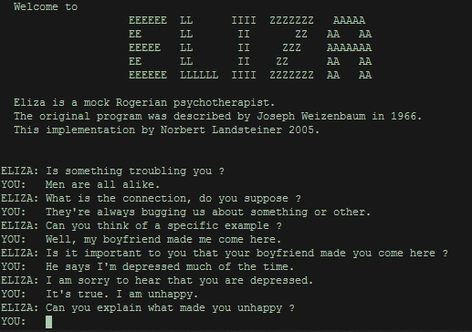
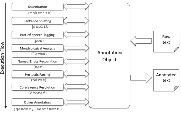
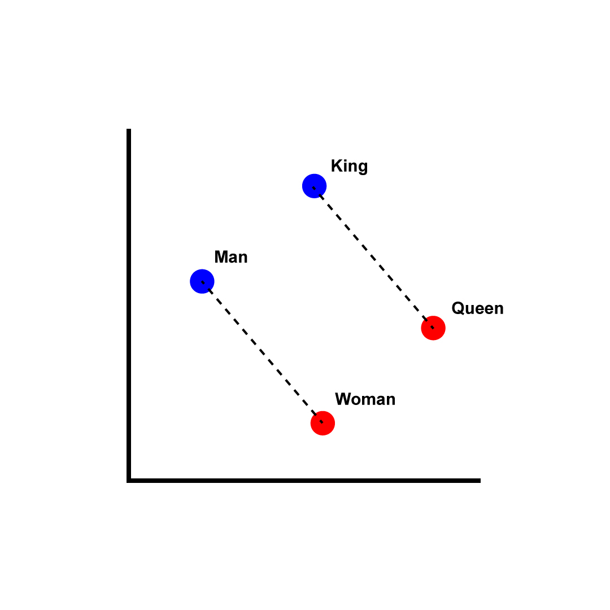
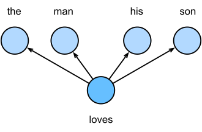
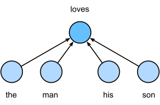
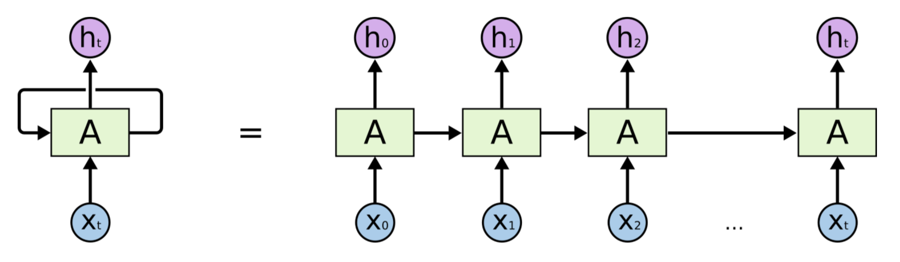
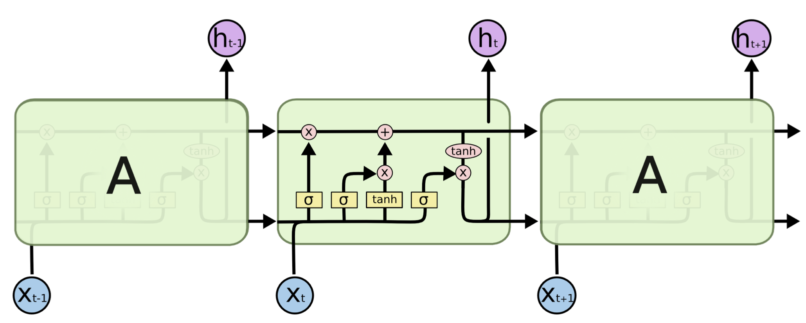
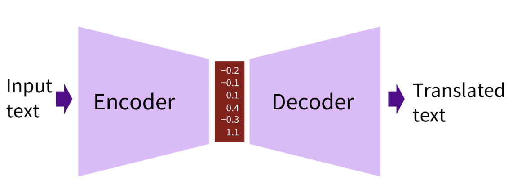
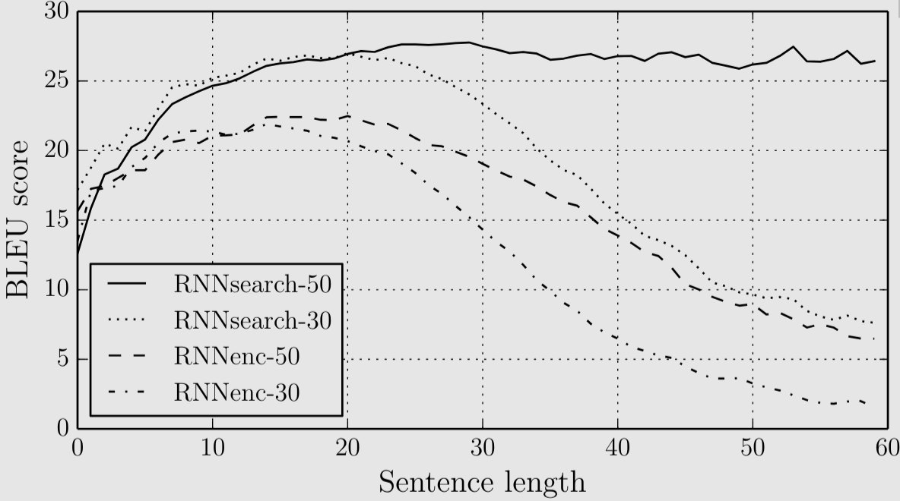
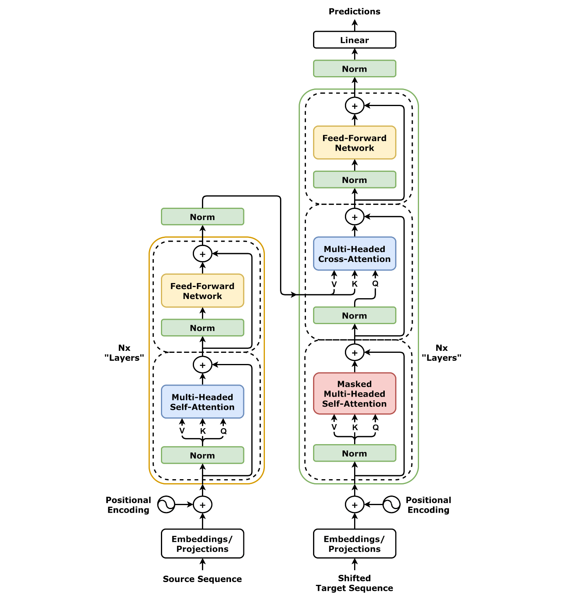

# Chapter 2 Foundations of Language Modeling with LLMs

[Course index](../../README.md) · [Original source](https://arxiv.org/html/2610.13455v1#Ch2) · [Raw file](../../raw/originals/book.html)

Retrieved: 2026-11-13T16:41:17.579179+00:00

[Contents](../../CONTENTS.md) · [Full book](../book/full-book-html.md) · [Previous chapter](chapter-01-introduction.md) · [Next chapter](chapter-03-the-large-language-model-training-pipeline.md)

### Chapter 2 Foundations of Language Modeling with LLMs

**What You Will Learn**

In this chapter you will learn how natural language can be processed in machine learning models.
Specifically, you will be able to:

- Describe the core concepts of *language modeling*, including tokenization and early word-representation methods, and explain what problem each was designed to solve.
- Distinguish the learning regimes used to build a language model—*supervised, autoregressive, and reinforcement*—and state what each contributes to the final model.
- Explain how *embeddings* represent word meaning as vectors, and predict how semantically related words are positioned relative to one another.
- Explain how the *attention mechanism* forms flexible, context-dependent connections between tokens, and trace how a query, key, and value interact for a given input.
- Describe how the *transformer architecture* is built from attention, and identify its main components.
- Contrast *encoder* (classification) and *decoder* (generation) models, and select the appropriate one for a given NLP task.

#### 2.1 Processing Natural Language

Language is the primary medium through which humans communicate. Language comes in forms spanning from printed books, digital media to spoken discourse. Language research has long been a focal point of multidisciplinary research. Within the context of artificial intelligence and computer science, language is of particular significance: we use it to articulate complex ideas, we formulate algorithms in programming languages, and we use it to facilitate interaction between software and its users.

For decades, a key aim of AI has been to unlock the ability for machines to understand human-produced language, as is argued by [Jurafsky and Martin [2025]](#biba.bib28) in their major textbook of the field. Research in this area is combined in the field of Natural Language Processing (NLP) and its counterpart, Computational Linguistics.11
1
Originally further apart, the two fields have been growing closer in recent years, one starting from the linguistic side, the other from the computational side. In this chapter, we provide an overview of the complexities of capturing *natural* (human) language by computational means, and outline the evolution of various fundamental techniques over the years for achieving such understanding.

One of the early goals of the fields has been to achieve the dream of practical machine translation. Since its inception in the 1950’s [[Hutchins, 1999](#biba.bib40)], human language processing technology has evolved greatly. Extensive research progress has allowed it to have a profound impact across industries. This widespread industrial adoption has, in turn, emerged as a vital driving force for application-oriented development. In NLP, fundamental theoretical research and practical, real-world utility, go hand in hand. As a consequence, the application areas have expanded beyond machine translation.

Figure 2.1: A typical conversation with ELIZA

Recently, the impact of language technology on society has truly exploded. We interact on a daily basis with chatbots such as ChatGPT and Claude. We can do so in multiple languages, and enhanced search engines have been incorporated in many popular products. However, these developments stand on the shoulders of many earlier results. A famous early example is ELIZA, the psychotherapist chatbot developed in 1966 by Joseph Weizenbaum [[Weizenbaum, 1966](#biba.bib41)]. ELIZA was a rudimentary chatbot based on simple rule-based word substitutions (see Figure [2.1](#Ch2.F1 "Figure 2.1 ‣ 2.1 Processing Natural Language ‣ Chapter 2 Foundations of Language Modeling with LLMs ‣ Part I Language Modeling ‣ Agentic Large Language Models")). ELIZA was already ascribed human-like qualities. Since these early days of rule-based systems for text processing, where we identify words based on specific delimiters (such as white space), we have come a long way.

##### 2.1.1 Language Understanding and Language Generation

Before considering how computers process language, we will consider how humans understand language.

A key observation is that communication is a sequential process, and that languages are shaped accordingly. Words are uttered one at a time, and are also consumed one at a time. This parallel holds both for human and mechanical processing of language: language is a sequence of characters (when reading), syllables (when speaking), or entire words (for early computational models of language).

We will now look deeper into the technology developed for working with natural language sequences. This technology is categorized as either natural language *understanding* or natural language *generation*. We will briefly describe both categories.

Figure 2.2: 
The standard NLP pipeline, as visualized by [Manning et al. [2014]](#biba.bib31)

###### Natural Language Understanding

Natural language understanding (NLU) focuses on developing methods for capturing meaning and intent. Approaches and techniques for NLU map unstructured human language elements onto a structured format such that a computer can interpret and act upon them. Such techniques can involve several layers of processing, inspired by linguistic analysis (as visualized in Figure [2.2](#Ch2.F2 "Figure 2.2 ‣ 2.1.1 Language Understanding and Language Generation ‣ 2.1 Processing Natural Language ‣ Chapter 2 Foundations of Language Modeling with LLMs ‣ Part I Language Modeling ‣ Agentic Large Language Models")), as follows:

- Tokenization: determine boundaries between meaningful linguistic elements (such as words) to be used for further processing.
- Syntactic Parsing: determine the grammatical structure (such as subjects, verbs, and objects).
- Named Entity Recognition (NER): identify and categorize key entities such as names, dates, and locations.
- Sentiment Analysis: detect the emotional tone of a text.
- Co-reference Resolution: determine what person or items are referred to in referential expressions (such as: *the computer* talked to me).
- Discourse Analysis: understand how the meaning of a sentence is influenced by preceding sentences.

One of the primary challenges in NLU is dealing with ambiguity [[Roth, 1998](#biba.bib48), [Liu et al., 2023](#biba.bib49)]. Human language is rife with ambiguity. Examples are polysemy (words with multiple meanings, such as *bank*) and context-dependent nuances that require world knowledge to decode correctly. Many more challenges exist; naturally occurring human language is as rich and complex as humans are.

###### Natural Language Generation

Natural language generation (NLG) focuses on developing methods for producing readable, natural-sounding human language.
Tasks range from free-form language generation, to the transformation of structured data or model representations into realistic utterances.

An important NLG task is *language modeling* (LM). In language modeling, the task is to predict the next element in a sequence, given the previous context. Mathematically, this involves assigning a probability distribution over sequences of words. Traditionally, finding this distribution was achieved using simple count-based models, often relying on further simplifying assumptions to predict a word based on a fixed window of preceding words.

Modern approaches use elaborate neural methods that can generate fluent sentences based on a long context, that often appear meaningful to a human observer.22
2
Which is by itself not always difficult to achieve, as we saw in the ELIZA example. Note that effective language generation requires more than just grammatical correctness; it requires coherence (logical flow) and cohesion (linguistic links). Current NLG systems use sampling methods, ensembles, and many other mechanisms to balance the creativity and predictability of the text that they produce, to ensure that the output feels natural rather than robotic [[Li and Jurafsky, 2017](#biba.bib45), [Dong et al., 2022](#biba.bib46), [Gatt and Krahmer, 2018](#biba.bib47)]. Techniques for NLG are commonly categorized into two approaches:

- Extractive Generation: Selecting and rearranging existing segments of text (often used in early summarization tools).
- Abstractive Generation: Generating entirely new sentences from scratch (as modern models such as ChatGPT do).

Most LLMs use the abstractive approach.

We will now discuss early, fundamental, approaches to language modeling. We will start by discussing the complexity of language, and then discuss the principle of distributional representation, tokenization methods, and early language modeling representations.

##### 2.1.2 Complexity of Natural Language

There are many reasons why natural language can be difficult for a machine to interpret. Language exhibits subtle nuances that carry meaning or distort it. Capturing the full nuance of language requires more than understanding its structure. Furthermore, the context in which something is said plays a role in communication. Understanding goes beyond the words themselves to grasp the intentions, implications, and subtleties embedded in communication [[Wittgenstein, 1953](#biba.bib43), [Grice, 1975](#biba.bib44), [Krause and Vossen, 2024](#biba.bib42)]. Below, we introduce topics that are studied in the field of linguistics, each of which brings about a different view on what language is capable of expressing.

###### Syntax

Syntax rules govern the structure of sentences. In the study of linguistics, syntax refers to the set of rules, principles, and processes that regulate the structure of sentences in a given language. Linguistic syntax examines the underlying logic that allows a speaker to combine words into well-formed and meaningful sequences. In English, for example, the most common order is subject-verb-object: in *cat bites dog* the verb *bites* follows the subject *cat*, indicating that the meaning of the sentence is that it was the cat that was doing the biting (and not the dog).

###### Morphology

Morphology is the study of how words change shape depending on their grammatical function. How words change shape is related to syntax, and the morphological rules (and their exceptions) depend on the language (family). In the preceding example sentence, the shape of the verb *to bite* changed to *bites*, where the *-s* indicates simple present tense (it is happening now, by a singular actor, not by a posse of felines in ancient times).

###### Semantics

In linguistics, lexical semantics is the study of the meaning of words. In natural languages words derive their meaning from their relationship to other words. For instance, words with nearly identical meanings form *synonyms*, such as car and automobile or vanish and disappear; words with opposite meanings form *antonyms*, such as hot and cold or buy and sell. Many more relationships exist.

In NLP, computational semantics is the study of how we can represent that meaning efficiently in a computer. A basic approach for storing a sentence in a computer memory would be to simply use a sequence of indices into a vector of the words of a language. However, this encoding only records the occurrence of the words, but not the relationships between the words; the semantics of the words are no longer present in this naive representation.

Words derive their meaning from their relationship to other words, and we need a way to efficiently encode these relationships. As we will see later in this chapter, different solutions have been developed over the years, including the transformer architecture and the attention mechanism.

###### Pragmatics

In addition to the literal meaning of words, humans care about the intent of the speaker and the context of the utterance. The way language is employed in specific social contexts determines its effect (*meaning is use* [[Baker and Hacker, 2008](#biba.bib59)]). The study of the implicit, everyday rules humans naturally follow to ensure that our communication is effective is called *pragmatics*.

A set of foundational principles are the Gricean Maxims [[Grice, 1975](#biba.bib44)]: the unspoken cooperative principles that humans use to infer meaning. For instance, the maxim of quantity states that humans provide exactly as much information as is required for the conversation. These maxims shape our communication, and help make our language understandable and cooperative. For a machine, interpreting sarcasm, subtext, or placeholders (e.g., “thingy”) requires knowledge of these rules, beyond adherance to a static dictionary.

###### Discourse

Language rarely occurs in isolated sentences; language is structured into larger units such as paragraphs, conversations, or full documents. The study of discourse focuses on how sentences connect to form a cohesive and coherent whole. For a machine to truly interpret a text, it must be able to track entities across multiple sentences, a task known as co-reference resolution (e.g., determining whether the pronoun *it* refers to the cat, the dog, or the bite from a previous sentence). Understanding discourse is vital for complex NLP tasks such as document summarization, machine translation, and sustaining long-form dialogue.

In addition to these topics, other fields of study exist, such as phonetics (the sounds of a language that carry additional meaning in human communication), sociolinguistics (how language varies according to social factors like class or region), lexicography (the science of compiling dictionaries), and many more.

As this overview may have highlighted, the generation and understanding of natural languages are large and challenging fields. It is important to realize that language is not static. Language varies over time, across geographical locations, between different cultures, and depending on the medium through which it is communicated :-). This variation makes the creation of language technology a difficult and never-ending quest.

Before we introduce the recent technologies that provide at least a partial answer to these challenges, we discuss the fundamental assumptions that inspired the modern turn in NLP.

Representing natural language in a computer is difficult because natural language is rich and complex. In the remainder of this section, we discuss the principle of distributional representation, which states that the semantic meaning of a word is driven by the context that surrounds that word. Next, we will look at tokenization methods: methods for splitting sentences into words. Finally we will discuss how we can work with vectors of tokens to arrive at a representation that encodes meaning.

##### 2.1.3 Distributional Representations

How can we teach a machine to understand complex semantic relationships and grammatical structures without manually encoding them all? The answer lies in the distributional hypothesis, a foundational concept in modern NLP. The core idea was articulated in the late 1950s:

*You shall know a word by the company it keeps. (Firth, 1957)*

This suggests that the meaning of a word can be inferred from the words around it (contexts) in which it typically appears. Words that appear in similar contexts are likely to have similar meanings. For example, if the words *coffee* and *tea* both frequently appear near verbs like *drink*, *sip*, or *brew*, then a machine may infer that there is a semantic relationship between them, without explicit definitions or other human-provided information.

To operationalize the distributional hypothesis for computational purposes, we will rely on linear algebra and turn to a framework known as *vector semantics*. We represent words as points in a high-dimensional continuous space. Words with similar meanings are mapped to points close to each other in this space, and we can measure semantic similarity using geometric distance measures such as cosine similarity (see Figure [2.3](#Ch2.F3 "Figure 2.3 ‣ 2.1.3 Distributional Representations ‣ 2.1 Processing Natural Language ‣ Chapter 2 Foundations of Language Modeling with LLMs ‣ Part I Language Modeling ‣ Agentic Large Language Models") and Section [2.3.1](#Ch2.S3.SS1 "2.3.1 Embeddings ‣ 2.3 Modeling Language ‣ Chapter 2 Foundations of Language Modeling with LLMs ‣ Part I Language Modeling ‣ Agentic Large Language Models")). Furthermore, we can make modifications to word meaning by doing vector arithmetic.
Early implementations relied on sparse co-occurrence matrices to construct semantic vectors, where individual words were counted inside their context, much like other methods described in Section [2.1.5](#Ch2.S1.SS5 "2.1.5 Early Methods for Language Representation ‣ 2.1 Processing Natural Language ‣ Chapter 2 Foundations of Language Modeling with LLMs ‣ Part I Language Modeling ‣ Agentic Large Language Models"). Modern approaches favor dense, low-dimensional vectors, often referred to as *word embeddings*. These representations are typically learned by training a neural model to predict a word from its neighbors or vice versa, a breakthrough popularized by the *word2vec* architecture [[Mikolov et al., 2013](#biba.bib34)].

While learning vector-based representations for words is an effective way to capture meaning, maintaining a distinct vector for every unique word in a language results in an impractically large vocabulary.

Furthermore, strict word-level approaches struggle to process rare or entirely unseen words, as the model has no pre-existing vector for them. Hence, before a model can assign vectors to linguistic units, we must first determine what those fundamental units actually are. To address these inefficiencies and handle out-of-vocabulary inputs, modern methods use a systematic approach to break down raw text into more manageable pieces. This process is called tokenization, which we will now discuss.

Figure 2.3: 
Illustration of vector arithmetic with word2vec embeddings [[Singerep, 2022](#biba.bib35)].

##### 2.1.4 Tokenization

Before computers can ascribe meaning to language, they must first have a way to digest it. Assuming that we already have raw text at our disposal, whether scraped from the web or transcribed from speech, the immediate challenge is determining how to split these continuous character strings into meaningful units, or how to split sentences into words. This process is called *tokenization*. However, a robust tokenization strategy must do much more than simply divide sentences by spaces to obtain words; it needs to be able to handle the nuances of different languages and dialects, parse complex punctuation, and even account for modern additions like emojis, and fit these into a vocabulary of fixed size.

This process of segmentation is a key step to many NLP pipelines. While dividing text might appear straightforward, ambiguities in punctuation complicate the process, such as in abbreviations (N.L.P. or NLP?). Simple rule-based segmenters frequently fail against the structural irregularities of natural language. Consequently, there are different approaches for constructing these units, as shown in Example [1](#Thmexample1 "Example 1 (Tokenization Strategies). ‣ 2.1.4 Tokenization ‣ 2.1 Processing Natural Language ‣ Chapter 2 Foundations of Language Modeling with LLMs ‣ Part I Language Modeling ‣ Agentic Large Language Models").

###### **Example 1**** **(Tokenization Strategies)**.**

Consider the following sentence:
  
“Leiden is beautiful in summer.”

**Word Tokenization**
  
This approach typically splits text by spaces and punctuation.

["Leiden", "is", "beautiful", "in", "summer", "."]

**Character Tokenization**
  
This approach breaks the text down into individual characters.

["L", "e", "i", "d", "e", "n", " ", "i", "s", " ", "b", "e", "a", "u", "t", "i", "f", "u", "l", " ", "i", "n", " ", "s", "u", "m", "m", "e", "r", "."]

**Subword Tokenization (e.g., WordPiece)**
  
This approach preserves common words as whole tokens but breaks down complex or rare words into foundational subwords.

["Lei", "##den", "is", "beautiful", "in", "summer",
  
"."]

###### Word-Level Tokenization

This approach treats each space-separated string as a token that is unique. While it preserves syntactic structure, it results in impractically large vocabularies and suffers from the out-of-vocabulary (OOV) problem, where models fail on words that were not seen during training.

Large vocabularies are problematic due to the mechanics of *one-hot encoding*.
If every word $w$ in a vocabulary $V$ is represented as a vector $\mathbf{x}\in\{0,1\}^{|V|}$, where only the index corresponding to $w$ is 1, the dimensionality $|V|$ scales linearly with the size of the vocabulary. As these one-hot vectors will later form the input to our neural networks, for texts that do not contain all words in a certain vocabulary, we end up creating sparse, computationally inefficient representations that fail to capture semantic relationships between words.

###### Character-Level Tokenization

Pure character-level modeling seems like a clear solution to the problem of increasing vocabularies, and has been explored over the years [[Mielke et al., 2021](#biba.bib51)]. Such a method divides text into individual characters, which restricts the vocabulary to the size of the alphabet, virtually eliminating OOV issues. However, it significantly increases sequence length and the resulting computational burden is substantial. Furthermore, because isolated characters lack inherent semantic meaning, the model must learn word morphology before it can grasp broader linguistic patterns, increasing training time.

###### Subword Tokenization

Hence, the current standard for LLMs balances the previous two methods. It preserves common words as whole tokens while decomposing rare words into smaller, meaningful components. Notable implementations include:

- 

  Byte Pair Encoding (BPE): An iterative algorithm that begins with individual characters and merges the most frequent adjacent pairs into single tokens until a target vocabulary size is reached [[Sennrich et al., 2016](#biba.bib50)] (e.g., *highest* $\rightarrow$ [*high*, *est*]). BPE was originally proposed as a data compression algorithm [[Gage, 1994](#biba.bib10)].
- 

  WordPiece: An iterative algorithm, similar to BPE, that merges pairs based on a likelihood criterion rather than on raw frequency, aiming to maximize the probability of the training data [[Wu et al., 2016](#biba.bib52)].

##### 2.1.5 Early Methods for Language Representation

After tokenization, the next question is how to combine our linguistic units (tokens) into coherent sentences, that carry meaning? We start with the observation that the ordering of these units in human language is dictated by strict syntactic and semantic rules. Now, if our computational approaches would be able to accurately produce sensible text sequences, then we might say that they possess the same syntactic and semantic understanding (or at least that they are able to reproduce such understanding).

How can we build mathematical representations that achieve this goal? A core task in this endeavor is *language modeling*. Mathematically speaking, a language model is a function that computes the joint probability of a sequence of words occurring together in a specific context.
By calculating this probability, models can distinguish between a logical, fluent sentence and a random sequence of tokens. For example, in English, the sequence *the cat sat* is significantly more probable than *sat cat the* because it adheres to established syntactic rules.

Because written language is sequential, estimating the joint probability of a sentence is inherently a sequence estimation problem. The overarching goal of language modeling is to quantify the statistical likelihood that a given sentence, $S$, occurs within a specific language, based on its sequence of constituent words $w_{1},\dots,w_{k}$:

|  |  |  |  |
| --- | --- | --- | --- |
|  | $$ P(S)=P(w_{1},\dots,w_{k}) $$ |  | (2.1) |

For sentences of arbitrary length, calculating this exact joint probability directly is computationally intractable, due to the exponentially large number of word combinations in any given vocabulary. To resolve this complexity, we often decompose the joint probability, using the chain rule of probability. By making specific mathematical assumptions regarding conditional independence, this decomposition allows the computation to remain tractable for real-world applications [[Jurafsky and Martin, 2025](#biba.bib28)]:

|  |  |  |  |
| --- | --- | --- | --- |
|  | $$ P(w_{1},\dots,w_{k})=P(w_{1})\prod_{i=2}^{k}P(w_{i}\mid w_{1},\dots,w_{i-1}) $$ |  | (2.2) |

By maximizing this joint probability, probabilistic models learn to favor grammatically and logically sound sequences. The learned probabilistic distributions effectively reverse engineer the complex, unwritten rules of human language [[Manning and Schutze, 1999](#biba.bib53)]. To estimate these probabilities from a segmented text corpus, early methods relied on maximum likelihood estimation (MLE). The simplest approach computes the marginal probability of a word based on its relative frequency in the corpus:

|  |  |  |  |
| --- | --- | --- | --- |
|  | $$ P(w)=\frac{\text{count}(w\text{ in corpus})}{\text{total number of words}} $$ |  | (2.3) |

To make the computation of these conditional probabilities manageable, researchers rely on *$n$-gram models*. An $n$-gram is a contiguous sequence of $n$ items from a given sample of text. Instead of calculating the probability of a word given its entire preceding history, which quickly becomes computationally intractable, $n$-gram models apply the *Markov assumption*. This assumption states that the probability of the next word depends only on the preceding $n-1$ words, effectively truncating the context. For example, a bi-gram model ($n=2$) approximates the history by looking solely at the immediately preceding word. The conditional probability is then calculated by taking the frequency of the two words occurring together and dividing it by the frequency of the first word alone,

|  |  |  |  |
| --- | --- | --- | --- |
|  | $$ P(w_{i}\mid w_{1},\dots,w_{i-1})\approx P(w_{i}\mid w_{i-1})=\frac{\text{count}(w_{i-1},w_{i})}{\text{count}(w_{i-1})} $$ |  | (2.4) |

Likewise, a tri-gram model ($n=3$) conditions on the previous two words. This simplification drastically reduces the computational burden and makes it feasible to estimate probabilities directly from a corpus.

Selecting the appropriate $n$ involves a critical trade-off. A larger $n$ captures richer contextual information and deeper syntactic dependencies, resulting in a model that generates a more natural language. Yet, increasing $n$ exponentially exacerbates the sparsity problem: highly specific word sequences appear far less frequently in the training data, and the model will increasingly encounter zero probabilities. Conversely, a smaller $n$ yields robust, frequent counts but severely limits the model’s understanding of broader semantic meaning and long-distance dependencies within the sentence.

In a standard language model computation, observing an unseen $n$-gram results in a probability of zero, as it nullifies the joint probability of the entire sentence via multiplication. To mitigate this counterintuitive behavior, total counts are often smoothed. A common technique is *Laplace (or add-one) smoothing*, which adds a fictitious count of $1$ to every possible vocabulary item. To maintain a valid probability distribution, the denominator is adjusted by adding the vocabulary size, $|V|$:

|  |  |  |  |
| --- | --- | --- | --- |
|  | $$ P_{\text{Laplace}}(w)=\frac{\text{count}(w\text{ in corpus})+1}{\text{total number of words}+|V|} $$ |  | (2.5) |

These probabilistic and count-based methods ultimately yield a numerical representation of language. A strong representation encodes the properties we intuitively grasp about a word: its meaning, its grammatical function, and its relationship with other words. In early NLP, these relative frequencies and co-occurrence counts were structured into vectors, representing words based on their distribution in the text.

While count-based representations are tractable, they result in vectors that are high-dimensional and sparse, leading to computational inefficiencies and poor generalization on unseen data. Consequently, modern NLP has transitioned toward learning dense, low-dimensional vector representations, known as *embeddings*, using neural networks. Instead of relying on explicit counting, these models learn continuous representations as a byproduct of predicting a word from its surrounding context, capturing deeper semantic relationships in a more efficient format.
These modern approaches will be discussed in Section [2.3](#Ch2.S3 "2.3 Modeling Language ‣ Chapter 2 Foundations of Language Modeling with LLMs ‣ Part I Language Modeling ‣ Agentic Large Language Models"). First we will have a brief intermezzo where we review three important machine learning approaches.

#### 2.2 Machine Learning Methods For Natural Language Processing

Having established a primer on language representation, we will now turn to the learning algorithms that allow us to create the large models powering modern AI systems. LLMs are trained using methods from the broader field of machine learning. While machine learning is an extensive field of research, understanding LLMs requires familiarity with three core paradigms, and how they are used in language modeling: *supervised learning*, *autoregressive learning*, and *reinforcement learning*. We briefly touch upon these essential methods and refer to standard works for deeper exploration.

##### 2.2.1 Supervised Learning

Supervised learning is the foundation of machine learning. It is named so because it relies on a set of labels, that must be given beforehand, that *supervise* the training process. This approach utilizes a dataset consisting of paired examples and labels, $D=\{(x_{i},y_{i})\}$, to train the parameters $\theta$ of a predictive model $f_{\theta}$. The model can be used to compute an estimate $\hat{y}$ for each input $x$, denoted mathematically as $f_{\theta}(x)\rightarrow\hat{y}$. Using the model to compute this estimate is also known as *inference*, or the *forward pass*.

After the forward pass, we can use a loss function $\mathcal{L}$ to compute some kind of difference between the estimate $\hat{y}$ and the true label $y$. Common examples of loss functions are the sum of squared-difference loss from statistical regression $\mathcal{L}=\sum_{i}(\hat{y_{i}}-y_{i})^{2}$, or the cross-entropy loss for classification $\mathcal{L}=-\sum_{c}y_{c}\log(\hat{y_{c}})$.

The goal of a supervised training algorithm is to minimize the sum of the losses over the dataset of example pairs by adjusting the parameters. This is done in the *backward pass*. Here, the loss function is used to compute an error signal to adjust the parameters $\theta$ of the model $f$ so that the next forward pass achieves a lower loss (backpropagation of the error). Minimizing the loss function on the examples from a data set is a process called *training*. A single training run of forward and backward passes over all of the training data is called an *epoch* (for efficiency reasons, epochs can be split into training *batches*).

After training, to see if our model $f_{\theta}$ works well—if it generalizes to unseen examples—it is *tested* on new examples, that were not part of the training set.

If the accuracy on the training set is high, we say that the model trains well (training converges). If the accuracy on the test set is also high, then we say that the model generalizes well and we have achieved our training goal. Informally speaking, if the accuracy of the model on the training set is high, but on the test set it is low, we say the model overfits on the training set. This usually means that the model has trained for too long or has too many parameters, so that it models not only the signal in the training set but also the noise. If the model has low accuracy on both training and test set, we say that it underfits. This is most likely due to too short training, or a model that is too simple (too few trainable parameters) to model the complexities of the data.

Generally speaking, problems with few variables (low-dimensional problems, such as simple regression) require smaller models (fewer parameters) and less training data to perform well. Problems with many variables (high-dimensional problems, such as image classification) require larger models with many millions of parameters (often deep neural networks) and large training datasets to perform well. Indeed, breakthrough performance in image classification [[Krizhevsky et al., 2012](#biba.bib5)] was only achieved after the construction of a large dataset with millions of hand-labeled images, Imagenet [[Deng et al., 2009](#biba.bib8)].

Supervised learning is the basis of machine learning. Many good text books have been written about the topic [[Bishop and Bishop, 2023](#biba.bib6), [Goodfellow et al., 2016](#biba.bib18)]. It is one of the core techniques in LLM training, for example in supervised finetuning, as we will see in the next chapter.

##### 2.2.2 Autoregressive Learning

Large language models are trained autoregressively. In this training approach, there is no dataset of pairs of labeled examples, but there is a lot of (textual) data available. Autoregressive learning is a form of self-supervised learning, without explicit labels, using the inherent sequential nature of the data, to predict the next token.

In autoregressive pretraining of language models, our algorithm performs predictions over the dataset where each token $y=x_{t}$ is taken as a label for preceding example tokens $\mathbf{x}=x_{t-1}$. Autoregressive learning is a core task of modern NLP, and is used in contemporary model training pipelines [[Radford et al., 2018](#biba.bib58)] and included in textbooks on NLP [[Jurafsky and Martin, 2025](#biba.bib28)]. We will provide more details of the methods in Section [2.3](#Ch2.S3 "2.3 Modeling Language ‣ Chapter 2 Foundations of Language Modeling with LLMs ‣ Part I Language Modeling ‣ Agentic Large Language Models") and Chapter [3](chapter-03-the-large-language-model-training-pipeline.md#Ch3 "Chapter 3 The Large Language Model Training Pipeline ‣ Part I Language Modeling ‣ Agentic Large Language Models").

##### 2.2.3 Reinforcement Learning

Both supervised and autogregressive learning need a dataset of training data to train on—they train *offline* on pre-existing data. However, sometimes no dataset is available, but we may have access to a function that can tell us when we are in a good state or in a bad state. In that case, an *online* learning method called reinforcement learning (RL) can be used, where an agent performs an action $a$ to bring an environment from state $s$ to the next state $s^{\prime}$, after which the environment reports back the reward $r(s^{\prime})$ of that new state. (The method is called online because it generates its training data on the fly, while training.) The agent can then use this reward information to adjust a $\theta$-parameterized behavior policy function $\pi_{\theta}(s)\rightarrow a$ to know which action to perform in which state. When the problem at hand is as a sequential decision problem, actions $a$ take the system from state $s$ to another state $s^{\prime}$, and rewards depend on actions taken in the past (the credit assignment problem: to which actions should rewards be assigned?). Repeating the state/action/reward process can cause the agent to explore the entire state space, and learn an optimal policy $\pi^{*}(s)$ of which action to take, for all states.

Environment: $T(s,a)\rightarrow s^{\prime},R(s^{\prime})\rightarrow r$Agent: $r$ improves $\pi_{\theta}(s)\rightarrow a$$(s^{\prime},r)$$a$

Figure 2.4: 
Reinforcement Learning, after [Sutton and Barto [2018]](#biba.bib17)

Note that reinforcement learning, being online, is inherently circular. At the start, the policy $\pi$ has seen few rewards, and has useful information on which action to take for just a few states. If it would greedily use this information on which good action to take, it would traverse only a limited part of the environment, and the optimal policy that it would find would be only locally optimum. To find better optima, it should explore, and try random actions, ideally to cover the entire state space.

Reinforcement is a form of active agentic learning from feedback from an environment. A key observation is that it is typically easier to see if an output is good (reward function), than to create a full new one (labeled dataset).
Many reinforcement learning algorithms have been developed that focus on good exploration methods.
Reinforcement learning problems are formally modeled as a Markov decision process (MDP), consisting of a state representation $S$, an action function $A(s)$, a transition function $T(s,a)\rightarrow s^{\prime}$, and a reward function $R(s)$. Rewards are numeric indications of the quality of a state, provided by the environment. They can be positive or negative. The goal of an agent is to find the policy $\pi(s)$ of optimal actions $a*$ in each state $s$.
Figure [2.4](#Ch2.F4 "Figure 2.4 ‣ 2.2.3 Reinforcement Learning ‣ 2.2 Machine Learning Methods For Natural Language Processing ‣ Chapter 2 Foundations of Language Modeling with LLMs ‣ Part I Language Modeling ‣ Agentic Large Language Models") illustrates how a reinforcement learning agent learns a policy with an action for each state, online, through interaction with the environment, which can compute functions $T$ and $R$ (the environment will answer the agent’s question as to what the next state is that resulted from its action, and how good that state is).

When the state space is small enough to fit in a computer memory, we can use exact tabular reinforcement learning methods, such as Q-learning [[Watkins and Dayan, 1992](#biba.bib3)]. For larger problems, function approximation methods are used (deep neural networks) such as deep Q-learning (DQN) [[Mnih et al., 2015](#biba.bib23)] or proximal policy optimization (PPO) [[Schulman et al., 2017](#biba.bib24)]. In deep reinforcement learning, the policy is a parameterized neural network that is trained by backpropagation, as in supervised deep learning.

Reinforcement learning is the basis of modern reasoning language models. Many text books have been written about reinforcement learning, such as the seminal work by [Sutton and Barto [2018]](#biba.bib17), as well as more educational texts [[Graesser and Keng, 2019](#biba.bib15), [Plaat, 2020](#biba.bib27), [Plaat, 2022](#biba.bib26)]. In LLM training, reinforcement learning is used in reinforcement finetuning, and in multi-step reasoning, as we will see in Chapter [6](chapter-06-multi-step-reasoning-in-llms.md#Ch6 "Chapter 6 Multi-step Reasoning in LLMs ‣ Part II Reasoning ‣ Agentic Large Language Models"). Furthermore, reinforcement learning formulates machine learning problems in terms of an agent that tries to learn how to interact in an environment, which fits the agentic LLM setting nicely. In agentic LLMs, it is used in in-context reinforcement learning for prompt optimization, in world models, and to model other agent behavior in relation to the environment, as we will see later in this book.

Reinforcement learning is a popular machine learning approach since we can learn new environments where we do not have data available. The method finds its own data. When we consider using reinforcement learning, two questions should be answered: (1) is the problem at hand a sequential decision problem, and, if so, (2) what is the size of the state space, can we use exact tabular methods, or must we resort to approximation?

Now that we have discussed the necessary language and machine learning principles, we turn back to language, to the next step: modeling language.

#### 2.3 Modeling Language

After the basics of language representation and machine learning, we turn to the overarching paradigms used to build computational language modeling capabilities. The development of natural language processing is broadly characterized by three paradigms. Each paradigm represents a fundamental shift in the type of model constructed to capture language and how the inherent complexity of human language is managed. We will see that as we move through the paradigms, we incorporate more techniques from machine learning, leveraging increases in compute power to process more data to train larger and larger neural networks for language processing. The paradigms are the *symbolic*, *statistical*, and *neural* approaches [[Kautz, 2020](#biba.bib32), [Deng and Liu, 2018](#biba.bib33)].

###### Symbolic Methods

Often referred to as *Classical AI* or rule-based systems, these early ELIZA-like symbolic approaches rely on explicit, human-defined instructions. By treating language as a formal system, symbolic models attempt to parse meaning deductively. While these systems are highly transparent and interpretable by design, they are brittle, as they struggle using rigid rules (*if-then-else*) to handle the natural variation, idiomatic expressions, and ambiguities of real-world language. Scaling symbolic approaches to larger language tasks requires a labor-intensive, manual enumeration of many edge cases, which turned out to be unfeasible for all but the smallest problem domains.

###### Statistical Methods

To overcome the limitations of rigid rule sets, between 1980-1990 the field experienced an empirical shift toward probabilistic modeling with the statistical methods. Instead of relying on explicit syntactic rules, statistical methods such as hidden Markov models and $n$-gram language models leverage large text corpora to compute the likelihood of word co-occurrences. This data-driven approach scales efficiently and handles linguistic ambiguity and noise far better than its symbolic predecessors. However, because these models typically rely on the Markov assumption, their representation of meaning is inherently limited to local word patterns, making them ill-equipped to capture long-distance dependencies and broader context.

###### Neural Methods

After approximately 2010, the contemporary state-of-the-art shifted to neural networks and deep learning. Rather than using logic or discrete counts, neural methods represent linguistic units as dense, low-dimensional vectors in a continuous semantic space. Modern architectures, particularly transformers, employ attention mechanisms to model global context simultaneously across an entire sequence. This approach yields impressive generalization, high fluency in text generation, and cross-lingual capabilities. Nevertheless, these advantages come with significant trade-offs: neural models operate largely as black boxes, sacrificing the interpretability seen in symbolic methods, and they require large data sets and large computational resources.

The contemporary pipelines for NLP training draw inspiration from all of these three paradigms. Before describing an example pipeline in the next chapter, we require a deeper understanding of the core components of these parts, as they are the building blocks for the systems on which agentic LLMs are based. In the next sections we will discuss many topics: word embeddings, contextualized embeddings, sequence modeling, attention, transformers, encoders (such as BERT), and decoders (such as GPT).

##### 2.3.1 Embeddings

Early models of neural embeddings operationalize semantic understanding of lexical items by defining a context window, a span of $n$ words to the left and right of a target word, and predicting the missing focus word. For the sentence *There are two cookies left on the table*, if we set a window of $n=2$, the context words for *cookies* are *are*, *two*, *left*, and *on*. By systematically sliding this window over a large corpus of text, we can count how many times each word appears in the context of every other word. These counts form the basis of a co-occurrence matrix, where each row represents a target word and each column represents a context word. The value in each cell is the number of times the column word appeared in the context of the row word. For example, the vector for *cherry* might have a high value in the column for pie (e.g., 442) and a low value for computer (e.g., 2). The vector for *strawberry* would show a similar pattern, and hence reflect the semantical similarity between the two words.

By representing words as vectors, we place them in a high-dimensional vector space where each dimension corresponds to a context word. In this space, words with similar meanings, which share similar contexts, will point in similar directions. This geometric relationship allows us to measure semantic similarity numerically. The most common method for this is *cosine similarity*, which measures the cosine of the angle $\theta$ between two vectors $\mathbf{a}$ and $\mathbf{b}$, as in Equation [2.6](#Ch2.E6 "In 2.3.1 Embeddings ‣ 2.3 Modeling Language ‣ Chapter 2 Foundations of Language Modeling with LLMs ‣ Part I Language Modeling ‣ Agentic Large Language Models").

|  |  |  |  |
| --- | --- | --- | --- |
|  | $$ \text{similarity}=\cos(\theta)=\frac{\mathbf{a}\cdot\mathbf{b}}{\|\mathbf{a}\|\|\mathbf{b}\|}=\frac{\sum_{i=1}^{n}a_{i}b_{i}}{\sqrt{\sum_{i=1}^{n}a_{i}^{2}}\sqrt{\sum_{i=1}^{n}b_{i}^{2}}} $$ |  | (2.6) |

Earlier, we argued that count-based vectors result in high-dimensional spaces that scale linearly with vocabulary size. Since the number of dimensions dictates the computational complexity of downstream models, we wish to keep the dimensionality in check and instead create dense embeddings. For this, we use the classical word2vec algorithm [[Mikolov et al., 2013](#biba.bib34)]. In this approach, a random embedding matrix $W$ is initialized and iteratively updated to match the intuition that similar words occur in similar contexts. This general framework uses two distinct techniques to achieve this: skip-gram and continuous bag-of-words, as shown in Figure [2.5](#Ch2.F5 "Figure 2.5 ‣ 2.3.1 Embeddings ‣ 2.3 Modeling Language ‣ Chapter 2 Foundations of Language Modeling with LLMs ‣ Part I Language Modeling ‣ Agentic Large Language Models").

The first, *skip-gram*, predicts which context words are likely to surround a given target word. It updates the matrix to ensure that the cosine similarity between positive samples, which are actual target and context pairs, is high, while driving down the similarity for negative samples, which are random word pairings. Because skip-gram treats every target-context pairing as a distinct training observation, it heavily penalizes incorrect predictions even for infrequent terms. Hence, skip-gram excels at capturing fine-grained semantic details and produces accurate representations even for rare words.

The second, *continuous bag-of-words* (CBOW), performs the reverse operation. It predicts a single target word based on a combined set of surrounding context words. By averaging the context vectors before predicting the target, CBOW inherently smooths over the specific details of individual context words. This distributional smoothing is the reason for its distinct performance profile: CBOW trains significantly faster than skip-gram and is highly effective at capturing general syntactic relationships among frequent words, though it sacrifices some sensitivity to a rare vocabulary.

Figure 2.5: 
Visualizations of the skipgram (left) and continuous bag-of-words (right) approaches to constructing word embeddings [[Zhang et al., 2023](#biba.bib36)].

##### 2.3.2 Shifting to Contextualized Embeddings

Word2vec represented a major leap forward in the creation of high-quality word embeddings. However, a major downside is that word2vec results in *static embeddings*. This means that a word is mapped to a single vector regardless of its usage (its context). This creates a fundamental problem with polysemy. Consider the word *bank* in two different sentences:

1. I need to go to the *bank* to withdraw some money.
2. The swimmer sat on the river *bank*.

In a static model, *bank* has one fixed representation that must average or pick between these disparate meanings, resulting in a vector that is neither purely financial nor purely geographical or a weird blend of the two. Modern architectures (such as BERT and GPT, which are discussed later in this chapter) solve this by producing *contextualized embeddings*. Instead of a static look-up table, the model processes the entire sequence. The resulting vector for *bank* is calculated dynamically based on the surrounding tokens (*money*, *withdraw* vs. *river*, *swimmer*), allowing the machine to represent the specific nuance intended by the speaker.

##### 2.3.3 Recurrent Neural Networks

While embeddings are capable of expressing the complex semantics of individual words, we still need an efficient way to ingest language as a sequence. Training models for classification tasks, for instance, requires independence assumptions to simplify computational dependencies. We could take a sliding window approach to concatenate all relevant word embeddings into a single vector to represent a sentence. However, this rapidly increases the size of the input to any classifier, and does not scale to long sequences of text.

In humans, the expectation of what we observe next is conditioned on the things that we have seen (or heard) in the past. Previously, models approximated this intuition through the independence assumption, as seen in Equation [2.2](#Ch2.E2 "In 2.1.5 Early Methods for Language Representation ‣ 2.1 Processing Natural Language ‣ Chapter 2 Foundations of Language Modeling with LLMs ‣ Part I Language Modeling ‣ Agentic Large Language Models"). Formally, we introduce additional notation for our input $x$ occurring in sequence $x_{1},x_{2},\dots,x_{t}$ from timestep 1 through $t$. In this formulation, predicting the next word can be modeled as $P(x_{t+1}\mid x_{1},\dots,x_{t})$. Alternatively, we call $x_{t+1}$ the prediction $y_{t}$ for timestep $t$.

To effectively observe input in sequences and produce corresponding predictions, we must incorporate historical context into our models. This means that, in addition to the current input, we include the previous hidden state from our model. *Recurrent neural networks* (RNNs) are networks with such a cycle, where current values depend on the input as well as the network’s state at a previous timestep. Instead of only producing a prediction (e.g., a word or token) $y_{t}$, we now also keep track of a hidden state $h_{t}$. Formally, this is expressed in Equations [2.7](#Ch2.E7 "In 2.3.3 Recurrent Neural Networks ‣ 2.3 Modeling Language ‣ Chapter 2 Foundations of Language Modeling with LLMs ‣ Part I Language Modeling ‣ Agentic Large Language Models") and [2.8](#Ch2.E8 "In 2.3.3 Recurrent Neural Networks ‣ 2.3 Modeling Language ‣ Chapter 2 Foundations of Language Modeling with LLMs ‣ Part I Language Modeling ‣ Agentic Large Language Models"). Figure [2.6](#Ch2.F6 "Figure 2.6 ‣ 2.3.3 Recurrent Neural Networks ‣ 2.3 Modeling Language ‣ Chapter 2 Foundations of Language Modeling with LLMs ‣ Part I Language Modeling ‣ Agentic Large Language Models") illustrate the architecure of an RNN, and how we can picture its unrolling in time steps.

Figure 2.6: 
Unrolled RNN (illustration from Chris Olah’s blog [[Olah and others, 2015](#biba.bib4)])

|  |  |  |  |  |
| --- | --- | --- | --- | --- |
|  | $\displaystyle h_{t}$ | $\displaystyle=f(\mathbf{U}h_{t-1}+\mathbf{W}x_{t}+\mathbf{b_{h}})$ |  | (2.7) |

|  |  |  |  |  |
| --- | --- | --- | --- | --- |
|  | $\displaystyle y_{t}$ | $\displaystyle=g(\mathbf{V}h_{t}+\mathbf{b_{y}})$ |  | (2.8) |

This introduces new trainable parameter matrices $\mathbf{U},\mathbf{V},\mathbf{W}$ (and subsequent bias terms $\mathbf{b}$) to make sure our architecture can shape the hidden state and output logits accordingly. RNNs can theoretically process infinite-length sequences, and we no longer need the Markov assumption to account for a sparsity problem.

Training RNNs is done using backpropagation through time (BPTT), where we unroll the temporal dependencies to backpropagate the gradient from time step $t$ to earlier ones: $t_{-1},t_{-2},\dots$. However, because the gradients for updating the model at a timestep depend recursively on the previous timesteps, this step is sensitive. Because of the repeated matrix multiplications required by the chain rule, this leads to the problem of *vanishing or exploding gradients* [[Bengio et al., 1994](#biba.bib54), [Pascanu et al., 2013](#biba.bib55)]. Controlling the flow of information in RNNs is difficult. Information from early timesteps has relatively little impact on our gradients, compared to more recent information. In practice, learning salient signals with RNNs is often difficult.

Figure 2.7: 
Repeating module of an LSTM (illustration from Chris Olah’s blog [[Olah and others, 2015](#biba.bib4)])

###### LSTMs

The *long short-term memory* (LSTM) architecture was introduced to address the gradient problem [[Hochreiter, 1997](#biba.bib7)]. An LSTM works by controlling the flow of information. In an LSTM network, additional gates are added to construct a context vector, which the network will learn to add and update information to (see Figure [2.7](#Ch2.F7 "Figure 2.7 ‣ 2.3.3 Recurrent Neural Networks ‣ 2.3 Modeling Language ‣ Chapter 2 Foundations of Language Modeling with LLMs ‣ Part I Language Modeling ‣ Agentic Large Language Models")). Below is the mathematical definition for a single time step $t$ for the LSTM architecture. The LSTM maintains two states: a context state ($c_{t}$) and a hidden state ($h_{t}$), and uses gates to control the flow of information:

|  |  |  |  |
| --- | --- | --- | --- |
|  | $\displaystyle f_{t}$ | $\displaystyle=\sigma(U_{f}h_{t-1}+W_{f}x_{t})$ |  |
|  |  |  |  |
| --- | --- | --- | --- |
|  | $\displaystyle k_{t}$ | $\displaystyle=c_{t-1}\odot f_{t}$ |  |
|  |  |  |  |
| --- | --- | --- | --- |
|  | $\displaystyle g_{t}$ | $\displaystyle=\tanh(U_{g}h_{t-1}+W_{g}x_{t})$ |  |
|  |  |  |  |
| --- | --- | --- | --- |
|  | $\displaystyle i_{t}$ | $\displaystyle=\sigma(U_{i}h_{t-1}+W_{i}x_{t})$ |  |
|  |  |  |  |
| --- | --- | --- | --- |
|  | $\displaystyle j_{t}$ | $\displaystyle=g_{t}\odot i_{t}$ |  |
|  |  |  |  |
| --- | --- | --- | --- |
|  | $\displaystyle c_{t}$ | $\displaystyle=j_{t}+k_{t}$ |  |
|  |  |  |  |
| --- | --- | --- | --- |
|  | $\displaystyle o_{t}$ | $\displaystyle=\sigma(U_{o}h_{t-1}+W_{o}x_{t})$ |  |
|  |  |  |  |
| --- | --- | --- | --- |
|  | $\displaystyle h_{t}$ | $\displaystyle=o_{t}\odot\tanh(c_{t})$ |  |

In the notation above, $\odot$ denotes the element-wise multiplication of two vectors, also called the Hadamard product. Besides LSTMs, there are subsequent variants such as the *gated recurrent unit* (GRU) that balance the computational complexity and the number of trainable parameters [[Cho et al., 2014](#biba.bib37)].

Recurrent neural networks played an important role in language modeling. For further explanations of how RNNs, LSTMs, and GRUs, work, see for example [Olah and others [2015]](#biba.bib4), [Bishop and Bishop [2023]](#biba.bib6), [Goodfellow et al. [2014]](#biba.bib1).

###### Encoder-Decoder

So far, we have formulated our task as the language modeling task: how to predict the next word, given a context of preceding words. However, there is an alternative task formulation that is useful to introduce.

Consider the problem of machine translation. While this looks like the previous tasks of predicting token $x_{t+1}$ based on inputs $x_{1},\dots,x_{t}$, we are now dealing with a *sequence-to-sequence* (seq2seq) problem: we need to process an input sentence $x_{1},\dots,x_{n}$ in one language, and output a translated sentence $y_{1},\dots,y_{m}$ in another. Why is translation a seq2seq problem? Note that $n$ and $m$ can be different from each other and that translations may not preserve order, as in the English to Dutch translation example below:

*We will celebrate the relief of Leiden* (7 words)

*Wij gaan Leids Ontzet vieren* (5 words)

The *encoder-decoder* architecture is a powerful framework designed to handle sequence-to-sequence tasks where the input and output lengths may differ. The encoder and decoder are two distinct RNNs that work together to map a variable-length input to a variable-length output. The job of the encoder is to process the input sequence one step at a time and compress the information into a fixed-length vector, often called the context vector.33
3
Not to be confused with the LSTM’s context vector. NLP research has repurposed terminology in relatively little time. Language in research papers is also a moving target. This forces the information into a *bottleneck*: compressing information of an input sequence $x_{1},\dots,x_{t}$ into a single hidden vector. However, this process is difficult to model and there is a loss of information. See Figure [2.8](#Ch2.F8 "Figure 2.8 ‣ Encoder-Decoder ‣ 2.3.3 Recurrent Neural Networks ‣ 2.3 Modeling Language ‣ Chapter 2 Foundations of Language Modeling with LLMs ‣ Part I Language Modeling ‣ Agentic Large Language Models") for an illustration of the architecture.

Figure 2.8: Illustration of the Encoder-Decoder architecture

The context vector acts as the bridge between the encoder and the decoder. It is the final hidden state of the encoder that is passed to the decoder as its initial hidden state. This vector encodes the semantic meaning of the entire source sentence, so the decoder can begin generating the target sequence accurately. The decoder is a second RNN that produces output tokens, conditioned on the context vector. Its goal is to generate the output sequence one token at a time. This continues until a special end-of-sequence token is generated. This approach works well, in principle. However, forcing a long input sentence into a single, fixed-length context vector causes information loss (the bottleneck problem). Moreover, RNNs struggle to remember the beginning of long sequences by the time they reach the end. These two problems combined prompted the development of a more dynamic approach for passing information between the encoder and decoder, which we will discuss next.

##### 2.3.4 Attention

In search for a solution to the bottleneck problem, researchers looked for ways to efficiently pass information from across the entire sequence into the decoder. During the generation process, the decoder could then decide which of the parts in the input sequence were relevant for decoding the next word.

This search has lead to advanced mechanisms for attention [[Bahdanau et al., 2015](#biba.bib56), [Kim et al., 2017](#biba.bib2)]. The effect of the attention mechanism is illustrated in Figure [2.9](#Ch2.F9 "Figure 2.9 ‣ 2.3.4 Attention ‣ 2.3 Modeling Language ‣ Chapter 2 Foundations of Language Modeling with LLMs ‣ Part I Language Modeling ‣ Agentic Large Language Models"), where translation performance (in terms of BLEU score [[Papineni et al., 2002](#biba.bib19)], higher is better) is plotted. The architecture using the attention mechanism (called *RNNsearch*, see Figure [2.9](#Ch2.F9 "Figure 2.9 ‣ 2.3.4 Attention ‣ 2.3 Modeling Language ‣ Chapter 2 Foundations of Language Modeling with LLMs ‣ Part I Language Modeling ‣ Agentic Large Language Models")) shows a consistent ability to achieve high translation quality especially for long sentences. The standard RNN encoder-decoder model (*RNNenc*) suffers a sharp drop in performance as sentence length increases.

Figure 2.9: 
The bilingual evaluation understudy (BLEU) scores of generated translations with respect to the lengths of the sentences [[Bahdanau et al., 2015](#biba.bib56)]

The intuition behind attention is to include a linear combination of all encoder hidden states in the context vector, instead of relying on a single final hidden state. This allows the model to look back at specific parts of the input sequence that are relevant to the current word being generated. We can control how much focus each input token $x_{i}$ receives by adjusting its weight $a_{i}$ in the linear combination, as shown in Equation [2.9](#Ch2.E9 "In 2.3.4 Attention ‣ 2.3 Modeling Language ‣ Chapter 2 Foundations of Language Modeling with LLMs ‣ Part I Language Modeling ‣ Agentic Large Language Models"). Here, $\mathbf{c}_{j}$ is the context vector for the $j$-th output, and $h_{i}$ represents the hidden state of the $i$-th input token.

|  |  |  |  |
| --- | --- | --- | --- |
|  | $$ \mathbf{c}_{j}=a_{1}\mathbf{h}_{1},\dots,a_{n}\mathbf{h}_{n} $$ |  | (2.9) |

The weights $a$ (often called attention weights) are not fixed; they are computed dynamically. A key observation is that we can make use of the hidden states $h_{i}$, which are a representation of the semantics of a token or word. We can find out how relevant one hidden state is to another, by comparing them, for example by computing their cosine similarity. The *softmax-normalized dot product* is a common approach:

1. Compare the current decoder state with each encoder hidden state by applying a similarity function (such as a dot product) to see how well they match.
2. Pass these scores through a softmax function so they sum to 1, effectively creating a probability distribution over the input tokens.

While attention improved accuracy, the challenge of efficient computation of RNNs still remained to be solved. Because RNNs process tokens one by one (sequentially), they cannot take full advantage of modern parallel computing hardware in GPUs. To be able to scale to large datasets the recurrence should be removed entirely. This can be achieved by going from a sequential structure to a parallel one with a fixed context width that processes all tokens in parallel. This is achieved through *self-attention*. Mathematically, this turns the computation of the contextualized embeddings into Equation [2.10](#Ch2.E10 "In 2.3.4 Attention ‣ 2.3 Modeling Language ‣ Chapter 2 Foundations of Language Modeling with LLMs ‣ Part I Language Modeling ‣ Agentic Large Language Models").

|  |  |  |  |
| --- | --- | --- | --- |
|  | $$ \mathbf{a}_{3}=\sum_{j=1}^{5}\alpha_{3j}\mathbf{x}_{j}=\sum_{j=1}^{5}\textsf{softmax}{(\underbrace{\mathbf{x}_{3}}_{\text{query}}\cdot\underbrace{\mathbf{x}_{j}}_{\text{key}}})\underbrace{\mathbf{x}_{j}}_{\text{value}} $$ |  | (2.10) |

|  |  |  |  |
| --- | --- | --- | --- |
|  | $$ \text{Attention}(Q,K,V)=\text{softmax}\left(\frac{QK^{T}}{\sqrt{d_{k}}}\right)V $$ |  | (2.11) |

Where $Q$ represents the matrix representing the current focus, $K$ represents the keys providing the information in the sequence to compare against, $V$ represents the matrix containing the actual content to be extracted, and $d_{k}$ represents the dimension of the keys (used for scaling to prevent gradient vanishing). As the dimension $d_{k}$ increases, the dot products $QK^{T}$ can grow large, pushing the softmax function into regions where it has small gradients. Dividing by $\sqrt{d_{k}}$ counteracts this effect, ensuring more stable training.

Together, the set of attention matrices $Q,K,V$ are called an attention *layer* or *head*.
In practice, one attention layer captures a specific type of interaction between tokens. However, having just one type of interaction means that the model can only focus on one relationship at a time (an attention *head*). Since a word can have many different types of linguistic relationships, such as syntactical (*which verb does this noun belong to?*), semantic (*is this word part of a metaphor?*), or referential (*who does he refer to?*). By using multiple heads in tandem, we give the model the ability to represent multiple types of relationships. One head might learn to look for grammatical structure, while another learns to look for pronouns, and another for entities. The heads all work in parallel, and their results are concatenated into a single, rich representation. Together, these heads form a layer. This is shown in Equation [2.12](#Ch2.E12 "In 2.3.4 Attention ‣ 2.3 Modeling Language ‣ Chapter 2 Foundations of Language Modeling with LLMs ‣ Part I Language Modeling ‣ Agentic Large Language Models").

|  |  |  |  |  |
| --- | --- | --- | --- | --- |
|  | $\displaystyle\text{MultiHead}(Q,K,V)$ | $\displaystyle=\text{Concat}(\text{head}_{1},\dots,\text{head}_{h})W^{O}$ |  | (2.12) |
|  |  |  |  |
| --- | --- | --- | --- |
|  | $\displaystyle\text{where }\text{head}_{i}$ | $\displaystyle=\text{Attention}(QW_{i}^{Q},KW_{i}^{K},VW_{i}^{V})$ |  |

##### 2.3.5 Transformers

How can we use the attention mechanism to build an architecture for language modeling? We will now discuss one such architecture, the transformer architecture, introduced in the seminal work by [Vaswani et al. [2017]](#biba.bib30).

The attention mechanism is the core of the transformer architecture.
The original transformer architecture, shown in Figure [2.10](#Ch2.F10 "Figure 2.10 ‣ 2.3.5 Transformers ‣ 2.3 Modeling Language ‣ Chapter 2 Foundations of Language Modeling with LLMs ‣ Part I Language Modeling ‣ Agentic Large Language Models"), consists of both an encoder and a decoder. The left side of the Figure shows the encoder stack, the right side shows the decoder stack. Most LLMs are decoder-only transformers.

The Figure shows *transformer blocks* that each consist of a self-attention module, a feed-forward network, a normalization layer, and residual connections from input to output. In most LLMs many transformer blocks are stacked on each other, in layers. For example, GPT-2 consists of 12 layers or more, depending on the version of the model.

Figure 2.10: 
Visualization of the Transformer architecture [[Godoy, 2020](#biba.bib57), [Vaswani et al., 2017](#biba.bib30)]

Let us now have a closer look at the transformer architecture (please refer to the Figure). The full architecture consists of three main types of elements: embedding, transformer blocks, and output probabilities:

1. Embedding: First, the input text is tokenized, and projected into low dimensional embedding vectors. Positional encoding is added to the embedding to preserve word order.
2. Transformer Blocks: The transformer blocks are the main feature of the architecture. Most models consist of multiple layers of transformer blocks. Within each layer, each block consists of three elements:

   - Self-attention Mechanism: The attention mechanism allows long range connections between tokens, capturing contextual information and relationships between tokens. Multiple attention heads allow the model to consider these relationships from different perspectives, for example, for short-range syntactic links, and for broader semantic context.

     For an encoder stack, transformers use self-attention. For a decoder stack, they use masked self-attention, to prevent looking at the future.
   - Multi-layer Perceptron: A fully-connected feed-forward network operates on each token independently. The attention layer makes connections between tokens, whereas the MLP can refine each token’s representation.
   - Normalization: In most transformer blocks typical deep learning methods such as normalization, regularization (dropouts), and residual connections are added, to prevent vanishing or exploding gradients, and to improve stable training.
3. Output Probabilities: linear and softmax layers transform the processed embeddings into probabilities, to make the next-token predictions.

The transformer architecture has two main advantages over earlier methods, such as RNN and LSTM networks. Attention-based transformers allow (1) large scale parallel processing, and (2) fine-grained long-range semantic connections—speed *and* semantic accuracy.

Transformers have dominated language modeling since their introduction. After large scale high quality training corpuses were created, transformer-based LLMs achieved impressive performance in question-answering, data-to-text generation, and application-driven tasks. Researchers have been pursuing increasingly larger models with promises of even higher capabilities [[Brown et al., 2020](#biba.bib29)]. In Chapter [4](chapter-04-scaling-laws-and-efficient-large-language-models.md#Ch4 "Chapter 4 Scaling Laws and Efficient Large Language Models ‣ Part I Language Modeling ‣ Agentic Large Language Models") we will discuss how to scale performance further.

The transformer architecture is a complex architecture. Excellent interactive tutorials exist online, with more details,44
4
See, for example, <https://poloclub.github.io/transformer-explainer/> see also the case study in Chapter [5](chapter-05-case-study-1-building-llms-from-scratch.md#Ch5 "Chapter 5 Case Study 1: Building LLMs from Scratch ‣ Part I Language Modeling ‣ Agentic Large Language Models").

##### 2.3.6 Encoder-only (BERT)

While the original transformer model consists of a combined encoder-decoder structure, modern models are usually either an encoder or a decoder, as they are found to have specific empirical strengths.

Let us have a closer look at encoders.
Encoders are trained to compress input data into meaningful representations (embeddings) using techniques such as masked language modeling (MLM).
They are good at NLU tasks such as text classification and sentiment analysis, while decoders are good at NLG tasks such as text generation, paraphrasing and summarization.

Encoder-only models are designed to produce high-quality vector representations (embeddings) of input text. Unlike decoders, which are *causal* (they can only look at past words), encoders are inherently bidirectional. In an encoder, every token in a sequence can attend to every other token simultaneously. This global context allows the model to build a complex semantic representation of the input.
To train these models, we use masked language modeling. In this process, roughly 15% of the input tokens are replaced with a special [MASK] token. It is up to the model to then learn which of the tokens from its vocabulary should go in its place. Often the regular cross-entropy loss is used to update the model. The goal of MLM encoder training is for the model to use the surrounding context (both left and right) to predict what the masked word is. Eventually, this forces the model to learn grammar, semantics, and even some world logic.

To improve learning, in addition to the [MASK] token, encoder training typically includes several special tokens:

- [CLS] (Classification): Inserted at the very start. After passing through all layers, the final state of this token is used as the aggregate representation for the whole sequence.
- [SEP] (Separator): Used to tell the model where one sentence ends and another begins, which is vital for tasks such as question answering.
- [PAD] (Padding): Ensures all sequences in a training batch are the same length.

The best-known encoder-only model may well be the *bidirectional encoder representations from transformers*, better known as BERT [[Devlin et al., 2018](#biba.bib22)].
Encoder-only models such as BERT, and its successors RoBERTa [[Liu et al., 2019](#biba.bib38)] and ALBERT [[Lan et al., 2019](#biba.bib39)], have become popular.

Encoder-only models are quite suitable for transfer learning, where they embed inputs and are subsequently finetuned on downstream tasks, such as classification for certain application domains.
The pipeline for constructing encoder-only models involves two phases:

1. Pretraining: First train the model on a large corpus of billions of words. It may learn, for example, that *King* is related to *Man* and *Queen* is related to *Woman*. The model does not yet know how to do a specific job yet, it just learns English. Pretraining is an expensive step, and may take a long time (weeks or months).
2. Finetuning: Second, take the pretrained model and add a small additional classification layer on top (often called a *classification head*). Then, the whole model is trained again on task-specific data (such as spam detection, or sentiment analysis). Because the model already understands language, it typically only needs a few thousand examples to become an expert at the new task. Finetuning is a cheap step, and may take just hours or minutes, whereas starting from scratch on the specific task would require a large dataset and much training time.

After we have discussed encoder-only models, we will now switch to decoder-only models.

##### 2.3.7 Decoder-only (GPT)

In language generation tasks, decoder-only models are used.
Decoders are trained to reconstruct data or generate sequences using autoregressive training—they often generate output one token at a time. This autoregressive dependency, where the next tokens depend on what has been generated so far, is a form of *causal* attention. We cannot use future tokens to derive the best prediction.
In an encoder, a word can look at the words to its right. In a decoder, this is strictly forbidden. We use a look-ahead mask (often a triangular matrix) that sets the attention scores of future tokens to $-\infty$. If the model is predicting the word *apple* in the phrase *The boy ate the…*, it should not be allowed to observe the word *apple* in the training data. The decoder must rely solely on the preceding context. Subsequently, while encoders use masked language modeling, decoders use (regular) *causal language modeling*, as shown in Equation [3.1](chapter-03-the-large-language-model-training-pipeline.md#Ch3.E1 "In 3.2.2 Pretrain ‣ 3.2 Training Pipeline ‣ Chapter 3 The Large Language Model Training Pipeline ‣ Part I Language Modeling ‣ Agentic Large Language Models") in the next chapter.

As a consequence, when moving from encoders to decoders, the relationship between pretraining and finetuning changes slightly: decoders learn to predict the next word in pretaining, and are then fine-tuned with the same loss function, but with another type of data. This allows us to move to *in-context learning* (ICL) or prompt-learning: because decoders are trained to continue a sequence, you can simply give them a prompt (the context), and they will generate the answer without needing any weight updates. The learn, as it were, from the examples in the prompt [[Brown et al., 2020](#biba.bib29)]. The ease of use with which large decoders can be used through in-context learning, without having to do expensive task-specific training or finetuning, has created much interest in ICL.

Decoder-only models, such as the *generalized pretrained transformer* (GPT) family [[Radford et al., 2018](#biba.bib58), [Radford et al., 2019](#biba.bib25), [Brown et al., 2020](#biba.bib29), [Ouyang et al., 2022](#biba.bib9), [Achiam et al., 2023](#biba.bib21)], have become quite successful and are now widely used in our society. Many other models have been developed, both open and closed.
Together, the training mechanisms that we discussed form the basis of the modern LLM pipeline, which we will explain in more detail in Chapter [3](chapter-03-the-large-language-model-training-pipeline.md#Ch3 "Chapter 3 The Large Language Model Training Pipeline ‣ Part I Language Modeling ‣ Agentic Large Language Models").

#### 2.4 Concluding Remarks

In this chapter, we have traced the remarkable evolution of natural language processing from its foundational linguistic roots to the neural architectures that power today’s large language models. We have argued that human language is inherently complex, defined by intricate rules of syntax, morphology, and deep semantic and pragmatic nuances. The breakthrough in modern NLP progressed through a series of paradigm shifts—symbolic, statistical, neural—delivering building blocks for contemporary language models that are built on dense embeddings, the attention mechanism, and increases in scale, for data, model size, and compute power. Encoder models are suitable for NLU, decoder models are suitable for NLG. Both are trained by pretraining, finetuning, and decoders allow prompt-based in-context learning.

##### 2.4.1 Open challenges

Although the performance of modern LLMs is impressive, and many useful use cases exists, important challenges remain. Understanding these challenges is critical for identifying research gaps and for engineering more robust systems, that are also relevant for agentic LLMs.

###### Performance Scaling

Current language modeling assumes *scaling laws*: better generalization is achieved through the triumvirate of more parameters, more data, and more compute. However, further scaling creates significant challenges. Achieving state-of-the-art performance may require models with billions of parameters, whose training costs millions of dollars in compute, bringing about a high environmental impact. How to achieve better generalization (the ability to perform tasks that the model was not trained on) using efficient architectures is an open question. Current research is exploring model pruning and quantization (both discussed in Chapter [4](chapter-04-scaling-laws-and-efficient-large-language-models.md#Ch4 "Chapter 4 Scaling Laws and Efficient Large Language Models ‣ Part I Language Modeling ‣ Agentic Large Language Models")). Furthermore, synthetic data generation (see Chapter [19](chapter-19-synthetic-data-generation-for-training-agentic-llms.md#Ch19 "Chapter 19 *Synthetic Data Generation for Training Agentic LLMs ‣ Part VI Advanced Topics ‣ Agentic Large Language Models")) aims to achieve higher generalization without more training data, but the sweet spot between model size and generalization capability remains elusive.

###### Data Scarcity

The majority of NLP training datasets are built for the English language, and so are major benchmarks, such as GLUE (general language understanding [[Wang et al., 2018](#biba.bib14)]) or SQuAD (question answering [[Rajpurkar et al., 2016](#biba.bib20)]). The data is often accumulated from large web-scrapes. Other high-resource languages, such as Chinese or Hindi, can also benefit from this approach, while low-resource languages (such as Dutch or Flemish) lack the digital footprint and the cultural presence that is necessary to train modern transformers from scratch. Because models inherit the cultural nuances of their training data, non-English speakers often experience degraded performance or algorithmic bias that favors Western perspectives and linguistic norms.

###### Multilinguality

Because of the differences in available resources, NLP rarely provides a generic solution for each language. For instance, translating a model’s success from English to other languages introduces several linguistic complexities.
Other languages like Turkish, Finnish, or Arabic may be morphologically richer, as they convey significant information through prefixes and suffixes to verbs or nouns. A single word in Turkish might correspond to an entire sentence in English. Models that are not trained on such languages fail to reflect such linguistic richness.

Furthermore, different languages may employ different character sets and scripts. This leads to problems in handling non-Latin scripts (for example, logographic scripts for Chinese, or Abjads for Hebrew and Arabic). These languages require new tokenization and embedding strategies that lead to sensible subwords.

###### Language Evolution

Languages are living entities that evolve faster than models can be retrained. Amongst others, this leads to the out-of-vocabulary (OOV) problem. Even with sub-word tokenization (such as byte-pair encoding (BPE) [[Gage, 1994](#biba.bib10)] or WordPiece [[Song et al., 2021](#biba.bib13)]), models struggle with neologisms, slang, technical jargon, or names that did not exist at the time of the training cutoff. Furthermore, a model trained in 2022 may not understand the context of global events or cultural shifts in 2026 (what is the Gen Z stare?). Creating continual learning systems that update knowledge without forgetting previous information (catastrophic forgetting) is an open challenge [[Wu et al., 2024](#biba.bib11)].

###### Tokenization Beyond Text

The boundary between text and other modalities is blurring as a consequence of the effort to make sense of information outside its traditional context. A challenge in providing this context is multi-modal representation: representing images, audio, and video in the same latent space as text. While text is discrete (words/characters), audio and video are continuous signals that must be sampled and quantized. Mapping a frame of video or a segment of a waveform to a token that a language model can process alongside text requires complex architectures like Vision Transformers (ViT) [[Han et al., 2022](#biba.bib12)] or Contrastive Language-Image Pre-training (CLIP) [[Radford et al., 2021](#biba.bib16)]. Chapter [7](chapter-07-vision-action-and-world-models.md#Ch7 "Chapter 7 Vision, Action and World Models ‣ Part II Reasoning ‣ Agentic Large Language Models") will discuss multi-modal models.

###### Interpretability

Finally, an important open question is how these models work internally. While we can measure that a model works, we often struggle to explain why it provided a specific answer. Furthermore, models often fail, or hallucinate, giving wrong answers in a convincing way. For high-stakes applications such as military, legal or medical NLP, the lack of transparency should be a significant barrier to adoption of language models. Techniques for interpretable language models, such as mechanistic interpretability, are discussed in Chapter [21](chapter-21-mechanistic-interpretability-for-llm-agents.md#Ch21 "Chapter 21 *Mechanistic Interpretability for LLM Agents ‣ Part VI Advanced Topics ‣ Agentic Large Language Models").

Beyond these challenges, language modeling faces many other socio-technical challenges, including ethical alignment, long-form logical reasoning, and many others. As NLP continues to evolve, these open problems represent a dynamic frontier where solving one challenges often reveals a host of deeper questions for the next generation of student, researchers and engineers.

##### 2.4.2 Looking Ahead

In this chapter we have discussed the basics of language modeling, from the early beginning, to modern decoder models. We are now ready to go deeper into the matter of agentic LLMs. In the next chapter, we will discuss in more detail how a training pipeline of a large language model works.

### References

- Achiam et al. (2023)
  J. Achiam, S. Adler, S. Agarwal, L. Ahmad, I. Akkaya, F. L. Aleman, D. Almeida, J. Altenschmidt, S. Altman, S. Anadkat, et al.
  Gpt-4 technical report.
  arXiv preprint arXiv:2303.08774.
  Cited by: [§2.3.7](#Ch2.S3.SS7.p3.1 "2.3.7 Decoder-only (GPT) ‣ 2.3 Modeling Language ‣ Chapter 2 Foundations of Language Modeling with LLMs ‣ Part I Language Modeling ‣ Agentic Large Language Models").

- Bahdanau et al. (2015)
  D. Bahdanau, K. Cho, and Y. Bengio
  Neural machine translation by jointly learning to align and translate.
  In 3rd International Conference on Learning Representations, ICLR 2015,
  San Diego, CA, USA, May 7-9, 2015, Conference Track Proceedings, Y. Bengio and Y. LeCun (Eds.),
  External Links: [Link](http://arxiv.org/abs/1409.0473)
  Cited by: [Figure 2.9](#Ch2.F9 "In 2.3.4 Attention ‣ 2.3 Modeling Language ‣ Chapter 2 Foundations of Language Modeling with LLMs ‣ Part I Language Modeling ‣ Agentic Large Language Models"),
  [Figure 2.9](#Ch2.F9.4 "In 2.3.4 Attention ‣ 2.3 Modeling Language ‣ Chapter 2 Foundations of Language Modeling with LLMs ‣ Part I Language Modeling ‣ Agentic Large Language Models"),
  [§2.3.4](#Ch2.S3.SS4.p2.1 "2.3.4 Attention ‣ 2.3 Modeling Language ‣ Chapter 2 Foundations of Language Modeling with LLMs ‣ Part I Language Modeling ‣ Agentic Large Language Models").

- Baker and Hacker (2008)
  G. P. Baker and P. M. S. Hacker
  Wittgenstein: understanding and meaning: volume 1 of an analytical commentary on the philosophical investigations, part i: essays.
  Vol. 1, John Wiley & Sons.
  Cited by: [§2.1.2](#Ch2.S1.SS2.SSS0.Px4.p1.1 "Pragmatics ‣ 2.1.2 Complexity of Natural Language ‣ 2.1 Processing Natural Language ‣ Chapter 2 Foundations of Language Modeling with LLMs ‣ Part I Language Modeling ‣ Agentic Large Language Models").

- Bengio et al. (1994)
  Y. Bengio, P. Simard, and P. Frasconi
  Learning long-term dependencies with gradient descent is difficult.
  IEEE transactions on neural networks 5 (2), pp. 157–166.
  Cited by: [§2.3.3](#Ch2.S3.SS3.p5.1 "2.3.3 Recurrent Neural Networks ‣ 2.3 Modeling Language ‣ Chapter 2 Foundations of Language Modeling with LLMs ‣ Part I Language Modeling ‣ Agentic Large Language Models").

- Bishop and Bishop (2023)
  C.M. Bishop and H. Bishop
  Deep learning: foundations and concepts.
  Computer Science, Springer International Publishing.
  External Links: ISBN 9783031454684,
  [Link](https://books.google.nl/books?id=0uTgEAAAQBAJ)
  Cited by: [§2.2.1](#Ch2.S2.SS1.p7.1 "2.2.1 Supervised Learning ‣ 2.2 Machine Learning Methods For Natural Language Processing ‣ Chapter 2 Foundations of Language Modeling with LLMs ‣ Part I Language Modeling ‣ Agentic Large Language Models"),
  [§2.3.3](#Ch2.S3.SS3.SSS0.Px1.p2.1 "LSTMs ‣ 2.3.3 Recurrent Neural Networks ‣ 2.3 Modeling Language ‣ Chapter 2 Foundations of Language Modeling with LLMs ‣ Part I Language Modeling ‣ Agentic Large Language Models").

- Brown et al. (2020)
  T. Brown, B. Mann, N. Ryder, M. Subbiah, J. D. Kaplan, P. Dhariwal, A. Neelakantan, P. Shyam, G. Sastry, A. Askell, et al.
  Language models are few-shot learners.
  Advances in neural information processing systems 33, pp. 1877–1901.
  Cited by: [§2.3.5](#Ch2.S3.SS5.p5.1 "2.3.5 Transformers ‣ 2.3 Modeling Language ‣ Chapter 2 Foundations of Language Modeling with LLMs ‣ Part I Language Modeling ‣ Agentic Large Language Models"),
  [§2.3.7](#Ch2.S3.SS7.p2.1 "2.3.7 Decoder-only (GPT) ‣ 2.3 Modeling Language ‣ Chapter 2 Foundations of Language Modeling with LLMs ‣ Part I Language Modeling ‣ Agentic Large Language Models"),
  [§2.3.7](#Ch2.S3.SS7.p3.1 "2.3.7 Decoder-only (GPT) ‣ 2.3 Modeling Language ‣ Chapter 2 Foundations of Language Modeling with LLMs ‣ Part I Language Modeling ‣ Agentic Large Language Models").

- Cho et al. (2014)
  K. Cho, B. van Merrienboer, D. Bahdanau, and Y. Bengio
  On the properties of neural machine translation: encoder-decoder approaches.
  CoRR abs/1409.1259.
  External Links: [Link](http://arxiv.org/abs/1409.1259),
  1409.1259
  Cited by: [§2.3.3](#Ch2.S3.SS3.SSS0.Px1.p1.2 "LSTMs ‣ 2.3.3 Recurrent Neural Networks ‣ 2.3 Modeling Language ‣ Chapter 2 Foundations of Language Modeling with LLMs ‣ Part I Language Modeling ‣ Agentic Large Language Models").

- Deng et al. (2009)
  J. Deng, W. Dong, R. Socher, L. Li, K. Li, and L. Fei-Fei
  Imagenet: a large-scale hierarchical image database.
  In 2009 IEEE conference on computer vision and pattern recognition,
  pp. 248–255.
  Cited by: [§2.2.1](#Ch2.S2.SS1.p6.1 "2.2.1 Supervised Learning ‣ 2.2 Machine Learning Methods For Natural Language Processing ‣ Chapter 2 Foundations of Language Modeling with LLMs ‣ Part I Language Modeling ‣ Agentic Large Language Models").

- Deng and Liu (2018)
  L. Deng and Y. Liu
  Deep learning in natural language processing.
   Springer.
  Cited by: [§2.3](#Ch2.S3.p1.1 "2.3 Modeling Language ‣ Chapter 2 Foundations of Language Modeling with LLMs ‣ Part I Language Modeling ‣ Agentic Large Language Models").

- Devlin et al. (2018)
  J. Devlin, M. Chang, K. Lee, and K. Toutanova
  Bert: pre-training of deep bidirectional transformers for language understanding.
  arXiv preprint arXiv:1810.04805.
  Cited by: [§2.3.6](#Ch2.S3.SS6.p4.2 "2.3.6 Encoder-only (BERT) ‣ 2.3 Modeling Language ‣ Chapter 2 Foundations of Language Modeling with LLMs ‣ Part I Language Modeling ‣ Agentic Large Language Models").

- Dong et al. (2022)
  C. Dong, Y. Li, H. Gong, M. Chen, J. Li, Y. Shen, and M. Yang
  A survey of natural language generation.
  ACM Comput. Surv. 55 (8).
  External Links: ISSN 0360-0300,
  [Link](https://doi.org/10.1145/3554727),
  [Document](https://dx.doi.org/10.1145/3554727)
  Cited by: [§2.1.1](#Ch2.S1.SS1.SSS0.Px2.p3.1 "Natural Language Generation ‣ 2.1.1 Language Understanding and Language Generation ‣ 2.1 Processing Natural Language ‣ Chapter 2 Foundations of Language Modeling with LLMs ‣ Part I Language Modeling ‣ Agentic Large Language Models").

- Gage (1994)
  P. Gage
  A new algorithm for data compression.
  The C Users Journal 12 (2), pp. 23–38.
  Cited by: [1st item](#Ch2.S1.I3.i1.p1.1 "In Subword Tokenization ‣ 2.1.4 Tokenization ‣ 2.1 Processing Natural Language ‣ Chapter 2 Foundations of Language Modeling with LLMs ‣ Part I Language Modeling ‣ Agentic Large Language Models"),
  [§2.4.1](#Ch2.S4.SS1.SSS0.Px4.p1.1 "Language Evolution ‣ 2.4.1 Open challenges ‣ 2.4 Concluding Remarks ‣ Chapter 2 Foundations of Language Modeling with LLMs ‣ Part I Language Modeling ‣ Agentic Large Language Models").

- Gatt and Krahmer (2018)
  A. Gatt and E. Krahmer
  Survey of the state of the art in natural language generation: core tasks, applications and evaluation.
  Journal of Artificial Intelligence Research 61, pp. 65–170.
  Cited by: [§2.1.1](#Ch2.S1.SS1.SSS0.Px2.p3.1 "Natural Language Generation ‣ 2.1.1 Language Understanding and Language Generation ‣ 2.1 Processing Natural Language ‣ Chapter 2 Foundations of Language Modeling with LLMs ‣ Part I Language Modeling ‣ Agentic Large Language Models").

- Godoy (2020)
  D. V. Godoy
  Dl-visuals.
   GitHub.
  Note: <https://github.com/dvgodoy/dl-visuals/?tab=readme-ov-file>
  External Links: [Link](https://github.com/dvgodoy/dl-visuals/?tab=readme-ov-file)
  Cited by: [Figure 2.10](#Ch2.F10 "In 2.3.5 Transformers ‣ 2.3 Modeling Language ‣ Chapter 2 Foundations of Language Modeling with LLMs ‣ Part I Language Modeling ‣ Agentic Large Language Models"),
  [Figure 2.10](#Ch2.F10.4 "In 2.3.5 Transformers ‣ 2.3 Modeling Language ‣ Chapter 2 Foundations of Language Modeling with LLMs ‣ Part I Language Modeling ‣ Agentic Large Language Models").

- Goodfellow et al. (2016)
  I. Goodfellow, Y. Bengio, and A. Courville
  Deep learning.
   MIT press.
  Cited by: [§2.2.1](#Ch2.S2.SS1.p7.1 "2.2.1 Supervised Learning ‣ 2.2 Machine Learning Methods For Natural Language Processing ‣ Chapter 2 Foundations of Language Modeling with LLMs ‣ Part I Language Modeling ‣ Agentic Large Language Models").

- Goodfellow et al. (2014)
  I. Goodfellow, J. Pouget-Abadie, M. Mirza, B. Xu, D. Warde-Farley, S. Ozair, A. Courville, and Y. Bengio
  Generative adversarial nets.
  In Advances in Neural Information Processing Systems,
  pp. 2672–2680.
  Cited by: [§2.3.3](#Ch2.S3.SS3.SSS0.Px1.p2.1 "LSTMs ‣ 2.3.3 Recurrent Neural Networks ‣ 2.3 Modeling Language ‣ Chapter 2 Foundations of Language Modeling with LLMs ‣ Part I Language Modeling ‣ Agentic Large Language Models").

- Graesser and Keng (2019)
  L. Graesser and W. L. Keng
  Foundations of deep reinforcement learning: theory and practice in python.
   Addison-Wesley Professional.
  Cited by: [§2.2.3](#Ch2.S2.SS3.p5.1 "2.2.3 Reinforcement Learning ‣ 2.2 Machine Learning Methods For Natural Language Processing ‣ Chapter 2 Foundations of Language Modeling with LLMs ‣ Part I Language Modeling ‣ Agentic Large Language Models").

- Grice (1975)
  H. P. Grice
  Logic and conversation.
  In Speech Acts,
  pp. 41–58.
  External Links: ISBN 9789004368576,
  [Link](http://dx.doi.org/10.1163/9789004368811_003),
  [Document](https://dx.doi.org/10.1163/9789004368811%5F003)
  Cited by: [§2.1.2](#Ch2.S1.SS2.SSS0.Px4.p2.1 "Pragmatics ‣ 2.1.2 Complexity of Natural Language ‣ 2.1 Processing Natural Language ‣ Chapter 2 Foundations of Language Modeling with LLMs ‣ Part I Language Modeling ‣ Agentic Large Language Models"),
  [§2.1.2](#Ch2.S1.SS2.p1.1 "2.1.2 Complexity of Natural Language ‣ 2.1 Processing Natural Language ‣ Chapter 2 Foundations of Language Modeling with LLMs ‣ Part I Language Modeling ‣ Agentic Large Language Models").

- Han et al. (2022)
  K. Han, Y. Wang, H. Chen, X. Chen, J. Guo, Z. Liu, Y. Tang, A. Xiao, C. Xu, Y. Xu, et al.
  A survey on vision transformer.
  IEEE transactions on pattern analysis and machine intelligence 45 (1), pp. 87–110.
  Cited by: [§2.4.1](#Ch2.S4.SS1.SSS0.Px5.p1.1 "Tokenization Beyond Text ‣ 2.4.1 Open challenges ‣ 2.4 Concluding Remarks ‣ Chapter 2 Foundations of Language Modeling with LLMs ‣ Part I Language Modeling ‣ Agentic Large Language Models").

- Hochreiter (1997)
  S. Hochreiter
  Long short-term memory.
  Neural Computation MIT-Press.
  Cited by: [§2.3.3](#Ch2.S3.SS3.SSS0.Px1.p1.1 "LSTMs ‣ 2.3.3 Recurrent Neural Networks ‣ 2.3 Modeling Language ‣ Chapter 2 Foundations of Language Modeling with LLMs ‣ Part I Language Modeling ‣ Agentic Large Language Models").

- Hutchins (1999)
  J. Hutchins
  Retrospect and prospect in computer-based translation.
  In Proceedings of Machine Translation Summit VII,
  Singapore, Singapore, pp. 30–36.
  External Links: [Link](https://aclanthology.org/1999.mtsummit-1.5/)
  Cited by: [§2.1](#Ch2.S1.p3.1 "2.1 Processing Natural Language ‣ Chapter 2 Foundations of Language Modeling with LLMs ‣ Part I Language Modeling ‣ Agentic Large Language Models").

- Jurafsky and Martin (2025)
  D. Jurafsky and J. H. Martin
  Speech and language processing: an introduction to natural language processing, computational linguistics, and speech recognition, with language models.
  3rd edition, Stanford.
  Note: Online manuscript released August 24, 2025
  External Links: [Link](https://web.stanford.edu/~jurafsky/slp3/)
  Cited by: [§2.1.5](#Ch2.S1.SS5.p5.1 "2.1.5 Early Methods for Language Representation ‣ 2.1 Processing Natural Language ‣ Chapter 2 Foundations of Language Modeling with LLMs ‣ Part I Language Modeling ‣ Agentic Large Language Models"),
  [§2.1](#Ch2.S1.p2.1 "2.1 Processing Natural Language ‣ Chapter 2 Foundations of Language Modeling with LLMs ‣ Part I Language Modeling ‣ Agentic Large Language Models"),
  [§2.2.2](#Ch2.S2.SS2.p2.1 "2.2.2 Autoregressive Learning ‣ 2.2 Machine Learning Methods For Natural Language Processing ‣ Chapter 2 Foundations of Language Modeling with LLMs ‣ Part I Language Modeling ‣ Agentic Large Language Models").

- Kautz (2020)
  H. Kautz
  The third ai summer, henry kautz,.
  Note: AAAI 2020 Robert S Engelmore Memorial Award Lecture
  Cited by: [§2.3](#Ch2.S3.p1.1 "2.3 Modeling Language ‣ Chapter 2 Foundations of Language Modeling with LLMs ‣ Part I Language Modeling ‣ Agentic Large Language Models").

- Kim et al. (2017)
  Y. Kim, C. Denton, L. Hoang, and A. M. Rush
  Structured attention networks.
  arXiv preprint arXiv:1702.00887.
  Cited by: [§2.3.4](#Ch2.S3.SS4.p2.1 "2.3.4 Attention ‣ 2.3 Modeling Language ‣ Chapter 2 Foundations of Language Modeling with LLMs ‣ Part I Language Modeling ‣ Agentic Large Language Models").

- Krause and Vossen (2024)
  L. Krause and P. T.J.M. Vossen
  The Gricean maxims in NLP—a survey.
  In Proceedings of the 17th International Natural Language Generation Conference, S. Mahamood, N. L. Minh, and D. Ippolito (Eds.),
  Tokyo, Japan, pp. 470–485.
  External Links: [Link](https://aclanthology.org/2024.inlg-main.39/),
  [Document](https://dx.doi.org/10.18653/v1/2024.inlg-main.39)
  Cited by: [§2.1.2](#Ch2.S1.SS2.p1.1 "2.1.2 Complexity of Natural Language ‣ 2.1 Processing Natural Language ‣ Chapter 2 Foundations of Language Modeling with LLMs ‣ Part I Language Modeling ‣ Agentic Large Language Models").

- Krizhevsky et al. (2012)
  A. Krizhevsky, I. Sutskever, and G. E. Hinton
  Imagenet classification with deep convolutional neural networks.
  Advances in neural information processing systems 25.
  Cited by: [§2.2.1](#Ch2.S2.SS1.p6.1 "2.2.1 Supervised Learning ‣ 2.2 Machine Learning Methods For Natural Language Processing ‣ Chapter 2 Foundations of Language Modeling with LLMs ‣ Part I Language Modeling ‣ Agentic Large Language Models").

- Lan et al. (2019)
  Z. Lan, M. Chen, S. Goodman, K. Gimpel, P. Sharma, and R. Soricut
  ALBERT: A lite BERT for self-supervised learning of language representations.
  CoRR abs/1909.11942.
  External Links: [Link](http://arxiv.org/abs/1909.11942),
  1909.11942
  Cited by: [§2.3.6](#Ch2.S3.SS6.p4.2 "2.3.6 Encoder-only (BERT) ‣ 2.3 Modeling Language ‣ Chapter 2 Foundations of Language Modeling with LLMs ‣ Part I Language Modeling ‣ Agentic Large Language Models").

- Li and Jurafsky (2017)
  J. Li and D. Jurafsky
  Neural net models of open-domain discourse coherence.
  In Proceedings of the 2017 Conference on Empirical Methods in Natural Language Processing, M. Palmer, R. Hwa, and S. Riedel (Eds.),
  Copenhagen, Denmark, pp. 198–209.
  External Links: [Link](https://aclanthology.org/D17-1019/),
  [Document](https://dx.doi.org/10.18653/v1/D17-1019)
  Cited by: [§2.1.1](#Ch2.S1.SS1.SSS0.Px2.p3.1 "Natural Language Generation ‣ 2.1.1 Language Understanding and Language Generation ‣ 2.1 Processing Natural Language ‣ Chapter 2 Foundations of Language Modeling with LLMs ‣ Part I Language Modeling ‣ Agentic Large Language Models").

- Liu et al. (2023)
  A. Liu, Z. Wu, J. Michael, A. Suhr, P. West, A. Koller, S. Swayamdipta, N. Smith, and Y. Choi
  We’re afraid language models aren’t modeling ambiguity.
  In Proceedings of the 2023 Conference on Empirical Methods in Natural Language Processing, H. Bouamor, J. Pino, and K. Bali (Eds.),
  Singapore, pp. 790–807.
  External Links: [Link](https://aclanthology.org/2023.emnlp-main.51/),
  [Document](https://dx.doi.org/10.18653/v1/2023.emnlp-main.51)
  Cited by: [§2.1.1](#Ch2.S1.SS1.SSS0.Px1.p1.2 "Natural Language Understanding ‣ 2.1.1 Language Understanding and Language Generation ‣ 2.1 Processing Natural Language ‣ Chapter 2 Foundations of Language Modeling with LLMs ‣ Part I Language Modeling ‣ Agentic Large Language Models").

- Liu et al. (2019)
  Y. Liu, M. Ott, N. Goyal, J. Du, M. Joshi, D. Chen, O. Levy, M. Lewis, L. Zettlemoyer, and V. Stoyanov
  RoBERTa: A robustly optimized BERT pretraining approach.
  CoRR abs/1907.11692.
  External Links: [Link](http://arxiv.org/abs/1907.11692),
  1907.11692
  Cited by: [§2.3.6](#Ch2.S3.SS6.p4.2 "2.3.6 Encoder-only (BERT) ‣ 2.3 Modeling Language ‣ Chapter 2 Foundations of Language Modeling with LLMs ‣ Part I Language Modeling ‣ Agentic Large Language Models").

- Manning and Schutze (1999)
  C. Manning and H. Schutze
  Foundations of statistical natural language processing.
  Foundations of Statistical Natural Language Processing, MIT Press.
  External Links: ISBN 9780262133609,
  LCCN 99021137,
  [Link](https://books.google.nl/books?id=ZL34DwAAQBAJ)
  Cited by: [§2.1.5](#Ch2.S1.SS5.p7.1 "2.1.5 Early Methods for Language Representation ‣ 2.1 Processing Natural Language ‣ Chapter 2 Foundations of Language Modeling with LLMs ‣ Part I Language Modeling ‣ Agentic Large Language Models").

- Manning et al. (2014)
  C. Manning, M. Surdeanu, J. Bauer, J. Finkel, S. Bethard, and D. McClosky
  The Stanford CoreNLP natural language processing toolkit.
  In Proceedings of 52nd Annual Meeting of the Association for Computational Linguistics: System Demonstrations, K. Bontcheva and J. Zhu (Eds.),
  Baltimore, Maryland, pp. 55–60.
  External Links: [Link](https://aclanthology.org/P14-5010/),
  [Document](https://dx.doi.org/10.3115/v1/P14-5010)
  Cited by: [Figure 2.2](#Ch2.F2 "In 2.1.1 Language Understanding and Language Generation ‣ 2.1 Processing Natural Language ‣ Chapter 2 Foundations of Language Modeling with LLMs ‣ Part I Language Modeling ‣ Agentic Large Language Models"),
  [Figure 2.2](#Ch2.F2.4 "In 2.1.1 Language Understanding and Language Generation ‣ 2.1 Processing Natural Language ‣ Chapter 2 Foundations of Language Modeling with LLMs ‣ Part I Language Modeling ‣ Agentic Large Language Models").

- Mielke et al. (2021)
  S. J. Mielke, Z. Alyafeai, E. Salesky, C. Raffel, M. Dey, M. Gallé, A. Raja, C. Si, W. Y. Lee, B. Sagot, and S. Tan
  Between words and characters: a brief history of open-vocabulary modeling and tokenization in nlp.
  External Links: 2112.10508,
  [Link](https://arxiv.org/abs/2112.10508)
  Cited by: [§2.1.4](#Ch2.S1.SS4.SSS0.Px2.p1.1 "Character-Level Tokenization ‣ 2.1.4 Tokenization ‣ 2.1 Processing Natural Language ‣ Chapter 2 Foundations of Language Modeling with LLMs ‣ Part I Language Modeling ‣ Agentic Large Language Models").

- Mikolov et al. (2013)
  T. Mikolov, K. Chen, G. Corrado, and J. Dean
  Efficient estimation of word representations in vector space.
  In 1st International Conference on Learning Representations, ICLR 2013,
  Scottsdale, Arizona, USA, May 2-4, 2013, Workshop Track Proceedings, Y. Bengio and Y. LeCun (Eds.),
  External Links: [Link](http://arxiv.org/abs/1301.3781)
  Cited by: [§2.1.3](#Ch2.S1.SS3.p2.1 "2.1.3 Distributional Representations ‣ 2.1 Processing Natural Language ‣ Chapter 2 Foundations of Language Modeling with LLMs ‣ Part I Language Modeling ‣ Agentic Large Language Models"),
  [§2.3.1](#Ch2.S3.SS1.p4.1 "2.3.1 Embeddings ‣ 2.3 Modeling Language ‣ Chapter 2 Foundations of Language Modeling with LLMs ‣ Part I Language Modeling ‣ Agentic Large Language Models").

- Mnih et al. (2015)
  V. Mnih, K. Kavukcuoglu, D. Silver, A. A. Rusu, J. Veness, M. G. Bellemare, A. Graves, M. Riedmiller, A. K. Fidjeland, G. Ostrovski, et al.
  Human-level control through deep reinforcement learning.
  nature 518 (7540), pp. 529–533.
  Cited by: [§2.2.3](#Ch2.S2.SS3.p4.1 "2.2.3 Reinforcement Learning ‣ 2.2 Machine Learning Methods For Natural Language Processing ‣ Chapter 2 Foundations of Language Modeling with LLMs ‣ Part I Language Modeling ‣ Agentic Large Language Models").

- Olah et al. (2015)
  C. Olah et al.
  Understanding lstm networks.
  External Links: [Link](http://colah.github.io/posts/2015-08-Understanding-LSTMs/)
  Cited by: [Figure 2.6](#Ch2.F6 "In 2.3.3 Recurrent Neural Networks ‣ 2.3 Modeling Language ‣ Chapter 2 Foundations of Language Modeling with LLMs ‣ Part I Language Modeling ‣ Agentic Large Language Models"),
  [Figure 2.6](#Ch2.F6.4 "In 2.3.3 Recurrent Neural Networks ‣ 2.3 Modeling Language ‣ Chapter 2 Foundations of Language Modeling with LLMs ‣ Part I Language Modeling ‣ Agentic Large Language Models"),
  [Figure 2.7](#Ch2.F7 "In 2.3.3 Recurrent Neural Networks ‣ 2.3 Modeling Language ‣ Chapter 2 Foundations of Language Modeling with LLMs ‣ Part I Language Modeling ‣ Agentic Large Language Models"),
  [Figure 2.7](#Ch2.F7.4 "In 2.3.3 Recurrent Neural Networks ‣ 2.3 Modeling Language ‣ Chapter 2 Foundations of Language Modeling with LLMs ‣ Part I Language Modeling ‣ Agentic Large Language Models"),
  [§2.3.3](#Ch2.S3.SS3.SSS0.Px1.p2.1 "LSTMs ‣ 2.3.3 Recurrent Neural Networks ‣ 2.3 Modeling Language ‣ Chapter 2 Foundations of Language Modeling with LLMs ‣ Part I Language Modeling ‣ Agentic Large Language Models").

- Ouyang et al. (2022)
  L. Ouyang, J. Wu, X. Jiang, D. Almeida, C. Wainwright, P. Mishkin, C. Zhang, S. Agarwal, K. Slama, A. Ray, et al.
  Training language models to follow instructions with human feedback.
  Advances in Neural Information Processing Systems 35, pp. 27730–27744.
  Cited by: [§2.3.7](#Ch2.S3.SS7.p3.1 "2.3.7 Decoder-only (GPT) ‣ 2.3 Modeling Language ‣ Chapter 2 Foundations of Language Modeling with LLMs ‣ Part I Language Modeling ‣ Agentic Large Language Models").

- Papineni et al. (2002)
  K. Papineni, S. Roukos, T. Ward, and W. Zhu
  Bleu: a method for automatic evaluation of machine translation.
  In Proceedings of the 40th annual meeting of the Association for Computational Linguistics,
  pp. 311–318.
  Cited by: [§2.3.4](#Ch2.S3.SS4.p2.1 "2.3.4 Attention ‣ 2.3 Modeling Language ‣ Chapter 2 Foundations of Language Modeling with LLMs ‣ Part I Language Modeling ‣ Agentic Large Language Models").

- Pascanu et al. (2013)
  R. Pascanu, T. Mikolov, and Y. Bengio
  On the difficulty of training recurrent neural networks.
  In Proceedings of the 30th International Conference on Machine Learning, S. Dasgupta and D. McAllester (Eds.),
  Proceedings of Machine Learning Research, Vol. 28, Atlanta, Georgia, USA, pp. 1310–1318.
  External Links: [Link](https://proceedings.mlr.press/v28/pascanu13.html)
  Cited by: [§2.3.3](#Ch2.S3.SS3.p5.1 "2.3.3 Recurrent Neural Networks ‣ 2.3 Modeling Language ‣ Chapter 2 Foundations of Language Modeling with LLMs ‣ Part I Language Modeling ‣ Agentic Large Language Models").

- Plaat (2020)
  A. Plaat
  Learning to play: reinforcement learning and games.
   Springer.
  Cited by: [§2.2.3](#Ch2.S2.SS3.p5.1 "2.2.3 Reinforcement Learning ‣ 2.2 Machine Learning Methods For Natural Language Processing ‣ Chapter 2 Foundations of Language Modeling with LLMs ‣ Part I Language Modeling ‣ Agentic Large Language Models").

- Plaat (2022)
  A. Plaat
  Deep reinforcement learning.
   Springer.
  Cited by: [§2.2.3](#Ch2.S2.SS3.p5.1 "2.2.3 Reinforcement Learning ‣ 2.2 Machine Learning Methods For Natural Language Processing ‣ Chapter 2 Foundations of Language Modeling with LLMs ‣ Part I Language Modeling ‣ Agentic Large Language Models").

- Radford et al. (2021)
  A. Radford, J. W. Kim, C. Hallacy, A. Ramesh, G. Goh, S. Agarwal, G. Sastry, A. Askell, P. Mishkin, J. Clark, et al.
  Learning transferable visual models from natural language supervision.
  In International conference on machine learning,
  pp. 8748–8763.
  Cited by: [§2.4.1](#Ch2.S4.SS1.SSS0.Px5.p1.1 "Tokenization Beyond Text ‣ 2.4.1 Open challenges ‣ 2.4 Concluding Remarks ‣ Chapter 2 Foundations of Language Modeling with LLMs ‣ Part I Language Modeling ‣ Agentic Large Language Models").

- Radford et al. (2018)
  A. Radford, K. Narasimhan, T. Salimans, and I. Sutskever
  Improving language understanding by generative pre-training.
  OpenAI Blog.
  Cited by: [§2.2.2](#Ch2.S2.SS2.p2.1 "2.2.2 Autoregressive Learning ‣ 2.2 Machine Learning Methods For Natural Language Processing ‣ Chapter 2 Foundations of Language Modeling with LLMs ‣ Part I Language Modeling ‣ Agentic Large Language Models"),
  [§2.3.7](#Ch2.S3.SS7.p3.1 "2.3.7 Decoder-only (GPT) ‣ 2.3 Modeling Language ‣ Chapter 2 Foundations of Language Modeling with LLMs ‣ Part I Language Modeling ‣ Agentic Large Language Models").

- Radford et al. (2019)
  A. Radford, J. Wu, R. Child, D. Luan, D. Amodei, I. Sutskever, et al.
  Language models are unsupervised multitask learners.
  OpenAI blog 1 (8), pp. 9.
  Cited by: [§2.3.7](#Ch2.S3.SS7.p3.1 "2.3.7 Decoder-only (GPT) ‣ 2.3 Modeling Language ‣ Chapter 2 Foundations of Language Modeling with LLMs ‣ Part I Language Modeling ‣ Agentic Large Language Models").

- Rajpurkar et al. (2016)
  P. Rajpurkar, J. Zhang, K. Lopyrev, and P. Liang
  Squad: 100,000+ questions for machine comprehension of text.
  arXiv preprint arXiv:1606.05250.
  Cited by: [§2.4.1](#Ch2.S4.SS1.SSS0.Px2.p1.1 "Data Scarcity ‣ 2.4.1 Open challenges ‣ 2.4 Concluding Remarks ‣ Chapter 2 Foundations of Language Modeling with LLMs ‣ Part I Language Modeling ‣ Agentic Large Language Models").

- Roth (1998)
  D. Roth
  Learning to resolve natural language ambiguities: A unified approach.
  In Proceedings of the Fifteenth National Conference on Artificial Intelligence
  and Tenth Innovative Applications of Artificial Intelligence Conference,
  AAAI 98, IAAI 98, July 26-30, 1998, Madison, Wisconsin, USA, J. Mostow and C. Rich (Eds.),
  pp. 806–813.
  External Links: [Link](http://www.aaai.org/Library/AAAI/1998/aaai98-114.php)
  Cited by: [§2.1.1](#Ch2.S1.SS1.SSS0.Px1.p1.2 "Natural Language Understanding ‣ 2.1.1 Language Understanding and Language Generation ‣ 2.1 Processing Natural Language ‣ Chapter 2 Foundations of Language Modeling with LLMs ‣ Part I Language Modeling ‣ Agentic Large Language Models").

- Schulman et al. (2017)
  J. Schulman, F. Wolski, P. Dhariwal, A. Radford, and O. Klimov
  Proximal policy optimization algorithms.
  arXiv preprint arXiv:1707.06347.
  Cited by: [§2.2.3](#Ch2.S2.SS3.p4.1 "2.2.3 Reinforcement Learning ‣ 2.2 Machine Learning Methods For Natural Language Processing ‣ Chapter 2 Foundations of Language Modeling with LLMs ‣ Part I Language Modeling ‣ Agentic Large Language Models").

- Sennrich et al. (2016)
  R. Sennrich, B. Haddow, and A. Birch
  Neural machine translation of rare words with subword units.
  In Proceedings of the 54th Annual Meeting of the Association for Computational Linguistics (Volume 1: Long Papers), K. Erk and N. A. Smith (Eds.),
  Berlin, Germany, pp. 1715–1725.
  External Links: [Link](https://aclanthology.org/P16-1162/),
  [Document](https://dx.doi.org/10.18653/v1/P16-1162)
  Cited by: [1st item](#Ch2.S1.I3.i1.p1.1 "In Subword Tokenization ‣ 2.1.4 Tokenization ‣ 2.1 Processing Natural Language ‣ Chapter 2 Foundations of Language Modeling with LLMs ‣ Part I Language Modeling ‣ Agentic Large Language Models").

- Singerep (2022)
  Singerep
  File:word vector illustration.jpg.
  Note: Wikimedia CommonsAccessed: 2026-01-08. Licensed under CC BY-SA 4.0
  External Links: [Link](https://commons.wikimedia.org/wiki/File:Word_vector_illustration.jpg)
  Cited by: [Figure 2.3](#Ch2.F3 "In 2.1.3 Distributional Representations ‣ 2.1 Processing Natural Language ‣ Chapter 2 Foundations of Language Modeling with LLMs ‣ Part I Language Modeling ‣ Agentic Large Language Models"),
  [Figure 2.3](#Ch2.F3.4 "In 2.1.3 Distributional Representations ‣ 2.1 Processing Natural Language ‣ Chapter 2 Foundations of Language Modeling with LLMs ‣ Part I Language Modeling ‣ Agentic Large Language Models").

- Song et al. (2021)
  X. Song, A. Salcianu, Y. Song, D. Dopson, and D. Zhou
  Fast wordpiece tokenization.
  In Proceedings of the 2021 conference on empirical methods in natural language processing,
  pp. 2089–2103.
  Cited by: [§2.4.1](#Ch2.S4.SS1.SSS0.Px4.p1.1 "Language Evolution ‣ 2.4.1 Open challenges ‣ 2.4 Concluding Remarks ‣ Chapter 2 Foundations of Language Modeling with LLMs ‣ Part I Language Modeling ‣ Agentic Large Language Models").

- Sutton and Barto (2018)
  R. S. Sutton and A. G. Barto
  Reinforcement learning.
  2 edition, Adaptive Computation and Machine Learning series, Bradford Books, Cambridge, MA.
  Cited by: [Figure 2.4](#Ch2.F4 "In 2.2.3 Reinforcement Learning ‣ 2.2 Machine Learning Methods For Natural Language Processing ‣ Chapter 2 Foundations of Language Modeling with LLMs ‣ Part I Language Modeling ‣ Agentic Large Language Models"),
  [Figure 2.4](#Ch2.F4.4 "In 2.2.3 Reinforcement Learning ‣ 2.2 Machine Learning Methods For Natural Language Processing ‣ Chapter 2 Foundations of Language Modeling with LLMs ‣ Part I Language Modeling ‣ Agentic Large Language Models"),
  [§2.2.3](#Ch2.S2.SS3.p5.1 "2.2.3 Reinforcement Learning ‣ 2.2 Machine Learning Methods For Natural Language Processing ‣ Chapter 2 Foundations of Language Modeling with LLMs ‣ Part I Language Modeling ‣ Agentic Large Language Models").

- Vaswani et al. (2017)
  A. Vaswani, N. Shazeer, N. Parmar, J. Uszkoreit, L. Jones, A. N. Gomez, Ł. Kaiser, and I. Polosukhin
  Attention is all you need.
  Advances in neural information processing systems 30.
  Cited by: [Figure 2.10](#Ch2.F10 "In 2.3.5 Transformers ‣ 2.3 Modeling Language ‣ Chapter 2 Foundations of Language Modeling with LLMs ‣ Part I Language Modeling ‣ Agentic Large Language Models"),
  [Figure 2.10](#Ch2.F10.4 "In 2.3.5 Transformers ‣ 2.3 Modeling Language ‣ Chapter 2 Foundations of Language Modeling with LLMs ‣ Part I Language Modeling ‣ Agentic Large Language Models"),
  [§2.3.5](#Ch2.S3.SS5.p1.1 "2.3.5 Transformers ‣ 2.3 Modeling Language ‣ Chapter 2 Foundations of Language Modeling with LLMs ‣ Part I Language Modeling ‣ Agentic Large Language Models").

- Wang et al. (2018)
  A. Wang, A. Singh, J. Michael, F. Hill, O. Levy, and S. Bowman
  GLUE: a multi-task benchmark and analysis platform for natural language understanding.
  In Proceedings of the 2018 EMNLP workshop BlackboxNLP: Analyzing and interpreting neural networks for NLP,
  pp. 353–355.
  Cited by: [§2.4.1](#Ch2.S4.SS1.SSS0.Px2.p1.1 "Data Scarcity ‣ 2.4.1 Open challenges ‣ 2.4 Concluding Remarks ‣ Chapter 2 Foundations of Language Modeling with LLMs ‣ Part I Language Modeling ‣ Agentic Large Language Models").

- Watkins and Dayan (1992)
  C. J. Watkins and P. Dayan
  Q-learning.
  Machine learning 8 (3), pp. 279–292.
  Cited by: [§2.2.3](#Ch2.S2.SS3.p4.1 "2.2.3 Reinforcement Learning ‣ 2.2 Machine Learning Methods For Natural Language Processing ‣ Chapter 2 Foundations of Language Modeling with LLMs ‣ Part I Language Modeling ‣ Agentic Large Language Models").

- Weizenbaum (1966)
  J. Weizenbaum
  ELIZA—a computer program for the study of natural language communication between man and machine.
  Commun. ACM 9 (1), pp. 36–45.
  External Links: ISSN 0001-0782,
  [Link](https://doi.org/10.1145/365153.365168),
  [Document](https://dx.doi.org/10.1145/365153.365168)
  Cited by: [§2.1](#Ch2.S1.p4.1 "2.1 Processing Natural Language ‣ Chapter 2 Foundations of Language Modeling with LLMs ‣ Part I Language Modeling ‣ Agentic Large Language Models").

- Wittgenstein (1953)
  L. Wittgenstein
  Philosophical investigations.
   Basil Blackwell, Oxford.
  Cited by: [§2.1.2](#Ch2.S1.SS2.p1.1 "2.1.2 Complexity of Natural Language ‣ 2.1 Processing Natural Language ‣ Chapter 2 Foundations of Language Modeling with LLMs ‣ Part I Language Modeling ‣ Agentic Large Language Models").

- Wu et al. (2024)
  T. Wu, L. Luo, Y. Li, S. Pan, T. Vu, and G. Haffari
  Continual learning for large language models: a survey.
  arXiv preprint arXiv:2402.01364.
  Cited by: [§2.4.1](#Ch2.S4.SS1.SSS0.Px4.p1.1 "Language Evolution ‣ 2.4.1 Open challenges ‣ 2.4 Concluding Remarks ‣ Chapter 2 Foundations of Language Modeling with LLMs ‣ Part I Language Modeling ‣ Agentic Large Language Models").

- Wu et al. (2016)
  Y. Wu, M. Schuster, Z. Chen, Q. V. Le, M. Norouzi, W. Macherey, M. Krikun, Y. Cao, Q. Gao, K. Macherey, J. Klingner, A. Shah, M. Johnson, X. Liu, Ł. Kaiser, S. Gouws, Y. Kato, T. Kudo, H. Kazawa, K. Stevens, G. Kurian, N. Patil, W. Wang, C. Young, J. Smith, J. Riesa, A. Rudnick, O. Vinyals, G. Corrado, M. Hughes, and J. Dean
  Google’s neural machine translation system: bridging the gap between human and machine translation.
  External Links: 1609.08144,
  [Link](https://arxiv.org/abs/1609.08144)
  Cited by: [2nd item](#Ch2.S1.I3.i2.p1.1 "In Subword Tokenization ‣ 2.1.4 Tokenization ‣ 2.1 Processing Natural Language ‣ Chapter 2 Foundations of Language Modeling with LLMs ‣ Part I Language Modeling ‣ Agentic Large Language Models").

- Zhang et al. (2023)
  A. Zhang, Z. C. Lipton, M. Li, and A. J. Smola
  File:Continuous Bag of Words model (CBOW).svg.
  Note: Wikimedia CommonsAccessed: 2026-01-09. Original source: d2l-ai/d2l-en. Licensed under CC BY-SA 4.0
  External Links: [Link](https://en.wikipedia.org/wiki/File:Continuous_Bag_of_Words_model_(CBOW).svg)
  Cited by: [Figure 2.5](#Ch2.F5 "In 2.3.1 Embeddings ‣ 2.3 Modeling Language ‣ Chapter 2 Foundations of Language Modeling with LLMs ‣ Part I Language Modeling ‣ Agentic Large Language Models"),
  [Figure 2.5](#Ch2.F5.6 "In 2.3.1 Embeddings ‣ 2.3 Modeling Language ‣ Chapter 2 Foundations of Language Modeling with LLMs ‣ Part I Language Modeling ‣ Agentic Large Language Models").
