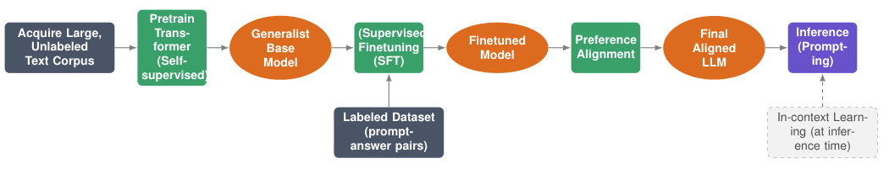
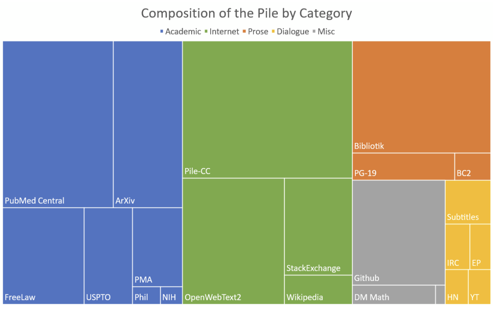
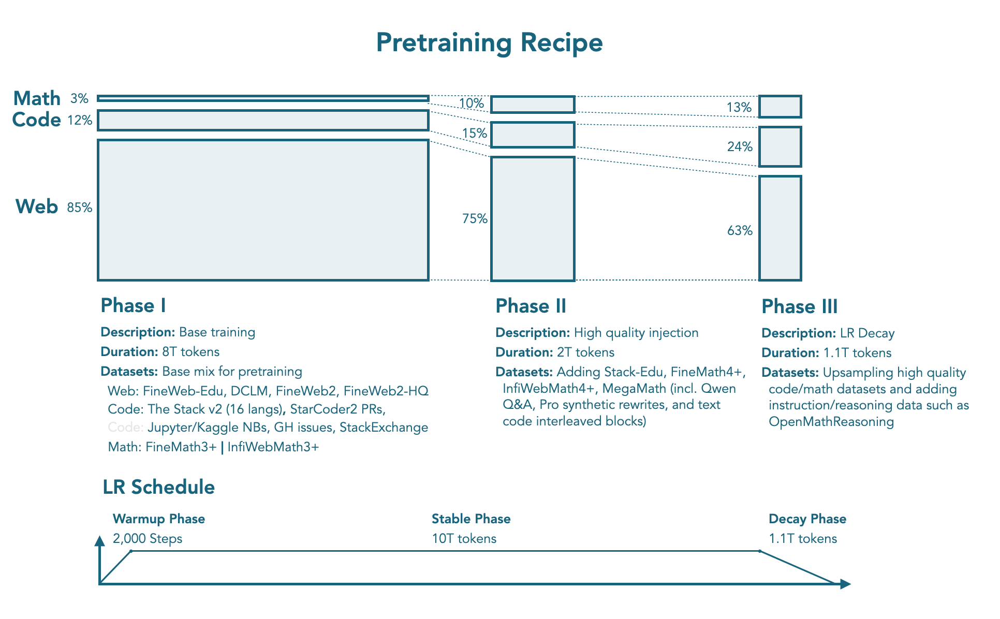
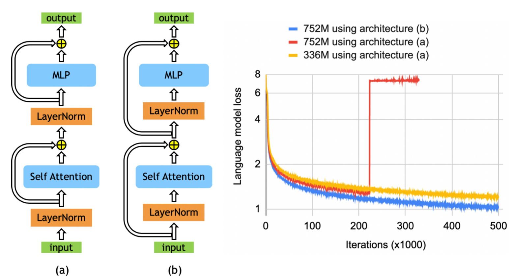
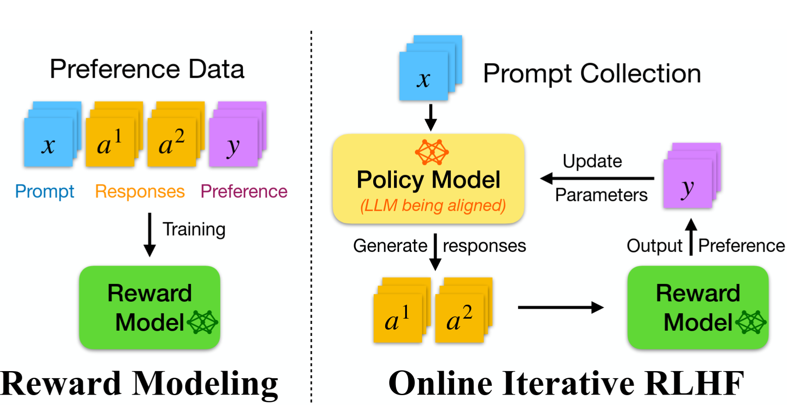
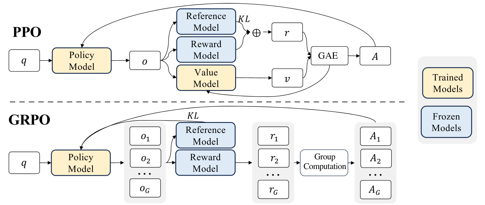

# Chapter 3 The Large Language Model Training Pipeline

[Course index](../../README.md) · [Original source](https://arxiv.org/html/2610.13455v1#Ch3) · [Raw file](../../raw/originals/book.html)

Retrieved: 2026-11-13T16:41:17.579179+00:00

[Contents](../../CONTENTS.md) · [Full book](../book/full-book-html.md) · [Previous chapter](chapter-02-foundations-of-language-modeling-with-llms.md) · [Next chapter](chapter-04-scaling-laws-and-efficient-large-language-models.md)

### Chapter 3 The Large Language Model Training Pipeline

**What You Will Learn**

In this chapter you will learn how language models are trained. Specifically, you will be able to:

- Describe the major stages of a basic training pipeline and explain the purpose of the individual stage: *data acquisition, pretraining, finetuning, preference tuning, and inference*.
- Distinguish *pretraining from finetuning*, and explain why preference tuning is applied after, and not before, them.
- Explain how the *encoder/decoder* distinction shapes which training objective a model uses.
- Identify common *benchmarks* used to evaluate language models, and state what capability each is meant to measure.

#### 3.1 Training Models

The training pipeline of a large language model follows a somewhat standard methodology: starting from a model architecture where the parameters are initialized randomly, we train language capabilities through a process that is called *pretraining*. During pretraining, we feed large text corpora to our models, which they are trained on autoregressively. The result of this stage is a base model, which is generally not yet suited for specific, practical applications. Hence, we need to adapt it to a downstream task or purpose. This stage is called *posttraining*, where we show specific types of additional data to the model using which we elicit task-specific behavior, such as instruction-following or classification settings.

##### 3.1.1 Encoder versus Decoder Models

As we saw in the previous chapter, there are two dominant styles of models. On the one hand, encoder models are able to create rich contextualized representations based on input data. However, most of the recent successes are based on the decoder models. While encoders are better at understanding tasks (classification, sentiment), decoders excel at generative tasks. Decoder models have grown in size, both in terms of number of trainable parameters, and the available training data. This leads to models that are surprisingly capable of generalization to unseen contexts.

Let us have a look in more detail at the relevant steps in the decoder-only training pipeline.

##### 3.1.2 Pretraining/Finetuning Paradigm

A central feature of the success of current training pipelines is the use of transfer learning. One of the standard applications of modern transformer models is to take a model that has been trained on a large, generic dataset, and then retrain it on a new task. The model is *pretrained* on the large, generic, corpus, and then *finetuned* on the new, specific, task, for which a small dataset is present. Finetuning for the new task is quick, since the dataset is small, but also since the pretrained weights have been transferred. The finetuning-training does not have to start from scratch.

This pretraining/finetuning distinction of the transfer learning paradigm is at the heart of large language model training pipelines.
Rather than starting the training from scratch, the model can reuse already-learned linguistic knowledge in new scenarios, thus speeding up the training process. Pretraining of large, commercial models may take months. Usually, the new task is specific (such as question answering in a certain domain, or sentiment analysis). For the new task, a dedicated dataset will be used to finetune the model. During finetuning, a subset of the model’s weights are updated carefully to retain the general linguistic capabilities of the pretrained model, while gaining an understanding of the new task. Finetuning a model to a new task takes typically on the order of minutes to hours.

##### 3.1.3 Open and Closed Models

Popular LLMs are OpenAI’s ChatGPT series [[Achiam et al., 2023](#bibb.bib23), [Ouyang et al., 2022](#bibb.bib7)], Meta’s LLaMa family [[Touvron et al., 2023](#bibb.bib33)], Google’s Gemma [[Chowdhery et al., 2023](#bibb.bib24)] and Gemini
[[Anil et al., 2023](#bibb.bib12)], Anthropic’s Claude family, Moonshot AI’s Kimi, DeepSeek [[Guo et al., 2025](#bibb.bib5)], and Qwen [[Bai et al., 2025](#bibb.bib6)], among others.

There are different degrees of openness between these models. For example, a model’s training data can be made public, the network architecture of a model can be disclosed, and the trained weights can be released. However, the companies behind commercial models seldom publish all elements of their model and training procedure, as they seek to retain some competitive edge.

In response, the scientific community has developed fully open-source models, such as BLOOM [[Le Scao et al., 2023](#bibb.bib14)], Pythia [[Biderman et al., 2023](#bibb.bib13)], and OLMo [[Groeneveld et al., 2024](#bibb.bib4)], to contribute to the collective understanding of how large language models work. Of these models all elements of the training pipeline are public, and they are the focus of this chapter. We also highlight certain aspects of some commercial models.

Although the models are all based on the transformer architecture, there are small differences between individual components and their overall layout, for example to capitalize on hardware differences or specific optimizations developed by their respective creators. For instance, Google optimized Gemini for their TPU-based compute infrastructure [[Jouppi et al., 2023](#bibb.bib34)]. We discuss further improvements to the architecture extensively in Chapter [4](chapter-04-scaling-laws-and-efficient-large-language-models.md#Ch4 "Chapter 4 Scaling Laws and Efficient Large Language Models ‣ Part I Language Modeling ‣ Agentic Large Language Models").

#### 3.2 Training Pipeline

We will now describe in more detail the steps of a standard training pipeline.
LLMs are constructed using an elaborate pipeline with different training phases [[Radford et al., 2019](#bibb.bib26), [Minaee et al., 2024](#bibb.bib32)]. We will describe the phases, as shown in Figure [3.1](#Ch3.F1 "Figure 3.1 ‣ 3.2 Training Pipeline ‣ Chapter 3 The Large Language Model Training Pipeline ‣ Part I Language Modeling ‣ Agentic Large Language Models"). The combinations of individual phases are usually referred to as training *recipes*, as they denote the order in which the models were trained. At each phase, a new dataset may be used, together with a new loss function. Each phase is designed to imbue the model with a specific capability. This will become clear as we discuss the individual phases.

Figure 3.1: 
Overview of the LLM training pipeline [[Radford et al., 2019](#bibb.bib26), [Minaee et al., 2024](#bibb.bib32)].

##### 3.2.1 Acquire Data

The first step in the pipeline is to acquire data. Typically, massive, general-purpose text corpora are used [[Brown et al., 2020](#bibb.bib30)]. The corpora consist of raw text without the need for manual labeling. This data is typically aggregated from both curated and uncurated online sources, then refined through cleaning heuristics to mitigate the effect of harmful, private, or copyrighted content.
The corpora that are used for pretraining are large. Modern LLMs are trained on a web-scale magnitude of data, often reaching the scale of trillions of tokens. Some examples of datasets are:

- 

  Common Crawl: a massive, non-profit snapshot of the web containing billions of pages; alternative sources include <https://archive.org>. While the size is unparalleled, the quality of the data is under discussion [[Baack, 2024](#bibb.bib39)]. Many derivatives, such as C4 (Colossal Clean Crawled Corpus) present a filtered subset of English web text [[Raffel et al., 2020](#bibb.bib40)] to enhance the quality of the data.
- 

  Dolma 3: a data mixture that is designed to maximize performance across a diverse suite of tasks. It is used in the OLMo open source/open data project [[Ettinger et al., 2025](#bibb.bib35), [Soldaini et al., 2024](#bibb.bib36)].
- 

  SmolLM3: utilizes a large three-stage training strategy with 11.2 trillion tokens that dynamically mixes web, math, and code data to optimize reasoning and knowledge acquisition [[Bakouch et al., 2025](#bibb.bib37)].

Recent research emphasizes that data diversity is as critical as size for improving cross-domain knowledge and downstream generalization [[Gao et al., 2020](#bibb.bib38)]. The corpus called *The Pile* has been specifically created as a heterogeneous corpus. For example, models trained on The Pile show significant gains in coding efficiency (Bits Per Byte, BPB)11
1
Bits-Per-Byte is a tokenizer-agnostic metric from information theory that measures the average bits needed per symbol, reflecting coding efficiency, see also Section [3.3.2](#Ch3.S3.SS2 "3.3.2 Metrics ‣ 3.3 Benchmarks, and Performance ‣ Chapter 3 The Large Language Model Training Pipeline ‣ Part I Language Modeling ‣ Agentic Large Language Models"). across disparate domains, such as GitHub repositories, medical papers, and philosophy texts (see Figure [3.2](#Ch3.F2 "Figure 3.2 ‣ 3.2.1 Acquire Data ‣ 3.2 Training Pipeline ‣ Chapter 3 The Large Language Model Training Pipeline ‣ Part I Language Modeling ‣ Agentic Large Language Models")). It is therefore often used as a benchmark, where successful performance on Pile BPB serves as an indicator of a model’s world knowledge and complex reasoning abilities.

Curation of data for pretraining requires defining complex data cleaning pipelines that transform raw data from multiple sources into a single collection of cleaned, plain text documents. Often, this process focuses on quality assurance and safety. The curation process begins with source prioritization, where the mixture is weighted toward high-quality sources such as Wikipedia, books, and other known curated sources. Further, to ensure the integrity of the corpus, researchers apply noise reduction heuristics to strip away boilerplate text, navigation menus, and possibly inappropriate content. Furthermore, de-duplication is performed at both the URL and document levels; this is essential to prevent the model from memorizing redundant information and overfitting on repetitive data.

Beyond accuracy, the pipeline must select data that matches safety and ethical constraints. This too is commonly implemented through heuristic-based filtering. Furthermore, toxicity-detection systems are implemented to remove hate speech, although these methods often yield mixed results. A significant challenge in this phase is bias mitigation, as automated filters can inadvertently flag and suppress legitimate data written in specific dialects, such as African American English, leading to the accidental exclusion of diverse voices from the training set.

Figure 3.2: 
Overview of the data sources inside The Pile dataset [[Gao et al., 2020](#bibb.bib38)].

##### 3.2.2 Pretrain

The second step in the training pipeline is pretraining the model on the curated corpus, a process that yields a generalist natural language model. This stage uses a self-supervised transformer approach [[Vaswani et al., 2017](#bibb.bib31)] on the unlabeled text.

In order to acquire internal representations of language, conceptual semantic relationships, and world knowledge, the model is trained using masked-token cloze-like tasks.
In such tasks the objective is to predict masked tokens conditioned on a preceding context of large corpora of sequences (i.e., representations of text, image patches). This process is self-supervised (no human-annotated data is required) and is known to yield rich representations of language, relations between concepts, and world knowledge, in various forms.

Formally, the language modeling objective maximizes the probability of the tokens in a sentence $\mathcal{U}=\{u_{0},\dots,u_{n}\}$, based on a window $k$ of existing tokens (Equation [3.1](#Ch3.E1 "In 3.2.2 Pretrain ‣ 3.2 Training Pipeline ‣ Chapter 3 The Large Language Model Training Pipeline ‣ Part I Language Modeling ‣ Agentic Large Language Models")). $L(\mathcal{U})$ is the *language modeling loss*.

|  |  |  |  |
| --- | --- | --- | --- |
|  | $$ L(\mathcal{U})=\sum_{i}\log P(u_{i}|u_{i-k},\dots,u_{i-1};\Theta) $$ |  | (3.1) |

Language models estimate these probabilities through trainable parameters $\Theta$, optimized via gradient updates. Given that model sizes range from millions to over a trillion parameters, large datasets are required to ensure convergence. During this training phase, teacher forcing is employed: the model makes a prediction, but the ground-truth token—rather than the model’s own output—is provided as the input for the next step. In contrast, during autoregressive generation at inference time, the model must rely on its own predictions as the input for subsequent tokens. Tokens are created by running the appropriate *tokenizer*, as explained in Section [2.1.4](chapter-02-foundations-of-language-modeling-with-llms.md#Ch2.S1.SS4 "2.1.4 Tokenization ‣ 2.1 Processing Natural Language ‣ Chapter 2 Foundations of Language Modeling with LLMs ‣ Part I Language Modeling ‣ Agentic Large Language Models").

In pretraining, a key challenge is to ensure that the model learns efficiently and remains stable throughout the trillions of gradient updates. Over time, different strategies have evolved that aim to keep the training process under control. One such strategy is curriculum learning. In human learning, we start by learning easy concepts (such as addition) before we tackle more difficult concepts (multiplication, logarithms). In language modeling, this idea is used in data mixtures, or data curricula. Rather than training on all data types simultaneously, researchers select a specific mixture of data sources to train on first, see the example in Figure [3.3](#Ch3.F3 "Figure 3.3 ‣ 3.2.2 Pretrain ‣ 3.2 Training Pipeline ‣ Chapter 3 The Large Language Model Training Pipeline ‣ Part I Language Modeling ‣ Agentic Large Language Models"). Creation of mixtures involves strategically ordering the data according to difficulty. In a training curriculum we start with easy-to-learn general web crawls, and then shift toward harder high-quality reasoning data (math and code) in later stages. The underlying idea is that this helps the model converge quicker on more complex logic [[Bengio et al., 2009](#bibb.bib15)].

Figure 3.3: 
Example data mixtures for training SmolLM3 [[Bakouch et al., 2025](#bibb.bib37)].

Other mechanisms for stabilizing training are employed, as training at this scale is notoriously unstable and prone to loss spikes [[Takase et al., 2025](#bibb.bib41)]. Stability is maintained through standard machine learning techniques such as weight decay, layer normalization, and sophisticated learning rate schedulers. The use of specialized optimizers and the monitoring of gradient norms helps to prevent parameters from diverging during the intensive pretraining process. An example of how switching embedding layers can lead to more stable training is shown in Figure [3.4](#Ch3.F4 "Figure 3.4 ‣ 3.2.2 Pretrain ‣ 3.2 Training Pipeline ‣ Chapter 3 The Large Language Model Training Pipeline ‣ Part I Language Modeling ‣ Agentic Large Language Models"). The left figure shows the training loss for the 336M and 752M BERT model. While the original architecture performs well on the 336M model, the modifications in (b) enable stable training with lower training loss [[Shoeybi et al., 2020](#bibb.bib52)].

Figure 3.4: 
Training loss for the BERT model using the original architecture (a) and a rearranged architecture (b) [[Shoeybi et al., 2020](#bibb.bib52)]

##### 3.2.3 Finetune

After pretraining comes posttraining, of which the first important training step is finetuning.
LLMs are rarely used in an autocomplete generic predict-next-word setting, people rather use them to answer questions, give advice and recall information. Finetuning is the process of taking a pretrained model that has already learned general language patterns, and then train it further on a smaller, more specific dataset. In finetuning, we apply a general model to a specific (narrow) task on a labeled dataset, using a supervised learning approach.
A popular efficient method is low-rank optimization, which finetunes a small subset of the parameters [[Hu et al., 2021](#bibb.bib27), [Wei et al., 2022](#bibb.bib29), [Minaee et al., 2024](#bibb.bib32)].

###### Supervised Finetuning (SFT)

Finetuning can be applied to many specialized tasks. The most general models use *supervised finetuning* to be able to follow instructions and perform reasoning steps [[Ettinger et al., 2025](#bibb.bib35)]. The supervised finetuning step is especially important for smaller models, offering an efficient mechanism for significant improvements in general chat, reasoning, and function-calling capabilities.

Supervised finetuning is also used for more specialized tasks, such as toxicity reduction. WildChat [[Zhao et al., 2024](#bibb.bib42)] provides over a million real-world user-ChatGPT interactions, capturing how humans prompt the LLM with varying complexity and toxicity.

For learning reasoning capabilities, OpenThoughts [[Guha et al., 2025](#bibb.bib43)] contains step-by-step reasoning chains, distilled from advanced models to enhance problem-solving capabilities in math, science, and coding. Human-obtained data is supplemented by synthetic data, which involves generating instructions and responses using larger teacher models (such as GPT-5) to fill specific data gaps and scale up training volume [[Zhang et al., 2026](#bibb.bib44)].

Finetuning does not only pertain to general instruction-following or reasoning. Other tasks can be, for example, translation from one language to another, or question answering in health-care or customer service. Especially for industrial applications, where tasks are narrow and models are smaller, finetuning is a fruitful undertaking.

In Chapter [11](chapter-11-how-agents-use-tools-to-act-in-the-world.md#Ch11 "Chapter 11 How Agents Use Tools to Act in the World ‣ Part IV Tools and Assistants ‣ Agentic Large Language Models") we will discuss the use of tools by LLMs, a central aspect of agentic LLM. The training to use tools also takes place in the supervised finetuning step in the training pipeline
[[Wei et al., 2022](#bibb.bib29), [Minaee et al., 2024](#bibb.bib32)].

Furthermore, finetuning is instrumental in establishing a model’s persona and deepening its expertise. For instance, organizations can train models to adopt a specific tone of voice, for example so that a customer service bot maintains a consistent brand identity, be that empathetic and formal or witty and casual. Finally, the injection of deep domain knowledge enables the model to master the intricate terminology and logic of niche fields, such as industry-specific patent information or debugging proprietary legacy code.

Ultimately, finetuning transforms a generalist predictor into a specialized expert, often allowing smaller, more efficient models to outperform larger foundational models on specific tasks.

##### 3.2.4 Preference Tuning

A problem that surfaced in early models is that training tends to amplify extreme socially unacceptable texts in the training data and run wild, crowding out moderate points of view. Since then, an essential step for LLMs to become socially acceptable, is for pipelines to include a phase in which the model is tuned to behave in socially acceptable ways. This phase is called preference tuning.

In this phase we align the finetuned model with user expectations (preference alignment). The goal of this step is to improve the model to give socially acceptable answers, prevent hate speech, reduce hallucinations, and improve instruction adherence.

Standard methods for preference tuning include reinforcement learning with human feedback (RLHF) [[Ouyang et al., 2022](#bibb.bib7)], which trains a reward model to approximate human values, and direct preference optimization (DPO) [[Rafailov et al., 2024](#bibb.bib28)], which optimizes the policy directly from preference data. A high-level overview of RLHF is shown in Figure [3.5](#Ch3.F5 "Figure 3.5 ‣ 3.2.4 Preference Tuning ‣ 3.2 Training Pipeline ‣ Chapter 3 The Large Language Model Training Pipeline ‣ Part I Language Modeling ‣ Agentic Large Language Models"). To address the bottleneck of human annotation, modern pipelines increasingly utilize reinforcement learning from AI feedback (RLAIF) [[Bai et al., 2022](#bibb.bib51)], where a stronger model generates the preference signals.

Figure 3.5: 
High-level overview of RLHF: training a reward model (left), and optimizing a language model (the policy) with respect to that reward model [Dong et al. [2024]](#bibb.bib50)

Achieving alignment with human values is not an easy task, and we usually distinguish between safety alignment, value alignment and preference alignment. In the latter case, a complication is that preferences are subjective preferences (such as writing style) that change per person.

###### Value alignment

On a higher level, value alignment focuses on ensuring that the model’s underlying principles and worldviews resonate with broad human ethics. Unlike individual preferences, this involves anchoring the model to high-level concepts such as fairness, helpfulness, and honesty. In practice, this means the model is governed by a set of written principles (a *constitution*) to ensure that it adheres to the policies set out by the developer.

However, this value alignment usually leads to a trade-off, where optimizing a model for safety and helpfulness also degrades its performance on other capabilities, such as factual recall or creativity [[Lin et al., 2024](#bibb.bib47)]. This trade-off is otherwise known as the *alignment tax*.

###### Safety alignment

Safety alignment is the process of setting hard boundaries on model behavior to prevent catastrophic or harmful outputs. While preference alignment might focus on tone, and value alignment on viewpoint, safety alignment focuses on adversarial robustness and the refusal of malicious prompts. Example methodologies for ensuring safety includes red teaming, where models are subjected to rigorous jailbreak attempts to identify vulnerabilities, and guard railing, where specific refusal boundaries for high-risk responses are filtered.

###### Objective alignment

Finally, for domains where objective truths exist, such as mathematics or coding, methods known as reinforcement learning with verifiable rewards (RLVR) [[Lambert et al., 2024](#bibb.bib2)] are employed. Unlike standard RLHF, RLVR optimizes for objective correctness by leveraging ground-truth signals to robustly improve reasoning capabilities. Examples include code that compiles, or correct mathematical solutions. In the latter case, the Group Relative Policy Optimization (GRPO) algorithm is often used [[Guo et al., 2025](#bibb.bib5)], a variant of Proximal Policy Optimization (PPO) that enhances mathematical reasoning abilities while concurrently optimizing the memory usage of PPO. It does so by sampling multiple answers from the policy model and using their relative quality (as assessed by a verifier) to compute the rewards. Instead of relying on human labels for learning what counts as a good answer, the model gets direct rewards (+1, or -1) from a deterministic verifier [[Guo et al., 2025](#bibb.bib5), [Shao et al., 2024](#bibb.bib10)], see Figure [3.6](#Ch3.F6 "Figure 3.6 ‣ Objective alignment ‣ 3.2.4 Preference Tuning ‣ 3.2 Training Pipeline ‣ Chapter 3 The Large Language Model Training Pipeline ‣ Part I Language Modeling ‣ Agentic Large Language Models").

Figure 3.6: 
Comparison of RLHF (specifically, PPO) to RLVR (specifically, GRPO) method [[Shao et al., 2024](#bibb.bib10)]

##### 3.2.5 Infer

The final step in the training pipeline is the inference step. This is the step in which the trained model is finally used.
Here the user finally gets to interact with the model. Finally, we can use the fruits of our training efforts.

At inference time, we use natural language prompts (instructions and questions) to obtain responses from the model. Prompting is the preferred way of using LLMs to have the model answer our questions. Inference results can be sensitive to the way that a prompt is formulated. The use of certain words, or re-ordering words in the prompt, can influence the answer of the model. This sensitivity has led to prompt engineering and context engineering, skills that have become important for users of LLMs [[Sahoo et al., 2024](#bibb.bib1)].

Interestingly, as we discussed in the previous chapter, in decoder models whose size is beyond hundreds of billions parameters a new learning method emerges: *in-context learning* (ICL) [[Brown et al., 2020](#bibb.bib30), [Wei et al., 2022](#bibb.bib29)]. In-context learning is a method where the prompt contains a small number of examples, together with an instruction. These examples point the model in a certain direction and it uses them to learn the answer. ICL is a form of within-prompt few-shot learning. ICL is also a type of learning where no parameters of the model are changed—it is example learning without parameter training [[Dong et al., 2022](#bibb.bib25)].

In the remainder of this book we will see many examples of the way in which in-context learning is used, such as in agentic harnesses. Inference-time in-context learning is a major driver of agentic LLM.

##### 3.2.6 Concluding Remarks

We have now described the phases of a typical LLM training pipeline.
Note that the pipeline that we described is an example of a typical approach, and different models are trained in different ways. Current modern training pipelines are elaborate, and training is costly. Innovations to training pipelines are the topic of current research, see, for example, [Guo et al. [2025]](#bibb.bib5), [Du et al. [2025]](#bibb.bib11).

Being able to obtain predictions quickly is key, and multiple techniques have been developed to speed up the process. For instance, is is important to strike a balance between the reasoning effort and response quality. Research into *test time scaling* studies this trade-off. A higher inference-time effort costs more compute time, but may yield a better answer. We discuss these and other optimization techniques in Chapter [4](chapter-04-scaling-laws-and-efficient-large-language-models.md#Ch4 "Chapter 4 Scaling Laws and Efficient Large Language Models ‣ Part I Language Modeling ‣ Agentic Large Language Models").

#### 3.3 Benchmarks, and Performance

After the pipeline has been used to train the model, we wish to find out how well the model performs.
LLMs are created using a variety of modeling techniques, for different tasks, on different datasets. As a result, they have often obtained remarkable capabilities. For example, LLMs perform well on natural language understanding tasks (GLUE, SQUAD, Xsum) [[Wang et al., 2018](#bibb.bib8), [Wang et al., 2019](#bibb.bib20), [Rajpurkar et al., 2016](#bibb.bib19), [Narayan et al., 2018](#bibb.bib21)], translation [[Kocmi et al., 2022](#bibb.bib22), [Papineni et al., 2002](#bibb.bib18), [Sennrich et al., 2015](#bibb.bib17)], question answering tasks [[Roberts et al., 2020](#bibb.bib16)], and poetry composition [[Zhang and Eger, 2024](#bibb.bib9)], to name just a few domains. The broad applicability of LLMs shows their versatility, although the rapid development of the field, as well as ongoing research efforts, raise many open questions related to the capabilities of LLMs in many domains and contexts.

We will now discuss benchmarks that are commonly used to test the performance of our models.

##### 3.3.1 Common tasks

Let us have a closer look at some common LLM tasks. The tasks can largely be grouped under the two language processing categories that we introduced previously: natural language understanding (NLU) and natural language generation (NLG).
Depending on the category, the exact task formulation, and the underlying data, the performance metric will differ. We will discuss each separately.

Note that *performance* is an ambiguous term. In NLP, it is often used in the context of *task performance* (accuracy), instead of *computational performance* (speed). While exact evaluation criteria differ depending on the task, modern evaluation practices primarily focus on task performance. However, how many of the calls to the LLM we make, and how quickly we can get responses from the model, is also important to achieve high scores on contemporary benchmarks, as we will see in later chapters.

##### 3.3.2 Metrics

In order to monitor or report the (task) performance of LLMs, different metrics are used, depending on the stage of the training that we are in.

###### Pretraining Metrics

In pretraining, we are mostly interested in knowing whether the model is able to accurately predict the next word. The standard metric is *perplexity*, shown in Equation [3.2](#Ch3.E2 "In Pretraining Metrics ‣ 3.3.2 Metrics ‣ 3.3 Benchmarks, and Performance ‣ Chapter 3 The Large Language Model Training Pipeline ‣ Part I Language Modeling ‣ Agentic Large Language Models"). Perplexity measures the model’s uncertainty when predicting the next token, and is directly related to the cross-entropy loss function. Low perplexity indicates that the model assigns high probability to the correct next tokens. For perplexity, lower is better.

|  |  |  |  |
| --- | --- | --- | --- |
|  | $$ \text{PPL}(X)=\exp\left(-\frac{1}{N}\sum_{i=1}^{N}\log P(x_{i}\mid x_{<i})\right) $$ |  | (3.2) |

|  |  |  |  |
| --- | --- | --- | --- |
|  | $$ \text{BPB}=-\frac{1}{B}\sum_{i=1}^{N}\log_{2}P(x_{i}\mid x_{<i}) $$ |  | (3.3) |

Perplexity is computed over tokens; adjusting perplexity to stick to word boundaries needs careful normalization [[Pimentel and Meister, 2024](#bibb.bib48)]. Moreover, even when adjusted, it is still tokenizer-specific, as other tokenizers can lead to other subwords and hence other probability distributions.

As an alternative, *bits-per-byte* (BPB), shown in Equation [3.3](#Ch3.E3 "In Pretraining Metrics ‣ 3.3.2 Metrics ‣ 3.3 Benchmarks, and Performance ‣ Chapter 3 The Large Language Model Training Pipeline ‣ Part I Language Modeling ‣ Agentic Large Language Models"), normalizes the loss to the byte level, which enables fair comparisons between models that use different tokenization schemes [[Borgeaud et al., 2022](#bibb.bib49)]. It measures the average number of bits required to encode a single byte of data.

###### Posttraining Metrics

In posttraining and inference, when the model is used for problem solving, generation, or reasoning, we look at the deterministic success rates, based on ground truth data. Often, tasks are set up in multiple-choice question/answering formats, where there is a single correct answer. For these types of tasks, we commonly report *accuracy*, the percentage of questions for which a correct response is given. For accuracy, higher is better.

In the regular setup, the model needs to provide an answer in one unique attempt. However, since sampling from a language model is a stochastic process, we may request additional attempts, and see if the answer is among them. This is formalized in the *Pass@K* metric: the percentage of problems solved correctly on the model’s $K$th attempt; higher is better. Common values for $K$ include 1, 5, 10, 100.

##### 3.3.3 Common Benchmarks

While measuring the performance of LLMs remains an active area of research, many datasets have become commonplace for reporting their general capabilities. These datasets are designed to only be used for *evaluating* the quality of a model, and are not intended as additional training data. As such, they serve as semi-standardized benchmarks. Ongoing efforts for moving to field standards, such as MLCommons [[Thiyagalingam et al., 2022](#bibb.bib3)], show an increasing need for objective and sound evaluation setups.

| **Benchmark Name** | **Capability Tested** | **Task Format** | **Metric** |
| --- | --- | --- | --- |
| **Humanity’s Last Exam (HLE)** | General Intelligence, Multimodal Reasoning | Short-Answer, Multiple-Choice | Pass@1 |
| **Abstract Reasoning Challenge (ARC)** | General Intelligence | Visual Grid Pattern Completion | Pass@1 (Private Set) |
| **GPQA Diamond** | Expert-Level STEM Reasoning | Multiple-Choice | Pass@1 |
| **AIME 2025** | Advanced Mathematical Reasoning | Integer Answer (0-999) | Pass@1 |
| **SWE-Bench** | Agentic Coding, Real-World Software Engineering | Code Patch Generation | Pass@1 |
| **Fortress** | AI Safety, National Security Risk Assessment | Varies (Proprietary) | Avg Risk Score (ARS) & Over-Refusal Score (ORS) |
| **MMLU** | Broad General Knowledge | Multiple-Choice | Pass@1 |
| **GSM8K** | Grade-School Mathematical Reasoning | Multi-Step Arithmetic | Pass@1 |
| **TruthfulQA** | Factual Correctness, Hallucination Detection | Question Answering | Pass@1 |

Table 3.1: Overview of common LLM benchmarks with the metrics reported on them

###### Data Contamination

Modern benchmarks run a risk of data contamination [[Balloccu et al., 2024](#bibb.bib46)].
As pretraining data increases in size (often a considerable ratio of the total size of the internet), the line between in- and out-of-domain data becomes increasingly blurred, especially given that commercial vendors often do not specify the sources of their training data (either out of commercial interest or for other reasons). Hence, when we wish to measure true generalization to unseen data, we need to ensure that the model has not seen the data before (we wish to prevent *data contamination*).

It is common for benchmarks to host a public, freely accessible dataset for quick experimentation by developers, but to maintain a private dataset that commercial vendors have restricted access to, to prevent data contamination. Furthermore, in order to maintain the benchmark’s usefulness into the future, developers often actively update the samples in the benchmark.

In Table [3.1](#Ch3.T1 "Table 3.1 ‣ 3.3.3 Common Benchmarks ‣ 3.3 Benchmarks, and Performance ‣ Chapter 3 The Large Language Model Training Pipeline ‣ Part I Language Modeling ‣ Agentic Large Language Models"), we provide a non-exhaustive list of general-purpose benchmarks that are popular at the time of writing.

#### 3.4 Concluding Remarks

In the field of LLM development, it has become common for commercial LLM developers (such as Anthropic, OpenAI, Google, DeepSeek, Mistral) to publish a tech report that informs the expert public on how the model behaves across popular benchmarks. Often, such as tech report is published as a preprint, without going through academic peer-review, and many details that would be necessary for full scientific reproducibility (such as data recipe, model architecture) are left out, for commercial reasons. Nonetheless, these reports provide useful information to derive insights into what LLMs can and cannot do.

First, we find that modern LLMs demonstrate a distinct performance hierarchy across benchmarks, as they have effectively solved broad knowledge tasks, but still struggle to master complex reasoning and autonomous agentic tasks. On static knowledge and professional exam benchmarks (such as MMLU and TruthfulQA), frontier models (such as GPT-5.2, Gemini 3 Pro, and Claude 4.5 Opus) have reached, at the time of writing, near-saturation, consistently scoring above 85–90% and surpassing human expert baselines.

The newest generation of reasoning models (such as OpenAI’s o1, DeepSeek-R1, and Qwen-3.5) have recently achieved great progress, pushing math and science pass rates from low percentages to expert levels. Despite these advances, the software engineering SWE-bench remains the ultimate stress test for reliability; while scores have risen from negligible (¡2%) to respectable levels (40-50% on verified subsets) for top coding agents, the gap between answering a coding question and autonomously fixing a real-world repository issue remains a significant hurdle for modern AI.

###### Open Questions

Open questions about the origin of LLMs capabilities still remain. As the pipelines have grown complex, both in terms of training (*What data matters? What training steps are most important?*) and inference (*How to extract high quality reasoning traces?*), drawing conclusions is difficult. For example, it is an open question whether pretraining or posttraining is more important, and whether knowledge comes mostly from pretraining, and posttraining only serves for finding a good task interface [[Zhou et al., 2023](#bibb.bib45)].

The remaining parts of this book will discuss posttraining and inference-time reasoning methods and agent training methods. But first, we will look at scaling laws, in the next chapter.

### References

- Achiam et al. (2023)
  J. Achiam, S. Adler, S. Agarwal, L. Ahmad, I. Akkaya, F. L. Aleman, D. Almeida, J. Altenschmidt, S. Altman, S. Anadkat, et al.
  Gpt-4 technical report.
  arXiv preprint arXiv:2303.08774.
  Cited by: [§3.1.3](#Ch3.S1.SS3.p1.1 "3.1.3 Open and Closed Models ‣ 3.1 Training Models ‣ Chapter 3 The Large Language Model Training Pipeline ‣ Part I Language Modeling ‣ Agentic Large Language Models").

- Anil et al. (2023)
  R. Anil, S. Borgeaud, J. Alayrac, J. Yu, R. Soricut, J. Schalkwyk, A. M. Dai, A. Hauth, K. Millican, et al.
  Gemini: a family of highly capable multimodal models.
  arXiv preprint arXiv:2312.11805.
  Cited by: [§3.1.3](#Ch3.S1.SS3.p1.1 "3.1.3 Open and Closed Models ‣ 3.1 Training Models ‣ Chapter 3 The Large Language Model Training Pipeline ‣ Part I Language Modeling ‣ Agentic Large Language Models").

- Baack (2024)
  S. Baack
  A critical analysis of the largest source for generative ai training data: common crawl.
  In Proceedings of the 2024 ACM Conference on Fairness, Accountability, and Transparency,
  pp. 2199–2208.
  Cited by: [1st item](#Ch3.S2.I1.i1.p1.1 "In 3.2.1 Acquire Data ‣ 3.2 Training Pipeline ‣ Chapter 3 The Large Language Model Training Pipeline ‣ Part I Language Modeling ‣ Agentic Large Language Models").

- Bai et al. (2025)
  S. Bai, K. Chen, X. Liu, J. Wang, W. Ge, S. Song, K. Dang, P. Wang, S. Wang, J. Tang, et al.
  Qwen2. 5-vl technical report.
  arXiv preprint arXiv:2502.13923.
  Cited by: [§3.1.3](#Ch3.S1.SS3.p1.1 "3.1.3 Open and Closed Models ‣ 3.1 Training Models ‣ Chapter 3 The Large Language Model Training Pipeline ‣ Part I Language Modeling ‣ Agentic Large Language Models").

- Bai et al. (2022)
  Y. Bai, S. Kadavath, S. Kundu, A. Askell, J. Kernion, A. Jones, A. Chen, A. Goldie, A. Mirhoseini, C. McKinnon, et al.
  Constitutional ai: harmlessness from ai feedback.
  arXiv preprint arXiv:2212.08073.
  Cited by: [§3.2.4](#Ch3.S2.SS4.p3.1 "3.2.4 Preference Tuning ‣ 3.2 Training Pipeline ‣ Chapter 3 The Large Language Model Training Pipeline ‣ Part I Language Modeling ‣ Agentic Large Language Models").

- Bakouch et al. (2025)
  E. Bakouch, L. Ben Allal, A. Lozhkov, N. Tazi, L. Tunstall, C. M. Patiño, E. Beeching, A. Roucher, A. J. Reedi, Q. Gallouédec, K. Rasul, N. Habib, C. Fourrier, H. Kydlicek, G. Penedo, H. Larcher, M. Morlon, V. Srivastav, J. Lochner, X. Nguyen, C. Raffel, L. von Werra, and T. Wolf
  SmolLM3: smol, multilingual, long-context reasoner.
  Note: <https://huggingface.co/blog/smollm3>
  Cited by: [Figure 3.3](#Ch3.F3 "In 3.2.2 Pretrain ‣ 3.2 Training Pipeline ‣ Chapter 3 The Large Language Model Training Pipeline ‣ Part I Language Modeling ‣ Agentic Large Language Models"),
  [Figure 3.3](#Ch3.F3.4 "In 3.2.2 Pretrain ‣ 3.2 Training Pipeline ‣ Chapter 3 The Large Language Model Training Pipeline ‣ Part I Language Modeling ‣ Agentic Large Language Models"),
  [3rd item](#Ch3.S2.I1.i3.p1.1 "In 3.2.1 Acquire Data ‣ 3.2 Training Pipeline ‣ Chapter 3 The Large Language Model Training Pipeline ‣ Part I Language Modeling ‣ Agentic Large Language Models").

- Balloccu et al. (2024)
  S. Balloccu, P. Schmidtová, M. Lango, and O. Dusek
  Leak, cheat, repeat: data contamination and evaluation malpractices in closed-source LLMs.
  In Proceedings of the 18th Conference of the European Chapter of the Association for Computational Linguistics (Volume 1: Long Papers), Y. Graham and M. Purver (Eds.),
  St. Julian’s, Malta, pp. 67–93.
  External Links: [Link](https://aclanthology.org/2024.eacl-long.5/),
  [Document](https://dx.doi.org/10.18653/v1/2024.eacl-long.5)
  Cited by: [§3.3.3](#Ch3.S3.SS3.SSS0.Px1.p1.1 "Data Contamination ‣ 3.3.3 Common Benchmarks ‣ 3.3 Benchmarks, and Performance ‣ Chapter 3 The Large Language Model Training Pipeline ‣ Part I Language Modeling ‣ Agentic Large Language Models").

- Bengio et al. (2009)
  Y. Bengio, J. Louradour, R. Collobert, and J. Weston
  Curriculum learning.
  In Proceedings of the 26th annual international conference on machine learning,
  pp. 41–48.
  Cited by: [§3.2.2](#Ch3.S2.SS2.p6.1 "3.2.2 Pretrain ‣ 3.2 Training Pipeline ‣ Chapter 3 The Large Language Model Training Pipeline ‣ Part I Language Modeling ‣ Agentic Large Language Models").

- Biderman et al. (2023)
  S. Biderman, H. Schoelkopf, Q. G. Anthony, H. Bradley, K. O’Brien, E. Hallahan, M. A. Khan, S. Purohit, U. S. Prashanth, E. Raff, et al.
  Pythia: a suite for analyzing large language models across training and scaling.
  In International Conference on Machine Learning,
  pp. 2397–2430.
  Cited by: [§3.1.3](#Ch3.S1.SS3.p3.1 "3.1.3 Open and Closed Models ‣ 3.1 Training Models ‣ Chapter 3 The Large Language Model Training Pipeline ‣ Part I Language Modeling ‣ Agentic Large Language Models").

- Borgeaud et al. (2022)
  S. Borgeaud, A. Mensch, J. Hoffmann, T. Cai, E. Rutherford, K. Millican, G. B. Van Den Driessche, J. Lespiau, B. Damoc, A. Clark, D. De Las Casas, A. Guy, J. Menick, R. Ring, T. Hennigan, S. Huang, L. Maggiore, C. Jones, A. Cassirer, A. Brock, M. Paganini, G. Irving, O. Vinyals, S. Osindero, K. Simonyan, J. Rae, E. Elsen, and L. Sifre
  Improving language models by retrieving from trillions of tokens.
  In Proceedings of the 39th International Conference on Machine Learning, K. Chaudhuri, S. Jegelka, L. Song, C. Szepesvari, G. Niu, and S. Sabato (Eds.),
  Proceedings of Machine Learning Research, Vol. 162, pp. 2206–2240.
  External Links: [Link](https://proceedings.mlr.press/v162/borgeaud22a.html)
  Cited by: [§3.3.2](#Ch3.S3.SS2.SSS0.Px1.p4.1 "Pretraining Metrics ‣ 3.3.2 Metrics ‣ 3.3 Benchmarks, and Performance ‣ Chapter 3 The Large Language Model Training Pipeline ‣ Part I Language Modeling ‣ Agentic Large Language Models").

- Brown et al. (2020)
  T. Brown, B. Mann, N. Ryder, M. Subbiah, J. D. Kaplan, P. Dhariwal, A. Neelakantan, P. Shyam, G. Sastry, A. Askell, et al.
  Language models are few-shot learners.
  Advances in neural information processing systems 33, pp. 1877–1901.
  Cited by: [§3.2.1](#Ch3.S2.SS1.p1.1 "3.2.1 Acquire Data ‣ 3.2 Training Pipeline ‣ Chapter 3 The Large Language Model Training Pipeline ‣ Part I Language Modeling ‣ Agentic Large Language Models"),
  [§3.2.5](#Ch3.S2.SS5.p3.1 "3.2.5 Infer ‣ 3.2 Training Pipeline ‣ Chapter 3 The Large Language Model Training Pipeline ‣ Part I Language Modeling ‣ Agentic Large Language Models").

- Chowdhery et al. (2023)
  A. Chowdhery, S. Narang, J. Devlin, M. Bosma, G. Mishra, A. Roberts, P. Barham, H. W. Chung, C. Sutton, S. Gehrmann, et al.
  Palm: scaling language modeling with pathways.
  Journal of Machine Learning Research 24 (240), pp. 1–113.
  Cited by: [§3.1.3](#Ch3.S1.SS3.p1.1 "3.1.3 Open and Closed Models ‣ 3.1 Training Models ‣ Chapter 3 The Large Language Model Training Pipeline ‣ Part I Language Modeling ‣ Agentic Large Language Models").

- Dong et al. (2024)
  H. Dong, W. Xiong, B. Pang, H. Wang, H. Zhao, Y. Zhou, N. Jiang, D. Sahoo, C. Xiong, and T. Zhang
  RLHF workflow: from reward modeling to online RLHF.
  Transactions on Machine Learning Research.
  Note: 
  External Links: ISSN 2835-8856,
  [Link](https://openreview.net/forum?id=a13aYUU9eU)
  Cited by: [Figure 3.5](#Ch3.F5 "In 3.2.4 Preference Tuning ‣ 3.2 Training Pipeline ‣ Chapter 3 The Large Language Model Training Pipeline ‣ Part I Language Modeling ‣ Agentic Large Language Models"),
  [Figure 3.5](#Ch3.F5.4 "In 3.2.4 Preference Tuning ‣ 3.2 Training Pipeline ‣ Chapter 3 The Large Language Model Training Pipeline ‣ Part I Language Modeling ‣ Agentic Large Language Models").

- Dong et al. (2022)
  Q. Dong, L. Li, D. Dai, C. Zheng, Z. Wu, B. Chang, X. Sun, J. Xu, and Z. Sui
  A survey on in-context learning.
  arXiv preprint arXiv:2301.00234.
  Cited by: [§3.2.5](#Ch3.S2.SS5.p3.1 "3.2.5 Infer ‣ 3.2 Training Pipeline ‣ Chapter 3 The Large Language Model Training Pipeline ‣ Part I Language Modeling ‣ Agentic Large Language Models").

- Du et al. (2025)
  A. Du, B. Gao, B. Xing, C. Jiang, C. Chen, C. Li, C. Xiao, C. Du, C. Liao, et al.
  Kimi k1.5: scaling reinforcement learning with llms.
  arXiv preprint arXiv:2501.12599.
  Cited by: [§3.2.6](#Ch3.S2.SS6.p1.1 "3.2.6 Concluding Remarks ‣ 3.2 Training Pipeline ‣ Chapter 3 The Large Language Model Training Pipeline ‣ Part I Language Modeling ‣ Agentic Large Language Models").

- Ettinger et al. (2025)
  A. Ettinger, A. Bertsch, B. Kuehl, D. Graham, D. Heineman, D. Groeneveld, F. Brahman, F. Timbers, H. Ivison, J. Morrison, J. Poznanski, K. Lo, L. Soldaini, M. Jordan, M. Chen, M. Noukhovitch, N. Lambert, et al.
  Olmo 3.
  External Links: 2512.13961,
  [Link](https://arxiv.org/abs/2512.13961)
  Cited by: [2nd item](#Ch3.S2.I1.i2.p1.1 "In 3.2.1 Acquire Data ‣ 3.2 Training Pipeline ‣ Chapter 3 The Large Language Model Training Pipeline ‣ Part I Language Modeling ‣ Agentic Large Language Models"),
  [§3.2.3](#Ch3.S2.SS3.SSS0.Px1.p1.1 "Supervised Finetuning (SFT) ‣ 3.2.3 Finetune ‣ 3.2 Training Pipeline ‣ Chapter 3 The Large Language Model Training Pipeline ‣ Part I Language Modeling ‣ Agentic Large Language Models").

- Gao et al. (2020)
  L. Gao, S. Biderman, S. Black, L. Golding, T. Hoppe, C. Foster, J. Phang, H. He, A. Thite, N. Nabeshima, S. Presser, and C. Leahy
  The pile: an 800gb dataset of diverse text for language modeling.
  External Links: 2101.00027,
  [Link](https://arxiv.org/abs/2101.00027)
  Cited by: [Figure 3.2](#Ch3.F2 "In 3.2.1 Acquire Data ‣ 3.2 Training Pipeline ‣ Chapter 3 The Large Language Model Training Pipeline ‣ Part I Language Modeling ‣ Agentic Large Language Models"),
  [Figure 3.2](#Ch3.F2.4 "In 3.2.1 Acquire Data ‣ 3.2 Training Pipeline ‣ Chapter 3 The Large Language Model Training Pipeline ‣ Part I Language Modeling ‣ Agentic Large Language Models"),
  [§3.2.1](#Ch3.S2.SS1.p2.1 "3.2.1 Acquire Data ‣ 3.2 Training Pipeline ‣ Chapter 3 The Large Language Model Training Pipeline ‣ Part I Language Modeling ‣ Agentic Large Language Models").

- Groeneveld et al. (2024)
  D. Groeneveld, I. Beltagy, P. Walsh, A. Bhagia, R. Kinney, O. Tafjord, A. H. Jha, H. Ivison, I. Magnusson, Y. Wang, S. Arora, D. Atkinson, R. Authur, K. R. Chandu, A. Cohan, J. Dumas, Y. Elazar, Y. Gu, J. Hessel, T. Khot, W. Merrill, J. Morrison, N. Muennighoff, A. Naik, C. Nam, M. E. Peters, V. Pyatkin, A. Ravichander, D. Schwenk, S. Shah, W. Smith, E. Strubell, N. Subramani, M. Wortsman, P. Dasigi, N. Lambert, K. Richardson, L. Zettlemoyer, J. Dodge, K. Lo, L. Soldaini, N. A. Smith, and H. Hajishirzi
  OLMo: accelerating the science of language models.
  External Links: 2402.00838,
  [Link](https://arxiv.org/abs/2402.00838)
  Cited by: [§3.1.3](#Ch3.S1.SS3.p3.1 "3.1.3 Open and Closed Models ‣ 3.1 Training Models ‣ Chapter 3 The Large Language Model Training Pipeline ‣ Part I Language Modeling ‣ Agentic Large Language Models").

- Guha et al. (2025)
  E. Guha, R. Marten, S. Keh, N. Raoof, G. Smyrnis, H. Bansal, M. Nezhurina, J. Mercat, T. Vu, Z. Sprague, et al.
  OpenThoughts: data recipes for reasoning models.
  arXiv preprint arXiv:2506.04178.
  Cited by: [§3.2.3](#Ch3.S2.SS3.SSS0.Px1.p3.1 "Supervised Finetuning (SFT) ‣ 3.2.3 Finetune ‣ 3.2 Training Pipeline ‣ Chapter 3 The Large Language Model Training Pipeline ‣ Part I Language Modeling ‣ Agentic Large Language Models").

- Guo et al. (2025)
  D. Guo, D. Yang, H. Zhang, J. Song, R. Zhang, R. Xu, Q. Zhu, S. Ma, P. Wang, X. Bi, et al.
  Deepseek-r1: incentivizing reasoning capability in llms via reinforcement learning.
  arXiv preprint arXiv:2501.12948.
  Cited by: [§3.1.3](#Ch3.S1.SS3.p1.1 "3.1.3 Open and Closed Models ‣ 3.1 Training Models ‣ Chapter 3 The Large Language Model Training Pipeline ‣ Part I Language Modeling ‣ Agentic Large Language Models"),
  [§3.2.4](#Ch3.S2.SS4.SSS0.Px3.p1.1 "Objective alignment ‣ 3.2.4 Preference Tuning ‣ 3.2 Training Pipeline ‣ Chapter 3 The Large Language Model Training Pipeline ‣ Part I Language Modeling ‣ Agentic Large Language Models"),
  [§3.2.6](#Ch3.S2.SS6.p1.1 "3.2.6 Concluding Remarks ‣ 3.2 Training Pipeline ‣ Chapter 3 The Large Language Model Training Pipeline ‣ Part I Language Modeling ‣ Agentic Large Language Models").

- Hu et al. (2021)
  E. J. Hu, Y. Shen, P. Wallis, Z. Allen-Zhu, Y. Li, S. Wang, L. Wang, and W. Chen
  Lora: low-rank adaptation of large language models.
  arXiv preprint arXiv:2106.09685.
  Cited by: [§3.2.3](#Ch3.S2.SS3.p1.1 "3.2.3 Finetune ‣ 3.2 Training Pipeline ‣ Chapter 3 The Large Language Model Training Pipeline ‣ Part I Language Modeling ‣ Agentic Large Language Models").

- Jouppi et al. (2023)
  N. Jouppi, G. Kurian, S. Li, P. Ma, R. Nagarajan, L. Nai, N. Patil, S. Subramanian, A. Swing, B. Towles, et al.
  Tpu v4: an optically reconfigurable supercomputer for machine learning with hardware support for embeddings.
  In Proceedings of the 50th annual international symposium on computer architecture,
  pp. 1–14.
  Cited by: [§3.1.3](#Ch3.S1.SS3.p4.1 "3.1.3 Open and Closed Models ‣ 3.1 Training Models ‣ Chapter 3 The Large Language Model Training Pipeline ‣ Part I Language Modeling ‣ Agentic Large Language Models").

- Kocmi et al. (2022)
  T. Kocmi, R. Bawden, O. Bojar, A. Dvorkovich, C. Federmann, M. Fishel, T. Gowda, Y. Graham, R. Grundkiewicz, B. Haddow, et al.
  Findings of the 2022 conference on machine translation (wmt22).
  In Proceedings of the Seventh Conference on Machine Translation (WMT),
  pp. 1–45.
  Cited by: [§3.3](#Ch3.S3.p1.1 "3.3 Benchmarks, and Performance ‣ Chapter 3 The Large Language Model Training Pipeline ‣ Part I Language Modeling ‣ Agentic Large Language Models").

- Lambert et al. (2024)
  N. Lambert, J. Morrison, V. Pyatkin, S. Huang, H. Ivison, F. Brahman, L. J. V. Miranda, A. Liu, N. Dziri, S. Lyu, et al.
  Tulu 3: pushing frontiers in open language model post-training.
  arXiv preprint arXiv:2411.15124.
  Cited by: [§3.2.4](#Ch3.S2.SS4.SSS0.Px3.p1.1 "Objective alignment ‣ 3.2.4 Preference Tuning ‣ 3.2 Training Pipeline ‣ Chapter 3 The Large Language Model Training Pipeline ‣ Part I Language Modeling ‣ Agentic Large Language Models").

- Le Scao et al. (2023)
  T. Le Scao, A. Fan, C. Akiki, E. Pavlick, S. Ilić, D. Hesslow, R. Castagné, A. S. Luccioni, F. Yvon, M. Gallé, et al.
  Bloom: a 176b-parameter open-access multilingual language model.
  Cited by: [§3.1.3](#Ch3.S1.SS3.p3.1 "3.1.3 Open and Closed Models ‣ 3.1 Training Models ‣ Chapter 3 The Large Language Model Training Pipeline ‣ Part I Language Modeling ‣ Agentic Large Language Models").

- Lin et al. (2024)
  Y. Lin, H. Lin, W. Xiong, S. Diao, J. Liu, J. Zhang, R. Pan, H. Wang, W. Hu, H. Zhang, et al.
  Mitigating the alignment tax of rlhf.
  In Proceedings of the 2024 Conference on Empirical Methods in Natural Language Processing,
  pp. 580–606.
  Cited by: [§3.2.4](#Ch3.S2.SS4.SSS0.Px1.p2.1 "Value alignment ‣ 3.2.4 Preference Tuning ‣ 3.2 Training Pipeline ‣ Chapter 3 The Large Language Model Training Pipeline ‣ Part I Language Modeling ‣ Agentic Large Language Models").

- Minaee et al. (2024)
  S. Minaee, T. Mikolov, N. Nikzad, M. Chenaghlu, R. Socher, X. Amatriain, and J. Gao
  Large language models: a survey.
  arXiv preprint arXiv:2402.06196.
  Cited by: [Figure 3.1](#Ch3.F1 "In 3.2 Training Pipeline ‣ Chapter 3 The Large Language Model Training Pipeline ‣ Part I Language Modeling ‣ Agentic Large Language Models"),
  [Figure 3.1](#Ch3.F1.4 "In 3.2 Training Pipeline ‣ Chapter 3 The Large Language Model Training Pipeline ‣ Part I Language Modeling ‣ Agentic Large Language Models"),
  [§3.2.3](#Ch3.S2.SS3.SSS0.Px1.p5.1 "Supervised Finetuning (SFT) ‣ 3.2.3 Finetune ‣ 3.2 Training Pipeline ‣ Chapter 3 The Large Language Model Training Pipeline ‣ Part I Language Modeling ‣ Agentic Large Language Models"),
  [§3.2.3](#Ch3.S2.SS3.p1.1 "3.2.3 Finetune ‣ 3.2 Training Pipeline ‣ Chapter 3 The Large Language Model Training Pipeline ‣ Part I Language Modeling ‣ Agentic Large Language Models"),
  [§3.2](#Ch3.S2.p1.1 "3.2 Training Pipeline ‣ Chapter 3 The Large Language Model Training Pipeline ‣ Part I Language Modeling ‣ Agentic Large Language Models").

- Narayan et al. (2018)
  S. Narayan, S. B. Cohen, and M. Lapata
  Don’t give me the details, just the summary! topic-aware convolutional neural networks for extreme summarization.
  arXiv preprint arXiv:1808.08745.
  Cited by: [§3.3](#Ch3.S3.p1.1 "3.3 Benchmarks, and Performance ‣ Chapter 3 The Large Language Model Training Pipeline ‣ Part I Language Modeling ‣ Agentic Large Language Models").

- Ouyang et al. (2022)
  L. Ouyang, J. Wu, X. Jiang, D. Almeida, C. Wainwright, P. Mishkin, C. Zhang, S. Agarwal, K. Slama, A. Ray, et al.
  Training language models to follow instructions with human feedback.
  Advances in Neural Information Processing Systems 35, pp. 27730–27744.
  Cited by: [§3.1.3](#Ch3.S1.SS3.p1.1 "3.1.3 Open and Closed Models ‣ 3.1 Training Models ‣ Chapter 3 The Large Language Model Training Pipeline ‣ Part I Language Modeling ‣ Agentic Large Language Models"),
  [§3.2.4](#Ch3.S2.SS4.p3.1 "3.2.4 Preference Tuning ‣ 3.2 Training Pipeline ‣ Chapter 3 The Large Language Model Training Pipeline ‣ Part I Language Modeling ‣ Agentic Large Language Models").

- Papineni et al. (2002)
  K. Papineni, S. Roukos, T. Ward, and W. Zhu
  Bleu: a method for automatic evaluation of machine translation.
  In Proceedings of the 40th annual meeting of the Association for Computational Linguistics,
  pp. 311–318.
  Cited by: [§3.3](#Ch3.S3.p1.1 "3.3 Benchmarks, and Performance ‣ Chapter 3 The Large Language Model Training Pipeline ‣ Part I Language Modeling ‣ Agentic Large Language Models").

- Pimentel and Meister (2024)
  T. Pimentel and C. Meister
  How to compute the probability of a word.
  In Proceedings of the 2024 Conference on Empirical Methods in Natural Language Processing, Y. Al-Onaizan, M. Bansal, and Y. Chen (Eds.),
  Miami, Florida, USA, pp. 18358–18375.
  External Links: [Link](https://aclanthology.org/2024.emnlp-main.1020/),
  [Document](https://dx.doi.org/10.18653/v1/2024.emnlp-main.1020)
  Cited by: [§3.3.2](#Ch3.S3.SS2.SSS0.Px1.p3.1 "Pretraining Metrics ‣ 3.3.2 Metrics ‣ 3.3 Benchmarks, and Performance ‣ Chapter 3 The Large Language Model Training Pipeline ‣ Part I Language Modeling ‣ Agentic Large Language Models").

- Radford et al. (2019)
  A. Radford, J. Wu, R. Child, D. Luan, D. Amodei, I. Sutskever, et al.
  Language models are unsupervised multitask learners.
  OpenAI blog 1 (8), pp. 9.
  Cited by: [Figure 3.1](#Ch3.F1 "In 3.2 Training Pipeline ‣ Chapter 3 The Large Language Model Training Pipeline ‣ Part I Language Modeling ‣ Agentic Large Language Models"),
  [Figure 3.1](#Ch3.F1.4 "In 3.2 Training Pipeline ‣ Chapter 3 The Large Language Model Training Pipeline ‣ Part I Language Modeling ‣ Agentic Large Language Models"),
  [§3.2](#Ch3.S2.p1.1 "3.2 Training Pipeline ‣ Chapter 3 The Large Language Model Training Pipeline ‣ Part I Language Modeling ‣ Agentic Large Language Models").

- Rafailov et al. (2024)
  R. Rafailov, A. Sharma, E. Mitchell, C. D. Manning, S. Ermon, and C. Finn
  Direct preference optimization: your language model is secretly a reward model.
  Advances in Neural Information Processing Systems 36.
  Cited by: [§3.2.4](#Ch3.S2.SS4.p3.1 "3.2.4 Preference Tuning ‣ 3.2 Training Pipeline ‣ Chapter 3 The Large Language Model Training Pipeline ‣ Part I Language Modeling ‣ Agentic Large Language Models").

- Raffel et al. (2020)
  C. Raffel, N. Shazeer, A. Roberts, K. Lee, S. Narang, M. Matena, Y. Zhou, W. Li, and P. J. Liu
  Exploring the limits of transfer learning with a unified text-to-text transformer.
  Journal of Machine Learning Research 21 (140), pp. 1–67.
  External Links: [Link](http://jmlr.org/papers/v21/20-074.html)
  Cited by: [1st item](#Ch3.S2.I1.i1.p1.1 "In 3.2.1 Acquire Data ‣ 3.2 Training Pipeline ‣ Chapter 3 The Large Language Model Training Pipeline ‣ Part I Language Modeling ‣ Agentic Large Language Models").

- Rajpurkar et al. (2016)
  P. Rajpurkar, J. Zhang, K. Lopyrev, and P. Liang
  Squad: 100,000+ questions for machine comprehension of text.
  arXiv preprint arXiv:1606.05250.
  Cited by: [§3.3](#Ch3.S3.p1.1 "3.3 Benchmarks, and Performance ‣ Chapter 3 The Large Language Model Training Pipeline ‣ Part I Language Modeling ‣ Agentic Large Language Models").

- Roberts et al. (2020)
  A. Roberts, C. Raffel, and N. Shazeer
  How much knowledge can you pack into the parameters of a language model?.
  arXiv preprint arXiv:2002.08910.
  Cited by: [§3.3](#Ch3.S3.p1.1 "3.3 Benchmarks, and Performance ‣ Chapter 3 The Large Language Model Training Pipeline ‣ Part I Language Modeling ‣ Agentic Large Language Models").

- Sahoo et al. (2024)
  P. Sahoo, A. K. Singh, S. Saha, V. Jain, S. Mondal, and A. Chadha
  A systematic survey of prompt engineering in large language models: techniques and applications.
  arXiv preprint arXiv:2402.07927.
  Cited by: [§3.2.5](#Ch3.S2.SS5.p2.1 "3.2.5 Infer ‣ 3.2 Training Pipeline ‣ Chapter 3 The Large Language Model Training Pipeline ‣ Part I Language Modeling ‣ Agentic Large Language Models").

- Sennrich et al. (2015)
  R. Sennrich, B. Haddow, and A. Birch
  Improving neural machine translation models with monolingual data.
  arXiv preprint arXiv:1511.06709.
  Cited by: [§3.3](#Ch3.S3.p1.1 "3.3 Benchmarks, and Performance ‣ Chapter 3 The Large Language Model Training Pipeline ‣ Part I Language Modeling ‣ Agentic Large Language Models").

- Shao et al. (2024)
  Z. Shao, P. Wang, Q. Zhu, R. Xu, J. Song, X. Bi, H. Zhang, M. Zhang, Y. Li, Y. Wu, et al.
  Deepseekmath: pushing the limits of mathematical reasoning in open language models.
  arXiv preprint arXiv:2402.03300.
  Cited by: [Figure 3.6](#Ch3.F6 "In Objective alignment ‣ 3.2.4 Preference Tuning ‣ 3.2 Training Pipeline ‣ Chapter 3 The Large Language Model Training Pipeline ‣ Part I Language Modeling ‣ Agentic Large Language Models"),
  [Figure 3.6](#Ch3.F6.4 "In Objective alignment ‣ 3.2.4 Preference Tuning ‣ 3.2 Training Pipeline ‣ Chapter 3 The Large Language Model Training Pipeline ‣ Part I Language Modeling ‣ Agentic Large Language Models"),
  [§3.2.4](#Ch3.S2.SS4.SSS0.Px3.p1.1 "Objective alignment ‣ 3.2.4 Preference Tuning ‣ 3.2 Training Pipeline ‣ Chapter 3 The Large Language Model Training Pipeline ‣ Part I Language Modeling ‣ Agentic Large Language Models").

- Shoeybi et al. (2020)
  M. Shoeybi, M. Patwary, R. Puri, P. LeGresley, J. Casper, and B. Catanzaro
  Megatron-lm: training multi-billion parameter language models using model parallelism.
  External Links: 1909.08053,
  [Link](https://arxiv.org/abs/1909.08053)
  Cited by: [Figure 3.4](#Ch3.F4 "In 3.2.2 Pretrain ‣ 3.2 Training Pipeline ‣ Chapter 3 The Large Language Model Training Pipeline ‣ Part I Language Modeling ‣ Agentic Large Language Models"),
  [Figure 3.4](#Ch3.F4.4 "In 3.2.2 Pretrain ‣ 3.2 Training Pipeline ‣ Chapter 3 The Large Language Model Training Pipeline ‣ Part I Language Modeling ‣ Agentic Large Language Models"),
  [§3.2.2](#Ch3.S2.SS2.p7.1 "3.2.2 Pretrain ‣ 3.2 Training Pipeline ‣ Chapter 3 The Large Language Model Training Pipeline ‣ Part I Language Modeling ‣ Agentic Large Language Models").

- Soldaini et al. (2024)
  L. Soldaini, R. Kinney, A. Bhagia, D. Schwenk, D. Atkinson, R. Authur, B. Bogin, K. Chandu, J. Dumas, Y. Elazar, V. Hofmann, A. Jha, S. Kumar, L. Lucy, X. Lyu, N. Lambert, I. Magnusson, J. Morrison, N. Muennighoff, A. Naik, C. Nam, M. Peters, A. Ravichander, K. Richardson, Z. Shen, E. Strubell, N. Subramani, O. Tafjord, E. Walsh, L. Zettlemoyer, N. Smith, H. Hajishirzi, I. Beltagy, D. Groeneveld, J. Dodge, and K. Lo
  Dolma: an open corpus of three trillion tokens for language model pretraining research.
  In Proceedings of the 62nd Annual Meeting of the Association for Computational Linguistics (Volume 1: Long Papers), L. Ku, A. Martins, and V. Srikumar (Eds.),
  Bangkok, Thailand, pp. 15725–15788.
  External Links: [Link](https://aclanthology.org/2024.acl-long.840/),
  [Document](https://dx.doi.org/10.18653/v1/2024.acl-long.840)
  Cited by: [2nd item](#Ch3.S2.I1.i2.p1.1 "In 3.2.1 Acquire Data ‣ 3.2 Training Pipeline ‣ Chapter 3 The Large Language Model Training Pipeline ‣ Part I Language Modeling ‣ Agentic Large Language Models").

- Takase et al. (2025)
  S. Takase, S. Kiyono, S. Kobayashi, and J. Suzuki
  Spike no more: stabilizing the pre-training of large language models.
  External Links: 2312.16903,
  [Link](https://arxiv.org/abs/2312.16903)
  Cited by: [§3.2.2](#Ch3.S2.SS2.p7.1 "3.2.2 Pretrain ‣ 3.2 Training Pipeline ‣ Chapter 3 The Large Language Model Training Pipeline ‣ Part I Language Modeling ‣ Agentic Large Language Models").

- Thiyagalingam et al. (2022)
  J. Thiyagalingam, G. von Laszewski, J. Yin, M. Emani, J. Papay, G. Barrett, P. Luszczek, A. Tsaris, C. Kirkpatrick, F. Wang, et al.
  AI benchmarking for science: efforts from the mlcommons science working group.
  In International Conference on High Performance Computing,
  pp. 47–64.
  Cited by: [§3.3.3](#Ch3.S3.SS3.p1.1 "3.3.3 Common Benchmarks ‣ 3.3 Benchmarks, and Performance ‣ Chapter 3 The Large Language Model Training Pipeline ‣ Part I Language Modeling ‣ Agentic Large Language Models").

- Touvron et al. (2023)
  H. Touvron, L. Martin, K. Stone, P. Albert, A. Almahairi, Y. Babaei, N. Bashlykov, S. Batra, P. Bhargava, S. Bhosale, et al.
  Llama 2: open foundation and fine-tuned chat models.
  arXiv preprint arXiv:2307.09288.
  Cited by: [§3.1.3](#Ch3.S1.SS3.p1.1 "3.1.3 Open and Closed Models ‣ 3.1 Training Models ‣ Chapter 3 The Large Language Model Training Pipeline ‣ Part I Language Modeling ‣ Agentic Large Language Models").

- Vaswani et al. (2017)
  A. Vaswani, N. Shazeer, N. Parmar, J. Uszkoreit, L. Jones, A. N. Gomez, Ł. Kaiser, and I. Polosukhin
  Attention is all you need.
  Advances in neural information processing systems 30.
  Cited by: [§3.2.2](#Ch3.S2.SS2.p1.1 "3.2.2 Pretrain ‣ 3.2 Training Pipeline ‣ Chapter 3 The Large Language Model Training Pipeline ‣ Part I Language Modeling ‣ Agentic Large Language Models").

- Wang et al. (2019)
  A. Wang, Y. Pruksachatkun, N. Nangia, A. Singh, J. Michael, F. Hill, O. Levy, and S. Bowman
  Superglue: a stickier benchmark for general-purpose language understanding systems.
  Advances in neural information processing systems 32.
  Cited by: [§3.3](#Ch3.S3.p1.1 "3.3 Benchmarks, and Performance ‣ Chapter 3 The Large Language Model Training Pipeline ‣ Part I Language Modeling ‣ Agentic Large Language Models").

- Wang et al. (2018)
  A. Wang, A. Singh, J. Michael, F. Hill, O. Levy, and S. Bowman
  GLUE: a multi-task benchmark and analysis platform for natural language understanding.
  In Proceedings of the 2018 EMNLP workshop BlackboxNLP: Analyzing and interpreting neural networks for NLP,
  pp. 353–355.
  Cited by: [§3.3](#Ch3.S3.p1.1 "3.3 Benchmarks, and Performance ‣ Chapter 3 The Large Language Model Training Pipeline ‣ Part I Language Modeling ‣ Agentic Large Language Models").

- Wei et al. (2022)
  J. Wei, Y. Tay, R. Bommasani, C. Raffel, B. Zoph, S. Borgeaud, D. Yogatama, M. Bosma, D. Zhou, D. Metzler, et al.
  Emergent abilities of large language models.
  arXiv preprint arXiv:2206.07682.
  Cited by: [§3.2.3](#Ch3.S2.SS3.SSS0.Px1.p5.1 "Supervised Finetuning (SFT) ‣ 3.2.3 Finetune ‣ 3.2 Training Pipeline ‣ Chapter 3 The Large Language Model Training Pipeline ‣ Part I Language Modeling ‣ Agentic Large Language Models"),
  [§3.2.3](#Ch3.S2.SS3.p1.1 "3.2.3 Finetune ‣ 3.2 Training Pipeline ‣ Chapter 3 The Large Language Model Training Pipeline ‣ Part I Language Modeling ‣ Agentic Large Language Models"),
  [§3.2.5](#Ch3.S2.SS5.p3.1 "3.2.5 Infer ‣ 3.2 Training Pipeline ‣ Chapter 3 The Large Language Model Training Pipeline ‣ Part I Language Modeling ‣ Agentic Large Language Models").

- Zhang and Eger (2024)
  R. Zhang and S. Eger
  LLM-based multi-agent poetry generation in non-cooperative environments.
  arXiv preprint arXiv:2409.03659.
  Cited by: [§3.3](#Ch3.S3.p1.1 "3.3 Benchmarks, and Performance ‣ Chapter 3 The Large Language Model Training Pipeline ‣ Part I Language Modeling ‣ Agentic Large Language Models").

- Zhang et al. (2026)
  S. Zhang, L. Dong, X. Li, S. Zhang, X. Sun, S. Wang, J. Li, R. Hu, T. Zhang, G. Wang, and F. Wu
  Instruction tuning for large language models: a survey.
  ACM Comput. Surv. 58 (7).
  External Links: ISSN 0360-0300,
  [Link](https://doi.org/10.1145/3777411),
  [Document](https://dx.doi.org/10.1145/3777411)
  Cited by: [§3.2.3](#Ch3.S2.SS3.SSS0.Px1.p3.1 "Supervised Finetuning (SFT) ‣ 3.2.3 Finetune ‣ 3.2 Training Pipeline ‣ Chapter 3 The Large Language Model Training Pipeline ‣ Part I Language Modeling ‣ Agentic Large Language Models").

- Zhao et al. (2024)
  W. Zhao, X. Ren, J. Hessel, C. Cardie, Y. Choi, and Y. Deng
  WildChat: 1m chatGPT interaction logs in the wild.
  In The Twelfth International Conference on Learning Representations,
  External Links: [Link](https://openreview.net/forum?id=Bl8u7ZRlbM)
  Cited by: [§3.2.3](#Ch3.S2.SS3.SSS0.Px1.p2.1 "Supervised Finetuning (SFT) ‣ 3.2.3 Finetune ‣ 3.2 Training Pipeline ‣ Chapter 3 The Large Language Model Training Pipeline ‣ Part I Language Modeling ‣ Agentic Large Language Models").

- Zhou et al. (2023)
  C. Zhou, P. Liu, P. Xu, S. Iyer, J. Sun, Y. Mao, X. Ma, A. Efrat, P. Yu, L. Yu, et al.
  Lima: less is more for alignment.
  Advances in Neural Information Processing Systems 36, pp. 55006–55021.
  Cited by: [§3.4](#Ch3.S4.SS0.SSS0.Px1.p1.1 "Open Questions ‣ 3.4 Concluding Remarks ‣ Chapter 3 The Large Language Model Training Pipeline ‣ Part I Language Modeling ‣ Agentic Large Language Models").
