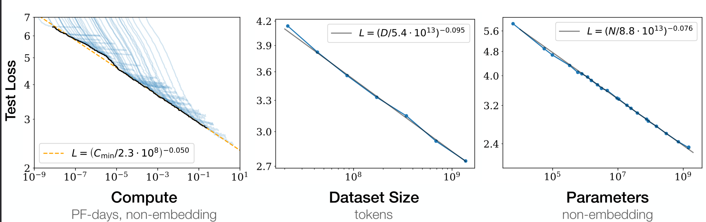
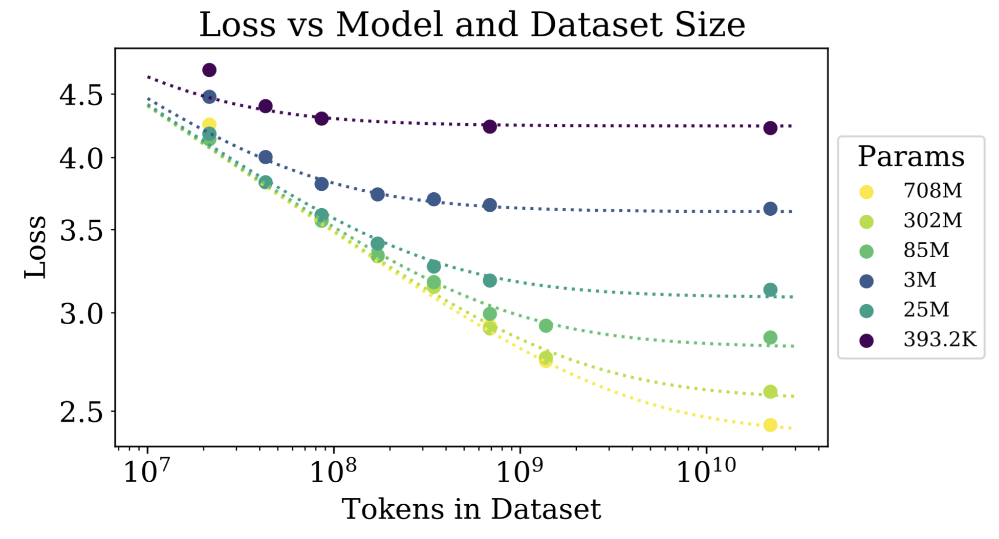
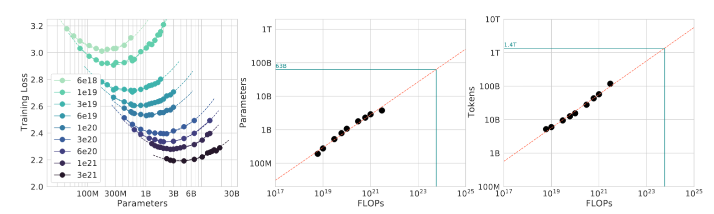
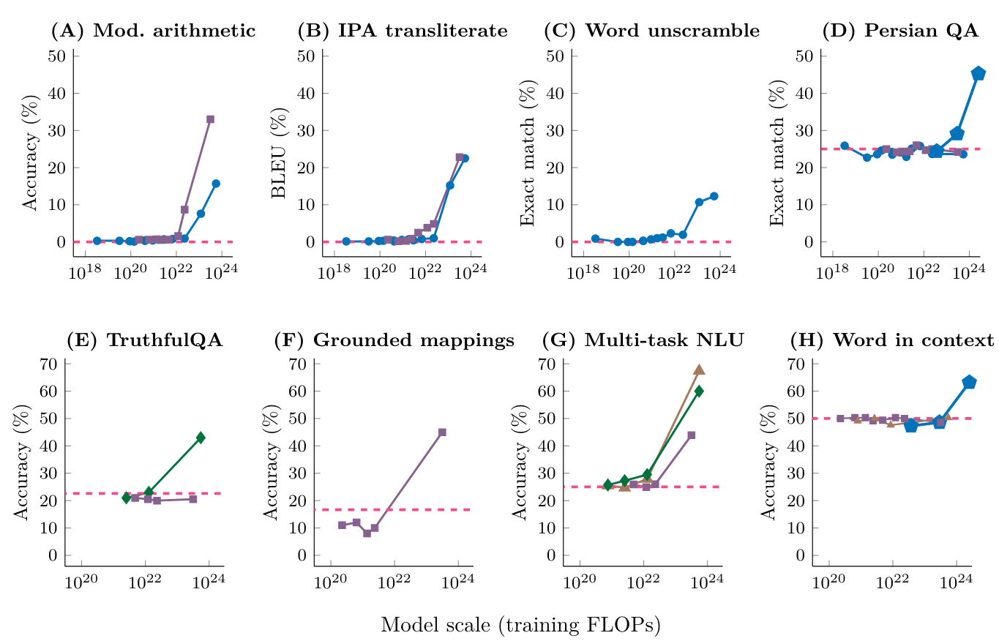
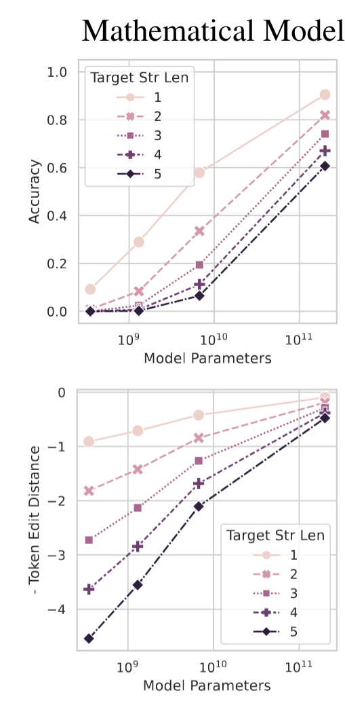
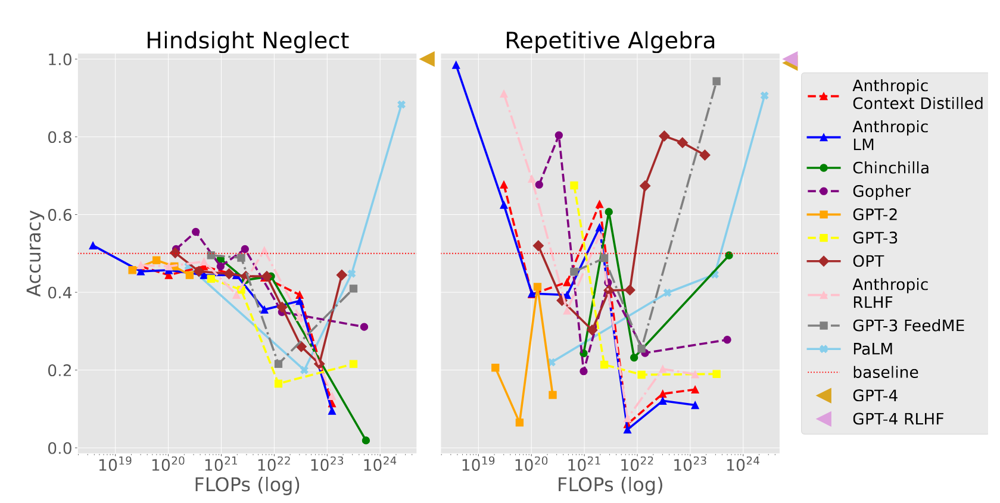
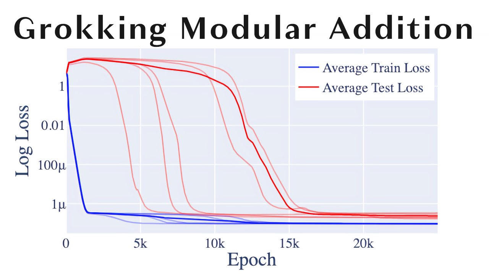
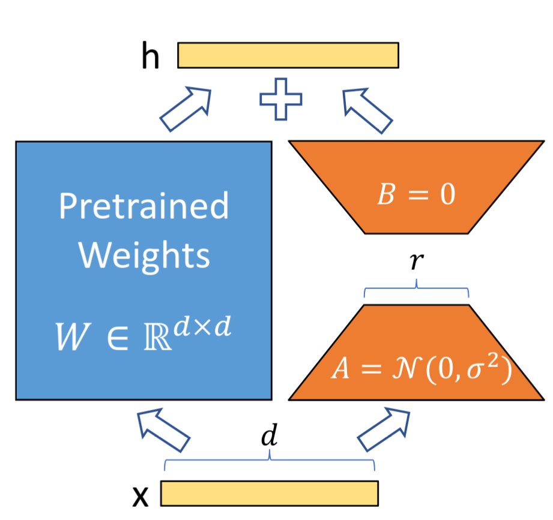
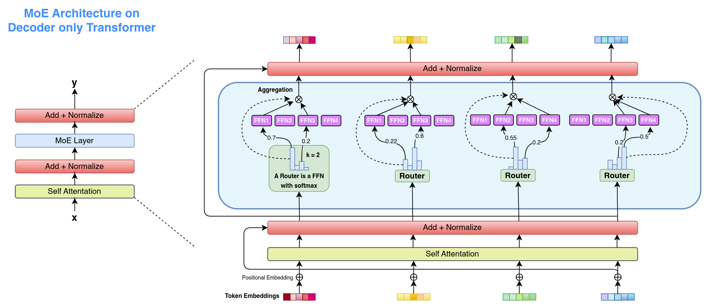

# Chapter 4 Scaling Laws and Efficient Large Language Models

[Course index](../../README.md) · [Original source](https://arxiv.org/html/2610.13455v1#Ch4) · [Raw file](../../raw/originals/book.html)

Retrieved: 2026-11-13T16:41:17.579179+00:00

[Contents](../../CONTENTS.md) · [Full book](../book/full-book-html.md) · [Previous chapter](chapter-03-the-large-language-model-training-pipeline.md) · [Next chapter](chapter-05-case-study-1-building-llms-from-scratch.md)

### Chapter 4 Scaling Laws and Efficient Large Language Models

**What You Will Learn**

In this chapter you will learn how performance of language models scales with data and training effort.
Specifically, you will be able to:

- Explain how model performance relates to compute, data, and model size through *scaling laws*, and predict the effect of increasing one factor while holding the others fixed.
- Describe what techniques can be used to develop *smaller language models*, and analyze the tradeoff of using smaller models with respect to compute requirements and performance.
- Recognize the difference between *inference-time compute* and training-time compute.
- Reflect on *sustainable language models* and the environmental and privacy implications of large-scale deployment

#### 4.1 Scaling Laws: Compute, Data, Parameters

There are three primary factors involved in the training of LLMs:
(1) the amount of compute,
(2) the size of the dataset, and
(3) the size of the model.
Studies have shown that these three factors relate to the final performance of a model, measured as its loss on a held-out test set ($L$). This relation has been found to be both smooth and predictable. The relationship takes the form of a *power law*: as any of the three resources is increased, the loss decreases proportionally to a negative power of that resource. For instance, doubling the model size might reduce the loss by a factor of $2^{-\alpha}$ for some positive exponent $\alpha$. Because the behavior is predictable, we can estimate how much a model will improve (for instance, from doubling the training dataset size) *before* committing to an expensive training run.

We define these three quantities ($C$, $D$, $N$) as follows:

- Compute ($C$): the total amount of arithmetic performed over the entire training run, measured in floating point operations (FLOPs). Note that this is a count of operations in total, not a rate per second. A widely used approximation relates it to the other two quantities as $C\approx 6ND$, since processing a single token touches each of the $N$ parameters roughly six times across the forward (twice) and backward pass (four times).
- Dataset size ($D$): the total number of tokens the model is trained on. Note that a token is a subword unit defined by the tokenizer, so the same corpus corresponds to different values of $D$ under different tokenizers. The count of $D$ is the number of tokens as they are used during the training run. When data is repeated over several epochs, the repeated tokens still add to $D$ but may yield diminishing returns compared to fresh data.
- Model size ($N$): the number of trainable parameters (weights) in the model architecture. This count usually refers only to the parameters that increase when scaling model depth, and therefore excludes the embedding matrix.

Training large models comes at considerable cost, usually in the realm of tens of millions of dollars, and up to months of compute time. Scaling laws allow us to predict whether a model will train well.

Figure 4.1: 
Loss on language modeling objective is a function of training compute, dataset size, and model size [[Kaplan et al., 2020](#bibc.bib24)].

##### 4.1.1 Kaplan Scaling Laws

There are different empirical results for scaling laws that are found by fitting a function to empirical test data. For instance, in Figure [4.1](#Ch4.F1 "Figure 4.1 ‣ 4.1 Scaling Laws: Compute, Data, Parameters ‣ Chapter 4 Scaling Laws and Efficient Large Language Models ‣ Part I Language Modeling ‣ Agentic Large Language Models"), every point is a trained model on a fixed dataset with a similar experimental setup, while only changing the three primary variables $C,D,N$. In early 2020, [Kaplan et al. [2020]](#bibc.bib24) found how model performance is related to $C,D,N$.
They estimated, following empirical observations, that the loss follows independent power laws rekated to the three main variables: $L(N)\propto N^{-\alpha_{N}}$ and $L(D)\propto D^{-\alpha_{D}}$, with $\alpha_{N}\approx 0.076$ and $\alpha_{D}\approx 0.095$.

The individual power laws can be combined into a single optimizable equation, shown in Equation [4.1](#Ch4.E1 "In 4.1.1 Kaplan Scaling Laws ‣ 4.1 Scaling Laws: Compute, Data, Parameters ‣ Chapter 4 Scaling Laws and Efficient Large Language Models ‣ Part I Language Modeling ‣ Agentic Large Language Models"). This relationship was assumed to be generic: it would apply well as models of loss behavior for “other generative modeling tasks” [[Kaplan et al., 2020](#bibc.bib24), p. 5]. The authors further showed that, under no other constraints than compute budget, their derivations would point to optimal model size $N$, an ideal dataset size $D$, defined by optimal step size ($S$) and batch size ($B$).

|  |  |  |  |
| --- | --- | --- | --- |
|  | $$ L(N,D)=\Big[\Big(\frac{N_{c}}{N}\Big)^{\frac{\alpha_{N}}{\alpha_{D}}}+\frac{D_{c}}{D}\Big]^{\alpha_{D}} $$ |  | (4.1) |

Specifically, they concluded that as the compute budget $C$ increases, model size $N$ should be increased faster than data size $D$ ($N\propto C^{0.73}$ and $D\propto C^{0.27}$11
1
$B\propto C^{0.24},\,S\propto C^{0.03},\,D=B\cdot S\propto C^{0.27}$), leading to the development of large models such as GPT-3. The negative exponents reflect diminishing returns: each doubling of model size or dataset size lowers the loss by only a few percent.

At first glance, this recommendation seems to contradict the exponents themselves: since $\alpha_{D}>\alpha_{N}$, data scaling reduces the loss *faster* than parameter scaling for the same relative increase in compute. The reason is that compute, not the resource itself, is the constraint: because $C\approx 6ND$, increasing $D$ consumes compute just as increasing $N$ does. This means that $N$ is with becoming a bottleneck with increasing likelihood. Hence, once the compute cost for $D$ is accounted for, allocating additional compute to $N$ yields a better return than allocating it to $D$. This means that the optimal allocation favors larger models.

###### Sample efficiency

A separate observation of [Kaplan et al. [2020]](#bibc.bib24) is that larger models are more *sample-efficient*. For a fixed number of training tokens, a larger model reaches a lower loss, and to reach a given target loss it requires fewer tokens and fewer optimization steps than a smaller one. This effect is visualized in Figure [4.2](#Ch4.F2 "Figure 4.2 ‣ Sample efficiency ‣ 4.1.1 Kaplan Scaling Laws ‣ 4.1 Scaling Laws: Compute, Data, Parameters ‣ Chapter 4 Scaling Laws and Efficient Large Language Models ‣ Part I Language Modeling ‣ Agentic Large Language Models").

Figure 4.2: 
Larger models reach a given loss using fewer training tokens, illustrating greater sample efficiency [[Kaplan et al., 2020](#bibc.bib24)]

##### 4.1.2 Chinchilla Scaling Laws

In 2022, [Hoffmann et al. [2022]](#bibc.bib28) reevaluated these findings with a model called Chinchilla, and found, surprisingly, that most large models at the time were severely undertrained. This discrepancy can be traced back to the methodology of [Kaplan et al. [2020]](#bibc.bib24): their optimal allocation was extrapolated from the *early*, non-converged training dynamics of many models rather than from runs trained to convergence, which systematically biased their conclusions toward larger models trained for fewer steps.

The key insight from the Chinchilla study was that for every doubling of the compute budget, both the model size $N$ and the number of training tokens $D$ should be increased in roughly equal proportions ($N\propto C^{0.5}$ and $D\propto C^{0.5}$). Their rule of thumb suggests training on approximately 20 tokens for every trainable parameter in the model to achieve compute optimality. This result has since been reproduced [[Besiroglu et al., 2024](#bibc.bib29)] and has been shown to be robust to sizable perturbations [[Schaeffer et al., 2025](#bibc.bib27)].

In their scaling laws, the loss is modeled as a function of the parameter count $N$ and the number of tokens $D$ that have been trained on, as follows:

|  |  |  |  |
| --- | --- | --- | --- |
|  | $$ L(N,D)=E+\frac{A}{N^{\alpha}}+\frac{B}{D^{\beta}} $$ |  | (4.2) |

The first term $E$ captures the irreducible loss, corresponding to the entropy of natural text. The second term $\frac{A}{N^{\alpha}}$ captures the sub-optimality of a model with finite parameters $N$, and the final term $\frac{B}{D^{\beta}}$ captures the sub-optimality due to training on a finite number of tokens $D$. Although $\alpha$ and $\beta$ here play the same role as Kaplan’s $\alpha_{N}$ and $\alpha_{D}$ (the exponents governing how the loss falls off with model size and data) they are a different parameterization: they are fit jointly within this two-term form and therefore take different values. Fitting the Chinchilla scaling function on more than 400 models found the following parameter estimates:

|  |  |  |  |
| --- | --- | --- | --- |
|  | $$ E\approx 1.69,\quad A\approx 406.4,\quad B\approx 410.7,\quad\alpha\approx 0.34,\quad\beta\approx 0.28 $$ |  | (4.3) |

By optimizing this loss function under the constraint of a fixed compute budget $C$ (recall $C\approx 6ND$), we can derive the compute-optimal model size $N_{opt}$ and data size $D_{opt}$ for any budget $C$:

|  |  |  |  |
| --- | --- | --- | --- |
|  | $$ N_{opt}(C)=G\left(\frac{C}{6}\right)^{a},\quad D_{opt}(C)=\frac{1}{G}\left(\frac{C}{6}\right)^{b} $$ |  | (4.4) |

where $G=\big(\frac{\alpha A}{\beta B}\big)^{\frac{1}{\alpha+\beta}}$ is a constant, $a=\frac{\beta}{\alpha+\beta}\approx 0.45$ and $b=\frac{\alpha}{\alpha+\beta}\approx 0.55$.

Note that $a$ and $b$ are not independent: by construction $a+b=1$. This follows directly from $C\approx 6ND$, since taking logarithms gives $\log C=\log 6+\log N+\log D$. Writing $N_{opt}\propto C^{a}$ and $D_{opt}\propto C^{b}$, this becomes $\log C=\text{const}+a\log C+b\log C$, which can only hold for all $C$ if $a+b=1$. The same constraint applies to Kaplan’s exponents ($0.73+0.27=1$). The difference for Chinchilla was *how* the budget is split between $N$ and $D$.

This rule is approximately *linear* because $N_{opt}$ and $D_{opt}$ grow with the compute budget $C$ at almost the same rate: their exponents $a\approx 0.45$ and $b\approx 0.55$ are close, so the ratio $D_{opt}/N_{opt}$ stays near a constant value of roughly $20$ across many orders of magnitude of compute.
The value is best understood as an empirical calibration anchored on real compute-optimal runs rather than a number that results cleanly from the fitted coefficients. The Chinchilla model itself (70B parameters trained on 1.4T tokens) sits exactly at $D/N=20$. Table [4.1](#Ch4.T1 "Table 4.1 ‣ 4.1.2 Chinchilla Scaling Laws ‣ 4.1 Scaling Laws: Compute, Data, Parameters ‣ Chapter 4 Scaling Laws and Efficient Large Language Models ‣ Part I Language Modeling ‣ Agentic Large Language Models") shows several well-known models relative to this rule. Models below the ratio are *undertrained* (too large for their token budget), while models far above it are deliberately *overtrained* to obtain a small model that is cheap to run at inference time. Earlier flagship models such as GPT-3 and Gopher fall well below the line ($D/N\approx 1$–$2$): they were made very large but trained on comparatively too few tokens.
It is worth stressing that $D\approx 20N$ is optimal only for minimizing the *training* loss at a fixed training budget. When a model will later serve many inference requests, it is often deliberately *over-trained* on far more than $20$ tokens per parameter, trading additional training cost for a smaller model that is cheaper to run at inference time. LLaMA-3 8B, for instance, is trained on roughly $1900$ tokens per parameter. This deliberate extreme over-training is chosen so that a small model still reaches a low loss, and is cheap to run during inference.

| Model | $N$ | $D$ | $D/N$ | Regime |
| --- | --- | --- | --- | --- |
|
 Gopher [[Rae et al., 2021](#bibc.bib6)] | 280B | 300B | $\approx 1$ | undertrained |
|
 GPT-3 [[Brown et al., 2020](#bibc.bib11)] | 175B | 300B | $\approx 1.7$ | undertrained |
|
 Chinchilla [[Hoffmann et al., 2022](#bibc.bib28)] | 70B | 1.4T | $20$ | compute-optimal |
|
 LLaMA-1 7B [[Touvron et al., 2023a](#bibc.bib66)] | 7B | 1.0T | $\approx 143$ | overtrained |
|
 LLaMA-2 7B [[Touvron et al., 2023b](#bibc.bib12)] | 7B | 2.0T | $\approx 286$ | overtrained |
|
 LLaMA-3 8B [[Grattafiori et al., 2024](#bibc.bib44)] | 8B | 15T | $\approx 1875$ | overtrained |

Table 4.1: Token-to-parameter ratios of several well-known models relative to the Chinchilla rule of thumb $D\approx 20N$.

The picture so far is fairly clean: test loss falls smoothly, monotonically, and predictably with compute, data, and parameters. However, in practice, various factors influence our results. We discuss four phenomena that each probe a different edge of that picture:
(1) compute-optimal curves,
(2) emergent abilities,
(3) inverse scaling, and
(4) grokking.

##### 4.1.3 Compute-Optimal Curve

Computer hardware and energy are finite resources. A practical question is how to split a fixed compute budget $C$ between model size $N$ and dataset size $D$ to obtain the best possible model. Scaling laws answer this through the *compute-optimal frontier*: the allocation of $C$ that minimizes the loss.

This frontier is located empirically with the *IsoFLOP* method [[Hoffmann et al., 2022](#bibc.bib28)], shown in Figure [4.3](#Ch4.F3 "Figure 4.3 ‣ 4.1.3 Compute-Optimal Curve ‣ 4.1 Scaling Laws: Compute, Data, Parameters ‣ Chapter 4 Scaling Laws and Efficient Large Language Models ‣ Part I Language Modeling ‣ Agentic Large Language Models"). For various model sizes, we choose the number of training tokens such that the final FLOPs is a constant. The learning rate is adjusted using a cosine annealing schedule, with the cosine cycle length is set to match the target FLOP count. We find a clear valley in loss, meaning that for a given FLOP budget there is an optimal model size to train (left). Using the location of these valleys, we project optimal model size and number of tokens for larger models (center and right). In green, we show the estimated number of parameters and tokens for an optimal model trained with the compute budget of Gopher. For a fixed FLOP budget we train several models of different sizes: a model that is too small underfits, while a model that is too large is forced to train on too few tokens, so the resulting curve of loss against model size is U-shaped. Its minimum identifies the compute-optimal model size $N_{opt}$, from which the matching token count $D_{opt}=C/6N_{opt}$ follows via $C\approx 6ND$. Fitting a parabola to each such curve locates this minimum, and repeating the procedure across budgets finds how $N_{opt}$ and $D_{opt}$ grow with compute.

This parabola fitting must be done with care, and the simplification introduces systematic biases in the estimated optimum [[Czech et al., 2026](#bibc.bib67)]. These biases persist even on noise-free synthetic data and stem from three sources: (1) spacing the sampled model sizes too coarsely, (2) sampling that fails to locate the true minimum symmetrically, and (3) the genuine asymmetry of the loss surface, which a symmetric parabola cannot represent. At the scale of Llama-3, they estimate that such biases waste on the order of $1.4M of compute. As a remedy, they recommend fitting the parametric loss model $L(N,D)=E+A/N^{\alpha}+B/D^{\beta}$ directly—Chinchilla Approach 3, the same form we used above to derive the $D\approx 20N$ rule—with a numerically robust optimizer, rather than reading the optimum off fitted parabolas.

Complementary views on scaling [[Paquette et al., 2024](#bibc.bib26)] study analytically solvable models (power-law random features trained with one-pass stochastic gradient descent) instead of fitting curves to trained models. They find that the compute-optimal exponent is not a single universal constant, but that the data-complexity/target-complexity plane instead splits into four primary phases (plus three sub-phases), each with its own exponent governing how $N_{\mbox{opt}}$ grows with compute. The answer to the question which allocation rule to apply, and whether a fixed *20 tokens per parameter* is even the right shape, depends on the regime of the problem.

Figure 4.3: 
IsoFLOP curves [[Hoffmann et al., 2022](#bibc.bib28)]

###### Scaling for finetuning

The preceding works studied how pretraining scales. Do these scaling laws also govern finetuning? [Zhang et al. [2024]](#bibc.bib21) study this question for both full-model finetuning, which updates all of the model’s weights, and parameter-efficient finetuning (PEFT), which freezes the pretrained weights and trains only a small set of added parameters (as in LoRA) [[Hu et al., 2021](#bibc.bib9)]. The lesson most relevant to compute budgeting is that finetuning performance improves more from scaling the size of the *base model* than from collecting additional finetuning data, while adding more trainable PEFT parameters helps little. In practice, a task that underperforms is usually better served by starting from a larger pretrained model than by enlarging the adapter or gathering more finetuning examples.

##### 4.1.4 Emergent Abilities

Some of the most interesting phenomena in LLM scaling are *emergent abilities*: capabilities that are not present in smaller models but that appear suddenly as model size or compute cross a certain threshold [[Wei et al., 2022](#bibc.bib10)]. Examples include multi-step reasoning, few-shot translation, and specialized coding tasks, as shown in Figure [4.4](#Ch4.F4 "Figure 4.4 ‣ 4.1.4 Emergent Abilities ‣ 4.1 Scaling Laws: Compute, Data, Parameters ‣ Chapter 4 Scaling Laws and Efficient Large Language Models ‣ Part I Language Modeling ‣ Agentic Large Language Models"). The ability to perform a task via few-shot prompting is emergent when a language model achieves random performance until a certain scale, after which performance significantly increases to well-above random.

Figure 4.4: 
Eight examples of emergence in the few-shot prompting setting, each point is a separate model [[Wei et al., 2022](#bibc.bib10)].

However, the suddenness of the appearance has been contested. [Schaeffer et al. [2023]](#bibc.bib30) argue that emergent abilities might be a mirage caused by the choice of evaluation metrics. For instance, in Figure [4.5](#Ch4.F5 "Figure 4.5 ‣ 4.1.4 Emergent Abilities ‣ 4.1 Scaling Laws: Compute, Data, Parameters ‣ Chapter 4 Scaling Laws and Efficient Large Language Models ‣ Part I Language Modeling ‣ Agentic Large Language Models"), we see that while non-smooth discrete metrics (such as accuracy or exact match) show sharp jumps—they are non-smooth, after all—underlying metrics (such as the cross-entropy loss or token-level probability) follow a smooth, predictable power law across scales.

Figure 4.5: 
Claimed emergent abilities evaporate upon changing the metric from a nonlinear (top) to a smooth (bottom) metric [[Schaeffer et al., 2023](#bibc.bib30)]

##### 4.1.5 Inverse Scaling

While most tasks improve with scale, some exhibit *inverse scaling*, where larger models perform worse or develop stronger biases. This may happen in tasks where a distractor answer is more probable according to the language modeling objective than the correct answer, leading larger (and more confident) models to consistently choose the wrong option [[McKenzie et al., 2023](#bibc.bib31), [Michaelov and Bergen, 2023](#bibc.bib32)].

An example of inverse scaling is *hindsight neglect*, a task that tests whether a bet was worth taking based on its expected value. In case the expected value is positive, the model should respond with *yes*, and in case of a negative expected value it should respond with *no*. The situation is as follows. The model is only shown few-shot examples where the actual outcome always matches the expected value (that is, the bettor won money when the expected value was positive and lost money when the expected value was negative). The model is then asked a question about whether it was correct to take a bet where the expected value and the actual outcome do not match. Hindsight neglect tests whether models can correctly generalize from instructions when the few-shot examples are correctly-labeled but misleading. Repetitive algebra tests how models respond to simple algebra questions when given a specific pattern of correctly-labeled few-shot examples. Figure [4.6](#Ch4.F6 "Figure 4.6 ‣ 4.1.5 Inverse Scaling ‣ 4.1 Scaling Laws: Compute, Data, Parameters ‣ Chapter 4 Scaling Laws and Efficient Large Language Models ‣ Part I Language Modeling ‣ Agentic Large Language Models") shows that models generally start around random performance, but fall below random performance at around $10^{22}$ training FLOPs.

Figure 4.6: 
Scaling behavior for the Hindsight Neglect (left) and Repetitive Algebra (right) tasks [[McKenzie et al., 2023](#bibc.bib31)]

##### 4.1.6 Grokking

Grokking is a relatively recent paradox in statistical learning theory. This theory holds that, conventionally, when a large model is presented with a small dataset, it will overfit, due to memorization of the examples. Grokking, then, occurs when we continue to train this too-large model, and, after much more training, the model suddenly finds a generalizing solution [[Power et al., 2022](#bibc.bib65)].

While originally observed on small algorithmic tasks, such as modular addition, the grokking phenomenon suggests that scaling the number of training steps (over-training) can lead to qualitative shifts from memorization to understanding, even without increasing the dataset size $D$, see Figure [4.7](#Ch4.F7 "Figure 4.7 ‣ 4.1.6 Grokking ‣ 4.1 Scaling Laws: Compute, Data, Parameters ‣ Chapter 4 Scaling Laws and Efficient Large Language Models ‣ Part I Language Modeling ‣ Agentic Large Language Models").

Figure 4.7: 
Early memorization of the training set (blue) versus late generalization (red: grokking) on a modular addition task [[Nanda et al., 2023](#bibc.bib2)]

The figure shows a data wall that initially limits scaling as the data is running out [[Villalobos et al., 2024](#bibc.bib72)], but later, after much more training, the model groks a generalizing solution.

Grokking is relevant to language modeling since we are rapidly running out of high-quality human text on the internet to satisfy the requirements on data $D$ of Chinchilla scaling for next-generation models. Because of these inherent limits, researchers are looking beyond simple scaling of $D$. As an alternative, we can look at a variety of these new frontiers:
(1) better architectural efficiency (such as Mixture of Experts),
(2) inference-time scaling (such as giving models more compute during inference to *think*, as seen in OpenAI’s o-series), or
(3) synthetic data generation (Chapter [19](chapter-19-synthetic-data-generation-for-training-agentic-llms.md#Ch19 "Chapter 19 *Synthetic Data Generation for Training Agentic LLMs ‣ Part VI Advanced Topics ‣ Agentic Large Language Models")).

#### 4.2 Small Language Models

As the requirements for compute and data continue to grow, there is an increasing interest in *small language models* (SLMs): models that are small enough to run on consumer hardware or even mobile or edge devices while maintaining high performance. These models are often developed using techniques that optimize for efficiency without sacrificing too much performance.

To understand the deployment landscape for these models, it is helpful to categorize common types of compute infrastructure:

- Datacenters: High-performance GPUs (such as NVIDIA H100s) and TPUs, primarily used for *pretraining* large models and hosting high-throughput inference APIs.
- Consumer Hardware: Standard desktop GPUs and high-end CPUs, where SLMs can be affordably *finetuned* or run locally by individual users.
- Edge Devices: Mobile phones, Internet-of-Things devices, and laptops, which are increasingly equipped with Neural Processing Units (NPUs) specifically designed for low-power, efficient on-device *inference*.

To fit models into the latter constrained environments, optimization techniques focus on speeding up throughput, reducing latency, reducing memory usage, and increasing sample efficiency. The techniques for achieving these goals can be grouped into two categories: (1) model-centric optimization, which targets the architecture of the models and their optimization approaches, and (2) data-centric optimization, which targets the data used to train the models. We will discuss both categories.

##### 4.2.1 Model-centric Optimization

First we discuss the model-centric optimization techniques.
We introduce the following techniques that allow for efficient training of smaller models, while still maintaining high task performance.
Model-centric techniques can focus on pretraining/finetuning or inference.

###### 4.2.1.1 Reducing Pretraining Cost

###### Parameter-Efficient Fine-Tuning (PEFT)

Methods such as *Low-Rank
Adaptation*
(LoRA) [[Hu et al., 2021](#bibc.bib9)] allow for adapting a large model to a new task by training only a tiny fraction (often $<1$%) of its parameters [[Lialin et al., 2023](#bibc.bib22)]. The key observation is that the weight update learned during finetuning has a low *intrinsic rank*: although a pretrained weight matrix
$W_{0}\in\mathbb{R}^{d\times k}$
is full-rank, the change $\Delta W$ needed to adapt it to a new task can be approximated well by a low-rank matrix. Instead of updating $W_{0}$ directly, LoRA freezes it and represents the update as a product of two small matrices,

|  |  |  |  |
| --- | --- | --- | --- |
|  | $$ W=W_{0}+\Delta W=W_{0}+BA,\qquad B\in\mathbb{R}^{d\times r},\;\;A\in\mathbb{R}^{r\times k} $$ |  | (4.5) |

where the rank $r\ll\min(d,k)$. For an input $x$, the modified forward pass becomes

|  |  |  |  |
| --- | --- | --- | --- |
|  | $$ h=W_{0}x+\frac{\alpha}{r}\,BAx, $$ |  | (4.6) |

where $\alpha$ is a constant scaling factor that controls the magnitude of the update, roughly similar to a learning rate in standard training. This is visualized in Figure [4.8](#Ch4.F8 "Figure 4.8 ‣ Parameter-Efficient Fine-Tuning (PEFT) ‣ 4.2.1.1 Reducing Pretraining Cost ‣ 4.2.1 Model-centric Optimization ‣ 4.2 Small Language Models ‣ Chapter 4 Scaling Laws and Efficient Large Language Models ‣ Part I Language Modeling ‣ Agentic Large Language Models"). We compute weight updates only for $A$ and $B$, reducing the number of trainable parameters from $d\times k$ to $r(d+k)$. At initialization $A$ is drawn from a random Gaussian and $B$ is set to zero, so $\Delta W=0$ and training starts from the pretrained model. Because $\Delta W$ can directly be merged back into $W_{0}$ after training, LoRA adds no inference latency, and a single base model can be served with many small, swappable task-specific adapters.

Figure 4.8: 
Low-Rank Adaptation reparametrization [[Hu et al., 2021](#bibc.bib9)]. During finetuning, only $A$ and $B$ are trained

###### Architectural Innovations

A second family of techniques changes the model architecture itself so that it is cheaper to run, rather than compressing a fixed architecture after the fact. Two influential examples are Grouped-Query Attention and Mixture of Experts.

*Grouped-Query Attention* (GQA) [[Ainslie et al., 2023](#bibc.bib47)] targets the memory bandwidth bottleneck of autoregressive decoding. In standard *multi-head attention* (MHA), every query head has its own key and value matrix, which we all need to use for computing attention scores. At the other extreme, *multi-query attention* (MQA) lets all query heads share a single key/value head, which shrinks the computation but can hurt expressive quality and training stability. GQA interpolates between these two: the query heads are divided into $g$ groups, and all heads within a group share one key/value head. With $g=1$ it is equivalent to MQA, and with $g$ equal to the number of heads it is equivalent to MHA, so $g$ trades quality against memory usage. Often, GQA is combined with the KV-caching optimizations discussed next in Section [4.2](#Ch4.S2 "4.2 Small Language Models ‣ Chapter 4 Scaling Laws and Efficient Large Language Models ‣ Part I Language Modeling ‣ Agentic Large Language Models"), and it is now the default attention variant in many open-weight models.

*Mixture of Experts* (MoE) [[Shazeer et al., 2017](#bibc.bib46)] decouples the total number of parameters from the compute spent per token. Instead of a single dense feed-forward block in each layer, a MoE layer contains many parallel “expert” sub-networks together with a lightweight *gating network* (router) that activates only a small number of experts (typically the top-$1$ or $2$) for each token. Because only the chosen experts perform computation, the per-token cost stays close to that of a single dense block even as the total parameter count (and hence the model’s overall capacity) grows by an order of magnitude or more [[Fedus et al., 2022](#bibc.bib45)].

This *sparse activation* is why models such as Mixtral and many recent frontier systems can have hundreds of billions of total parameters while activating only a fraction of them per token. The trade-offs are (1) that all experts must still be held in memory, (2) that the load must be balanced across experts (often via an auxiliary loss) so that no expert is over- or under-used, and (3) that routing introduces additional engineering complexity. The MoE architecture is visualized in Figure [4.9](#Ch4.F9 "Figure 4.9 ‣ Architectural Innovations ‣ 4.2.1.1 Reducing Pretraining Cost ‣ 4.2.1 Model-centric Optimization ‣ 4.2 Small Language Models ‣ Chapter 4 Scaling Laws and Efficient Large Language Models ‣ Part I Language Modeling ‣ Agentic Large Language Models"), which shows a top-$k$ routing mechanism, configured with $k=2$, where the gating function selects the two highest-scoring FFN experts for each token based on the router. The selected experts are evaluated in parallel, with their outputs aggregated using weighted summation [[Zhang et al., 2025](#bibc.bib69)].

Figure 4.9: 
Illustration of the sparsely gated Mixture of Experts (MoE) architecture on top of a decoder-only transformer [[Zhang et al., 2025](#bibc.bib69)]

###### Knowledge Distillation

A large teacher model is used to train a smaller student model by encouraging the student to match the teacher’s output distribution [[Gu et al., 2023](#bibc.bib8), [Xu et al., 2024](#bibc.bib7)]. Crucially, the student learns from the teacher’s full *soft* probabilities (typically softened with a temperature) rather than only the single correct answer. These soft targets carry richer information: for instance, which wrong answers the teacher considers plausible. This lets the student approach the teacher’s quality at a fraction of its size. The same idea underpins the synthetic-data generation discussed below, where a frontier model effectively acts as the teacher, generating high-quality training data for a smaller student model.

###### 4.2.1.2 Reducing Inference Cost

Once a model is trained, it can be further optimized for deployment at inference time. Whereas training-time techniques focus on reducing the cost of producing the model, inference-time techniques target the cost of *using* it: the throughput (tokens generated per second), the latency (time to the first and each subsequent token), and the memory footprint required to serve a request. We discuss several techniques that are commonly used to reduce inference cost, which can be applied to both large and small models.

###### Key–Value (KV) Caching

During autoregressive generation, the model produces one token at a time, and each new token attends to all previous tokens. Recomputing the attention keys and values for the entire context at every step is quadratically expensive. However, when we predict a new token, the context remains the same. Instead of recomputing the attention values, we can store the key and value vectors of past tokens in a *KV cache* and reuse them. This turns per-step attention into a linear-cost lookup. This is the basic optimization that makes decoding practical, but it comes at a cost: the cache grows linearly with both sequence length and batch size and quickly dominates memory usage for long contexts. This problem has motivated both the architectural choices above (GQA and MQA shrink the cache by sharing key/value heads across query heads) and dedicated memory-management schemes such as *PagedAttention*, which stores the cache in non-contiguous blocks to reduce fragmentation and enable higher serving throughput [[Kwon et al., 2023](#bibc.bib68)].

###### Pruning

A more extreme method for reducing model size is to consider removing redundant or less important connections in the neural network [[Ma et al., 2023](#bibc.bib51)]. Pruning can be *unstructured* (zeroing out individual weights) or *structured* (removing entire neurons, attention heads, or layers); the latter yields concrete speedups on standard hardware, whereas the former requires sparsity-aware kernels to realize its benefits.

###### Quantization

Another method of saving memory during inference is to reduce the size of the matrix that needs to be loaded into memory. Rather than making the matrix dimensions smaller, we can also lower the precision of weights entries (e.g., from 16-bit to 8-bit or 4-bit numbers). This significantly reduces memory usage and speeds up inference. However, in principle, lower precision means lower performance. The same idea can also be applied to the KV cache itself to keep long contexts in memory. Quantization is a frequently used approach [[Dettmers et al., 2022](#bibc.bib48), [Dettmers and Zettlemoyer, 2023](#bibc.bib49), [Xiao et al., 2023](#bibc.bib50)].

Alternatively, rather than casting all weights to the same precision, *mixed precision* modes have been proposed, with different levels of numerical precision for different parts of the computation, to balance speed and stability [[Micikevicius et al., 2017](#bibc.bib3)]. This approach may suffer from non-deterministic results due to numerical instabilities [[Yuan et al., 2025](#bibc.bib25)].

###### Speculative Decoding

A key technique for optimizing inference efficiency is *speculative decoding* [[Leviathan et al., 2023](#bibc.bib20)]. This approach uses a small draft model to generate multiple tokens quickly, which are then verified in parallel by a larger target model. This allows for faster inference (up to 2-3 fold speedup) without sacrificing the quality of the larger model, effectively leveraging the different points on the scaling curve.

##### 4.2.2 Data-centric Optimization

In addition to model-centric approaches, the literature emphasizes that data quality and curation are often more important than the size of the dataset when training efficient models [[Luo et al., 2025](#bibc.bib34)]. Small models can perform well if they are trained on highly curated, high-quality data. Hence, it is important to create a good data recipe, in addition to an efficient model architecture. Data-centric techniques broadly fall into two camps: *selecting* the most useful parts from a broader pool of data, and *generating* new synthetic data where good data is scarce.

###### 4.2.2.1 Data Selection and Curation

Rather than training on all available text, a growing body of work shows that carefully choosing *which* data to train on, and in what proportions, yields better models for the same compute budget. For pretraining, NVIDIA’s *CLIMB* framework [[Diao et al., 2026](#bibc.bib70)] embeds a large corpus into a semantic space, clusters it, and then iteratively searches for the data mixture that minimises proxy-model loss. The resulting *ClimbMix* dataset (400B tokens) lets a sub-billion-parameter model outperform comparable models trained on far larger but unfiltered corpora. The same principle applies at the finetuning stage: *LIMA* [[Zhou et al., 2023](#bibc.bib23)] shows that supervised finetuning on only $1{,}000$ carefully curated prompt–response pairs is enough to produce a strong instruction-following model, supporting the view that most knowledge is acquired during pretraining and that alignment mainly teaches the model a desired response *style*.

###### 4.2.2.2 Synthetic Data Gathering

When suitable data does not exist, it can be generated. The *Textbooks Are All You Need* approach, used for models such as Microsoft’s Phi series [[Gunasekar et al., 2023](#bibc.bib33)], demonstrates that training on clean, synthetic textbook-quality data can allow a relatively small model of 1.3B parameters to outperform models ten times its size.

Such pipelines typically rely on frontier models to generate the data, combined with *LLM-as-a-judge* scoring to filter for the most accurate and educational examples, and rigorous *decontamination* to ensure the synthetic data does not leak benchmark test sets and inflate reported performance. This approach is particularly valuable for reasoning data: by training on step-by-step reasoning trajectories produced by larger models, complex problem-solving skills can be distilled into a smaller architecture (see also Chapter [6](chapter-06-multi-step-reasoning-in-llms.md#Ch6 "Chapter 6 Multi-step Reasoning in LLMs ‣ Part II Reasoning ‣ Agentic Large Language Models")) [[Muennighoff et al., 2025](#bibc.bib4), [Arora and Zanette, 2026](#bibc.bib71)].

###### 4.2.2.3 Sample-Efficient Learning

Beyond synthetic data, there is an increased research focus on how models can learn more efficiently from limited, naturalistic data. Initiatives such as the *BabyLM Challenge* [[Warstadt et al., 2023](#bibc.bib52)] focus on training models under strict data constraints (e.g., 10M to 100M tokens). This mirrors the volume of language input a human child receives during early development, driving innovation in sample-efficient architectures while providing insights into cognitively plausible language acquisition.

##### 4.2.3 Popular models

Having surveyed improvement techniques, it is useful to look at how popular large and small models apply them in practice. Models are commonly categorized by their openness: closed-weight (proprietary) models expose only an API, open-weight models release their trained parameters, and open-source models additionally share the training data and code. In practice openness is a matter of degree rather than a strict category, and we may subsequently use an openness index to rate the transparency [[Artificial Analysis, 2026](#bibc.bib37)]. Most open models can be found on repositories such as Hugging Face.

Below, we briefly describe some of the most popular open-weight models that are designed to be efficient enough to run on consumer hardware, and the techniques they use to achieve this. This is not an exhaustive list, but rather a selection of influential models that exemplify the trends in efficiency techniques and their scales, at the time of writing.

- 

  [[Abdin et al., 2024](#bibc.bib38)]. The Phi-series are capable SLMs that are efficient enough to run locally on mobile devices. The core innovation behind the Phi models is their data-centric training methodology. Microsoft curates high-quality, heavily filtered web data combined with synthetic data generated by larger models. This allows small models (such as the 3.8 billion parameter Phi-3-mini) to perform well, rivaling the reasoning capabilities of much larger models such as GPT-3.5 and Mixtral.
- 

  [[Mesnard et al., 2024](#bibc.bib39)] Google emphasizes that Gemma models inherit Gemini’s strong generalist capabilities, particularly in text, reasoning, and coding, while advancing the state-of-the-art for their specific size classes, but little is known about their training method or data.
- 

  [[Ettinger et al., 2025](#bibc.bib19)] The OLMo (Open Language Model) family is developed by the Allen Institute for AI to be a completely open-source model. The OLMo project open-sourced the full training pipeline, including code and data: the pre-training dataset (Dolma), the training and evaluation code, training logs, and intermediate checkpoints. This transparency allows researchers to study training dynamics, data influences, and algorithmic biases.
- 

  [[Bai et al., 2023](#bibc.bib43)] The Qwen family represents a high-performing suite of foundational and instruction-tuned models, ranging from sub-billion dense models to large Mixture-of-Experts (MoE) architectures. They are notable for their multilingual capabilities and performance on mathematics, coding, and logical reasoning benchmarks.
- 

  [[Mehta et al., 2024](#bibc.bib40)] Apple’s Efficient Language Model family is designed to run efficiently on edge devices. The layer-wise scaling strategy uses smaller latent dimensions in layers closer to the input and widens them closer to the output. This results in high accuracy for low parameter count.
- 

  [[Agarwal et al., 2025](#bibc.bib42)] OpenAI released two open-weight reasoning models that use an efficient mixture-of-expert architecture, optimized for agentic capabilities.
- 

  [[Jiang et al., 2024](#bibc.bib41)] These models popularized Sparse Mixture-of-Experts (SMoE) architectures in the open-weights ecosystem (e.g., Mixtral 8x7B), allowing for large parameter counts with few active parameters during inference, to maximize efficiency.
- 

  [[Grattafiori et al., 2024](#bibc.bib44)] Meta’s Llama models have become frequently used. Trained on large datasets (up to 15 trillion tokens for Llama 3) and ranging from small edge-friendly sizes to large 405B parameter frontier models, they established the standard for scaling laws in open models and catalyzed an ecosystem of finetuned models and derivatives.
- 

  [[Liu et al., 2025](#bibc.bib18)] DeepSeek-V3 is a large Mixture-of-Experts model (671B total parameters with 37B activated per token) notable for the stability of its training. It combines Multi-head Latent Attention (MLA) for a compressed key-value cache with an auxiliary-loss-free strategy for expert load balancing, and was trained in FP8 mixed precision, achieving frontier-level performance at a small compute cost. The line also includes the DeepSeek-R1 reasoning models.
- 

  [[Zeng et al., 2026](#bibc.bib17)] Developed by Zhipu AI, the GLM (General Language Model) family is built on strong reasoning capabilities that are developed early in training, and retained throughout the training process. Recent iterations are optimized for agentic workflows and software engineering, targeting tool-use and code-generation performance rather than text completion alone.
- 

  [[Biderman et al., 2023](#bibc.bib5)] EleutherAI’s Pythia is a suite of models (ranging from 70M to 12B parameters) designed to support research into training dynamics and scaling. Every model is trained on the same data in the same order, with intermediate checkpoints released per model, enabling controlled studies of how capabilities, memorization, and biases emerge over the course of training.
- 

  [[Scao et al., 2023](#bibc.bib16)] BLOOM is a 176B-parameter open-access model produced by the BigScience collaborative research effort. Trained on the ROOTS corpus, spanning 46 natural languages and 13 programming languages, it was among the first large-scale models to prioritize multilingual coverage and full openness, released under a Responsible AI License.
- 

  [[Allal et al., 2025](#bibc.bib15)] Hugging Face’s SmolLM is a family of compact models (135M, 360M, and 1.7B parameters) aimed at efficient on-device deployment, much like the Phi series. Its performance stems from data curation: it is trained on the SmolLM-Corpus, which combines high-quality web data, Python code examples, and synthetically (Mixtral) generated textbooks and stories.

#### 4.3 Inference-Time Compute

The traditional scaling laws focus on the relationship between compute and performance *at training time*. More recent studies shift part of this computational burden to inference: *inference-time scaling* (or test-time compute) [[Muennighoff et al., 2025](#bibc.bib4)]. Rather than spending all compute during training, a model is allowed to deliberate longer at inference time. This is measured by the number of tokens generated or reasoning paths explored, in order to produce a higher-quality answer. Hence, optimizing throughput (tokens/s) becomes of prime importance: the faster tokens can be produced, the more reasoning a model is able to do during the same amount of time.

Increasing this inference-time budget in terms of tokens can lead to significant improvements in capabilities [[Du et al., 2024](#bibc.bib1)]; recent work indicates that optimally allocating test-time compute can allow smaller models to outperform larger ones on difficult reasoning tasks [[Snell et al., 2024](#bibc.bib35)]. These gains are not guaranteed, however, and depend on the task and on the specific search or verification strategy employed [[Stechly et al., 2023](#bibc.bib36)]. Beyond performance, this shift also reframes a broader question about what kind of systems LLMs are, which we take up in detail in Chapter [6](chapter-06-multi-step-reasoning-in-llms.md#Ch6 "Chapter 6 Multi-step Reasoning in LLMs ‣ Part II Reasoning ‣ Agentic Large Language Models").

#### 4.4 Sustainable Language Models

The large scale of LLM training and deployment has significant environmental and economic implications. The energy consumption of AI training and inference is large, and the subsequent water consumption for cooling comes with a strain on water distribution pipelines [[Li et al., 2025](#bibc.bib14), [Jegham et al., 2025](#bibc.bib13)]. Measuring the energy use and carbon footprint of training has only recently entered standard reporting [[Ding and Shi, 2024](#bibc.bib53)]. It has been reported that training a single large model can consume as much energy as hundreds of households use in a year. Training a model such as BLOOM emitted over 50 tonnes of CO2 equivalent when accounting for both dynamic power consumption and the embodied carbon of hardware manufacturing [[Luccioni et al., 2023](#bibc.bib54)].

As the use of LLMs is increasing in science and society, the total carbon footprint is increasingly dominated by *inference* rather than training, especially for models used by millions of people daily [[Özcan et al., 2025](#bibc.bib57), [Wu et al., 2022](#bibc.bib56), [Samsi et al., 2023](#bibc.bib55)]. This creates an opportunity: spending more compute during training to create a smaller, more efficient model (as discussed in Section [4.1](#Ch4.S1 "4.1 Scaling Laws: Compute, Data, Parameters ‣ Chapter 4 Scaling Laws and Efficient Large Language Models ‣ Part I Language Modeling ‣ Agentic Large Language Models")) can significantly reduce the long-term environmental cost of deployment.

As global inference demand scales to billions of daily queries, the cumulative energy consumption and associated financial cost overtake the initial training investment [[Faiz et al., 2024](#bibc.bib58)]. Deploying large models at this scale requires a substantial data center infrastructure, and large electricity and water consumption. Consequently, there is a strong push toward deploying Small Language Models (SLMs) for sustainable, large-scale use. By minimizing the parameter and quantization count, SLMs reduce the memory bandwidth and compute required per generated token, offering a greener and more economically viable solution.

###### Privacy and Data Leakage

Beyond environmental concerns, the centralization of LLMs through cloud APIs introduces privacy vulnerabilities. When users query cloud-based models, sensitive personal data, corporate intellectual property, or protected health information must be transmitted to third-party servers. This creates risks of data leakage [[Aiyappa et al., 2023](#bibc.bib59), [Li et al., 2024](#bibc.bib60)], either through unauthorized interception, adversarial extraction attacks, or the inadvertent memorization and subsequent regurgitation of private user prompts by the model [[Chen et al., 2024](#bibc.bib61), [Maini et al., 2024](#bibc.bib62), [Liu et al., 2022](#bibc.bib63)].

To mitigate these privacy risks and reduce reliance on cloud infrastructure, developers can move from API-based inference toward *local, on-device inference* [[Qu et al., 2025](#bibc.bib64)]:

- API-Based Inference: API-based inference relies on powerful remote servers. While this allows access to frontier models with hundreds of billions of parameters, it suffers from network latency, requires constant internet connectivity, and inherently exposes user data to cloud providers.
- Local Inference: Local inference runs the model directly on the user’s hardware (e.g., smartphones, laptops, or edge servers). This ensures data privacy because prompts never leave the device while also eliminating network latency and guaranteeing offline availability.

Local inference is constrained by the physical limits of consumer and edge hardware. For instance, memory and bandwidth are limited. LLM inference is a memory-bound process. Storing model weights requires significant RAM capacity, while generating tokens requires a high memory bandwidth. Furthermore, most mobile devices are powered by a battery. Running intensive matrix multiplications on mobile devices or standard laptops can lead to rapid battery drain and thermal throttling.

To make local deployment feasible, developers must rely on the inference-time optimization techniques, such as quantization (e.g., 4-bit) and speculative decoding, alongside the increasing availability of specialized neural processing units (NPUs) designed for low-power edge AI.

#### 4.5 Concluding Remarks

As LLM use becomes more ubiquitous and the demand for quick responses increases, the focus in LLM development is shifting towards more efficient solutions. Hence, the focus on scaling data, compute, and model size purely for raw performance is transitioning into a focus on scaling for *efficiency*.

While the fundamental power laws still hold, the focus has shifted from simply training the largest possible model toward compute-optimal training, inference-time scaling, and initiatives to develop capable small models that run on consumer and edge hardware.

The directions that have been discussed in this chapter are complementary rather than competing: the model-centric techniques (LoRA, GQA, MoE, quantization, distillation) and the data-centric techniques (careful data selection and synthetic generation) are increasingly combined within a single training recipe.

As we move closer to the data wall, the role of synthetic data and architectural efficiency are likely to grow in importance, and the ability to do more with less is becoming a research focus.

### References

- Abdin et al. (2024)
  M. Abdin, J. Aneja, H. Awadalla, A. Awadallah, A. A. Awan, N. Bach, A. Bahree, A. Bakhtiari, J. Bao, H. Behl, A. Benhaim, M. Bilenko, J. Bjorck, S. Bubeck, M. Cai, Q. Cai, V. Chaudhary, et al.
  Phi-3 technical report: a highly capable language model locally on your phone.
  External Links: 2404.14219,
  [Link](https://arxiv.org/abs/2404.14219)
  Cited by: [item Phi series](#Ch4.S2.I2.ix1.p1.1 "In 4.2.3 Popular models ‣ 4.2 Small Language Models ‣ Chapter 4 Scaling Laws and Efficient Large Language Models ‣ Part I Language Modeling ‣ Agentic Large Language Models").

- Agarwal et al. (2025)
  S. Agarwal, L. Ahmad, J. Ai, S. Altman, A. Applebaum, E. Arbus, R. K. Arora, Y. Bai, B. Baker, H. Bao, B. Barak, A. Bennett, T. Bertao, N. Brett, E. Brevdo, G. Brockman, et al.
  Gpt-oss-120b & gpt-oss-20b model card.
  External Links: 2508.10925,
  [Link](https://arxiv.org/abs/2508.10925)
  Cited by: [item gpt-oss](#Ch4.S2.I2.ix6.p1.1 "In 4.2.3 Popular models ‣ 4.2 Small Language Models ‣ Chapter 4 Scaling Laws and Efficient Large Language Models ‣ Part I Language Modeling ‣ Agentic Large Language Models").

- Ainslie et al. (2023)
  J. Ainslie, J. Lee-Thorp, M. de Jong, Y. Zemlyanskiy, F. Lebron, and S. Sanghai
  GQA: training generalized multi-query transformer models from multi-head checkpoints.
  In Proceedings of the 2023 Conference on Empirical Methods in Natural Language Processing, H. Bouamor, J. Pino, and K. Bali (Eds.),
  Singapore, pp. 4895–4901.
  External Links: [Link](https://aclanthology.org/2023.emnlp-main.298/),
  [Document](https://dx.doi.org/10.18653/v1/2023.emnlp-main.298)
  Cited by: [§4.2.1.1](#Ch4.S2.SS1.SSS1.Px2.p2.1 "Architectural Innovations ‣ 4.2.1.1 Reducing Pretraining Cost ‣ 4.2.1 Model-centric Optimization ‣ 4.2 Small Language Models ‣ Chapter 4 Scaling Laws and Efficient Large Language Models ‣ Part I Language Modeling ‣ Agentic Large Language Models").

- Aiyappa et al. (2023)
  R. Aiyappa, J. An, H. Kwak, and Y. Ahn
  Can we trust the evaluation on ChatGPT?.
  In Proceedings of the 3rd Workshop on Trustworthy Natural Language Processing (TrustNLP 2023), A. Ovalle, K. Chang, N. Mehrabi, Y. Pruksachatkun, A. Galystan, J. Dhamala, A. Verma, T. Cao, A. Kumar, and R. Gupta (Eds.),
  Toronto, Canada, pp. 47–54.
  External Links: [Link](https://aclanthology.org/2023.trustnlp-1.5/),
  [Document](https://dx.doi.org/10.18653/v1/2023.trustnlp-1.5)
  Cited by: [§4.4](#Ch4.S4.SS0.SSS0.Px1.p1.1 "Privacy and Data Leakage ‣ 4.4 Sustainable Language Models ‣ Chapter 4 Scaling Laws and Efficient Large Language Models ‣ Part I Language Modeling ‣ Agentic Large Language Models").

- Allal et al. (2025)
  L. B. Allal, A. Lozhkov, E. Bakouch, G. M. Blazquez, G. Penedo, L. Tunstall, A. Marafioti, A. P. Lajarín, H. Kydlíček, V. Srivastav, J. Lochner, C. Fahlgren, X. S. NGUYEN, B. Burtenshaw, C. Fourrier, H. Zhao, H. Larcher, M. Morlon, C. Zakka, C. Raffel, L. V. Werra, and T. Wolf
  SmolLM2: when smol goes big — data-centric training of a fully open small language model.
  In Second Conference on Language Modeling,
  External Links: [Link](https://openreview.net/forum?id=3JiCl2A14H)
  Cited by: [item SmolLM](#Ch4.S2.I2.ix13.p1.1 "In 4.2.3 Popular models ‣ 4.2 Small Language Models ‣ Chapter 4 Scaling Laws and Efficient Large Language Models ‣ Part I Language Modeling ‣ Agentic Large Language Models").

- Arora and Zanette (2026)
  D. Arora and A. Zanette
  Training language models to reason efficiently.
  Advances in Neural Information Processing Systems 38, pp. 60770–60808.
  Cited by: [§4.2.2.2](#Ch4.S2.SS2.SSS2.p2.1 "4.2.2.2 Synthetic Data Gathering ‣ 4.2.2 Data-centric Optimization ‣ 4.2 Small Language Models ‣ Chapter 4 Scaling Laws and Efficient Large Language Models ‣ Part I Language Modeling ‣ Agentic Large Language Models").

- Artificial Analysis (2026)
  Artificial Analysis
  Artificial analysis openness index.
  Note: Accessed: 2026-03-16
  External Links: [Link](https://artificialanalysis.ai/evaluations/artificial-analysis-openness-index)
  Cited by: [§4.2.3](#Ch4.S2.SS3.p1.1 "4.2.3 Popular models ‣ 4.2 Small Language Models ‣ Chapter 4 Scaling Laws and Efficient Large Language Models ‣ Part I Language Modeling ‣ Agentic Large Language Models").

- Bai et al. (2023)
  J. Bai, S. Bai, Y. Chu, Z. Cui, K. Dang, X. Deng, Y. Fan, W. Ge, Y. Han, F. Huang, B. Hui, L. Ji, M. Li, J. Lin, R. Lin, D. Liu, G. Liu, et al.
  Qwen technical report.
  External Links: 2309.16609,
  [Link](https://arxiv.org/abs/2309.16609)
  Cited by: [item Qwen series](#Ch4.S2.I2.ix4.p1.1 "In 4.2.3 Popular models ‣ 4.2 Small Language Models ‣ Chapter 4 Scaling Laws and Efficient Large Language Models ‣ Part I Language Modeling ‣ Agentic Large Language Models").

- Besiroglu et al. (2024)
  T. Besiroglu, E. Erdil, M. Barnett, and J. You
  Chinchilla scaling: a replication attempt.
  arXiv preprint arXiv:2404.10102.
  Cited by: [§4.1.2](#Ch4.S1.SS2.p2.1 "4.1.2 Chinchilla Scaling Laws ‣ 4.1 Scaling Laws: Compute, Data, Parameters ‣ Chapter 4 Scaling Laws and Efficient Large Language Models ‣ Part I Language Modeling ‣ Agentic Large Language Models").

- Biderman et al. (2023)
  S. Biderman, H. Schoelkopf, Q. G. Anthony, H. Bradley, K. O’Brien, E. Hallahan, M. A. Khan, S. Purohit, U. S. Prashanth, E. Raff, et al.
  Pythia: a suite for analyzing large language models across training and scaling.
  In International Conference on Machine Learning,
  pp. 2397–2430.
  Cited by: [item Pythia](#Ch4.S2.I2.ix11.p1.1 "In 4.2.3 Popular models ‣ 4.2 Small Language Models ‣ Chapter 4 Scaling Laws and Efficient Large Language Models ‣ Part I Language Modeling ‣ Agentic Large Language Models").

- Brown et al. (2020)
  T. Brown, B. Mann, N. Ryder, M. Subbiah, J. D. Kaplan, P. Dhariwal, A. Neelakantan, P. Shyam, G. Sastry, A. Askell, et al.
  Language models are few-shot learners.
  Advances in neural information processing systems 33, pp. 1877–1901.
  Cited by: [Table 4.1](#Ch4.T1.3.3.1 "In 4.1.2 Chinchilla Scaling Laws ‣ 4.1 Scaling Laws: Compute, Data, Parameters ‣ Chapter 4 Scaling Laws and Efficient Large Language Models ‣ Part I Language Modeling ‣ Agentic Large Language Models").

- Chen et al. (2024)
  X. Chen, S. Tang, R. Zhu, S. Yan, L. Jin, Z. Wang, L. Su, Z. Zhang, X. Wang, and H. Tang
  The janus interface: how fine-tuning in large language models amplifies the privacy risks.
  In Proceedings of the 2024 on ACM SIGSAC Conference on Computer and Communications Security,
  pp. 1285–1299.
  Cited by: [§4.4](#Ch4.S4.SS0.SSS0.Px1.p1.1 "Privacy and Data Leakage ‣ 4.4 Sustainable Language Models ‣ Chapter 4 Scaling Laws and Efficient Large Language Models ‣ Part I Language Modeling ‣ Agentic Large Language Models").

- Czech et al. (2026)
  E. Czech, Z. Xu, Y. Elmatad, Y. Wang, and W. Held
  Problems with chinchilla approach 2: systematic biases in isoflop parabola fits.
  External Links: 2603.22339,
  [Link](https://arxiv.org/abs/2603.22339)
  Cited by: [§4.1.3](#Ch4.S1.SS3.p3.1 "4.1.3 Compute-Optimal Curve ‣ 4.1 Scaling Laws: Compute, Data, Parameters ‣ Chapter 4 Scaling Laws and Efficient Large Language Models ‣ Part I Language Modeling ‣ Agentic Large Language Models").

- Dettmers et al. (2022)
  T. Dettmers, M. Lewis, Y. Belkada, and L. Zettlemoyer
  GPT3.int8(): 8-bit matrix multiplication for transformers at scale.
  In Advances in Neural Information Processing Systems, S. Koyejo, S. Mohamed, A. Agarwal, D. Belgrave, K. Cho, and A. Oh (Eds.),
  Vol. 35, pp. 30318–30332.
  External Links: [Link](https://proceedings.neurips.cc/paper_files/paper/2022/file/c3ba4962c05c49636d4c6206a97e9c8a-Paper-Conference.pdf)
  Cited by: [§4.2.1.2](#Ch4.S2.SS1.SSS2.Px3.p1.1 "Quantization ‣ 4.2.1.2 Reducing Inference Cost ‣ 4.2.1 Model-centric Optimization ‣ 4.2 Small Language Models ‣ Chapter 4 Scaling Laws and Efficient Large Language Models ‣ Part I Language Modeling ‣ Agentic Large Language Models").

- Dettmers and Zettlemoyer (2023)
  T. Dettmers and L. Zettlemoyer
  The case for 4-bit precision: k-bit inference scaling laws.
  In Proceedings of the 40th International Conference on Machine Learning, A. Krause, E. Brunskill, K. Cho, B. Engelhardt, S. Sabato, and J. Scarlett (Eds.),
  Proceedings of Machine Learning Research, Vol. 202, pp. 7750–7774.
  External Links: [Link](https://proceedings.mlr.press/v202/dettmers23a.html)
  Cited by: [§4.2.1.2](#Ch4.S2.SS1.SSS2.Px3.p1.1 "Quantization ‣ 4.2.1.2 Reducing Inference Cost ‣ 4.2.1 Model-centric Optimization ‣ 4.2 Small Language Models ‣ Chapter 4 Scaling Laws and Efficient Large Language Models ‣ Part I Language Modeling ‣ Agentic Large Language Models").

- Diao et al. (2026)
  S. Diao, Y. Yang, Y. Fu, X. Dong, D. Su, M. Kliegl, Z. Chen, P. Belcak, Y. Suhara, H. Yin, et al.
  Nemotron-climb: clustering-based iterative data mixture bootstrapping for language model pre-training.
  Advances in Neural Information Processing Systems 38.
  Cited by: [§4.2.2.1](#Ch4.S2.SS2.SSS1.p1.1 "4.2.2.1 Data Selection and Curation ‣ 4.2.2 Data-centric Optimization ‣ 4.2 Small Language Models ‣ Chapter 4 Scaling Laws and Efficient Large Language Models ‣ Part I Language Modeling ‣ Agentic Large Language Models").

- Ding and Shi (2024)
  Y. Ding and T. Shi
  Sustainable llm serving: environmental implications, challenges, and opportunities.
  In 2024 IEEE 15th International Green and Sustainable Computing Conference (IGSC),
  pp. 37–38.
  Cited by: [§4.4](#Ch4.S4.p1.1 "4.4 Sustainable Language Models ‣ Chapter 4 Scaling Laws and Efficient Large Language Models ‣ Part I Language Modeling ‣ Agentic Large Language Models").

- Du et al. (2024)
  Y. Du, S. Li, A. Torralba, J. B. Tenenbaum, and I. Mordatch
  Improving factuality and reasoning in language models through multiagent debate.
  In Proceedings of the 41st International Conference on Machine Learning,
  ICML’24.
  Cited by: [§4.3](#Ch4.S3.p2.1 "4.3 Inference-Time Compute ‣ Chapter 4 Scaling Laws and Efficient Large Language Models ‣ Part I Language Modeling ‣ Agentic Large Language Models").

- Ettinger et al. (2025)
  A. Ettinger, A. Bertsch, B. Kuehl, D. Graham, D. Heineman, D. Groeneveld, F. Brahman, F. Timbers, H. Ivison, J. Morrison, J. Poznanski, K. Lo, L. Soldaini, M. Jordan, M. Chen, M. Noukhovitch, N. Lambert, et al.
  Olmo 3.
  External Links: 2512.13961,
  [Link](https://arxiv.org/abs/2512.13961)
  Cited by: [item OLMo family](#Ch4.S2.I2.ix3.p1.1 "In 4.2.3 Popular models ‣ 4.2 Small Language Models ‣ Chapter 4 Scaling Laws and Efficient Large Language Models ‣ Part I Language Modeling ‣ Agentic Large Language Models").

- Faiz et al. (2024)
  A. Faiz, S. Kaneda, R. Wang, R. Osi, P. Sharma, F. Chen, and L. Jiang
  LLMCarbon: modeling the end-to-end carbon footprint of large language models.
  In International Conference on Learning Representations, B. Kim, Y. Yue, S. Chaudhuri, K. Fragkiadaki, M. Khan, and Y. Sun (Eds.),
  Vol. 2024, pp. 24727–24741.
  External Links: [Link](https://proceedings.iclr.cc/paper_files/paper/2024/file/6b4ac044095525631df38e20919b45d2-Paper-Conference.pdf)
  Cited by: [§4.4](#Ch4.S4.p3.1 "4.4 Sustainable Language Models ‣ Chapter 4 Scaling Laws and Efficient Large Language Models ‣ Part I Language Modeling ‣ Agentic Large Language Models").

- Fedus et al. (2022)
  W. Fedus, B. Zoph, and N. Shazeer
  Switch transformers: scaling to trillion parameter models with simple and efficient sparsity.
  Journal of Machine Learning Research 23 (120), pp. 1–39.
  External Links: [Link](http://jmlr.org/papers/v23/21-0998.html)
  Cited by: [§4.2.1.1](#Ch4.S2.SS1.SSS1.Px2.p3.1 "Architectural Innovations ‣ 4.2.1.1 Reducing Pretraining Cost ‣ 4.2.1 Model-centric Optimization ‣ 4.2 Small Language Models ‣ Chapter 4 Scaling Laws and Efficient Large Language Models ‣ Part I Language Modeling ‣ Agentic Large Language Models").

- Grattafiori et al. (2024)
  A. Grattafiori, A. Dubey, A. Jauhri, A. Pandey, A. Kadian, A. Al-Dahle, A. Letman, A. Mathur, A. Schelten, A. Vaughan, A. Yang, A. Fan, A. Goyal, A. Hartshorn, A. Yang, A. Mitra, A. Sravankumar, A. Korenev, A. Hinsvark, et al.
  The llama 3 herd of models.
  External Links: 2407.21783,
  [Link](https://arxiv.org/abs/2407.21783)
  Cited by: [item Llama series](#Ch4.S2.I2.ix8.p1.1 "In 4.2.3 Popular models ‣ 4.2 Small Language Models ‣ Chapter 4 Scaling Laws and Efficient Large Language Models ‣ Part I Language Modeling ‣ Agentic Large Language Models"),
  [Table 4.1](#Ch4.T1.3.7.1 "In 4.1.2 Chinchilla Scaling Laws ‣ 4.1 Scaling Laws: Compute, Data, Parameters ‣ Chapter 4 Scaling Laws and Efficient Large Language Models ‣ Part I Language Modeling ‣ Agentic Large Language Models").

- Gu et al. (2023)
  Y. Gu, L. Dong, F. Wei, and M. Huang
  MiniLLM: knowledge distillation of large language models.
  In The Twelfth International Conference on Learning Representations,
  Cited by: [§4.2.1.1](#Ch4.S2.SS1.SSS1.Px3.p1.1 "Knowledge Distillation ‣ 4.2.1.1 Reducing Pretraining Cost ‣ 4.2.1 Model-centric Optimization ‣ 4.2 Small Language Models ‣ Chapter 4 Scaling Laws and Efficient Large Language Models ‣ Part I Language Modeling ‣ Agentic Large Language Models").

- Gunasekar et al. (2023)
  S. Gunasekar, Y. Zhang, J. Aneja, C. C. T. Mendes, A. D. Giorno, S. Gopi, M. Javaheripi, P. Kauffmann, G. de Rosa, O. Saarikivi, A. Salim, S. Shah, H. S. Behl, X. Wang, S. Bubeck, R. Eldan, A. T. Kalai, Y. T. Lee, and Y. Li
  Textbooks are all you need.
  External Links: 2306.11644,
  [Link](https://arxiv.org/abs/2306.11644)
  Cited by: [§4.2.2.2](#Ch4.S2.SS2.SSS2.p1.1 "4.2.2.2 Synthetic Data Gathering ‣ 4.2.2 Data-centric Optimization ‣ 4.2 Small Language Models ‣ Chapter 4 Scaling Laws and Efficient Large Language Models ‣ Part I Language Modeling ‣ Agentic Large Language Models").

- Hoffmann et al. (2022)
  J. Hoffmann, S. Borgeaud, A. Mensch, E. Buchatskaya, T. Cai, E. Rutherford, D. de Las Casas, L. A. Hendricks, J. Welbl, A. Clark, T. Hennigan, E. Noland, K. Millican, G. van den Driessche, B. Damoc, A. Guy, S. Osindero, K. Simonyan, E. Elsen, O. Vinyals, J. W. Rae, and L. Sifre
  Training compute-optimal large language models.
  In Proceedings of the 36th International Conference on Neural Information Processing Systems,
  NIPS ’22, Red Hook, NY, USA.
  External Links: ISBN 9781713871088
  Cited by: [Figure 4.3](#Ch4.F3 "In 4.1.3 Compute-Optimal Curve ‣ 4.1 Scaling Laws: Compute, Data, Parameters ‣ Chapter 4 Scaling Laws and Efficient Large Language Models ‣ Part I Language Modeling ‣ Agentic Large Language Models"),
  [Figure 4.3](#Ch4.F3.4 "In 4.1.3 Compute-Optimal Curve ‣ 4.1 Scaling Laws: Compute, Data, Parameters ‣ Chapter 4 Scaling Laws and Efficient Large Language Models ‣ Part I Language Modeling ‣ Agentic Large Language Models"),
  [§4.1.2](#Ch4.S1.SS2.p1.1 "4.1.2 Chinchilla Scaling Laws ‣ 4.1 Scaling Laws: Compute, Data, Parameters ‣ Chapter 4 Scaling Laws and Efficient Large Language Models ‣ Part I Language Modeling ‣ Agentic Large Language Models"),
  [§4.1.3](#Ch4.S1.SS3.p2.1 "4.1.3 Compute-Optimal Curve ‣ 4.1 Scaling Laws: Compute, Data, Parameters ‣ Chapter 4 Scaling Laws and Efficient Large Language Models ‣ Part I Language Modeling ‣ Agentic Large Language Models"),
  [Table 4.1](#Ch4.T1.3.4.1 "In 4.1.2 Chinchilla Scaling Laws ‣ 4.1 Scaling Laws: Compute, Data, Parameters ‣ Chapter 4 Scaling Laws and Efficient Large Language Models ‣ Part I Language Modeling ‣ Agentic Large Language Models").

- Hu et al. (2021)
  E. J. Hu, Y. Shen, P. Wallis, Z. Allen-Zhu, Y. Li, S. Wang, L. Wang, and W. Chen
  Lora: low-rank adaptation of large language models.
  arXiv preprint arXiv:2106.09685.
  Cited by: [Figure 4.8](#Ch4.F8 "In Parameter-Efficient Fine-Tuning (PEFT) ‣ 4.2.1.1 Reducing Pretraining Cost ‣ 4.2.1 Model-centric Optimization ‣ 4.2 Small Language Models ‣ Chapter 4 Scaling Laws and Efficient Large Language Models ‣ Part I Language Modeling ‣ Agentic Large Language Models"),
  [Figure 4.8](#Ch4.F8.4 "In Parameter-Efficient Fine-Tuning (PEFT) ‣ 4.2.1.1 Reducing Pretraining Cost ‣ 4.2.1 Model-centric Optimization ‣ 4.2 Small Language Models ‣ Chapter 4 Scaling Laws and Efficient Large Language Models ‣ Part I Language Modeling ‣ Agentic Large Language Models"),
  [§4.1.3](#Ch4.S1.SS3.SSS0.Px1.p1.1 "Scaling for finetuning ‣ 4.1.3 Compute-Optimal Curve ‣ 4.1 Scaling Laws: Compute, Data, Parameters ‣ Chapter 4 Scaling Laws and Efficient Large Language Models ‣ Part I Language Modeling ‣ Agentic Large Language Models"),
  [§4.2.1.1](#Ch4.S2.SS1.SSS1.Px1.p1.1 "Parameter-Efficient Fine-Tuning (PEFT) ‣ 4.2.1.1 Reducing Pretraining Cost ‣ 4.2.1 Model-centric Optimization ‣ 4.2 Small Language Models ‣ Chapter 4 Scaling Laws and Efficient Large Language Models ‣ Part I Language Modeling ‣ Agentic Large Language Models").

- Jegham et al. (2025)
  N. Jegham, M. Abdelatti, C. Y. Koh, L. Elmoubarki, and A. Hendawi
  How hungry is ai? benchmarking energy, water, and carbon footprint of llm inference.
  External Links: 2505.09598,
  [Link](https://arxiv.org/abs/2505.09598)
  Cited by: [§4.4](#Ch4.S4.p1.1 "4.4 Sustainable Language Models ‣ Chapter 4 Scaling Laws and Efficient Large Language Models ‣ Part I Language Modeling ‣ Agentic Large Language Models").

- Jiang et al. (2024)
  A. Q. Jiang, A. Sablayrolles, A. Roux, A. Mensch, B. Savary, C. Bamford, D. S. Chaplot, D. de las Casas, E. B. Hanna, F. Bressand, G. Lengyel, G. Bour, G. Lample, L. R. Lavaud, L. Saulnier, M. Lachaux, P. Stock, S. Subramanian, S. Yang, S. Antoniak, T. L. Scao, T. Gervet, T. Lavril, T. Wang, T. Lacroix, and W. E. Sayed
  Mixtral of experts.
  External Links: 2401.04088,
  [Link](https://arxiv.org/abs/2401.04088)
  Cited by: [item Mixtral series](#Ch4.S2.I2.ix7.p1.1 "In 4.2.3 Popular models ‣ 4.2 Small Language Models ‣ Chapter 4 Scaling Laws and Efficient Large Language Models ‣ Part I Language Modeling ‣ Agentic Large Language Models").

- Kaplan et al. (2020)
  J. Kaplan, S. McCandlish, T. Henighan, T. B. Brown, B. Chess, R. Child, S. Gray, A. Radford, J. Wu, and D. Amodei
  Scaling laws for neural language models.
  External Links: 2001.08361,
  [Link](https://arxiv.org/abs/2001.08361)
  Cited by: [Figure 4.1](#Ch4.F1 "In 4.1 Scaling Laws: Compute, Data, Parameters ‣ Chapter 4 Scaling Laws and Efficient Large Language Models ‣ Part I Language Modeling ‣ Agentic Large Language Models"),
  [Figure 4.1](#Ch4.F1.4 "In 4.1 Scaling Laws: Compute, Data, Parameters ‣ Chapter 4 Scaling Laws and Efficient Large Language Models ‣ Part I Language Modeling ‣ Agentic Large Language Models"),
  [Figure 4.2](#Ch4.F2 "In Sample efficiency ‣ 4.1.1 Kaplan Scaling Laws ‣ 4.1 Scaling Laws: Compute, Data, Parameters ‣ Chapter 4 Scaling Laws and Efficient Large Language Models ‣ Part I Language Modeling ‣ Agentic Large Language Models"),
  [Figure 4.2](#Ch4.F2.4 "In Sample efficiency ‣ 4.1.1 Kaplan Scaling Laws ‣ 4.1 Scaling Laws: Compute, Data, Parameters ‣ Chapter 4 Scaling Laws and Efficient Large Language Models ‣ Part I Language Modeling ‣ Agentic Large Language Models"),
  [§4.1.1](#Ch4.S1.SS1.SSS0.Px1.p1.1 "Sample efficiency ‣ 4.1.1 Kaplan Scaling Laws ‣ 4.1 Scaling Laws: Compute, Data, Parameters ‣ Chapter 4 Scaling Laws and Efficient Large Language Models ‣ Part I Language Modeling ‣ Agentic Large Language Models"),
  [§4.1.1](#Ch4.S1.SS1.p1.1 "4.1.1 Kaplan Scaling Laws ‣ 4.1 Scaling Laws: Compute, Data, Parameters ‣ Chapter 4 Scaling Laws and Efficient Large Language Models ‣ Part I Language Modeling ‣ Agentic Large Language Models"),
  [§4.1.1](#Ch4.S1.SS1.p2.1 "4.1.1 Kaplan Scaling Laws ‣ 4.1 Scaling Laws: Compute, Data, Parameters ‣ Chapter 4 Scaling Laws and Efficient Large Language Models ‣ Part I Language Modeling ‣ Agentic Large Language Models"),
  [§4.1.2](#Ch4.S1.SS2.p1.1 "4.1.2 Chinchilla Scaling Laws ‣ 4.1 Scaling Laws: Compute, Data, Parameters ‣ Chapter 4 Scaling Laws and Efficient Large Language Models ‣ Part I Language Modeling ‣ Agentic Large Language Models").

- Kwon et al. (2023)
  W. Kwon, Z. Li, S. Zhuang, Y. Sheng, L. Zheng, C. H. Yu, J. Gonzalez, H. Zhang, and I. Stoica
  Efficient memory management for large language model serving with pagedattention.
  In Proceedings of the 29th Symposium on Operating Systems Principles,
  SOSP ’23, New York, NY, USA, pp. 611–626.
  External Links: ISBN 9798400702297,
  [Link](https://doi.org/10.1145/3600006.3613165),
  [Document](https://dx.doi.org/10.1145/3600006.3613165)
  Cited by: [§4.2.1.2](#Ch4.S2.SS1.SSS2.Px1.p1.1 "Key–Value (KV) Caching ‣ 4.2.1.2 Reducing Inference Cost ‣ 4.2.1 Model-centric Optimization ‣ 4.2 Small Language Models ‣ Chapter 4 Scaling Laws and Efficient Large Language Models ‣ Part I Language Modeling ‣ Agentic Large Language Models").

- Leviathan et al. (2023)
  Y. Leviathan, M. Kalman, and Y. Matias
  Fast inference from transformers via speculative decoding.
  In International Conference on Machine Learning,
  pp. 19274–19286.
  Cited by: [§4.2.1.2](#Ch4.S2.SS1.SSS2.Px4.p1.1 "Speculative Decoding ‣ 4.2.1.2 Reducing Inference Cost ‣ 4.2.1 Model-centric Optimization ‣ 4.2 Small Language Models ‣ Chapter 4 Scaling Laws and Efficient Large Language Models ‣ Part I Language Modeling ‣ Agentic Large Language Models").

- Li et al. (2025)
  P. Li, J. Yang, M. A. Islam, and S. Ren
  Making ai less ’thirsty’.
  Commun. ACM 68 (7), pp. 54–61.
  External Links: ISSN 0001-0782,
  [Link](https://doi.org/10.1145/3724499),
  [Document](https://dx.doi.org/10.1145/3724499)
  Cited by: [§4.4](#Ch4.S4.p1.1 "4.4 Sustainable Language Models ‣ Chapter 4 Scaling Laws and Efficient Large Language Models ‣ Part I Language Modeling ‣ Agentic Large Language Models").

- Li et al. (2024)
  Y. Li, F. Guerin, and C. Lin
  An open source data contamination report for large language models.
  External Links: 2310.17589,
  [Link](https://arxiv.org/abs/2310.17589)
  Cited by: [§4.4](#Ch4.S4.SS0.SSS0.Px1.p1.1 "Privacy and Data Leakage ‣ 4.4 Sustainable Language Models ‣ Chapter 4 Scaling Laws and Efficient Large Language Models ‣ Part I Language Modeling ‣ Agentic Large Language Models").

- Lialin et al. (2023)
  V. Lialin, V. Deshpande, and A. Rumshisky
  Scaling down to scale up: a guide to parameter-efficient fine-tuning.
  arXiv preprint arXiv:2303.15647.
  Cited by: [§4.2.1.1](#Ch4.S2.SS1.SSS1.Px1.p1.1 "Parameter-Efficient Fine-Tuning (PEFT) ‣ 4.2.1.1 Reducing Pretraining Cost ‣ 4.2.1 Model-centric Optimization ‣ 4.2 Small Language Models ‣ Chapter 4 Scaling Laws and Efficient Large Language Models ‣ Part I Language Modeling ‣ Agentic Large Language Models").

- Liu et al. (2025)
  A. Liu, B. Feng, B. Xue, B. Wang, B. Wu, C. Lu, C. Zhao, C. Deng, C. Zhang, C. Ruan, D. Dai, D. Guo, D. Yang, D. Chen, D. Ji, E. Li, F. Lin, F. Dai, F. Luo, G. Hao, et al.
  DeepSeek-v3 technical report.
  External Links: 2412.19437,
  [Link](https://arxiv.org/abs/2412.19437)
  Cited by: [item DeepSeek](#Ch4.S2.I2.ix9.p1.1 "In 4.2.3 Popular models ‣ 4.2 Small Language Models ‣ Chapter 4 Scaling Laws and Efficient Large Language Models ‣ Part I Language Modeling ‣ Agentic Large Language Models").

- Liu et al. (2022)
  L. Liu, Y. Wang, G. Liu, K. Peng, and C. Wang
  Membership inference attacks against machine learning models via prediction sensitivity.
  IEEE Transactions on Dependable and Secure Computing 20 (3), pp. 2341–2347.
  Cited by: [§4.4](#Ch4.S4.SS0.SSS0.Px1.p1.1 "Privacy and Data Leakage ‣ 4.4 Sustainable Language Models ‣ Chapter 4 Scaling Laws and Efficient Large Language Models ‣ Part I Language Modeling ‣ Agentic Large Language Models").

- Luccioni et al. (2023)
  A. S. Luccioni, S. Viguier, and A. Ligozat
  Estimating the carbon footprint of bloom, a 176b parameter language model.
  Journal of Machine Learning Research 24 (253), pp. 1–15.
  External Links: [Link](http://jmlr.org/papers/v24/23-0069.html)
  Cited by: [§4.4](#Ch4.S4.p1.1 "4.4 Sustainable Language Models ‣ Chapter 4 Scaling Laws and Efficient Large Language Models ‣ Part I Language Modeling ‣ Agentic Large Language Models").

- Luo et al. (2025)
  J. Luo, B. Wu, X. Luo, Z. Xiao, Y. Jin, R. Tu, N. Yin, Y. Wang, J. Yuan, W. Ju, and M. Zhang
  A survey on efficient large language model training: from data-centric perspectives.
  In Proceedings of the 63rd Annual Meeting of the Association for Computational Linguistics (Volume 1: Long Papers), W. Che, J. Nabende, E. Shutova, and M. T. Pilehvar (Eds.),
  Vienna, Austria, pp. 30904–30920.
  External Links: [Link](https://aclanthology.org/2025.acl-long.1493/),
  [Document](https://dx.doi.org/10.18653/v1/2025.acl-long.1493),
  ISBN 979-8-89176-251-0
  Cited by: [§4.2.2](#Ch4.S2.SS2.p1.1 "4.2.2 Data-centric Optimization ‣ 4.2 Small Language Models ‣ Chapter 4 Scaling Laws and Efficient Large Language Models ‣ Part I Language Modeling ‣ Agentic Large Language Models").

- Ma et al. (2023)
  X. Ma, G. Fang, and X. Wang
  Llm-pruner: on the structural pruning of large language models.
  Advances in neural information processing systems 36, pp. 21702–21720.
  Cited by: [§4.2.1.2](#Ch4.S2.SS1.SSS2.Px2.p1.1 "Pruning ‣ 4.2.1.2 Reducing Inference Cost ‣ 4.2.1 Model-centric Optimization ‣ 4.2 Small Language Models ‣ Chapter 4 Scaling Laws and Efficient Large Language Models ‣ Part I Language Modeling ‣ Agentic Large Language Models").

- Maini et al. (2024)
  P. Maini, H. Jia, N. Papernot, and A. Dziedzic
  LLM dataset inference: did you train on my dataset?.
  Advances in Neural Information Processing Systems 37, pp. 124069–124092.
  Cited by: [§4.4](#Ch4.S4.SS0.SSS0.Px1.p1.1 "Privacy and Data Leakage ‣ 4.4 Sustainable Language Models ‣ Chapter 4 Scaling Laws and Efficient Large Language Models ‣ Part I Language Modeling ‣ Agentic Large Language Models").

- McKenzie et al. (2023)
  I. R. McKenzie, A. Lyzhov, M. M. Pieler, A. Parrish, A. Mueller, A. Prabhu, E. McLean, X. Shen, J. Cavanagh, A. G. Gritsevskiy, D. Kauffman, A. T. Kirtland, Z. Zhou, Y. Zhang, S. Huang, D. Wurgaft, M. Weiss, A. Ross, G. Recchia, A. Liu, J. Liu, T. Tseng, T. Korbak, N. Kim, S. R. Bowman, and E. Perez
  Inverse scaling: when bigger isn’t better.
  Transactions on Machine Learning Research.
  Note: Featured Certification
  External Links: ISSN 2835-8856,
  [Link](https://openreview.net/forum?id=DwgRm72GQF)
  Cited by: [Figure 4.6](#Ch4.F6 "In 4.1.5 Inverse Scaling ‣ 4.1 Scaling Laws: Compute, Data, Parameters ‣ Chapter 4 Scaling Laws and Efficient Large Language Models ‣ Part I Language Modeling ‣ Agentic Large Language Models"),
  [Figure 4.6](#Ch4.F6.4 "In 4.1.5 Inverse Scaling ‣ 4.1 Scaling Laws: Compute, Data, Parameters ‣ Chapter 4 Scaling Laws and Efficient Large Language Models ‣ Part I Language Modeling ‣ Agentic Large Language Models"),
  [§4.1.5](#Ch4.S1.SS5.p1.1 "4.1.5 Inverse Scaling ‣ 4.1 Scaling Laws: Compute, Data, Parameters ‣ Chapter 4 Scaling Laws and Efficient Large Language Models ‣ Part I Language Modeling ‣ Agentic Large Language Models").

- Mehta et al. (2024)
  S. Mehta, M. H. Sekhavat, Q. Cao, M. Horton, Y. Jin, C. Sun, I. Mirzadeh, M. Najibi, D. Belenko, P. Zatloukal, and M. Rastegari
  OpenELM: an efficient language model family with open training and inference framework.
  External Links: 2404.14619,
  [Link](https://arxiv.org/abs/2404.14619)
  Cited by: [item OpenELM](#Ch4.S2.I2.ix5.p1.1 "In 4.2.3 Popular models ‣ 4.2 Small Language Models ‣ Chapter 4 Scaling Laws and Efficient Large Language Models ‣ Part I Language Modeling ‣ Agentic Large Language Models").

- Mesnard et al. (2024)
  T. Mesnard, C. Hardin, R. Dadashi, S. Bhupatiraju, S. Pathak, L. Sifre, M. Rivière, M. S. Kale, J. Love, P. Tafti, L. Hussenot, P. G. Sessa, A. Chowdhery, A. Roberts, et al.
  Gemma: open models based on gemini research and technology.
  External Links: 2403.08295,
  [Link](https://arxiv.org/abs/2403.08295)
  Cited by: [item Gemma series](#Ch4.S2.I2.ix2.p1.1 "In 4.2.3 Popular models ‣ 4.2 Small Language Models ‣ Chapter 4 Scaling Laws and Efficient Large Language Models ‣ Part I Language Modeling ‣ Agentic Large Language Models").

- Michaelov and Bergen (2023)
  J. A. Michaelov and B. K. Bergen
  Emergent inabilities? inverse scaling over the course of pretraining.
  In Findings of the Association for Computational Linguistics: EMNLP 2023, H. Bouamor, J. Pino, and K. Bali (Eds.),
  Singapore, pp. 14607–14615.
  External Links: [Link](https://aclanthology.org/2023.findings-emnlp.973/),
  [Document](https://dx.doi.org/10.18653/v1/2023.findings-emnlp.973)
  Cited by: [§4.1.5](#Ch4.S1.SS5.p1.1 "4.1.5 Inverse Scaling ‣ 4.1 Scaling Laws: Compute, Data, Parameters ‣ Chapter 4 Scaling Laws and Efficient Large Language Models ‣ Part I Language Modeling ‣ Agentic Large Language Models").

- Micikevicius et al. (2017)
  P. Micikevicius, S. Narang, J. Alben, G. Diamos, E. Elsen, D. Garcia, B. Ginsburg, M. Houston, O. Kuchaiev, G. Venkatesh, et al.
  Mixed precision training.
  arXiv preprint arXiv:1710.03740.
  Cited by: [§4.2.1.2](#Ch4.S2.SS1.SSS2.Px3.p2.1 "Quantization ‣ 4.2.1.2 Reducing Inference Cost ‣ 4.2.1 Model-centric Optimization ‣ 4.2 Small Language Models ‣ Chapter 4 Scaling Laws and Efficient Large Language Models ‣ Part I Language Modeling ‣ Agentic Large Language Models").

- Muennighoff et al. (2025)
  N. Muennighoff, Z. Yang, W. Shi, X. L. Li, L. Fei-Fei, H. Hajishirzi, L. Zettlemoyer, P. Liang, E. Candès, and T. Hashimoto
  S1: simple test-time scaling.
  arXiv preprint arXiv:2501.19393.
  Cited by: [§4.2.2.2](#Ch4.S2.SS2.SSS2.p2.1 "4.2.2.2 Synthetic Data Gathering ‣ 4.2.2 Data-centric Optimization ‣ 4.2 Small Language Models ‣ Chapter 4 Scaling Laws and Efficient Large Language Models ‣ Part I Language Modeling ‣ Agentic Large Language Models"),
  [§4.3](#Ch4.S3.p1.1 "4.3 Inference-Time Compute ‣ Chapter 4 Scaling Laws and Efficient Large Language Models ‣ Part I Language Modeling ‣ Agentic Large Language Models").

- Nanda et al. (2023)
  N. Nanda, L. Chan, T. Lieberum, J. Smith, and J. Steinhardt
  Progress measures for grokking via mechanistic interpretability.
  arXiv preprint arXiv:2301.05217.
  Cited by: [Figure 4.7](#Ch4.F7 "In 4.1.6 Grokking ‣ 4.1 Scaling Laws: Compute, Data, Parameters ‣ Chapter 4 Scaling Laws and Efficient Large Language Models ‣ Part I Language Modeling ‣ Agentic Large Language Models"),
  [Figure 4.7](#Ch4.F7.4 "In 4.1.6 Grokking ‣ 4.1 Scaling Laws: Compute, Data, Parameters ‣ Chapter 4 Scaling Laws and Efficient Large Language Models ‣ Part I Language Modeling ‣ Agentic Large Language Models").

- Özcan et al. (2025)
  M. Özcan, P. Wiesner, P. Weiß, and O. Kao
  Quantifying the energy consumption and carbon emissions of llm inference via simulations.
  arXiv preprint arXiv:2507.11417.
  Cited by: [§4.4](#Ch4.S4.p2.1 "4.4 Sustainable Language Models ‣ Chapter 4 Scaling Laws and Efficient Large Language Models ‣ Part I Language Modeling ‣ Agentic Large Language Models").

- Paquette et al. (2024)
  E. Paquette, C. Paquette, L. Xiao, and J. Pennington
  4+3 phases of compute-optimal neural scaling laws.
  In The Thirty-eighth Annual Conference on Neural Information Processing Systems,
  External Links: [Link](https://openreview.net/forum?id=aVSxwicpAk)
  Cited by: [§4.1.3](#Ch4.S1.SS3.p4.1 "4.1.3 Compute-Optimal Curve ‣ 4.1 Scaling Laws: Compute, Data, Parameters ‣ Chapter 4 Scaling Laws and Efficient Large Language Models ‣ Part I Language Modeling ‣ Agentic Large Language Models").

- Power et al. (2022)
  A. Power, Y. Burda, H. Edwards, I. Babuschkin, and V. Misra
  Grokking: generalization beyond overfitting on small algorithmic datasets.
  External Links: 2201.02177,
  [Link](https://arxiv.org/abs/2201.02177)
  Cited by: [§4.1.6](#Ch4.S1.SS6.p1.1 "4.1.6 Grokking ‣ 4.1 Scaling Laws: Compute, Data, Parameters ‣ Chapter 4 Scaling Laws and Efficient Large Language Models ‣ Part I Language Modeling ‣ Agentic Large Language Models").

- Qu et al. (2025)
  G. Qu, Q. Chen, W. Wei, Z. Lin, X. Chen, and K. Huang
  Mobile edge intelligence for large language models: a contemporary survey.
  IEEE Communications Surveys & Tutorials 27 (6), pp. 3820–3860.
  Cited by: [§4.4](#Ch4.S4.SS0.SSS0.Px1.p2.1 "Privacy and Data Leakage ‣ 4.4 Sustainable Language Models ‣ Chapter 4 Scaling Laws and Efficient Large Language Models ‣ Part I Language Modeling ‣ Agentic Large Language Models").

- Rae et al. (2021)
  J. W. Rae, S. Borgeaud, T. Cai, K. Millican, J. Hoffmann, F. Song, J. Aslanides, S. Henderson, R. Ring, S. Young, et al.
  Scaling language models: methods, analysis & insights from training gopher.
  arXiv preprint arXiv:2112.11446.
  Cited by: [Table 4.1](#Ch4.T1.3.2.1 "In 4.1.2 Chinchilla Scaling Laws ‣ 4.1 Scaling Laws: Compute, Data, Parameters ‣ Chapter 4 Scaling Laws and Efficient Large Language Models ‣ Part I Language Modeling ‣ Agentic Large Language Models").

- Samsi et al. (2023)
  S. Samsi, D. Zhao, J. McDonald, B. Li, A. Michaleas, M. Jones, W. Bergeron, J. Kepner, D. Tiwari, and V. Gadepally
  From words to watts: benchmarking the energy costs of large language model inference.
  In 2023 IEEE high performance extreme computing conference (HPEC),
  pp. 1–9.
  Cited by: [§4.4](#Ch4.S4.p2.1 "4.4 Sustainable Language Models ‣ Chapter 4 Scaling Laws and Efficient Large Language Models ‣ Part I Language Modeling ‣ Agentic Large Language Models").

- Scao et al. (2023)
  T. L. Scao, A. Fan, C. Akiki, E. Pavlick, S. Ilić, D. Hesslow, R. Castagné, A. S. Luccioni, F. Yvon, M. Gallé, J. Tow, A. M. Rush, S. Biderman, A. Webson, et al.
  BLOOM: a 176b-parameter open-access multilingual language model.
  External Links: 2211.05100,
  [Link](https://arxiv.org/abs/2211.05100)
  Cited by: [item BLOOM](#Ch4.S2.I2.ix12.p1.1 "In 4.2.3 Popular models ‣ 4.2 Small Language Models ‣ Chapter 4 Scaling Laws and Efficient Large Language Models ‣ Part I Language Modeling ‣ Agentic Large Language Models").

- Schaeffer et al. (2025)
  R. Schaeffer, N. Levi, A. Kirsch, T. Guenais, B. Miranda, E. Obbad, and S. Koyejo
  Evaluating the robustness of chinchilla compute-optimal scaling.
  arXiv preprint arXiv:2509.23963.
  Cited by: [§4.1.2](#Ch4.S1.SS2.p2.1 "4.1.2 Chinchilla Scaling Laws ‣ 4.1 Scaling Laws: Compute, Data, Parameters ‣ Chapter 4 Scaling Laws and Efficient Large Language Models ‣ Part I Language Modeling ‣ Agentic Large Language Models").

- Schaeffer et al. (2023)
  R. Schaeffer, B. Miranda, and S. Koyejo
  Are emergent abilities of large language models a mirage?.
  Advances in neural information processing systems 36, pp. 55565–55581.
  Cited by: [Figure 4.5](#Ch4.F5 "In 4.1.4 Emergent Abilities ‣ 4.1 Scaling Laws: Compute, Data, Parameters ‣ Chapter 4 Scaling Laws and Efficient Large Language Models ‣ Part I Language Modeling ‣ Agentic Large Language Models"),
  [Figure 4.5](#Ch4.F5.4 "In 4.1.4 Emergent Abilities ‣ 4.1 Scaling Laws: Compute, Data, Parameters ‣ Chapter 4 Scaling Laws and Efficient Large Language Models ‣ Part I Language Modeling ‣ Agentic Large Language Models"),
  [§4.1.4](#Ch4.S1.SS4.p2.1 "4.1.4 Emergent Abilities ‣ 4.1 Scaling Laws: Compute, Data, Parameters ‣ Chapter 4 Scaling Laws and Efficient Large Language Models ‣ Part I Language Modeling ‣ Agentic Large Language Models").

- Shazeer et al. (2017)
  N. Shazeer, A. Mirhoseini, K. Maziarz, A. Davis, Q. Le, G. Hinton, and J. Dean
  Outrageously large neural networks: the sparsely-gated mixture-of-experts layer.
  External Links: 1701.06538,
  [Link](https://arxiv.org/abs/1701.06538)
  Cited by: [§4.2.1.1](#Ch4.S2.SS1.SSS1.Px2.p3.1 "Architectural Innovations ‣ 4.2.1.1 Reducing Pretraining Cost ‣ 4.2.1 Model-centric Optimization ‣ 4.2 Small Language Models ‣ Chapter 4 Scaling Laws and Efficient Large Language Models ‣ Part I Language Modeling ‣ Agentic Large Language Models").

- Snell et al. (2024)
  C. Snell, J. Lee, K. Xu, and A. Kumar
  Scaling llm test-time compute optimally can be more effective than scaling model parameters.
  arXiv preprint arXiv:2408.03314.
  Cited by: [§4.3](#Ch4.S3.p2.1 "4.3 Inference-Time Compute ‣ Chapter 4 Scaling Laws and Efficient Large Language Models ‣ Part I Language Modeling ‣ Agentic Large Language Models").

- Stechly et al. (2023)
  K. Stechly, M. Marquez, and S. Kambhampati
  GPT-4 doesn’t know it’s wrong: an analysis of iterative prompting for reasoning problems.
  In NeurIPS 2023 Foundation Models for Decision Making Workshop,
  External Links: [Link](https://openreview.net/forum?id=PMtZjDYB68)
  Cited by: [§4.3](#Ch4.S3.p2.1 "4.3 Inference-Time Compute ‣ Chapter 4 Scaling Laws and Efficient Large Language Models ‣ Part I Language Modeling ‣ Agentic Large Language Models").

- Touvron et al. (2023a)
  H. Touvron, T. Lavril, G. Izacard, X. Martinet, M. Lachaux, T. Lacroix, B. Rozière, N. Goyal, E. Hambro, F. Azhar, A. Rodriguez, A. Joulin, E. Grave, and G. Lample
  LLaMA: open and efficient foundation language models.
  External Links: 2302.13971,
  [Link](https://arxiv.org/abs/2302.13971)
  Cited by: [Table 4.1](#Ch4.T1.3.5.1 "In 4.1.2 Chinchilla Scaling Laws ‣ 4.1 Scaling Laws: Compute, Data, Parameters ‣ Chapter 4 Scaling Laws and Efficient Large Language Models ‣ Part I Language Modeling ‣ Agentic Large Language Models").

- Touvron et al. (2023b)
  H. Touvron, L. Martin, K. Stone, P. Albert, A. Almahairi, Y. Babaei, N. Bashlykov, S. Batra, P. Bhargava, S. Bhosale, et al.
  Llama 2: open foundation and fine-tuned chat models.
  arXiv preprint arXiv:2307.09288.
  Cited by: [Table 4.1](#Ch4.T1.3.6.1 "In 4.1.2 Chinchilla Scaling Laws ‣ 4.1 Scaling Laws: Compute, Data, Parameters ‣ Chapter 4 Scaling Laws and Efficient Large Language Models ‣ Part I Language Modeling ‣ Agentic Large Language Models").

- Villalobos et al. (2024)
  P. Villalobos, A. Ho, J. Sevilla, T. Besiroglu, L. Heim, and M. Hobbhahn
  Position: will we run out of data? limits of LLM scaling based on human-generated data.
  In Forty-first International Conference on Machine Learning,
  External Links: [Link](https://openreview.net/forum?id=ViZcgDQjyG)
  Cited by: [§4.1.6](#Ch4.S1.SS6.p3.1 "4.1.6 Grokking ‣ 4.1 Scaling Laws: Compute, Data, Parameters ‣ Chapter 4 Scaling Laws and Efficient Large Language Models ‣ Part I Language Modeling ‣ Agentic Large Language Models").

- Warstadt et al. (2023)
  A. Warstadt, A. Mueller, L. Choshen, E. Wilcox, C. Zhuang, J. Ciro, R. Mosquera, B. Paranjabe, A. Williams, T. Linzen, and R. Cotterell
  Findings of the BabyLM challenge: sample-efficient pretraining on developmentally plausible corpora.
  In Proceedings of the BabyLM Challenge at the 27th Conference on Computational Natural Language Learning, A. Warstadt, A. Mueller, L. Choshen, E. Wilcox, C. Zhuang, J. Ciro, R. Mosquera, B. Paranjabe, A. Williams, T. Linzen, and R. Cotterell (Eds.),
  Singapore, pp. 1–34.
  External Links: [Link](https://aclanthology.org/2023.conll-babylm.1/),
  [Document](https://dx.doi.org/10.18653/v1/2023.conll-babylm.1)
  Cited by: [§4.2.2.3](#Ch4.S2.SS2.SSS3.p1.1 "4.2.2.3 Sample-Efficient Learning ‣ 4.2.2 Data-centric Optimization ‣ 4.2 Small Language Models ‣ Chapter 4 Scaling Laws and Efficient Large Language Models ‣ Part I Language Modeling ‣ Agentic Large Language Models").

- Wei et al. (2022)
  J. Wei, Y. Tay, R. Bommasani, C. Raffel, B. Zoph, S. Borgeaud, D. Yogatama, M. Bosma, D. Zhou, D. Metzler, et al.
  Emergent abilities of large language models.
  arXiv preprint arXiv:2206.07682.
  Cited by: [Figure 4.4](#Ch4.F4 "In 4.1.4 Emergent Abilities ‣ 4.1 Scaling Laws: Compute, Data, Parameters ‣ Chapter 4 Scaling Laws and Efficient Large Language Models ‣ Part I Language Modeling ‣ Agentic Large Language Models"),
  [Figure 4.4](#Ch4.F4.4 "In 4.1.4 Emergent Abilities ‣ 4.1 Scaling Laws: Compute, Data, Parameters ‣ Chapter 4 Scaling Laws and Efficient Large Language Models ‣ Part I Language Modeling ‣ Agentic Large Language Models"),
  [§4.1.4](#Ch4.S1.SS4.p1.1 "4.1.4 Emergent Abilities ‣ 4.1 Scaling Laws: Compute, Data, Parameters ‣ Chapter 4 Scaling Laws and Efficient Large Language Models ‣ Part I Language Modeling ‣ Agentic Large Language Models").

- Wu et al. (2022)
  C. Wu, R. Raghavendra, U. Gupta, B. Acun, N. Ardalani, K. Maeng, G. Chang, F. Aga, J. Huang, C. Bai, M. Gschwind, A. Gupta, M. Ott, A. Melnikov, S. Candido, D. Brooks, G. Chauhan, B. Lee, H. Lee, B. Akyildiz, M. Balandat, J. Spisak, R. Jain, M. Rabbat, and K. Hazelwood
  Sustainable ai: environmental implications, challenges and opportunities.
  In Proceedings of Machine Learning and Systems, D. Marculescu, Y. Chi, and C. Wu (Eds.),
  Vol. 4, pp. 795–813.
  External Links: [Link](https://proceedings.mlsys.org/paper_files/paper/2022/file/462211f67c7d858f663355eff93b745e-Paper.pdf)
  Cited by: [§4.4](#Ch4.S4.p2.1 "4.4 Sustainable Language Models ‣ Chapter 4 Scaling Laws and Efficient Large Language Models ‣ Part I Language Modeling ‣ Agentic Large Language Models").

- Xiao et al. (2023)
  G. Xiao, J. Lin, M. Seznec, H. Wu, J. Demouth, and S. Han
  SmoothQuant: accurate and efficient post-training quantization for large language models.
  In Proceedings of the 40th International Conference on Machine Learning, A. Krause, E. Brunskill, K. Cho, B. Engelhardt, S. Sabato, and J. Scarlett (Eds.),
  Proceedings of Machine Learning Research, Vol. 202, pp. 38087–38099.
  External Links: [Link](https://proceedings.mlr.press/v202/xiao23c.html)
  Cited by: [§4.2.1.2](#Ch4.S2.SS1.SSS2.Px3.p1.1 "Quantization ‣ 4.2.1.2 Reducing Inference Cost ‣ 4.2.1 Model-centric Optimization ‣ 4.2 Small Language Models ‣ Chapter 4 Scaling Laws and Efficient Large Language Models ‣ Part I Language Modeling ‣ Agentic Large Language Models").

- Xu et al. (2024)
  X. Xu, M. Li, C. Tao, T. Shen, R. Cheng, J. Li, C. Xu, D. Tao, and T. Zhou
  A survey on knowledge distillation of large language models.
  arXiv preprint arXiv:2402.13116.
  Cited by: [§4.2.1.1](#Ch4.S2.SS1.SSS1.Px3.p1.1 "Knowledge Distillation ‣ 4.2.1.1 Reducing Pretraining Cost ‣ 4.2.1 Model-centric Optimization ‣ 4.2 Small Language Models ‣ Chapter 4 Scaling Laws and Efficient Large Language Models ‣ Part I Language Modeling ‣ Agentic Large Language Models").

- Yuan et al. (2025)
  J. Yuan, H. Li, X. Ding, W. Xie, Y. Li, W. Zhao, K. Wan, J. Shi, X. Hu, and Z. Liu
  Understanding and mitigating numerical sources of nondeterminism in LLM inference.
  In The Thirty-ninth Annual Conference on Neural Information Processing Systems,
  External Links: [Link](https://openreview.net/forum?id=Q3qAsZAEZw)
  Cited by: [§4.2.1.2](#Ch4.S2.SS1.SSS2.Px3.p2.1 "Quantization ‣ 4.2.1.2 Reducing Inference Cost ‣ 4.2.1 Model-centric Optimization ‣ 4.2 Small Language Models ‣ Chapter 4 Scaling Laws and Efficient Large Language Models ‣ Part I Language Modeling ‣ Agentic Large Language Models").

- Zeng et al. (2026)
  A. Zeng, X. Lv, Z. Hou, Z. Du, Q. Zheng, B. Chen, D. Yin, C. Ge, C. Huang, C. Xie, C. Zhu, C. Yin, C. Wang, G. Pan, H. Zeng, H. Zhang, H. Wang, H. Chen, et al.
  GLM-5: from vibe coding to agentic engineering.
  External Links: 2602.15763,
  [Link](https://arxiv.org/abs/2602.15763)
  Cited by: [item GLM](#Ch4.S2.I2.ix10.p1.1 "In 4.2.3 Popular models ‣ 4.2 Small Language Models ‣ Chapter 4 Scaling Laws and Efficient Large Language Models ‣ Part I Language Modeling ‣ Agentic Large Language Models").

- Zhang et al. (2024)
  B. Zhang, Z. Liu, C. Cherry, and O. Firat
  When scaling meets LLM finetuning: the effect of data, model and finetuning method.
  In The Twelfth International Conference on Learning Representations,
  External Links: [Link](https://openreview.net/forum?id=5HCnKDeTws)
  Cited by: [§4.1.3](#Ch4.S1.SS3.SSS0.Px1.p1.1 "Scaling for finetuning ‣ 4.1.3 Compute-Optimal Curve ‣ 4.1 Scaling Laws: Compute, Data, Parameters ‣ Chapter 4 Scaling Laws and Efficient Large Language Models ‣ Part I Language Modeling ‣ Agentic Large Language Models").

- Zhang et al. (2025)
  D. Zhang, J. Song, Z. Bi, X. Song, Y. Yuan, T. Wang, J. Yeong, and J. Hao
  Mixture of experts in large language models.
  External Links: 2507.11181,
  [Link](https://arxiv.org/abs/2507.11181)
  Cited by: [Figure 4.9](#Ch4.F9 "In Architectural Innovations ‣ 4.2.1.1 Reducing Pretraining Cost ‣ 4.2.1 Model-centric Optimization ‣ 4.2 Small Language Models ‣ Chapter 4 Scaling Laws and Efficient Large Language Models ‣ Part I Language Modeling ‣ Agentic Large Language Models"),
  [Figure 4.9](#Ch4.F9.4 "In Architectural Innovations ‣ 4.2.1.1 Reducing Pretraining Cost ‣ 4.2.1 Model-centric Optimization ‣ 4.2 Small Language Models ‣ Chapter 4 Scaling Laws and Efficient Large Language Models ‣ Part I Language Modeling ‣ Agentic Large Language Models"),
  [§4.2.1.1](#Ch4.S2.SS1.SSS1.Px2.p4.1 "Architectural Innovations ‣ 4.2.1.1 Reducing Pretraining Cost ‣ 4.2.1 Model-centric Optimization ‣ 4.2 Small Language Models ‣ Chapter 4 Scaling Laws and Efficient Large Language Models ‣ Part I Language Modeling ‣ Agentic Large Language Models").

- Zhou et al. (2023)
  C. Zhou, P. Liu, P. Xu, S. Iyer, J. Sun, Y. Mao, X. Ma, A. Efrat, P. Yu, L. Yu, et al.
  Lima: less is more for alignment.
  Advances in Neural Information Processing Systems 36, pp. 55006–55021.
  Cited by: [§4.2.2.1](#Ch4.S2.SS2.SSS1.p1.1 "4.2.2.1 Data Selection and Curation ‣ 4.2.2 Data-centric Optimization ‣ 4.2 Small Language Models ‣ Chapter 4 Scaling Laws and Efficient Large Language Models ‣ Part I Language Modeling ‣ Agentic Large Language Models").
