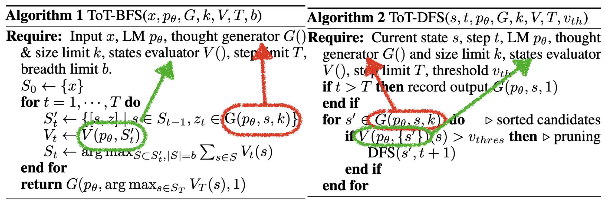
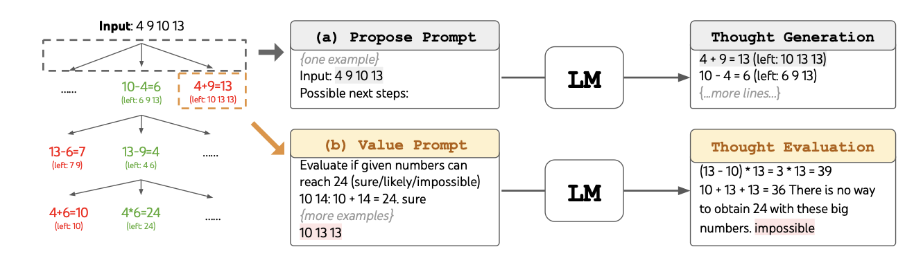
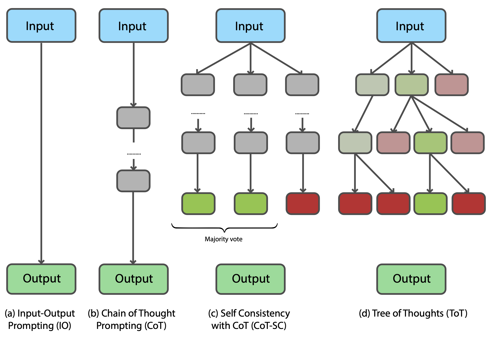
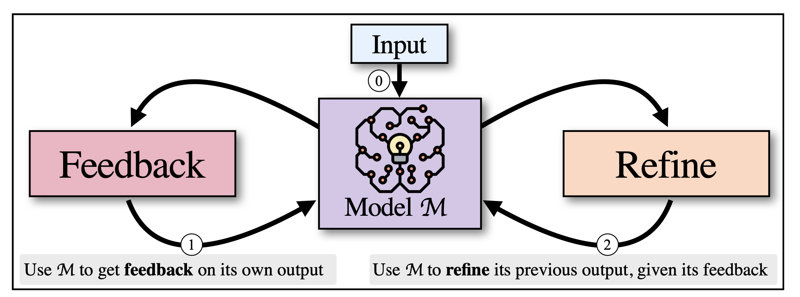
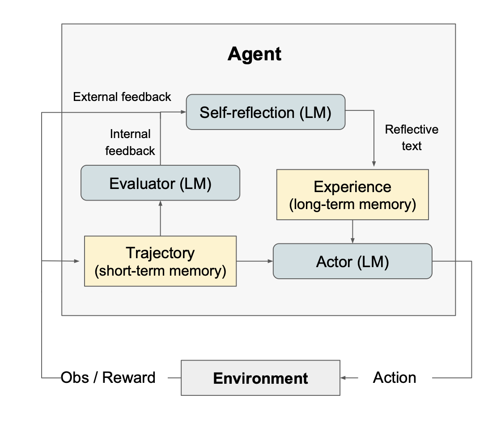
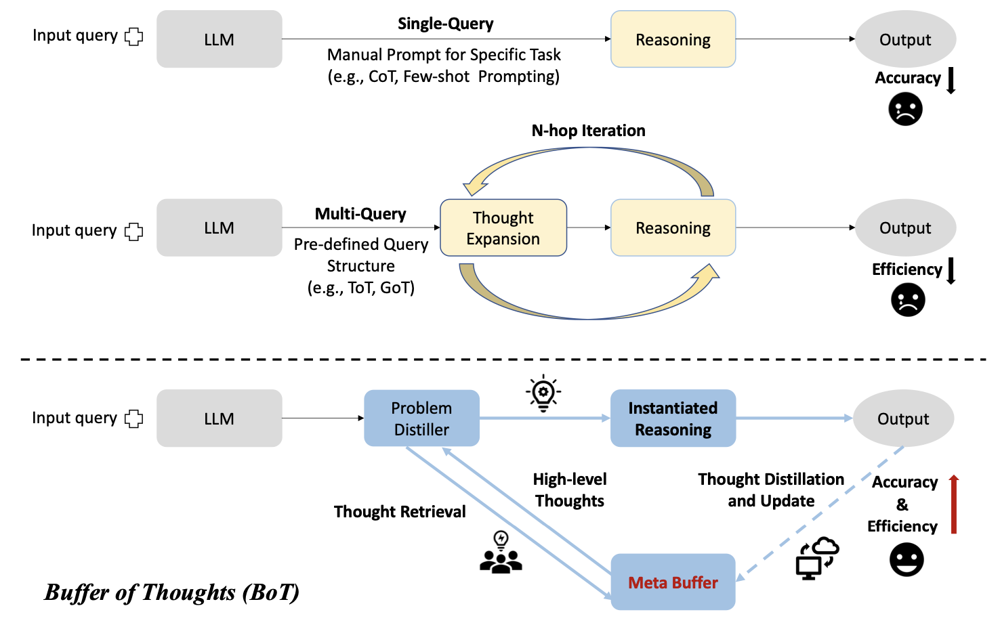

# Chapter 6 Multi-step Reasoning in LLMs

[Course index](../../README.md) · [Original source](https://arxiv.org/html/2610.13455v1#Ch6) · [Raw file](../../raw/originals/book.html)

Retrieved: 2026-11-13T16:41:17.579179+00:00

[Contents](../../CONTENTS.md) · [Full book](../book/full-book-html.md) · [Previous chapter](chapter-05-case-study-1-building-llms-from-scratch.md) · [Next chapter](chapter-07-vision-action-and-world-models.md)

### Chapter 6 Multi-step Reasoning in LLMs

**What You Will Learn**

In this chapter you will learn how language models can solve more complex problems through *multi-step reasoning*.
Specifically, you will be able to:

- Describe the *chain of thought* concept: how we can use in-context learning to guide the LLM to take intermediate steps in answering a query, and thus provide better answers to more complex queries.
- Describe how reasoning methods have increased the *power* of LLMs greatly, and why this power is essential for agentic LLMs to act realistically in the real world.
- Write your first *agentic harness*: a small algorithm that calls the LLM with different prompts. The agent harness manages the prompts and the replies from the LLM.
- Explain *self-reflection*: LLMs can be called in different roles by the harness, for example, to *evaluate* an answer, or to *generate* subproblems. The LLM is reflecting to improve its own answers.
- Understand the role that is played by *memory*: how the harness keeps track of the state of the agent, and how this state is used by the harness to manages the prompts.
- Use the concept of *reinforcement learning with verifiable rewards*: where inference-time reasoning results are used for finetuning.

#### 6.1 In-Context Reasoning

As we noted Chapter [3](chapter-03-the-large-language-model-training-pipeline.md#Ch3 "Chapter 3 The Large Language Model Training Pipeline ‣ Part I Language Modeling ‣ Agentic Large Language Models"), in large models, beyond hundreds of billions of parameters, a new kind of learning has emerged in LLMs. It is called *in-context learning* (ICL) or *prompt-learning* [[Brown et al., 2020](#bibe.bib59)]. It is an important learning method, which we will discuss in more detail in this section.
Then, we will discuss common benchmarks, and the chain of thought method for multi-step reasoning.

##### 6.1.1 In-Context Learning

In-context learning [[Dong et al., 2022](#bibe.bib52)] occurs not at training time, but at inference time, from examples that are provided in the LLM prompt, when the model is used to answer questions.
These examples cause the decoder model to access relevant knowledge stored in the LLM. Because of this rich knowledge, in-context learning finds accurate results with few examples, which is why it is a so-called *few-shot* learning method. The few-shot learning is made possible by the large size of the model, containing rich and varied knowledge on many topics.

###### Learning, not Training

A main difference between in-context learning and finetuning or pretraining is that in-context learning does not change the parameters of the transformer.
Since no model-parameters are changed at inference time, it is not a *parameter training* method; however, since it does learn an answer from provided examples, it is a *learning* method.
A consequence is that ICL has the disadvantage of forgetfulness: since model parameters remain unchanged, all learned information is lost between LLM calls. To share information between LLM calls, previous results must be added to the prompt of the next call, in the context window, as extra learning examples.

###### Context Window

How does in-context learning work?
The part of an LLM in which the prompt is written is called its *context window*. The decoder model learns inside this context window, from the examples that are provided in the prompt.
A point to note is that all examples that the answer is learned from must be provided together in the context window—they should fit in the prompt. Typically, the size of the context window is limited to a few thousand tokens, and only few examples can be provided: all ICL is able to perform is few-shot learning.
This becomes problematic when the amount of information that we wish to learn from grows, since the context window is typically limited in size. We might say that in-context learning suffers from long-term memory loss.

###### Example

In in-context learning, a prompt, consisting of a few pieces of
demonstration context, is concatenated with a query question, which is given
to the context window of the language model [[Liu et al., 2023](#bibe.bib40)]. The model will then generate the answer by performing a forward pass through the model. For example,
when the task is emotion recognition in a social media post, *I
missed the bus today*, can be followed by *I felt so [___]*, and the model could answer with *bad*.
Alternatively, for translation, we could follow *I missed the bus today*, by
*French: [___]* to request a translation.
The prompt contains background information that is recognized by the
model, selecting the desired model context.

###### Few-shot Learning and the Holy Grail of Machine Learning

In-context learning works when language models contain enough
knowledge, allowing them to generalize on the (few) examples provided in the prompt. The user provides a few relevant examples in the prompt, in order to prime the LLM to select the right background knowledge for answering the prompted instruction.
Contexts that contain a few examples
are said to perform few-shot learning. Contexts that contain
only instructions, with zero examples, are said to perform zero-shot learning.

ICL is a form of few-shot learning that caused much excitement among researchers.
In traditional machine learning, a model $f$ is trained on dataset.
To achieve high accuracy on complex problems, the datasets must contain many examples. Traditional machine learning is a form of *many-shot learning*, requiring many (expensive) training epochs to train the parameters of the model.
In-context learning, on the other hand, is cheap, requiring just a few examples followed by a single forward pass through the decoder model (since the expensive training has been done in the pretraining phase). Few-shot learning is something of the holy grail of machine learning: a model that generalizes, cheaply.

###### Practical Considerations and Prompt Engineering

In-context learning further has the practical advantage of convenience: we can perform ICL on an LLM that runs commercially in the cloud, from our smartphone, without going through the difficulty of finding a computer to train a large model on.

Although prompts provide a user-friendly interface to LLMs, the success of in-context learning tends to be quite sensitive to the way a prompt is formulated or when different examples are provided. Prompt-learning is brittle, and a
new field called *prompt engineering* has emerged to
help human users to learn how to
make LLMs do what we want them to do [[Radford et al., 2019](#bibe.bib53), [Wei et al., 2022a](#bibe.bib58), [Giray, 2023](#bibe.bib33), [Sahoo et al., 2024](#bibe.bib12)].

In most LLMs the context window is provided with hidden prompts, the system prompts, to specify a particular role for the model, to prevent the use of swear words, and, in chatbots, to have a short history of previous search results, to allow for more naturally flowing conversations.

In-context learning has spawned much further research. One of the areas is multi-step reasoning, which is the topic of this chapter. Reasoning used to be an area where LLMs performed poorly. For example, LLMs failed at simple math exercises. To better understand this application domain we will introduce a few reasoning benchmarks. Then we will discuss an in-context learning method that greatly improved the performance of reasoning by LLMs.

##### 6.1.2 Multi-step Reasoning Benchmarks

Progress in artificial intelligence is measured by benchmarks.
The research on multi-step reasoning with LLMs started with easy
(grade school)
math word problems. Specifically for the study of such easy reasoning the GSM8K benchmark was composed [[Cobbe et al., 2021](#bibe.bib57)].
GSM8K was created with the aim of providing high quality problems, of high
diversity and moderate difficulty, in natural language. It consists of 8500 human-written math
problems and solutions. Language models struggled to achieve good performance on this dataset before chain of thought was introduced (see the next section).
Here is an example of a typical math word problem:

> *Problem:* Romeo bakes 4 trays with
> two dozen batches of cookies in a week. If these cookies are shared amongst 16 people equally, how many cookies does
> each person consume?
>   
> *Answer:* $4\times 2\times 12/16=6$.

The GSM8K benchmark, although it may look easy to us, turned out to be difficult for LLMs. When it was introduced, the state of the art LLM GPT-3-175B achieved a rather low accuracy of around 15% [[Wei et al., 2022b](#bibe.bib70)].
Other benchmarks of similar math word problems are the SVAMP varying structures benchmark [[Patel et al., 2021](#bibe.bib44)], the
ASDiv dataset of diverse math problems [[Miao et al., 2021](#bibe.bib38)], the AQuA dataset of algebraic
word problems [[Ling et al., 2017](#bibe.bib67)], and the MAWPS benchmark
[[Koncel-Kedziorski et al., 2016](#bibe.bib37)].

Later, benchmarks for other tasks were introduced, to assess LLM reasoning abilities
in other fields of reasoning. For example, benchmarks have been developed on advanced mathematical questions (AIME [[Codeforces, 2024](#bibe.bib5)]),
computer code comprehension (Spider [[Yu et al., 2018](#bibe.bib6)], transcoding (translating a program in one computer language to another) [[Roziere et al., 2020](#bibe.bib7)]), robotic movement (Alfworld [[Shridhar et al., 2020](#bibe.bib25)], kitchen tasks [[Ahn et al., 2022](#bibe.bib61)]), puzzle solving (Game24 [[Yao et al., 2024](#bibe.bib42)]), creative writing [[Yao et al., 2024](#bibe.bib42)]), board games (Checkmate problems [[Yang et al., 2024](#bibe.bib34)], MineCraft [[Fan et al., 2022](#bibe.bib11)]), and webpage navigation (WebShop [[Yao et al., 2022a](#bibe.bib10)]).
Further relevant benchmark studies also focus on games and planning problems
[[Ruoss et al., 2024](#bibe.bib23), [Paglieri et al., 2025](#bibe.bib1), [Wen et al., 2025a](#bibe.bib9)].

The goal of benchmarks is to be able to clearly compare the performance of different approaches. However, it can be difficult to directly compare different benchmarking results, since there may be differences in the way the experiments were conducted. See [Kamoi et al. [2024]](#bibe.bib8), [Shojaee et al. [2025]](#bibe.bib13) for a critical discussion of challenges in benchmarking LLM reasoning.

##### 6.1.3 Chain of Thought Prompting

Around 2022, regular LLMs of the time performed poorly on simple math word problems. Interestingly, the standard Chapter [4](chapter-04-scaling-laws-and-efficient-large-language-models.md#Ch4 "Chapter 4 Scaling Laws and Efficient Large Language Models ‣ Part I Language Modeling ‣ Agentic Large Language Models") approach to improve performance of LLMs by scaling up the
size of the LLM, did not solve the problem [[Rae et al., 2021](#bibe.bib46)]. The problem appeared to be somehow fundamental in nature, and researchers went looking for a different approach.

The LLM architecture is
a transformer-based decoder. Given a certain input, it is designed to produce a single token. LLMs are next-token predictors. When we
prompt such a decoder to produce an answer, it does as it is instructed to: it provides an answer quickly—any answer. But that is not how humans work towards an answer in a mathematical reasoning problem, we divide the question into a sequence of steps to solve ($4\times 2\times 12/16=6$). Thus, for the LLM, what we should do instead is to prompt it to follow a well-chosen sequence of intermediate steps, answer those, and thus work towards the final answer, just as a student is taught to break down a complex problem into smaller steps, and to also provide the reasoning steps when answering a problem in school—*Don’t just tell me the answer, but tell me how you arrived at the answer*. Children are taught in school to break down a big problem into a sequence of small steps, when solving a mathematical problem. Similarly, we
should guide the language model to explicitly produce such intermediate steps, and then to combine the results. The LLM should then provide an answer that includes the intermediate steps, arriving at a correct result.

Thus, our few-shot prompt should contain examples of intermediate reasoning steps, instead of only examples of the final answer.
This question was studied by [Wei et al. [2022b]](#bibe.bib70), amongst others, who introduced the *chain of thought* approach. Figure [6.1](#Ch6.F1 "Figure 6.1 ‣ 6.1.3 Chain of Thought Prompting ‣ 6.1 In-Context Reasoning ‣ Chapter 6 Multi-step Reasoning in LLMs ‣ Part II Reasoning ‣ Agentic Large Language Models") illustrates how the approach works, in addition to related approaches, that it inspired.

The way to instruct an LLM to generate intermediate steps is to manually write a prompt consisting of specific reasoning steps to answer the task (for example, calculate how many balls are in the container, or in how many pieces the pie was cut).
Indeed, when [Wei et al. [2022b]](#bibe.bib70) tried this approach, and the LLM was prompted to rephrase information from the question as
intermediate reasoning steps in its answer, the LLM performed
much better than when it was prompted to produce a single answer. The example from the chain of thought paper is shown in Figure [6.1](#Ch6.F1 "Figure 6.1 ‣ 6.1.3 Chain of Thought Prompting ‣ 6.1 In-Context Reasoning ‣ Chapter 6 Multi-step Reasoning in LLMs ‣ Part II Reasoning ‣ Agentic Large Language Models"). When shown the longer example prompt,
the LLM follows the longer example when answering the question (Few-Shot CoT). On GSM8K, the chain of thought approach showed a large increase in accuracy, from 16% to 47%.

Figure 6.1: 
Different Chain of Though (CoT) prompting techniques [[Wei et al., 2022b](#bibe.bib70), [Kojima et al., 2022](#bibe.bib54), [Gao et al., 2023](#bibe.bib66), [Plaat et al., 2025](#bibe.bib29)]. At the top the prompts, at the bottom the answers.

The idea that, when prompted, an LLM can be made to follow step-by-step instructions, has caused much excitement and has opened up further research on multi-step reasoning with LLMs. Chain of thought (CoT) has become a standard prompting approach in LLMs since.

In the
original paper the prompts were hand-written by
the researchers for the individual types of problems.
[Kojima et al. [2022]](#bibe.bib54) go a step further.
They show that the addition of a single task-independent sentence (*Let’s think step by step*) also
significantly improves performance for many problems. Since this text does not contain problem-related elements, it is as a form of zero-shot learning.
Figure [6.1](#Ch6.F1 "Figure 6.1 ‣ 6.1.3 Chain of Thought Prompting ‣ 6.1 In-Context Reasoning ‣ Chapter 6 Multi-step Reasoning in LLMs ‣ Part II Reasoning ‣ Agentic Large Language Models") compares the approaches (second and third column).
Experiments further show that with this addition significant performance gains
are also achieved on other reasoning benchmarks, including arithmetic, symbolic, and logical reasoning (achieving 70% accuracy on GSM8K when self consistency (see next section) is also included, using the newer PaLM LLM [[Wang et al., 2022](#bibe.bib64)]).

The chain of thought idea itself is inspired by Scratchpad [[Nye et al., 2021](#bibe.bib68)], by other earlier work where natural language
steps are generated for arithmetic reasoning
[[Ling et al., 2017](#bibe.bib67), [Cobbe et al., 2021](#bibe.bib57)], and by the use of formal languages for reasoning [[Roy and Roth, 2016](#bibe.bib50), [Chiang and Chen, 2018](#bibe.bib49), [Amini et al., 2019](#bibe.bib48), [Chen et al., 2019](#bibe.bib47)].

###### 6.1.3.1 Self Evaluation

LLMs are not perfect, and errors in results occur.
When multiple reasoning steps are generated, errors accumulate. To prevent the errors from getting out of hand we should pay extra attention to the evaluation of results.
We will now review approaches to reduce error accumulation, either by examining the model, or by evaluating intermediate reasoning steps.

When LLMs are prompted to perform CoT reasoning, they
perform a sequence of steps. Performing multiple steps makes them
sensitive to mistakes and vulnerable to error
accumulation [[Weng et al., 2022](#bibe.bib56), [Xiao et al., 2023](#bibe.bib45)]. Several methods
have been developed to prevent error
accumulation. One approach is to create a new model to separately
evaluate the results. [Weng et al. [2022]](#bibe.bib56) propose an automated approach using evaluation by
the same LLM, called self verification. The LLM is prompted to use
the conclusion of the chain of thought reasoning chain as a
condition for solving the original problem and then compare
the answer, going back to the original question. The LLM is given variations of its own conclusion and is instructed to choose the one with the
highest similarity to the original question.

A popular related approach is self consistency [[Wang et al., 2022](#bibe.bib64)].
Self consistency is an ensemble approach (a well-known machine learning technique to make a strong learner by running multiple weaker
learners [[Sagi and Rokach, 2018](#bibe.bib39), [Breiman, 2001](#bibe.bib36)]).
Conventionally, the answer of an LLM query is extracted from the decoder network by greedily following the path with the highest logit values. In self consistency, greedy single-path decoding is replaced by majority voting over a wider sample of paths.
By sampling diverse reasoning paths, evaluating them, and selecting the most consistent answer among them, self consistency effectively asks the LLM to perform the same query multiple times, and takes the majority-vote of the internal decoding paths of the transformer model. Self consistency
works because complex reasoning problems typically
have different reasoning paths that lead to the
correct answer. Figure [6.2](#Ch6.F2 "Figure 6.2 ‣ 6.1.3.1 Self Evaluation ‣ 6.1.3 Chain of Thought Prompting ‣ 6.1 In-Context Reasoning ‣ Chapter 6 Multi-step Reasoning in LLMs ‣ Part II Reasoning ‣ Agentic Large Language Models") provides an example of the approach.

Figure 6.2: 
Self Consistency (Adapted from [[Wang et al., 2022](#bibe.bib64)]), showing majority voting

Self consistency has been evaluated on arithmetic reasoning, on commonsense
reasoning and on symbolic reasoning, with a variety of LLMs, including GPT-3.
Self consistency typically improves the performance of chain of thought
by a further 10-20 percentage points. Self consistency is often used in combination with chain of thought in modern LLMs.

###### 6.1.3.2 Code Generation for Validation

Another approach to improve the accuracy of a sequence of reasoning steps is to switch from a natural to a formal language. The advantage
of a formal language is that it is less ambiguous than a natural language. Examples are computer languages, such as Python, or mathematical logic.

LLMs have been quite successful in generating computer code from natural language prompts.
[Chen et al. [2021]](#bibe.bib55) introduced Codex, a GPT model that
was trained on publicly available code in the repository
GitHub. Codex is able to generate correct programs from
descriptions in natural language, such as commentary strings.
Subsequently, the use of a formal language for reasoning has become a popular approach. Many approaches generate the reasoning steps in Python, so that the code can be evaluated by a compiler, debugger, or interpreter.
Human programmers, when writing code, typically
follow a cycle of writing some code, compiling and executing it to look for errors,
and then using the feedback to improve the code. This approach
is followed, for example, in self debugging
[[Chen et al., 2023](#bibe.bib62)]. It follows the same steps of code generation,
code execution, and code explanation.
Self debugging is able to identify mistakes in its own
code by investigating the execution
results, and can also provide an explanation of the generated code, in
natural language.

Another approach, program aided language [[Gao et al., 2023](#bibe.bib66)], uses the LLM to generate Python and then use an interpreter to evaluate the result. In this approach the problem is translated into small pieces of Python code, that can then be executed by an interpreter to solve the problem.
Figure [6.1](#Ch6.F1 "Figure 6.1 ‣ 6.1.3 Chain of Thought Prompting ‣ 6.1 In-Context Reasoning ‣ Chapter 6 Multi-step Reasoning in LLMs ‣ Part II Reasoning ‣ Agentic Large Language Models") (fourth column) illustrates the program aided language approach.
When the evaluation of the reasoning steps is offloaded to the Python
interpreter, decomposing the natural language problem into executable
code-steps
remains the only task for the LLM. [Gao et al. [2023]](#bibe.bib66) provide extensive experimental
evidence showing the synergy between the neural LLM and the symbolic interpreter.
Experiments were performed on 13 mathematical, symbolic, and algorithmic reasoning
tasks, achieving more accurate results than much larger
models of the time (for example, program aided language reported 72% on GSM8K and 93% on Penguins).

###### 6.1.3.3 Evolving code generation prompts

The work on verification with formal languages has lead to several works that generate working code tuned for solving specific problems automatically, without human feedback.
[Romera-Paredes et al. [2024]](#bibe.bib26) introduced FunSearch, an approach that integrates formal methods and LLMs to enhance mathematical reasoning and code generation. FunSearch uses a genetic approach with multiple populations of candidate solutions (programs), which are evaluated using a function depending on the problem specification. After evaluating the generated programs from the starting prompt, a new prompt is created, in an iterative fashion, combining a selection of sampled programs sorted according to their evaluation score, and the LLM is requested to generate a new program.
Another work leverages evolutionary computation methods to generate and optimize evolutionary algorithms [[van Stein and Bäck, 2024](#bibe.bib27)]. This approach, LLaMEA (Large Language Model Evolutionary Algorithm), utilizes LLMs to design and optimize evolutionary algorithms. The approach uses LLMs to generate initial algorithmic structures, which are then refined through mutation and selection. Accuracy improvements on the Black-Box Optimization Benchmark (BBOB) [[Hansen and Ros, 2010](#bibe.bib4)] are reported of 11 percentage points.

#### 6.2 Self-Reflection and State

In-context learning has emerged as a powerful new few-shot learning method. When our few-shot examples specify reasoning steps, we can improve the capabilities of LLMs even more.

In this section we will look at some of the limits of in-context learning,
and we will look at ways to extend the limits.
We will first discuss the question of state and memory. We will look at how state can be passed between separate invocations of LLMs, at long context windows, and at the question if LLMs are good at solving problems for which they have to manipulate state.

##### 6.2.1 LLMs are Memory-less Functions

In-context few-shot learning exploits the capabilities of LLMs to retrieve knowledge, conditioned by the prompt. The instructions and examples are provided, and the transformer architecture finds the answer (next token) in its vast model of $(K,V)$-parameters. With chain of thought prompts, the LLM is conditioned on few-shot reasoning steps that are specified in the prompt.

In-context learning uses the LLM in a functional way, where all input to the LLM is provided in the prompt. The model $f$ finds the answer $a$ for the input prompt $p$:

|  |  |  |
| --- | --- | --- |
|  | $$ f(p)\rightarrow a. $$ |  |

In principle, LLMs do not retain information between LLM calls (model parameters remain unchanged, and there are no global variables with history). If we wish to refine our request, and we wish to carry state information from the previous call to the next, then all such state must be specified by the user in the new prompt $p^{\prime}$. The model itself has forgotten all about the previous answer.

For a chatbot, repeating the entire conversational history in each new question would be a cumbersome and unnatural way of conversing. In human conversation our conversation partners do remember what was last said, without us having to explicitly repeat their last sentence (although, when interviewing politicians, journalists sometimes use this method to try to keep them on message).
Commercial chatbots overcome this problem in part using system prompts, by invisibly providing the output of the previous LLM call to the prompt for a new LLM query. However, the principle remains that LLMs are good at finding associative next-token answers for a prompt, but not at all at remembering answers and manipulating the state of variables as we know them from general computer programming languages. As no parameters are changed, LLMs do not remember in-context state between calls.

##### 6.2.2 Retrieval Augmentation and Long Context Windows

The LLM-memory problem goes deeper. All information for the query must be specified in a context window. The size of this context window is limited, which fundamentally limits the amount of information that can be communicated to the LLM for a query. This limitation is a problem when a large text (such as a book) is to be summarized. Furthermore, in Section [20.2.1](chapter-20-advanced-transformer-and-agentic-architectures.md#Ch20.S2.SS1 "20.2.1 In-Context Reinforcement Learning ‣ 20.2 Agentic Architectures ‣ Chapter 20 *Advanced Transformer and Agentic Architectures ‣ Part VI Advanced Topics ‣ Agentic Large Language Models") we will discuss in-context *reinforcement* learning methods, that work by storing full episode histories in the context window. In short, methods are needed to pass more information to the LLM.

One of the earliest methods to extend the amount of information at inference time is *retrieval augmentation for generative AI* (RAG). RAG lets the LLM place a call to external data, such as a corporate database, or to Wikipedia [[Lewis et al., 2020](#bibe.bib32)]. RAG’s use is also in reducing factual hallucinations and providing access to time-sensitive information, such as financial or logistics data. RAG will be discussed in Chapter [12](chapter-12-search-and-retrieval-in-agentic-llms.md#Ch12 "Chapter 12 Search and Retrieval in Agentic LLMs ‣ Part IV Tools and Assistants ‣ Agentic Large Language Models").

For passing longer texts to the model, LLMs have been developed with longer context windows. With the standard transformer architecture, the compute requirements scale quadratically with the size of the context window, and linear architectures are being developed [[Ren et al., 2024](#bibe.bib15)]. Another solution is to compress the information in the context window, for example using semantic compression [[Fei et al., 2024](#bibe.bib60)], by chunking the information [[Wang et al., 2023](#bibe.bib17), [Zhou et al., 2025](#bibe.bib14)], or by recursive methods [[Zhang et al., 2025](#bibe.bib28)].
Devising novel memory architectures for LLMs is an active area of research [[Yan et al., 2025](#bibe.bib16)].

Figure 6.3: Tic Tac Toe is a Simple Board Game, in which State is important

##### 6.2.3 LLMs and Stateful Problems

LLMs perform poorly at solving problems in which state must be managed [[Wong et al., 2025](#bibe.bib63)]. This occurs for example in planning problems in which the current state has to be remembered accurately, even in simple board games such as the one shown in Figure [6.3](#Ch6.F3 "Figure 6.3 ‣ 6.2.2 Retrieval Augmentation and Long Context Windows ‣ 6.2 Self-Reflection and State ‣ Chapter 6 Multi-step Reasoning in LLMs ‣ Part II Reasoning ‣ Agentic Large Language Models"). LLMs tend to mix up the states, and to provide plausible sounding answers that may be correct for games that it has seen in its training corpus, but that are wrong for the actual board state at hand [[Paglieri et al., 2025](#bibe.bib1), [Ruoss et al., 2024](#bibe.bib23)].

Many approaches have been tried to improve reasoning with state, often inspired by reinforcement learning and planning algorithms [[Wong et al., 2026](#bibe.bib3)].
To see how LLMs can be used to solve these stateful problems, we discuss how the memory-less nature of LLMs makes them suffer from a problem known as the *knowing-doing gap*. Other, advanced, methods have been developed to allow LLMs to deal better with stateful problems. Chapter [20](chapter-20-advanced-transformer-and-agentic-architectures.md#Ch20 "Chapter 20 *Advanced Transformer and Agentic Architectures ‣ Part VI Advanced Topics ‣ Agentic Large Language Models") will discuss these advanced approaches.

###### Knowing-Doing Gap

In addition to the lack of state *between* LLM calls, there is another memory-related problem, in the *internal* execution by the LLM of certain tasks.

This problem has been named the *knowing-doing gap*. This gap describes the curious phenomenon where an LLM is able to generate a correct textual description to solve a problem, even the correct algorithm, but is not able to execute this algorithm correctly [[Paglieri et al., 2025](#bibe.bib1)]. When you ask an LLM how to solve a certain problem, it can promptly provide the right algorithm in executable Python code. When one subsequently asks it to actually solve this problem, the LLM does not correctly follow the algorithm that it just generated. More often than not, errors start appearing between state changes of the variables in the algorithm that it generated [[Paglieri et al., 2025](#bibe.bib1), [Ruoss et al., 2024](#bibe.bib23)]. Note that faithfully executing algorithmic code step by step, tracking values in registers, is not what the attention-based transformers in LLMs were designed for at all—they were designed to simulate natural language processing through a form of associative memory [[La Malfa et al., 2024](#bibe.bib65)].11
1
Note further that the human mind sometimes has the same problem: we can easily describe an algorithm for long division, but when asked to compute $12345/42$, we may make mistakes—computers are good at this, but not humans, and also not LLMs.

In addition to the knowing-doing gap, there is another state-management problem.
Prompting an LLM to play the first few moves of a board game against itself may show a game in which pieces on the board magically (dis)appear between moves. The model does not recognize that the moves that it plays that may have been good in certain situations, do not fit the current board position, and even decorates these wrong moves with a plausibly sounding reason in a chatty conversational style. LLMs have difficulty reliably managing the state transition of a variable that goes from one value to another value. Individual values tend to be forgotten or mixed up. Additional text can be inserted into the prompt to instruct the model to carefully track values of variables before making a next step [[La Malfa et al., 2024](#bibe.bib65)], but this is a cumbersome and error-prone solution.

Both the knowing-doing gap and the disappearing-pieces problem can be circumvented by calling an external interpreter to execute an LLM-generated algorithm. This strategy is sometimes taken by commercial chatbots. It is a smart, practical, solution, since, in addition to being able to correctly execute Python code, the Python interpreter will do so more efficiently than an LLM.

Chapter [20](chapter-20-advanced-transformer-and-agentic-architectures.md#Ch20 "Chapter 20 *Advanced Transformer and Agentic Architectures ‣ Part VI Advanced Topics ‣ Agentic Large Language Models") will discuss other approaches that address state and memory in the transformer architecture.

##### 6.2.4 Agentic Harness for Prompt Improvement

In addition to resorting to externally executing generated code, other methods have been developed to deal with memory and state. In this section, we will go agentic, and introduce small external algorithms to explicitly manage state and prompts. Such an algorithm is called a *harness*. The harness may also call the same LLM in different roles, with different prompts for each role, for example, for *generation* or for *evaluation* of states. We start with prompt management based on search algorithms.

When the LLM is called in different roles, for example to critique (evaluate) its own performance (that it just generated), the LLM can be said to perform *self-reflection*. This somewhat anthropomorphic term is often used in the literature for these approaches. Exactly what (not who) is doing the self-reflecting, the LLM, or the agentic harness, is a matter for debate.

###### 6.2.4.1 Search-based Prompt Optimization

We will now discuss search-based inference-time decision methods.
These are in-context learning methods that go beyond chain of thought. Chain of thought explores a single line of reasoning steps, where each step has a single successor step. Search-based methods explore multiple options at each step, creating a tree of possibilities.

When we wish to examine a tree of possible reasoning steps, then we need a method to keep track of the state of which step we have seen, what the best answer so far was, and which steps should still be further examined. As we have seen, LLMs are not terribly good at keeping track of state, whereas conventional computer algorithms, such as small pieces of Python code, are.
Such an algorithm will decompose the problem into a search tree, where multiple alternative steps are
generated that can be searched multiple steps into the future (see Figure [6.6](#Ch6.F6 "Figure 6.6 ‣ 6.2.4.1 Search-based Prompt Optimization ‣ 6.2.4 Agentic Harness for Prompt Improvement ‣ 6.2 Self-Reflection and State ‣ Chapter 6 Multi-step Reasoning in LLMs ‣ Part II Reasoning ‣ Agentic Large Language Models") on page [6.6](#Ch6.F6 "Figure 6.6 ‣ 6.2.4.1 Search-based Prompt Optimization ‣ 6.2.4 Agentic Harness for Prompt Improvement ‣ 6.2 Self-Reflection and State ‣ Chapter 6 Multi-step Reasoning in LLMs ‣ Part II Reasoning ‣ Agentic Large Language Models")). The algorithms call the LLM as a subroutine prompting it to perform requested tasks, such as action selection and reward evaluation. Then, backtracking can be performed by the algorithm, allowing alternative steps to be tried. This control algorithm is external to the LLM. It wraps around the LLM, keeping track of state, managing the prompts, shielding it from the outside world (and shielding the outside world from LLMs that mess up state). The control algorithm is called a *harness*.

We start our discussion of control strategies with depth-first and breadth-first search [[Cormen et al., 2022](#bibe.bib2)].
Tree of thoughts [[Yao et al., 2024](#bibe.bib42)] uses breadth-first or depth-first search to dynamically follow different reasoning steps.22
2
Tree of thoughts is a popular approach. The Huggingface link is here: <https://huggingface.co/blog/sadhaklal/tree-of-thoughts> Both the generation (red) and the evaluation (green) part in tree of thoughts are performed by prompting the LLM, see Figure [6.4](#Ch6.F4 "Figure 6.4 ‣ 6.2.4.1 Search-based Prompt Optimization ‣ 6.2.4 Agentic Harness for Prompt Improvement ‣ 6.2 Self-Reflection and State ‣ Chapter 6 Multi-step Reasoning in LLMs ‣ Part II Reasoning ‣ Agentic Large Language Models").

Figure 6.4: 
Tree of Thoughts. Left Breadth First Search, Right Depth First Search. The arrows indicate the LLM prompts (after [[Yao et al., 2024](#bibe.bib42)])

Together, the two LLM prompts with the external control,
allow systematic exploration of the space of reasoning steps, performing look-ahead and backtracking.

Figure 6.5: 
Tree of Thoughts Example prompts for Game of 24 [[Yao et al., 2024](#bibe.bib42)]

Tree of thoughts (ToT) has been used on planning-based puzzles, such as the Game of 24. In this game, 4 numbers are give, and the task is to reach the number 24 by using the arithmetic operators $(+-*/)$ in between the numbers. For example, for the numbers $4$ $9$ $10$ $13$, a solution would be $(10-4)*(13-9)=24$. Tree of thoughts first generates a position with the *propose* prompt: `Input 4 9 10 13; Possible next steps:` to which the model answers by generating possible next step thoughts. These are then evaluated by the model with an evaluation prompt including chain of thought examples. Figure [6.5](#Ch6.F5 "Figure 6.5 ‣ 6.2.4.1 Search-based Prompt Optimization ‣ 6.2.4 Agentic Harness for Prompt Improvement ‣ 6.2 Self-Reflection and State ‣ Chapter 6 Multi-step Reasoning in LLMs ‣ Part II Reasoning ‣ Agentic Large Language Models") shows a possible prompting sequence from the original paper.

The authors compare their approach to traditional linear chain of thought with self consistency on the Game of 24, Creative writing, and Mini crossword, achieving an accuracy of 74% on a Game of 24 task. The other tasks are evaluated qualitatively. Figure [6.6](#Ch6.F6 "Figure 6.6 ‣ 6.2.4.1 Search-based Prompt Optimization ‣ 6.2.4 Agentic Harness for Prompt Improvement ‣ 6.2 Self-Reflection and State ‣ Chapter 6 Multi-step Reasoning in LLMs ‣ Part II Reasoning ‣ Agentic Large Language Models") illustrates the different reasoning structures.
33
3
A similarly named approach is graph of thoughts [[Besta et al., 2024](#bibe.bib35)]. Graph of thoughts allows more general reasoning graphs, providing a formal framework, where the different elements can then be specified manually.

Figure 6.6: Reasoning structure of Chain of Thought (b), Self Consistency (c), Tree of Thoughts (d)

Tree of thoughts is an elegant approach, adding two of the simplest possible search structures on top of an LLM. The sequence of prompts is easy to follow, and finding and correcting mistakes is also easy.

The two search methods of tree of thoughts follow a fixed expansion policy.
Next, we will discuss more advanced learning-based approaches, that may perform better, at the cost of higher algorithmic complexity.

###### 6.2.4.2 Self-Reflection

Many approaches have been devised that use the LLM in more than one role. Such approaches are generally called self-reflective approaches. The LLM is used not just to evaluate a prompt, but also to generate new reasoning steps, and often to refine them.

The field of self-reflection is young and new approaches are being developed regularly. We will present four such approaches: self refine, ReAct, reflexion, and buffer of thoughts. These approaches use the LLMs in different ways, using schemes inspired by reinforcement learning to let the LLMs improve themselves.

###### Self Refine

The first approach is self refine [[Madaan et al., 2023](#bibe.bib71)]. This approach aims to improve answers from feedback. The LLM generates an initial output and provides feedback for
its answer, using the LLM to refine itself, iteratively. The LLM is thus used to improve its own answers, see
Figure [6.7](#Ch6.F7 "Figure 6.7 ‣ Self Refine ‣ 6.2.4.2 Self-Reflection ‣ 6.2.4 Agentic Harness for Prompt Improvement ‣ 6.2 Self-Reflection and State ‣ Chapter 6 Multi-step Reasoning in LLMs ‣ Part II Reasoning ‣ Agentic Large Language Models").

Figure 6.7: 
Self Refine Architecture [[Madaan et al., 2023](#bibe.bib71)]

Self refine prompts the LLM in three ways: (1) for initial generation, (2) for
feedback, and (3) for refinement, following a greedy reasoning chain. Self refine reportedly improves significantly over regular chain of thought, on benchmarks such as dialogue
response generation, code optimization, and
constrained generation. This approach does follow a linear, greedy, reasoning chain, where a single successor is tried in a state (it does not explore a tree, as in ToT).

###### ReAct

Generalizing the greedy approach, we can use LLMs to examine multiple options per state.
A notable approach that combines reinforcement learning and LLMs is ReAct [[Yao et al., 2022b](#bibe.bib72)].44
4
<https://github.com/ysymyth/ReAct>
ReAct uses chain of thought prompt-learning as part of a reinforcement learning framework that also uses external knowledge sources (Wikipedia) and finetuning; for error reduction, grounding, and for reducing hallucination. The framework allows hand-written prompts.
On two interactive decision
making benchmarks (Alfworld and WebShop),
ReAct outperforms imitation
and reinforcement learning methods by an absolute success rate of 34%
and 10% respectively.

###### Reflexion

The ReAct work has been developed further.
Reflexion [[Shinn et al., 2024](#bibe.bib69)] creates AI agents that learn by reflecting on failures and
enhance their results, inspired by the way that humans do this.55
5
<https://github.com/noahshinn/reflexion>
Reflexion uses three prompts for the LLM: actor, evaluator, and reflector.
The reflexion harness incorporates explicit memory between LLM calls. For trajectory generation it has a short-term memory, and for storing experience information it has a long term memory. This approach addresses the state management problem of regular LLMs using memory in the external algorithm. Reflexion
works as follows: (1) an actor model generates text and actions,
(2) an evaluator model scores the outputs produced by the actor,
and (3) a self-reflection model generates verbal reinforcement
cues to assist the actor to self-improve (see Figure [6.8](#Ch6.F8 "Figure 6.8 ‣ Reflexion ‣ 6.2.4.2 Self-Reflection ‣ 6.2.4 Agentic Harness for Prompt Improvement ‣ 6.2 Self-Reflection and State ‣ Chapter 6 Multi-step Reasoning in LLMs ‣ Part II Reasoning ‣ Agentic Large Language Models")).
For the actor, chain of thought
and ReAct can be used. Reflexion has been evaluated on
decision-making, reasoning, and coding tasks. Improvements of 10-20
percentage points are reported [[Shinn et al., 2024](#bibe.bib69)].

Figure 6.8: 
Architecture of Reflexion [[Shinn et al., 2024](#bibe.bib69)], showing a close resemblance to the agent/environment structure of reinforcement learning

###### Buffer of Thoughts

Another approach is buffer of thoughts [[Yang et al., 2024](#bibe.bib34)], which goes a step towards metareasoning [[Gao et al., 2024](#bibe.bib22)]. It introduces a meta-buffer that stores high-level *thought-templates*. Thought-templates are derived from a variety of tasks. Buffer of thoughts uses a problem distiller that stores high-level
thoughts distilled from different problems in a meta-buffer, which is actively managed for capacity. Figure [6.9](#Ch6.F9 "Figure 6.9 ‣ Buffer of Thoughts ‣ 6.2.4.2 Self-Reflection ‣ 6.2.4 Agentic Harness for Prompt Improvement ‣ 6.2 Self-Reflection and State ‣ Chapter 6 Multi-step Reasoning in LLMs ‣ Part II Reasoning ‣ Agentic Large Language Models") compares the buffer of thoughts approach to other approaches such as chain of thought and tree of thoughts. Buffer of thoughts outperforms other methods in puzzles such as Game of 24 (by 11%) and checkmating (by 51%).
Thought templates are related to metacognition (thinking about thinking) [[Didolkar et al., 2024](#bibe.bib43)].

Figure 6.9: 
Buffer of Thoughts [[Yang et al., 2024](#bibe.bib34)]

###### Critique and Prompt Sensitivity

The concept of self-reflection is not without pitfalls and criticism. To start, the basic idea of asking a model to refine its results begs the question why the model did not give the better answer in the first place. Next, studies by [Huang et al. [2023]](#bibe.bib18), [Shojaee et al. [2025]](#bibe.bib13) find methodological issues with some of the studies, such as the use of data labels that reveal the answer, second refinement prompts that unintentionally reveal more information than the initial prompts, and the use of the same LLM for agent and environment. In one reproducibility study performance did not exceed that of chain of thought with self consistency [[Huang et al., 2023](#bibe.bib18)]. LLMs are sensitive to how a question is formulated in the prompt. Self-reflection is still a young and active field of research, with an appealing premise, but many open questions.

The approaches that we have presented potentially make many LLM calls, which can become expensive and slow. Finding the optimum approach for your problem may require quite some experimentation. In Chapter [10](chapter-10-case-study-2-balrog-for-llm-reasoning-and-reflection.md#Ch10 "Chapter 10 Case Study 2: BALROG for LLM Reasoning and Reflection ‣ Part III Agents ‣ Agentic Large Language Models") we will discuss a practical case study where we will get hands-on experience with self-reflection methods. Please keep the preceding critique in mind.

###### 6.2.4.3 Reinforcement Learning with Verifiable Rewards

The focus of this chapter is on in-context learning. In-context learning occurs at inference time, and no parameters are trained or changed. Finetuning occurs at training time, and does change the parameters of the model. In this section we will, however, briefly talk about a mix of finetuning and in-context learning, we will be mixing training and inference.

Reinforcement learning with verifiable rewards refers to an algorithmic approach for training
language models on tasks with verifiable outcomes such as mathematical problem-solving and instruction
following. Especially for reasoning problems, such as math word problems and coding, inference-time chain of thought results have been found to significantly improve models when they are used for finetuning.

RLVR is an improvement over reinforcement learning from human feedback (RLHF), dispensing with the need for human feedback. In many domains, such as mathematics, a simple function exists to check if an answer is correct, without the need for human feedback. RLVR leverages the existing RLHF objective but replaces the reward model with a verification
function. RLVR samples completions
from a policy model given a set of prompts, and verifies their correctness using a deterministic function. If correct, the reward is positive, otherwise it is 0. This reward is then used to train against using PPO [[Schulman et al., 2017](#bibe.bib41)] (a standard reinforcement learning algorithm), as in RLHF.

An influential approach of this type was proposed in the development of DeepSeek-R1 [Guo et al. [2025]](#bibe.bib24). This method distinguishes itself from external reasoning approaches by emphasizing the model’s self-generated reasoning steps. It learns the steps through reinforcement learning, integrating data generation and training in a single loop. Lowering the supervised data requirements to train LLMs,
DeepSeek’s methodology leverages reinforcement learning to enable models to evolve reasoning skills autonomously. By starting with a base model and applying reinforcement learning, the system identifies and reinforces effective reasoning patterns. DeepSeek uses group-relative policy optimization (GRPO), which calculates advantages with
group-based scoring [[Shao et al., 2024](#bibe.bib31)].

One of the key features of DeepSeek’s approach is the emergence of sophisticated reasoning behaviors during finetuning, such as reflection and exploration of alternative problem-solving methods [[Mercer et al., 2025](#bibe.bib30)]. These behaviors arise spontaneously as a result of the model’s interaction with the reinforcement learning environment, rather than being pre-programmed, and without external self-reflection loops. For example, DeepSeek-R1-Zero learns to allocate more thinking time to problems by reevaluating its initial approach.
This autonomous approach of *learning to reason* may lead to more stable and adaptive reasoning LLMs.

One of the successes behind GRPO is its focus on applications for which verifiable rewards exist, allowing reinforcement learning methods to be used. The focus on verifiable rewards has been quite successful, and reinforcement learning with verifiable rewards (RLVR) methods are often used in finetuning LLMs [[Lambert et al., 2024](#bibe.bib21)].

RLVR methods such as GRPO are typically used dynamically, where an inference time chain of thought query is used to answer a query from the training set to finetune the model. Thus, test time inference is used for finetuning.
The impressive results of DeepSeek [[Guo et al., 2025](#bibe.bib24)] have made GRPO [[Shao et al., 2024](#bibe.bib31)] and RLVR [[Lambert et al., 2024](#bibe.bib21), [Guo et al., 2025](#bibe.bib24), [Wen et al., 2025b](#bibe.bib19), [Yue et al., 2025](#bibe.bib20)] highly popular finetuning methods.

#### 6.3 Concluding Remarks

In the preceding pages we have seen how the reasoning capabilities of language models can be improved. The best-known approach is chain of thought, which is a prompt-engineering method that shows an LLM to provide a multi-step reasoning when it is answering a question, just like we are taught in school when we are shown how to solve math exercises. More elaborate prompt improvement algorithms have been introduced, from depth-first search, via self-reflection, to inference-time reinforcement learning methods. Advanced training methods such as RLVR combine inference-results with finetuning, achieving strong training results.

##### 6.3.1 Brittleness

We have discussed many different algorithmic approaches to create an agentic harness. There are multiple reasons why there are so many. First, the field of agentic LLM is still young, many challenges exist, leading to many new solutions.

Second, the methods are quite brittle. Small changes in prompts, a comma here or there, sometimes make the difference whether an approach works or not. Small changes in hyperparameters, such as the temperature of your model, or even using a different seed of a random number generator, may have large effects. Changes to the memory management method of the agentic harness, or using a different LLM, may all have a large effect on performance.

This may feel like a unsatisfactory state of affairs. Indeed, the field is young, and it will take some years before methods have stabilized. In your experiments, you should keep in mind to always do multiple runs, with different seeds, different models, and different hyperparameter settings. This will help you better understand how your solution works in different circumstances.

##### 6.3.2 Thinking, Fast and Slow

To conclude this chapter we will discuss reasoning in LLMs in a broader perspective. In the history of AI, two approaches, or schools of thought, can be seen: symbolic AI and connectionist AI. Symbolic AI roughly corresponds to the idea that intelligence is best modeled as the manipulation of symbols via the rules of logic. Connectionist AI studies whether intelligence emerges spontaneously out of interactions between connected elements (be they neurons, cells, ants, humans, or robots). Symbolic AI draws on mathematics, connectionist AI on biology. As we already saw in Section [2.3](chapter-02-foundations-of-language-modeling-with-llms.md#Ch2.S3 "2.3 Modeling Language ‣ Chapter 2 Foundations of Language Modeling with LLMs ‣ Part I Language Modeling ‣ Agentic Large Language Models"), both schools have developed useful methods, and both schools have seen important successes (such as search algorithms and reasoning, or deep learning and LLMs).

In 2011 Daniel Kahneman published the book *Thinking, Fast and Slow* in which the terms System 1 and System 2
were used to distinguish human thought into intuitive, fast, thinking, and deliberative,
slow, thinking [[Kahneman, 2011](#bibe.bib51)]. These terms have become
popular in artificial intelligence, where fast thinking is linked to associative lookup and slow thinking to multi-step reasoning. At inference time, zero-shot LLMs think fast (System 1 thinking).
Inference-time step-by-step methods (either through longer prompts or with an agentic harness) perform deliberative
slow thinking
(System 2 thinking).

LLMs are based on the connectionist AI tradition (System 1). The
use of tools at inference time enhances the LLM part with
knowledge retrieval or processing tools from the symbolic AI tradition
(System 2).

We should note that whereas researchers sometimes humanize LLMs and their capabilities, LLMs only perform next-token prediction. LLMs are not even close to being human. By generating more tokens to form an answer (reasoning step-by-step), the token-path from the prompt to the final answer becomes longer. The reason that this leads more often to correct answers, might be because it takes smaller steps into the direction of the answer, making the correct answer more plausible with every step in between—not that it is similar to the way humans are taught to solve the problem. Reasoning is narrowing down probabilities such that the correct answer becomes more probable to generate, independent of interpretations related to human cognition [[Guo et al., 2025](#bibe.bib24)].

##### 6.3.3 Conclusion

In this chapter we have discussed how LLMs can solve language tasks by next-token prediction, and solve tasks that require multi-step reasoning. We have discussed ways to manage complex reasoning structures.

Most methods are in-context methods, efficient and easy to use since the prompts that guide the reasoning are readable by the user. We have introduced the rule of an agentic harness for prompt improvement and memory management. We have also touched upon methods that use pretraining and finetuning, not just for the language part, but also for integrating multi-step reasoning. These methods thus train models for decision making, beyond pure next-token prediction in language models.

There has been much activity in the creation of such richer models, adding visual reasoning, decision making, and actions to become an integral part of the LLMs. In the next chapter we will look deeper into these pretrained and finetuned multi-modal models.

### References

- Ahn et al. (2022)
  M. Ahn, A. Brohan, N. Brown, Y. Chebotar, O. Cortes, B. David, C. Finn, C. Fu, K. Gopalakrishnan, K. Hausman, et al.
  Do as i can, not as i say: grounding language in robotic affordances.
  arXiv preprint arXiv:2204.01691.
  Cited by: [§6.1.2](#Ch6.S1.SS2.p3.1 "6.1.2 Multi-step Reasoning Benchmarks ‣ 6.1 In-Context Reasoning ‣ Chapter 6 Multi-step Reasoning in LLMs ‣ Part II Reasoning ‣ Agentic Large Language Models").

- Amini et al. (2019)
  A. Amini, S. Gabriel, P. Lin, R. Koncel-Kedziorski, Y. Choi, and H. Hajishirzi
  Mathqa: towards interpretable math word problem solving with operation-based formalisms.
  arXiv preprint arXiv:1905.13319.
  Cited by: [§6.1.3](#Ch6.S1.SS3.p7.1 "6.1.3 Chain of Thought Prompting ‣ 6.1 In-Context Reasoning ‣ Chapter 6 Multi-step Reasoning in LLMs ‣ Part II Reasoning ‣ Agentic Large Language Models").

- Besta et al. (2024)
  M. Besta, N. Blach, A. Kubicek, R. Gerstenberger, M. Podstawski, L. Gianinazzi, J. Gajda, T. Lehmann, H. Niewiadomski, P. Nyczyk, et al.
  Graph of thoughts: solving elaborate problems with large language models.
  Proceedings of the AAAI Conference on Artificial Intelligence 38 (16), pp. 17682–17690.
  Cited by: [footnote 3](#Ch6.footnote3 "In 6.2.4.1 Search-based Prompt Optimization ‣ 6.2.4 Agentic Harness for Prompt Improvement ‣ 6.2 Self-Reflection and State ‣ Chapter 6 Multi-step Reasoning in LLMs ‣ Part II Reasoning ‣ Agentic Large Language Models").

- Breiman (2001)
  L. Breiman
  Random forests.
  Machine learning 45, pp. 5–32.
  Cited by: [§6.1.3.1](#Ch6.S1.SS3.SSS1.p3.1 "6.1.3.1 Self Evaluation ‣ 6.1.3 Chain of Thought Prompting ‣ 6.1 In-Context Reasoning ‣ Chapter 6 Multi-step Reasoning in LLMs ‣ Part II Reasoning ‣ Agentic Large Language Models").

- Brown et al. (2020)
  T. Brown, B. Mann, N. Ryder, M. Subbiah, J. D. Kaplan, P. Dhariwal, A. Neelakantan, P. Shyam, G. Sastry, A. Askell, et al.
  Language models are few-shot learners.
  Advances in neural information processing systems 33, pp. 1877–1901.
  Cited by: [§6.1](#Ch6.S1.p1.1 "6.1 In-Context Reasoning ‣ Chapter 6 Multi-step Reasoning in LLMs ‣ Part II Reasoning ‣ Agentic Large Language Models").

- Chen et al. (2021)
  M. Chen, J. Tworek, H. Jun, Q. Yuan, H. P. d. O. Pinto, J. Kaplan, H. Edwards, Y. Burda, N. Joseph, G. Brockman, et al.
  Evaluating large language models trained on code.
  arXiv preprint arXiv:2107.03374.
  Cited by: [§6.1.3.2](#Ch6.S1.SS3.SSS2.p2.1 "6.1.3.2 Code Generation for Validation ‣ 6.1.3 Chain of Thought Prompting ‣ 6.1 In-Context Reasoning ‣ Chapter 6 Multi-step Reasoning in LLMs ‣ Part II Reasoning ‣ Agentic Large Language Models").

- Chen et al. (2019)
  X. Chen, C. Liang, A. W. Yu, D. Zhou, D. Song, and Q. V. Le
  Neural symbolic reader: scalable integration of distributed and symbolic representations for reading comprehension.
  In International Conference on Learning Representations,
  Cited by: [§6.1.3](#Ch6.S1.SS3.p7.1 "6.1.3 Chain of Thought Prompting ‣ 6.1 In-Context Reasoning ‣ Chapter 6 Multi-step Reasoning in LLMs ‣ Part II Reasoning ‣ Agentic Large Language Models").

- Chen et al. (2023)
  X. Chen, M. Lin, N. Schärli, and D. Zhou
  Teaching large language models to self-debug.
  arXiv preprint arXiv:2304.05128.
  Cited by: [§6.1.3.2](#Ch6.S1.SS3.SSS2.p2.1 "6.1.3.2 Code Generation for Validation ‣ 6.1.3 Chain of Thought Prompting ‣ 6.1 In-Context Reasoning ‣ Chapter 6 Multi-step Reasoning in LLMs ‣ Part II Reasoning ‣ Agentic Large Language Models").

- Chiang and Chen (2018)
  T. Chiang and Y. Chen
  Semantically-aligned equation generation for solving and reasoning math word problems.
  arXiv preprint arXiv:1811.00720.
  Cited by: [§6.1.3](#Ch6.S1.SS3.p7.1 "6.1.3 Chain of Thought Prompting ‣ 6.1 In-Context Reasoning ‣ Chapter 6 Multi-step Reasoning in LLMs ‣ Part II Reasoning ‣ Agentic Large Language Models").

- Cobbe et al. (2021)
  K. Cobbe, V. Kosaraju, M. Bavarian, M. Chen, H. Jun, L. Kaiser, M. Plappert, J. Tworek, J. Hilton, R. Nakano, et al.
  Training verifiers to solve math word problems.
  arXiv preprint arXiv:2110.14168.
  Cited by: [§6.1.2](#Ch6.S1.SS2.p1.1 "6.1.2 Multi-step Reasoning Benchmarks ‣ 6.1 In-Context Reasoning ‣ Chapter 6 Multi-step Reasoning in LLMs ‣ Part II Reasoning ‣ Agentic Large Language Models"),
  [§6.1.3](#Ch6.S1.SS3.p7.1 "6.1.3 Chain of Thought Prompting ‣ 6.1 In-Context Reasoning ‣ Chapter 6 Multi-step Reasoning in LLMs ‣ Part II Reasoning ‣ Agentic Large Language Models").

- Codeforces (2024)
  M. Codeforces
  American invitational mathematics examination-aime 2024, 2024.
  Cited by: [§6.1.2](#Ch6.S1.SS2.p3.1 "6.1.2 Multi-step Reasoning Benchmarks ‣ 6.1 In-Context Reasoning ‣ Chapter 6 Multi-step Reasoning in LLMs ‣ Part II Reasoning ‣ Agentic Large Language Models").

- Cormen et al. (2022)
  T. H. Cormen, C. E. Leiserson, R. L. Rivest, and C. Stein
  Introduction to algorithms.
   MIT press.
  Cited by: [§6.2.4.1](#Ch6.S2.SS4.SSS1.p3.1 "6.2.4.1 Search-based Prompt Optimization ‣ 6.2.4 Agentic Harness for Prompt Improvement ‣ 6.2 Self-Reflection and State ‣ Chapter 6 Multi-step Reasoning in LLMs ‣ Part II Reasoning ‣ Agentic Large Language Models").

- Didolkar et al. (2024)
  A. Didolkar, A. Goyal, N. R. Ke, S. Guo, M. Valko, T. Lillicrap, D. Rezende, Y. Bengio, M. Mozer, and S. Arora
  Metacognitive capabilities of llms: an exploration in mathematical problem solving.
  arXiv preprint arXiv:2405.12205.
  Cited by: [§6.2.4.2](#Ch6.S2.SS4.SSS2.Px4.p1.1 "Buffer of Thoughts ‣ 6.2.4.2 Self-Reflection ‣ 6.2.4 Agentic Harness for Prompt Improvement ‣ 6.2 Self-Reflection and State ‣ Chapter 6 Multi-step Reasoning in LLMs ‣ Part II Reasoning ‣ Agentic Large Language Models").

- Dong et al. (2022)
  Q. Dong, L. Li, D. Dai, C. Zheng, Z. Wu, B. Chang, X. Sun, J. Xu, and Z. Sui
  A survey on in-context learning.
  arXiv preprint arXiv:2301.00234.
  Cited by: [§6.1.1](#Ch6.S1.SS1.p1.1 "6.1.1 In-Context Learning ‣ 6.1 In-Context Reasoning ‣ Chapter 6 Multi-step Reasoning in LLMs ‣ Part II Reasoning ‣ Agentic Large Language Models").

- Fan et al. (2022)
  L. Fan, G. Wang, Y. Jiang, A. Mandlekar, Y. Yang, H. Zhu, A. Tang, D. Huang, Y. Zhu, et al.
  Minedojo: building open-ended embodied agents with internet-scale knowledge.
  Advances in Neural Information Processing Systems 35, pp. 18343–18362.
  Cited by: [§6.1.2](#Ch6.S1.SS2.p3.1 "6.1.2 Multi-step Reasoning Benchmarks ‣ 6.1 In-Context Reasoning ‣ Chapter 6 Multi-step Reasoning in LLMs ‣ Part II Reasoning ‣ Agentic Large Language Models").

- Fei et al. (2024)
  W. Fei, X. Niu, P. Zhou, L. Hou, B. Bai, L. Deng, and W. Han
  Extending context window of large language models via semantic compression.
  In Findings of the Association for Computational Linguistics: ACL 2024,
  pp. 5169–5181.
  Cited by: [§6.2.2](#Ch6.S2.SS2.p3.1 "6.2.2 Retrieval Augmentation and Long Context Windows ‣ 6.2 Self-Reflection and State ‣ Chapter 6 Multi-step Reasoning in LLMs ‣ Part II Reasoning ‣ Agentic Large Language Models").

- Gao et al. (2023)
  L. Gao, A. Madaan, S. Zhou, U. Alon, P. Liu, Y. Yang, J. Callan, and G. Neubig
  Pal: program-aided language models.
  In International Conference on Machine Learning,
  pp. 10764–10799.
  Cited by: [Figure 6.1](#Ch6.F1 "In 6.1.3 Chain of Thought Prompting ‣ 6.1 In-Context Reasoning ‣ Chapter 6 Multi-step Reasoning in LLMs ‣ Part II Reasoning ‣ Agentic Large Language Models"),
  [Figure 6.1](#Ch6.F1.4 "In 6.1.3 Chain of Thought Prompting ‣ 6.1 In-Context Reasoning ‣ Chapter 6 Multi-step Reasoning in LLMs ‣ Part II Reasoning ‣ Agentic Large Language Models"),
  [§6.1.3.2](#Ch6.S1.SS3.SSS2.p3.1 "6.1.3.2 Code Generation for Validation ‣ 6.1.3 Chain of Thought Prompting ‣ 6.1 In-Context Reasoning ‣ Chapter 6 Multi-step Reasoning in LLMs ‣ Part II Reasoning ‣ Agentic Large Language Models").

- Gao et al. (2024)
  P. Gao, A. Xie, S. Mao, W. Wu, Y. Xia, H. Mi, and F. Wei
  Meta reasoning for large language models.
  arXiv preprint arXiv:2406.11698.
  Cited by: [§6.2.4.2](#Ch6.S2.SS4.SSS2.Px4.p1.1 "Buffer of Thoughts ‣ 6.2.4.2 Self-Reflection ‣ 6.2.4 Agentic Harness for Prompt Improvement ‣ 6.2 Self-Reflection and State ‣ Chapter 6 Multi-step Reasoning in LLMs ‣ Part II Reasoning ‣ Agentic Large Language Models").

- Giray (2023)
  L. Giray
  Prompt engineering with chatgpt: a guide for academic writers.
  Annals of biomedical engineering 51 (12), pp. 2629–2633.
  Cited by: [§6.1.1](#Ch6.S1.SS1.SSS0.Px5.p2.1 "Practical Considerations and Prompt Engineering ‣ 6.1.1 In-Context Learning ‣ 6.1 In-Context Reasoning ‣ Chapter 6 Multi-step Reasoning in LLMs ‣ Part II Reasoning ‣ Agentic Large Language Models").

- Guo et al. (2025)
  D. Guo, D. Yang, H. Zhang, J. Song, R. Zhang, R. Xu, Q. Zhu, S. Ma, P. Wang, X. Bi, et al.
  Deepseek-r1: incentivizing reasoning capability in llms via reinforcement learning.
  arXiv preprint arXiv:2501.12948.
  Cited by: [§6.2.4.3](#Ch6.S2.SS4.SSS3.p4.1 "6.2.4.3 Reinforcement Learning with Verifiable Rewards ‣ 6.2.4 Agentic Harness for Prompt Improvement ‣ 6.2 Self-Reflection and State ‣ Chapter 6 Multi-step Reasoning in LLMs ‣ Part II Reasoning ‣ Agentic Large Language Models"),
  [§6.2.4.3](#Ch6.S2.SS4.SSS3.p7.1 "6.2.4.3 Reinforcement Learning with Verifiable Rewards ‣ 6.2.4 Agentic Harness for Prompt Improvement ‣ 6.2 Self-Reflection and State ‣ Chapter 6 Multi-step Reasoning in LLMs ‣ Part II Reasoning ‣ Agentic Large Language Models"),
  [§6.3.2](#Ch6.S3.SS2.p4.1 "6.3.2 Thinking, Fast and Slow ‣ 6.3 Concluding Remarks ‣ Chapter 6 Multi-step Reasoning in LLMs ‣ Part II Reasoning ‣ Agentic Large Language Models").

- Hansen and Ros (2010)
  N. Hansen and R. Ros
  Black-box optimization benchmarking of newuoa compared to bipop-cma-es: on the bbob noiseless testbed.
  In Proceedings of the 12th annual conference companion on Genetic and evolutionary computation,
  pp. 1519–1526.
  Cited by: [§6.1.3.3](#Ch6.S1.SS3.SSS3.p1.1 "6.1.3.3 Evolving code generation prompts ‣ 6.1.3 Chain of Thought Prompting ‣ 6.1 In-Context Reasoning ‣ Chapter 6 Multi-step Reasoning in LLMs ‣ Part II Reasoning ‣ Agentic Large Language Models").

- Huang et al. (2023)
  J. Huang, X. Chen, S. Mishra, H. S. Zheng, A. W. Yu, X. Song, and D. Zhou
  Large language models cannot self-correct reasoning yet.
  arXiv preprint arXiv:2310.01798.
  Cited by: [§6.2.4.2](#Ch6.S2.SS4.SSS2.Px5.p1.1 "Critique and Prompt Sensitivity ‣ 6.2.4.2 Self-Reflection ‣ 6.2.4 Agentic Harness for Prompt Improvement ‣ 6.2 Self-Reflection and State ‣ Chapter 6 Multi-step Reasoning in LLMs ‣ Part II Reasoning ‣ Agentic Large Language Models").

- Kahneman (2011)
  D. Kahneman
  Thinking, fast and slow.
   macmillan.
  Cited by: [§6.3.2](#Ch6.S3.SS2.p2.1 "6.3.2 Thinking, Fast and Slow ‣ 6.3 Concluding Remarks ‣ Chapter 6 Multi-step Reasoning in LLMs ‣ Part II Reasoning ‣ Agentic Large Language Models").

- Kamoi et al. (2024)
  R. Kamoi, Y. Zhang, N. Zhang, J. Han, and R. Zhang
  When can llms actually correct their own mistakes? a critical survey of self-correction of llms.
  Transactions of the Association for Computational Linguistics 12, pp. 1417–1440.
  Cited by: [§6.1.2](#Ch6.S1.SS2.p4.1 "6.1.2 Multi-step Reasoning Benchmarks ‣ 6.1 In-Context Reasoning ‣ Chapter 6 Multi-step Reasoning in LLMs ‣ Part II Reasoning ‣ Agentic Large Language Models").

- Kojima et al. (2022)
  T. Kojima, S. S. Gu, M. Reid, Y. Matsuo, and Y. Iwasawa
  Large language models are zero-shot reasoners.
  Advances in neural information processing systems 35, pp. 22199–22213.
  Cited by: [Figure 6.1](#Ch6.F1 "In 6.1.3 Chain of Thought Prompting ‣ 6.1 In-Context Reasoning ‣ Chapter 6 Multi-step Reasoning in LLMs ‣ Part II Reasoning ‣ Agentic Large Language Models"),
  [Figure 6.1](#Ch6.F1.4 "In 6.1.3 Chain of Thought Prompting ‣ 6.1 In-Context Reasoning ‣ Chapter 6 Multi-step Reasoning in LLMs ‣ Part II Reasoning ‣ Agentic Large Language Models"),
  [§6.1.3](#Ch6.S1.SS3.p6.1 "6.1.3 Chain of Thought Prompting ‣ 6.1 In-Context Reasoning ‣ Chapter 6 Multi-step Reasoning in LLMs ‣ Part II Reasoning ‣ Agentic Large Language Models").

- Koncel-Kedziorski et al. (2016)
  R. Koncel-Kedziorski, S. Roy, A. Amini, N. Kushman, and H. Hajishirzi
  MAWPS: a math word problem repository.
  In Proceedings of the 2016 conference of the north american chapter of the association for computational linguistics: human language technologies,
  pp. 1152–1157.
  Cited by: [§6.1.2](#Ch6.S1.SS2.p2.1 "6.1.2 Multi-step Reasoning Benchmarks ‣ 6.1 In-Context Reasoning ‣ Chapter 6 Multi-step Reasoning in LLMs ‣ Part II Reasoning ‣ Agentic Large Language Models").

- La Malfa et al. (2024)
  E. La Malfa, C. Weinhuber, O. Torre, F. Lin, S. Marro, A. Cohn, N. Shadbolt, and M. Wooldridge
  Code simulation challenges for large language models.
  arXiv preprint arXiv:2401.09074.
  Cited by: [§6.2.3](#Ch6.S2.SS3.SSS0.Px1.p2.1 "Knowing-Doing Gap ‣ 6.2.3 LLMs and Stateful Problems ‣ 6.2 Self-Reflection and State ‣ Chapter 6 Multi-step Reasoning in LLMs ‣ Part II Reasoning ‣ Agentic Large Language Models"),
  [§6.2.3](#Ch6.S2.SS3.SSS0.Px1.p3.1 "Knowing-Doing Gap ‣ 6.2.3 LLMs and Stateful Problems ‣ 6.2 Self-Reflection and State ‣ Chapter 6 Multi-step Reasoning in LLMs ‣ Part II Reasoning ‣ Agentic Large Language Models").

- Lambert et al. (2024)
  N. Lambert, J. Morrison, V. Pyatkin, S. Huang, H. Ivison, F. Brahman, L. J. V. Miranda, A. Liu, N. Dziri, S. Lyu, et al.
  Tulu 3: pushing frontiers in open language model post-training.
  arXiv preprint arXiv:2411.15124.
  Cited by: [§6.2.4.3](#Ch6.S2.SS4.SSS3.p6.1 "6.2.4.3 Reinforcement Learning with Verifiable Rewards ‣ 6.2.4 Agentic Harness for Prompt Improvement ‣ 6.2 Self-Reflection and State ‣ Chapter 6 Multi-step Reasoning in LLMs ‣ Part II Reasoning ‣ Agentic Large Language Models"),
  [§6.2.4.3](#Ch6.S2.SS4.SSS3.p7.1 "6.2.4.3 Reinforcement Learning with Verifiable Rewards ‣ 6.2.4 Agentic Harness for Prompt Improvement ‣ 6.2 Self-Reflection and State ‣ Chapter 6 Multi-step Reasoning in LLMs ‣ Part II Reasoning ‣ Agentic Large Language Models").

- Lewis et al. (2020)
  P. Lewis, E. Perez, A. Piktus, F. Petroni, V. Karpukhin, N. Goyal, H. Küttler, M. Lewis, W. Yih, T. Rocktäschel, et al.
  Retrieval-augmented generation for knowledge-intensive nlp tasks.
  Advances in Neural Information Processing Systems 33, pp. 9459–9474.
  Cited by: [§6.2.2](#Ch6.S2.SS2.p2.1 "6.2.2 Retrieval Augmentation and Long Context Windows ‣ 6.2 Self-Reflection and State ‣ Chapter 6 Multi-step Reasoning in LLMs ‣ Part II Reasoning ‣ Agentic Large Language Models").

- Ling et al. (2017)
  W. Ling, D. Yogatama, C. Dyer, and P. Blunsom
  Program induction by rationale generation: learning to solve and explain algebraic word problems.
  arXiv preprint arXiv:1705.04146.
  Cited by: [§6.1.2](#Ch6.S1.SS2.p2.1 "6.1.2 Multi-step Reasoning Benchmarks ‣ 6.1 In-Context Reasoning ‣ Chapter 6 Multi-step Reasoning in LLMs ‣ Part II Reasoning ‣ Agentic Large Language Models"),
  [§6.1.3](#Ch6.S1.SS3.p7.1 "6.1.3 Chain of Thought Prompting ‣ 6.1 In-Context Reasoning ‣ Chapter 6 Multi-step Reasoning in LLMs ‣ Part II Reasoning ‣ Agentic Large Language Models").

- Liu et al. (2023)
  P. Liu, W. Yuan, J. Fu, Z. Jiang, H. Hayashi, and G. Neubig
  Pre-train, prompt, and predict: a systematic survey of prompting methods in natural language processing.
  ACM Computing Surveys 55 (9), pp. 1–35.
  Cited by: [§6.1.1](#Ch6.S1.SS1.SSS0.Px3.p1.1 "Example ‣ 6.1.1 In-Context Learning ‣ 6.1 In-Context Reasoning ‣ Chapter 6 Multi-step Reasoning in LLMs ‣ Part II Reasoning ‣ Agentic Large Language Models").

- Madaan et al. (2023)
  A. Madaan, N. Tandon, P. Gupta, S. Hallinan, L. Gao, S. Wiegreffe, U. Alon, N. Dziri, S. Prabhumoye, Y. Yang, et al.
  Self-refine: iterative refinement with self-feedback.
  Advances in Neural Information Processing Systems 36.
  Cited by: [Figure 6.7](#Ch6.F7 "In Self Refine ‣ 6.2.4.2 Self-Reflection ‣ 6.2.4 Agentic Harness for Prompt Improvement ‣ 6.2 Self-Reflection and State ‣ Chapter 6 Multi-step Reasoning in LLMs ‣ Part II Reasoning ‣ Agentic Large Language Models"),
  [Figure 6.7](#Ch6.F7.4 "In Self Refine ‣ 6.2.4.2 Self-Reflection ‣ 6.2.4 Agentic Harness for Prompt Improvement ‣ 6.2 Self-Reflection and State ‣ Chapter 6 Multi-step Reasoning in LLMs ‣ Part II Reasoning ‣ Agentic Large Language Models"),
  [§6.2.4.2](#Ch6.S2.SS4.SSS2.Px1.p1.1 "Self Refine ‣ 6.2.4.2 Self-Reflection ‣ 6.2.4 Agentic Harness for Prompt Improvement ‣ 6.2 Self-Reflection and State ‣ Chapter 6 Multi-step Reasoning in LLMs ‣ Part II Reasoning ‣ Agentic Large Language Models").

- Mercer et al. (2025)
  S. Mercer, S. Spillard, and D. P. Martin
  Brief analysis of deepseek r1 and it’s implications for generative ai.
  arXiv preprint arXiv:2502.02523.
  Cited by: [§6.2.4.3](#Ch6.S2.SS4.SSS3.p5.1 "6.2.4.3 Reinforcement Learning with Verifiable Rewards ‣ 6.2.4 Agentic Harness for Prompt Improvement ‣ 6.2 Self-Reflection and State ‣ Chapter 6 Multi-step Reasoning in LLMs ‣ Part II Reasoning ‣ Agentic Large Language Models").

- Miao et al. (2021)
  S. Miao, C. Liang, and K. Su
  A diverse corpus for evaluating and developing english math word problem solvers.
  arXiv preprint arXiv:2106.15772.
  Cited by: [§6.1.2](#Ch6.S1.SS2.p2.1 "6.1.2 Multi-step Reasoning Benchmarks ‣ 6.1 In-Context Reasoning ‣ Chapter 6 Multi-step Reasoning in LLMs ‣ Part II Reasoning ‣ Agentic Large Language Models").

- Nye et al. (2021)
  M. Nye, A. J. Andreassen, G. Gur-Ari, H. Michalewski, J. Austin, D. Bieber, D. Dohan, A. Lewkowycz, M. Bosma, D. Luan, et al.
  Show your work: scratchpads for intermediate computation with language models.
  arXiv preprint arXiv:2112.00114.
  Cited by: [§6.1.3](#Ch6.S1.SS3.p7.1 "6.1.3 Chain of Thought Prompting ‣ 6.1 In-Context Reasoning ‣ Chapter 6 Multi-step Reasoning in LLMs ‣ Part II Reasoning ‣ Agentic Large Language Models").

- Paglieri et al. (2025)
  D. Paglieri, B. Cupiał, S. Coward, U. Piterbarg, M. Wolczyk, A. Khan, E. Pignatelli, Ł. Kuciński, L. Pinto, R. Fergus, J. N. Foerster, J. Parker-Holder, and T. Rocktäschel
  BALROG: benchmarking agentic LLM and VLM reasoning on games.
  In The Thirteenth International Conference on Learning Representations,
  External Links: [Link](https://openreview.net/forum?id=fp6t3F669F)
  Cited by: [§6.1.2](#Ch6.S1.SS2.p3.1 "6.1.2 Multi-step Reasoning Benchmarks ‣ 6.1 In-Context Reasoning ‣ Chapter 6 Multi-step Reasoning in LLMs ‣ Part II Reasoning ‣ Agentic Large Language Models"),
  [§6.2.3](#Ch6.S2.SS3.SSS0.Px1.p2.1 "Knowing-Doing Gap ‣ 6.2.3 LLMs and Stateful Problems ‣ 6.2 Self-Reflection and State ‣ Chapter 6 Multi-step Reasoning in LLMs ‣ Part II Reasoning ‣ Agentic Large Language Models"),
  [§6.2.3](#Ch6.S2.SS3.p1.1 "6.2.3 LLMs and Stateful Problems ‣ 6.2 Self-Reflection and State ‣ Chapter 6 Multi-step Reasoning in LLMs ‣ Part II Reasoning ‣ Agentic Large Language Models").

- Patel et al. (2021)
  A. Patel, S. Bhattamishra, and N. Goyal
  Are nlp models really able to solve simple math word problems?.
  arXiv preprint arXiv:2103.07191.
  Cited by: [§6.1.2](#Ch6.S1.SS2.p2.1 "6.1.2 Multi-step Reasoning Benchmarks ‣ 6.1 In-Context Reasoning ‣ Chapter 6 Multi-step Reasoning in LLMs ‣ Part II Reasoning ‣ Agentic Large Language Models").

- Plaat et al. (2025)
  A. Plaat, A. Wong, S. Verberne, J. Broekens, N. van Stein, and T. Bäck
  Multi-step reasoning with large language models, a survey.
  ACM Computing Surveys, arXiv preprint arXiv:2407.11511 58 (6), pp. 160:1–160:35.
  Cited by: [Figure 6.1](#Ch6.F1 "In 6.1.3 Chain of Thought Prompting ‣ 6.1 In-Context Reasoning ‣ Chapter 6 Multi-step Reasoning in LLMs ‣ Part II Reasoning ‣ Agentic Large Language Models"),
  [Figure 6.1](#Ch6.F1.4 "In 6.1.3 Chain of Thought Prompting ‣ 6.1 In-Context Reasoning ‣ Chapter 6 Multi-step Reasoning in LLMs ‣ Part II Reasoning ‣ Agentic Large Language Models").

- Radford et al. (2019)
  A. Radford, J. Wu, R. Child, D. Luan, D. Amodei, I. Sutskever, et al.
  Language models are unsupervised multitask learners.
  OpenAI blog 1 (8), pp. 9.
  Cited by: [§6.1.1](#Ch6.S1.SS1.SSS0.Px5.p2.1 "Practical Considerations and Prompt Engineering ‣ 6.1.1 In-Context Learning ‣ 6.1 In-Context Reasoning ‣ Chapter 6 Multi-step Reasoning in LLMs ‣ Part II Reasoning ‣ Agentic Large Language Models").

- Rae et al. (2021)
  J. W. Rae, S. Borgeaud, T. Cai, K. Millican, J. Hoffmann, F. Song, J. Aslanides, S. Henderson, R. Ring, S. Young, et al.
  Scaling language models: methods, analysis & insights from training gopher.
  arXiv preprint arXiv:2112.11446.
  Cited by: [§6.1.3](#Ch6.S1.SS3.p1.1 "6.1.3 Chain of Thought Prompting ‣ 6.1 In-Context Reasoning ‣ Chapter 6 Multi-step Reasoning in LLMs ‣ Part II Reasoning ‣ Agentic Large Language Models").

- Ren et al. (2024)
  L. Ren, Y. Liu, Y. Lu, Y. Shen, C. Liang, and W. Chen
  Samba: simple hybrid state space models for efficient unlimited context language modeling.
  arXiv preprint arXiv:2406.07522.
  Cited by: [§6.2.2](#Ch6.S2.SS2.p3.1 "6.2.2 Retrieval Augmentation and Long Context Windows ‣ 6.2 Self-Reflection and State ‣ Chapter 6 Multi-step Reasoning in LLMs ‣ Part II Reasoning ‣ Agentic Large Language Models").

- Romera-Paredes et al. (2024)
  B. Romera-Paredes, M. Barekatain, A. Novikov, M. Balog, M. P. Kumar, E. Dupont, F. J. Ruiz, J. S. Ellenberg, P. Wang, O. Fawzi, et al.
  Mathematical discoveries from program search with large language models.
  Nature 625 (7995), pp. 468–475.
  Cited by: [§6.1.3.3](#Ch6.S1.SS3.SSS3.p1.1 "6.1.3.3 Evolving code generation prompts ‣ 6.1.3 Chain of Thought Prompting ‣ 6.1 In-Context Reasoning ‣ Chapter 6 Multi-step Reasoning in LLMs ‣ Part II Reasoning ‣ Agentic Large Language Models").

- Roy and Roth (2016)
  S. Roy and D. Roth
  Solving general arithmetic word problems.
  arXiv preprint arXiv:1608.01413.
  Cited by: [§6.1.3](#Ch6.S1.SS3.p7.1 "6.1.3 Chain of Thought Prompting ‣ 6.1 In-Context Reasoning ‣ Chapter 6 Multi-step Reasoning in LLMs ‣ Part II Reasoning ‣ Agentic Large Language Models").

- Roziere et al. (2020)
  B. Roziere, M. Lachaux, L. Chanussot, and G. Lample
  Unsupervised translation of programming languages.
  Advances in neural information processing systems 33, pp. 20601–20611.
  Cited by: [§6.1.2](#Ch6.S1.SS2.p3.1 "6.1.2 Multi-step Reasoning Benchmarks ‣ 6.1 In-Context Reasoning ‣ Chapter 6 Multi-step Reasoning in LLMs ‣ Part II Reasoning ‣ Agentic Large Language Models").

- Ruoss et al. (2024)
  A. Ruoss, F. Pardo, H. Chan, B. Li, V. Mnih, and T. Genewein
  Lmact: a benchmark for in-context imitation learning with long multimodal demonstrations.
  arXiv preprint arXiv:2412.01441.
  Cited by: [§6.1.2](#Ch6.S1.SS2.p3.1 "6.1.2 Multi-step Reasoning Benchmarks ‣ 6.1 In-Context Reasoning ‣ Chapter 6 Multi-step Reasoning in LLMs ‣ Part II Reasoning ‣ Agentic Large Language Models"),
  [§6.2.3](#Ch6.S2.SS3.SSS0.Px1.p2.1 "Knowing-Doing Gap ‣ 6.2.3 LLMs and Stateful Problems ‣ 6.2 Self-Reflection and State ‣ Chapter 6 Multi-step Reasoning in LLMs ‣ Part II Reasoning ‣ Agentic Large Language Models"),
  [§6.2.3](#Ch6.S2.SS3.p1.1 "6.2.3 LLMs and Stateful Problems ‣ 6.2 Self-Reflection and State ‣ Chapter 6 Multi-step Reasoning in LLMs ‣ Part II Reasoning ‣ Agentic Large Language Models").

- Sagi and Rokach (2018)
  O. Sagi and L. Rokach
  Ensemble learning: a survey.
  Wiley interdisciplinary reviews: data mining and knowledge discovery 8 (4), pp. e1249.
  Cited by: [§6.1.3.1](#Ch6.S1.SS3.SSS1.p3.1 "6.1.3.1 Self Evaluation ‣ 6.1.3 Chain of Thought Prompting ‣ 6.1 In-Context Reasoning ‣ Chapter 6 Multi-step Reasoning in LLMs ‣ Part II Reasoning ‣ Agentic Large Language Models").

- Sahoo et al. (2024)
  P. Sahoo, A. K. Singh, S. Saha, V. Jain, S. Mondal, and A. Chadha
  A systematic survey of prompt engineering in large language models: techniques and applications.
  arXiv preprint arXiv:2402.07927.
  Cited by: [§6.1.1](#Ch6.S1.SS1.SSS0.Px5.p2.1 "Practical Considerations and Prompt Engineering ‣ 6.1.1 In-Context Learning ‣ 6.1 In-Context Reasoning ‣ Chapter 6 Multi-step Reasoning in LLMs ‣ Part II Reasoning ‣ Agentic Large Language Models").

- Schulman et al. (2017)
  J. Schulman, F. Wolski, P. Dhariwal, A. Radford, and O. Klimov
  Proximal policy optimization algorithms.
  arXiv preprint arXiv:1707.06347.
  Cited by: [§6.2.4.3](#Ch6.S2.SS4.SSS3.p3.1 "6.2.4.3 Reinforcement Learning with Verifiable Rewards ‣ 6.2.4 Agentic Harness for Prompt Improvement ‣ 6.2 Self-Reflection and State ‣ Chapter 6 Multi-step Reasoning in LLMs ‣ Part II Reasoning ‣ Agentic Large Language Models").

- Shao et al. (2024)
  Z. Shao, P. Wang, Q. Zhu, R. Xu, J. Song, X. Bi, H. Zhang, M. Zhang, Y. Li, Y. Wu, et al.
  Deepseekmath: pushing the limits of mathematical reasoning in open language models.
  arXiv preprint arXiv:2402.03300.
  Cited by: [§6.2.4.3](#Ch6.S2.SS4.SSS3.p4.1 "6.2.4.3 Reinforcement Learning with Verifiable Rewards ‣ 6.2.4 Agentic Harness for Prompt Improvement ‣ 6.2 Self-Reflection and State ‣ Chapter 6 Multi-step Reasoning in LLMs ‣ Part II Reasoning ‣ Agentic Large Language Models"),
  [§6.2.4.3](#Ch6.S2.SS4.SSS3.p7.1 "6.2.4.3 Reinforcement Learning with Verifiable Rewards ‣ 6.2.4 Agentic Harness for Prompt Improvement ‣ 6.2 Self-Reflection and State ‣ Chapter 6 Multi-step Reasoning in LLMs ‣ Part II Reasoning ‣ Agentic Large Language Models").

- Shinn et al. (2024)
  N. Shinn, F. Cassano, A. Gopinath, K. Narasimhan, and S. Yao
  Reflexion: language agents with verbal reinforcement learning.
  Advances in Neural Information Processing Systems 36.
  Cited by: [Figure 6.8](#Ch6.F8 "In Reflexion ‣ 6.2.4.2 Self-Reflection ‣ 6.2.4 Agentic Harness for Prompt Improvement ‣ 6.2 Self-Reflection and State ‣ Chapter 6 Multi-step Reasoning in LLMs ‣ Part II Reasoning ‣ Agentic Large Language Models"),
  [Figure 6.8](#Ch6.F8.4 "In Reflexion ‣ 6.2.4.2 Self-Reflection ‣ 6.2.4 Agentic Harness for Prompt Improvement ‣ 6.2 Self-Reflection and State ‣ Chapter 6 Multi-step Reasoning in LLMs ‣ Part II Reasoning ‣ Agentic Large Language Models"),
  [§6.2.4.2](#Ch6.S2.SS4.SSS2.Px3.p1.1 "Reflexion ‣ 6.2.4.2 Self-Reflection ‣ 6.2.4 Agentic Harness for Prompt Improvement ‣ 6.2 Self-Reflection and State ‣ Chapter 6 Multi-step Reasoning in LLMs ‣ Part II Reasoning ‣ Agentic Large Language Models").

- Shojaee et al. (2025)
  P. Shojaee, I. Mirzadeh, K. Alizadeh, M. Horton, S. Bengio, and M. Farajtabar
  The illusion of thinking: understanding the strengths and limitations of reasoning models via the lens of problem complexity.
  arXiv preprint arXiv:2506.06941.
  Cited by: [§6.1.2](#Ch6.S1.SS2.p4.1 "6.1.2 Multi-step Reasoning Benchmarks ‣ 6.1 In-Context Reasoning ‣ Chapter 6 Multi-step Reasoning in LLMs ‣ Part II Reasoning ‣ Agentic Large Language Models"),
  [§6.2.4.2](#Ch6.S2.SS4.SSS2.Px5.p1.1 "Critique and Prompt Sensitivity ‣ 6.2.4.2 Self-Reflection ‣ 6.2.4 Agentic Harness for Prompt Improvement ‣ 6.2 Self-Reflection and State ‣ Chapter 6 Multi-step Reasoning in LLMs ‣ Part II Reasoning ‣ Agentic Large Language Models").

- Shridhar et al. (2020)
  M. Shridhar, X. Yuan, M. Côté, Y. Bisk, A. Trischler, and M. Hausknecht
  Alfworld: aligning text and embodied environments for interactive learning.
  arXiv preprint arXiv:2010.03768.
  Cited by: [§6.1.2](#Ch6.S1.SS2.p3.1 "6.1.2 Multi-step Reasoning Benchmarks ‣ 6.1 In-Context Reasoning ‣ Chapter 6 Multi-step Reasoning in LLMs ‣ Part II Reasoning ‣ Agentic Large Language Models").

- van Stein and Bäck (2024)
  N. van Stein and T. Bäck
  LLaMEA: a large language model evolutionary algorithm for automatically generating metaheuristics.
  arXiv preprint arXiv:2405.20132.
  Cited by: [§6.1.3.3](#Ch6.S1.SS3.SSS3.p1.1 "6.1.3.3 Evolving code generation prompts ‣ 6.1.3 Chain of Thought Prompting ‣ 6.1 In-Context Reasoning ‣ Chapter 6 Multi-step Reasoning in LLMs ‣ Part II Reasoning ‣ Agentic Large Language Models").

- Wang et al. (2023)
  W. Wang, L. Dong, H. Cheng, X. Liu, X. Yan, J. Gao, and F. Wei
  Augmenting language models with long-term memory.
  Advances in Neural Information Processing Systems 36, pp. 74530–74543.
  Cited by: [§6.2.2](#Ch6.S2.SS2.p3.1 "6.2.2 Retrieval Augmentation and Long Context Windows ‣ 6.2 Self-Reflection and State ‣ Chapter 6 Multi-step Reasoning in LLMs ‣ Part II Reasoning ‣ Agentic Large Language Models").

- Wang et al. (2022)
  X. Wang, J. Wei, D. Schuurmans, Q. Le, E. Chi, S. Narang, A. Chowdhery, and D. Zhou
  Self-consistency improves chain of thought reasoning in language models.
  arXiv preprint arXiv:2203.11171.
  Cited by: [Figure 6.2](#Ch6.F2 "In 6.1.3.1 Self Evaluation ‣ 6.1.3 Chain of Thought Prompting ‣ 6.1 In-Context Reasoning ‣ Chapter 6 Multi-step Reasoning in LLMs ‣ Part II Reasoning ‣ Agentic Large Language Models"),
  [Figure 6.2](#Ch6.F2.4 "In 6.1.3.1 Self Evaluation ‣ 6.1.3 Chain of Thought Prompting ‣ 6.1 In-Context Reasoning ‣ Chapter 6 Multi-step Reasoning in LLMs ‣ Part II Reasoning ‣ Agentic Large Language Models"),
  [§6.1.3.1](#Ch6.S1.SS3.SSS1.p3.1 "6.1.3.1 Self Evaluation ‣ 6.1.3 Chain of Thought Prompting ‣ 6.1 In-Context Reasoning ‣ Chapter 6 Multi-step Reasoning in LLMs ‣ Part II Reasoning ‣ Agentic Large Language Models"),
  [§6.1.3](#Ch6.S1.SS3.p6.1 "6.1.3 Chain of Thought Prompting ‣ 6.1 In-Context Reasoning ‣ Chapter 6 Multi-step Reasoning in LLMs ‣ Part II Reasoning ‣ Agentic Large Language Models").

- Wei et al. (2022a)
  J. Wei, Y. Tay, R. Bommasani, C. Raffel, B. Zoph, S. Borgeaud, D. Yogatama, M. Bosma, D. Zhou, D. Metzler, et al.
  Emergent abilities of large language models.
  arXiv preprint arXiv:2206.07682.
  Cited by: [§6.1.1](#Ch6.S1.SS1.SSS0.Px5.p2.1 "Practical Considerations and Prompt Engineering ‣ 6.1.1 In-Context Learning ‣ 6.1 In-Context Reasoning ‣ Chapter 6 Multi-step Reasoning in LLMs ‣ Part II Reasoning ‣ Agentic Large Language Models").

- Wei et al. (2022b)
  J. Wei, X. Wang, D. Schuurmans, M. Bosma, F. Xia, E. Chi, Q. V. Le, D. Zhou, et al.
  Chain-of-thought prompting elicits reasoning in large language models.
  Advances in neural information processing systems 35, pp. 24824–24837.
  Cited by: [Figure 6.1](#Ch6.F1 "In 6.1.3 Chain of Thought Prompting ‣ 6.1 In-Context Reasoning ‣ Chapter 6 Multi-step Reasoning in LLMs ‣ Part II Reasoning ‣ Agentic Large Language Models"),
  [Figure 6.1](#Ch6.F1.4 "In 6.1.3 Chain of Thought Prompting ‣ 6.1 In-Context Reasoning ‣ Chapter 6 Multi-step Reasoning in LLMs ‣ Part II Reasoning ‣ Agentic Large Language Models"),
  [§6.1.2](#Ch6.S1.SS2.p2.1 "6.1.2 Multi-step Reasoning Benchmarks ‣ 6.1 In-Context Reasoning ‣ Chapter 6 Multi-step Reasoning in LLMs ‣ Part II Reasoning ‣ Agentic Large Language Models"),
  [§6.1.3](#Ch6.S1.SS3.p3.1 "6.1.3 Chain of Thought Prompting ‣ 6.1 In-Context Reasoning ‣ Chapter 6 Multi-step Reasoning in LLMs ‣ Part II Reasoning ‣ Agentic Large Language Models"),
  [§6.1.3](#Ch6.S1.SS3.p4.1 "6.1.3 Chain of Thought Prompting ‣ 6.1 In-Context Reasoning ‣ Chapter 6 Multi-step Reasoning in LLMs ‣ Part II Reasoning ‣ Agentic Large Language Models").

- Wen et al. (2025a)
  P. Wen, J. Ji, C. Chan, J. Dai, D. Hong, Y. Yang, S. Han, and Y. Guo
  Thinkpatterns-21k: a systematic study on the impact of thinking patterns in llms.
  arXiv preprint arXiv:2503.12918.
  Cited by: [§6.1.2](#Ch6.S1.SS2.p3.1 "6.1.2 Multi-step Reasoning Benchmarks ‣ 6.1 In-Context Reasoning ‣ Chapter 6 Multi-step Reasoning in LLMs ‣ Part II Reasoning ‣ Agentic Large Language Models").

- Wen et al. (2025b)
  X. Wen, Z. Liu, S. Zheng, Z. Xu, S. Ye, Z. Wu, X. Liang, Y. Wang, J. Li, Z. Miao, et al.
  Reinforcement learning with verifiable rewards implicitly incentivizes correct reasoning in base llms.
  arXiv preprint arXiv:2506.14245.
  Cited by: [§6.2.4.3](#Ch6.S2.SS4.SSS3.p7.1 "6.2.4.3 Reinforcement Learning with Verifiable Rewards ‣ 6.2.4 Agentic Harness for Prompt Improvement ‣ 6.2 Self-Reflection and State ‣ Chapter 6 Multi-step Reasoning in LLMs ‣ Part II Reasoning ‣ Agentic Large Language Models").

- Weng et al. (2022)
  Y. Weng, M. Zhu, F. Xia, B. Li, S. He, S. Liu, B. Sun, K. Liu, and J. Zhao
  Large language models are better reasoners with self-verification.
  arXiv preprint arXiv:2212.09561.
  Cited by: [§6.1.3.1](#Ch6.S1.SS3.SSS1.p2.1 "6.1.3.1 Self Evaluation ‣ 6.1.3 Chain of Thought Prompting ‣ 6.1 In-Context Reasoning ‣ Chapter 6 Multi-step Reasoning in LLMs ‣ Part II Reasoning ‣ Agentic Large Language Models").

- Wong et al. (2025)
  A. Wong, T. Bäck, A. Plaat, N. van Stein, and A. V. Kononova
  Reasoning capabilities of large language models on dynamic tasks.
  In 3rd International Conference on Foundation and Large Language Models (FLLM2025), 25-28 November, Vienna, Austria, arXiv preprint arXiv:2505.10543,
  Cited by: [§6.2.3](#Ch6.S2.SS3.p1.1 "6.2.3 LLMs and Stateful Problems ‣ 6.2 Self-Reflection and State ‣ Chapter 6 Multi-step Reasoning in LLMs ‣ Part II Reasoning ‣ Agentic Large Language Models").

- Wong et al. (2026)
  A. Wong, A. Plaat, T. Bäck, N. van Stein, and A. V. Kononova
  State design matters: how representations shape dynamic reasoning in large language models.
  Transactions on Machine Learning Research.
  Cited by: [§6.2.3](#Ch6.S2.SS3.p2.1 "6.2.3 LLMs and Stateful Problems ‣ 6.2 Self-Reflection and State ‣ Chapter 6 Multi-step Reasoning in LLMs ‣ Part II Reasoning ‣ Agentic Large Language Models").

- Xiao et al. (2023)
  Y. Xiao, L. Wu, J. Guo, J. Li, M. Zhang, T. Qin, and T. Liu
  A survey on non-autoregressive generation for neural machine translation and beyond.
  IEEE Transactions on Pattern Analysis and Machine Intelligence.
  Cited by: [§6.1.3.1](#Ch6.S1.SS3.SSS1.p2.1 "6.1.3.1 Self Evaluation ‣ 6.1.3 Chain of Thought Prompting ‣ 6.1 In-Context Reasoning ‣ Chapter 6 Multi-step Reasoning in LLMs ‣ Part II Reasoning ‣ Agentic Large Language Models").

- Yan et al. (2025)
  B. Yan, C. Li, H. Qian, S. Lu, and Z. Liu
  General agentic memory via deep research.
  arXiv preprint arXiv:2511.18423.
  Cited by: [§6.2.2](#Ch6.S2.SS2.p3.1 "6.2.2 Retrieval Augmentation and Long Context Windows ‣ 6.2 Self-Reflection and State ‣ Chapter 6 Multi-step Reasoning in LLMs ‣ Part II Reasoning ‣ Agentic Large Language Models").

- Yang et al. (2024)
  L. Yang, Z. Yu, T. Zhang, S. Cao, M. Xu, W. Zhang, J. E. Gonzalez, and B. Cui
  Buffer of thoughts: thought-augmented reasoning with large language models.
  arXiv preprint arXiv:2406.04271.
  Cited by: [Figure 6.9](#Ch6.F9 "In Buffer of Thoughts ‣ 6.2.4.2 Self-Reflection ‣ 6.2.4 Agentic Harness for Prompt Improvement ‣ 6.2 Self-Reflection and State ‣ Chapter 6 Multi-step Reasoning in LLMs ‣ Part II Reasoning ‣ Agentic Large Language Models"),
  [Figure 6.9](#Ch6.F9.4 "In Buffer of Thoughts ‣ 6.2.4.2 Self-Reflection ‣ 6.2.4 Agentic Harness for Prompt Improvement ‣ 6.2 Self-Reflection and State ‣ Chapter 6 Multi-step Reasoning in LLMs ‣ Part II Reasoning ‣ Agentic Large Language Models"),
  [§6.1.2](#Ch6.S1.SS2.p3.1 "6.1.2 Multi-step Reasoning Benchmarks ‣ 6.1 In-Context Reasoning ‣ Chapter 6 Multi-step Reasoning in LLMs ‣ Part II Reasoning ‣ Agentic Large Language Models"),
  [§6.2.4.2](#Ch6.S2.SS4.SSS2.Px4.p1.1 "Buffer of Thoughts ‣ 6.2.4.2 Self-Reflection ‣ 6.2.4 Agentic Harness for Prompt Improvement ‣ 6.2 Self-Reflection and State ‣ Chapter 6 Multi-step Reasoning in LLMs ‣ Part II Reasoning ‣ Agentic Large Language Models").

- Yao et al. (2022a)
  S. Yao, H. Chen, J. Yang, and K. Narasimhan
  Webshop: towards scalable real-world web interaction with grounded language agents.
  Advances in Neural Information Processing Systems 35, pp. 20744–20757.
  Cited by: [§6.1.2](#Ch6.S1.SS2.p3.1 "6.1.2 Multi-step Reasoning Benchmarks ‣ 6.1 In-Context Reasoning ‣ Chapter 6 Multi-step Reasoning in LLMs ‣ Part II Reasoning ‣ Agentic Large Language Models").

- Yao et al. (2024)
  S. Yao, D. Yu, J. Zhao, I. Shafran, T. Griffiths, Y. Cao, and K. Narasimhan
  Tree of thoughts: deliberate problem solving with large language models.
  Advances in Neural Information Processing Systems 36.
  Cited by: [Figure 6.4](#Ch6.F4 "In 6.2.4.1 Search-based Prompt Optimization ‣ 6.2.4 Agentic Harness for Prompt Improvement ‣ 6.2 Self-Reflection and State ‣ Chapter 6 Multi-step Reasoning in LLMs ‣ Part II Reasoning ‣ Agentic Large Language Models"),
  [Figure 6.4](#Ch6.F4.4 "In 6.2.4.1 Search-based Prompt Optimization ‣ 6.2.4 Agentic Harness for Prompt Improvement ‣ 6.2 Self-Reflection and State ‣ Chapter 6 Multi-step Reasoning in LLMs ‣ Part II Reasoning ‣ Agentic Large Language Models"),
  [Figure 6.5](#Ch6.F5 "In 6.2.4.1 Search-based Prompt Optimization ‣ 6.2.4 Agentic Harness for Prompt Improvement ‣ 6.2 Self-Reflection and State ‣ Chapter 6 Multi-step Reasoning in LLMs ‣ Part II Reasoning ‣ Agentic Large Language Models"),
  [Figure 6.5](#Ch6.F5.4 "In 6.2.4.1 Search-based Prompt Optimization ‣ 6.2.4 Agentic Harness for Prompt Improvement ‣ 6.2 Self-Reflection and State ‣ Chapter 6 Multi-step Reasoning in LLMs ‣ Part II Reasoning ‣ Agentic Large Language Models"),
  [§6.1.2](#Ch6.S1.SS2.p3.1 "6.1.2 Multi-step Reasoning Benchmarks ‣ 6.1 In-Context Reasoning ‣ Chapter 6 Multi-step Reasoning in LLMs ‣ Part II Reasoning ‣ Agentic Large Language Models"),
  [§6.2.4.1](#Ch6.S2.SS4.SSS1.p3.1 "6.2.4.1 Search-based Prompt Optimization ‣ 6.2.4 Agentic Harness for Prompt Improvement ‣ 6.2 Self-Reflection and State ‣ Chapter 6 Multi-step Reasoning in LLMs ‣ Part II Reasoning ‣ Agentic Large Language Models").

- Yao et al. (2022b)
  S. Yao, J. Zhao, D. Yu, N. Du, I. Shafran, K. Narasimhan, and Y. Cao
  React: synergizing reasoning and acting in language models.
  arXiv preprint arXiv:2210.03629.
  Cited by: [§6.2.4.2](#Ch6.S2.SS4.SSS2.Px2.p1.1 "ReAct ‣ 6.2.4.2 Self-Reflection ‣ 6.2.4 Agentic Harness for Prompt Improvement ‣ 6.2 Self-Reflection and State ‣ Chapter 6 Multi-step Reasoning in LLMs ‣ Part II Reasoning ‣ Agentic Large Language Models").

- Yu et al. (2018)
  T. Yu, R. Zhang, K. Yang, M. Yasunaga, D. Wang, Z. Li, J. Ma, I. Li, Q. Yao, et al.
  Spider: a large-scale human-labeled dataset for complex and cross-domain semantic parsing and text-to-sql task.
  In Association for Computational Linguistics,
  Cited by: [§6.1.2](#Ch6.S1.SS2.p3.1 "6.1.2 Multi-step Reasoning Benchmarks ‣ 6.1 In-Context Reasoning ‣ Chapter 6 Multi-step Reasoning in LLMs ‣ Part II Reasoning ‣ Agentic Large Language Models").

- Yue et al. (2025)
  Y. Yue, Z. Chen, R. Lu, A. Zhao, Z. Wang, S. Song, and G. Huang
  Does reinforcement learning really incentivize reasoning capacity in llms beyond the base model?.
  arXiv preprint arXiv:2504.13837.
  Cited by: [§6.2.4.3](#Ch6.S2.SS4.SSS3.p7.1 "6.2.4.3 Reinforcement Learning with Verifiable Rewards ‣ 6.2.4 Agentic Harness for Prompt Improvement ‣ 6.2 Self-Reflection and State ‣ Chapter 6 Multi-step Reasoning in LLMs ‣ Part II Reasoning ‣ Agentic Large Language Models").

- Zhang et al. (2025)
  A. L. Zhang, T. Kraska, and O. Khattab
  Recursive language models.
  arXiv preprint arXiv:2512.24601.
  Cited by: [§6.2.2](#Ch6.S2.SS2.p3.1 "6.2.2 Retrieval Augmentation and Long Context Windows ‣ 6.2 Self-Reflection and State ‣ Chapter 6 Multi-step Reasoning in LLMs ‣ Part II Reasoning ‣ Agentic Large Language Models").

- Zhou et al. (2025)
  Z. Zhou, A. Qu, Z. Wu, S. Kim, A. Prakash, D. Rus, J. Zhao, B. K. H. Low, and P. P. Liang
  MEM1: learning to synergize memory and reasoning for efficient long-horizon agents.
  arXiv preprint arXiv:2506.15841.
  Cited by: [§6.2.2](#Ch6.S2.SS2.p3.1 "6.2.2 Retrieval Augmentation and Long Context Windows ‣ 6.2 Self-Reflection and State ‣ Chapter 6 Multi-step Reasoning in LLMs ‣ Part II Reasoning ‣ Agentic Large Language Models").
