# Chapter 7 Vision, Action and World Models

[Course index](../../README.md) · [Original source](https://arxiv.org/html/2610.13455v1#Ch7) · [Raw file](../../raw/originals/book.html)

Retrieved: 2026-11-13T16:41:17.579179+00:00

[Contents](../../CONTENTS.md) · [Full book](../book/full-book-html.md) · [Previous chapter](chapter-06-multi-step-reasoning-in-llms.md) · [Next chapter](chapter-08-metalearning.md)

### Chapter 7 Vision, Action and World Models

**What You Will Learn**

Agents act in a world that consists of more than language. In this chapter you will learn how transformer-based models can gain world knowledge in modalities beyond language.
Specifically, you will be able to:

- Describe the architecture of *vision-language models*, or VLMs, (mostly) transformer models that consist of a language and a vision part. VLMs are highly successful, for example in generating realistic fake images, and film clips.
- Understand how *vision-language-action* models work. VLAs are also trained on robotic action. VLAs help improve the generality of robot behavior.
- Explain why agents benefit from *world models*: models that have learned some physical aspects of the world around us, preventing agents from attempting to walk through walls.

#### 7.1 Multi-modal Vision Language Models

Many decisions involve vision.
As we will see in this section, the transformer architecture is also able to learn tokenized visual patterns. Models that are pretrained on both language and visual data are called vision-language models, or VLMs. VLMs typically consist of (1) a language part, (2) a vision part, and (3) a part that combines both embeddings.

We will discuss various architectures of these vision-language models. For each type of model we will describe the task, the architecture of the model, and the algorithm with which it is trained.
We will see impressive results.

Computer vision has a long and successful history in AI. Deep learning has been successful in image recognition
tasks, long before the breakthroughs in natural language
processing [[Krizhevsky et al., 2012](#bibf.bib36)]. Can these two successful fields be combined? This is not a trivial question, since the two fields are based on deep learning architectures that re quite different: image processing is based on convolutional neural networks that work well on two-dimensional rectangular grids of pixels, and language processing on transformers that work well on one-dimensional sequences of tokens.

As we will see, architectures have indeed been developed for combining the two fields, to the extent that most frontier models are now VLMs.

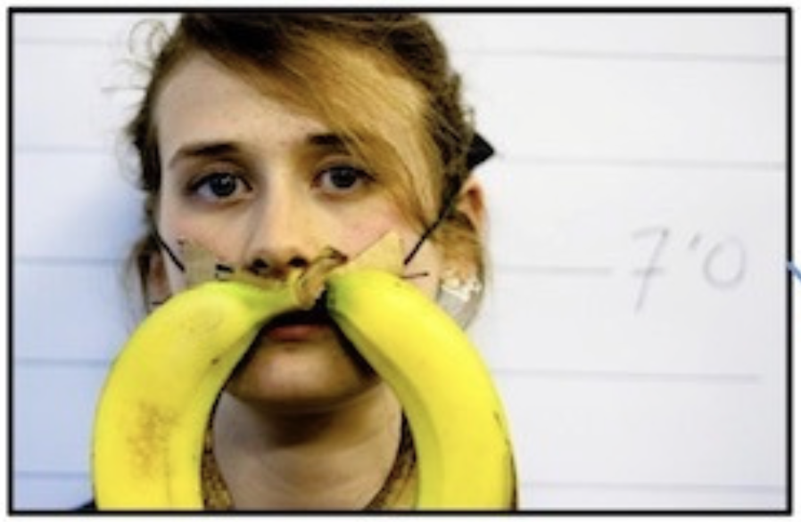

Figure 7.1: A Question in a Visual-Question Answering Tasks might be: *What is the mustache made of?*

##### 7.1.1 Tasks

Let us first discuss the types of tasks that vision-language models must solve, and list some of the popular benchmark suites. For understanding, the models can be tested on visual question answering tasks (VQA), to see if the models have acquired some textual understanding of visual images. A related, but generative, task is that of captioning problems, where models have to generate a textual descriptions of images. Additionally, models may be tasked to do image generation.

Let us have a look at some example tasks. For Figure [7.1](#Ch7.F1 "Figure 7.1 ‣ 7.1 Multi-modal Vision Language Models ‣ Chapter 7 Vision, Action and World Models ‣ Part II Reasoning ‣ Agentic Large Language Models"), a VQA question could be: *What is the mustache made of?* and the system should answer: *Bananas*. Other typical VQA questions are to count the number of certain shapes of a certain color in a certain part of an image (to answer questions such as: *Is there a red block in the upper corner of the table in this scene?*). The tasks can be quite diverse, and there is a range of popular benchmarks such as MOSAIC [[Burda-Lassen et al., 2025](#bibf.bib11)], GLOBAL-RG [[Bhatia et al., 2024](#bibf.bib12)], CultureVQA [[Nayak et al., 2024](#bibf.bib13)], FoodieQA [[Li et al., 2024](#bibf.bib28)], and MaRVL [[Liu et al., 2021](#bibf.bib29)].

Figure 7.2: A Captioning Task, possible Caption: *A happy dog is standing in the ocean*

In captioning problems, a model could be prompted to provide a caption for the scene in Figure [7.2](#Ch7.F2 "Figure 7.2 ‣ 7.1.1 Tasks ‣ 7.1 Multi-modal Vision Language Models ‣ Chapter 7 Vision, Action and World Models ‣ Part II Reasoning ‣ Agentic Large Language Models"), which shows *a happy dog standing in the ocean*. Note that variations may be equally valid, such as *a wet dog*, *a cold dog*, or *a dog with a red collar standing in the ocean*. Popular benchmarks are MS-COCO [[Lin et al., 2014](#bibf.bib14)], nocaps,11
1
<https://nocaps.org> and, for video, MSR-VTT [[Xu et al., 2016](#bibf.bib27)], and VATEX for traditional, short-caption evaluation [[Wang et al., 2019](#bibf.bib26)]. Newer benchmarks have been developed that focus on detailed, multi-faceted descriptions: DetailCaps [[Dong et al., 2024](#bibf.bib25)], VDC [[Chai et al., 2024](#bibf.bib15)], and CapArena [[Cheng et al., 2025](#bibf.bib16)].

Typical applications of VLMs are summarization, image generation, search and retrieval, image segmentation, and object detection. The Massive Multi-discipline Multi-modal Understanding and Reasoning Benchmark (MMMU) for Expert AGI is a comprehensive benchmark for vision-language models [[Yue et al., 2024](#bibf.bib23)].

##### 7.1.2 Architecture

Now that we have seen the types of tasks that VLMs are tested on, how could we design a model to perform these tasks?

Language, when modeled as a sequence of tokens, is a sequential (1 dimensional) problem domain. Vision, when modeled as a grid of pixels, is a rectangular (2 dimensional) problem domain. Correspondingly, the deep learning architectures for the two applications are different. For language, the transformer architecture is used, finding sequential patterns, and for imaging, the convolutional neural network is used, finding 2-dimensional patterns. It is therefore not obvious what architecture a multi-modal vision-language model should have. Indeed, it was unclear if a VLM would work at all.

Research first focused on the question if the transformer architecture would also be able to work on image processing (in addition to the conventional convolutional neural networks, CNN). Special vision transformers and tokenization schemes were developed that worked well in image processing [[Dosovitskiy et al., 2020](#bibf.bib24)].

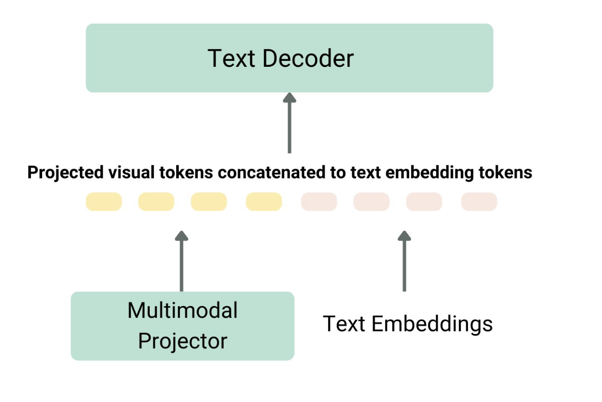

Figure 7.3: 
Architecture of a VLM (after LLaVa [[Liu et al., 2023](#bibf.bib17)], image from Huggingface)

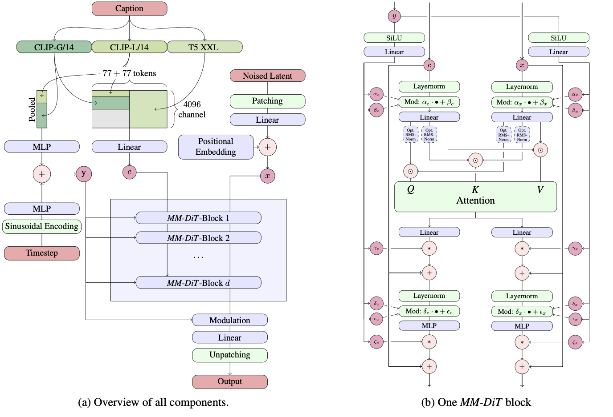

Figure 7.4: 
Architecture of Stable Diffusion [[Esser et al., 2024](#bibf.bib21)]

Then, an architecture was needed to combine the language and image embeddings, and to generate language.
In general, the architecture of a VLM consists of an image encoder (either a CNN or a specially tokenized vision-transformer) and a text encoder that are connected to an embedding projector to align image and text representations (often a dense neural network), connecting to, finally, a text decoder (a transformer). Figure [7.3](#Ch7.F3 "Figure 7.3 ‣ 7.1.2 Architecture ‣ 7.1 Multi-modal Vision Language Models ‣ Chapter 7 Vision, Action and World Models ‣ Part II Reasoning ‣ Agentic Large Language Models") illustrates this architecture, using LLaVa as an example [[Liu et al., 2023](#bibf.bib17)].
The connection between the visual embedding and the textual embedding is made by a network that projects the visual embedding to another embedding, to allow unified reasoning by the model. The projector network is often a dense neural network (multi-layer perceptron, MLP).

More elaborate architectures have been developed, and the architecture of state of the art VLMs can become quite complex, consisting of multiple transformer modules. As an example, Figure [7.4](#Ch7.F4 "Figure 7.4 ‣ 7.1.2 Architecture ‣ 7.1 Multi-modal Vision Language Models ‣ Chapter 7 Vision, Action and World Models ‣ Part II Reasoning ‣ Agentic Large Language Models") shows the generative Stable Diffusion architecture [[Esser et al., 2024](#bibf.bib21), [Weng, 2021](#bibf.bib4), [Yang et al., 2023](#bibf.bib20)].

##### 7.1.3 Learning Algorithm

Now that we have seen the tasks and the architecture of VLMs, it is time to look at the type of learning algorithm that is used by the models.
The different encoders and projectors allow the VLM to be trained. The training algorithms should align and fuse the knowledge from both the visual and the language encoders. The VLM can then correlate the image and text information so that the model can analyze the query and provide an answer based on the two modalities. The literature reports a variety of approaches for training the VLM.

OpenAI’s CLIP [[Radford et al., 2021](#bibf.bib50)], which stands for *contrastive language-image pretraining*, uses contrastive learning. Contrastive learning is a form of self-supervised learning, creating supervisory signals when there are no such labels in the dataset. The idea is to push dissimilar data points apart and pull similar data points together in an embedding space. Contrastive learning maximizes the similarity of representations for *positive* pairs (such as similar forms of the same image) and minimize the similarity for *negative* pairs (images of different objects).

Another approach is to use masking. Here the VLM learns to predict randomly obscured parts of an input text or image, just as it is used in language model training. The model learns to reconstruct the hidden pixels in an image given an (unmasked) caption. An example is FLAVA, or *foundational language and vision alignment*, which uses a vision transformer as image encoder and a transformer for its language encoder and multi-modal projector [[Singh et al., 2022](#bibf.bib22)].

Figure 7.5: DALL-E: Avocado Armchairs

VLM’s are also used in a generative style, to generate an image based on a text prompt. Popular text-to-image models often use diffusion models [[Ho et al., 2022](#bibf.bib62), [Yang et al., 2023](#bibf.bib20)]. Well-known examples are Google’s Imagen [[Baldridge et al., 2024](#bibf.bib18)], Midjourney, OpenAI’s DALL-E [[Betker et al., 2023](#bibf.bib19)] and Stability AI’s stable diffusion [[Esser et al., 2024](#bibf.bib21)]. DALL-E 2 uses a diffusion model conditioned on CLIP image embeddings. Figure [7.5](#Ch7.F5 "Figure 7.5 ‣ 7.1.3 Learning Algorithm ‣ 7.1 Multi-modal Vision Language Models ‣ Chapter 7 Vision, Action and World Models ‣ Part II Reasoning ‣ Agentic Large Language Models") shows DALL-E’s well-known surrealistic avocado armchairs.

Pretraining vision language models from scratch is expensive, and since a VLM consists of a language model and a vision model, we could try to see if it is possible to build a VLM out of one or two existing models, that have already been pretrained before.
Both a pretrained LLM and a pretrained vision encoder can be used, to which a mapping network can be added that projects the visual embedding to the textual input space of the language model.
An example is LLaVA, which stands for *large language and vision assistant*. LLaVa uses the Vicuna language decoder and the CLIP ViT visual encoder, and their outputs are merged into a shared dimensional space using a linear projector [[Liu et al., 2023](#bibf.bib17)].

Many vision language models have been developed. VLMs tend to perform well on benchmark tasks and they are often used for decision making in agents.
VLMs have become so popular that many current open and commercial LLMs are VLMs: DeepSeek-VL2, Gemini 2.0 Flash, GPT-4o, Llama 3.2, NVLM, Qwen 2.5-VL.

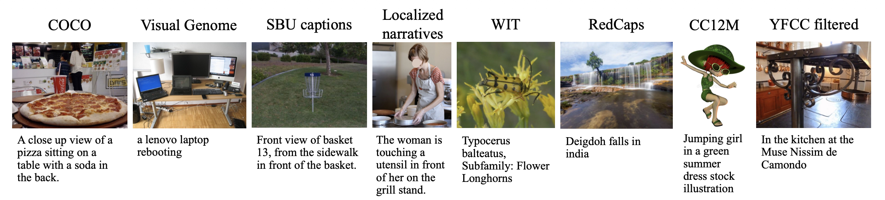

Figure 7.6: 
Flava Pretraining Image-Text Dataset Examples [[Singh et al., 2022](#bibf.bib22)]

##### 7.1.4 Results

Let us take a look at how well VLMs perform at captioning and image generation by looking at some of the examples that are reported in the literature.

Vision language models have produced imaginative and inspiring results ranging from visual question answering, object detection, image captioning to text-to-image generation. An example of the test dataset that is used in Flava is shown in Figure [7.6](#Ch7.F6 "Figure 7.6 ‣ 7.1.3 Learning Algorithm ‣ 7.1 Multi-modal Vision Language Models ‣ Chapter 7 Vision, Action and World Models ‣ Part II Reasoning ‣ Agentic Large Language Models"). The successor of DALL-E 2, DALL-E 3, focused on training on highly descriptive generated image captions, yielding even more impressive results [[Betker et al., 2023](#bibf.bib19)]. Some of the prompt following image generation capabilities of DALL-E 3 are shown in Figure [7.7](#Ch7.F7 "Figure 7.7 ‣ 7.1.4 Results ‣ 7.1 Multi-modal Vision Language Models ‣ Chapter 7 Vision, Action and World Models ‣ Part II Reasoning ‣ Agentic Large Language Models"). Figure [7.8](#Ch7.F8 "Figure 7.8 ‣ 7.1.4 Results ‣ 7.1 Multi-modal Vision Language Models ‣ Chapter 7 Vision, Action and World Models ‣ Part II Reasoning ‣ Agentic Large Language Models") shows examples from stable diffusion (based on the rectified-flow diffusion models).

Figure 7.7: 
Prompt Following Text-to-Image Examples from DALL-E 3 [[Betker et al., 2023](#bibf.bib19)]

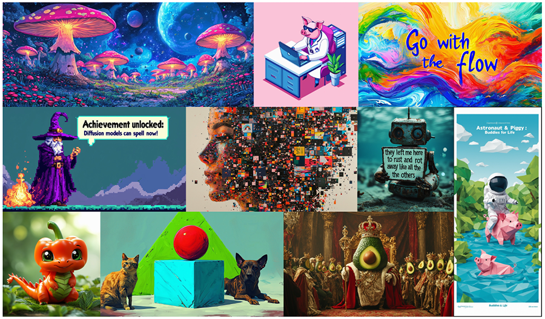

Figure 7.8: 
Stable Diffusion Examples [[Esser et al., 2024](#bibf.bib21)]

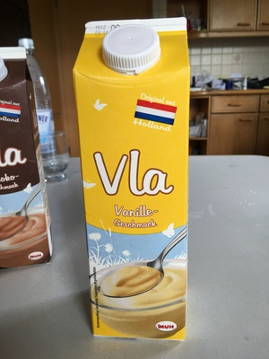

Figure 7.9: VLA has a different meaning in different languages. So has Vlas. (A hint of which language this is flagged in one of the pictures)

#### 7.2 Decisions & Vision Language Action Models

To act, agents must make decisions, and to make decisions, different options must be weighed. As we will see in this section, we can train transformers on episodes of states, actions and rewards $\{(s,a,r)\}$ (see also Section [20.1.2](chapter-20-advanced-transformer-and-agentic-architectures.md#Ch20.S1.SS2 "20.1.2 Pretraining Backtracking on Decision Traces ‣ 20.1 Transformer Architectures ‣ Chapter 20 *Advanced Transformer and Agentic Architectures ‣ Part VI Advanced Topics ‣ Agentic Large Language Models")).
These models are trained on sequences of language, vision, and robotic actions. Vision-language-action models, VLAs, (Figure [7.9](#Ch7.F9 "Figure 7.9 ‣ 7.1.4 Results ‣ 7.1 Multi-modal Vision Language Models ‣ Chapter 7 Vision, Action and World Models ‣ Part II Reasoning ‣ Agentic Large Language Models")) are trained to output robot API commands, which are a special type of language: the language of commands to steer robotic movement.

The task of a VLA is to understand a visual scene, and, when given a textual command, instruct a robot arm to perform an appropriate action, depending on what the model sees through the camera.
These models have shown impressive results of robots generalizing to unseen situations, successfully performing tasks.

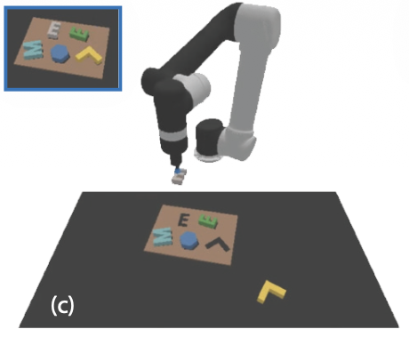

Figure 7.10: 
Example from CLIPort: *put the gray letter E in the left letter E shape hole* [[Shridhar et al., 2022](#bibf.bib60)]

##### 7.2.1 Tasks

The main task of VLAs is to perform instructions in the real world, and to do so in a general way, in a changing environment. When a robotic manipulation model has been trained to pick up a set of red pencils, and the task changes to pick up blue pencils, then it would be nice if the model generalizes, and we do not have to assemble a new training set involving blue pencils and re-train the model again from scratch. We also want our model to recognize objects, and recognize when an object is oriented differently, has moved, or the lighting changes. The model should know how to use a robot arm to manipulate objects, and how to perform different actions. See Figure [7.10](#Ch7.F10 "Figure 7.10 ‣ 7.2 Decisions & Vision Language Action Models ‣ Chapter 7 Vision, Action and World Models ‣ Part II Reasoning ‣ Agentic Large Language Models") for an example, taken from the CLIPort paper [[Shridhar et al., 2022](#bibf.bib60)].

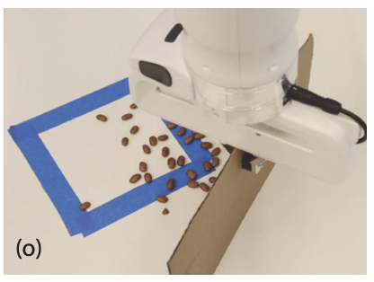

Figure 7.11: 
Another Example from CLIPort: *sweep the beans into the blue zone* [[Shridhar et al., 2020](#bibf.bib49)]

The hardest task for VLAs is to combine these scenes, objects and actions to manipulations that are complicated combinations of what the model has seen during training, and to generalize to unseen combinations. Especially long-horizon navigation through complex, changing, environments (perhaps even outdoors) is a complex challenge [[Shridhar et al., 2022](#bibf.bib60)].

In realistic human-robot interaction settings,
collecting additional demonstrations is often infeasible.
To perform high-level tasks, such as in Figure [7.11](#Ch7.F11 "Figure 7.11 ‣ 7.2.1 Tasks ‣ 7.2 Decisions & Vision Language Action Models ‣ Chapter 7 Vision, Action and World Models ‣ Part II Reasoning ‣ Agentic Large Language Models"), the VLA must be able to recognize objects, their poses, and segmentations of instances. The model must also be able to understand language, and relate the meaning of language to the meaning of visual objects and to the meaning of robotic actions.

As we will see, language provides an intuitive interface for specifying goals and for transferring semantic concepts across tasks. Furthermore, the work on VLMs has shown how to semantically connect different kinds of embeddings.

##### 7.2.2 Architecture

Now that we have seen the task and the challenges, let us look at possible model architectures. Again, they can become quite complex.
The transformer architecture is well suited to learn patterns in sequential data, as the results on natural language show. Intuitively, this suggests that transformers may also work well to model sequential decision problems, the type of problems that are often solved in reinforcement learning for robotic action, as we discussed in Section [2.2.3](chapter-02-foundations-of-language-modeling-with-llms.md#Ch2.S2.SS3 "2.2.3 Reinforcement Learning ‣ 2.2 Machine Learning Methods For Natural Language Processing ‣ Chapter 2 Foundations of Language Modeling with LLMs ‣ Part I Language Modeling ‣ Agentic Large Language Models") (and further in depth in Section [20.2.1](chapter-20-advanced-transformer-and-agentic-architectures.md#Ch20.S2.SS1 "20.2.1 In-Context Reinforcement Learning ‣ 20.2 Agentic Architectures ‣ Chapter 20 *Advanced Transformer and Agentic Architectures ‣ Part VI Advanced Topics ‣ Agentic Large Language Models")). These problems consist of a state, from which actions cause the system to enter a new state, which has actions, etc. The transformer architecture is well suited to model these problems.

Early work on decision transformer (DT) [[Chen et al., 2021](#bibf.bib33), [Janner et al., 2021](#bibf.bib40)] showed that on offline (static) reinforcement learning problems, the GPT architecture was indeed able to learn optimal policies. The decision-pretrained transformer (DPT) [Lee et al. [2023]](#bibf.bib34), [Wang et al. [2024a]](#bibf.bib39) showed that the basic transformer architectures can be pretrained and finetuned on decision traces. Section [20.1.2](chapter-20-advanced-transformer-and-agentic-architectures.md#Ch20.S1.SS2 "20.1.2 Pretraining Backtracking on Decision Traces ‣ 20.1 Transformer Architectures ‣ Chapter 20 *Advanced Transformer and Agentic Architectures ‣ Part VI Advanced Topics ‣ Agentic Large Language Models") discusses decision traces further.

Following pioneering work on CLIPort [[Shridhar et al., 2022](#bibf.bib60), [Shridhar et al., 2020](#bibf.bib49)], VLAs are often built on VLMs, where the robotic commands are used as regular language tokens. Let us have a closer look at some representative models.

The goal of Mobility VLA [[Chiang et al., 2024](#bibf.bib58)] is navigation. This VLA is created by combining a long context VLM with topological maps, as illustrated in Figure [7.12](#Ch7.F12 "Figure 7.12 ‣ 7.2.2 Architecture ‣ 7.2 Decisions & Vision Language Action Models ‣ Chapter 7 Vision, Action and World Models ‣ Part II Reasoning ‣ Agentic Large Language Models").

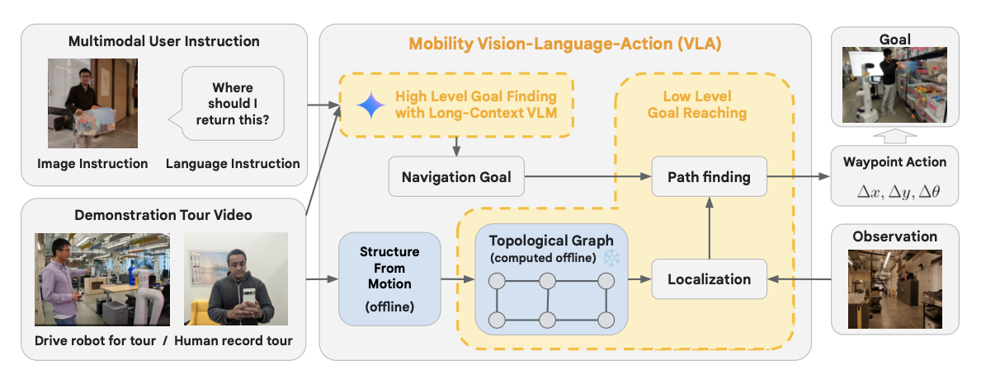

Figure 7.12: 
Mobility VLA Architecture: Long Context VLM and Topological Maps [[Chiang et al., 2024](#bibf.bib58)]

Mobility VLA is used on a problem category of navigation tasks called *multi-modal instruction navigation with demonstration tours* (MINT). In this dataset, an environment prior is provided through a previously recorded demonstration
video. The model consists of a two-level VLA that combines the environment
understanding and common sense reasoning of long-context VLMs with a
low-level navigation policy based on topological graphs. The high-level policy is created by combining user instructions from a long-context VLM that finds the goal frame in a demonstration video. Then, a low-level policy starts at this goal frame to traverse a topological graph to generate the robot action instructions at every timestep.

LM-Nav [[Shah et al., 2023](#bibf.bib54)] uses a different architecture, based on existing models. It takes as input a set of raw observations
from the target environment and from free-form textual instructions. From this, it derives an action plan using three pretrained models: a language model (LLM) for extracting landmarks, a vision-language model (VLM)
for grounding, and a visual-navigation model (VNM) for execution (not unlike the topological map previously discussed). Together, these models enable LM-Nav to follow textual
instructions from visual observations without any finetuning. Figure [7.13](#Ch7.F13 "Figure 7.13 ‣ 7.2.2 Architecture ‣ 7.2 Decisions & Vision Language Action Models ‣ Chapter 7 Vision, Action and World Models ‣ Part II Reasoning ‣ Agentic Large Language Models") shows an illustration of the approach.

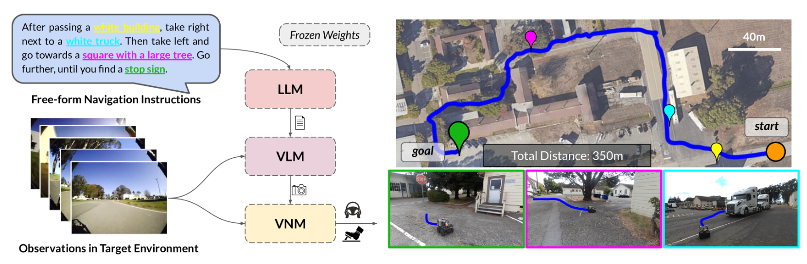

Figure 7.13: 
Three-LLM Architecture of LM-Nav [[Shah et al., 2023](#bibf.bib54)]

Google’s RT-2 [[Brohan et al., 2023](#bibf.bib52)] uses a different approach. The idea of RT-2 is to leverage knowledge from the web to inform robotic control: the robot should learn how to act from watching videos. A standard vision language model is finetuned both on textual robotic trajectory data and on
Internet-scale vision-language tasks, such as visual question answering. Robotic actions are expressed as regular text tokens and are incorporated
directly into the training set in the same way as natural language tokens, as shown in Figure [7.14](#Ch7.F14 "Figure 7.14 ‣ 7.2.2 Architecture ‣ 7.2 Decisions & Vision Language Action Models ‣ Chapter 7 Vision, Action and World Models ‣ Part II Reasoning ‣ Agentic Large Language Models").

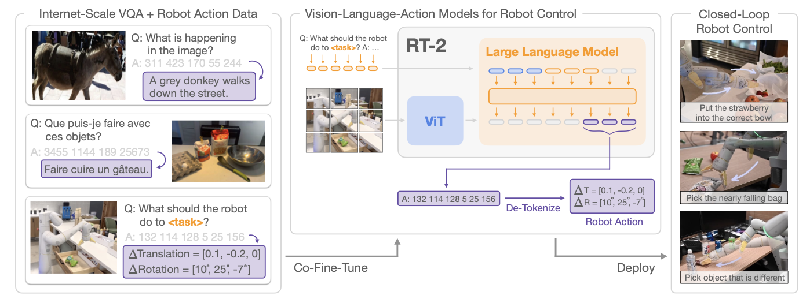

Figure 7.14: 
RT-2 Architecture: VLM trained using Robotic Actions as Text Tokens [[Brohan et al., 2023](#bibf.bib52)]

A similar approach is taken by Magma [[Yang et al., 2025](#bibf.bib61)]. Magma is pretrained on heterogeneous datasets spanning from images and videos to robotics data. However, in Magma the actionable visual objects in images
are labeled by special tokens (Set-of-Mark) for action grounding. Similarly, object movements (such as the trace of human hands or
robotic arms) are labeled by Trace-of-Mark
to ease action planning. Figure [7.15](#Ch7.F15 "Figure 7.15 ‣ 7.2.2 Architecture ‣ 7.2 Decisions & Vision Language Action Models ‣ Chapter 7 Vision, Action and World Models ‣ Part II Reasoning ‣ Agentic Large Language Models") provides an illustration.

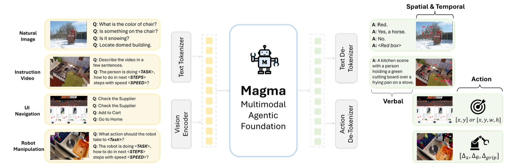

Figure 7.15: 
Magma Pretraining Pipeline [[Yang et al., 2025](#bibf.bib61)]

Finally, a VLA called $\pi_{0}$ [[Black et al., 2024](#bibf.bib44)] stresses the reinforcement learning approach by using a pretrained late-fusion vision-language model, as well as a diverse cross-embodiment dataset with a variety of manipulation tasks. The model is inspired by the Transfusion approach [[Zhou et al., 2024](#bibf.bib41)]. This model is adapted to robot control by adding a separate
action expert that produces actions via flow matching, for fluent manipulation skills. The resulting model
can either be used directly to perform tasks based on a prompt, or be further finetuned on higher-quality data to enable complex multi-stage
tasks, such as folding multiple articles of laundry or assembling a box (see Figure [7.16](#Ch7.F16 "Figure 7.16 ‣ 7.2.2 Architecture ‣ 7.2 Decisions & Vision Language Action Models ‣ Chapter 7 Vision, Action and World Models ‣ Part II Reasoning ‣ Agentic Large Language Models")).

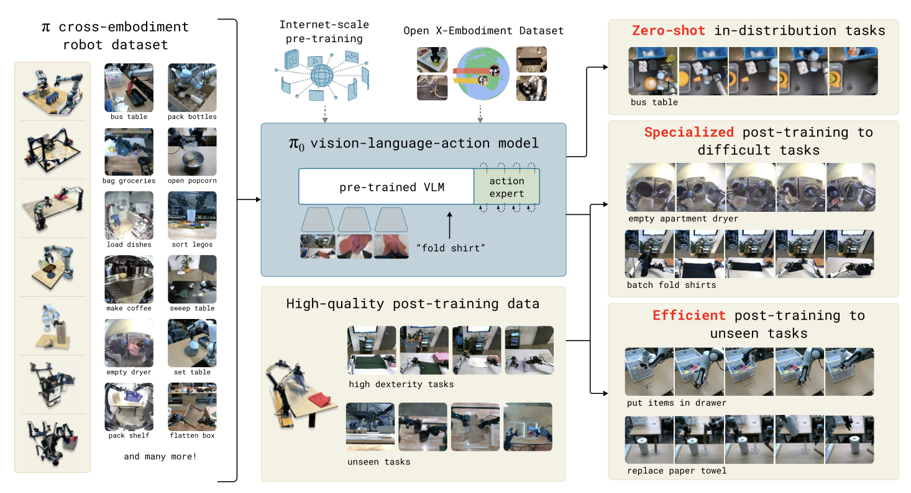

Figure 7.16: 
Architecture of $\pi_{0}$. The model is based on a VLM, enhanced with a cross-embodiment dataset [[Black et al., 2024](#bibf.bib44)]

##### 7.2.3 Learning Algorithm

The model architecture of most VLAs is based on VLMs, in some cases augmented with navigation map data. The robotic action commands are typically encoded as regular text commands. Likewise, for pretraining and finetuning typical LLM self-supervised learning algorithms are used, similar to VLMs and decision transformers. Sometimes existing pretrained models are used, to reduce the training expense.

##### 7.2.4 Results

Various VLA models have been
created that achieve impressive zero-shot results, generalizing behavior to unseen situations.
[Chiang et al. [2024]](#bibf.bib58), [Brohan et al. [2023]](#bibf.bib52), [Yang et al. [2025]](#bibf.bib61) are examples of
VLA models for robotic action, achieving complex tasks such as navigation, table top manipulation, or even folding laundry [[Black et al., 2024](#bibf.bib44)].

VLAs have shown impressive and imaginative results, where robots were able to generalize at inference time without the need for retraining. A survey of VLAs can be found in
[[Ma et al., 2024](#bibf.bib59)].

The results are best appreciated from seeing a video.
For $\pi_{0}$, a video is available.22
2
<https://www.physicalintelligence.company/blog/pi0>
For RT-2, a video is also available.33
3
<https://robotics-transformer2.github.io>

#### 7.3 World Models, Physics, and Planning

To a VLM, an image consists of pixels without a deeper intrinsic meaning. However, agents that interact with the world need knowledge about physical aspects of that world. The models need an understanding of what is physically possible, so that agents do not walk through walls, as they still sometimes do in video games.

World models help agents understand the world, allowing them to act effectively in the physical world, taking actions that make sense. Originally, LLMs are language models. We can converse with them in natural language, and they necessarily contain some knowledge of the world, but they were not specifically trained to have a wide and deep understanding of worldly affairs. Some researchers argue that in order for agentic LLMs to be truly successful, and for LLMs to reach a high level of general intelligence, research into world models should be strengthened [[Sutton et al., 2022](#bibf.bib35), [Matsuo et al., 2022](#bibf.bib69), [LeCun and others, 2022](#bibf.bib2), [Klindt et al., 2026](#bibf.bib3)].

Agents and robots that act in the world need a rudimentary understanding of the physics of the world.
One of the challenges for training an LLM is to ground its understanding of the physical world and of the possible robotic actions into reality.
One way to do this is to learn an agentic model of the world (environment) from feedback on actions.

The term *world model* has been used in AI in other contexts. Most notably, it refers to the *model* in model-based reinforcement learning [[Ha and Schmidhuber, 2018](#bibf.bib57), [Moerland et al., 2023](#bibf.bib45), [Sutton, 1991](#bibf.bib32)] (see next section). This model contains a local copy of some knowledge of the environment, based on the interactions it has had with the environment, to be used to improve the action policy.
The world model contains an efficient, compressed, learned representation of the world [[Hafner et al., 2019](#bibf.bib31), [Plaat et al., 2020](#bibf.bib38)]. The representation of a world model is often called an abstract or *latent* representation, to contrast it with the regular representation of the real world in the environment.
World models are often trained to contain knowledge about physics and certain spatial properties, that puts restrictions on the agent’s actions. The precise contents of the world model depends on the domain in which the agent operates.

Note that in a just few chapters we have progressed from understanding language to understanding the world. The goal of a large *language* model is to understand some semantics of natural language from statistical patterns in text, to be used for question answering and translation. The goal of a *world* model is to understand causal relations in the laws of physics, to be used to simulate future world states for our agent. Quite some new technology is necessary to go from LLM to agentic LLM.

We start with a look at how world models are currently used in agentic LLM.

##### 7.3.1 Tasks

World models should encapsulate knowledge of the world, so that an agent can perform meaningful actions. The actions should be grounded in the physical world. For example, the model should understand the limitations of the joints of a robot arm that it is commanding; a navigational agent should understand some physics, such as the concept of gravity, of distance, and that walls are solid objects; a financial agent should understand the consequences of a negative bank balance. Often this is the type of information that humans take for granted, and we are surprised when an agent fails to understand such basic things about the world in which it operates. VLMs that are only trained on pixels may miss the semantic meaning of a specific texture, whether it is a garment, smoke, or a wall.

Standard pretrained LLMs already contain some useful world knowledge. They learn acceptable textual behavior using reinforcement learning with human feedback (RLHF), and acceptable mathematical and coding behavior using reinforcement learning with verifiable rewards (RLVR). Some early approaches use LLMs as pretrained world model without any finetuning.
A natural way to learn about the physics of the world is through interaction: agents can learn acceptable physical behavior through a reinforcement learning-style reward function.

The goal of world models in model-based reinforcement learning is to improve the sample efficiency of learning from interaction, by planning with the world *model* instead of sampling from the *real* world. This is especially useful when interacting with the world is more expensive than performing a simulation, as will often be the case in agentic LLM. In the approaches that we will discuss, LLM world models use methods from model-based reinforcement learning (see Section [7.3.5](#Ch7.S3.SS5 "7.3.5 *Model-Based Reinforcement Learning ‣ 7.3 World Models, Physics, and Planning ‣ Chapter 7 Vision, Action and World Models ‣ Part II Reasoning ‣ Agentic Large Language Models")). Currently, world model approaches in LLM are quite diverse. To show which tasks world models are used for in LLMs, we will discuss three examples: WorldGPT, WebDreamer, and WorldCoder.

###### WorldGPT

The goal of
WorldGPT [[Ge et al., 2024](#bibf.bib8)] is to solve visual question answering and embodied planning tasks, including audio-video question answering. WorldGPT learns a world-VLM from videos.
It uses a latent space VLM with external knowledge bases and long-term memory.

###### WebDreamer

The goal of WebDreamer [[Gu et al., 2024](#bibf.bib9)] is to improve efficient learning of Web-interaction tasks, such as e-commerce. WebDreamer enables web-agents to simulate actions before execution, and thus be faster and more sample efficient (by not having to act in the real web to gather experience). WebDreamer is a model-based reinforcement learning approach in a web-world. (The name is derived from *Dreamer*, a series of influential model-based reinforcement learning latent dynamics models [[Hafner et al., 2019](#bibf.bib31), [Hafner et al., 2020a](#bibf.bib30), [Hafner et al., 2023](#bibf.bib47)].) Typical tasks are to find products on e-commerce sites. It does so by training a small model from a large model, allowing efficient simulation.

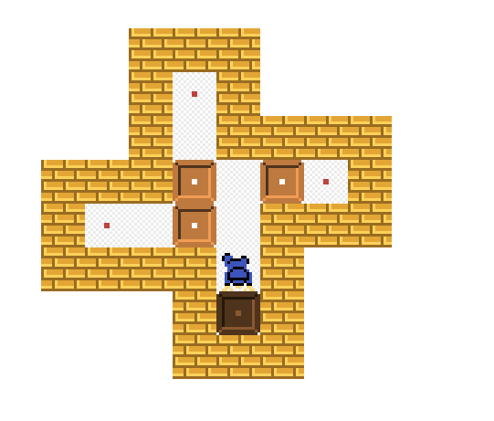

Figure 7.17: 
Sokoban for WorldCoder [[Tang et al., 2024](#bibf.bib10)]

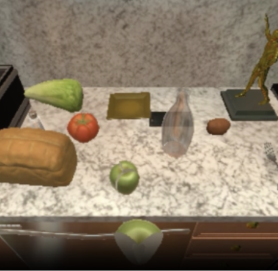

Figure 7.18: 
AlfWorld for WorldCoder [[Tang et al., 2024](#bibf.bib10)]

###### WorldCoder

The goal of WorldCoder [[Tang et al., 2024](#bibf.bib10)] is also to improve sample efficiency, but the approach is different. WorldCoder improves efficiency by generating the dynamics model (transition function and reward function) in interpretable Python code, which is then used in a standard model-based reinforcement learning design. The generated Python code executes more efficiently than LLM inference does. WorldCoder is used in grid-tasks (Sokoban, see Figure [7.17](#Ch7.F17 "Figure 7.17 ‣ WebDreamer ‣ 7.3.1 Tasks ‣ 7.3 World Models, Physics, and Planning ‣ Chapter 7 Vision, Action and World Models ‣ Part II Reasoning ‣ Agentic Large Language Models")) and domestic task planning (AlfWorld, see Figure [7.18](#Ch7.F18 "Figure 7.18 ‣ WebDreamer ‣ 7.3.1 Tasks ‣ 7.3 World Models, Physics, and Planning ‣ Chapter 7 Vision, Action and World Models ‣ Part II Reasoning ‣ Agentic Large Language Models")).

##### 7.3.2 Architecture

The purpose of a world model is to add semantic meaning to observations—actions having consequences—something that LLMs and VLMs may struggle with. When does a pixel belong to a floor to walk on (restrict $y$ movement) and when is it part of a wall to stop you (restrict $x$ movement)? A reward function provides feedback information on which actions are good, and which are not. Thus, world model architectures often use a reinforcement learning setting, in which an action policy is trained from feedback rewards. We can think of a world model as a VLM with a policy learner inside.

WorldGPT, WebDreamer, and WorldCoder use different architectures for their world model, which we will now discuss in more detail.

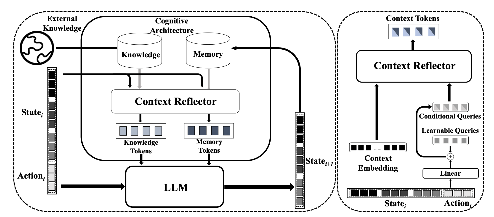

Figure 7.19: 
Architecture of WorldGPT [[Ge et al., 2024](#bibf.bib8)]

###### WorldGPT

WorldGPT is based on a standard LLM, Vicuna-7B-v0.44
4
<https://huggingface.co/lmsys/vicuna-7b-v1.3>, <https://lmsys.org> It performs reasoning in latent space, following the model-based reinforcement learning approach. The goal of WorldGPT is to be a simulator of realistic dynamics of the world—the transition and the reward function in reinforcement learning. To do so, the architecture helps synthesize multi-modal instruction instances, using a special architecture. At the core WorldGPT follows the common VLM architecture with a central LLM, and a multi-modal encoder and a decoder. To help the model synthesize multi-modal instructions, a cognitive architecture is added to help with specialized or long-term tasks. The architecture adds memory, knowledge retrieval, and context reflection. The context reflection is built on Q-former [[Li et al., 2023](#bibf.bib42)]. See Figure [7.19](#Ch7.F19 "Figure 7.19 ‣ 7.3.2 Architecture ‣ 7.3 World Models, Physics, and Planning ‣ Chapter 7 Vision, Action and World Models ‣ Part II Reasoning ‣ Agentic Large Language Models") for a diagram of the architecture.

###### WebDreamer

WebDreamer is aimed at web-interaction. It distills a large model, Qwen-70B [[Bai et al., 2025](#bibf.bib43)], into a small 7B model. The small model is then used for simulating actions with the world model, before acting in the “real” web-world. It uses model predictive control (MPC) as planning approach [[Garcia et al., 1989](#bibf.bib67), [Schwenzer et al., 2021](#bibf.bib37)] for decision making about website actions, re-planning at each interaction step. WebDreamer leverages LLMs as world model and as value function. The LLM implements
both the simulation function (sim) and the scoring function (score), see Figure [7.20](#Ch7.F20 "Figure 7.20 ‣ WebDreamer ‣ 7.3.2 Architecture ‣ 7.3 World Models, Physics, and Planning ‣ Chapter 7 Vision, Action and World Models ‣ Part II Reasoning ‣ Agentic Large Language Models").
Furthermore, following [[Koh et al., 2024](#bibf.bib65)], the LLM is used for candidate action generation (in addition to sim and score). The authors
employ a two-stage approach: first sampling top-$k$ actions, and
then using the LLM to self-refine unnecessary actions for simulation.

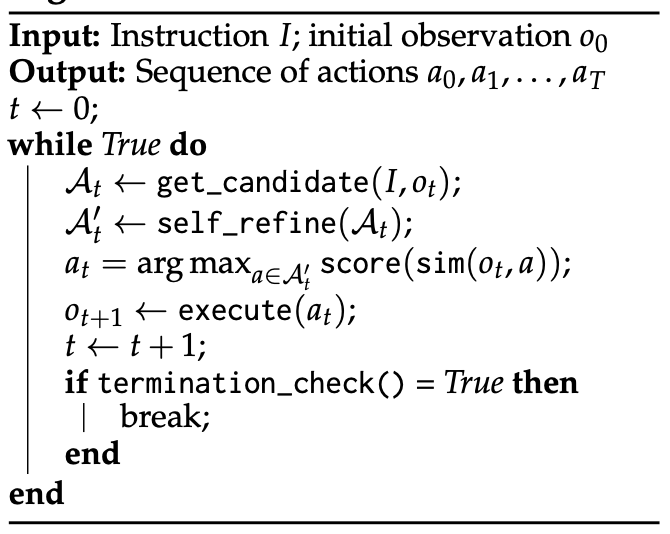

Figure 7.20: 
WebDreamer pseudocode: using LLM for score and sim function [[Gu et al., 2024](#bibf.bib9)]

###### WorldCoder

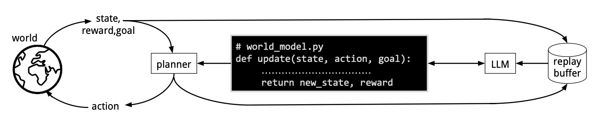

Figure 7.21: 
WorldCoder Architecture [[Tang et al., 2024](#bibf.bib10)]

WorldCoder is a model-based agent that builds a Python program to represent its knowledge of the world. WorldCoder creates a transition function of the world in executable Python code, see Figure [7.21](#Ch7.F21 "Figure 7.21 ‣ WorldCoder ‣ 7.3.2 Architecture ‣ 7.3 World Models, Physics, and Planning ‣ Chapter 7 Vision, Action and World Models ‣ Part II Reasoning ‣ Agentic Large Language Models").
WorldCoder uses program synthesis. In reinforcement learning, problems are formalized as MDPs, consisting of a state representation $S$, action function $A$, transition function $T$, and reward function $R$ (see Section [7.3.5](#Ch7.S3.SS5 "7.3.5 *Model-Based Reinforcement Learning ‣ 7.3 World Models, Physics, and Planning ‣ Chapter 7 Vision, Action and World Models ‣ Part II Reasoning ‣ Agentic Large Language Models")). WorldCoder uses an LLM to generate Python code for action, transition and reward functions for a task, as well as for the state representation, which is then used in a model-based reinforcement learning approach. This code is checked and improved, in an iterative self debug refinement process [[Chen et al., 2023](#bibf.bib68)], see Section [6.1.3.2](chapter-06-multi-step-reasoning-in-llms.md#Ch6.S1.SS3.SSS2 "6.1.3.2 Code Generation for Validation ‣ 6.1.3 Chain of Thought Prompting ‣ 6.1 In-Context Reasoning ‣ Chapter 6 Multi-step Reasoning in LLMs ‣ Part II Reasoning ‣ Agentic Large Language Models").
This process repeats until the program
produces the correct output.

Note that in WorldCoder the learned model is symbolic (the transition function is represented as computer code), where in regular deep reinforcement learning the model is a neural network. At inference time, WorldCoder is efficient, since no LLM calls occur that require forward passes through a large network, only interpretation of the transition and reward function Python code.

In regular model-based LLM approaches, the LLM *simulates* the world, in WorldCoder the LLM *builds* a simulation of the world, for later execution. At inference time, the Python interpreter executes the transition function, where in ReAct, an LLM reasons about the world state. For planning problems, the symbolic approach is better suited, since LLMs struggle with planning during inference (see Section [6.2.3](chapter-06-multi-step-reasoning-in-llms.md#Ch6.S2.SS3.SSS0.Px1 "Knowing-Doing Gap ‣ 6.2.3 LLMs and Stateful Problems ‣ 6.2 Self-Reflection and State ‣ Chapter 6 Multi-step Reasoning in LLMs ‣ Part II Reasoning ‣ Agentic Large Language Models")).

##### 7.3.3 Learning Algorithm

We will now discuss the pretraining and finetuning algorithms that the different approaches use.

###### WorldGPT

WorldGPT acquires an understanding of world
dynamics by pretraining and finetuning on millions of videos across various domains. Vicuna-7B-v0 is used as the base LLM. Pretraining then uses a language-centric encoder to obtain a unified representation of the multi-modal state. For multi-modal decoding, special tokens are inserted into the LLM’s vocabulary. Training starts uni-modal, and progresses to cross-modal. For finetuning, a special cognitive reinforcement architecture is used with a dataset with fine-grain sequential state-transition sample annotations from more than 10 million videos. As mentioned before, the cognitive architecture consists of memory, knowledge retrieval, and context reflection. Through finetuning, agents acquire specialized knowledge by finetuning on synthetic multi-modal instruction data.

###### WebDreamer

The WebDreamer approach aims to learn dynamics suitable for model-based reinforcement learning. First the pretrained Qwen-2-VL vision language model [[Wang et al., 2024b](#bibf.bib66)] is used to initialize the Dreamer-7B model, which is then further finetuned on 3.1 million interaction examples.
The data synthesis pipeline consists of (1) random walks over the web,
where the model autonomously interacts with web pages through actions such as typing for search
and clicking, and (2) synthesis, where Qwen2-VL-72B generates textual
descriptions of state changes based on visual snapshots before and after the actions. WebDreamer simulates possible
future states for each action over a finite horizon (replanning and retraining according to the model predictive control (MPC) approach, a reinforcement learning approach for adaptive retraining that is used in engineering and control problems).

###### WorldCoder

WorldCoder uses program synthesis to learn to make a transition function, the function that computes the next state of the world. WorldCoder then performs planning-actions using that coded world model. It initially
performs random exploration to initialize a dataset of environmental interactions; it updates its world
model using a program synthesis algorithm, generates the code, and then
performs planning. Different planners are possible, from depth-limited value iteration (in
simple domains) to MCTS (for more complex domains) [[Browne et al., 2012](#bibf.bib51)].

##### 7.3.4 Results

We will now look at the results of the three approaches.

###### WorldGPT

The WorldGPT model is evaluated with a multi-modal state transition prediction benchmark. WorldGPT is effective, and understands and predicts the dynamics of complex real-world kitchen and cooking scenarios accurately.

The system is also evaluated as a world simulator, showing that it can generalize to unfamiliar domains.
In one experiment, WorldGPT is 30 times faster then traditional diffusion-based methods on audio-video question answering
tasks [[Ge et al., 2024](#bibf.bib8)].

###### WebDreamer

WebDreamer also performs well. It is reported to surpass GPT-4o performance on web interaction tasks.
Substantial performance improvements are reported over reactive baselines, on which it is 4-5 times more efficient than tree search. WebDreamer performs well on the sandbox environment VisualWebArena, and also on real-world websites (Online-Mind2Web and Mind2Web-Live), where tree search methods are difficult to implement and deploy. Moreover, on online benchmarks, using Dreamer-7B, the approach achieves performance
comparable to GPT-4o. On real-world websites, WebDreamer
outperforms the reactive baseline with a relative gain of 42% and 24%, respectively.

###### WorldCoder

For WorldCoder results are reported on grid worlds and on task planning (AlfWorld). WorldCoder is more sample-efficient than model-free reinforcement learning, and more compute-efficient compared to ReAct-style agents that try to perform in-context planning by the LLM.

Generating world knowledge as computer code by LLMs brings
advantages. It allows prior world knowledge embedded in the LLM to improve code generation, as existing solutions to published problems may well have been seen during pretraining. The code can also be transferred across tasks by reusing pieces of old programs. Furthermore, the results are human readable, allowing the world knowledge to be inspected by humans by reading the generated code.

Though promising for planning problems, a limitation of the WorldCoder approach is inherent to the computational difficulty of planning problems. Problem instances that are difficult to solve with dedicated solvers are also difficult to solve for WorldCoder solvers. The transition function that is generated by the LLM is unlikely to be better than those designed by expert human researchers.

So far, the synthesized code aims to reproduce the transition and reward functions. For future work, self reflection and metalearning approaches may be able to improve performance further.

##### 7.3.5 \*Model-Based Reinforcement Learning

World models are being used successfully in agentic LLM. An extensive literature exists on world models in model-based reinforcement learning. At the end of this chapter, we will now provide a brief overview of world models in model-based reinforcement learning, in order to provide more context for the use of world models in LLM.

An influential early model-based approach is Dyna [[Sutton, 1991](#bibf.bib32)]. Influential recent works are [[Ha and Schmidhuber, 2018](#bibf.bib57), [Hafner et al., 2020b](#bibf.bib56)]. Two modern surveys are [Moerland et al. [2023]](#bibf.bib45), [Plaat et al. [2023]](#bibf.bib46).

In reinforcement learning, agents learn how to act in an
environment by sampling rewards from actions that are executed in the environment.

Environment: $T(s,a)\rightarrow s^{\prime},R(s^{\prime})\rightarrow r$Agent: $r$ improves $\pi_{\theta}(s)\rightarrow a$$(s^{\prime},r)$$a$

Figure 7.22: 
The standard reinforcement learning loop. The agent learns a $\theta$-parameterized policy $\pi_{\theta}$ from feedback rewards $r$ from the environment. [[Sutton and Barto, 2018](#bibf.bib53)]

###### 7.3.5.1 Model-free Reinforcement Learning

In regular reinforcement learning an optimal agent policy is learned model-free: the best actions for all states are learned directly from interaction with the environment (see Figure [7.22](#Ch7.F22 "Figure 7.22 ‣ 7.3.5 *Model-Based Reinforcement Learning ‣ 7.3 World Models, Physics, and Planning ‣ Chapter 7 Vision, Action and World Models ‣ Part II Reasoning ‣ Agentic Large Language Models")), without the help of an extra model of the environment. Regular reinforcement learning is formally described as a Markov decision process, with four functions $\{S,T,A,R\}$: a function $S(o)\rightarrow s$ to represent the state of the system for observation $o$, a function $T(s,a)\rightarrow s^{\prime}$ that transitions from one state to the next state using an action, a function $A(s)\rightarrow a$ that returns an action for a state, and a function $R(s)\rightarrow r$ that assign a reward value (positive or negative) to a state. The goal of reinforcement learning is to use the MDP to learn an optimal policy $\pi^{*}(s)\rightarrow a^{*}$, the function that returns the best action for each state that the MDP can be in. Thus, a reinforcement learning problem consists of four functions $S$, $T$, $A$, and $R$, and the goal of the agent is to find the optimal policy $\pi^{*}(s)$ with the highest expected cumulative reward. The agent does not have access to $T$ and $R$, functions that reside in the environment. Regular, model-free, reinforcement learning is also called *direct* reinforcement learning. The direct method naturally has high sample complexity: policy improvement requires sampling, and large MDPs require many samples for the policy improvement process to converge (Figure [7.22](#Ch7.F22 "Figure 7.22 ‣ 7.3.5 *Model-Based Reinforcement Learning ‣ 7.3 World Models, Physics, and Planning ‣ Chapter 7 Vision, Action and World Models ‣ Part II Reasoning ‣ Agentic Large Language Models")).

Environment: $T(s,a)\rightarrow s^{\prime},R(s^{\prime})\rightarrow r$Agent:$r$ improves $\hat{M}=(\hat{T},\hat{R})$and $r,\hat{M}$ both improve $\pi_{\theta}(s)\rightarrow a$$(s^{\prime},r)$$a$

Figure 7.23: Model-based reinforcement learning where environment feedback is used to improve both the policy $\pi$ and the local dynamics model $\hat{M}=(\hat{T},\hat{R})$ from which the policy $\pi$ is also sampled (*planning*)

###### 7.3.5.2 Model-based Reinforcement Learning

In direct reinforcement learning, sampled information is not retained by the agent, but forgotten, and each policy improvement requires a new sample. Interaction by the agent with the outside environment is often expensive, for example for a robot acting in the real world, whose joints wear out. In this case it would be beneficial to find ways to reduce the sample complexity. We should try to improve the policy without having to sample as much from the environment.

A straightforward idea is not to throw away the samples, but to store them in a buffer, and also sample from that buffer of older interaction results, or, slightly more advanced, to train a *local surrogate model* $M=(\hat{T},\hat{R})$ of the environment dynamics. When we have trained this local dynamics model, we can also sample from the model, cheaply, in addition to sampling the environment, expensively (see Figure [7.23](#Ch7.F23 "Figure 7.23 ‣ 7.3.5.1 Model-free Reinforcement Learning ‣ 7.3.5 *Model-Based Reinforcement Learning ‣ 7.3 World Models, Physics, and Planning ‣ Chapter 7 Vision, Action and World Models ‣ Part II Reasoning ‣ Agentic Large Language Models")).

These methods are indirect methods, since, in the last methods, where a local dynamics model is built up by the agent, the policy is learned indirectly (through a local model) from the environment.

Using a local dynamics model is called model-based reinforcement learning. The dynamics model consist of local estimations $\hat{T}$ and $\hat{R}$ by the agent, estimates of the real $T$ and $R$ that are known only to the environment.
Model-based reinforcement learning has been successful in some applications, such as Go [[Silver et al., 2016](#bibf.bib48)], Diplomacy [[Bakhtin et al., 2022](#bibf.bib64)], StarCraft [[Vinyals et al., 2019](#bibf.bib63)], and showing learning across domains [[Hafner et al., 2020b](#bibf.bib56)].

Model-based reinforcement learning also connects to *planning*, a classic field in symbolic artificial intelligence, that looks ahead into the future, simulating different possible worlds using the efficient latent representation, without having to act in the real world.

###### 7.3.5.3 Dimension Reduction

In deep model-based reinforcement learning, the local dynamics models are also called world models [[Ha and Schmidhuber, 2018](#bibf.bib57)].
In this context world models reduce high dimensional observation spaces to lower dimensional state and reward spaces, that can then be used in model-based reinforcement learning methods to efficiently improve policy functions.
The idea
behind world models is that in most high-dimensional environments
there are elements that are less important, such as, in a video game, trees in the background
that never move, that have little or no relation to the value
of the agent’s actions. The goal is to
abstract away these unimportant elements of the input space,
reducing the effective dimensionality of the state space.

###### 7.3.5.4 Joint Embedding Predictive Architecture

The joint embedding predictive architecture (JEPA) is proposed by [LeCun and others [2022]](#bibf.bib2) and further refined in [Assran et al. [2023]](#bibf.bib7). The goal of JEPA is to predict future states in an abstract, compressed representation (latent space) rather than trying to recreate raw sensory details or pixels. This goal is similar to the dimension-reduction goal of a world model in model-based reinforcement learning. Where model-based reinforcement learning uses learns a local transition model supervised by rewards, JEPA is a self-supervised representation learning framework.
JEPA is trained via self-supervised observation (watching videos or images) to map context embeddings to target embeddings without rewards or explicit actions. Model-based reinforcement learning explicitly incorporates actions, rewards, and control optimization to maximize the return [[Lim et al., 2026](#bibf.bib6)]. JEPA and reinforcement learning are close, JEPA can be used as a perception engine (world model) for reinforcement learning or planning algorithms, for example to guide robotic control [[Destrade et al., 2025](#bibf.bib5)].

###### 7.3.5.5 Agentic World Models

In the context of model-based reinforcement learning, LLMs can be used in two different ways. We can use a pre-trained (static) LLM as world model $(\hat{T},\hat{R})$ in model-based reinforcement learning (LLM4MBRL). Often this approach uses a tree search or MCTS planning. In this approach, the LLM is used to help reinforcement learning.

Alternatively (model-based) reinforcement learning settings can be used to train LLM world models (MBRL4LLM) with feedback from world-interaction. Now, the LLM has become adaptive, either through an adaptive harness, or by posttraining the model itself, as in a VLA.
This approach is also known as agentic world models,
and holds much promise for agents to better understand their environment, to act in more realistic ways. In this approach, reinforcement learning is used to help agentic language modeling. This is an active area of research, see, for example,
[Zuo et al. [2026]](#bibf.bib1), including their references.55
5
There is a third connection between reinforcement learning and language modeling. Model-free reinforcement learning is also used *inside* the LLM training pipeline, for finetuning, as in RLHF and RLVR.

#### 7.4 Concluding Remarks

Transformers can be trained on tokenized language data, but also on other tokenized data. In this chapter we have seen different model architectures for different modalities. Architecturally, the models were quite different. However, most models are transformer based, and tokenization approaches have been devised for a surprising difference in modalities. Let us review the different types of models to see what they have in common:

- Large language models (LLM) are transformers that are pretrained on *tokenized natural language*.
- Vision language models (VLM) are models that consist of a transformer that is trained on *tokenized vision data* (or a diffusion model, or a convolutional network) and a transformer trained on *tokenized natural language*, whose embeddings come together in a joint decoder.
- Decision transformers (DT) are transformers that are trained on *tokenized $(s,a,r)$-episodes* of decision paths (see Section [20.1.2](chapter-20-advanced-transformer-and-agentic-architectures.md#Ch20.S1.SS2 "20.1.2 Pretraining Backtracking on Decision Traces ‣ 20.1 Transformer Architectures ‣ Chapter 20 *Advanced Transformer and Agentic Architectures ‣ Part VI Advanced Topics ‣ Agentic Large Language Models")).
- Vision language action models (VLA) are models that consist of a vision-language architecture that are also trained on *tokenized $(s,a,r)$ episodes* of robotic actions.
- World models are models that consist of a vision-language architecture that are also trained on *tokenized $(s,a,r)$ episodes* of real world actions or decisions.

There are other types of models that we have not discussed in this chapter. For example, a large music model (LMM) is a transformer that is pretrained on tokenized musical sequences (which can be either symbolic music (score sheets) or a soundtrack) [[Yuan et al., 2025](#bibf.bib55)].

This chapter was devoted to advanced models for agents. We discussed language models that were pretrained and finetuned on vision and action. These models understand more of the world, allowing agents to achieve impressive generalization results. We have seen how the LLM, originally a language model, is becoming a world model, a term that is borrowed from the field of model-based reinforcement learning.

At this point it might be good to look back on what we have seen so far.
The first part of the book explained how to *pretrain* models self-referentially for *language*. Then, Chapter [6](chapter-06-multi-step-reasoning-in-llms.md#Ch6 "Chapter 6 Multi-step Reasoning in LLMs ‣ Part II Reasoning ‣ Agentic Large Language Models") explained how *in-context learning* emerged, and how it can be used for inference time *multi-step reasoning* and self-reflection. This chapter discussed *pretraining* and *finetuning* methods to yield *multi-modal world* models of the environment. Together, pretrained language, inference time reasoning, and finetuned world models enable agents more and more to act intelligently and achieve tasks in the world for their users.

We have now discussed many different modalities and training methods. In the next chapter we will take a step back and reflect on how agents can learn in a stable manner, while they are also acting in the world that they learn from.

### References

- Assran et al. (2023)
  M. Assran, Q. Duval, I. Misra, P. Bojanowski, P. Vincent, M. Rabbat, Y. LeCun, and N. Ballas
  Self-supervised learning from images with a joint-embedding predictive architecture.
  In 2023 IEEE/CVF Conference on Computer Vision and Pattern Recognition (CVPR),
  pp. 15619–15629.
  Cited by: [§7.3.5.4](#Ch7.S3.SS5.SSS4.p1.1 "7.3.5.4 Joint Embedding Predictive Architecture ‣ 7.3.5 *Model-Based Reinforcement Learning ‣ 7.3 World Models, Physics, and Planning ‣ Chapter 7 Vision, Action and World Models ‣ Part II Reasoning ‣ Agentic Large Language Models").

- Bai et al. (2025)
  S. Bai, K. Chen, X. Liu, J. Wang, W. Ge, S. Song, K. Dang, P. Wang, S. Wang, J. Tang, et al.
  Qwen2. 5-vl technical report.
  arXiv preprint arXiv:2502.13923.
  Cited by: [§7.3.2](#Ch7.S3.SS2.SSS0.Px2.p1.1 "WebDreamer ‣ 7.3.2 Architecture ‣ 7.3 World Models, Physics, and Planning ‣ Chapter 7 Vision, Action and World Models ‣ Part II Reasoning ‣ Agentic Large Language Models").

- Bakhtin et al. (2022)
  A. Bakhtin, N. Brown, E. Dinan, G. Farina, C. Flaherty, D. Fried, A. Goff, J. Gray, H. Hu, et al.
  Human-level play in the game of diplomacy by combining language models with strategic reasoning.
  Science 378 (6624), pp. 1067–1074.
  Cited by: [§7.3.5.2](#Ch7.S3.SS5.SSS2.p4.1 "7.3.5.2 Model-based Reinforcement Learning ‣ 7.3.5 *Model-Based Reinforcement Learning ‣ 7.3 World Models, Physics, and Planning ‣ Chapter 7 Vision, Action and World Models ‣ Part II Reasoning ‣ Agentic Large Language Models").

- Baldridge et al. (2024)
  J. Baldridge, J. Bauer, M. Bhutani, N. Brichtova, A. Bunner, L. Castrejon, K. Chan, Y. Chen, S. Dieleman, Y. Du, et al.
  Imagen 3.
  arXiv preprint arXiv:2408.07009.
  Cited by: [§7.1.3](#Ch7.S1.SS3.p4.1 "7.1.3 Learning Algorithm ‣ 7.1 Multi-modal Vision Language Models ‣ Chapter 7 Vision, Action and World Models ‣ Part II Reasoning ‣ Agentic Large Language Models").

- Betker et al. (2023)
  J. Betker, G. Goh, L. Jing, T. Brooks, J. Wang, L. Li, L. Ouyang, J. Zhuang, J. Lee, Y. Guo, et al.
  Improving image generation with better captions.
  Computer Science. https://cdn. openai. com/papers/dall-e-3. pdf 2 (3), pp. 8.
  Cited by: [Figure 7.7](#Ch7.F7 "In 7.1.4 Results ‣ 7.1 Multi-modal Vision Language Models ‣ Chapter 7 Vision, Action and World Models ‣ Part II Reasoning ‣ Agentic Large Language Models"),
  [Figure 7.7](#Ch7.F7.4 "In 7.1.4 Results ‣ 7.1 Multi-modal Vision Language Models ‣ Chapter 7 Vision, Action and World Models ‣ Part II Reasoning ‣ Agentic Large Language Models"),
  [§7.1.3](#Ch7.S1.SS3.p4.1 "7.1.3 Learning Algorithm ‣ 7.1 Multi-modal Vision Language Models ‣ Chapter 7 Vision, Action and World Models ‣ Part II Reasoning ‣ Agentic Large Language Models"),
  [§7.1.4](#Ch7.S1.SS4.p2.1 "7.1.4 Results ‣ 7.1 Multi-modal Vision Language Models ‣ Chapter 7 Vision, Action and World Models ‣ Part II Reasoning ‣ Agentic Large Language Models").

- Bhatia et al. (2024)
  M. Bhatia, S. Ravi, A. Chinchure, E. Hwang, and V. Shwartz
  From local concepts to universals: evaluating the multicultural understanding of vision-language models.
  arXiv preprint arXiv:2407.00263.
  Cited by: [§7.1.1](#Ch7.S1.SS1.p2.1 "7.1.1 Tasks ‣ 7.1 Multi-modal Vision Language Models ‣ Chapter 7 Vision, Action and World Models ‣ Part II Reasoning ‣ Agentic Large Language Models").

- Black et al. (2024)
  K. Black, N. Brown, D. Driess, A. Esmail, M. Equi, C. Finn, N. Fusai, L. Groom, K. Hausman, B. Ichter, et al.
  $\pi_{0}$: A vision-language-action flow model for general robot control.
  arXiv preprint arXiv:2410.24164.
  Cited by: [Figure 7.16](#Ch7.F16 "In 7.2.2 Architecture ‣ 7.2 Decisions & Vision Language Action Models ‣ Chapter 7 Vision, Action and World Models ‣ Part II Reasoning ‣ Agentic Large Language Models"),
  [Figure 7.16](#Ch7.F16.4 "In 7.2.2 Architecture ‣ 7.2 Decisions & Vision Language Action Models ‣ Chapter 7 Vision, Action and World Models ‣ Part II Reasoning ‣ Agentic Large Language Models"),
  [§7.2.2](#Ch7.S2.SS2.p9.1 "7.2.2 Architecture ‣ 7.2 Decisions & Vision Language Action Models ‣ Chapter 7 Vision, Action and World Models ‣ Part II Reasoning ‣ Agentic Large Language Models"),
  [§7.2.4](#Ch7.S2.SS4.p1.1 "7.2.4 Results ‣ 7.2 Decisions & Vision Language Action Models ‣ Chapter 7 Vision, Action and World Models ‣ Part II Reasoning ‣ Agentic Large Language Models").

- Brohan et al. (2023)
  A. Brohan, N. Brown, J. Carbajal, Y. Chebotar, X. Chen, K. Choromanski, T. Ding, D. Driess, A. Dubey, C. Finn, et al.
  Rt-2: vision-language-action models transfer web knowledge to robotic control.
  arXiv preprint arXiv:2307.15818.
  Cited by: [Figure 7.14](#Ch7.F14 "In 7.2.2 Architecture ‣ 7.2 Decisions & Vision Language Action Models ‣ Chapter 7 Vision, Action and World Models ‣ Part II Reasoning ‣ Agentic Large Language Models"),
  [Figure 7.14](#Ch7.F14.4 "In 7.2.2 Architecture ‣ 7.2 Decisions & Vision Language Action Models ‣ Chapter 7 Vision, Action and World Models ‣ Part II Reasoning ‣ Agentic Large Language Models"),
  [§7.2.2](#Ch7.S2.SS2.p7.1 "7.2.2 Architecture ‣ 7.2 Decisions & Vision Language Action Models ‣ Chapter 7 Vision, Action and World Models ‣ Part II Reasoning ‣ Agentic Large Language Models"),
  [§7.2.4](#Ch7.S2.SS4.p1.1 "7.2.4 Results ‣ 7.2 Decisions & Vision Language Action Models ‣ Chapter 7 Vision, Action and World Models ‣ Part II Reasoning ‣ Agentic Large Language Models").

- Browne et al. (2012)
  C. B. Browne, E. Powley, D. Whitehouse, S. M. Lucas, P. I. Cowling, P. Rohlfshagen, S. Tavener, D. Perez, S. Samothrakis, and S. Colton
  A survey of monte carlo tree search methods.
  IEEE Transactions on Computational Intelligence and AI in games 4 (1), pp. 1–43.
  Cited by: [§7.3.3](#Ch7.S3.SS3.SSS0.Px3.p1.1 "WorldCoder ‣ 7.3.3 Learning Algorithm ‣ 7.3 World Models, Physics, and Planning ‣ Chapter 7 Vision, Action and World Models ‣ Part II Reasoning ‣ Agentic Large Language Models").

- Burda-Lassen et al. (2025)
  O. Burda-Lassen, A. Chadha, S. Goswami, and V. Jain
  How culturally aware are vision-language models?.
  In 2025 IEEE 6th International Conference on Image Processing, Applications and Systems (IPAS),
  pp. 1–6.
  Cited by: [§7.1.1](#Ch7.S1.SS1.p2.1 "7.1.1 Tasks ‣ 7.1 Multi-modal Vision Language Models ‣ Chapter 7 Vision, Action and World Models ‣ Part II Reasoning ‣ Agentic Large Language Models").

- Chai et al. (2024)
  W. Chai, E. Song, Y. Du, C. Meng, V. Madhavan, O. Bar-Tal, J. Hwang, S. Xie, and C. D. Manning
  Auroracap: efficient, performant video detailed captioning and a new benchmark.
  arXiv preprint arXiv:2410.03051.
  Cited by: [§7.1.1](#Ch7.S1.SS1.p3.1 "7.1.1 Tasks ‣ 7.1 Multi-modal Vision Language Models ‣ Chapter 7 Vision, Action and World Models ‣ Part II Reasoning ‣ Agentic Large Language Models").

- Chen et al. (2021)
  L. Chen, K. Lu, A. Rajeswaran, K. Lee, A. Grover, M. Laskin, P. Abbeel, A. Srinivas, and I. Mordatch
  Decision transformer: reinforcement learning via sequence modeling.
  Advances in neural information processing systems 34, pp. 15084–15097.
  Cited by: [§7.2.2](#Ch7.S2.SS2.p2.1 "7.2.2 Architecture ‣ 7.2 Decisions & Vision Language Action Models ‣ Chapter 7 Vision, Action and World Models ‣ Part II Reasoning ‣ Agentic Large Language Models").

- Chen et al. (2023)
  X. Chen, M. Lin, N. Schärli, and D. Zhou
  Teaching large language models to self-debug.
  arXiv preprint arXiv:2304.05128.
  Cited by: [§7.3.2](#Ch7.S3.SS2.SSS0.Px3.p1.1 "WorldCoder ‣ 7.3.2 Architecture ‣ 7.3 World Models, Physics, and Planning ‣ Chapter 7 Vision, Action and World Models ‣ Part II Reasoning ‣ Agentic Large Language Models").

- Cheng et al. (2025)
  K. Cheng, W. Song, J. Fan, Z. Ma, Q. Sun, F. Xu, C. Yan, N. Chen, J. Zhang, and J. Chen
  Caparena: benchmarking and analyzing detailed image captioning in the llm era.
  arXiv preprint arXiv:2503.12329.
  Cited by: [§7.1.1](#Ch7.S1.SS1.p3.1 "7.1.1 Tasks ‣ 7.1 Multi-modal Vision Language Models ‣ Chapter 7 Vision, Action and World Models ‣ Part II Reasoning ‣ Agentic Large Language Models").

- Chiang et al. (2024)
  H. L. Chiang, Z. Xu, Z. Fu, M. G. Jacob, T. Zhang, T. E. Lee, W. Yu, C. Schenck, D. Rendleman, D. Shah, et al.
  Mobility vla: multimodal instruction navigation with long-context vlms and topological graphs.
  arXiv preprint arXiv:2407.07775.
  Cited by: [Figure 7.12](#Ch7.F12 "In 7.2.2 Architecture ‣ 7.2 Decisions & Vision Language Action Models ‣ Chapter 7 Vision, Action and World Models ‣ Part II Reasoning ‣ Agentic Large Language Models"),
  [Figure 7.12](#Ch7.F12.4 "In 7.2.2 Architecture ‣ 7.2 Decisions & Vision Language Action Models ‣ Chapter 7 Vision, Action and World Models ‣ Part II Reasoning ‣ Agentic Large Language Models"),
  [§7.2.2](#Ch7.S2.SS2.p4.1 "7.2.2 Architecture ‣ 7.2 Decisions & Vision Language Action Models ‣ Chapter 7 Vision, Action and World Models ‣ Part II Reasoning ‣ Agentic Large Language Models"),
  [§7.2.4](#Ch7.S2.SS4.p1.1 "7.2.4 Results ‣ 7.2 Decisions & Vision Language Action Models ‣ Chapter 7 Vision, Action and World Models ‣ Part II Reasoning ‣ Agentic Large Language Models").

- Destrade et al. (2025)
  M. Destrade, O. Bounou, Q. L. Lidec, J. Ponce, and Y. LeCun
  Value-guided action planning with jepa world models.
  arXiv preprint arXiv:2601.00844.
  Cited by: [§7.3.5.4](#Ch7.S3.SS5.SSS4.p1.1 "7.3.5.4 Joint Embedding Predictive Architecture ‣ 7.3.5 *Model-Based Reinforcement Learning ‣ 7.3 World Models, Physics, and Planning ‣ Chapter 7 Vision, Action and World Models ‣ Part II Reasoning ‣ Agentic Large Language Models").

- Dong et al. (2024)
  H. Dong, J. Li, B. Wu, J. Wang, Y. Zhang, and H. Guo
  Benchmarking and improving detail image caption.
  arXiv preprint arXiv:2405.19092.
  Cited by: [§7.1.1](#Ch7.S1.SS1.p3.1 "7.1.1 Tasks ‣ 7.1 Multi-modal Vision Language Models ‣ Chapter 7 Vision, Action and World Models ‣ Part II Reasoning ‣ Agentic Large Language Models").

- Dosovitskiy et al. (2020)
  A. Dosovitskiy, L. Beyer, A. Kolesnikov, D. Weissenborn, X. Zhai, T. Unterthiner, M. Dehghani, M. Minderer, G. Heigold, S. Gelly, et al.
  An image is worth 16x16 words: transformers for image recognition at scale.
  arXiv preprint arXiv:2010.11929.
  Cited by: [§7.1.2](#Ch7.S1.SS2.p3.1 "7.1.2 Architecture ‣ 7.1 Multi-modal Vision Language Models ‣ Chapter 7 Vision, Action and World Models ‣ Part II Reasoning ‣ Agentic Large Language Models").

- Esser et al. (2024)
  P. Esser, S. Kulal, A. Blattmann, R. Entezari, J. Müller, H. Saini, Y. Levi, D. Lorenz, A. Sauer, F. Boesel, et al.
  Scaling rectified flow transformers for high-resolution image synthesis.
  In Forty-first international conference on machine learning,
  Cited by: [Figure 7.4](#Ch7.F4 "In 7.1.2 Architecture ‣ 7.1 Multi-modal Vision Language Models ‣ Chapter 7 Vision, Action and World Models ‣ Part II Reasoning ‣ Agentic Large Language Models"),
  [Figure 7.4](#Ch7.F4.4 "In 7.1.2 Architecture ‣ 7.1 Multi-modal Vision Language Models ‣ Chapter 7 Vision, Action and World Models ‣ Part II Reasoning ‣ Agentic Large Language Models"),
  [Figure 7.8](#Ch7.F8 "In 7.1.4 Results ‣ 7.1 Multi-modal Vision Language Models ‣ Chapter 7 Vision, Action and World Models ‣ Part II Reasoning ‣ Agentic Large Language Models"),
  [Figure 7.8](#Ch7.F8.4 "In 7.1.4 Results ‣ 7.1 Multi-modal Vision Language Models ‣ Chapter 7 Vision, Action and World Models ‣ Part II Reasoning ‣ Agentic Large Language Models"),
  [§7.1.2](#Ch7.S1.SS2.p5.1 "7.1.2 Architecture ‣ 7.1 Multi-modal Vision Language Models ‣ Chapter 7 Vision, Action and World Models ‣ Part II Reasoning ‣ Agentic Large Language Models"),
  [§7.1.3](#Ch7.S1.SS3.p4.1 "7.1.3 Learning Algorithm ‣ 7.1 Multi-modal Vision Language Models ‣ Chapter 7 Vision, Action and World Models ‣ Part II Reasoning ‣ Agentic Large Language Models").

- Garcia et al. (1989)
  C. E. Garcia, D. M. Prett, and M. Morari
  Model predictive control: theory and practice—a survey.
  Automatica 25 (3), pp. 335–348.
  Cited by: [§7.3.2](#Ch7.S3.SS2.SSS0.Px2.p1.1 "WebDreamer ‣ 7.3.2 Architecture ‣ 7.3 World Models, Physics, and Planning ‣ Chapter 7 Vision, Action and World Models ‣ Part II Reasoning ‣ Agentic Large Language Models").

- Ge et al. (2024)
  Z. Ge, H. Huang, M. Zhou, J. Li, G. Wang, S. Tang, and Y. Zhuang
  Worldgpt: empowering llm as multimodal world model.
  In Proceedings of the 32nd ACM International Conference on Multimedia,
  pp. 7346–7355.
  Cited by: [Figure 7.19](#Ch7.F19 "In 7.3.2 Architecture ‣ 7.3 World Models, Physics, and Planning ‣ Chapter 7 Vision, Action and World Models ‣ Part II Reasoning ‣ Agentic Large Language Models"),
  [Figure 7.19](#Ch7.F19.4 "In 7.3.2 Architecture ‣ 7.3 World Models, Physics, and Planning ‣ Chapter 7 Vision, Action and World Models ‣ Part II Reasoning ‣ Agentic Large Language Models"),
  [§7.3.1](#Ch7.S3.SS1.SSS0.Px1.p1.1 "WorldGPT ‣ 7.3.1 Tasks ‣ 7.3 World Models, Physics, and Planning ‣ Chapter 7 Vision, Action and World Models ‣ Part II Reasoning ‣ Agentic Large Language Models"),
  [§7.3.4](#Ch7.S3.SS4.SSS0.Px1.p2.1 "WorldGPT ‣ 7.3.4 Results ‣ 7.3 World Models, Physics, and Planning ‣ Chapter 7 Vision, Action and World Models ‣ Part II Reasoning ‣ Agentic Large Language Models").

- Gu et al. (2024)
  Y. Gu, K. Zhang, Y. Ning, B. Zheng, B. Gou, T. Xue, C. Chang, S. Srivastava, Y. Xie, P. Qi, et al.
  Is your llm secretly a world model of the internet? model-based planning for web agents.
  arXiv preprint arXiv:2411.06559.
  Cited by: [Figure 7.20](#Ch7.F20 "In WebDreamer ‣ 7.3.2 Architecture ‣ 7.3 World Models, Physics, and Planning ‣ Chapter 7 Vision, Action and World Models ‣ Part II Reasoning ‣ Agentic Large Language Models"),
  [Figure 7.20](#Ch7.F20.4 "In WebDreamer ‣ 7.3.2 Architecture ‣ 7.3 World Models, Physics, and Planning ‣ Chapter 7 Vision, Action and World Models ‣ Part II Reasoning ‣ Agentic Large Language Models"),
  [§7.3.1](#Ch7.S3.SS1.SSS0.Px2.p1.1 "WebDreamer ‣ 7.3.1 Tasks ‣ 7.3 World Models, Physics, and Planning ‣ Chapter 7 Vision, Action and World Models ‣ Part II Reasoning ‣ Agentic Large Language Models").

- Ha and Schmidhuber (2018)
  D. Ha and J. Schmidhuber
  World models.
  arXiv preprint arXiv:1803.10122.
  Cited by: [§7.3.5.3](#Ch7.S3.SS5.SSS3.p1.1 "7.3.5.3 Dimension Reduction ‣ 7.3.5 *Model-Based Reinforcement Learning ‣ 7.3 World Models, Physics, and Planning ‣ Chapter 7 Vision, Action and World Models ‣ Part II Reasoning ‣ Agentic Large Language Models"),
  [§7.3.5](#Ch7.S3.SS5.p2.1 "7.3.5 *Model-Based Reinforcement Learning ‣ 7.3 World Models, Physics, and Planning ‣ Chapter 7 Vision, Action and World Models ‣ Part II Reasoning ‣ Agentic Large Language Models"),
  [§7.3](#Ch7.S3.p4.1 "7.3 World Models, Physics, and Planning ‣ Chapter 7 Vision, Action and World Models ‣ Part II Reasoning ‣ Agentic Large Language Models").

- Hafner et al. (2020a)
  D. Hafner, T. Lillicrap, J. Ba, and M. Norouzi
  Dream to control: learning behaviors by latent imagination.
  In International Conference on Learning Representations,
  Cited by: [§7.3.1](#Ch7.S3.SS1.SSS0.Px2.p1.1 "WebDreamer ‣ 7.3.1 Tasks ‣ 7.3 World Models, Physics, and Planning ‣ Chapter 7 Vision, Action and World Models ‣ Part II Reasoning ‣ Agentic Large Language Models").

- Hafner et al. (2019)
  D. Hafner, T. Lillicrap, I. Fischer, R. Villegas, D. Ha, H. Lee, and J. Davidson
  Learning latent dynamics for planning from pixels.
  In International Conference on Machine Learning,
  pp. 2555–2565.
  Cited by: [§7.3.1](#Ch7.S3.SS1.SSS0.Px2.p1.1 "WebDreamer ‣ 7.3.1 Tasks ‣ 7.3 World Models, Physics, and Planning ‣ Chapter 7 Vision, Action and World Models ‣ Part II Reasoning ‣ Agentic Large Language Models"),
  [§7.3](#Ch7.S3.p4.1 "7.3 World Models, Physics, and Planning ‣ Chapter 7 Vision, Action and World Models ‣ Part II Reasoning ‣ Agentic Large Language Models").

- Hafner et al. (2020b)
  D. Hafner, T. Lillicrap, M. Norouzi, and J. Ba
  Mastering atari with discrete world models.
  arXiv preprint arXiv:2010.02193.
  Cited by: [§7.3.5.2](#Ch7.S3.SS5.SSS2.p4.1 "7.3.5.2 Model-based Reinforcement Learning ‣ 7.3.5 *Model-Based Reinforcement Learning ‣ 7.3 World Models, Physics, and Planning ‣ Chapter 7 Vision, Action and World Models ‣ Part II Reasoning ‣ Agentic Large Language Models"),
  [§7.3.5](#Ch7.S3.SS5.p2.1 "7.3.5 *Model-Based Reinforcement Learning ‣ 7.3 World Models, Physics, and Planning ‣ Chapter 7 Vision, Action and World Models ‣ Part II Reasoning ‣ Agentic Large Language Models").

- Hafner et al. (2023)
  D. Hafner, J. Pasukonis, J. Ba, and T. Lillicrap
  Mastering diverse domains through world models.
  arXiv preprint arXiv:2301.04104.
  Cited by: [§7.3.1](#Ch7.S3.SS1.SSS0.Px2.p1.1 "WebDreamer ‣ 7.3.1 Tasks ‣ 7.3 World Models, Physics, and Planning ‣ Chapter 7 Vision, Action and World Models ‣ Part II Reasoning ‣ Agentic Large Language Models").

- Ho et al. (2022)
  N. Ho, L. Schmid, and S. Yun
  Large language models are reasoning teachers.
  arXiv preprint arXiv:2212.10071.
  Cited by: [§7.1.3](#Ch7.S1.SS3.p4.1 "7.1.3 Learning Algorithm ‣ 7.1 Multi-modal Vision Language Models ‣ Chapter 7 Vision, Action and World Models ‣ Part II Reasoning ‣ Agentic Large Language Models").

- Janner et al. (2021)
  M. Janner, Q. Li, and S. Levine
  Offline reinforcement learning as one big sequence modeling problem.
  Advances in neural information processing systems 34, pp. 1273–1286.
  Cited by: [§7.2.2](#Ch7.S2.SS2.p2.1 "7.2.2 Architecture ‣ 7.2 Decisions & Vision Language Action Models ‣ Chapter 7 Vision, Action and World Models ‣ Part II Reasoning ‣ Agentic Large Language Models").

- Klindt et al. (2026)
  D. Klindt, Y. LeCun, and R. Balestriero
  When does lejepa learn a world model?.
  arXiv preprint arXiv:2605.26379.
  Cited by: [§7.3](#Ch7.S3.p2.1 "7.3 World Models, Physics, and Planning ‣ Chapter 7 Vision, Action and World Models ‣ Part II Reasoning ‣ Agentic Large Language Models").

- Koh et al. (2024)
  J. Y. Koh, S. McAleer, D. Fried, and R. Salakhutdinov
  Tree search for language model agents.
  arXiv preprint arXiv:2407.01476.
  Cited by: [§7.3.2](#Ch7.S3.SS2.SSS0.Px2.p1.1 "WebDreamer ‣ 7.3.2 Architecture ‣ 7.3 World Models, Physics, and Planning ‣ Chapter 7 Vision, Action and World Models ‣ Part II Reasoning ‣ Agentic Large Language Models").

- Krizhevsky et al. (2012)
  A. Krizhevsky, I. Sutskever, and G. E. Hinton
  Imagenet classification with deep convolutional neural networks.
  Advances in neural information processing systems 25.
  Cited by: [§7.1](#Ch7.S1.p3.1 "7.1 Multi-modal Vision Language Models ‣ Chapter 7 Vision, Action and World Models ‣ Part II Reasoning ‣ Agentic Large Language Models").

- LeCun et al. (2022)
  Y. LeCun et al.
  A path towards autonomous machine intelligence version 0.9. 2, 2022-06-27.
  Open Review 62 (1), pp. 1–62.
  Cited by: [§7.3.5.4](#Ch7.S3.SS5.SSS4.p1.1 "7.3.5.4 Joint Embedding Predictive Architecture ‣ 7.3.5 *Model-Based Reinforcement Learning ‣ 7.3 World Models, Physics, and Planning ‣ Chapter 7 Vision, Action and World Models ‣ Part II Reasoning ‣ Agentic Large Language Models"),
  [§7.3](#Ch7.S3.p2.1 "7.3 World Models, Physics, and Planning ‣ Chapter 7 Vision, Action and World Models ‣ Part II Reasoning ‣ Agentic Large Language Models").

- Lee et al. (2023)
  J. Lee, A. Xie, A. Pacchiano, Y. Chandak, C. Finn, O. Nachum, and E. Brunskill
  Supervised pretraining can learn in-context reinforcement learning.
  Advances in Neural Information Processing Systems 36, pp. 43057–43083.
  Cited by: [§7.2.2](#Ch7.S2.SS2.p2.1 "7.2.2 Architecture ‣ 7.2 Decisions & Vision Language Action Models ‣ Chapter 7 Vision, Action and World Models ‣ Part II Reasoning ‣ Agentic Large Language Models").

- Li et al. (2023)
  J. Li, D. Li, S. Savarese, and S. Hoi
  Blip-2: bootstrapping language-image pre-training with frozen image encoders and large language models.
  In International conference on machine learning,
  pp. 19730–19742.
  Cited by: [§7.3.2](#Ch7.S3.SS2.SSS0.Px1.p1.1 "WorldGPT ‣ 7.3.2 Architecture ‣ 7.3 World Models, Physics, and Planning ‣ Chapter 7 Vision, Action and World Models ‣ Part II Reasoning ‣ Agentic Large Language Models").

- Li et al. (2024)
  W. Li, C. Zhang, J. Li, Q. Peng, R. Tang, L. Zhou, W. Zhang, G. Hu, Y. Yuan, A. Søgaard, D. Hershcovich, and D. Elliott
  FoodieQA: a multimodal dataset for fine-grained understanding of Chinese food culture.
  In Proceedings of the 2024 Conference on Empirical Methods in Natural Language Processing, Y. Al-Onaizan, M. Bansal, and Y. Chen (Eds.),
  Miami, Florida, USA, pp. 19077–19095.
  External Links: [Link](https://aclanthology.org/2024.emnlp-main.1063/),
  [Document](https://dx.doi.org/10.18653/v1/2024.emnlp-main.1063)
  Cited by: [§7.1.1](#Ch7.S1.SS1.p2.1 "7.1.1 Tasks ‣ 7.1 Multi-modal Vision Language Models ‣ Chapter 7 Vision, Action and World Models ‣ Part II Reasoning ‣ Agentic Large Language Models").

- Lim et al. (2026)
  J. Y. Lim, R. Shah, Z. Ikram, S. Yu, H. Ma, T. Leong, and D. Liu
  JEDI: joint embedding diffusion world model for online model-based reinforcement learning.
  arXiv preprint arXiv:2605.13013.
  Cited by: [§7.3.5.4](#Ch7.S3.SS5.SSS4.p1.1 "7.3.5.4 Joint Embedding Predictive Architecture ‣ 7.3.5 *Model-Based Reinforcement Learning ‣ 7.3 World Models, Physics, and Planning ‣ Chapter 7 Vision, Action and World Models ‣ Part II Reasoning ‣ Agentic Large Language Models").

- Lin et al. (2014)
  T. Lin, M. Maire, S. Belongie, J. Hays, P. Perona, D. Ramanan, P. Dollár, and C. L. Zitnick
  Microsoft coco: common objects in context.
  In European conference on computer vision,
  pp. 740–755.
  Cited by: [§7.1.1](#Ch7.S1.SS1.p3.1 "7.1.1 Tasks ‣ 7.1 Multi-modal Vision Language Models ‣ Chapter 7 Vision, Action and World Models ‣ Part II Reasoning ‣ Agentic Large Language Models").

- Liu et al. (2021)
  F. Liu, E. Bugliarello, E. M. Ponti, S. Reddy, N. Collier, and D. Elliott
  Visually grounded reasoning across languages and cultures.
  arXiv preprint arXiv:2109.13238.
  Cited by: [§7.1.1](#Ch7.S1.SS1.p2.1 "7.1.1 Tasks ‣ 7.1 Multi-modal Vision Language Models ‣ Chapter 7 Vision, Action and World Models ‣ Part II Reasoning ‣ Agentic Large Language Models").

- Liu et al. (2023)
  H. Liu, C. Li, Q. Wu, and Y. J. Lee
  Visual instruction tuning.
  Advances in neural information processing systems 36, pp. 34892–34916.
  Cited by: [Figure 7.3](#Ch7.F3 "In 7.1.2 Architecture ‣ 7.1 Multi-modal Vision Language Models ‣ Chapter 7 Vision, Action and World Models ‣ Part II Reasoning ‣ Agentic Large Language Models"),
  [Figure 7.3](#Ch7.F3.4 "In 7.1.2 Architecture ‣ 7.1 Multi-modal Vision Language Models ‣ Chapter 7 Vision, Action and World Models ‣ Part II Reasoning ‣ Agentic Large Language Models"),
  [§7.1.2](#Ch7.S1.SS2.p4.1 "7.1.2 Architecture ‣ 7.1 Multi-modal Vision Language Models ‣ Chapter 7 Vision, Action and World Models ‣ Part II Reasoning ‣ Agentic Large Language Models"),
  [§7.1.3](#Ch7.S1.SS3.p5.1 "7.1.3 Learning Algorithm ‣ 7.1 Multi-modal Vision Language Models ‣ Chapter 7 Vision, Action and World Models ‣ Part II Reasoning ‣ Agentic Large Language Models").

- Ma et al. (2024)
  Y. Ma, Z. Song, Y. Zhuang, J. Hao, and I. King
  A survey on vision-language-action models for embodied ai.
  arXiv preprint arXiv:2405.14093.
  Cited by: [§7.2.4](#Ch7.S2.SS4.p2.1 "7.2.4 Results ‣ 7.2 Decisions & Vision Language Action Models ‣ Chapter 7 Vision, Action and World Models ‣ Part II Reasoning ‣ Agentic Large Language Models").

- Matsuo et al. (2022)
  Y. Matsuo, Y. LeCun, M. Sahani, D. Precup, D. Silver, M. Sugiyama, E. Uchibe, and J. Morimoto
  Deep learning, reinforcement learning, and world models.
  Neural Networks 152, pp. 267–275.
  Cited by: [§7.3](#Ch7.S3.p2.1 "7.3 World Models, Physics, and Planning ‣ Chapter 7 Vision, Action and World Models ‣ Part II Reasoning ‣ Agentic Large Language Models").

- Moerland et al. (2023)
  T. M. Moerland, J. Broekens, A. Plaat, C. M. Jonker, et al.
  Model-based reinforcement learning: a survey.
  Foundations and Trends® in Machine Learning 16 (1), pp. 1–118.
  Cited by: [§7.3.5](#Ch7.S3.SS5.p2.1 "7.3.5 *Model-Based Reinforcement Learning ‣ 7.3 World Models, Physics, and Planning ‣ Chapter 7 Vision, Action and World Models ‣ Part II Reasoning ‣ Agentic Large Language Models"),
  [§7.3](#Ch7.S3.p4.1 "7.3 World Models, Physics, and Planning ‣ Chapter 7 Vision, Action and World Models ‣ Part II Reasoning ‣ Agentic Large Language Models").

- Nayak et al. (2024)
  S. Nayak, K. Jain, R. Awal, S. Reddy, S. Van Steenkiste, L. A. Hendricks, A. Agrawal, et al.
  Benchmarking vision language models for cultural understanding.
  arXiv preprint arXiv:2407.10920.
  Cited by: [§7.1.1](#Ch7.S1.SS1.p2.1 "7.1.1 Tasks ‣ 7.1 Multi-modal Vision Language Models ‣ Chapter 7 Vision, Action and World Models ‣ Part II Reasoning ‣ Agentic Large Language Models").

- Plaat et al. (2020)
  A. Plaat, W. Kosters, and M. Preuss
  Deep model-based reinforcement learning for high-dimensional problems, a survey.
  arXiv preprint arXiv:2008.05598.
  Cited by: [§7.3](#Ch7.S3.p4.1 "7.3 World Models, Physics, and Planning ‣ Chapter 7 Vision, Action and World Models ‣ Part II Reasoning ‣ Agentic Large Language Models").

- Plaat et al. (2023)
  A. Plaat, W. Kosters, and M. Preuss
  High-accuracy model-based reinforcement learning, a survey.
  Artificial Intelligence Review 56 (9), pp. 9541–9573.
  Cited by: [§7.3.5](#Ch7.S3.SS5.p2.1 "7.3.5 *Model-Based Reinforcement Learning ‣ 7.3 World Models, Physics, and Planning ‣ Chapter 7 Vision, Action and World Models ‣ Part II Reasoning ‣ Agentic Large Language Models").

- Radford et al. (2021)
  A. Radford, J. W. Kim, C. Hallacy, A. Ramesh, G. Goh, S. Agarwal, G. Sastry, A. Askell, P. Mishkin, J. Clark, et al.
  Learning transferable visual models from natural language supervision.
  In International conference on machine learning,
  pp. 8748–8763.
  Cited by: [§7.1.3](#Ch7.S1.SS3.p2.1 "7.1.3 Learning Algorithm ‣ 7.1 Multi-modal Vision Language Models ‣ Chapter 7 Vision, Action and World Models ‣ Part II Reasoning ‣ Agentic Large Language Models").

- Schwenzer et al. (2021)
  M. Schwenzer, M. Ay, T. Bergs, and D. Abel
  Review on model predictive control: an engineering perspective.
  The International Journal of Advanced Manufacturing Technology 117 (5), pp. 1327–1349.
  Cited by: [§7.3.2](#Ch7.S3.SS2.SSS0.Px2.p1.1 "WebDreamer ‣ 7.3.2 Architecture ‣ 7.3 World Models, Physics, and Planning ‣ Chapter 7 Vision, Action and World Models ‣ Part II Reasoning ‣ Agentic Large Language Models").

- Shah et al. (2023)
  D. Shah, B. Osiński, S. Levine, et al.
  Lm-nav: robotic navigation with large pre-trained models of language, vision, and action.
  In Conference on robot learning,
  pp. 492–504.
  Cited by: [Figure 7.13](#Ch7.F13 "In 7.2.2 Architecture ‣ 7.2 Decisions & Vision Language Action Models ‣ Chapter 7 Vision, Action and World Models ‣ Part II Reasoning ‣ Agentic Large Language Models"),
  [Figure 7.13](#Ch7.F13.4 "In 7.2.2 Architecture ‣ 7.2 Decisions & Vision Language Action Models ‣ Chapter 7 Vision, Action and World Models ‣ Part II Reasoning ‣ Agentic Large Language Models"),
  [§7.2.2](#Ch7.S2.SS2.p6.1 "7.2.2 Architecture ‣ 7.2 Decisions & Vision Language Action Models ‣ Chapter 7 Vision, Action and World Models ‣ Part II Reasoning ‣ Agentic Large Language Models").

- Shridhar et al. (2022)
  M. Shridhar, L. Manuelli, and D. Fox
  Cliport: what and where pathways for robotic manipulation.
  In Conference on robot learning,
  pp. 894–906.
  Cited by: [Figure 7.10](#Ch7.F10 "In 7.2 Decisions & Vision Language Action Models ‣ Chapter 7 Vision, Action and World Models ‣ Part II Reasoning ‣ Agentic Large Language Models"),
  [Figure 7.10](#Ch7.F10.5 "In 7.2 Decisions & Vision Language Action Models ‣ Chapter 7 Vision, Action and World Models ‣ Part II Reasoning ‣ Agentic Large Language Models"),
  [§7.2.1](#Ch7.S2.SS1.p1.1 "7.2.1 Tasks ‣ 7.2 Decisions & Vision Language Action Models ‣ Chapter 7 Vision, Action and World Models ‣ Part II Reasoning ‣ Agentic Large Language Models"),
  [§7.2.1](#Ch7.S2.SS1.p2.1 "7.2.1 Tasks ‣ 7.2 Decisions & Vision Language Action Models ‣ Chapter 7 Vision, Action and World Models ‣ Part II Reasoning ‣ Agentic Large Language Models"),
  [§7.2.2](#Ch7.S2.SS2.p3.1 "7.2.2 Architecture ‣ 7.2 Decisions & Vision Language Action Models ‣ Chapter 7 Vision, Action and World Models ‣ Part II Reasoning ‣ Agentic Large Language Models").

- Shridhar et al. (2020)
  M. Shridhar, X. Yuan, M. Côté, Y. Bisk, A. Trischler, and M. Hausknecht
  Alfworld: aligning text and embodied environments for interactive learning.
  arXiv preprint arXiv:2010.03768.
  Cited by: [Figure 7.11](#Ch7.F11 "In 7.2.1 Tasks ‣ 7.2 Decisions & Vision Language Action Models ‣ Chapter 7 Vision, Action and World Models ‣ Part II Reasoning ‣ Agentic Large Language Models"),
  [Figure 7.11](#Ch7.F11.5 "In 7.2.1 Tasks ‣ 7.2 Decisions & Vision Language Action Models ‣ Chapter 7 Vision, Action and World Models ‣ Part II Reasoning ‣ Agentic Large Language Models"),
  [§7.2.2](#Ch7.S2.SS2.p3.1 "7.2.2 Architecture ‣ 7.2 Decisions & Vision Language Action Models ‣ Chapter 7 Vision, Action and World Models ‣ Part II Reasoning ‣ Agentic Large Language Models").

- Silver et al. (2016)
  D. Silver, A. Huang, C. J. Maddison, A. Guez, L. Sifre, G. Van Den Driessche, J. Schrittwieser, I. Antonoglou, V. Panneershelvam, M. Lanctot, et al.
  Mastering the game of go with deep neural networks and tree search.
  nature 529 (7587), pp. 484–489.
  Cited by: [§7.3.5.2](#Ch7.S3.SS5.SSS2.p4.1 "7.3.5.2 Model-based Reinforcement Learning ‣ 7.3.5 *Model-Based Reinforcement Learning ‣ 7.3 World Models, Physics, and Planning ‣ Chapter 7 Vision, Action and World Models ‣ Part II Reasoning ‣ Agentic Large Language Models").

- Singh et al. (2022)
  A. Singh, R. Hu, V. Goswami, G. Couairon, W. Galuba, M. Rohrbach, and D. Kiela
  Flava: a foundational language and vision alignment model.
  In Proceedings of the IEEE/CVF conference on computer vision and pattern recognition,
  pp. 15638–15650.
  Cited by: [Figure 7.6](#Ch7.F6 "In 7.1.3 Learning Algorithm ‣ 7.1 Multi-modal Vision Language Models ‣ Chapter 7 Vision, Action and World Models ‣ Part II Reasoning ‣ Agentic Large Language Models"),
  [Figure 7.6](#Ch7.F6.4 "In 7.1.3 Learning Algorithm ‣ 7.1 Multi-modal Vision Language Models ‣ Chapter 7 Vision, Action and World Models ‣ Part II Reasoning ‣ Agentic Large Language Models"),
  [§7.1.3](#Ch7.S1.SS3.p3.1 "7.1.3 Learning Algorithm ‣ 7.1 Multi-modal Vision Language Models ‣ Chapter 7 Vision, Action and World Models ‣ Part II Reasoning ‣ Agentic Large Language Models").

- Sutton and Barto (2018)
  R. S. Sutton and A. G. Barto
  Reinforcement learning.
  2 edition, Adaptive Computation and Machine Learning series, Bradford Books, Cambridge, MA.
  Cited by: [Figure 7.22](#Ch7.F22 "In 7.3.5 *Model-Based Reinforcement Learning ‣ 7.3 World Models, Physics, and Planning ‣ Chapter 7 Vision, Action and World Models ‣ Part II Reasoning ‣ Agentic Large Language Models"),
  [Figure 7.22](#Ch7.F22.4 "In 7.3.5 *Model-Based Reinforcement Learning ‣ 7.3 World Models, Physics, and Planning ‣ Chapter 7 Vision, Action and World Models ‣ Part II Reasoning ‣ Agentic Large Language Models").

- Sutton et al. (2022)
  R. S. Sutton, M. Bowling, and P. M. Pilarski
  The alberta plan for ai research.
  arXiv preprint arXiv:2208.11173.
  Cited by: [§7.3](#Ch7.S3.p2.1 "7.3 World Models, Physics, and Planning ‣ Chapter 7 Vision, Action and World Models ‣ Part II Reasoning ‣ Agentic Large Language Models").

- Sutton (1991)
  R. S. Sutton
  Dyna, an integrated architecture for learning, planning, and reacting.
  ACM Sigart Bulletin 2 (4), pp. 160–163.
  Cited by: [§7.3.5](#Ch7.S3.SS5.p2.1 "7.3.5 *Model-Based Reinforcement Learning ‣ 7.3 World Models, Physics, and Planning ‣ Chapter 7 Vision, Action and World Models ‣ Part II Reasoning ‣ Agentic Large Language Models"),
  [§7.3](#Ch7.S3.p4.1 "7.3 World Models, Physics, and Planning ‣ Chapter 7 Vision, Action and World Models ‣ Part II Reasoning ‣ Agentic Large Language Models").

- Tang et al. (2024)
  H. Tang, D. Key, and K. Ellis
  Worldcoder, a model-based llm agent: building world models by writing code and interacting with the environment.
  Advances in Neural Information Processing Systems 37, pp. 70148–70212.
  Cited by: [Figure 7.17](#Ch7.F17 "In WebDreamer ‣ 7.3.1 Tasks ‣ 7.3 World Models, Physics, and Planning ‣ Chapter 7 Vision, Action and World Models ‣ Part II Reasoning ‣ Agentic Large Language Models"),
  [Figure 7.17](#Ch7.F17.4 "In WebDreamer ‣ 7.3.1 Tasks ‣ 7.3 World Models, Physics, and Planning ‣ Chapter 7 Vision, Action and World Models ‣ Part II Reasoning ‣ Agentic Large Language Models"),
  [Figure 7.18](#Ch7.F18 "In WebDreamer ‣ 7.3.1 Tasks ‣ 7.3 World Models, Physics, and Planning ‣ Chapter 7 Vision, Action and World Models ‣ Part II Reasoning ‣ Agentic Large Language Models"),
  [Figure 7.18](#Ch7.F18.4 "In WebDreamer ‣ 7.3.1 Tasks ‣ 7.3 World Models, Physics, and Planning ‣ Chapter 7 Vision, Action and World Models ‣ Part II Reasoning ‣ Agentic Large Language Models"),
  [Figure 7.21](#Ch7.F21 "In WorldCoder ‣ 7.3.2 Architecture ‣ 7.3 World Models, Physics, and Planning ‣ Chapter 7 Vision, Action and World Models ‣ Part II Reasoning ‣ Agentic Large Language Models"),
  [Figure 7.21](#Ch7.F21.4 "In WorldCoder ‣ 7.3.2 Architecture ‣ 7.3 World Models, Physics, and Planning ‣ Chapter 7 Vision, Action and World Models ‣ Part II Reasoning ‣ Agentic Large Language Models"),
  [§7.3.1](#Ch7.S3.SS1.SSS0.Px3.p1.1 "WorldCoder ‣ 7.3.1 Tasks ‣ 7.3 World Models, Physics, and Planning ‣ Chapter 7 Vision, Action and World Models ‣ Part II Reasoning ‣ Agentic Large Language Models").

- Vinyals et al. (2019)
  O. Vinyals, I. Babuschkin, W. M. Czarnecki, M. Mathieu, A. Dudzik, J. Chung, D. H. Choi, R. Powell, T. Ewalds, P. Georgiev, et al.
  Grandmaster level in starcraft ii using multi-agent reinforcement learning.
  Nature 575 (7782), pp. 350–354.
  Cited by: [§7.3.5.2](#Ch7.S3.SS5.SSS2.p4.1 "7.3.5.2 Model-based Reinforcement Learning ‣ 7.3.5 *Model-Based Reinforcement Learning ‣ 7.3 World Models, Physics, and Planning ‣ Chapter 7 Vision, Action and World Models ‣ Part II Reasoning ‣ Agentic Large Language Models").

- Wang et al. (2024a)
  J. Wang, E. Blaser, H. Daneshmand, and S. Zhang
  Transformers learn temporal difference methods for in-context reinforcement learning.
  arXiv preprint arXiv:2405.13861.
  Cited by: [§7.2.2](#Ch7.S2.SS2.p2.1 "7.2.2 Architecture ‣ 7.2 Decisions & Vision Language Action Models ‣ Chapter 7 Vision, Action and World Models ‣ Part II Reasoning ‣ Agentic Large Language Models").

- Wang et al. (2024b)
  P. Wang, S. Bai, S. Tan, S. Wang, Z. Fan, J. Bai, K. Chen, X. Liu, J. Wang, W. Ge, et al.
  Qwen2-vl: enhancing vision-language model’s perception of the world at any resolution.
  arXiv preprint arXiv:2409.12191.
  Cited by: [§7.3.3](#Ch7.S3.SS3.SSS0.Px2.p1.1 "WebDreamer ‣ 7.3.3 Learning Algorithm ‣ 7.3 World Models, Physics, and Planning ‣ Chapter 7 Vision, Action and World Models ‣ Part II Reasoning ‣ Agentic Large Language Models").

- Wang et al. (2019)
  X. Wang, J. Wu, J. Chen, L. Li, Y. Wang, and W. Y. Wang
  Vatex: a large-scale, high-quality multilingual dataset for video-and-language research.
  In Proceedings of the IEEE/CVF international conference on computer vision,
  pp. 4581–4591.
  Cited by: [§7.1.1](#Ch7.S1.SS1.p3.1 "7.1.1 Tasks ‣ 7.1 Multi-modal Vision Language Models ‣ Chapter 7 Vision, Action and World Models ‣ Part II Reasoning ‣ Agentic Large Language Models").

- Weng (2021)
  L. Weng
  What are diffusion models?.
  lilianweng. github. io, pp. 21.
  Cited by: [§7.1.2](#Ch7.S1.SS2.p5.1 "7.1.2 Architecture ‣ 7.1 Multi-modal Vision Language Models ‣ Chapter 7 Vision, Action and World Models ‣ Part II Reasoning ‣ Agentic Large Language Models").

- Xu et al. (2016)
  J. Xu, T. Mei, T. Yao, and Y. Rui
  Msr-vtt: a large video description dataset for bridging video and language.
  In Proceedings of the IEEE conference on computer vision and pattern recognition,
  pp. 5288–5296.
  Cited by: [§7.1.1](#Ch7.S1.SS1.p3.1 "7.1.1 Tasks ‣ 7.1 Multi-modal Vision Language Models ‣ Chapter 7 Vision, Action and World Models ‣ Part II Reasoning ‣ Agentic Large Language Models").

- Yang et al. (2025)
  J. Yang, R. Tan, Q. Wu, R. Zheng, B. Peng, Y. Liang, Y. Gu, M. Cai, S. Ye, J. Jang, et al.
  Magma: a foundation model for multimodal ai agents.
  arXiv preprint arXiv:2502.13130.
  Cited by: [Figure 7.15](#Ch7.F15 "In 7.2.2 Architecture ‣ 7.2 Decisions & Vision Language Action Models ‣ Chapter 7 Vision, Action and World Models ‣ Part II Reasoning ‣ Agentic Large Language Models"),
  [Figure 7.15](#Ch7.F15.4 "In 7.2.2 Architecture ‣ 7.2 Decisions & Vision Language Action Models ‣ Chapter 7 Vision, Action and World Models ‣ Part II Reasoning ‣ Agentic Large Language Models"),
  [§7.2.2](#Ch7.S2.SS2.p8.1 "7.2.2 Architecture ‣ 7.2 Decisions & Vision Language Action Models ‣ Chapter 7 Vision, Action and World Models ‣ Part II Reasoning ‣ Agentic Large Language Models"),
  [§7.2.4](#Ch7.S2.SS4.p1.1 "7.2.4 Results ‣ 7.2 Decisions & Vision Language Action Models ‣ Chapter 7 Vision, Action and World Models ‣ Part II Reasoning ‣ Agentic Large Language Models").

- Yang et al. (2023)
  L. Yang, Z. Zhang, Y. Song, S. Hong, R. Xu, Y. Zhao, W. Zhang, B. Cui, and M. Yang
  Diffusion models: a comprehensive survey of methods and applications.
  ACM computing surveys 56 (4), pp. 1–39.
  Cited by: [§7.1.2](#Ch7.S1.SS2.p5.1 "7.1.2 Architecture ‣ 7.1 Multi-modal Vision Language Models ‣ Chapter 7 Vision, Action and World Models ‣ Part II Reasoning ‣ Agentic Large Language Models"),
  [§7.1.3](#Ch7.S1.SS3.p4.1 "7.1.3 Learning Algorithm ‣ 7.1 Multi-modal Vision Language Models ‣ Chapter 7 Vision, Action and World Models ‣ Part II Reasoning ‣ Agentic Large Language Models").

- Yuan et al. (2025)
  R. Yuan, H. Lin, S. Guo, G. Zhang, J. Pan, Y. Zang, H. Liu, Y. Liang, W. Ma, X. Du, et al.
  Yue: scaling open foundation models for long-form music generation.
  arXiv preprint arXiv:2503.08638.
  Cited by: [§7.4](#Ch7.S4.p1.2 "7.4 Concluding Remarks ‣ Chapter 7 Vision, Action and World Models ‣ Part II Reasoning ‣ Agentic Large Language Models").

- Yue et al. (2024)
  X. Yue, Y. Ni, K. Zhang, T. Zheng, R. Liu, G. Zhang, S. Stevens, D. Jiang, W. Ren, Y. Sun, et al.
  Mmmu: a massive multi-discipline multimodal understanding and reasoning benchmark for expert agi.
  In Proceedings of the IEEE/CVF Conference on Computer Vision and Pattern Recognition,
  pp. 9556–9567.
  Cited by: [§7.1.1](#Ch7.S1.SS1.p4.1 "7.1.1 Tasks ‣ 7.1 Multi-modal Vision Language Models ‣ Chapter 7 Vision, Action and World Models ‣ Part II Reasoning ‣ Agentic Large Language Models").

- Zhou et al. (2024)
  C. Zhou, L. Yu, A. Babu, K. Tirumala, M. Yasunaga, L. Shamis, J. Kahn, X. Ma, L. Zettlemoyer, and O. Levy
  Transfusion: predict the next token and diffuse images with one multi-modal model.
  arXiv preprint arXiv:2408.11039.
  Cited by: [§7.2.2](#Ch7.S2.SS2.p9.1 "7.2.2 Architecture ‣ 7.2 Decisions & Vision Language Action Models ‣ Chapter 7 Vision, Action and World Models ‣ Part II Reasoning ‣ Agentic Large Language Models").

- Zuo et al. (2026)
  Y. Zuo, Z. Xiao, L. Sheng, F. Huang, J. Tu, Y. Liu, T. Tang, X. Hu, Y. Su, Q. Lan, et al.
  Qwen-agentworld: language world models for general agents.
  arXiv preprint arXiv:2606.24597.
  Cited by: [§7.3.5.5](#Ch7.S3.SS5.SSS5.p2.1 "7.3.5.5 Agentic World Models ‣ 7.3.5 *Model-Based Reinforcement Learning ‣ 7.3 World Models, Physics, and Planning ‣ Chapter 7 Vision, Action and World Models ‣ Part II Reasoning ‣ Agentic Large Language Models").
