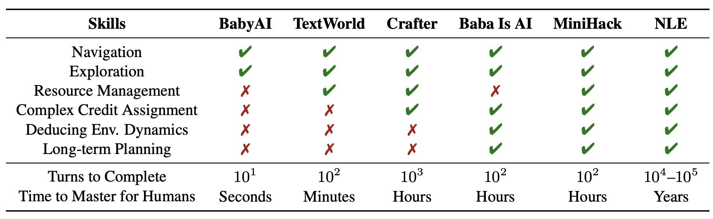
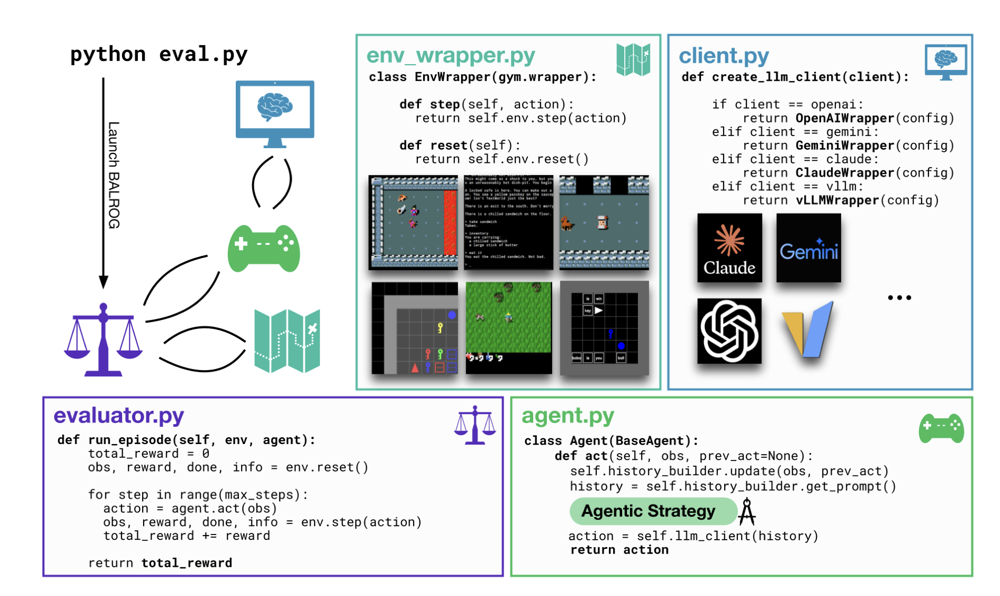
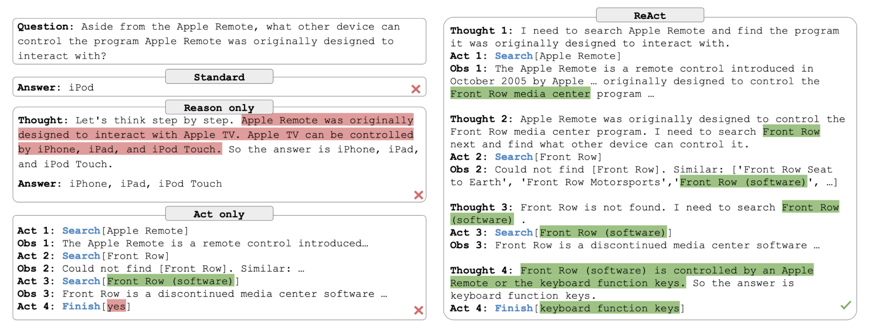
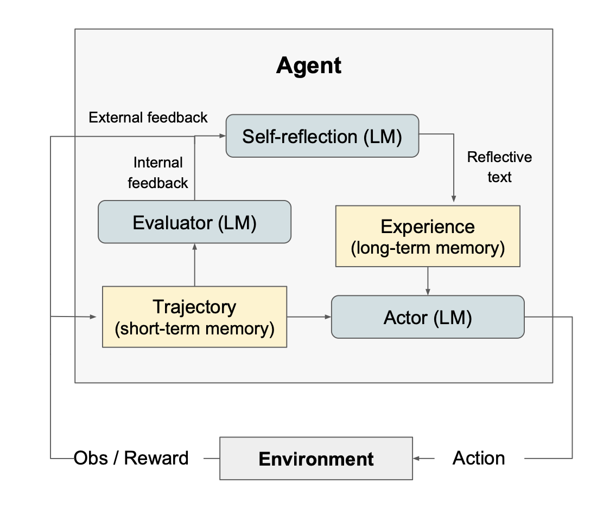
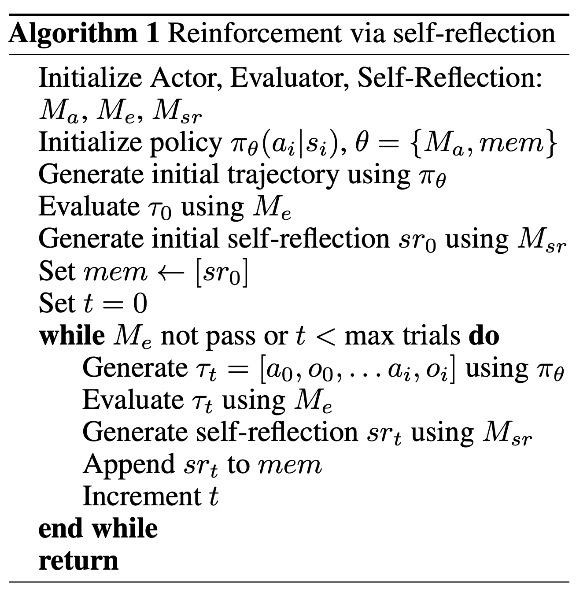

# Chapter 10 Case Study 2: BALROG for LLM Reasoning and Reflection

[Course index](../../README.md) · [Original source](https://arxiv.org/html/2610.13455v1#Ch10) · [Raw file](../../raw/originals/book.html)

Retrieved: 2026-11-13T16:41:17.579179+00:00

[Contents](../../CONTENTS.md) · [Full book](../book/full-book-html.md) · [Previous chapter](chapter-09-interaction-styles-for-agentic-llms.md) · [Next chapter](chapter-11-how-agents-use-tools-to-act-in-the-world.md)

### Chapter 10 Case Study 2: BALROG for LLM Reasoning and Reflection

**What You Will Learn**

In this case study you will gain hands-on experience building self-reflective agent for reasoning domains.
Specifically, you will be able to:

- Run a multi-step *reasoning agent* on a benchmark of puzzles and games.
- Adapt a reasoning agent with your own ideas.
- Implement your own *self-reflective* agent.
- Critically reflect on the *performance and stability* of a learning agent in the domain of puzzles and games.

#### 10.1 BALROG Overview

In this case we will work with an agentic LLM that performs self-reflection. We use a popular benchmark suite for reasoning tasks, called BALROG.11
1
A Balrog is a mythical demon from Middle-earth, featured in the fantasy works of J.R.R. Tolkien. A Balrog is a match even for Gandalf the Grey, the most powerful wizard of all. BALROG is an acronym for *B*enchmarking *A*gentic *L*LM and VLM *R*easoning *O*n *G*ames. The BALROG benchmark consists of a mix of easy and hard games, some of which are difficult for LLMs to play well, as the BALROG paper shows in their own benchmarking study [[Paglieri et al., 2025](#bibi.bib1)].

Initially, the BALROG games are benchmarked with vanilla LLMs. The code, however, is quite open and amenable to writing your own agent approaches, to see if you can do better.
The software is written for you to write your own agent code for in-context (reinforcement) learning.

The main BALROG website is <https://balrogai.com>.
The code is easy to adapt and use for your own experiments, and there is a leaderboard. In this chapter we will guide you to write your own agent code, that can then be run on the BALROG games-suite.

Figure 10.1: 
List of games in BALROG [[Paglieri et al., 2025](#bibi.bib1)]

BALROG is designed to challenge in-context agents on reasoning problems.
It uses puzzle-style games to benchmark the reasoning capabilities of LLMs and VLMs. Figure [10.1](#Ch10.F1 "Figure 10.1 ‣ 10.1 BALROG Overview ‣ Chapter 10 Case Study 2: BALROG for LLM Reasoning and Reflection ‣ Part III Agents ‣ Agentic Large Language Models") lists the games. The games are from easy to hard: BabyAI, Crafter, TextWorld, BabaIsAI, MiniHack, and NetHack. The games offer a mix of challenges, some are text-based, some have a visual component, all include reasoning challenges for the model. Some of the games are considered hard. For example, it is not expected that your model or your agent—or your self—will reach a high score on NetHack. (If you do achieve that, without having accessed the cheat-sheets, you may want to consider writing a paper for a prestigious AI conference.)

##### 10.1.1 Puzzles and Games

BALROG consists of the six puzzles and games shown in Figure [10.1](#Ch10.F1 "Figure 10.1 ‣ 10.1 BALROG Overview ‣ Chapter 10 Case Study 2: BALROG for LLM Reasoning and Reflection ‣ Part III Agents ‣ Agentic Large Language Models"). The games run from easy grid world puzzles to hard text-based dungeon and dragons strategy games, with long credit assignment episodes and flat reward landscapes.

The authors of BALROG provide a code base that allows experimentation with agents, to design your own agent, to see how well they do on the benchmarks. To perform well on the benchmarks in BALROG, the agents must be good at reasoning and planning, and, most likely, be good at adapting and reflecting on their own behavior.

BabyAI is a simple grid-world game, where the agent has to solve a navigation task. A simple reinforcement learning type algorithm would be able to easily solve this game. Tasks are given in natural language, such as: *go to the blue ball, then pick up the grey key*. Of course, the challenge for the agentic LLM is to perform the planning part of the task. It is expected that the LLM will be able to do well on this simple game (see the BALROG paper).

NetHack, on the other hand, is a highly challenging game, also for human players. NetHack is a text-based dungeons and dragons-like game. It includes both
long-term strategic planning, in the sense that winning a game can involve hundreds of thousands of steps, and short-term tactical fights to fend of the usual hordes of monsters. Credit assignment is a challenge in NetHack, in order to understand which of the actions that the agent took in the past contributed to ultimate success or failure, since actions in one area of the game may have unexpected consequences far away, making it difficult to play for reinforcement learning agents. NetHack is known for human players to take years to
master the game without resorting to cheat guides.

Figure 10.2: 
Architecture of BALROG [[Paglieri et al., 2025](#bibi.bib1)]

##### 10.1.2 BALROG Architecture

We wil now have a look at the architecture of the BALROG framework. Figure [10.2](#Ch10.F2 "Figure 10.2 ‣ 10.1.1 Puzzles and Games ‣ 10.1 BALROG Overview ‣ Chapter 10 Case Study 2: BALROG for LLM Reasoning and Reflection ‣ Part III Agents ‣ Agentic Large Language Models") shows the architecture, taken from the paper [[Paglieri et al., 2025](#bibi.bib1)].

Please familiarize yourself with the BALROG system. Read the paper [Paglieri et al. [2025]](#bibi.bib1), which you can find on <https://arxiv.org/abs/2411.13543>, or go to the BALROG website at <https://balrogai.com>.

If you have not done so yet, install BALROG on your system with the `git clone` command.
Go to <https://balrogai.com>, or directly to the Github repository at <https://github.com/balrog-ai/BALROG>. Install the repository on your local computer.

Decide which LLM you want to use. Please note that typical BALROG agents make many LLM calls, at each step of the way. If you want to run the LLM locally, install it, or use it from Huggingface. If you want to use a (commercial) cloud-based LLM, acquire an API-key and install the API-key in your environment. You may want to consider applying for a free student-tier, if that is offered. The use of frontier LLMs can be expensive, but usually older and smaller LLMs, some of which are still relatively capable, are much cheaper.

The BALROG readme on the Github repository contains information on how to install the system, and how to install an API key for your favorite LLM, see Listing [10.3](#Ch10.F3 "Figure 10.3 ‣ 10.1.2 BALROG Architecture ‣ 10.1 BALROG Overview ‣ Chapter 10 Case Study 2: BALROG for LLM Reasoning and Reflection ‣ Part III Agents ‣ Agentic Large Language Models"). (In one of the exercises we will use multiple LLMs, to compare their performance. For now, we are just trying to get the system to run, and anyone will do.)

[⬇](data:text/plain;base64,ICAgICAgICBleHBvcnQgT1BFTkFJX0FQSV9LRVk9PEtFWT4KICAgICAgICBleHBvcnQgQU5USFJPUElDX0FQSV9LRVk9PEtFWT4KICAgICAgICBleHBvcnQgR0VNSU5JX0FQSV9LRVk9PEtFWT4=)

1
 **export** OPENAI_API_KEY=<KEY>

2
 **export** ANTHROPIC_API_KEY=<KEY>

3
 **export** GEMINI_API_KEY=<KEY>

Figure 10.3: Installing the API key

##### 10.1.3 Agent

Please read the Agent tutorial in BALROG at <https://github.com/balrog-ai/BALROG/blob/main/docs/agents.md>. In BALROG, agents are small pieces of Python code that call an LLM with a prompt to provide an answer how to determine the next step. The agent code is responsible for receiving answers from the model (observations) and for selecting the next action. The LLM is used to execute various prompts.

BALROG follows interaction style D from Figure [9.7](chapter-09-interaction-styles-for-agentic-llms.md#Ch9.F7 "Figure 9.7 ‣ 9.2.1.4 D. Self-Reflection Harness ‣ 9.2.1 Agentic Interaction Styles ‣ 9.2 Learning Mechanisms in Agentic LLMs ‣ Chapter 9 Interaction Styles for Agentic LLMs ‣ Part III Agents ‣ Agentic Large Language Models"), where the prompt is built up from the history of interactions.

###### 10.1.3.1 Prompt Builder

The agent builds a prompt based on previous actions, based on observation/action pairs from previous interactions.
Thus, in reinforcement learning terms, the agent performs the function of the policy, selecting the next action to perform based on the incoming observation.

Go to the `prompt_builder` directory to change the way that prompts are constructed from the history of actions.

###### 10.1.3.2 Agents

Agents are responsible for the memory function: managing
the observation/action histories.
The agents must keep a record of past observations and actions to support context-aware decision-making, and this must be implemented by us, external to the LLM.

The agent code in BALROG queries the LLM: agents send observations to the LLM, receive responses, and use those responses to decide on actions to take in the game.

BALROG comes with a number of pre-written agents, which you should study to design your own. The repository has a naive agent and a chain of thought agent. Also provided are more robust versions for handling LLM responses.

When you build your own agent, you will most likely build on the custom agent.
The BALROG agent tutorial provides an example for a simple planning agent.

#### 10.2 Implementation Steps

We will now provide some exercises to help you explore building your agents.

##### 10.2.1 Reproduce Paper

We start by trying to reproduce the results in the BALROG paper.
Please have a look at the BALROG code at Github <https://github.com/balrog-ai/BALROG>. Read the Evaluation Guide, the Agent Development tutorial, and the instructions how to run Few Shot Learning experiments (in-context learning).
Install the relevant tools on your computer, and the right Python version (and put it in your PATH). Check the version by starting the Python interpreter from the command prompt: `$ python`.

First, run the standard evaluation, to make sure you installed things correctly, see Listing [10.4](#Ch10.F4 "Figure 10.4 ‣ 10.2.1 Reproduce Paper ‣ 10.2 Implementation Steps ‣ Chapter 10 Case Study 2: BALROG for LLM Reasoning and Reflection ‣ Part III Agents ‣ Agentic Large Language Models").

[⬇](data:text/plain;base64,IHB5dGhvbiBldmFsLnB5IFwKICBhZ2VudC50eXBlPW5haXZlIFwKICBhZ2VudC5tYXhfaW1hZ2VfaGlzdG9yeT0wIFwKICBhZ2VudC5tYXhfdGV4dF9oaXN0b3J5PTE2IFwKICBldmFsLm51bV93b3JrZXJzPTE2IFwKICBjbGllbnQuY2xpZW50X25hbWU9b3BlbmFpIFwKICBjbGllbnQubW9kZWxfaWQ9Z3B0LTRvLW1pbmktMjAyNC0wNy0xOA==)

1
 python **eval**.py \

2
 agent.**type**=naive \

3
 agent.max_image_history=0 \

4
 agent.max_text_history=16 \

5
 **eval**.num_workers=16 \

6
 client.client_name=openai \

7
 client.model_id=gpt-4o-mini-2024-07-18

Figure 10.4: Running the standard evaluation

##### 10.2.2 Different LLMs

To get a feeling for how the standard agent performs on the different benchmarks with different LLMs, it is useful to run a few different LLMs. It is recommended to run closed and open LLMs, and see how they perform. Especially the open version from OpenAI, Claude, DeepSeek, OLMo and Qwen may work well.

Running these models is important, and will lead to more insight into the relative strengths of the various models.

##### 10.2.3 Different Puzzles

Next, to get a better understanding of the benchmark, you should, after running the LLM agent in the different puzzle problems, have a closer look at the prompts and the answers of LLM. See if you can see where the LLM agent fails, where the weakness of the agent lies. By close inspection of the individual actions, and a deeper understanding of the puzzle, you might be able to think of a way to improve your agent.

##### 10.2.4 Computational Cost

BALROG agents call an LLM for each step that the agent makes, often with a long prompt. In these puzzles and games many such steps are made. Running different LLMs on the full benchmark, for different seeds, will easily require many tokens.

In your experiments, first try a small and cheap LLM, such as Qwen-3B. Start with the easiest benchmarks (BabyAI and Crafter). If you wish to expand, please go ahead, but be mindful of the computational cost. You want insights, but you also want your experiments to finish in a reasonable time for a reasonable cost.

##### 10.2.5 Implement Own Reasoning Agent

Now it is time to implement your own learning agent.
Go to the agents directory in balrog, and edit the `custom.py` file.
Listing [10.5](#Ch10.F5 "Figure 10.5 ‣ 10.2.5 Implement Own Reasoning Agent ‣ 10.2 Implementation Steps ‣ Chapter 10 Case Study 2: BALROG for LLM Reasoning and Reflection ‣ Part III Agents ‣ Agentic Large Language Models") reproduces the code for Custom Agent from the BALROG readme. The code can be run with the command in Listing [10.6](#Ch10.F6 "Figure 10.6 ‣ 10.2.5 Implement Own Reasoning Agent ‣ 10.2 Implementation Steps ‣ Chapter 10 Case Study 2: BALROG for LLM Reasoning and Reflection ‣ Part III Agents ‣ Agentic Large Language Models") (specifying the custom agent, and running gently with fewer workers). Of course, you can specify your own LLM of choice in the command.

Start with the provided code, run it, see how it works. Then, you can try to make small improvements. Try making changes to the prompt for the LLM, and to the way in which the Python code handles the learning in the agent, either with the history prompt builder, in the plan, or in the learning algorithm.

[⬇](data:text/plain;base64,ZnJvbSBiYWxyb2cuYWdlbnRzLmJhc2UgaW1wb3J0IEJhc2VBZ2VudAppbXBvcnQgcmUKCgpjbGFzcyBDdXN0b21BZ2VudChCYXNlQWdlbnQpOgogICAgZGVmIF9faW5pdF9fKHNlbGYsIGNsaWVudF9mYWN0b3J5LCBwcm9tcHRfYnVpbGRlcik6CiAgICAgICAgc3VwZXIoKS5fX2luaXRfXyhjbGllbnRfZmFjdG9yeSwgcHJvbXB0X2J1aWxkZXIpCiAgICAgICAgc2VsZi5jbGllbnQgPSBjbGllbnRfZmFjdG9yeSgpCiAgICAgICAgc2VsZi5wbGFuID0gTm9uZQoKICAgIGRlZiBhY3Qoc2VsZiwgb2JzLCBwcmV2X2FjdGlvbj1Ob25lKToKICAgICAgICBpZiBwcmV2X2FjdGlvbjoKICAgICAgICAgICAgc2VsZi5wcm9tcHRfYnVpbGRlci51cGRhdGVfYWN0aW9uKHByZXZfYWN0aW9uKQogICAgICAgIHNlbGYucHJvbXB0X2J1aWxkZXIudXBkYXRlX29ic2VydmF0aW9uKG9icykKCiAgICAgICAgcGxhbl90ZXh0ID0gZiJDdXJyZW50IFBsYW46XG57c2VsZi5wbGFufVxuIiBpZiBzZWxmLnBsYW4gZWxzZSAiWW91IGhhdmUgbm8gcGxhbiB5ZXQuXG4iCgogICAgICAgIHBsYW5uaW5nX2luc3RydWN0aW9ucyA9ICIiIgpSZXZpZXcgdGhlIGN1cnJlbnQgcGxhbiBhYm92ZSBpZiBwcmVzZW50LiBEZWNpZGUgd2hldGhlciB0byBjb250aW51ZSB3aXRoIGl0IG9yIG1ha2UgY2hhbmdlcy4KSWYgeW91IG1ha2UgY2hhbmdlcywgcHJvdmlkZSB0aGUgdXBkYXRlZCBwbGFuLiBUaGVuLCBwcm92aWRlIHRoZSBuZXh0IGFjdGlvbiB0byB0YWtlLgpZb3UgbXVzdCBvdXRwdXQgYW4gYWN0aW9uIGF0IGV2ZXJ5IHN0ZXAuCkZvcm1hdCB5b3VyIGFuc3dlciBpbiB0aGUgZm9sbG93aW5nIHdheToKUExBTjogPHlvdXIgdXBkYXRlZCBwbGFuIGlmIGNoYW5nZWQsIG9yICJObyBjaGFuZ2VzIHRvIHRoZSBwbGFuLiIgaWYgdGhlIGN1cnJlbnQgcGxhbiBpcyBnb29kPgpBQ1RJT046IDx5b3VyIG5leHQgYWN0aW9uPgogICAgICAgICIiIi5zdHJpcCgpCgogICAgICAgIG1lc3NhZ2VzID0gc2VsZi5wcm9tcHRfYnVpbGRlci5nZXRfcHJvbXB0KCkKICAgICAgICBpZiBtZXNzYWdlcyBhbmQgbWVzc2FnZXNbLTFdLnJvbGUgPT0gInVzZXIiOgogICAgICAgICAgICBtZXNzYWdlc1stMV0uY29udGVudCArPSAiXG5cbiIgKyBwbGFuX3RleHQgKyAiXG4iICsgcGxhbm5pbmdfaW5zdHJ1Y3Rpb25zCgogICAgICAgIHJlc3BvbnNlID0gc2VsZi5jbGllbnQuZ2VuZXJhdGUobWVzc2FnZXMpCgogICAgICAgICMgRXh0cmFjdCB0aGUgcGxhbiBhbmQgYWN0aW9uIGZyb20gdGhlIExMTSdzIHJlc3BvbnNlCiAgICAgICAgcGxhbiwgYWN0aW9uID0gc2VsZi5fZXh0cmFjdF9wbGFuX2FuZF9hY3Rpb24ocmVzcG9uc2UuY29tcGxldGlvbikKCiAgICAgICAgIyBVcGRhdGUgdGhlIGludGVybmFsIHBsYW4gaWYgaXQgaGFzIGNoYW5nZWQKICAgICAgICBpZiBwbGFuICE9ICJObyBjaGFuZ2VzIHRvIHRoZSBwbGFuLiI6CiAgICAgICAgICAgIHNlbGYucGxhbiA9IHBsYW4KCiAgICAgICAgIyBTYXZlIHRoZSBwbGFuIGluIHRoZSByZXNwb25zZS5yZWFzb25pbmcgZmllbGQgYW5kIHRoZSBhY3Rpb24gaW4gcmVzcG9uc2UuY29tcGxldGlvbgogICAgICAgIHJlc3BvbnNlID0gcmVzcG9uc2UuX3JlcGxhY2UocmVhc29uaW5nPXBsYW4sIGNvbXBsZXRpb249YWN0aW9uKQogICAgICAgIHJldHVybiByZXNwb25zZQoKICAgIGRlZiBfZXh0cmFjdF9wbGFuX2FuZF9hY3Rpb24oc2VsZiwgcmVzcG9uc2VfdGV4dCk6CiAgICAgICAgcGxhbl9tYXRjaCA9IHJlLnNlYXJjaChyIlBMQU46XHMqKC4qPykoPz1cbkFDVElPTjp8XFopIiwgcmVzcG9uc2VfdGV4dCwgcmUuSUdOT1JFQ0FTRSB8IHJlLkRPVEFMTCkKICAgICAgICBhY3Rpb25fbWF0Y2ggPSByZS5zZWFyY2gociJBQ1RJT046XHMqKC4qKSIsIHJlc3BvbnNlX3RleHQsIHJlLklHTk9SRUNBU0UgfCByZS5ET1RBTEwpCgogICAgICAgIHBsYW4gPSBwbGFuX21hdGNoLmdyb3VwKDEpLnN0cmlwKCkgaWYgcGxhbl9tYXRjaCBlbHNlICJObyBjaGFuZ2VzIHRvIHRoZSBwbGFuLiIKICAgICAgICBhY3Rpb24gPSBhY3Rpb25fbWF0Y2guZ3JvdXAoMSkuc3RyaXAoKSBpZiBhY3Rpb25fbWF0Y2ggZWxzZSBOb25lCgogICAgICAgIHJldHVybiBwbGFuLCBhY3Rpb24=)

1
**from** balrog.agents.base **import** BaseAgent

2
**import** re

3

4

5
**class** CustomAgent(BaseAgent):

6
 **def** __init__(self, client_factory, prompt_builder):

7
 **super**().__init__(client_factory, prompt_builder)

8
 self.client = client_factory()

9
 self.plan = None

10

11
 **def** act(self, obs, prev_action=None):

12
 **if** prev_action:

13
 self.prompt_builder.update_action(prev_action)

14
 self.prompt_builder.update_observation(obs)

15

16
 plan_text = f"Current␣Plan:\n{self.plan}\n" **if** self.plan **else** "You␣have␣no␣plan␣yet.\n"

17

18
 planning_instructions = """

19
Review␣the␣current␣plan␣above␣if␣present.␣Decide␣whether␣to␣continue␣with␣it␣or␣make␣changes.

20
If␣you␣make␣changes,␣provide␣the␣updated␣plan.␣Then,␣provide␣the␣next␣action␣to␣take.

21
You␣must␣output␣an␣action␣at␣every␣step.

22
Format␣your␣answer␣in␣the␣following␣way:

23
PLAN:␣<your␣updated␣plan␣if␣changed,␣or␣"No changes to the plan."␣if␣the␣current␣plan␣is␣good>

24
ACTION:␣<your␣next␣action>

25
␣␣␣␣␣␣␣␣""".strip()

26

27
 messages = self.prompt_builder.get_prompt()

28
 **if** messages **and** messages[-1].role == "user":

29
 messages[-1].content += "\n\n" + plan_text + "\n" + planning_instructions

30

31
 response = self.client.generate(messages)

32

33
 *# Extract the plan and action from the LLM’s response*

34
 plan, action = self._extract_plan_and_action(response.completion)

35

36
 *# Update the internal plan if it has changed*

37
 **if** plan != "No␣changes␣to␣the␣plan.":

38
 self.plan = plan

39

40
 *# Save the plan in the response.reasoning field and the action in response.completion*

41
 response = response._replace(reasoning=plan, completion=action)

42
 **return** response

43

44
 **def** _extract_plan_and_action(self, response_text):

45
 plan_match = re.search(r"PLAN:\s\*(.\*?)(?=\nACTION:|\Z)", response_text, re.IGNORECASE | re.DOTALL)

46
 action_match = re.search(r"ACTION:\s\*(.\*)", response_text, re.IGNORECASE | re.DOTALL)

47

48
 plan = plan_match.group(1).strip() **if** plan_match **else** "No␣changes␣to␣the␣plan."

49
 action = action_match.group(1).strip() **if** action_match **else** None

50

51
 **return** plan, action

Figure 10.5: Agent code in BALROG

[⬇](data:text/plain;base64,cHl0aG9uIGV2YWwucHkgXAogIGFnZW50LnR5cGU9Y3VzdG9tIFwKICBhZ2VudC5tYXhfaW1hZ2VfaGlzdG9yeT0wIFwKICBhZ2VudC5tYXhfaGlzdG9yeT0xNiBcCiAgZXZhbC5udW1fd29ya2Vycz02NCBcCiAgY2xpZW50LmNsaWVudF9uYW1lPW9wZW5haSBcCiAgY2xpZW50Lm1vZGVsX2lkPWdwdC00by1taW5pLTIwMjQtMDctMTg=)

1
python **eval**.py \

2
 agent.**type**=custom \

3
 agent.max_image_history=0 \

4
 agent.max_history=16 \

5
 **eval**.num_workers=64 \

6
 client.client_name=openai \

7
 client.model_id=gpt-4o-mini-2024-07-18

Figure 10.6: Running the Agent evaluation

#### 10.3 Evaluation

The performance of your agent will be reported by BALROG as a progression percentage. Record the progression numbers for each benchmark, and for the agent types that you try. Do this in a structured way, you may want to write a Python or shell script to automate the running of the experiments and the logging of the results, perhaps also plotting the progression in a graph. Consider using wandb.ai.

What agent types work well, and on what benchmark do they work well? Make a matrix in which you log progression for the agent types and the benchmark types that you try.

Note that LLM experiments are inherently non-deterministic: two runs with the same prompt may give different results. Therefore, perform multiple runs of each experiment. If you get five identical results in a row, you may start to trust these results. If they vary widely, you may want to investigate. Is the reason purely statistical? Does turning down the temperature solve the problem, or is there another problem?

Do not blindly trust the progression numbers that are reported. Since you are using code on a computer, there may be bugs, or other issues. The BALROG system facilitates delving deeper into the runs. It logs csv files that you can look at with a spreadsheet. Have a look at some of the runs, and decide if it makes sense what you see, or if the agents are exhibiting degenerative behavior. If they do, try to find the reason. Did you do something wrong? Is there unexpected interference between the benchmark and the agent behavior?
Is the reward landscape too flat, so that there is no signal for the agent to go after, and all it does is random actions running in circles in a way that makes no sense at all? Is there something that you can do about this?

Please note that the field of large language models, and especially of agentic LLMs, is new, and our insights and our software frameworks have not yet stabilized. Some unexpected results are to be expected, and some challenges or frustration as well.

A structured way of experimentation and result-logging is your friend. Planning and organization can make the running, evaluation, and improvement of practical agentic LLM experiments an enjoyable exercise.

#### 10.4 Self-Reflection

When you were able to reproduce the benchmark results, and have experimented somewhat with the agents, you may want to try to take on some larger challenges. In this section, we will try to extend the BALROG agent towards self-reflection, where the LLM is used in different roles, such as evaluation and action selection. Self-reflection, as any adaptive system that chases a target that is itself being optimized, can be prone to instability and oscillations. Therefore, before we try our self-reflective ideas, it is important that the base learner system of the previous subsection works, and converges in a stable and predictable manner.
Please go back to that section and make sure things work as you want them to work.

There are many recent works that try to improve LLM agents. We will mention two: ReAct [[Yao et al., 2022](#bibi.bib3)] and reflexion [[Shinn et al., 2024](#bibi.bib2)]. ReAct is primarily focused on prompts, where reflexion introduces new agent algorithms, including short-term and long-term memory.

Figure 10.7: 
ReAct example Performing Search [[Yao et al., 2022](#bibi.bib3)]

###### ReAct

ReAct uses promtps to interact with the world. ReAct promotes the use of tools, to lookup information, see Figure [10.7](#Ch10.F7 "Figure 10.7 ‣ 10.4 Self-Reflection ‣ Chapter 10 Case Study 2: BALROG for LLM Reasoning and Reflection ‣ Part III Agents ‣ Agentic Large Language Models"). The original website for ReAct is <https://react-lm.github.io>, the code repository is here: <https://github.com/ysymyth/ReAct>. ReAct prompting has also been implemented in the LangChain22
2
See <https://docs.langchain.com/oss/python/langchain/overview> and BeeAI33
3
See <https://github.com/i-am-bee/beeai-framework/blob/main/python/examples/agents/react.py> frameworks.

Have a look at these framework to get an understanding of the prompt-based agent interaction style that ReAct introduces. Then, implement the prompt-based interaction in BALROG. Does is improve performance? For which games does it help to lookup external information? For which games not?

###### Reflexion

Where ReAct is prompt-based, allowing interactive lookups, the reflexion approach introduces Python-coded agents, allowing more elaborate agent behavior.
Reflexion uses the same LLM in different contexts, with different prompts.
It works on the assumption that it is easier to criticize what is wrong with an existing prompt, than to come up with one that works.

Reflexion is a popular self-reflection architecture [[Shinn et al., 2024](#bibi.bib2)]. The main webpage for reflexion is <https://github.com/noahshinn/reflexion>. A blog post on reflexion, describing the main ideas, is here: <https://nanothoughts.substack.com/p/reflecting-on-reflexion>.

Figure 10.8: 
Reflexion Architecture [[Shinn et al., 2024](#bibi.bib2)]

Figure 10.9: 
Reflexion Algorithm [[Shinn et al., 2024](#bibi.bib2)]

Figure [10.8](#Ch10.F8 "Figure 10.8 ‣ Reflexion ‣ 10.4 Self-Reflection ‣ Chapter 10 Case Study 2: BALROG for LLM Reasoning and Reflection ‣ Part III Agents ‣ Agentic Large Language Models") shows the general concept of reflexion, the different prompts, and the different types of memory. Figure [10.9](#Ch10.F9 "Figure 10.9 ‣ Reflexion ‣ 10.4 Self-Reflection ‣ Chapter 10 Case Study 2: BALROG for LLM Reasoning and Reflection ‣ Part III Agents ‣ Agentic Large Language Models") shows the code of reflexion, with the different calls to the LLM in line 3, 5, and 6 ($M_{a}$, $M_{e}$, and $M_{sr}$) and line 9, 11, 12. Note that the code is pseudo code, with important details about memory management, prompt management, and convergence criterium left open.
Have a look at the repository in Github for details.

Reflexion uses the same LLM with different prompts, which may lead to learning instability, and loops. Furthermore, memory management is relatively simple, with the potential of context overruns. An idea is to implement chunking or other memory compression methods, by hand in Python, or using an LLM.

First play with the reflexion repository, try to get it to work on the reflexion application, such as AlfWorld and HotpotQA.

###### Extensions

Now, try to implement a reflexion agent in BALROG, to run on the BALROG benchmarks.
What problem do you encounter? Does reflexion improve performance over the standard BALROG agents?

Next, extend the problem further. You can try to find other reflection methods in the literature, or try to create new reflection methods from your own. You can try different application types, and you can try to see how your approaches perform. And you can of course try other LLMs.

#### 10.5 Concluding Remarks

In this chapter we have discussed a practical case study, to see how an LLM can performs self-reflection. We used BALROG, a popular benchmark suite for reasoning tasks. BALROG consists of a mix from easy to hard games, some of which are difficult for LLMs to play well.
The BALROG suite is designed in an open style. We can write our own agent code that can then be run on the BALROG games.

This has been an important practical case study.
You have explored writing our own agent code for in-context reasoning. You have also gone beyond base-learning, by implementing self-reflection. You have explored the stability of self-reflection, on different LLMs and with highly challenging benchmarks.

### References

- Paglieri et al. (2025)
  D. Paglieri, B. Cupiał, S. Coward, U. Piterbarg, M. Wolczyk, A. Khan, E. Pignatelli, Ł. Kuciński, L. Pinto, R. Fergus, J. N. Foerster, J. Parker-Holder, and T. Rocktäschel
  BALROG: benchmarking agentic LLM and VLM reasoning on games.
  In The Thirteenth International Conference on Learning Representations,
  External Links: [Link](https://openreview.net/forum?id=fp6t3F669F)
  Cited by: [Figure 10.1](#Ch10.F1 "In 10.1 BALROG Overview ‣ Chapter 10 Case Study 2: BALROG for LLM Reasoning and Reflection ‣ Part III Agents ‣ Agentic Large Language Models"),
  [Figure 10.1](#Ch10.F1.4 "In 10.1 BALROG Overview ‣ Chapter 10 Case Study 2: BALROG for LLM Reasoning and Reflection ‣ Part III Agents ‣ Agentic Large Language Models"),
  [Figure 10.2](#Ch10.F2 "In 10.1.1 Puzzles and Games ‣ 10.1 BALROG Overview ‣ Chapter 10 Case Study 2: BALROG for LLM Reasoning and Reflection ‣ Part III Agents ‣ Agentic Large Language Models"),
  [Figure 10.2](#Ch10.F2.4 "In 10.1.1 Puzzles and Games ‣ 10.1 BALROG Overview ‣ Chapter 10 Case Study 2: BALROG for LLM Reasoning and Reflection ‣ Part III Agents ‣ Agentic Large Language Models"),
  [§10.1.2](#Ch10.S1.SS2.p1.1 "10.1.2 BALROG Architecture ‣ 10.1 BALROG Overview ‣ Chapter 10 Case Study 2: BALROG for LLM Reasoning and Reflection ‣ Part III Agents ‣ Agentic Large Language Models"),
  [§10.1.2](#Ch10.S1.SS2.p2.1 "10.1.2 BALROG Architecture ‣ 10.1 BALROG Overview ‣ Chapter 10 Case Study 2: BALROG for LLM Reasoning and Reflection ‣ Part III Agents ‣ Agentic Large Language Models"),
  [§10.1](#Ch10.S1.p1.1 "10.1 BALROG Overview ‣ Chapter 10 Case Study 2: BALROG for LLM Reasoning and Reflection ‣ Part III Agents ‣ Agentic Large Language Models").

- Shinn et al. (2024)
  N. Shinn, F. Cassano, A. Gopinath, K. Narasimhan, and S. Yao
  Reflexion: language agents with verbal reinforcement learning.
  Advances in Neural Information Processing Systems 36.
  Cited by: [Figure 10.8](#Ch10.F8 "In Reflexion ‣ 10.4 Self-Reflection ‣ Chapter 10 Case Study 2: BALROG for LLM Reasoning and Reflection ‣ Part III Agents ‣ Agentic Large Language Models"),
  [Figure 10.8](#Ch10.F8.4 "In Reflexion ‣ 10.4 Self-Reflection ‣ Chapter 10 Case Study 2: BALROG for LLM Reasoning and Reflection ‣ Part III Agents ‣ Agentic Large Language Models"),
  [Figure 10.9](#Ch10.F9 "In Reflexion ‣ 10.4 Self-Reflection ‣ Chapter 10 Case Study 2: BALROG for LLM Reasoning and Reflection ‣ Part III Agents ‣ Agentic Large Language Models"),
  [Figure 10.9](#Ch10.F9.4 "In Reflexion ‣ 10.4 Self-Reflection ‣ Chapter 10 Case Study 2: BALROG for LLM Reasoning and Reflection ‣ Part III Agents ‣ Agentic Large Language Models"),
  [§10.4](#Ch10.S4.SS0.SSS0.Px2.p2.1 "Reflexion ‣ 10.4 Self-Reflection ‣ Chapter 10 Case Study 2: BALROG for LLM Reasoning and Reflection ‣ Part III Agents ‣ Agentic Large Language Models"),
  [§10.4](#Ch10.S4.p2.1 "10.4 Self-Reflection ‣ Chapter 10 Case Study 2: BALROG for LLM Reasoning and Reflection ‣ Part III Agents ‣ Agentic Large Language Models").

- Yao et al. (2022)
  S. Yao, J. Zhao, D. Yu, N. Du, I. Shafran, K. Narasimhan, and Y. Cao
  React: synergizing reasoning and acting in language models.
  arXiv preprint arXiv:2210.03629.
  Cited by: [Figure 10.7](#Ch10.F7 "In 10.4 Self-Reflection ‣ Chapter 10 Case Study 2: BALROG for LLM Reasoning and Reflection ‣ Part III Agents ‣ Agentic Large Language Models"),
  [Figure 10.7](#Ch10.F7.4 "In 10.4 Self-Reflection ‣ Chapter 10 Case Study 2: BALROG for LLM Reasoning and Reflection ‣ Part III Agents ‣ Agentic Large Language Models"),
  [§10.4](#Ch10.S4.p2.1 "10.4 Self-Reflection ‣ Chapter 10 Case Study 2: BALROG for LLM Reasoning and Reflection ‣ Part III Agents ‣ Agentic Large Language Models").
