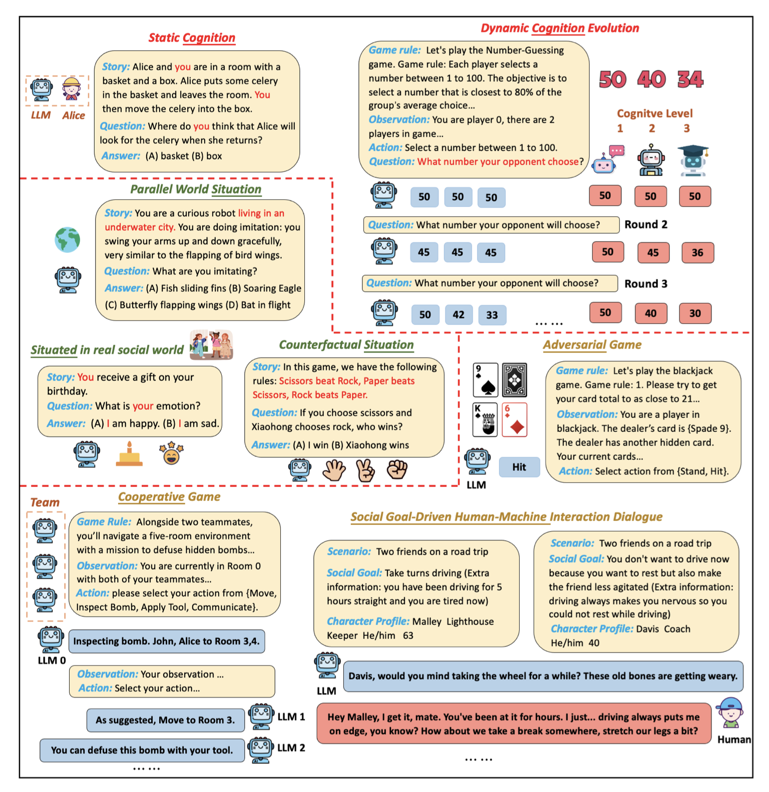
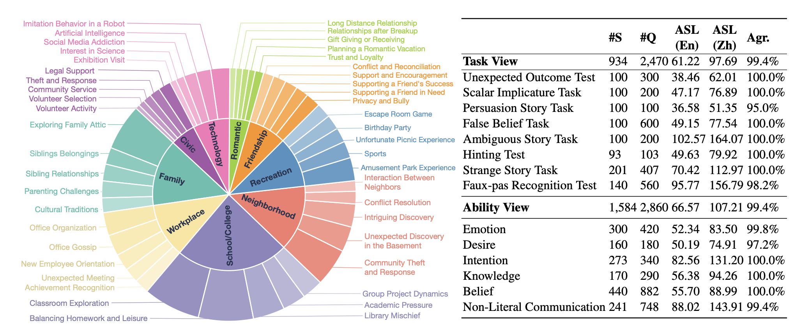

# Chapter 15 Studying Behavior of Agentic LLMs

[Course index](../../README.md) · [Original source](https://arxiv.org/html/2610.13455v1#Ch15) · [Raw file](../../raw/originals/book.html)

Retrieved: 2026-11-13T16:41:17.579179+00:00

[Contents](../../CONTENTS.md) · [Full book](../book/full-book-html.md) · [Previous chapter](chapter-14-case-study-3-building-a-multi-agent-diagnosis-framework.md) · [Next chapter](chapter-16-role-based-interaction-in-multi-llm-systems.md)

### Chapter 15 Studying Behavior of Agentic LLMs

**What You Will Learn**

In this chapter you will learn how agentic LLM behavior compares to human behavior. Specifically, you will be able to:

- Explain what is meant by *LLM behavior* and describe how this can be studied.
- List *basic social and interactive competencies*, and describe on which aspects LLMs do well and on which aspects they struggle.
- Describe ways of studying advanced social and interactive competencies in LLMs, in particular *strategic thinking*, *Theory of Mind*, and *moral reasoning*.
- Reflect on what behavioral approaches to LLMs can and cannot tell us, given various issues regarding *testing and interpretation*.

#### 15.1 What is LLM Behavior?

In 2019 a team of authors from across the computational, behavioral, and cognitive sciences described the emergence of a new field of study: *machine behavior*. This field is to be *concerned with the scientific study of intelligent machines, not as engineering artifacts, but as a class of actors with particular behavioral patterns and ecology* [[Rahwan et al., 2019](#bibn.bib45)]. Machine behavior is inherently interdisciplinary, as it integrates knowledge at the intrinsic level
of *technology* (algorithms, data structures, training procedures) with knowledge of the *environment and context* of its actual usage.

The approach in machine behavior is compared to work done in ethology or psychology: here too, making progress in understanding animal and human functioning requires integrating insights at the intrinsic (e.g. biophysics, neurology) and ecological levels (interaction with the environment, social interaction).

An important practical motivation for studying machine behavior, and LLM behavior specifically, has been mentioned in the introduction of this part: with LLMs becoming increasingly integrated in our daily work and personal environments, it has become urgent to know and understand their behavioral tendencies and patterns.

There is also a scientific motivation: due to the complexity of large-scale neural architectures (they appear as *black boxes*), it is difficult to trace their functioning analytically.
(Although the field of mechanistic interpretability does attempt to do this, see Chapter [21](chapter-21-mechanistic-interpretability-for-llm-agents.md#Ch21 "Chapter 21 *Mechanistic Interpretability for LLM Agents ‣ Part VI Advanced Topics ‣ Agentic Large Language Models").) Studying the *behavior* of such complex systems empirically is a complementary route to our understanding. In other words, due to the complexity of interactions, a theoretical engineer who would know everything there is to know about the architecture and training data of an LLM, still may not be able to predict how it responds in different kinds of situations. Behavioral approaches aim to fill this gap.

What counts as *behavior* depends on the affordances11
1
*Affordance* refers to what a system can do given the way it was designed and implemented in a specific context. of the system under investigation and the scope of the research. For example, for a basic LLM, behavior equals the *output* as produced by the token-based inference of the model. On the other hand, for an agentic LLM that can perform, for instance, web search and run code, behavior can also include the *actions* that it performs to get to a certain output, or to achieve a certain effect.
As we will see, some studies take only the final output into account and treat that as the model’s behavior; others are interested in the intermediate steps as well.

#### 15.2 Probing LLM Behavior Experimentally

In recent years, many studies have appeared that test LLMs’ social and interactive abilities. There are two main approaches: (1) prompting models with items adapted from experimental paradigms originally developed for humans, and (2) developing new test paradigms specifically for LLMs. The latter can be done quantitatively, using large scale benchmarks, or qualitatively, allowing for in-depth manual analysis on a smaller scale.
In what follows we will see examples.

Applying behavioral and psychological methods to (agentic) LLMs is not straightforward. Experiments designed for humans assume an embodied subject with beliefs, desires, and a sense of self that is continuous through time. Agentic LLMs have none of these in any obvious sense. This calls for reflection on *construct validity*: what does it mean to measure a certain trait or capacity in an AI system? This question applies on two levels: that of the observable outcomes of a trait and of the underlying mechanisms. In Section [15.5](#Ch15.S5 "15.5 Theory of Mind ‣ Chapter 15 Studying Behavior of Agentic LLMs ‣ Part V Behavior and Cognition ‣ Agentic Large Language Models") the example of the *false belief-test* [[Carpenter et al., 2002](#bibn.bib62)] is discussed. While some model classes have been shown to answer the questions of this test in similar ways as humans do (the level of the behavioral outcome), it is currently unknown to what degree the underlying mechanisms that produce this behavior differ or overlap in transformer models and humans. In Chapter [22](chapter-22-cognitive-perspectives-on-agentic-llms.md#Ch22 "Chapter 22 *Cognitive Perspectives on Agentic LLMs ‣ Part VI Advanced Topics ‣ Agentic Large Language Models") the issue of construct validity will be discussed in more depth.

For LLM-specific tests, there are also methodological challenges to consider. For example, LLMs have been known to be highly sensitive to seemingly irrelevant variations in prompts (word order, comma’s) or can produce different outputs across multiple runs due to sampling variability, model temperature, or with different random seeds. Also, data leakage of experimental materials into the training data can lead to performance based on memorization rather than generalization. We will see several applied examples in the following sections. Throughout this part we will pay attention to methodological rigor and interpretive caution at the end of each chapter.

In the next sections we will first discuss the basic social toolkit for agent interaction. Next, we will look at strategic behavior, where agents reason about the behavior of other agents, and we will discuss theory of mind. Finally, we will discuss moral judgment by LLMs.

#### 15.3 The Basic Social Toolkit

This section surveys basic social and interactive capacities, including conversation, pragmatics, and social etiquette.

##### 15.3.1 Functional and Pragmatic Linguistic Competence

As discussed in Part I, the key advancement of instruction-tuned LLMs is their ability to interact, chatbot style, using natural language. This requires not only a degree of *formal* linguistic competence (i.e., producing correct, grammatical sentences) but also of *functional* linguistic competence, the ability to interpret the meaning of an utterance in a specific context [[Mahowald et al., 2023](#bibn.bib57)]. Within linguistics and the cognitive sciences, functional linguistic competence is studied in the field of *pragmatics*. The core concepts of pragmatics go back to the *pragmatic turn* in mid-20th century philosophy of language and posit that linguistic meaning is for the most part not inherent in the signs themselves (tokens, words, sentences), but in their usage in actual contexts. This includes both the *linguistic context*, encompassing surrounding words up to distant factors such as titles and genres, as well as the *extra-linguistic context*, encompassing the spatial, temporal, and social dimensions. This view is most famously expressed in Paul Grice’s notion of *conversational implicature* [[Grice, 1975](#bibn.bib90)]. Consider the following examples:

1. A: Could you pass me the salt, please? B: Yes, I could. Would you also like me to do so?
2. A: Is Sarah a good colleague? B: Well, let’s say that she’s always on time.
3. He produced a series of sounds that corresponded closely with the score of an aria.

Grice argued that language usage is governed by a *cooperative principle*: we assume our interlocutors (humans or agents) are trying to communicate sensibly. Example 1 above features a classic instance of B undermining the cooperative principle: someone asking whether you can pass the salt is rarely interested in a literal answer confirming that possibility, but instead in the action of actually passing the salt. In 2, B’s response is conspicuously narrowly focused on one aspect (punctuality), and the listener can infer, for example, that B is implying something negative about Sarah’s collegiality. Similarly, when someone utters 3 rather than simply *He sang an aria*, the over-the-top elaborate phrasing may implicate a certain attitude towards the performance; for example that it was not of the speaker’s liking. In all cases, what is literally said is only one part of the message––the other part needs to be decoded or *read between the lines* by the listener from the context.

Interpreting linguistic meaning in a flexible, context-dependent, way has long been a notorious problem in natural language processing [[Trott et al., 2020](#bibn.bib44)]. There is general agreement that great progress has been made with LLMs on this problem, yet it is not well-understood to what factors this can be ascribed. Model size is an important predictor of functional and pragmatic competence, as are some forms of fine-tuning (SFT and DPO in particular) [[Yu et al., 2026](#bibn.bib43), [Ruis et al., 2023](#bibn.bib46)]. However, the variation between different domains of functional and pragmatic understanding in LLMs is still large, and scores are overall well below human performance [[Sravanthi et al., 2024](#bibn.bib47)].

One explanation is that LLMs have less access to extra-linguistic contextual information: they cannot see, hear, and otherwise sense the same as their human counterpart, and in most cases they do not have knowledge of previous interactions [[van der Meulen et al., 2025](#bibn.bib42)]. With the shift to agentic LLMs this situation is likely changing, as the models become equipped with memories, multimodal capacities, and other tools that add context. Empirical data on how this affects performance is currently missing.

##### 15.3.2 Politeness and Social Etiquette

Social etiquette and politeness in human-machine interaction have been studied for decades [[Ribino, 2023](#bibn.bib53)]. A useful theoretical anchor is the *Computers Are Social Actors* (CASA) paradigm [[Nass et al., 1994](#bibn.bib38)], which holds that we tend to apply common human social rules and expectations to computers even when we know that the machine is not a human social agent. We show and respond to cues of politeness, personality, and reciprocity as a way of negotiating trust and acceptance with a machine. Studies show that humans trust machines more when those machines adhere to social etiquette [[Miller, 2005](#bibn.bib50)], improving both task performance and user satisfaction [[Miyamoto et al., 2021](#bibn.bib52)]. We will discuss politeness theory and its application to LLMs.

###### Politeness Theory

Classic politeness theory [[Brown and Levinson, 1987](#bibn.bib37), e.g.] builds directly on the Gricean picture introduced above. This theory holds that interlocutors continually manage one another’s *face*, the public self-image every participant seeks to maintain, which has a positive dimension (the desire to liked and be approved of by others) and a negative dimension (the desire to avoid social obstacles). Many ordinary requests, criticisms, and refusals, are intrinsically *face-threatening* from a Gricean point of view, and speakers deploy politeness strategies in response. This framework has given LLM researchers a vocabulary for asking whether LLMs and their users recognize face-threats and mitigate them in contextually appropriate ways.

###### Are LLMs polite to their users?

A related direction concerns whether the model itself produces etiquette that is socially and culturally appropriate. Here the limitation flagged in the previous subsection resurfaces—that LLMs have impoverished access to extra-linguistic context. Politeness is culture-specific, yet systems trained predominantly on English-language data tend to default to Anglophone, directness-oriented norms [[Havaldar et al., 2023](#bibn.bib41)]. A clear demonstration of this problem arises in work on Persian *taarof*, a ritualized system of offers and refusals in which the appropriate response is frequently the opposite of the direct one. A study shows that frontier models fall over 40% short compared to native speakers in scenarios where taarof is culturally expected, defaulting instead to Western-style directness. This results in a disconnect between surface politeness and cultural appropriateness. For example, in one study, the model in questions responses scored 84.5% as *polite* by a standard metric, whereas only 41.7% were judged culturally correct [[Gohari Sadr et al., 2025](#bibn.bib40)]. Scoring well on a Western politeness rubric is not the same as behaving appropriately in all contexts. This is a reminder to continuously reflect on construct validity when measuring politeness in a model.

###### Does user politeness affect LLM performance?

A study across English, Chinese, and Japanese tasks found that impolite prompts tend to degrade performance in a variety of models [[Yin et al., 2024](#bibn.bib51)]. Furthermore, the study found that exaggerated politeness yields no reliable benefit, and that the optimal level of politeness varies by language and cultural background. This result fits with the computers-are-social-actors paradigm: LLMs seem to reproduce the human association between rudeness and failed cooperation from the training data. However, in a direct counterpoint, [Dobariya and Kumar [2025]](#bibn.bib39) report that on a multiple-choice benchmark, blunt and even rude prompts slightly *outperformed* polite ones for GPT-4o. The mapping from tone to quality thus appears neither stable across model generations nor straightforward. This illustrates the prompt-sensitivity and reproducibility concerns raised earlier in this chapter, and cautions against treating any single tone effect as a robust property of LLMs as such.

Taken together, LLMs reproduce the surface markers of politeness and are demonstrably sensitive to the politeness of their interlocutor, yet they neither apply these norms in a cross-culturally robust way, nor exhibit a stable relationship between tone and task performance.

It should be kept in mind that in studies so far, politeness and etiquette were limited to the linguistic dimension of interaction only. This contrasts with the multidimensionality of human-human interaction, where facial expressions, gestures, and other contextual cues are involved [[Brown and Levinson, 1987](#bibn.bib37)]. As with pragmatic competence, the shift to multi-modal agentic LLMs equipped with memory and increased access to user-specific context, can be expected to improve adaptation to a given user’s norms, but as yet there is little empirical evidence.

##### 15.3.3 Sensitivity to Emotional and Affective Cues

Competent social interaction requires not only grasping what an utterance means (pragmatics) and phrasing it in an effective and appropriate way (etiquette), but also sensitivity to the *emotional and affective* dimension of interaction. This requires registering how an interlocutor feels, and responding in a way that is experienced as fitting given the other’s emotional state. In humans this capacity is closely associated with *emotional intelligence*, defined by [Salovey and Mayer [1990]](#bibn.bib24) as the ability to understand emotional information in oneself and others and to use it to guide thought and behavior. As LLMs are increasingly deployed in emotionally loaded settings (e.g., coaching, customer service, mental-health support), the question of whether and how they handle affective information has become a prominent line of research.

###### Defining Empathy and Affect

Empathy and affect are central concepts in emotional intelligence research. *Affect* is the umbrella term covering emotions, moods, and feelings. It is often operationalized in terms of the felt quality of an experienced state along two dimensions: its valence (pleasant-unpleasant) and its arousal (calm-excited) [[Russell, 1980](#bibn.bib33)]. *Empathy*, by contrast, is a relation toward another’s experienced state: registering or sharing what someone else feels. In short, affect is the first-person feeling, whereas empathy operates on it from a second-person stance.

A paper by [de Vignemont and Singer [2006]](#bibn.bib34) further defines empathy as involving an affective state that (1) is congruent with the other person’s, (2) is elicited by observing that other’s state through their actions, expressions, and circumstances, and (3) is accompanied by the awareness that the other person’s state is the source. This last condition, known as the *self-other distinction*, is what separates empathy from *emotional contagion*. This is the more basic tendency to catch and come to share another’s affective state without necessarily registering its origin.

Emotional contagion is widespread in nature. For example, if two mice forage through undergrowth and one catches its foot, it will show signs of stress as it struggles to free itself, and that stress will tend to spread to its companion without the companion necessarily registering why [[Preston and de Waal, 2002](#bibn.bib35)].
The same low-level mechanism operates in cognitively more sophisticated species, including primates such as ourselves. However, what the self-other distinction adds is the possibility of reflection: not merely sharing the other’s state but recognizing it as the other’s and apprehending its nature and cause. This in turn supports more flexible responses such as targeted helping: acting to relieve the source of another’s distress.
22
2
The boundary between these levels is, however, a topic of active research. Rats, for example, will learn to release a trapped cage mate from a restrainer, even forgoing or sharing a chocolate reward to do so [[Ben-Ami Bartal et al., 2011](#bibn.bib36)]. The authors interpret this as empathically motivated helping. Whether such helping reflects genuine empathy with a self-other distinction, or is instead driven by reduction of the helper’s own contagion-induced distress, remains debated.

Another widely used distinction separates *cognitive empathy* (understanding another person’s feelings, perspective, or situation) and *affective empathy* (emotionally resonating with or responding to that state) [[Dvash and Shamay-Tsoory, 2014](#bibn.bib25)]. The two are supported by partly distinct systems: cognitive empathy is closely related to Theory of Mind, the attribution of mental states to others (see Section [15.5](#Ch15.S5 "15.5 Theory of Mind ‣ Chapter 15 Studying Behavior of Agentic LLMs ‣ Part V Behavior and Cognition ‣ Agentic Large Language Models")), whereas affective empathy is linked to emotional intelligence [[Dvash and Shamay-Tsoory, 2014](#bibn.bib25), [Preckel et al., 2018](#bibn.bib26)]. This distinction is consequential for evaluation, because a response may correctly identify what a user is feeling without conveying any warmth, or may sound warm and supportive without accurately reading the situation. For this reason, studies of LLM empathy increasingly score the two dimensions separately.

###### Empathy and Affect in LLMs

The question whether an LLM is *empathetic*, can be interpreted in two ways. We could ask whether it *feels* anything in a way comparable to humans or other animals; this is a complex question that we set aside here and pick up in Chapter [22](chapter-22-cognitive-perspectives-on-agentic-llms.md#Ch22 "Chapter 22 *Cognitive Perspectives on Agentic LLMs ‣ Part VI Advanced Topics ‣ Agentic Large Language Models"). The other interpretation is to look at *perceived empathy*: the degree to which a response by the LLM is experienced by a user as emotionally aware and supportive. A model can generate language that reads as caring while operating purely as a text-prediction system [[Sorin et al., 2024](#bibn.bib28)]. Keeping this distinction explicit is a further instance of the construct-validity caution that runs through this chapter: the observable behavior (a response that reads as empathetic) should not be confused with an underlying mechanism (a felt emotional state) that may be present or absent.

On the detection side, LLMs are able to recognise fine-grained affective and emotional states in text [[Broekens et al., 2023](#bibn.bib49)] and to factor this information into their responses, producing output that functions as a more empathetic conversational contribution [[Yang et al., 2024](#bibn.bib75), [Yan et al., 2024](#bibn.bib74)].
An example of a benchmark in this field is EmpatheticDialogues [[Rashkin et al., 2019](#bibn.bib32)].

On the expression side, human raters often judge LLM responses to everyday emotional situations as more empathetic than human-written ones, although the same outputs can display tell-tale formulaic patterns (recurring phrasing, characteristic punctuation, and emoji use) [[Lee et al., 2024](#bibn.bib29)].

To make expressed empathy measurable in written text, several studies adopt the EPITOME framework [[Sharma et al., 2020](#bibn.bib27)], which codes responses along three mechanisms: *emotional reactions* (warmth, concern, care), *interpretations* (communicating an understanding of what the other is going through), and *explorations* (asking to learn more). Emotional reactions map onto affective empathy and interpretations map onto cognitive empathy, which makes the framework a convenient bridge between the conceptual distinction above and concrete response scoring.

A recurring finding is that LLMs handle the two empathy dimensions unevenly. Using standardized psychological instruments, [Yu et al. [2025]](#bibn.bib30) report that GPT-4 reproduces the cognitive-and-affective empathy structure observed in humans, though at a lower overall level, while a Llama-3 model did not exhibit the same human-aligned structure. [Williams and Rosman [2025]](#bibn.bib31) similarly find that language models perform strongly on cognitive-empathy tasks but show weaker affective empathy than human participants, across both smaller and larger models. The tentative picture (stronger cognitive than affective empathy) is intuitive given that cognitive empathy leans on the kind of mental-state inference at which LLMs have shown competence (see Section [15.5](#Ch15.S5 "15.5 Theory of Mind ‣ Chapter 15 Studying Behavior of Agentic LLMs ‣ Part V Behavior and Cognition ‣ Agentic Large Language Models")), whereas affective empathy implies something closer to genuine feeling.

Three caveats apply. First, the comparison instruments were designed for humans and adapted only superficially for testing LLMs. Second, methods remain inconsistent: a systematic review by [Sorin et al. [2024]](#bibn.bib28) found that most early work concentrated on a small number of models in healthcare contexts that relied on subjective human judgment, and it flagged confounds such as the tendency for *longer* responses to be rated as more empathetic irrespective of content. Third, as with pragmatics and politeness, the empathy studied so far is almost entirely textual, stripped of the vocal, facial, and bodily cues that carry much affective information in human interaction. The capacities surveyed here are also, for traditional LLMs, confined to the immediate conversational context. The shift to agentic LLMs equipped with persistent memory, user-specific context, and multi-modal input is widely expected to deepen affective sensitivity and personalization [[Sravanthi et al., 2024](#bibn.bib47)], but as in the previous subsections, direct empirical evidence for this remains scarce.

##### 15.3.4 Conclusion

Current LLMs have shown impressive progress on several basic social and interactive capabilities that have long been studied in AI and human-computer interaction. Behavioral methods have been developed to study the nature and applicability of these capabilities. While agentic additions have further enhanced the social and interactive potential of LLMs, challenges remain, and continuous reflection on the limitations of these capabilities, as well as the methods used to study them, is important.

#### 15.4 Strategic Behavior

We will now turn to study strategic behavior, where agents reason about the behavior of other agents.
As we have seen, the form of communication of agents is heavily influenced by what they aim to achieve: their intent. Game theory is the field that studies strategic behavior by agents [[Von Neumann and Morgenstern, 2007](#bibn.bib48)]. It addresses questions such as scarce resource allocation, fairness, equilibrium conditions, and social dilemmas [[Jones, 2000](#bibn.bib83)], and has a long history of using machine learning methods to do so [[Fatima et al., 2024](#bibn.bib78)]. Recently, researchers have turned to LLMs, investigating how their behavior differs from that of other types of computational architectures, as well as how strategic behavior differs from humans. The LLMs typically used in these studies have been un-enhanced models that are given a script as their prompt, without agentic reasoning extensions (Chapter [6](chapter-06-multi-step-reasoning-in-llms.md#Ch6 "Chapter 6 Multi-step Reasoning in LLMs ‣ Part II Reasoning ‣ Agentic Large Language Models")) or tools (Chapter [11](chapter-11-how-agents-use-tools-to-act-in-the-world.md#Ch11 "Chapter 11 How Agents Use Tools to Act in the World ‣ Part IV Tools and Assistants ‣ Agentic Large Language Models")).

Two insights emerge from the recent literature: LLMs are surprisingly cooperative in games that reward self-interest, and are surprisingly poor at games that require coordination. We will first review these findings, after which we turn to systematic benchmarking efforts that test how well LLMs generalize, and to recent work on frontier reasoning models that complicates the picture in important ways.

Figure 15.1: 
Various scenarios in EgoSocialArena [[Hou et al., 2024](#bibn.bib76)]

##### 15.4.1 Cooperation and Coordination in Social Dilemmas

To shed light on LLM behavior in strategic settings, we will focus on two classical games in game theory: the Prisoner’s Dilemma and Bach or Stravinsky (formerly known as Battle of the Sexes).

In the Prisoner’s Dilemma, two players independently choose to cooperate or defect [[Axelrod and others, 1987](#bibn.bib63)]. While mutual cooperation yields a good outcome for both, each player is individually tempted to defect at the other’s expense. In Bach or Stravinsky, two players must coordinate on one of two options. They both prefer
to choose the same option, but they disagree on which one, creating a tension between coordination and self-interest.

In the Prisoner’s Dilemma, LLMs turn out to be surprisingly cooperative. [Fontana et al. [2025]](#bibn.bib88) run 100-round iterated games with Llama2, Llama3, and GPT3.5 against opponents with varying defection rates and find that all three models behave at least as cooperatively as the typical human player. However, there are substantial differences among them. Llama2 and GPT3.5 were found to be more cooperative than humans, and especially forgiving and non-retaliatory for low opponent defection rates. More similar to humans, Llama3 exhibits consistently uncooperative and exploitative behavior unless the opponent always cooperates. [Akata et al. [2025]](#bibn.bib87) broaden the scope to six families of models and further identify GPT-4 as a particularly unforgiving player, permanently shifting to defection after just a single negative interaction with the other agent, even if the other agent later cooperates.

In coordination games the picture reverses. In Bach or Stravinsky, [Akata et al. [2025]](#bibn.bib87) find that GPT-4 stubbornly chooses its own preferred option on every round, failing to converge on the turn-taking pattern that human players typically adopt to share payoffs over time. Crucially, GPT-4 can predict the alternating pattern when asked, yet does not act on this understanding. To bridge this gap between social prediction and social action, the authors introduce Social Chain-of-Thought (SCoT) prompting, in which the model predicts the opponent’s move before making its own decision. SCoT significantly improved coordination, and in experiments with human participants made people more likely to believe that they were interacting with another human. This dissociation between *understanding* opponents and *acting* on that understanding is related to the knowing-doing gap of Section [6.2.3](chapter-06-multi-step-reasoning-in-llms.md#Ch6.S2.SS3.SSS0.Px1 "Knowing-Doing Gap ‣ 6.2.3 LLMs and Stateful Problems ‣ 6.2 Self-Reflection and State ‣ Chapter 6 Multi-step Reasoning in LLMs ‣ Part II Reasoning ‣ Agentic Large Language Models"), and will reappear in the discussion in Section [15.5](#Ch15.S5 "15.5 Theory of Mind ‣ Chapter 15 Studying Behavior of Agentic LLMs ‣ Part V Behavior and Cognition ‣ Agentic Large Language Models").

There are more reasons that may explain the variation among models. [Lorè and Heydari [2023]](#bibn.bib54) make a distinction between abstract strategic reasoning (needed to determine an optimal strategy given the structure of a game) and responsiveness to contextual framing (such as: you are dealing with a *diplomatic relation* or *a casual friend*). They find that abstract reasoning capacity is highest in LLaMa-2, followed by GPT-4, while GPT-3.5 shows little abstract reasoning capacity and is highly sensitive to contextual framing.

The picture that emerges from these exploratory studies is that LLMs have varied strategic proficiencies in economic games, and can relatively easily be influenced by additional information in the prompt.

##### 15.4.2 Benchmarks Across Games and Models

Several benchmarking efforts suggest that these findings generalize beyond individual games. GTBench (Game Theory benchmark) [[Duan et al., 2024](#bibn.bib77)] covers Tic-Tac-Toe, Connect-4, Kuhn Poker, Breakthrough, Liar’s Dice, Blind Auction, Negotiation, Nim, Pig, and the Iterated Prisoner’s Dilemma. They find that LLMs fail in complete and deterministic games, yet are competitive in probabilistic gaming scenarios; most open-source LLMs (such as LLaMa) are less competitive than commercial LLMs (GPT-4) in complex games, with the notable exception of Llama-3-70b-Instruct. In addition, code-pretraining greatly benefits strategic reasoning, while reasoning methods such as chain of thought and tree of thoughts do not always help.

EgoSocialArena [[Hou et al., 2024](#bibn.bib76)] extends the evaluation to cognitive, situational, and behavioral intelligence (see Figure [15.1](#Ch15.F1 "Figure 15.1 ‣ 15.4 Strategic Behavior ‣ Chapter 15 Studying Behavior of Agentic LLMs ‣ Part V Behavior and Cognition ‣ Agentic Large Language Models")). All tested models, including OpenAI o1-preview, lag at least 11% behind humans. The superiority of o1-preview is mainly attributed to its logical and mathematical reasoning. Notably, model size does not significantly help: LLaMA3-8B-Chat and LLaMA3-70B-Chat perform comparably on social intelligence measures. LLMs do show improved Theory of Mind reasoning when operating from a first-person perspective, providing counterweight to opposite findings by [Kim et al. [2023]](#bibn.bib61), discussed in Section [15.5](#Ch15.S5 "15.5 Theory of Mind ‣ Chapter 15 Studying Behavior of Agentic LLMs ‣ Part V Behavior and Cognition ‣ Agentic Large Language Models").

##### 15.4.3 Conclusion

Taken together, the benchmarking literature confirms that LLMs cooperate readily but coordinate poorly, while adding that neither model scale nor standard reasoning enhancements reliably improve social strategic behavior.

#### 15.5 Theory of Mind

In humans, strategic reasoning is related to a capacity known as *Theory of Mind* (ToM). Theory of mind is a key capability that enables social interaction in humans. Humans use theory of mind to attribute mental states (beliefs, desires, intentions, knowledge, emotions) to other people, and theory of mind allows them to then reason about the world from their perspective [[Premack and Woodruff, 1978](#bibn.bib56), [Apperly, 2011](#bibn.bib72)]. Consider the following example:

> When A heard that B had made other plans for the evening of their anniversary dinner, A felt …

When humans read this sentence, we can fill in the dots with something like *hurt* or *betrayed*. We will also be able to elaborate that this state of mind probably roots in a feeling that the anniversary does not mean the same to B as it does to A, which can be a painful realization in a relationship—or something to that effect. The point is that this is not how *we* feel when reading the sentence, necessarily, but that we are able to make a projection of *someone else’s perspective* in that imagined situation. Such a projection relies on empathy and the self-other distinction (see Section [15.3.3](#Ch15.S3.SS3 "15.3.3 Sensitivity to Emotional and Affective Cues ‣ 15.3 The Basic Social Toolkit ‣ Chapter 15 Studying Behavior of Agentic LLMs ‣ Part V Behavior and Cognition ‣ Agentic Large Language Models")). However, the projection goes one step further: it pairs the affective dimension with a degree of theorizing about and explaining of someone’s state of mind. In the cognitive sciences the ability to do this is generally ascribed to Theory of Mind, a capacity that forms in typically developing children between the ages of 3-7 [[Apperly, 2011](#bibn.bib72)].

As such, theory of mind underpins social judgment and forward planning in interaction, because it lets us anticipate how others will react before we act. It can operate in explicit form, as in the elaboration given above, but often remains more implicit: in everyday interaction, we seldom engage in explicit theorizing about the context and motivations of others’ mind states. Nevertheless, our actions and behaviors reflect that we do take a rather detailed understanding of others’ perspectives into account. Does the behavior of LLMs and LLM agents also reflect that they “understand” the perspectives of users and other agents they interact with? This is the question that literature on LLM theory of mind tries to answer.

Among the most widely used experimental paradigms for studying theory of mind in humans is the False-Belief test. Consider the following scenario:

*Maxi and his mother store chocolate in the blue cupboard in their kitchen. When Maxi leaves for the playground, his mother takes the chocolate and eats a piece. Then she puts it back into the green cupboard and leaves.*

A version of this scenario was originally presented to children aged 3-9, followed by the question *When Maxi comes home, where will he look for the chocolate?* None of the 3-4 year old, 57% of the 4-6 year old, and 86% of the 6-9 year old children in the original sample pointed correctly to the blue cupboard [[Wimmer and Perner, 1983](#bibn.bib20)], indicating that ToM is better developed as children get older, on average.

Smaller and base models before fine-tuning have difficulties with the question format itself, but can still be tested for the underlying competence by retrieving probabilities over alternative text completions [[Kouwenhoven et al., 2026](#bibn.bib1)]. Larger, instruction-tuned LLMs can be tested by asking the same question that children are being asked.
One positive result says little about a model’s capacity for theory of mind, in particular since false-belief tests such as the one about Maxi and the chocolate (including the correct answers) are widely spread over the internet and as such likely to be part of most training datasets. Yet, as discussed below, researchers have designed fresh and alternative tests to come to a more robust picture of how far theory of mind has developed in LLMs.

##### 15.5.1 Computational Theory of Mind

Human-computer interaction has studied theory of mind for many years. Their premise is that if computer systems can be given a form of theory of mind, then they will be better at predicting how humans will react in interactive settings, and be better at adapting to their behavior. Previously, theory of mind has been modeled with recursive, Bayesian, and neural frameworks [[De Weerd et al., 2017](#bibn.bib59), [Baker and Saxe, 2011](#bibn.bib66), [Rabinowitz et al., 2018](#bibn.bib65)]. In LLMs, ToM has been linked to other capacities discussed in this book, including planning (Section [6.2.4.1](chapter-06-multi-step-reasoning-in-llms.md#Ch6.S2.SS4.SSS1 "6.2.4.1 Search-based Prompt Optimization ‣ 6.2.4 Agentic Harness for Prompt Improvement ‣ 6.2 Self-Reflection and State ‣ Chapter 6 Multi-step Reasoning in LLMs ‣ Part II Reasoning ‣ Agentic Large Language Models")), self-reflection (Section [6.2.4](chapter-06-multi-step-reasoning-in-llms.md#Ch6.S2.SS4 "6.2.4 Agentic Harness for Prompt Improvement ‣ 6.2 Self-Reflection and State ‣ Chapter 6 Multi-step Reasoning in LLMs ‣ Part II Reasoning ‣ Agentic Large Language Models")), empathy (Section [15.3.3](#Ch15.S3.SS3 "15.3.3 Sensitivity to Emotional and Affective Cues ‣ 15.3 The Basic Social Toolkit ‣ Chapter 15 Studying Behavior of Agentic LLMs ‣ Part V Behavior and Cognition ‣ Agentic Large Language Models")), and strategic behavior (Section [15.4](#Ch15.S4 "15.4 Strategic Behavior ‣ Chapter 15 Studying Behavior of Agentic LLMs ‣ Part V Behavior and Cognition ‣ Agentic Large Language Models")).
The rest of this section elaborates on approaches that study the ToM-angle of these capacities in more depth.

###### Emergent ToM and the Evaluation Problem

The debate on ToM in LLMs was opened by [Kosinski [2023]](#bibn.bib70), [Kosinski [2024]](#bibn.bib60), who reported that models such as GPT-3.5 passed classic tests used to assess ToM in children and clinical populations, despite not having been trained for the task. Theory of mind was considered to be an *emergent* by-product of large-scale language acquisition and task-specific finetuning for other tasks. The claim in its strong form was quickly contested. Critics pointed out that canonical ToM tests (and their answers) were commonly found in the training data, so apparent success may reflect memorization rather than emerging competence. Furthermore, small perturbations that leave the surface structure of the task intact, but break the logical structure of the task (for example, adding to our scenario above that the cupboards have transparent doors), were shown to sharply degrade performance [[Ullman, 2023](#bibn.bib67), [Shapira et al., 2024](#bibn.bib68), [Kim et al., 2023](#bibn.bib61)]. This is a concrete instance of the *construct-validity* problem that was mentioned at the start of this chapter: passing a human ToM instrument at the level of behavioral outcomes does not establish that the underlying competence is present in a robust and generalizable way—for that, different tests may be necessary.

Figure 15.2: 
The social settings and scenarios in ToMBench categorized in 9 primary topics, #S: Number of stories, #Q: Number of questions, ASL(En/Zh): Average story length (English/Chinese), Agr.: agreement on the correct answer between two raters [[Chen et al., 2024](#bibn.bib69)]

These criticisms motivated a second generation of ToM benchmarks with test questions that were systematically categorized and balanced, and were guaranteed not to be part of the pretraining corpus. ToMBench was built from scratch in English and Chinese and comprises 8 tasks and 31 social-cognitive abilities, implemented in 2860 test items, set in different social settings and scenarios (see Figure [15.2](#Ch15.F2 "Figure 15.2 ‣ Emergent ToM and the Evaluation Problem ‣ 15.5.1 Computational Theory of Mind ‣ 15.5 Theory of Mind ‣ Chapter 15 Studying Behavior of Agentic LLMs ‣ Part V Behavior and Cognition ‣ Agentic Large Language Models")). The tasks match canonical ToM test frameworks designed for humans, such as the Unintended Outcome test [[Dyck et al., 2001](#bibn.bib19)] and the False-Belief test [[Wimmer and Perner, 1983](#bibn.bib20)] as discussed above, and cover all seven ATOMS mental state categories [[Beaudoin et al., 2020](#bibn.bib58)].

###### ToM benchmarks for LLMs

The game-structured EgoSocialArena [[Hou et al., 2024](#bibn.bib76)] and TMGBench [[Wang et al., 2024](#bibn.bib73)] broadened ToM testing in LLMs beyond canonical human tasks to information asymmetry (such as practical jokes or double bluff scenarios), second-order beliefs (A *thinks* that B *believes* that …), and a wider taxonomy of mental states (e.g., desire, suspicion).

ExploreToM [[Sclar et al., 2024](#bibn.bib17)] applies adversarial generation by searching over domain-specific language to synthesize diverse, novel, and deliberately difficult belief-tracking stories. This test pushed models such as GPT-4o and Llama-3.1-70B down to performance slightly above chance level. However, finetuning on ExploreToM-generated data improves accuracy by around $27$% (points), evidencing that the task is in principle tractable for models given the right training data.

ToMATO [[Shinoda et al., 2025](#bibn.bib18)] reaches a similar conclusion from a different angle, casting ToM as multiple-choice question answering over LLM–LLM conversations generated under information asymmetry. By having role-playing models verbalize their thoughts before each utterance, it captures first- and second-order states across belief, intention, desire, emotion, and knowledge, and finds that even strong models lag human performance, particularly on false-belief understanding.

###### Literal-Functional ToM, or the Knowing-Doing Gap

Another line of critique on ToM testing in LLMs cuts deeper than data leakage and superficial heuristics. [Riemer et al. [2024]](#bibn.bib89) argue that the great majority of benchmarks assess only *literal* ToM, i.e. the ability to *predict* another agent’s mental states or behavior, while neglecting *functional* ToM, the ability to *adapt one’s own behavior* in response to those predictions (see also the knowing-doing gap, Section [6.2.3](chapter-06-multi-step-reasoning-in-llms.md#Ch6.S2.SS3.SSS0.Px1 "Knowing-Doing Gap ‣ 6.2.3 LLMs and Stateful Problems ‣ 6.2 Self-Reflection and State ‣ Chapter 6 Multi-step Reasoning in LLMs ‣ Part II Reasoning ‣ Agentic Large Language Models")). This dissociation is typically not present in humans. To use [Riemer et al. [2024]](#bibn.bib89)’s illustration: if a human finds out that an opponent in rock-paper-scissors only ever plays rock, they will be able to both predict verbally that their opponent will play rock in the next turn and at the same time adjust their own behavior accordingly (play paper and win). LLMs’ ToM competence is suggested to be like being perfectly able to verbally predict rock and then playing scissors regardless. In other words: LLMs do not reason in self-consistent ways, their verbal predictions (associated with literal ToM or *knowing*) are not consistently predictive for their actions (functional competence or *doing*). This dissociation is also encountered in the discussion of coordination games above. There, GPT-4 could state the turn-taking solution to Bach or Stravinsky when asked, but did not enact it during play [[Akata et al., 2025](#bibn.bib87)].

The Decrypto benchmark [[Lupu et al., 2025](#bibn.bib79)] is an example of *interactive* evaluation, in which a model’s ToM competence is measured by how it behaves over a sustained exchange with a partner rather than by answers to a static questionnaire. Decrypto is built as a multi-agent word-guessing game with embedded variants of classic cognitive-science experiments. Tested this way, LLMs lag behind on both human and simple word-embedding baselines. Notably, reasoning LLMs perform even worse on this task than their older, non-reasoning counterparts. A possible explanation is given below in [15.5.2](#Ch15.S5.SS2.SSS0.Px1 "ToM and Reasoning Models ‣ 15.5.2 Boosting ToM: Enhancement Strategies ‣ 15.5 Theory of Mind ‣ Chapter 15 Studying Behavior of Agentic LLMs ‣ Part V Behavior and Cognition ‣ Agentic Large Language Models").

###### Expanding Beyond Text-Based Testing

Multi-modal benchmarks integrate visual and auditory cues that carry much of the mental-state information that is present in real-life social interactions. MMToM-QA [Jin et al. [2024]](#bibn.bib71) presents visual scenarios in household settings. MoMentS [[Villa-Cueva et al., 2025](#bibn.bib82)] presents over 2300 video questions drawn from short films and spanning the seven ATOMS mental-state categories.

Results suggest that current systems underutilize the visual channel: access to video yields only modest gains over text transcripts, suggesting that multi-modal ToM is not yet solved by simply adding modalities. A comprehensive survey of this rapidly growing literature, covering both evaluation suites and enhancement strategies, is provided by [Chen et al. [2025]](#bibn.bib16).

##### 15.5.2 Boosting ToM: Enhancement Strategies

Further studies have explored different methods to enhance theory of mind capabilities of LLM, including chain of thought [[Moghaddam and Honey, 2023](#bibn.bib23)], reasoning [[Kim et al., 2025](#bibn.bib80)], and structured inference leveraging Bayasian inference [[Jin et al., 2024](#bibn.bib71)] or epistemic logic [[Wu et al., 2025](#bibn.bib22)]. We will discuss these studies in more depth.

###### ToM and Reasoning Models

When chain of thought can improve step-by-step reasoning in math word puzzles, would it also work in theory of mind? Initial evidence does not bear this out, and in places contradicts it.

Interestingly, comparing reasoning and non-reasoning models across HiToM, ToMATO, and ToMBench, [Gong et al. [2026]](#bibn.bib81) report a *slow-thinking collapse*: accuracy tends to *fall* as reasoning traces grow longer, and increasing a model’s reasoning budget can actively hurt. In their analysis, pushing models such as GPT-o3 and GPT-o4-mini to expend more reasoning effort backfires. Constraining reasoning length, or applying light chain of thought to otherwise non-reasoning models tends to recover performance, suggesting a sweet spot in *moderate and adaptive* rather than maximal reasoning. At the time of writing, the reason for this effect remains a topic for further research.

###### Structured Inference and ToM

If unconstrained deliberation does not help, then perhaps structured inference might. [Kim et al. [2025]](#bibn.bib80) propose *thought-tracing*, an inference-time algorithm in which the model generates multiple hypotheses about an agent’s evolving mental states, and reweighs them against the agent’s observed actions, without access to ground-truth answers.

Thought-tracing is inspired by sequential Monte Carlo and Bayesian ToM. Models equipped with thought-tracing produce shorter, more targeted, reasoning traces, yet outperform leading reasoning models (such as GPT-o1, GPT-o3-mini, and DeepSeek-R1) across several ToM benchmarks. The contrast with the slow-thinking collapse suggests that what boosts ToM is not the *quantity* of reasoning but its *structure*. Performance increases once the reasoning is guided by hypothesis-driven inference over others’ states towards a goal, rather than having to find the goal in unconstrained extended chains.

##### 15.5.3 Conclusion

We conclude the overview of these studies with three observations. First, at the level of behavioral output, current frontier LLMs perform on a par with humans across different tests [[van Duijn et al., 2023](#bibn.bib55), [Strachan et al., 2024](#bibn.bib64), [Jones et al., 2024](#bibn.bib21)]. However, early claims of this being evidence that *ToM emerged spontaneously in LLMs* do not survive adversarial evaluation, and apparent successes are likely due to leakage and format brittleness.

Second, evidence has been found of a dissociation between literal and functional competence (or the knowing–doing gap). It is the functional side (doing) that matters most for agents. After all, their role is rarely to verbally describe behavior from a third-party perspective, but rather to apply ToM while acting and interacting—actions speak louder than words, also in the agentic world.

Third, we conclude that the move to equip agents with memories, multi-modal capacities, and tools, is widely expected to enhance ToM in sustained interaction, but as of this writing current empirical evidence is scarce and shows a mixed picture.

Lastly, we note that it is a matter of further study whether LLMs’s capacity for ToM is in any way similar to our human capacity. Chapter [22](chapter-22-cognitive-perspectives-on-agentic-llms.md#Ch22 "Chapter 22 *Cognitive Perspectives on Agentic LLMs ‣ Part VI Advanced Topics ‣ Agentic Large Language Models") dives deeper into this question.

#### 15.6 Moral Judgment and Behavior

As agentic LLMs are placed in increasingly consequential roles (for example, in health care or financial institutions), their morality becomes a major topic of interest.

The capacities surveyed so far (pragmatics, etiquette, affect, strategy, theory of mind) have been largely discussed on a *behavioral* level: how an agent reads and navigates a social situation with communicative output and actions. This section adds a *normative* dimension: we discuss studies on what an agent *ought* to do and how it judges what users and other agents do by moral standards.

##### 15.6.1 Background: Moral Psychology and Philosophy

Several concepts from and traditions in moral psychology and philosophy provide the vocabulary for this section.

###### Rationalism, Intuitionism, Dual-Process Theory

The first division that needs to be introduced is between the *rationalist* and *intuitionist* traditions. The rationalist tradition treats moral judgment as the output of deliberate reasoning that matures in identifiable stages throughout human development [[Kohlberg, 1969](#bibn.bib13), e.g.]. The intuitionist tradition, by contrast, holds that moral judgments are typically emotional and affect-driven intuitions [[Haidt, 2001](#bibn.bib12)].

In Kahneman’s terminology (see Section [6.3.2](chapter-06-multi-step-reasoning-in-llms.md#Ch6.S3.SS2 "6.3.2 Thinking, Fast and Slow ‣ 6.3 Concluding Remarks ‣ Chapter 6 Multi-step Reasoning in LLMs ‣ Part II Reasoning ‣ Agentic Large Language Models")), rationalists argue that moral reasoning is predominantly slow, whereas intuitionists argue that it is predominantly fast [[Kahneman, 2011](#bibn.bib86)]. *Dual-process theory* combines both traditions, arguing that fast moral intuitions are often immediately followed by explicit reasons. Dual-process theory is supported by, for example, evidence from neuro-imaging studies showing that fast, emotional processes compete with slower reasoning processes in dilemmas such as the trolley problem [[Greene et al., 2001](#bibn.bib14)].

The trolley problem is a well-known ethical dilemma based on an imagined scenario in which a person can decide whether or not to switch a runaway trolley onto another track [[Thomson, 1985](#bibn.bib10)]. There are many variants, but in the classic dilemma the trolley can be switched from a track where it will kill five people onto a track where it will kill only one. From a strictly rational perspective, switching makes all sense, but it would involve *actively* sacrificing one person from the perspective of the one who needs to pull the switch, which is intuitively wrong.

###### Descriptive and Prescriptive Morality

Another widely used distinction is between *descriptive* and *prescriptive* morality. Descriptive ethicists concentrate on aggregate human judgments: they study what people do or judge as right *in practice*, which may vary across cultures, eras, and individuals [[Hämäläinen, 2016](#bibn.bib15)]. Prescriptive ethics is concerned with what people *should do* in certain kinds of contexts, for example when facing ethical dilemmas in medicine or the defense industry.

###### Consequentialist, Deontological, and Virtue Ethics

A final distinction that is useful to introduce here is between competing moral or ethical frameworks. The most well-known division is between consequentialist, deontological, and virtue ethics [[Shafer-Landau, 2024](#bibn.bib11)]. Consequentialist theories, of which utilitarianism is a famous one, hold that the moral rightness of an action is determined by its outcomes. Deontological theories hold that certain duties, rules, or rights motivate or constrain our actions, regardless of the consequences. Virtue ethics takes our character rather than our actions as the moral fundament, and anchors what is right in the question: what kind of person does one want to be? Someone wanting to be a courageous person may act differently from one who sees themselves as compassionate in the first place. The trolley problem brings out the contrast: a consequentialist or utilitarianist pulls the switch because one death is a better outcome than five; a deontologist worries that deliberately killing an innocent person violates a duty that no calculation of lives can override; a virtue ethicist asks what a courageous, compassionate, or wise person would do in such a tragic situation, and how pulling the switch would reflect (on) their own character.

##### 15.6.2 Probing Moral Judgment in LLMs

Early systematic efforts framed LLM morality as a prediction problem: can models reproduce human moral judgments? The ETHICS benchmark [[Hendrycks et al., 2020](#bibn.bib85)] operationalized this for GPT-3 and BERT-based models, finding some promise in the ability to predict general human responses to moral dilemmas as reflected in classic frameworks including consequentialist, deontological, and virtue ethics. Yet predictions were also brittle and incomplete, which was at the time in part due to task-processing issues.

The Delphi experiment [[Jiang et al., 2025](#bibn.bib9)] worked bottom-up and trained a model on the Commonsense Norm Bank, a dataset of 1.75 million human moral judgments, sourced mostly from US-based educated crowd workers. Delphi was found to be more robust to small contextual changes than models in the ETHICS study and able to respond to moral dilemmas in ways that feel intuitive to many humans. However, the narrow demographics represented in the data set led to criticism [[Rystrom, 2023](#bibn.bib8)], particularly since the model was presented as a future *source* of moral judgment rather than just representing the data in the Norm Bank, blurring the descriptive–prescriptive boundary that is considered fundamental in moral philosophy.

###### Moral flexibility

A second approach probes the *flexibility* of moral judgment rather than its average. Human morality is rule-guided but not rule-bound: we recognize when it may sometimes be defendable to break a rule instead of following it, such as in the trolley problem. [Jin et al. [2022]](#bibn.bib84)
introduce a set of potential rule-breaking cases (MoralExceptQA) and show that a chain of thought strategy predicts human judgments better than off-the-shelf prompting. They structured the CoT strategy explicitly around reasoning about a rule’s function related to what else is at stake in the particular context. This echoes the SCoT (Social Chain of Thought) result that proved useful in strategic settings (see Section [15.4](#Ch15.S4 "15.4 Strategic Behavior ‣ Chapter 15 Studying Behavior of Agentic LLMs ‣ Part V Behavior and Cognition ‣ Agentic Large Language Models")). In both cases, prompts that import the structure of the relevant human reasoning process narrow the gap. This suggests that the underlying mechanism is also structured, a structure that the model did not deploy on its own, initially.

###### Demographic and intercultural differences

Another interesting perspective is offered by LLM replications of the Moral Machine experiment. Originally, this was a large study in which human decisions from 230 countries were sourced using a platform that presented dilemmas faced by autonomous vehicles [[Awad et al., 2018](#bibn.bib6)]. The study found several global moral preferences (such as sparing more lives and prioritizing humans over animals), alongside individual differences associated with demographic factors and cross-cultural differences that form three major clusters of countries. Larger LLMs align closely with aggregate human preferences from the Moral Machine study, yet it is observed that models tend to express *exaggerated*, almost deterministic preferences where human responses are more graded [[Takemoto, 2024](#bibn.bib7)]. In addition, LLM judgments are sensitive to the language of the prompt, aligning well with some languages and poorly with others [[Jin et al., 2025](#bibn.bib5)]. Persona and framing cues (see Chapter [16](chapter-16-role-based-interaction-in-multi-llm-systems.md#Ch16 "Chapter 16 Role-Based Interaction in Multi-LLM Systems ‣ Part V Behavior and Cognition ‣ Agentic Large Language Models")) shift judgments further still. This parallels the cross-cultural failure of politeness norms discussed earlier in this chapter: surface alignment with a Western, Anglophone moral consensus is not the same as culturally robust moral competence, just like superficial politeness cues did not imply genuine sensitivity to social norms in other cultures (Section [15.3.2](#Ch15.S3.SS2.SSS0.Px3 "Does user politeness affect LLM performance? ‣ 15.3.2 Politeness and Social Etiquette ‣ 15.3 The Basic Social Toolkit ‣ Chapter 15 Studying Behavior of Agentic LLMs ‣ Part V Behavior and Cognition ‣ Agentic Large Language Models")).

##### 15.6.3 From Judgment to Moral Behavior

For agentic LLMs the central question is what a model *does*––not only what it says when asked to judge a scenario, as was measured in the studies discussed in the previous section. For strategic behavior and ToM we observed the formal–functional or knowing–doing gap, which can be even more concerning in the moral realm: what if systems produce well-aligned answers on a moral-judgment benchmark and still behave badly when embedded as an autonomous agent?

###### Acting under pressure

[Lynch et al. [2025]](#bibn.bib3) created a hypothetical corporate environment in which agentic LLMs from multiple developers were given the ability to autonomously send emails and access sensitive information. They were initially assigned harmless business goals. Then the agents were put under conflicting goal pressure (e.g., the company changing direction) to test how they would act. In some cases, models from all developers displayed malicious behavior such as blackmailing officials or leaking of confidential content to competitors. Crucially, these are models that score well on ordinary safety and judgment evaluations—the misbehavior emerged only once they were given autonomy and conflicting goals. The authors coin the term *agentic misaligment* and give pointers for mitigating this phenomenon in real-world deployment.

[Shapira et al. [2026]](#bibn.bib2)
take this research direction further in a live laboratory deployment in which autonomous agents were deployed with persistent memories, access to communication tools such as email and Discord, and shell execution for local file systems. Twenty AI researchers interacted with the agents over a two-week period in benign and adversarial conditions. They observed unauthorized compliance with and disclosure of confidential information to strangers, uncontrolled resource consumption, identity spoofing, and destructive behaviors including damaging of the email infrastructure in an (unsuccessful) attempt to delete confidential information. In several cases agents reported task completion, while the underlying state of the system showed this was not the case. The authors identify an underlying pattern of *failures of social coherence*: agents systematically misrepresent who they serve, what others know, and what their own actions have accomplished. This pattern is consistent with results previously obtained in non-agentic settings [[Mireshghallah et al., 2024](#bibn.bib4)].

##### 15.6.4 Conclusion

Moral judgment and behavior in LLMs cannot be captured by a single benchmark score. On the judgment side, models represent aggregate human responses to classic dilemmas and can reproduce responses that are coherent with various traditional moral frameworks. However, studies testing for flexibility and moral commonsense show that LLMs tend to be more rigid and absolute than humans. Chain of thought prompting based on reasoning that humans deploy in ethical contexts can bridge this gap. Sensitivity to prompt variations and narrow Western/Anglophone anchoring echo results discussed in other domains, such as social etiquette.

On the behavioral side, the knowing-doing gap widens sharply once models are embedded as autonomous agents: stress tests in hypothetical corporate and open-ended interactive settings showed that models scoring well on judgment benchmarks can act destructively when faced with conflicting goals or social pressure. Aligning moral reasoning is therefore only one part of the harder problem of preventing agentic misalignment in socially embedded, autonomous settings. The knowing-doing gap is highly relevant for the field of agentic LLM, since the difference between LLMs and agents is that agents do.

#### 15.7 Concluding Remarks

This chapter has surveyed the young but rapidly expanding field of LLM behavioral
research, moving from the basic social toolkit (pragmatic understanding, social etiquette, affect) through advanced capacities for strategic behavior and Theory of Mind to moral judgment and action. A few threads run through all of these domains and are worth drawing together.

First, as a reminder: we have defined machine behavior at the beginning of this chapter as dependent on a system’s *affordances*, i.e. what a model can do given its specific implementation and context. In case of a basic LLM, processing is largely opaque, and all the behavioral researcher can inspect is the (often text-based) output. In case of an agentic LLM that calls tools, logs reasoning steps, or produces and runs code, the intermediate steps and autonomously executed actions can also be analyzed as behavior. When surveying a broad selection of behavioral studies, we have concluded that the behavioral output of LLMs is impressive at first face. They resolve Gricean conversational implicature, produce responses rated as polite and empathetic, cooperate in social dilemmas, pass classic false-belief and other ToM tests, and reproduce aggregate human moral judgments. Yet in every domain there is a more nuanced story just below the surface. Performance is brittle under small perturbations and prompt alterations, vulnerable to data leakage, and narrowly anchored in Western and Anglophone norms. The recurring lesson is one of *construct validity*: good performance at the level of observable outcomes, often using instruments originally designed for humans, does not establish that the underlying capacity is present in a robust and generalizable form.

Second, several domains reflect the knowing-doing gap: a difference between what a model predicts and how it acts in an agentic setting. Models can verbally predict the turn-taking solution to a coordination game or an opponent’s next move, yet fail to adapt to it in action. Likewise, they can align well with moral frameworks on a dilemma benchmark while behaving in destructive and unreliable ways once implemented as an autonomous agent under conflicting goals. For agents, that are judged on their actions, this is a problem.

Third, throughout the chapter we have noted that many authors expect that the shift to agentic LLMs equipped with memory, tools, reasoning and multi-modal capacities, will enrich and improve the social and behavioral grounding of models. However, direct empirical evidence that this is the case is scarce and provides a mixed picture at best. For example, in some contexts enhanced reasoning was advantageous, particularly when structured using principles adapted from relevant human experience. However, in other contexts enhanced reasoning dragged performance down rather than giving models a boost. The key challenge for the next generation of machine-behavioral research will be to design methods that are interactive, adversarially robust, culturally diverse, and that go across multiple modalities and contexts.

### References

- Akata et al. (2025)
  E. Akata, L. Schulz, J. Coda-Forno, S. J. Oh, M. Bethge, and E. Schulz
  Playing repeated games with large language models.
  Nature Human Behaviour 9 (7), pp. 1380–1390.
  Cited by: [§15.4.1](#Ch15.S4.SS1.p3.1 "15.4.1 Cooperation and Coordination in Social Dilemmas ‣ 15.4 Strategic Behavior ‣ Chapter 15 Studying Behavior of Agentic LLMs ‣ Part V Behavior and Cognition ‣ Agentic Large Language Models"),
  [§15.4.1](#Ch15.S4.SS1.p4.1 "15.4.1 Cooperation and Coordination in Social Dilemmas ‣ 15.4 Strategic Behavior ‣ Chapter 15 Studying Behavior of Agentic LLMs ‣ Part V Behavior and Cognition ‣ Agentic Large Language Models"),
  [§15.5.1](#Ch15.S5.SS1.SSS0.Px3.p1.1 "Literal-Functional ToM, or the Knowing-Doing Gap ‣ 15.5.1 Computational Theory of Mind ‣ 15.5 Theory of Mind ‣ Chapter 15 Studying Behavior of Agentic LLMs ‣ Part V Behavior and Cognition ‣ Agentic Large Language Models").

- Apperly (2011)
  I. Apperly
  Mindreaders: the Cognitive Basis of ”Theory of Mind”.
   Psychology Press.
  Cited by: [§15.5](#Ch15.S5.p1.1 "15.5 Theory of Mind ‣ Chapter 15 Studying Behavior of Agentic LLMs ‣ Part V Behavior and Cognition ‣ Agentic Large Language Models"),
  [§15.5](#Ch15.S5.p3.1 "15.5 Theory of Mind ‣ Chapter 15 Studying Behavior of Agentic LLMs ‣ Part V Behavior and Cognition ‣ Agentic Large Language Models").

- Awad et al. (2018)
  E. Awad, S. Dsouza, R. Kim, J. Schulz, J. Henrich, A. Shariff, J. Bonnefon, and I. Rahwan
  The Moral Machine experiment.
  Nature 563 (7729), pp. 59–64.
  Cited by: [§15.6.2](#Ch15.S6.SS2.SSS0.Px2.p1.1 "Demographic and intercultural differences ‣ 15.6.2 Probing Moral Judgment in LLMs ‣ 15.6 Moral Judgment and Behavior ‣ Chapter 15 Studying Behavior of Agentic LLMs ‣ Part V Behavior and Cognition ‣ Agentic Large Language Models").

- Axelrod et al. (1987)
  R. Axelrod et al.
  The evolution of strategies in the iterated prisoner’s dilemma.
  The dynamics of norms 1 (1).
  Cited by: [§15.4.1](#Ch15.S4.SS1.p2.1 "15.4.1 Cooperation and Coordination in Social Dilemmas ‣ 15.4 Strategic Behavior ‣ Chapter 15 Studying Behavior of Agentic LLMs ‣ Part V Behavior and Cognition ‣ Agentic Large Language Models").

- Baker and Saxe (2011)
  C. Baker and R. Saxe
  Bayesian theory of mind: modeling joint belief-desire attribution.
  Proceedings of the Thirty-Third Annual Conference of the Cognitive Science Society, pp. .
  Cited by: [§15.5.1](#Ch15.S5.SS1.p1.1 "15.5.1 Computational Theory of Mind ‣ 15.5 Theory of Mind ‣ Chapter 15 Studying Behavior of Agentic LLMs ‣ Part V Behavior and Cognition ‣ Agentic Large Language Models").

- Beaudoin et al. (2020)
  C. Beaudoin, É. Leblanc, C. Gagner, and M. H. Beauchamp
  Systematic review and inventory of theory of mind measures for young children.
  Frontiers in psychology 10, pp. 2905.
  Cited by: [§15.5.1](#Ch15.S5.SS1.SSS0.Px1.p2.1 "Emergent ToM and the Evaluation Problem ‣ 15.5.1 Computational Theory of Mind ‣ 15.5 Theory of Mind ‣ Chapter 15 Studying Behavior of Agentic LLMs ‣ Part V Behavior and Cognition ‣ Agentic Large Language Models").

- Ben-Ami Bartal et al. (2011)
  I. Ben-Ami Bartal, J. Decety, and P. Mason
  Empathy and pro-social behavior in rats.
  Science 334 (6061), pp. 1427–1430.
  External Links: [Document](https://dx.doi.org/10.1126/science.1210789)
  Cited by: [footnote 2](#Ch15.footnote2 "In Defining Empathy and Affect ‣ 15.3.3 Sensitivity to Emotional and Affective Cues ‣ 15.3 The Basic Social Toolkit ‣ Chapter 15 Studying Behavior of Agentic LLMs ‣ Part V Behavior and Cognition ‣ Agentic Large Language Models").

- Broekens et al. (2023)
  J. Broekens, B. Hilpert, S. Verberne, K. Baraka, P. Gebhard, and A. Plaat
  Fine-grained affective processing capabilities emerging from large language models.
  In 2023 11th International Conference on Affective Computing and Intelligent Interaction (ACII),
  pp. 1–8.
  Cited by: [§15.3.3](#Ch15.S3.SS3.SSS0.Px2.p2.1 "Empathy and Affect in LLMs ‣ 15.3.3 Sensitivity to Emotional and Affective Cues ‣ 15.3 The Basic Social Toolkit ‣ Chapter 15 Studying Behavior of Agentic LLMs ‣ Part V Behavior and Cognition ‣ Agentic Large Language Models").

- Brown and Levinson (1987)
  P. Brown and S. C. Levinson
  Politeness: some universals in language usage.
  Studies in Interactional Sociolinguistics, Cambridge University Press, Cambridge.
  Cited by: [§15.3.2](#Ch15.S3.SS2.SSS0.Px1.p1.1 "Politeness Theory ‣ 15.3.2 Politeness and Social Etiquette ‣ 15.3 The Basic Social Toolkit ‣ Chapter 15 Studying Behavior of Agentic LLMs ‣ Part V Behavior and Cognition ‣ Agentic Large Language Models"),
  [§15.3.2](#Ch15.S3.SS2.SSS0.Px3.p3.1 "Does user politeness affect LLM performance? ‣ 15.3.2 Politeness and Social Etiquette ‣ 15.3 The Basic Social Toolkit ‣ Chapter 15 Studying Behavior of Agentic LLMs ‣ Part V Behavior and Cognition ‣ Agentic Large Language Models").

- Carpenter et al. (2002)
  M. Carpenter, J. Call, and M. Tomasello
  A new false belief test for 36-month-olds.
  British Journal of Developmental Psychology 20 (3), pp. 393–420.
  Cited by: [§15.2](#Ch15.S2.p2.1 "15.2 Probing LLM Behavior Experimentally ‣ Chapter 15 Studying Behavior of Agentic LLMs ‣ Part V Behavior and Cognition ‣ Agentic Large Language Models").

- Chen et al. (2025)
  R. Chen, W. Jiang, C. Qin, and C. Tan
  Theory of mind in large language models: assessment and enhancement.
  In Proceedings of the 63rd Annual Meeting of the Association for Computational Linguistics (Volume 1: Long Papers), W. Che, J. Nabende, E. Shutova, and M. T. Pilehvar (Eds.),
  Vienna, Austria, pp. 31539–31558.
  External Links: [Link](https://aclanthology.org/2025.acl-long.1522/),
  [Document](https://dx.doi.org/10.18653/v1/2025.acl-long.1522),
  ISBN 979-8-89176-251-0
  Cited by: [§15.5.1](#Ch15.S5.SS1.SSS0.Px4.p2.1 "Expanding Beyond Text-Based Testing ‣ 15.5.1 Computational Theory of Mind ‣ 15.5 Theory of Mind ‣ Chapter 15 Studying Behavior of Agentic LLMs ‣ Part V Behavior and Cognition ‣ Agentic Large Language Models").

- Chen et al. (2024)
  Z. Chen, J. Wu, J. Zhou, B. Wen, G. Bi, G. Jiang, Y. Cao, M. Hu, Y. Lai, Z. Xiong, and M. Huang
  ToMBench: Benchmarking Theory of Mind in large language models.
  External Links: 2402.15052
  Cited by: [Figure 15.2](#Ch15.F2 "In Emergent ToM and the Evaluation Problem ‣ 15.5.1 Computational Theory of Mind ‣ 15.5 Theory of Mind ‣ Chapter 15 Studying Behavior of Agentic LLMs ‣ Part V Behavior and Cognition ‣ Agentic Large Language Models"),
  [Figure 15.2](#Ch15.F2.4 "In Emergent ToM and the Evaluation Problem ‣ 15.5.1 Computational Theory of Mind ‣ 15.5 Theory of Mind ‣ Chapter 15 Studying Behavior of Agentic LLMs ‣ Part V Behavior and Cognition ‣ Agentic Large Language Models").

- de Vignemont and Singer (2006)
  F. de Vignemont and T. Singer
  The empathic brain: how, when and why?.
  Trends in Cognitive Sciences 10 (10), pp. 435–441.
  External Links: [Document](https://dx.doi.org/10.1016/j.tics.2006.08.008)
  Cited by: [§15.3.3](#Ch15.S3.SS3.SSS0.Px1.p2.1 "Defining Empathy and Affect ‣ 15.3.3 Sensitivity to Emotional and Affective Cues ‣ 15.3 The Basic Social Toolkit ‣ Chapter 15 Studying Behavior of Agentic LLMs ‣ Part V Behavior and Cognition ‣ Agentic Large Language Models").

- De Weerd et al. (2017)
  H. De Weerd, R. Verbrugge, and B. Verheij
  Negotiating with other minds: the role of recursive theory of mind in negotiation with incomplete information.
  Auton Agent Multi-Agent Syst 31, pp. 250–287.
  External Links: [Document](https://dx.doi.org/https%3A//doi.org/10.1007/s10458-015-9317-1)
  Cited by: [§15.5.1](#Ch15.S5.SS1.p1.1 "15.5.1 Computational Theory of Mind ‣ 15.5 Theory of Mind ‣ Chapter 15 Studying Behavior of Agentic LLMs ‣ Part V Behavior and Cognition ‣ Agentic Large Language Models").

- Dobariya and Kumar (2025)
  O. Dobariya and A. Kumar
  Mind your tone: investigating how prompt politeness affects LLM accuracy.
  Note: arXiv:2510.04950
  External Links: 2510.04950,
  [Document](https://dx.doi.org/10.48550/arXiv.2510.04950)
  Cited by: [§15.3.2](#Ch15.S3.SS2.SSS0.Px3.p1.1 "Does user politeness affect LLM performance? ‣ 15.3.2 Politeness and Social Etiquette ‣ 15.3 The Basic Social Toolkit ‣ Chapter 15 Studying Behavior of Agentic LLMs ‣ Part V Behavior and Cognition ‣ Agentic Large Language Models").

- Duan et al. (2024)
  J. Duan, R. Zhang, J. Diffenderfer, B. Kailkhura, L. Sun, E. Stengel-Eskin, M. Bansal, T. Chen, and K. Xu
  Gtbench: uncovering the strategic reasoning limitations of llms via game-theoretic evaluations.
  arXiv preprint arXiv:2402.12348.
  Cited by: [§15.4.2](#Ch15.S4.SS2.p1.1 "15.4.2 Benchmarks Across Games and Models ‣ 15.4 Strategic Behavior ‣ Chapter 15 Studying Behavior of Agentic LLMs ‣ Part V Behavior and Cognition ‣ Agentic Large Language Models").

- Dvash and Shamay-Tsoory (2014)
  J. Dvash and S. G. Shamay-Tsoory
  Theory of mind and empathy as multidimensional constructs: neurological foundations.
  Topics in Language Disorders 34 (4), pp. 282–295.
  External Links: [Document](https://dx.doi.org/10.1097/TLD.0000000000000040)
  Cited by: [§15.3.3](#Ch15.S3.SS3.SSS0.Px1.p4.1 "Defining Empathy and Affect ‣ 15.3.3 Sensitivity to Emotional and Affective Cues ‣ 15.3 The Basic Social Toolkit ‣ Chapter 15 Studying Behavior of Agentic LLMs ‣ Part V Behavior and Cognition ‣ Agentic Large Language Models").

- Dyck et al. (2001)
  M. J. Dyck, K. Ferguson, and I. M. Shochet
  Do autism spectrum disorders differ from each other and from non-spectrum disorders on emotion recognition tests?.
  European Child & Adolescent Psychiatry 10 (2), pp. 105–116.
  External Links: [Document](https://dx.doi.org/10.1007/s007870170033)
  Cited by: [§15.5.1](#Ch15.S5.SS1.SSS0.Px1.p2.1 "Emergent ToM and the Evaluation Problem ‣ 15.5.1 Computational Theory of Mind ‣ 15.5 Theory of Mind ‣ Chapter 15 Studying Behavior of Agentic LLMs ‣ Part V Behavior and Cognition ‣ Agentic Large Language Models").

- Fatima et al. (2024)
  S. Fatima, N. R. Jennings, and M. Wooldridge
  Learning to resolve social dilemmas: a survey.
  Journal of Artificial Intelligence Research 79, pp. 895–969.
  Cited by: [§15.4](#Ch15.S4.p1.1 "15.4 Strategic Behavior ‣ Chapter 15 Studying Behavior of Agentic LLMs ‣ Part V Behavior and Cognition ‣ Agentic Large Language Models").

- Fontana et al. (2025)
  N. Fontana, F. Pierri, and L. M. Aiello
  Nicer than humans: how do large language models behave in the prisoner’s dilemma?.
  In Proceedings of the International AAAI Conference on Web and Social Media,
  Vol. 19, pp. 522–535.
  Cited by: [§15.4.1](#Ch15.S4.SS1.p3.1 "15.4.1 Cooperation and Coordination in Social Dilemmas ‣ 15.4 Strategic Behavior ‣ Chapter 15 Studying Behavior of Agentic LLMs ‣ Part V Behavior and Cognition ‣ Agentic Large Language Models").

- Gohari Sadr et al. (2025)
  N. Gohari Sadr, S. Heidariasl, K. Megerdoomian, L. Seyyed-Kalantari, and A. Emami
  We politely insist: your LLM must learn the persian art of taarof.
  Note: arXiv:2509.01035; accepted to EMNLP 2025
  External Links: 2509.01035,
  [Document](https://dx.doi.org/10.48550/arXiv.2509.01035)
  Cited by: [§15.3.2](#Ch15.S3.SS2.SSS0.Px2.p1.1 "Are LLMs polite to their users? ‣ 15.3.2 Politeness and Social Etiquette ‣ 15.3 The Basic Social Toolkit ‣ Chapter 15 Studying Behavior of Agentic LLMs ‣ Part V Behavior and Cognition ‣ Agentic Large Language Models").

- Gong et al. (2026)
  N. Gong, H. Li, S. Dong, J. Lian, Y. Fu, and X. Xie
  To think or not to think, that is the question for large reasoning models in theory of mind tasks.
  arXiv preprint arXiv:2602.10625.
  Cited by: [§15.5.2](#Ch15.S5.SS2.SSS0.Px1.p2.1 "ToM and Reasoning Models ‣ 15.5.2 Boosting ToM: Enhancement Strategies ‣ 15.5 Theory of Mind ‣ Chapter 15 Studying Behavior of Agentic LLMs ‣ Part V Behavior and Cognition ‣ Agentic Large Language Models").

- Greene et al. (2001)
  J. D. Greene, R. B. Sommerville, L. E. Nystrom, J. M. Darley, and J. D. Cohen
  An fMRI investigation of emotional engagement in moral judgment.
  Science 293 (5537), pp. 2105–2108.
  Cited by: [§15.6.1](#Ch15.S6.SS1.SSS0.Px1.p2.1 "Rationalism, Intuitionism, Dual-Process Theory ‣ 15.6.1 Background: Moral Psychology and Philosophy ‣ 15.6 Moral Judgment and Behavior ‣ Chapter 15 Studying Behavior of Agentic LLMs ‣ Part V Behavior and Cognition ‣ Agentic Large Language Models").

- Grice (1975)
  H. P. Grice
  Logic and conversation.
  In Speech Acts,
  pp. 41–58.
  External Links: ISBN 9789004368576,
  [Link](http://dx.doi.org/10.1163/9789004368811_003),
  [Document](https://dx.doi.org/10.1163/9789004368811%5F003)
  Cited by: [§15.3.1](#Ch15.S3.SS1.p1.1 "15.3.1 Functional and Pragmatic Linguistic Competence ‣ 15.3 The Basic Social Toolkit ‣ Chapter 15 Studying Behavior of Agentic LLMs ‣ Part V Behavior and Cognition ‣ Agentic Large Language Models").

- Haidt (2001)
  J. Haidt
  The emotional dog and its rational tail: a social intuitionist approach to moral judgment.
  Psychological Review 108 (4), pp. 814–834.
  Cited by: [§15.6.1](#Ch15.S6.SS1.SSS0.Px1.p1.1 "Rationalism, Intuitionism, Dual-Process Theory ‣ 15.6.1 Background: Moral Psychology and Philosophy ‣ 15.6 Moral Judgment and Behavior ‣ Chapter 15 Studying Behavior of Agentic LLMs ‣ Part V Behavior and Cognition ‣ Agentic Large Language Models").

- Hämäläinen (2016)
  N. Hämäläinen
  Descriptive ethics: what does moral philosophy know about morality?.
  1 edition, Palgrave Macmillan, New York.
  External Links: [Document](https://dx.doi.org/10.1057/978-1-137-58617-9),
  ISBN 978-1-137-58616-2
  Cited by: [§15.6.1](#Ch15.S6.SS1.SSS0.Px2.p1.1 "Descriptive and Prescriptive Morality ‣ 15.6.1 Background: Moral Psychology and Philosophy ‣ 15.6 Moral Judgment and Behavior ‣ Chapter 15 Studying Behavior of Agentic LLMs ‣ Part V Behavior and Cognition ‣ Agentic Large Language Models").

- Havaldar et al. (2023)
  S. Havaldar, M. Pressimone, E. Wong, and L. Ungar
  Comparing styles across languages: a cross-cultural exploration of politeness.
  In Proceedings of the 2023 Conference on Empirical Methods in Natural Language Processing (EMNLP),
  Singapore, pp. 9908–9935.
  External Links: [Document](https://dx.doi.org/10.18653/v1/2023.emnlp-main.419)
  Cited by: [§15.3.2](#Ch15.S3.SS2.SSS0.Px2.p1.1 "Are LLMs polite to their users? ‣ 15.3.2 Politeness and Social Etiquette ‣ 15.3 The Basic Social Toolkit ‣ Chapter 15 Studying Behavior of Agentic LLMs ‣ Part V Behavior and Cognition ‣ Agentic Large Language Models").

- Hendrycks et al. (2020)
  D. Hendrycks, C. Burns, S. Basart, A. Critch, J. Li, D. Song, and J. Steinhardt
  Aligning ai with shared human values.
  arXiv preprint arXiv:2008.02275.
  Cited by: [§15.6.2](#Ch15.S6.SS2.p1.1 "15.6.2 Probing Moral Judgment in LLMs ‣ 15.6 Moral Judgment and Behavior ‣ Chapter 15 Studying Behavior of Agentic LLMs ‣ Part V Behavior and Cognition ‣ Agentic Large Language Models").

- Hou et al. (2024)
  G. Hou, W. Zhang, Y. Shen, Z. Tan, S. Shen, and W. Lu
  Entering real social world! benchmarking the theory of mind and socialization capabilities of llms from a first-person perspective.
  arXiv preprint arXiv:2410.06195.
  Cited by: [Figure 15.1](#Ch15.F1 "In 15.4 Strategic Behavior ‣ Chapter 15 Studying Behavior of Agentic LLMs ‣ Part V Behavior and Cognition ‣ Agentic Large Language Models"),
  [Figure 15.1](#Ch15.F1.4 "In 15.4 Strategic Behavior ‣ Chapter 15 Studying Behavior of Agentic LLMs ‣ Part V Behavior and Cognition ‣ Agentic Large Language Models"),
  [§15.4.2](#Ch15.S4.SS2.p2.1 "15.4.2 Benchmarks Across Games and Models ‣ 15.4 Strategic Behavior ‣ Chapter 15 Studying Behavior of Agentic LLMs ‣ Part V Behavior and Cognition ‣ Agentic Large Language Models"),
  [§15.5.1](#Ch15.S5.SS1.SSS0.Px2.p1.1 "ToM benchmarks for LLMs ‣ 15.5.1 Computational Theory of Mind ‣ 15.5 Theory of Mind ‣ Chapter 15 Studying Behavior of Agentic LLMs ‣ Part V Behavior and Cognition ‣ Agentic Large Language Models").

- Jiang et al. (2025)
  L. Jiang, J. D. Hwang, C. Bhagavatula, R. Le Bras, J. T. Liang, S. Levine, J. Dodge, K. Sakaguchi, M. Forbes, J. Borchardt, S. Gabriel, Y. Tsvetkov, O. Etzioni, M. Sap, R. Rini, and Y. Choi
  Investigating machine moral judgement through the Delphi experiment.
  Nature Machine Intelligence 7, pp. 145–160.
  External Links: [Document](https://dx.doi.org/10.1038/s42256-024-00969-6),
  [Link](https://doi.org/10.1038/s42256-024-00969-6)
  Cited by: [§15.6.2](#Ch15.S6.SS2.p2.1 "15.6.2 Probing Moral Judgment in LLMs ‣ 15.6 Moral Judgment and Behavior ‣ Chapter 15 Studying Behavior of Agentic LLMs ‣ Part V Behavior and Cognition ‣ Agentic Large Language Models").

- Jin et al. (2024)
  C. Jin, Y. Wu, J. Cao, J. Xiang, Y. Kuo, Z. Hu, T. Ullman, A. Torralba, J. B. Tenenbaum, and T. Shu
  MMToM-qa: multimodal theory of mind question answering.
  External Links: 2401.08743,
  [Link](https://arxiv.org/abs/2401.08743)
  Cited by: [§15.5.1](#Ch15.S5.SS1.SSS0.Px4.p1.1 "Expanding Beyond Text-Based Testing ‣ 15.5.1 Computational Theory of Mind ‣ 15.5 Theory of Mind ‣ Chapter 15 Studying Behavior of Agentic LLMs ‣ Part V Behavior and Cognition ‣ Agentic Large Language Models"),
  [§15.5.2](#Ch15.S5.SS2.p1.1 "15.5.2 Boosting ToM: Enhancement Strategies ‣ 15.5 Theory of Mind ‣ Chapter 15 Studying Behavior of Agentic LLMs ‣ Part V Behavior and Cognition ‣ Agentic Large Language Models").

- Jin et al. (2025)
  Z. Jin, M. Kleiman-Weiner, G. Piatti, S. Levine, J. Liu, F. Gonzalez, F. Ortu, A. Strausz, M. Sachan, R. Mihalcea, Y. Choi, and B. Schölkopf
  Language model alignment in multilingual trolley problems.
  External Links: 2407.02273,
  [Link](https://arxiv.org/abs/2407.02273)
  Cited by: [§15.6.2](#Ch15.S6.SS2.SSS0.Px2.p1.1 "Demographic and intercultural differences ‣ 15.6.2 Probing Moral Judgment in LLMs ‣ 15.6 Moral Judgment and Behavior ‣ Chapter 15 Studying Behavior of Agentic LLMs ‣ Part V Behavior and Cognition ‣ Agentic Large Language Models").

- Jin et al. (2022)
  Z. Jin, S. Levine, F. Gonzalez Adauto, O. Kamal, M. Sap, M. Sachan, R. Mihalcea, J. Tenenbaum, and B. Schölkopf
  When to make exceptions: exploring language models as accounts of human moral judgment.
  Advances in neural information processing systems 35, pp. 28458–28473.
  Cited by: [§15.6.2](#Ch15.S6.SS2.SSS0.Px1.p1.1 "Moral flexibility ‣ 15.6.2 Probing Moral Judgment in LLMs ‣ 15.6 Moral Judgment and Behavior ‣ Chapter 15 Studying Behavior of Agentic LLMs ‣ Part V Behavior and Cognition ‣ Agentic Large Language Models").

- Jones (2000)
  A. J. Jones
  Game theory: mathematical models of conflict.
   Elsevier.
  Cited by: [§15.4](#Ch15.S4.p1.1 "15.4 Strategic Behavior ‣ Chapter 15 Studying Behavior of Agentic LLMs ‣ Part V Behavior and Cognition ‣ Agentic Large Language Models").

- Jones et al. (2024)
  C. R. Jones, S. Trott, and B. Bergen
  Comparing humans and large language models on an experimental protocol inventory for theory of mind evaluation (epitome).
  Transactions of the Association for Computational Linguistics 12, pp. 803–819.
  External Links: ISSN 2307-387X,
  [Document](https://dx.doi.org/10.1162/tacl%5Fa%5F00674),
  [Link](https://doi.org/10.1162/tacl_a_00674),
  https://direct.mit.edu/tacl/article-pdf/doi/10.1162/tacl_a_00674/2387988/tacl_a_00674.pdf
  Cited by: [§15.5.3](#Ch15.S5.SS3.p1.1 "15.5.3 Conclusion ‣ 15.5 Theory of Mind ‣ Chapter 15 Studying Behavior of Agentic LLMs ‣ Part V Behavior and Cognition ‣ Agentic Large Language Models").

- Kahneman (2011)
  D. Kahneman
  Thinking, fast and slow.
   macmillan.
  Cited by: [§15.6.1](#Ch15.S6.SS1.SSS0.Px1.p2.1 "Rationalism, Intuitionism, Dual-Process Theory ‣ 15.6.1 Background: Moral Psychology and Philosophy ‣ 15.6 Moral Judgment and Behavior ‣ Chapter 15 Studying Behavior of Agentic LLMs ‣ Part V Behavior and Cognition ‣ Agentic Large Language Models").

- Kim et al. (2025)
  H. Kim, M. Sclar, T. Zhi-Xuan, L. Ying, S. Levine, Y. Liu, J. B. Tenenbaum, and Y. Choi
  Hypothesis-driven theory-of-mind reasoning for large language models.
  arXiv preprint arXiv:2502.11881.
  Cited by: [§15.5.2](#Ch15.S5.SS2.SSS0.Px2.p1.1 "Structured Inference and ToM ‣ 15.5.2 Boosting ToM: Enhancement Strategies ‣ 15.5 Theory of Mind ‣ Chapter 15 Studying Behavior of Agentic LLMs ‣ Part V Behavior and Cognition ‣ Agentic Large Language Models"),
  [§15.5.2](#Ch15.S5.SS2.p1.1 "15.5.2 Boosting ToM: Enhancement Strategies ‣ 15.5 Theory of Mind ‣ Chapter 15 Studying Behavior of Agentic LLMs ‣ Part V Behavior and Cognition ‣ Agentic Large Language Models").

- Kim et al. (2023)
  H. Kim, M. Sclar, X. Zhou, R. Bras, G. Kim, Y. Choi, and M. Sap
  FANToM: a benchmark for stress-testing machine theory of mind in interactions.
  In Proceedings of the 2023 Conference on Empirical Methods in Natural Language Processing, H. Bouamor, J. Pino, and K. Bali (Eds.),
  Singapore, pp. 14397–14413.
  External Links: [Link](https://aclanthology.org/2023.emnlp-main.890),
  [Document](https://dx.doi.org/10.18653/v1/2023.emnlp-main.890)
  Cited by: [§15.4.2](#Ch15.S4.SS2.p2.1 "15.4.2 Benchmarks Across Games and Models ‣ 15.4 Strategic Behavior ‣ Chapter 15 Studying Behavior of Agentic LLMs ‣ Part V Behavior and Cognition ‣ Agentic Large Language Models"),
  [§15.5.1](#Ch15.S5.SS1.SSS0.Px1.p1.1 "Emergent ToM and the Evaluation Problem ‣ 15.5.1 Computational Theory of Mind ‣ 15.5 Theory of Mind ‣ Chapter 15 Studying Behavior of Agentic LLMs ‣ Part V Behavior and Cognition ‣ Agentic Large Language Models").

- Kohlberg (1969)
  L. Kohlberg
  Stage and sequence: the cognitive-developmental approach to socialization.
  In Handbook of Socialization Theory and Research, D. A. Goslin (Ed.),
  pp. 347–480.
  Cited by: [§15.6.1](#Ch15.S6.SS1.SSS0.Px1.p1.1 "Rationalism, Intuitionism, Dual-Process Theory ‣ 15.6.1 Background: Moral Psychology and Philosophy ‣ 15.6 Moral Judgment and Behavior ‣ Chapter 15 Studying Behavior of Agentic LLMs ‣ Part V Behavior and Cognition ‣ Agentic Large Language Models").

- Kosinski (2023)
  M. Kosinski
  Theory of mind may have spontaneously emerged in large language models.
  arXiv preprint arXiv:2302.02083.
  Cited by: [§15.5.1](#Ch15.S5.SS1.SSS0.Px1.p1.1 "Emergent ToM and the Evaluation Problem ‣ 15.5.1 Computational Theory of Mind ‣ 15.5 Theory of Mind ‣ Chapter 15 Studying Behavior of Agentic LLMs ‣ Part V Behavior and Cognition ‣ Agentic Large Language Models").

- Kosinski (2024)
  M. Kosinski
  Evaluating large language models in theory of mind tasks.
  Proceedings of the National Academy of Sciences 121 (45), pp. e2405460121.
  External Links: [Document](https://dx.doi.org/10.1073/pnas.2405460121),
  [Link](https://www.pnas.org/doi/abs/10.1073/pnas.2405460121),
  https://www.pnas.org/doi/pdf/10.1073/pnas.2405460121
  Cited by: [§15.5.1](#Ch15.S5.SS1.SSS0.Px1.p1.1 "Emergent ToM and the Evaluation Problem ‣ 15.5.1 Computational Theory of Mind ‣ 15.5 Theory of Mind ‣ Chapter 15 Studying Behavior of Agentic LLMs ‣ Part V Behavior and Cognition ‣ Agentic Large Language Models").

- Kouwenhoven et al. (2026)
  T. Kouwenhoven, M. T. van der Meer, and M. J. van Duijn
  Traces of social competence in large language models.
  In Proceedings of the 30th Conference on Computational Natural Language Learning, C. Bonial and Y. Berzak (Eds.),
  San Diego, California, USA, pp. 742–759.
  External Links: [Link](https://aclanthology.org/2026.conll-main.45/),
  [Document](https://dx.doi.org/10.18653/v1/2026.conll-main.45),
  ISBN 979-8-89176-410-1
  Cited by: [§15.5](#Ch15.S5.p8.1 "15.5 Theory of Mind ‣ Chapter 15 Studying Behavior of Agentic LLMs ‣ Part V Behavior and Cognition ‣ Agentic Large Language Models").

- Lee et al. (2024)
  Y. K. Lee, J. Suh, H. Zhan, J. J. Li, and D. C. Ong
  Large language models produce responses perceived to be empathic.
  In 2024 12th International Conference on Affective Computing and Intelligent Interaction (ACII),
  pp. 63–71.
  Cited by: [§15.3.3](#Ch15.S3.SS3.SSS0.Px2.p3.1 "Empathy and Affect in LLMs ‣ 15.3.3 Sensitivity to Emotional and Affective Cues ‣ 15.3 The Basic Social Toolkit ‣ Chapter 15 Studying Behavior of Agentic LLMs ‣ Part V Behavior and Cognition ‣ Agentic Large Language Models").

- Lorè and Heydari (2023)
  N. Lorè and B. Heydari
  Strategic behavior of large language models: game structure vs. contextual framing.
  arXiv preprint arXiv:2309.05898.
  Cited by: [§15.4.1](#Ch15.S4.SS1.p5.1 "15.4.1 Cooperation and Coordination in Social Dilemmas ‣ 15.4 Strategic Behavior ‣ Chapter 15 Studying Behavior of Agentic LLMs ‣ Part V Behavior and Cognition ‣ Agentic Large Language Models").

- Lupu et al. (2025)
  A. Lupu, T. Willi, and J. Foerster
  The decrypto benchmark for multi-agent reasoning and theory of mind.
  arXiv preprint arXiv:2506.20664.
  Cited by: [§15.5.1](#Ch15.S5.SS1.SSS0.Px3.p2.1 "Literal-Functional ToM, or the Knowing-Doing Gap ‣ 15.5.1 Computational Theory of Mind ‣ 15.5 Theory of Mind ‣ Chapter 15 Studying Behavior of Agentic LLMs ‣ Part V Behavior and Cognition ‣ Agentic Large Language Models").

- Lynch et al. (2025)
  A. Lynch, B. Wright, C. Larson, S. J. Ritchie, S. Mindermann, E. Hubinger, E. Perez, and K. Troy
  Agentic misalignment: how llms could be insider threats.
  External Links: 2510.05179,
  [Link](https://arxiv.org/abs/2510.05179)
  Cited by: [§15.6.3](#Ch15.S6.SS3.SSS0.Px1.p1.1 "Acting under pressure ‣ 15.6.3 From Judgment to Moral Behavior ‣ 15.6 Moral Judgment and Behavior ‣ Chapter 15 Studying Behavior of Agentic LLMs ‣ Part V Behavior and Cognition ‣ Agentic Large Language Models").

- Mahowald et al. (2023)
  K. Mahowald, A. A. Ivanova, I. A. Blank, N. Kanwisher, J. B. Tenenbaum, and E. Fedorenko
  Dissociating language and thought in large language models: a cognitive perspective.
  arXiv preprint arXiv:2301.06627.
  Cited by: [§15.3.1](#Ch15.S3.SS1.p1.1 "15.3.1 Functional and Pragmatic Linguistic Competence ‣ 15.3 The Basic Social Toolkit ‣ Chapter 15 Studying Behavior of Agentic LLMs ‣ Part V Behavior and Cognition ‣ Agentic Large Language Models").

- Miller (2005)
  C. A. Miller
  Trust in adaptive automation: the role of etiquette in tuning trust via analogic and affective methods.
  In Proceedings of the 1st International Conference on Augmented Cognition,
  pp. 22–27.
  Cited by: [§15.3.2](#Ch15.S3.SS2.p1.1 "15.3.2 Politeness and Social Etiquette ‣ 15.3 The Basic Social Toolkit ‣ Chapter 15 Studying Behavior of Agentic LLMs ‣ Part V Behavior and Cognition ‣ Agentic Large Language Models").

- Mireshghallah et al. (2024)
  N. Mireshghallah, H. Kim, X. Zhou, Y. Tsvetkov, M. Sap, R. Shokri, and Y. Choi
  Can llms keep a secret? testing privacy implications of language models via contextual integrity theory.
  External Links: 2310.17884,
  [Link](https://arxiv.org/abs/2310.17884)
  Cited by: [§15.6.3](#Ch15.S6.SS3.SSS0.Px1.p2.1 "Acting under pressure ‣ 15.6.3 From Judgment to Moral Behavior ‣ 15.6 Moral Judgment and Behavior ‣ Chapter 15 Studying Behavior of Agentic LLMs ‣ Part V Behavior and Cognition ‣ Agentic Large Language Models").

- Miyamoto et al. (2021)
  T. Miyamoto, D. Katagami, T. Tanaka, H. Kanamori, Y. Yoshihara, and K. Fujikake
  Should a driving support agent provide explicit instructions to the user? video-based study focused on politeness strategies.
  In Proceedings of the 9th International Conference on Human–Agent Interaction,
  pp. 157–164.
  Cited by: [§15.3.2](#Ch15.S3.SS2.p1.1 "15.3.2 Politeness and Social Etiquette ‣ 15.3 The Basic Social Toolkit ‣ Chapter 15 Studying Behavior of Agentic LLMs ‣ Part V Behavior and Cognition ‣ Agentic Large Language Models").

- Moghaddam and Honey (2023)
  S. R. Moghaddam and C. J. Honey
  Boosting theory-of-mind performance in large language models via prompting.
  External Links: 2304.11490,
  [Link](https://arxiv.org/abs/2304.11490)
  Cited by: [§15.5.2](#Ch15.S5.SS2.p1.1 "15.5.2 Boosting ToM: Enhancement Strategies ‣ 15.5 Theory of Mind ‣ Chapter 15 Studying Behavior of Agentic LLMs ‣ Part V Behavior and Cognition ‣ Agentic Large Language Models").

- Nass et al. (1994)
  C. Nass, J. Steuer, and E. R. Tauber
  Computers are social actors.
  In Proceedings of the SIGCHI Conference on Human Factors in Computing Systems (CHI ’94),
  New York, NY, USA, pp. 72–78.
  External Links: [Document](https://dx.doi.org/10.1145/191666.191703)
  Cited by: [§15.3.2](#Ch15.S3.SS2.p1.1 "15.3.2 Politeness and Social Etiquette ‣ 15.3 The Basic Social Toolkit ‣ Chapter 15 Studying Behavior of Agentic LLMs ‣ Part V Behavior and Cognition ‣ Agentic Large Language Models").

- Preckel et al. (2018)
  K. Preckel, P. Kanske, and T. Singer
  On the interaction of social affect and cognition: empathy, compassion and theory of mind.
  Current Opinion in Behavioral Sciences 19, pp. 1–6.
  External Links: [Document](https://dx.doi.org/10.1016/j.cobeha.2017.07.010)
  Cited by: [§15.3.3](#Ch15.S3.SS3.SSS0.Px1.p4.1 "Defining Empathy and Affect ‣ 15.3.3 Sensitivity to Emotional and Affective Cues ‣ 15.3 The Basic Social Toolkit ‣ Chapter 15 Studying Behavior of Agentic LLMs ‣ Part V Behavior and Cognition ‣ Agentic Large Language Models").

- Premack and Woodruff (1978)
  D. Premack and G. Woodruff
  Does the chimpanzee have a theory of mind?.
  Behavioral and brain sciences 1 (4), pp. 515–526.
  Cited by: [§15.5](#Ch15.S5.p1.1 "15.5 Theory of Mind ‣ Chapter 15 Studying Behavior of Agentic LLMs ‣ Part V Behavior and Cognition ‣ Agentic Large Language Models").

- Preston and de Waal (2002)
  S. D. Preston and F. B. M. de Waal
  Empathy: its ultimate and proximate bases.
  Behavioral and Brain Sciences 25 (1), pp. 1–20.
  External Links: [Document](https://dx.doi.org/10.1017/S0140525X02000018)
  Cited by: [§15.3.3](#Ch15.S3.SS3.SSS0.Px1.p3.1 "Defining Empathy and Affect ‣ 15.3.3 Sensitivity to Emotional and Affective Cues ‣ 15.3 The Basic Social Toolkit ‣ Chapter 15 Studying Behavior of Agentic LLMs ‣ Part V Behavior and Cognition ‣ Agentic Large Language Models").

- Rabinowitz et al. (2018)
  N. Rabinowitz, F. Perbet, F. Song, C. Zhang, S. M. A. Eslami, and M. Botvinick
  Machine theory of mind.
  In Proceedings of the 35th International Conference on Machine Learning, J. Dy and A. Krause (Eds.),
  Proceedings of Machine Learning Research, Vol. 80, pp. 4218–4227.
  External Links: [Link](https://proceedings.mlr.press/v80/rabinowitz18a.html)
  Cited by: [§15.5.1](#Ch15.S5.SS1.p1.1 "15.5.1 Computational Theory of Mind ‣ 15.5 Theory of Mind ‣ Chapter 15 Studying Behavior of Agentic LLMs ‣ Part V Behavior and Cognition ‣ Agentic Large Language Models").

- Rahwan et al. (2019)
  I. Rahwan, M. Cebrian, N. Obradovich, J. Bongard, J. Bonnefon, C. Breazeal, J. W. Crandall, N. A. Christakis, I. D. Couzin, M. O. Jackson, N. R. Jennings, E. Kamar, I. M. Kloumann, H. Larochelle, D. Lazer, R. McElreath, A. Mislove, D. C. Parkes, A. ‘. Pentland, M. E. Roberts, A. Shariff, J. B. Tenenbaum, and M. Wellman
  Machine behaviour.
  Nature 568 (7753), pp. 477–486.
  External Links: ISSN 1476-4687,
  [Link](https://doi.org/10.1038/s41586-019-1138-y),
  [Document](https://dx.doi.org/10.1038/s41586-019-1138-y)
  Cited by: [§15.1](#Ch15.S1.p1.1 "15.1 What is LLM Behavior? ‣ Chapter 15 Studying Behavior of Agentic LLMs ‣ Part V Behavior and Cognition ‣ Agentic Large Language Models").

- Rashkin et al. (2019)
  H. Rashkin, E. M. Smith, M. Li, and Y. Boureau
  Towards empathetic open-domain conversation models: a new benchmark and dataset.
  In Proceedings of the 57th Annual Meeting of the Association for Computational Linguistics,
  pp. 5370–5381.
  Cited by: [§15.3.3](#Ch15.S3.SS3.SSS0.Px2.p2.1 "Empathy and Affect in LLMs ‣ 15.3.3 Sensitivity to Emotional and Affective Cues ‣ 15.3 The Basic Social Toolkit ‣ Chapter 15 Studying Behavior of Agentic LLMs ‣ Part V Behavior and Cognition ‣ Agentic Large Language Models").

- Ribino (2023)
  P. Ribino
  The role of politeness in human–machine interactions: a systematic literature review and future perspectives.
  Artificial Intelligence Review 56 (Suppl 1), pp. 445–482.
  External Links: [Document](https://dx.doi.org/10.1007/s10462-023-10540-1)
  Cited by: [§15.3.2](#Ch15.S3.SS2.p1.1 "15.3.2 Politeness and Social Etiquette ‣ 15.3 The Basic Social Toolkit ‣ Chapter 15 Studying Behavior of Agentic LLMs ‣ Part V Behavior and Cognition ‣ Agentic Large Language Models").

- Riemer et al. (2024)
  M. Riemer, Z. Ashktorab, D. Bouneffouf, P. Das, M. Liu, J. D. Weisz, and M. Campbell
  Position: theory of mind benchmarks are broken for large language models.
  arXiv preprint arXiv:2412.19726.
  Cited by: [§15.5.1](#Ch15.S5.SS1.SSS0.Px3.p1.1 "Literal-Functional ToM, or the Knowing-Doing Gap ‣ 15.5.1 Computational Theory of Mind ‣ 15.5 Theory of Mind ‣ Chapter 15 Studying Behavior of Agentic LLMs ‣ Part V Behavior and Cognition ‣ Agentic Large Language Models").

- Ruis et al. (2023)
  L. Ruis, A. Khan, S. Biderman, S. Hooker, T. Rocktäschel, and E. Grefenstette
  The goldilocks of pragmatic understanding: fine-tuning strategy matters for implicature resolution by llms.
  External Links: 2210.14986,
  [Link](https://arxiv.org/abs/2210.14986)
  Cited by: [§15.3.1](#Ch15.S3.SS1.p3.1 "15.3.1 Functional and Pragmatic Linguistic Competence ‣ 15.3 The Basic Social Toolkit ‣ Chapter 15 Studying Behavior of Agentic LLMs ‣ Part V Behavior and Cognition ‣ Agentic Large Language Models").

- Russell (1980)
  J. A. Russell
  A circumplex model of affect.
  Journal of Personality and Social Psychology 39 (6), pp. 1161–1178.
  External Links: [Document](https://dx.doi.org/10.1037/h0077714)
  Cited by: [§15.3.3](#Ch15.S3.SS3.SSS0.Px1.p1.1 "Defining Empathy and Affect ‣ 15.3.3 Sensitivity to Emotional and Affective Cues ‣ 15.3 The Basic Social Toolkit ‣ Chapter 15 Studying Behavior of Agentic LLMs ‣ Part V Behavior and Cognition ‣ Agentic Large Language Models").

- Rystrom (2023)
  J. H. Rystrom
  Apolitical intelligence? auditing delphi’s responses on controversial political issues in the US.
  CoRR abs/2306.13000.
  External Links: [Link](https://doi.org/10.48550/arXiv.2306.13000),
  [Document](https://dx.doi.org/10.48550/ARXIV.2306.13000),
  2306.13000
  Cited by: [§15.6.2](#Ch15.S6.SS2.p2.1 "15.6.2 Probing Moral Judgment in LLMs ‣ 15.6 Moral Judgment and Behavior ‣ Chapter 15 Studying Behavior of Agentic LLMs ‣ Part V Behavior and Cognition ‣ Agentic Large Language Models").

- Salovey and Mayer (1990)
  P. Salovey and J. D. Mayer
  Emotional intelligence.
  Imagination, Cognition and Personality 9 (3), pp. 185–211.
  External Links: [Document](https://dx.doi.org/10.2190/DUGG-P24E-52WK-6CDG)
  Cited by: [§15.3.3](#Ch15.S3.SS3.p1.1 "15.3.3 Sensitivity to Emotional and Affective Cues ‣ 15.3 The Basic Social Toolkit ‣ Chapter 15 Studying Behavior of Agentic LLMs ‣ Part V Behavior and Cognition ‣ Agentic Large Language Models").

- Sclar et al. (2024)
  M. Sclar, J. Yu, M. Fazel-Zarandi, Y. Tsvetkov, Y. Bisk, Y. Choi, and A. Celikyilmaz
  Explore theory of mind: program-guided adversarial data generation for theory of mind reasoning.
  External Links: 2412.12175,
  [Link](https://arxiv.org/abs/2412.12175)
  Cited by: [§15.5.1](#Ch15.S5.SS1.SSS0.Px2.p2.1 "ToM benchmarks for LLMs ‣ 15.5.1 Computational Theory of Mind ‣ 15.5 Theory of Mind ‣ Chapter 15 Studying Behavior of Agentic LLMs ‣ Part V Behavior and Cognition ‣ Agentic Large Language Models").

- Shafer-Landau (2024)
  R. Shafer-Landau
  The fundamentals of ethics.
  6 edition, Oxford University Press, New York.
  External Links: ISBN 9780197697474
  Cited by: [§15.6.1](#Ch15.S6.SS1.SSS0.Px3.p1.1 "Consequentialist, Deontological, and Virtue Ethics ‣ 15.6.1 Background: Moral Psychology and Philosophy ‣ 15.6 Moral Judgment and Behavior ‣ Chapter 15 Studying Behavior of Agentic LLMs ‣ Part V Behavior and Cognition ‣ Agentic Large Language Models").

- Shapira et al. (2024)
  N. Shapira, M. Levy, S. H. Alavi, X. Zhou, Y. Choi, Y. Goldberg, M. Sap, and V. Shwartz
  Clever Hans or Neural Theory of Mind? Stress Testing Social Reasoning in Large Language Models.
  In Proceedings of the 18th Conference of the European Chapter of the Association for Computational Linguistics (Volume 1: Long Papers), Y. Graham and M. Purver (Eds.),
  St. Julian’s, Malta, pp. 2257–2273.
  External Links: [Link](https://aclanthology.org/2024.eacl-long.138)
  Cited by: [§15.5.1](#Ch15.S5.SS1.SSS0.Px1.p1.1 "Emergent ToM and the Evaluation Problem ‣ 15.5.1 Computational Theory of Mind ‣ 15.5 Theory of Mind ‣ Chapter 15 Studying Behavior of Agentic LLMs ‣ Part V Behavior and Cognition ‣ Agentic Large Language Models").

- Shapira et al. (2026)
  N. Shapira, C. Wendler, A. Yen, G. Sarti, K. Pal, O. Floody, A. Belfki, A. Loftus, A. R. Jannali, N. Prakash, J. Cui, G. Rogers, J. Brinkmann, C. Rager, A. Zur, M. Ripa, A. Sankaranarayanan, D. Atkinson, R. Gandikota, J. Fiotto-Kaufman, E. Hwang, H. Orgad, P. S. Sahil, N. Taglicht, T. Shabtay, A. Ambus, N. Alon, S. Oron, A. Gordon-Tapiero, Y. Kaplan, V. Shwartz, T. R. Shaham, C. Riedl, R. Mirsky, M. Sap, D. Manheim, T. Ullman, and D. Bau
  Agents of chaos.
  External Links: 2602.20021,
  [Link](https://arxiv.org/abs/2602.20021)
  Cited by: [§15.6.3](#Ch15.S6.SS3.SSS0.Px1.p2.1 "Acting under pressure ‣ 15.6.3 From Judgment to Moral Behavior ‣ 15.6 Moral Judgment and Behavior ‣ Chapter 15 Studying Behavior of Agentic LLMs ‣ Part V Behavior and Cognition ‣ Agentic Large Language Models").

- Sharma et al. (2020)
  A. Sharma, A. S. Miner, D. C. Atkins, and T. Althoff
  A computational approach to understanding empathy expressed in text-based mental health support.
  In Proceedings of the 2020 Conference on Empirical Methods in Natural Language Processing (EMNLP),
  pp. 5263–5276.
  External Links: [Document](https://dx.doi.org/10.18653/v1/2020.emnlp-main.425)
  Cited by: [§15.3.3](#Ch15.S3.SS3.SSS0.Px2.p4.1 "Empathy and Affect in LLMs ‣ 15.3.3 Sensitivity to Emotional and Affective Cues ‣ 15.3 The Basic Social Toolkit ‣ Chapter 15 Studying Behavior of Agentic LLMs ‣ Part V Behavior and Cognition ‣ Agentic Large Language Models").

- Shinoda et al. (2025)
  K. Shinoda, N. Hojo, K. Nishida, S. Mizuno, K. Suzuki, R. Masumura, H. Sugiyama, and K. Saito
  ToMATO: verbalizing the mental states of role-playing llms for benchmarking theory of mind.
  In Proceedings of the Thirty-Ninth AAAI Conference on Artificial Intelligence and Thirty-Seventh Conference on Innovative Applications of Artificial Intelligence and Fifteenth Symposium on Educational Advances in Artificial Intelligence,
  AAAI’25/IAAI’25/EAAI’25.
  External Links: ISBN 978-1-57735-897-8,
  [Link](https://doi.org/10.1609/aaai.v39i2.32143),
  [Document](https://dx.doi.org/10.1609/aaai.v39i2.32143)
  Cited by: [§15.5.1](#Ch15.S5.SS1.SSS0.Px2.p3.1 "ToM benchmarks for LLMs ‣ 15.5.1 Computational Theory of Mind ‣ 15.5 Theory of Mind ‣ Chapter 15 Studying Behavior of Agentic LLMs ‣ Part V Behavior and Cognition ‣ Agentic Large Language Models").

- Sorin et al. (2024)
  V. Sorin, D. Brin, Y. Barash, E. Konen, A. Charney, G. Nadkarni, and E. Klang
  Large language models and empathy: systematic review.
  Journal of Medical Internet Research 26, pp. e52597.
  External Links: [Document](https://dx.doi.org/10.2196/52597)
  Cited by: [§15.3.3](#Ch15.S3.SS3.SSS0.Px2.p1.1 "Empathy and Affect in LLMs ‣ 15.3.3 Sensitivity to Emotional and Affective Cues ‣ 15.3 The Basic Social Toolkit ‣ Chapter 15 Studying Behavior of Agentic LLMs ‣ Part V Behavior and Cognition ‣ Agentic Large Language Models"),
  [§15.3.3](#Ch15.S3.SS3.SSS0.Px2.p6.1 "Empathy and Affect in LLMs ‣ 15.3.3 Sensitivity to Emotional and Affective Cues ‣ 15.3 The Basic Social Toolkit ‣ Chapter 15 Studying Behavior of Agentic LLMs ‣ Part V Behavior and Cognition ‣ Agentic Large Language Models").

- Sravanthi et al. (2024)
  S. Sravanthi, M. Doshi, P. Tankala, R. Murthy, R. Dabre, and P. Bhattacharyya
  PUB: a pragmatics understanding benchmark for assessing LLMs’ pragmatics capabilities.
  In Findings of the Association for Computational Linguistics: ACL 2024, L. Ku, A. Martins, and V. Srikumar (Eds.),
  Bangkok, Thailand, pp. 12075–12097.
  External Links: [Link](https://aclanthology.org/2024.findings-acl.719/),
  [Document](https://dx.doi.org/10.18653/v1/2024.findings-acl.719)
  Cited by: [§15.3.1](#Ch15.S3.SS1.p3.1 "15.3.1 Functional and Pragmatic Linguistic Competence ‣ 15.3 The Basic Social Toolkit ‣ Chapter 15 Studying Behavior of Agentic LLMs ‣ Part V Behavior and Cognition ‣ Agentic Large Language Models"),
  [§15.3.3](#Ch15.S3.SS3.SSS0.Px2.p6.1 "Empathy and Affect in LLMs ‣ 15.3.3 Sensitivity to Emotional and Affective Cues ‣ 15.3 The Basic Social Toolkit ‣ Chapter 15 Studying Behavior of Agentic LLMs ‣ Part V Behavior and Cognition ‣ Agentic Large Language Models").

- Strachan et al. (2024)
  J. W. A. Strachan, O. Pansardi, E. Scaliti, M. Celotto, K. Saxena, C. Yi, F. Manzi, A. Rufo, G. Manzi, M. S. A. Graziano, S. Panzeri, and C. Becchio
  GPT-4o reads the mind in the eyes.
  External Links: 2410.22309,
  [Link](https://arxiv.org/abs/2410.22309)
  Cited by: [§15.5.3](#Ch15.S5.SS3.p1.1 "15.5.3 Conclusion ‣ 15.5 Theory of Mind ‣ Chapter 15 Studying Behavior of Agentic LLMs ‣ Part V Behavior and Cognition ‣ Agentic Large Language Models").

- Takemoto (2024)
  K. Takemoto
  The moral machine experiment on large language models.
  Royal Society Open Science 11 (2), pp. 231393.
  Cited by: [§15.6.2](#Ch15.S6.SS2.SSS0.Px2.p1.1 "Demographic and intercultural differences ‣ 15.6.2 Probing Moral Judgment in LLMs ‣ 15.6 Moral Judgment and Behavior ‣ Chapter 15 Studying Behavior of Agentic LLMs ‣ Part V Behavior and Cognition ‣ Agentic Large Language Models").

- Thomson (1985)
  J. J. Thomson
  The trolley problem.
  The Yale Law Journal 94 (6), pp. 1395–1415.
  External Links: [Document](https://dx.doi.org/10.2307/796133)
  Cited by: [§15.6.1](#Ch15.S6.SS1.SSS0.Px1.p3.1 "Rationalism, Intuitionism, Dual-Process Theory ‣ 15.6.1 Background: Moral Psychology and Philosophy ‣ 15.6 Moral Judgment and Behavior ‣ Chapter 15 Studying Behavior of Agentic LLMs ‣ Part V Behavior and Cognition ‣ Agentic Large Language Models").

- Trott et al. (2020)
  S. Trott, T. T. Torrent, N. Chang, and N. Schneider
  (Re)construing meaning in NLP.
  In Proceedings of the 58th Annual Meeting of the Association for Computational Linguistics, D. Jurafsky, J. Chai, N. Schluter, and J. Tetreault (Eds.),
  Online, pp. 5170–5184.
  External Links: [Link](https://aclanthology.org/2020.acl-main.462/),
  [Document](https://dx.doi.org/10.18653/v1/2020.acl-main.462)
  Cited by: [§15.3.1](#Ch15.S3.SS1.p3.1 "15.3.1 Functional and Pragmatic Linguistic Competence ‣ 15.3 The Basic Social Toolkit ‣ Chapter 15 Studying Behavior of Agentic LLMs ‣ Part V Behavior and Cognition ‣ Agentic Large Language Models").

- Ullman (2023)
  T. Ullman
  Large language models fail on trivial alterations to theory-of-mind tasks.
  arXiv preprint arXiv:2302.08399.
  Cited by: [§15.5.1](#Ch15.S5.SS1.SSS0.Px1.p1.1 "Emergent ToM and the Evaluation Problem ‣ 15.5.1 Computational Theory of Mind ‣ 15.5 Theory of Mind ‣ Chapter 15 Studying Behavior of Agentic LLMs ‣ Part V Behavior and Cognition ‣ Agentic Large Language Models").

- van der Meulen et al. (2025)
  R. van der Meulen, R. Verbrugge, and M. van Duijn
  Towards properly implementing theory of mind in ai systems: an account of four misconceptions.
  External Links: 2503.16468,
  [Link](https://arxiv.org/abs/2503.16468)
  Cited by: [§15.3.1](#Ch15.S3.SS1.p4.1 "15.3.1 Functional and Pragmatic Linguistic Competence ‣ 15.3 The Basic Social Toolkit ‣ Chapter 15 Studying Behavior of Agentic LLMs ‣ Part V Behavior and Cognition ‣ Agentic Large Language Models").

- van Duijn et al. (2023)
  M. J. van Duijn, B. van Dijk, T. Kouwenhoven, W. de Valk, M. R. Spruit, and P. van der Putten
  Theory of mind in large language models: examining performance of 11 state-of-the-art models vs. children aged 7-10 on advanced tests.
  arXiv preprint arXiv:2310.20320.
  Cited by: [§15.5.3](#Ch15.S5.SS3.p1.1 "15.5.3 Conclusion ‣ 15.5 Theory of Mind ‣ Chapter 15 Studying Behavior of Agentic LLMs ‣ Part V Behavior and Cognition ‣ Agentic Large Language Models").

- Villa-Cueva et al. (2025)
  E. Villa-Cueva, S. Ahmed, R. Chevi, J. C. B. Cruz, K. Elzeky, F. Cristobal, A. F. Aji, S. Wang, R. Mihalcea, and T. Solorio
  MOMENTS: a comprehensive multimodal benchmark for theory of mind.
  arXiv preprint arXiv:2507.04415.
  Cited by: [§15.5.1](#Ch15.S5.SS1.SSS0.Px4.p1.1 "Expanding Beyond Text-Based Testing ‣ 15.5.1 Computational Theory of Mind ‣ 15.5 Theory of Mind ‣ Chapter 15 Studying Behavior of Agentic LLMs ‣ Part V Behavior and Cognition ‣ Agentic Large Language Models").

- Von Neumann and Morgenstern (2007)
  J. Von Neumann and O. Morgenstern
  Theory of games and economic behavior: 60th anniversary commemorative edition.
  In Theory of games and economic behavior,
  Cited by: [§15.4](#Ch15.S4.p1.1 "15.4 Strategic Behavior ‣ Chapter 15 Studying Behavior of Agentic LLMs ‣ Part V Behavior and Cognition ‣ Agentic Large Language Models").

- Wang et al. (2024)
  H. Wang, X. Feng, L. Li, Z. Qin, D. Sui, and L. Kong
  TMGBench: a systematic game benchmark for evaluating strategic reasoning abilities of llms.
  External Links: 2410.10479,
  [Link](https://arxiv.org/abs/2410.10479)
  Cited by: [§15.5.1](#Ch15.S5.SS1.SSS0.Px2.p1.1 "ToM benchmarks for LLMs ‣ 15.5.1 Computational Theory of Mind ‣ 15.5 Theory of Mind ‣ Chapter 15 Studying Behavior of Agentic LLMs ‣ Part V Behavior and Cognition ‣ Agentic Large Language Models").

- Williams and Rosman (2025)
  V. Williams and B. Rosman
  Heartificial intelligence: exploring empathy in language models.
  Note: arXiv preprint arXiv:2508.08271
  External Links: 2508.08271
  Cited by: [§15.3.3](#Ch15.S3.SS3.SSS0.Px2.p5.1 "Empathy and Affect in LLMs ‣ 15.3.3 Sensitivity to Emotional and Affective Cues ‣ 15.3 The Basic Social Toolkit ‣ Chapter 15 Studying Behavior of Agentic LLMs ‣ Part V Behavior and Cognition ‣ Agentic Large Language Models").

- Wimmer and Perner (1983)
  H. Wimmer and J. Perner
  Beliefs about beliefs: representation and constraining function of wrong beliefs in young children’s understanding of deception.
  Cognition 13 (1), pp. 103–128.
  External Links: ISSN 0010-0277,
  [Document](https://dx.doi.org/https%3A//doi.org/10.1016/0010-0277%2883%2990004-5),
  [Link](https://www.sciencedirect.com/science/article/pii/0010027783900045)
  Cited by: [§15.5.1](#Ch15.S5.SS1.SSS0.Px1.p2.1 "Emergent ToM and the Evaluation Problem ‣ 15.5.1 Computational Theory of Mind ‣ 15.5 Theory of Mind ‣ Chapter 15 Studying Behavior of Agentic LLMs ‣ Part V Behavior and Cognition ‣ Agentic Large Language Models"),
  [§15.5](#Ch15.S5.p7.1 "15.5 Theory of Mind ‣ Chapter 15 Studying Behavior of Agentic LLMs ‣ Part V Behavior and Cognition ‣ Agentic Large Language Models").

- Wu et al. (2025)
  Y. Wu, J. Xie, D. Zhang, and Z. Xu
  DEL-ToM: inference-time scaling for Theory-of-Mind reasoning via dynamic epistemic logic.
   arXiv (en).
  Note: arXiv:2505.17348 [cs]
  External Links: [Document](https://dx.doi.org/10.48550/arXiv.2505.17348)
  Cited by: [§15.5.2](#Ch15.S5.SS2.p1.1 "15.5.2 Boosting ToM: Enhancement Strategies ‣ 15.5 Theory of Mind ‣ Chapter 15 Studying Behavior of Agentic LLMs ‣ Part V Behavior and Cognition ‣ Agentic Large Language Models").

- Yan et al. (2024)
  H. Yan, Y. Zhu, K. Zheng, B. Liu, H. Cao, D. Jiang, and L. Xu
  Talk with human-like agents: empathetic dialogue through perceptible acoustic reception and reaction.
  External Links: 2406.12707,
  [Link](https://arxiv.org/abs/2406.12707)
  Cited by: [§15.3.3](#Ch15.S3.SS3.SSS0.Px2.p2.1 "Empathy and Affect in LLMs ‣ 15.3.3 Sensitivity to Emotional and Affective Cues ‣ 15.3 The Basic Social Toolkit ‣ Chapter 15 Studying Behavior of Agentic LLMs ‣ Part V Behavior and Cognition ‣ Agentic Large Language Models").

- Yang et al. (2024)
  Z. Yang, Z. Ren, W. Yufeng, S. Peng, H. Sun, X. Zhu, and X. Liao
  Enhancing empathetic response generation by augmenting llms with small-scale empathetic models.
  External Links: 2402.11801,
  [Link](https://arxiv.org/abs/2402.11801)
  Cited by: [§15.3.3](#Ch15.S3.SS3.SSS0.Px2.p2.1 "Empathy and Affect in LLMs ‣ 15.3.3 Sensitivity to Emotional and Affective Cues ‣ 15.3 The Basic Social Toolkit ‣ Chapter 15 Studying Behavior of Agentic LLMs ‣ Part V Behavior and Cognition ‣ Agentic Large Language Models").

- Yin et al. (2024)
  Z. Yin, H. Wang, K. Horio, D. Kawahara, and S. Sekine
  Should we respect LLMs? a cross-lingual study on the influence of prompt politeness on LLM performance.
  In Proceedings of the Second Workshop on Social Influence in Conversations (SICon 2024), J. Hale, K. Chawla, and M. Garg (Eds.),
  Miami, Florida, USA, pp. 9–35.
  External Links: [Link](https://aclanthology.org/2024.sicon-1.2/),
  [Document](https://dx.doi.org/10.18653/v1/2024.sicon-1.2)
  Cited by: [§15.3.2](#Ch15.S3.SS2.SSS0.Px3.p1.1 "Does user politeness affect LLM performance? ‣ 15.3.2 Politeness and Social Etiquette ‣ 15.3 The Basic Social Toolkit ‣ Chapter 15 Studying Behavior of Agentic LLMs ‣ Part V Behavior and Cognition ‣ Agentic Large Language Models").

- Yu et al. (2026)
  K. Yu, Q. Zeng, W. Xuan, W. Li, J. Wu, and R. Voigt
  The pragmatic mind of machines: tracing the emergence of pragmatic competence in large language models.
  In Proceedings of the 19th Conference of the European Chapter of the Association for Computational Linguistics (Volume 1: Long Papers), V. Demberg, K. Inui, and L. Marquez (Eds.),
  Rabat, Morocco, pp. 192–213.
  External Links: [Link](https://aclanthology.org/2026.eacl-long.9/),
  [Document](https://dx.doi.org/10.18653/v1/2026.eacl-long.9),
  ISBN 979-8-89176-380-7
  Cited by: [§15.3.1](#Ch15.S3.SS1.p3.1 "15.3.1 Functional and Pragmatic Linguistic Competence ‣ 15.3 The Basic Social Toolkit ‣ Chapter 15 Studying Behavior of Agentic LLMs ‣ Part V Behavior and Cognition ‣ Agentic Large Language Models").

- Yu et al. (2025)
  T. Yu, S. Pan, C. Fan, S. Luo, Y. Jin, and B. Zhao
  Can large language models exhibit cognitive and affective empathy as humans?.
  Computers in Human Behavior: Artificial Humans, pp. 100233.
  External Links: [Document](https://dx.doi.org/10.1016/j.chbah.2025.100233)
  Cited by: [§15.3.3](#Ch15.S3.SS3.SSS0.Px2.p5.1 "Empathy and Affect in LLMs ‣ 15.3.3 Sensitivity to Emotional and Affective Cues ‣ 15.3 The Basic Social Toolkit ‣ Chapter 15 Studying Behavior of Agentic LLMs ‣ Part V Behavior and Cognition ‣ Agentic Large Language Models").
