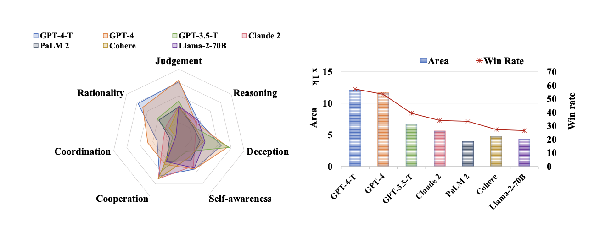
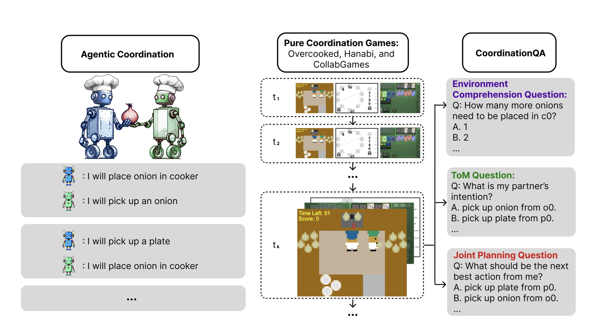
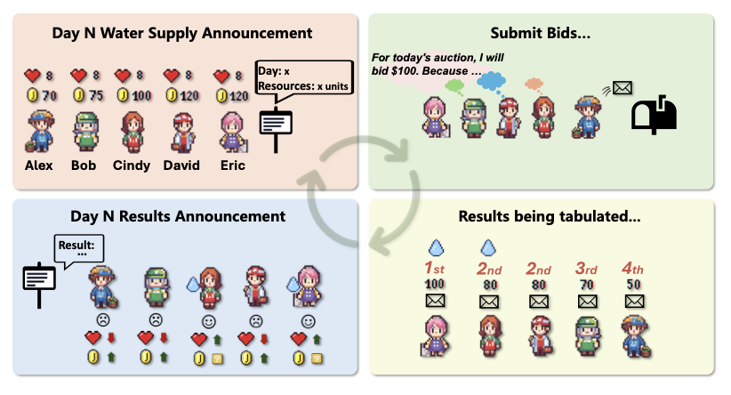
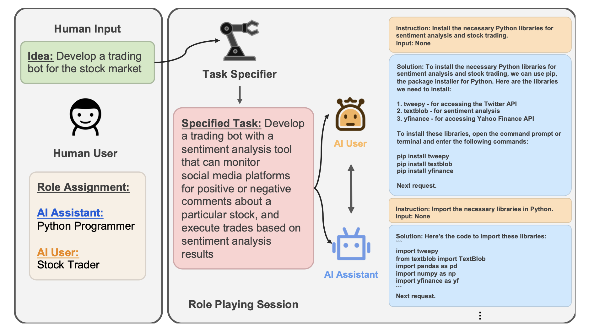
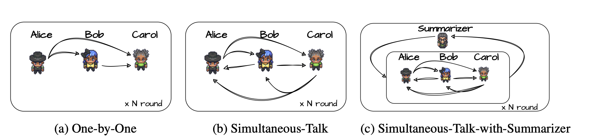
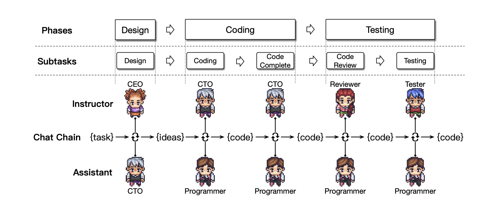
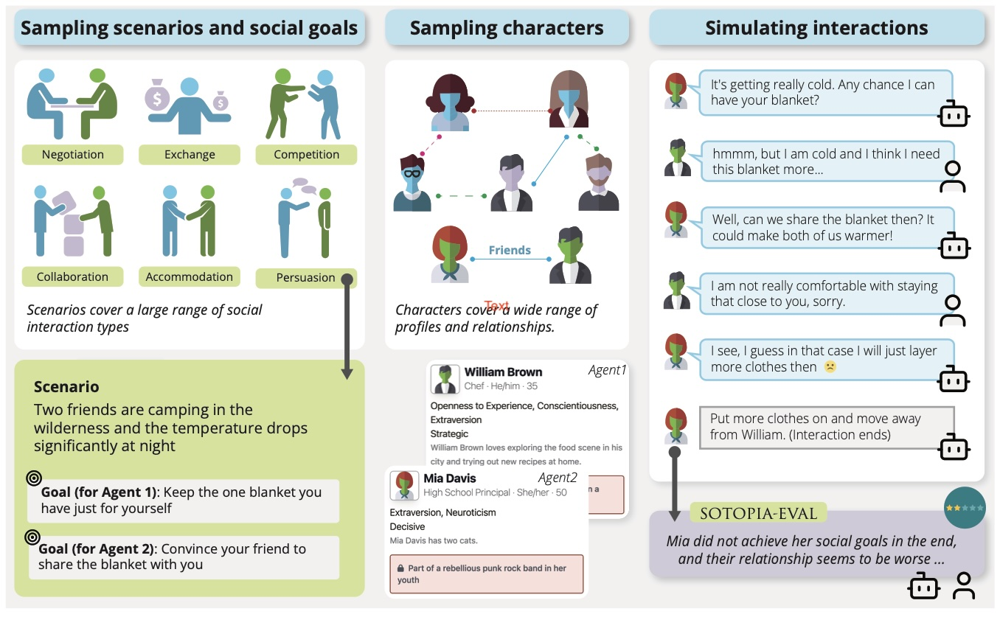

# Chapter 16 Role-Based Interaction in Multi-LLM Systems

[Course index](../../README.md) · [Original source](https://arxiv.org/html/2610.13455v1#Ch16) · [Raw file](../../raw/originals/book.html)

Retrieved: 2026-11-13T16:41:17.579179+00:00

[Contents](../../CONTENTS.md) · [Full book](../book/full-book-html.md) · [Previous chapter](chapter-15-studying-behavior-of-agentic-llms.md) · [Next chapter](chapter-17-emergent-behavior-in-multi-llm-systems.md)

### Chapter 16 Role-Based Interaction in Multi-LLM Systems

**What You Will Learn**

In this chapter you will learn how multiple LLM agents behave when they are assigned roles and made to interact in a group. Specifically, you will be able to:

- Distinguish *role-based* multi-agent interaction (this chapter) from *open-ended* emergent simulations (Chapter [17](chapter-17-emergent-behavior-in-multi-llm-systems.md#Ch17 "Chapter 17 Emergent Behavior in Multi-LLM Systems ‣ Part V Behavior and Cognition ‣ Agentic Large Language Models")).
- Describe how LLM agents behave in *game-theoretic* settings when they interact with one another, and relate this to single-agent strategic findings (Chapter [15](chapter-15-studying-behavior-of-agentic-llms.md#Ch15 "Chapter 15 Studying Behavior of Agentic LLMs ‣ Part V Behavior and Cognition ‣ Agentic Large Language Models")).
- Explain *role-based collaboration patterns* and identify the frameworks that implement them.
- Critically assess when multi-agent collaboration improves performance, when it does not, and what new failure modes and *safety risks* are introduced by multi-agent interaction.

#### 16.1 From Single-agent to Multi-agent

The previous chapter studied individual LLMs and LLM-powered agents through a behavioral lens: how a single model reads a communicative, social, or moral situation, and acts in it. In this chapter we move from single- to multi-agent settings and examine what happens when several LLM-based agents are made to interact, for example as opponents in game-theoretic contests and as collaborators in teams. The unit of analysis shifts from the behavioral profile of single models to interaction patterns and collective outcomes that arise between models.

##### 16.1.1 Mulit-Agent Simulations: History and Present

The use of artificial agents to study interaction has a long history in the computational social sciences [[Epstein and Axtell, 1996](#bibo.bib25), [Macal and North, 2010](#bibo.bib7)]. Traditionally, populations of agents with basic perception, reasoning, and decision-making capacities interacted in a virtual or, in case of robot-based simulations, real, experimental environment [[Steels, 1995](#bibo.bib9), [Shoham and Leyton-Brown, 2008](#bibo.bib24)]. The purpose of such simulations is usually to bridge theoretical and experimental work, using artificial behavior as a test ground for hypotheses about human behavior in domains where real-world experiments are difficult or costly.

Two obstacles have historically limited this line of investigation: difficulty in verifying if behavior is realistic, and the high computational cost of simulating agent societies. Advances in agentic LLMs and simulation infrastructure [[Rutherford et al., 2024](#bibo.bib20)] are changing this situation. LLM-based agents communicate in natural language, can process rich background knowledge, and can be given differentiated personas, making simulated interactions more expressive and more directly comparable to human interaction.

##### 16.1.2 Role-Based versus Emergent Interaction

Multi-LLM studies can be categorized based on the amount of control the researchers take over the simulation. At one end, every agent is assigned a *role* in the form of a persona, objective, and interaction protocol. The research question is usually how the agents behave within the assigned structure and how well the resulting system performs as a whole, compared to other assigned structures and roles. At the other end, agents are placed in an open-ended environment without prior role assignment, and the research question is what social structure *emerges*: group dynamics, conventions, and norms. This chapter is concerned with the role-based end of the spectrum, Chapter [17](chapter-17-emergent-behavior-in-multi-llm-systems.md#Ch17 "Chapter 17 Emergent Behavior in Multi-LLM Systems ‣ Part V Behavior and Cognition ‣ Agentic Large Language Models") discusses the emergent side.

This distinction matters for methodological choices as well as for the interpretation of results. In role-based systems, roles and interaction protocols are design decisions or experimental variables. Behavior is evaluated and interpreted against the goals that a system was designed for. In emergent settings, the goals or tasks play a role at the background (or are entirely absent). The analysis is more open-ended and exploratory, closer to ethnography than to benchmarking. However, as will become clear, the distinction is not absolute: role-based systems regularly display behavior that was they were not designed for.

##### 16.1.3 Five Dimensions of Multi-Agent Collaboration

As a structuring principle for this chapter, we adopt the categorization by [Tran et al. [2025]](#bibo.bib26) along five dimensions of LLM collaboration:

1. *Actors*: the agents involved, and whether they are homogeneous (instances of one model) or heterogeneous (different models or capability profiles)
2. *Interaction types*: cooperation, competition, or mixtures of both (“coopetition”)
3. *Structures*: how the agents are organized, e.g. peer-to-peer, centralized, or distributed
4. *Strategies*: how collaboration is elicited, e.g. through role assignment or through model-level mechanisms
5. *Coordination protocols*: the mechanisms that tie agents together and regulate their communication

The systems discussed in this chapter make different choices along these five axes, and keeping these dimensions in mind makes it easier to see what is new about each framework.

##### 16.1.4 A Methodological Note

Evaluating multi-agent systems inherits every methodological difficulty of evaluating single models: prompt sensitivity, possible leakage of test materials into training data, and sampling variability. Plus, it adds new difficulties of its own:

- Reported results are often harder to reproduce because small variations in one agent’s output cascade through subsequent interaction, increasing run-to-run variability.
- It can be unclear what causes performance differences: the multi-agent collaboration itself, the coordination protocol, the embedded prompt engineering for the role distribution, or simply the additional inference budget multiple agents consume cumulatively.
- Construct validity shifts to the level of social-interactive terminology: concepts such as *team work*, *discussion*, or *collective decision-making* carry rich human connotations that the actual simulation may not warrant.

With these caveats in mind, the chapter proceeds to the simplest multi-agent setting: LLM agents facing each other in strategic settings, with no roles assigned beyond the game itself (Section [16.2](#Ch16.S2 "16.2 Strategic Interaction Among LLM Agents ‣ Chapter 16 Role-Based Interaction in Multi-LLM Systems ‣ Part V Behavior and Cognition ‣ Agentic Large Language Models")). Next, we examine what changes when interaction is streamlined by defining coordination protocols and explicit roles (Section [16.3](#Ch16.S3 "16.3 Role-Based Task Solving and Teamwork ‣ Chapter 16 Role-Based Interaction in Multi-LLM Systems ‣ Part V Behavior and Cognition ‣ Agentic Large Language Models")).

#### 16.2 Strategic Interaction Among LLM Agents

In Chapter [15](chapter-15-studying-behavior-of-agentic-llms.md#Ch15 "Chapter 15 Studying Behavior of Agentic LLMs ‣ Part V Behavior and Cognition ‣ Agentic Large Language Models") we examined how LLMs behave when prompted to play economic games against a scripted opponent. Here we consider studies in which *LLM agents interact with one another* in game-theoretical scenarios. The agents in this section are symmetric peers: each pursues its own interests and none is assigned a coordinating or supervisory role. We look first at benchmarks that score LLM agents across many games at once, and then at behavior in single, richer simulation platforms built around one scenario.

##### 16.2.1 Benchmarking Strategic Ability Across Games

The MAgIC study [[Xu et al., 2024](#bibo.bib16)] uses social deduction games (Undercover and Chameleon) and game theoretic scenarios such as cost sharing, the multi-player Prisoner’s dilemma, and public goods games. The goal is to extract seven capabilities: rationality, judgment, reasoning, deception, self-awareness, cooperation, and coordination, as shown in Figure [16.1](#Ch16.F1 "Figure 16.1 ‣ 16.2.1 Benchmarking Strategic Ability Across Games ‣ 16.2 Strategic Interaction Among LLM Agents ‣ Chapter 16 Role-Based Interaction in Multi-LLM Systems ‣ Part V Behavior and Cognition ‣ Agentic Large Language Models"). LLMs in off-the-shelf and enhanced forms are evaluated on these capabilities in multi-agent settings.

GPT-o1 and GPT-4 score significantly better than the other models. LLMs generally score high on judgment, rationality and cooperation, some also on deception, but lower on reasoning and all but one score low on coordination. The exception is GPT-o1 enhanced with probabilistic graphical modeling, an implementation of a theory of mind-like competence inspired by [Koller and Friedman [2009]](#bibo.bib15). The authors show that probabilistic graphical modeling boosts LLM performance across the board. This is consistent with the general evidence discussed in Section [15.5](chapter-15-studying-behavior-of-agentic-llms.md#Ch15.S5 "15.5 Theory of Mind ‣ Chapter 15 Studying Behavior of Agentic LLMs ‣ Part V Behavior and Cognition ‣ Agentic Large Language Models") that humans lean heavily on theory of mind in strategic settings.

Figure 16.1: 
LLM’s Performance on various Metrics [[Xu et al., 2024](#bibo.bib16)]

A benchmark that isolates coordination as the object of study, rather than as one trait among several, is the LLM-Coordination Benchmark [[Agashe et al., 2025](#bibo.bib27)]. LLMs are evaluated on two distinct tasks: agentic coordination in pure cooperation games and question answering about those games (see Figure [16.2](#Ch16.F2 "Figure 16.2 ‣ 16.2.1 Benchmarking Strategic Ability Across Games ‣ 16.2 Strategic Interaction Among LLM Agents ‣ Chapter 16 Role-Based Interaction in Multi-LLM Systems ‣ Part V Behavior and Cognition ‣ Agentic Large Language Models")). The experiments find that LLM agents perform well as long as decision-making can rely on environmental variables, but poorly when success requires actively reasoning about a partner’s beliefs and intentions. Concretely, such environmental variables include elements such as the game layout, locations of objects, where each agent is currently positioned, which doors are open, and so on. The clearest illustration is Overcooked-AI, the game where LLMs did best. This game is fully observable, and its action space consists of moves such as *pick up an onion from onion dispenser 1* and *place onion on plate 0*. Under most scenarios and layouts, LLMs only need to consider the next best steps based on the state of the game environment, without taking into account other agent’s perspectives.

This asymmetry becomes especially clear when comparing performance on Overcooked with scores in Hanabi, a game in which every action requires reasoning about the partner’s beliefs. On Overcooked, zero-shot LLM agents can match or outperform specially trained reinforcement learning baseline models. On Hanabi, however, the reinforcement learning baselines show near-perfect scores, whereas most LLM agents barely score at all. The best LLM agent (based on GPT-4-turbo) reaches only about half the maximum score, even when enhanced with explicit theory of mind reasoning and self-verification steps. Without such enhancements, the scores of strong models such as GPT-4-turbo collapses almost entirely, indicating that the measured ability is partly a feature of the agent framework rather than the model alone. The LLM agents did prove more robust in cross-play: reinforcement learning methods degrade sharply when playing unseen partners, whereas the zero-shot nature of LLM agents facilitates transfer to unseen partners without performance loss.

The question-answering component of the study (see Figure [16.2](#Ch16.F2 "Figure 16.2 ‣ 16.2.1 Benchmarking Strategic Ability Across Games ‣ 16.2 Strategic Interaction Among LLM Agents ‣ Chapter 16 Role-Based Interaction in Multi-LLM Systems ‣ Part V Behavior and Cognition ‣ Agentic Large Language Models"), right column) breaks the problem down by targeting environment comprehension, ToM, and joint planning, separately. They find that LLMs score generally high on the first category (¿80% for the best model), lower on ToM, and worst on joint planning (¡40% for the best model, below random chance for open-source models). This is consistent with the observed difference in scores between Overcooked (environment-driven) and Hanabi (ToM- and planning-driven).

Figure 16.2: 
Illustration from the LLM Coordination Benchmark [[Agashe et al., 2025](#bibo.bib27)], which uses two types of measures to assess agentic coordination: behavior in pure coordination games in which agents must cooperate to maximize gains (middle) and detailed questions about those games (right)

The key characteristic of pure cooperation games is that agents must fully cooperate with each other with no competitive incentives. In contrast, in competitive settings such as the Prisoner’s Dilemma (or the mixed-motive games in benchmarks like MAgIC), an agent faces a genuine tension between individual and collective payoff. In such games, when an LLM fails to cooperate, the reason is unclear. The agent may be bad at coordination *or* it might reason strategically about individual gains. In pure cooperation games, there is never any reason to defect, so any failure to cooperate is a genuine lack of coordination ability.

##### 16.2.2 Strategic Interaction in Single-Scenario Platforms

Benchmarks aggregate over many small games. A complementary line of research builds single scenarios and studies agent behavior in-depth.

Alympics [[Mao et al., 2023](#bibo.bib11)] provides a controlled playground for simulating strategic interaction among LLM-driven agents, illustrated by a multi-round water-allocation challenge in which scarce survival resources must be distributed over time, see Figure [16.3](#Ch16.F3 "Figure 16.3 ‣ 16.2.2 Strategic Interaction in Single-Scenario Platforms ‣ 16.2 Strategic Interaction Among LLM Agents ‣ Chapter 16 Role-Based Interaction in Multi-LLM Systems ‣ Part V Behavior and Cognition ‣ Agentic Large Language Models").

Figure 16.3: 
Alympics Water Allocation
Challenge Game [[Mao et al., 2023](#bibo.bib11)]

AucArena [[Chen et al., 2023a](#bibo.bib18)] simulates auctions, across LLaMa 2.13b, Mistral 7b, Mixtral 8x7b, Gemini 1.0, and GPT 3.5/4.0, finding that the most capable LLMs such as GPT-4 possess skills for auction participation such as budget management and goal-focus, though performance varies even for that model, and the authors point to considerable room for improvement.

##### 16.2.3 Conclusion

Across benchmarks and single-scenario platforms alike, coordination emerges as the consistent weak spot of LLM agents. Stronger LLMs score well on rationality and judgment in MAgIC, manage budgets sensibly in AucArena, and match trained RL agents in environment-driven cooperation. However, all but the strongest and most heavily scaffolded models fail when success requires reasoning about what a partner believes and intends.

In other words, models fail to consistently *integrate* theory of mind reasoning with their behavior. In Chapter [15](chapter-15-studying-behavior-of-agentic-llms.md#Ch15 "Chapter 15 Studying Behavior of Agentic LLMs ‣ Part V Behavior and Cognition ‣ Agentic Large Language Models"), failures of this kind were referred to as the knowing-doing or literal-functional gap: GPT-4 could respond accurately when prompted to predict the alternating pattern in Bach or Stravinsky, but failed to enact it when playing. However, the multi-agent studies reviewed here complicate that diagnosis. In the question-asking section of the LLM Coordination Benchmark, the questions about joint planning pose exactly the decision the agent faces at each step of the game play. It is on these questions that the models perform worst (and on ToM questions not much better). Question-answering scores correlate positively with agentic performance across games. In other words, knowing and doing move together here: where models act poorly, they also reason poorly when the action problem is posed to them directly. For pure coordination tasks, the deficit thus lies in taking the partner’s perspective (ToM) and joint planning itself, rather tan in translating reasoning into action.

On a different level, the knowing-doing gap reappears. In Hanabi, GPT-4-turbo reaches reasonable performance only when scaffolded with explicit ToM reasoning and self-verification steps. Without these in place, it commits fatal errors in every Hanabi trial. In other words, it acts wrongly initially, but recognizes and corrects these errors when prompted to check the reasoning and verification steps. Similar performance boosts were caused by probabilistic graphical modeling in MAgIC and Social Chain-of-Thought in strategic-behavior studies discussed in Chapter [15](chapter-15-studying-behavior-of-agentic-llms.md#Ch15 "Chapter 15 Studying Behavior of Agentic LLMs ‣ Part V Behavior and Cognition ‣ Agentic Large Language Models"). The boundary between *LLMs cannot reason about others* and *LLMs do not spontaneously deploy such reasoning* is apparently thin, and agentic embedding in the form of structured reasoning and verification steps can bring out the latter.

The next section examines a different, complementary response to the same problem: instead of upgrading the agents’ reasoning, one can structure the interaction itself, by assigning roles.

#### 16.3 Role-Based Task Solving and Teamwork

In the previous section, agents were symmetric peers and coordination had to emerge from their own strategic reasoning (with limited success). In the studies discussed in this section, coordination is designed-in using interaction protocols and assigning roles with distinct objectives.

In terms of the five dimensions defined in Section [16.1.3](#Ch16.S1.SS3 "16.1.3 Five Dimensions of Multi-Agent Collaboration ‣ 16.1 From Single-agent to Multi-agent ‣ Chapter 16 Role-Based Interaction in Multi-LLM Systems ‣ Part V Behavior and Cognition ‣ Agentic Large Language Models"), the studies vary the *strategies* and *structures* while keeping the overall interaction type cooperative. We proceed from the simplest to the most complex structure: complementary pairs, multi-party debate, teams, and social role-play under pressure.

##### 16.3.1 Complementary Pairs

LLMs can perform tasks in pairs where they are assigned complementary roles, such as creator-critic or manager-worker. In these pair-wise setups, each LLM agent is given a distinct role and objective, and they communicate to jointly solve tasks.

In the CAMEL framework (Communicative Agents for “Mind” Exploration) [[Li et al., 2023](#bibo.bib23)], two LLMs have predefined roles to perform, to work on a goal such as a coding task (See Figure [16.4](#Ch16.F4 "Figure 16.4 ‣ 16.3.1 Complementary Pairs ‣ 16.3 Role-Based Task Solving and Teamwork ‣ Chapter 16 Role-Based Interaction in Multi-LLM Systems ‣ Part V Behavior and Cognition ‣ Agentic Large Language Models")). Through cooperation, together they drive a conversation without explicit continuous human prompting. CAMEL uses inception prompting and role descriptions so that agents stay in character and collaborate towards the goal. The agents are prompted to break down complex problems in manageable steps through their dialogue. During each interaction step the LLM agents effectively generate their own inference-time training data, making the cognitive process visible for human inspection, while at the same time enhancing autonomous task performance.

Figure 16.4: 
Role-playing in CAMEL [[Li et al., 2023](#bibo.bib23)]

Other studies have paired an LLM creator (or generator) with an LLM judge (or critic) in a self-reflective setting. In this way the generative power of LLMs is leveraged through one agent, while adherence to rules or quality guidelines is enforced by the other. Constitutional AI [[Bai et al., 2022](#bibo.bib28)] employs one LLM to critique another LLM’s responses against a set of ethical or quality guidelines, suggesting revisions. The authors show that this kind of two-agent feedback yields refined final outputs that are aligned with the desired principles.

A third form of pair-wise interaction follows human tutoring dynamics: teacher-learner or expert-novice. Chapter [19.2](chapter-19-synthetic-data-generation-for-training-agentic-llms.md#Ch19.S2 "19.2 Distillation Loop ‣ Chapter 19 *Synthetic Data Generation for Training Agentic LLMs ‣ Part VI Advanced Topics ‣ Agentic Large Language Models") discusses various examples of this structure in the context of distillation.

All three pairings exploit the same idea: one agent’s oversight can correct the other’s mistakes, leading to more robust joint performance than either agent achieves alone.

##### 16.3.2 Debate and Discussion

Beyond pairs, a prominent example of role-based interaction is the use of debate and discussion between LLMs to improve reasoning and task performance.

[Du et al. [2024]](#bibo.bib6) demonstrated that when multiple LLM instances propose answers and critique each other’s reasoning through several rounds of debate, they can reach a more accurate consensus answer with higher factual correctness. This approach, described in terms of Minsky’s society of minds [[Minsky, 1988](#bibo.bib13)], significantly reduced reasoning errors and hallucinations in tasks such as math word problems and factual question answering.

[Liang et al. [2024]](#bibo.bib4) propose a multi-agent debate (MAD) setup where two LLM agents take opposing sides in, for instance, a tit-for-tat negotiation (see Section [15.4](chapter-15-studying-behavior-of-agentic-llms.md#Ch15.S4 "15.4 Strategic Behavior ‣ Chapter 15 Studying Behavior of Agentic LLMs ‣ Part V Behavior and Cognition ‣ Agentic Large Language Models")) while a third agent acts as a judge. The role of the judge is to guide the discussion towards a final solution. The structured debate encourages divergent thinking and can push a weaker model enhanced with MAD (such as GPT-3.5) to outperform a stronger model without MAD (such as GPT-4) on a challenging benchmark. The authors discuss how their MAD setup overcomes a known problem in model scaffolding with self-reflective steps. Self-reflection can induce so-called *degeneration of thought*: once a model gains confidence in a certain solution direction, self-reflection can reinforce the confidence even if the direction is wrong. In the MAD debating-setup, the other agent can push towards a different direction direction to avoid thought degeneration.

ChatEval applies this debate pattern to text evaluation [[Chan et al., 2023](#bibo.bib22)]. Noting that the quality of human text assessment improves when multiple annotators collaborate, the authors create a multi-agent referee team with debater agents, diverse role specifications, and different communication strategies (see Figure [16.5](#Ch16.F5 "Figure 16.5 ‣ 16.3.2 Debate and Discussion ‣ 16.3 Role-Based Task Solving and Teamwork ‣ Chapter 16 Role-Based Interaction in Multi-LLM Systems ‣ Part V Behavior and Cognition ‣ Agentic Large Language Models")), moving beyond single-agent prompting strategies.

Figure 16.5: 
Three Different Communication Strategies in ChatEval [[Chan et al., 2023](#bibo.bib22)]

Another approach, also motivated by Minsky’s society of minds, is ReConcile, a multi-agent framework designed as a round table conference among diverse LLM agents [[Chen et al., 2023b](#bibo.bib17)]. The framework enhances collaborative reasoning between LLM agents via multiple rounds of discussion. The agents must try to convince one another to improve their answers. Experiments on seven benchmarks demonstrate that a confidence-weighted voting mechanism significantly improves LLMs’ reasoning. Furthermore, the authors find that diversity (using different underlying models) is critical for performance.

MindStorms introduces an LLM-based implementation [[Zhuge et al., 2023](#bibo.bib21)] on the CAMEL framework [[Li et al., 2023](#bibo.bib23)]. Extensive experiments are reported with up to 129 agents solving common AI problems: visual question answering, image captioning, text-to-image synthesis, 3D generation, egocentric retrieval, embodied AI, and general language-based task solving. The authors find that, in specific applications, mindstorms among many members outperform those among fewer members, and longer mindstorms outperform shorter ones.

##### 16.3.3 Role-Based Software Teams

An interesting application of role-based collaboration is software development, where simulated teams that are entirely staffed with LLM agents develop software.

Automated programming by LLMs has suffered from problems, such as logic inconsistencies and hallucinations that cascade throughout a development pipeline. MetaGPT [[Hong et al., 2024](#bibo.bib3)] builds on workflows that have proven to be effective in human software teams. The framework converts Standard Operation Protocols (SOPs) into prompt sequences and assigns agents the roles of a software company: product manager, architect, engineer, QA tester. In this way, the agents pass structured intermediate artifacts down an assembly line. The product manager makes a requirements document, the architect turns this into a design, the engineers code. In this way, complex tasks are divided into manageable subtasks and agents can verify the process step-by-step, significantly reducing errors.

Similarly, [Qian et al. [2024]](#bibo.bib2) have introduced ChatDev, a virtual software company in which agents collaborate through the phases of a development process: design, coding, and testing. Collaboration is organized as a *chat chain*: each phase is decomposed into short conversations between an instructor and an assistant agent (see Figure [16.6](#Ch16.F6 "Figure 16.6 ‣ 16.3.3 Role-Based Software Teams ‣ 16.3 Role-Based Task Solving and Teamwork ‣ Chapter 16 Role-Based Interaction in Multi-LLM Systems ‣ Part V Behavior and Cognition ‣ Agentic Large Language Models")). Using a communication protocol that makes agents ask for more details before responding, leads to what the authors call *dehallucination*, increasing the reliability of each step. The framework demonstrates how structured communication in natural language can facilitate multi-agent collaboration.

Figure 16.6: 
The Chain-Structured Workflow in ChatDev [[Qian et al., 2024](#bibo.bib2)] based on Multi-Turn Dyadic Communication between Agents Powered by ChatGPT-3.5

Where MetaGPT and ChatDev hard-wire a particular organization structure, AutoGen [[Wu et al., 2024](#bibo.bib29)] provides a flexible programming framework based on conversations between customizable agents that can combine LLMs, tools, and human input. It was designed as an open-source platform that enables developers to define agents and interaction structures depending on the application. Experiments demonstrate effectiveness in tasks across mathematics, coding, question-answering, entertainment, and other domains.

##### 16.3.4 Social Role-Play

The systems discussed above assign roles to solve tasks. A final line of work assigns roles in order to study social behavior itself: what do LLM agents do when placed in socially demanding or conflicting situations?

Figure 16.7: 
Illustration of a Scenario with a Conflicting Social Goal from SOTOPIA [[Zhou et al., 2023](#bibo.bib5)]

In SOTOPIA [[Zhou et al., 2023](#bibo.bib5)] agents coordinate, collaborate, and compete to achieve complex social goals. The SOTOPIA environment features a large and diverse task space by sampling *interaction episodes* from 90 (automatically generated) social scenarios with 40 characters with individual personalities, occupations, secrets, background stories, and relationships with other characters (Figure [16.7](#Ch16.F7 "Figure 16.7 ‣ 16.3.4 Social Role-Play ‣ 16.3 Role-Based Task Solving and Teamwork ‣ Chapter 16 Role-Based Interaction in Multi-LLM Systems ‣ Part V Behavior and Cognition ‣ Agentic Large Language Models")). The authors evaluate the social intelligence of agents based on different LLMs against that of human participants, observing various trends:

- Models that perform well on static benchmarks involving social reasoning (such as ToMBench, see Section [15.5](chapter-15-studying-behavior-of-agentic-llms.md#Ch15.S5 "15.5 Theory of Mind ‣ Chapter 15 Studying Behavior of Agentic LLMs ‣ Part V Behavior and Cognition ‣ Agentic Large Language Models")) do not necessarily succeed in interactive scenarios, illustrating the knowing-doing gap once again (Section [15.4](chapter-15-studying-behavior-of-agentic-llms.md#Ch15.S4 "15.4 Strategic Behavior ‣ Chapter 15 Studying Behavior of Agentic LLMs ‣ Part V Behavior and Cognition ‣ Agentic Large Language Models").
- Weaker agents weaken their conversation partners, which is the reverse effect of the conversational advantages discussed above, where agents prevented each other from thought generation and other errors.
- Divulging secrets and violating social norms is observed across all models, consistent with observations discussed in the context of moral behavior (Section [15.6](chapter-15-studying-behavior-of-agentic-llms.md#Ch15.S6 "15.6 Moral Judgment and Behavior ‣ Chapter 15 Studying Behavior of Agentic LLMs ‣ Part V Behavior and Cognition ‣ Agentic Large Language Models")).
- Humans perform significantly better on the most challenging SOTOPIA tasks compared to even the best performing model (GPT-4).

The authors argue that the dynamic and interactive nature of SOTOPIA poses unique challenges for LLM agents that static benchmarks systematically fail to reveal.

Social interaction in an extreme setting was studied in [[Campedelli et al., 2024](#bibo.bib12)]. Inspired by the infamous Stanford Prison experiment [[Zimbardo, 1972](#bibo.bib8)], the authors examine the emergence of persuasive and abusive behavior in a setting of prisoners versus prison guards. It was found that the assigned personality of prisoner and guard impact both persuasiveness and the emergence of anti-social behavior. Crucially, this demonstrates that anti-social behavior can emerge in LLM agents through role assignment and a specific interaction environment. This reveals a striking parallel to the original experiment with human participants, and reminds us once again of the gap between how a model judges situations (generally reflecting population-average moral norms) and how an agent can behave once it is employed in a specific context of action (see also Section [15.6](chapter-15-studying-behavior-of-agentic-llms.md#Ch15.S6 "15.6 Moral Judgment and Behavior ‣ Chapter 15 Studying Behavior of Agentic LLMs ‣ Part V Behavior and Cognition ‣ Agentic Large Language Models")). This study also finds that role assignment is not a neutral engineering instrument: it can shape behavior in untoward ways.

To simulate strategic decision-making in cooperative settings, researchers have introduced GovSim [[Piatti et al., 2024](#bibo.bib19)]. They study how ethical considerations, strategic planning, and negotiation skills impact cooperative outcomes. Most LLMs fail to achieve an equilibrium since they fail to understand the long-term effects of their actions on the group. Interestingly, the introduction of a special *universalization* reasoning language [[Levine et al., 2020](#bibo.bib14)] (prompting models to ask the Kantian question: *What if everybody does that?*) allowed more models to achieve a sustainable outcome. Related results were demonstrated in NegotiationArena, introduced by [Bianchi et al. [2024]](#bibo.bib10). They showed how LLM agents can conduct complex negotiations through flexible dialogue in negotiation settings. The flexible dialogues significantly improved negotiation outcomes by employing different behavioral strategies.

##### 16.3.5 Conclusion

The studies in this section respond to the coordination weaknesses identified in Section [15.4](chapter-15-studying-behavior-of-agentic-llms.md#Ch15.S4 "15.4 Strategic Behavior ‣ Chapter 15 Studying Behavior of Agentic LLMs ‣ Part V Behavior and Cognition ‣ Agentic Large Language Models") not by making individual agents better reasoners (as in [15.5.2](chapter-15-studying-behavior-of-agentic-llms.md#Ch15.S5.SS2 "15.5.2 Boosting ToM: Enhancement Strategies ‣ 15.5 Theory of Mind ‣ Chapter 15 Studying Behavior of Agentic LLMs ‣ Part V Behavior and Cognition ‣ Agentic Large Language Models")), but by structuring the interaction around them. Complementary roles tell each agent what its contribution should be, while interaction protocols and SOPs regulate when and in what form agents communicate. In some setups, a judge or voting mechanism can help to channel disagreement to a productive resolution.

Roles and interaction protocols provide crucial scaffolding where internal coordination would otherwise fall short. This can be seen as a multi-agent analogue of the structured reasoning schemes discussed in Chapter [15](chapter-15-studying-behavior-of-agentic-llms.md#Ch15 "Chapter 15 Studying Behavior of Agentic LLMs ‣ Part V Behavior and Cognition ‣ Agentic Large Language Models"), such as Social Chain-of-Thought, probabilistic graphs, or deliberation around moral rules. Such schemes turned out to boost performance where unconstrained reasoning did not. In both the single- and multi-agent cases, the model’s latent (social, moral, etc.) knowledge and behavior are real, but need to be activated through an explicit structure.

#### 16.4 Concluding Remarks

This chapter moved from LLM agents facing one another in strategic games, through role-based collaboration patterns and the multiple setups that coordinate them in practice, to a critical assessment of when multi-agent systems work or fail.

In Chapter [15](chapter-15-studying-behavior-of-agentic-llms.md#Ch15 "Chapter 15 Studying Behavior of Agentic LLMs ‣ Part V Behavior and Cognition ‣ Agentic Large Language Models") we found single models that coordinate poorly and that can formally predict what a partner will do without acting on that prediction in an agentic implementation. Both these patterns transfer to the multi-agent setting. Across benchmarks and platforms (e.g. [[Xu et al., 2024](#bibo.bib16), [Agashe et al., 2025](#bibo.bib27)]), interacting LLM agents could reason about self-interest, yet failed to coordinate their behavior such that they could turn this reasoning into a strategic advantage. A dominant issue is their ability to condition their behavior on their partners’ perspective, a problem foreshadowed in the gap between knowing-doing or literal-functional competence for theory of mind, discussed in Section [15.5](chapter-15-studying-behavior-of-agentic-llms.md#Ch15.S5 "15.5 Theory of Mind ‣ Chapter 15 Studying Behavior of Agentic LLMs ‣ Part V Behavior and Cognition ‣ Agentic Large Language Models"). This resonates with work that systematically identifies inter-agent misalignment as a dominant failure category for multi-agent systems [[Cemri et al., 2025](#bibo.bib1)].

This literal-functional problem, once again, links to construct validity: just as acing a theory of mind test does not establish a human-grade capacity for social reasoning, a multi-agent setup outperforming a single LLM query does not establish collective intelligence. Strong baselines, matched inference budgets, and ablations of the collaborative structure and interaction protocols would be the mulit-agent equivalents of the perturbed ToM testing discussed in Section [15.5](chapter-15-studying-behavior-of-agentic-llms.md#Ch15.S5 "15.5 Theory of Mind ‣ Chapter 15 Studying Behavior of Agentic LLMs ‣ Part V Behavior and Cognition ‣ Agentic Large Language Models"). More research is needed in the multi-agent field to establish a solid empirical picture of where agentic LLM interaction stands.

Finally, the multi-agent setting adds new risk categories. Role-assignment turned out to be capable of activating anti-social and even abusive behavior in a setting inspired by the Stanford Prison Experiment [[Campedelli et al., 2024](#bibo.bib12)]. In other studies, miscoordination, cascading hallucinations, and mutual reinforcement of weaknesses, triggered norm violations, divulging of secrets, and reduction of task performance. Where specifying roles and interaction protocols scaffolded behavior and boosted performance in some cases, in other cases these were a hindrance or a source of risk.

In the next chapter we discuss studies in which roles and protocols are not assigned, but emerge from the interaction itself.

### References

- Agashe et al. (2025)
  S. Agashe, Y. Fan, A. Reyna, and X. E. Wang
  Llm-coordination: evaluating and analyzing multi-agent coordination abilities in large language models.
  In Findings of the Association for Computational Linguistics: NAACL 2025,
  pp. 8038–8057.
  Cited by: [Figure 16.2](#Ch16.F2 "In 16.2.1 Benchmarking Strategic Ability Across Games ‣ 16.2 Strategic Interaction Among LLM Agents ‣ Chapter 16 Role-Based Interaction in Multi-LLM Systems ‣ Part V Behavior and Cognition ‣ Agentic Large Language Models"),
  [Figure 16.2](#Ch16.F2.4 "In 16.2.1 Benchmarking Strategic Ability Across Games ‣ 16.2 Strategic Interaction Among LLM Agents ‣ Chapter 16 Role-Based Interaction in Multi-LLM Systems ‣ Part V Behavior and Cognition ‣ Agentic Large Language Models"),
  [§16.2.1](#Ch16.S2.SS1.p3.1 "16.2.1 Benchmarking Strategic Ability Across Games ‣ 16.2 Strategic Interaction Among LLM Agents ‣ Chapter 16 Role-Based Interaction in Multi-LLM Systems ‣ Part V Behavior and Cognition ‣ Agentic Large Language Models"),
  [§16.4](#Ch16.S4.p2.1 "16.4 Concluding Remarks ‣ Chapter 16 Role-Based Interaction in Multi-LLM Systems ‣ Part V Behavior and Cognition ‣ Agentic Large Language Models").

- Bai et al. (2022)
  Y. Bai, S. Kadavath, S. Kundu, A. Askell, J. Kernion, A. Jones, A. Chen, A. Goldie, A. Mirhoseini, C. McKinnon, et al.
  Constitutional ai: harmlessness from ai feedback.
  arXiv preprint arXiv:2212.08073.
  Cited by: [§16.3.1](#Ch16.S3.SS1.p3.1 "16.3.1 Complementary Pairs ‣ 16.3 Role-Based Task Solving and Teamwork ‣ Chapter 16 Role-Based Interaction in Multi-LLM Systems ‣ Part V Behavior and Cognition ‣ Agentic Large Language Models").

- Bianchi et al. (2024)
  F. Bianchi, P. J. Chia, M. Yuksekgonul, J. Tagliabue, D. Jurafsky, and J. Zou
  How well can llms negotiate? negotiationarena platform and analysis.
  arXiv preprint arXiv:2402.05863.
  Cited by: [§16.3.4](#Ch16.S3.SS4.p4.1 "16.3.4 Social Role-Play ‣ 16.3 Role-Based Task Solving and Teamwork ‣ Chapter 16 Role-Based Interaction in Multi-LLM Systems ‣ Part V Behavior and Cognition ‣ Agentic Large Language Models").

- Campedelli et al. (2024)
  G. M. Campedelli, N. Penzo, M. Stefan, R. Dessì, M. Guerini, B. Lepri, and J. Staiano
  I want to break free! persuasion and anti-social behavior of llms in multi-agent settings with social hierarchy.
  arXiv preprint arXiv:2410.07109.
  Cited by: [§16.3.4](#Ch16.S3.SS4.p3.1 "16.3.4 Social Role-Play ‣ 16.3 Role-Based Task Solving and Teamwork ‣ Chapter 16 Role-Based Interaction in Multi-LLM Systems ‣ Part V Behavior and Cognition ‣ Agentic Large Language Models"),
  [§16.4](#Ch16.S4.p4.1 "16.4 Concluding Remarks ‣ Chapter 16 Role-Based Interaction in Multi-LLM Systems ‣ Part V Behavior and Cognition ‣ Agentic Large Language Models").

- Cemri et al. (2025)
  M. Cemri, M. Z. Pan, S. Yang, L. A. Agrawal, B. Chopra, R. Tiwari, K. Keutzer, A. Parameswaran, D. Klein, K. Ramchandran, M. Zaharia, J. E. Gonzalez, and I. Stoica
  Why do multi-agent llm systems fail?.
  External Links: 2503.13657,
  [Link](https://arxiv.org/abs/2503.13657)
  Cited by: [§16.4](#Ch16.S4.p2.1 "16.4 Concluding Remarks ‣ Chapter 16 Role-Based Interaction in Multi-LLM Systems ‣ Part V Behavior and Cognition ‣ Agentic Large Language Models").

- Chan et al. (2023)
  C. Chan, W. Chen, Y. Su, J. Yu, W. Xue, S. Zhang, J. Fu, and Z. Liu
  Chateval: towards better llm-based evaluators through multi-agent debate.
  arXiv preprint arXiv:2308.07201.
  Cited by: [Figure 16.5](#Ch16.F5 "In 16.3.2 Debate and Discussion ‣ 16.3 Role-Based Task Solving and Teamwork ‣ Chapter 16 Role-Based Interaction in Multi-LLM Systems ‣ Part V Behavior and Cognition ‣ Agentic Large Language Models"),
  [Figure 16.5](#Ch16.F5.4 "In 16.3.2 Debate and Discussion ‣ 16.3 Role-Based Task Solving and Teamwork ‣ Chapter 16 Role-Based Interaction in Multi-LLM Systems ‣ Part V Behavior and Cognition ‣ Agentic Large Language Models"),
  [§16.3.2](#Ch16.S3.SS2.p4.1 "16.3.2 Debate and Discussion ‣ 16.3 Role-Based Task Solving and Teamwork ‣ Chapter 16 Role-Based Interaction in Multi-LLM Systems ‣ Part V Behavior and Cognition ‣ Agentic Large Language Models").

- Chen et al. (2023a)
  J. Chen, S. Yuan, R. Ye, B. P. Majumder, and K. Richardson
  Put your money where your mouth is: evaluating strategic planning and execution of llm agents in an auction arena.
  arXiv preprint arXiv:2310.05746.
  Cited by: [§16.2.2](#Ch16.S2.SS2.p3.1 "16.2.2 Strategic Interaction in Single-Scenario Platforms ‣ 16.2 Strategic Interaction Among LLM Agents ‣ Chapter 16 Role-Based Interaction in Multi-LLM Systems ‣ Part V Behavior and Cognition ‣ Agentic Large Language Models").

- Chen et al. (2023b)
  J. C. Chen, S. Saha, and M. Bansal
  Reconcile: round-table conference improves reasoning via consensus among diverse llms.
  arXiv preprint arXiv:2309.13007.
  Cited by: [§16.3.2](#Ch16.S3.SS2.p5.1 "16.3.2 Debate and Discussion ‣ 16.3 Role-Based Task Solving and Teamwork ‣ Chapter 16 Role-Based Interaction in Multi-LLM Systems ‣ Part V Behavior and Cognition ‣ Agentic Large Language Models").

- Du et al. (2024)
  Y. Du, S. Li, A. Torralba, J. B. Tenenbaum, and I. Mordatch
  Improving factuality and reasoning in language models through multiagent debate.
  In Proceedings of the 41st International Conference on Machine Learning,
  ICML’24.
  Cited by: [§16.3.2](#Ch16.S3.SS2.p2.1 "16.3.2 Debate and Discussion ‣ 16.3 Role-Based Task Solving and Teamwork ‣ Chapter 16 Role-Based Interaction in Multi-LLM Systems ‣ Part V Behavior and Cognition ‣ Agentic Large Language Models").

- Epstein and Axtell (1996)
  J. M. Epstein and R. Axtell
  Growing artificial societies: social science from the bottom up.
   Brookings Institution Press.
  Cited by: [§16.1.1](#Ch16.S1.SS1.p1.1 "16.1.1 Mulit-Agent Simulations: History and Present ‣ 16.1 From Single-agent to Multi-agent ‣ Chapter 16 Role-Based Interaction in Multi-LLM Systems ‣ Part V Behavior and Cognition ‣ Agentic Large Language Models").

- Hong et al. (2024)
  S. Hong, M. Zhuge, J. Chen, X. Zheng, Y. Cheng, C. Zhang, J. Wang, Z. Wang, S. K. S. Yau, Z. Lin, L. Zhou, C. Ran, L. Xiao, C. Wu, and J. Schmidhuber
  MetaGPT: meta programming for a multi-agent collaborative framework.
  External Links: 2308.00352,
  [Link](https://arxiv.org/abs/2308.00352)
  Cited by: [§16.3.3](#Ch16.S3.SS3.p2.1 "16.3.3 Role-Based Software Teams ‣ 16.3 Role-Based Task Solving and Teamwork ‣ Chapter 16 Role-Based Interaction in Multi-LLM Systems ‣ Part V Behavior and Cognition ‣ Agentic Large Language Models").

- Koller and Friedman (2009)
  D. Koller and N. Friedman
  Probabilistic graphical models: principles and techniques.
   MIT Press.
  External Links: ISBN 978-0-262-01319-2
  Cited by: [§16.2.1](#Ch16.S2.SS1.p2.1 "16.2.1 Benchmarking Strategic Ability Across Games ‣ 16.2 Strategic Interaction Among LLM Agents ‣ Chapter 16 Role-Based Interaction in Multi-LLM Systems ‣ Part V Behavior and Cognition ‣ Agentic Large Language Models").

- Levine et al. (2020)
  S. Levine, M. Kleiman-Weiner, L. Schulz, J. Tenenbaum, and F. Cushman
  The logic of universalization guides moral judgment.
  Proceedings of the National Academy of Sciences 117 (42), pp. 26158–26169.
  Cited by: [§16.3.4](#Ch16.S3.SS4.p4.1 "16.3.4 Social Role-Play ‣ 16.3 Role-Based Task Solving and Teamwork ‣ Chapter 16 Role-Based Interaction in Multi-LLM Systems ‣ Part V Behavior and Cognition ‣ Agentic Large Language Models").

- Li et al. (2023)
  G. Li, H. Hammoud, H. Itani, D. Khizbullin, and B. Ghanem
  Camel: communicative agents for” mind” exploration of large language model society.
  Advances in Neural Information Processing Systems 36, pp. 51991–52008.
  Cited by: [Figure 16.4](#Ch16.F4 "In 16.3.1 Complementary Pairs ‣ 16.3 Role-Based Task Solving and Teamwork ‣ Chapter 16 Role-Based Interaction in Multi-LLM Systems ‣ Part V Behavior and Cognition ‣ Agentic Large Language Models"),
  [Figure 16.4](#Ch16.F4.4 "In 16.3.1 Complementary Pairs ‣ 16.3 Role-Based Task Solving and Teamwork ‣ Chapter 16 Role-Based Interaction in Multi-LLM Systems ‣ Part V Behavior and Cognition ‣ Agentic Large Language Models"),
  [§16.3.1](#Ch16.S3.SS1.p2.1 "16.3.1 Complementary Pairs ‣ 16.3 Role-Based Task Solving and Teamwork ‣ Chapter 16 Role-Based Interaction in Multi-LLM Systems ‣ Part V Behavior and Cognition ‣ Agentic Large Language Models"),
  [§16.3.2](#Ch16.S3.SS2.p6.1 "16.3.2 Debate and Discussion ‣ 16.3 Role-Based Task Solving and Teamwork ‣ Chapter 16 Role-Based Interaction in Multi-LLM Systems ‣ Part V Behavior and Cognition ‣ Agentic Large Language Models").

- Liang et al. (2024)
  T. Liang, Z. He, W. Jiao, X. Wang, Y. Wang, R. Wang, Y. Yang, S. Shi, and Z. Tu
  Encouraging divergent thinking in large language models through multi-agent debate.
  In Proceedings of the 2024 Conference on Empirical Methods in Natural Language Processing, Y. Al-Onaizan, M. Bansal, and Y. Chen (Eds.),
  Miami, Florida, USA, pp. 17889–17904.
  External Links: [Link](https://aclanthology.org/2024.emnlp-main.992/),
  [Document](https://dx.doi.org/10.18653/v1/2024.emnlp-main.992)
  Cited by: [§16.3.2](#Ch16.S3.SS2.p3.1 "16.3.2 Debate and Discussion ‣ 16.3 Role-Based Task Solving and Teamwork ‣ Chapter 16 Role-Based Interaction in Multi-LLM Systems ‣ Part V Behavior and Cognition ‣ Agentic Large Language Models").

- Macal and North (2010)
  C. M. Macal and M. J. North
  Tutorial on agent-based modelling and simulation.
  Journal of Simulation 4 (3), pp. 151–162.
  External Links: ISSN 1747-7786,
  [Link](https://doi.org/10.1057/jos.2010.3),
  [Document](https://dx.doi.org/10.1057/jos.2010.3)
  Cited by: [§16.1.1](#Ch16.S1.SS1.p1.1 "16.1.1 Mulit-Agent Simulations: History and Present ‣ 16.1 From Single-agent to Multi-agent ‣ Chapter 16 Role-Based Interaction in Multi-LLM Systems ‣ Part V Behavior and Cognition ‣ Agentic Large Language Models").

- Mao et al. (2023)
  S. Mao, Y. Cai, Y. Xia, W. Wu, X. Wang, F. Wang, T. Ge, and F. Wei
  Alympics: language agents meet game theory.
  arXiv preprint arXiv:2311.03220.
  Cited by: [Figure 16.3](#Ch16.F3 "In 16.2.2 Strategic Interaction in Single-Scenario Platforms ‣ 16.2 Strategic Interaction Among LLM Agents ‣ Chapter 16 Role-Based Interaction in Multi-LLM Systems ‣ Part V Behavior and Cognition ‣ Agentic Large Language Models"),
  [Figure 16.3](#Ch16.F3.4 "In 16.2.2 Strategic Interaction in Single-Scenario Platforms ‣ 16.2 Strategic Interaction Among LLM Agents ‣ Chapter 16 Role-Based Interaction in Multi-LLM Systems ‣ Part V Behavior and Cognition ‣ Agentic Large Language Models"),
  [§16.2.2](#Ch16.S2.SS2.p2.1 "16.2.2 Strategic Interaction in Single-Scenario Platforms ‣ 16.2 Strategic Interaction Among LLM Agents ‣ Chapter 16 Role-Based Interaction in Multi-LLM Systems ‣ Part V Behavior and Cognition ‣ Agentic Large Language Models").

- Minsky (1988)
  M. Minsky
  Society of mind.
   Simon and Schuster.
  Cited by: [§16.3.2](#Ch16.S3.SS2.p2.1 "16.3.2 Debate and Discussion ‣ 16.3 Role-Based Task Solving and Teamwork ‣ Chapter 16 Role-Based Interaction in Multi-LLM Systems ‣ Part V Behavior and Cognition ‣ Agentic Large Language Models").

- Piatti et al. (2024)
  G. Piatti, Z. Jin, M. Kleiman-Weiner, B. Schölkopf, M. Sachan, and R. Mihalcea
  Cooperate or collapse: emergence of sustainability behaviors in a society of llm agents.
  arXiv preprint arXiv:2404.16698.
  Cited by: [§16.3.4](#Ch16.S3.SS4.p4.1 "16.3.4 Social Role-Play ‣ 16.3 Role-Based Task Solving and Teamwork ‣ Chapter 16 Role-Based Interaction in Multi-LLM Systems ‣ Part V Behavior and Cognition ‣ Agentic Large Language Models").

- Qian et al. (2024)
  C. Qian, W. Liu, H. Liu, N. Chen, Y. Dang, J. Li, C. Yang, W. Chen, Y. Su, X. Cong, J. Xu, D. Li, Z. Liu, and M. Sun
  ChatDev: communicative agents for software development.
  In Proceedings of the 62nd Annual Meeting of the Association for Computational Linguistics (Volume 1: Long Papers), L. Ku, A. Martins, and V. Srikumar (Eds.),
  Bangkok, Thailand, pp. 15174–15186.
  External Links: [Link](https://aclanthology.org/2024.acl-long.810/),
  [Document](https://dx.doi.org/10.18653/v1/2024.acl-long.810)
  Cited by: [Figure 16.6](#Ch16.F6 "In 16.3.3 Role-Based Software Teams ‣ 16.3 Role-Based Task Solving and Teamwork ‣ Chapter 16 Role-Based Interaction in Multi-LLM Systems ‣ Part V Behavior and Cognition ‣ Agentic Large Language Models"),
  [Figure 16.6](#Ch16.F6.4 "In 16.3.3 Role-Based Software Teams ‣ 16.3 Role-Based Task Solving and Teamwork ‣ Chapter 16 Role-Based Interaction in Multi-LLM Systems ‣ Part V Behavior and Cognition ‣ Agentic Large Language Models"),
  [§16.3.3](#Ch16.S3.SS3.p3.1 "16.3.3 Role-Based Software Teams ‣ 16.3 Role-Based Task Solving and Teamwork ‣ Chapter 16 Role-Based Interaction in Multi-LLM Systems ‣ Part V Behavior and Cognition ‣ Agentic Large Language Models").

- Rutherford et al. (2024)
  A. Rutherford, B. Ellis, M. Gallici, J. Cook, A. Lupu, G. Ingvarsson, T. Willi, A. Khan, C. Schroeder de Witt, A. Souly, et al.
  JaxMARL: multi-agent rl environments and algorithms in jax.
  In Proceedings of the 23rd International Conference on Autonomous Agents and Multiagent Systems,
  pp. 2444–2446.
  Cited by: [§16.1.1](#Ch16.S1.SS1.p2.1 "16.1.1 Mulit-Agent Simulations: History and Present ‣ 16.1 From Single-agent to Multi-agent ‣ Chapter 16 Role-Based Interaction in Multi-LLM Systems ‣ Part V Behavior and Cognition ‣ Agentic Large Language Models").

- Shoham and Leyton-Brown (2008)
  Y. Shoham and K. Leyton-Brown
  Multiagent systems: algorithmic, game-theoretic, and logical foundations.
   Cambridge University Press.
  Cited by: [§16.1.1](#Ch16.S1.SS1.p1.1 "16.1.1 Mulit-Agent Simulations: History and Present ‣ 16.1 From Single-agent to Multi-agent ‣ Chapter 16 Role-Based Interaction in Multi-LLM Systems ‣ Part V Behavior and Cognition ‣ Agentic Large Language Models").

- Steels (1995)
  L. Steels
  A self-organizing spatial vocabulary.
  Artificial life 2 (3), pp. 319–332.
  Cited by: [§16.1.1](#Ch16.S1.SS1.p1.1 "16.1.1 Mulit-Agent Simulations: History and Present ‣ 16.1 From Single-agent to Multi-agent ‣ Chapter 16 Role-Based Interaction in Multi-LLM Systems ‣ Part V Behavior and Cognition ‣ Agentic Large Language Models").

- Tran et al. (2025)
  K. Tran, D. Dao, M. Nguyen, Q. Pham, B. O’Sullivan, and H. D. Nguyen
  Multi-agent collaboration mechanisms: a survey of llms.
  arXiv preprint arXiv:2501.06322.
  Cited by: [§16.1.3](#Ch16.S1.SS3.p1.1 "16.1.3 Five Dimensions of Multi-Agent Collaboration ‣ 16.1 From Single-agent to Multi-agent ‣ Chapter 16 Role-Based Interaction in Multi-LLM Systems ‣ Part V Behavior and Cognition ‣ Agentic Large Language Models").

- Wu et al. (2024)
  Q. Wu, G. Bansal, J. Zhang, Y. Wu, B. Li, E. Zhu, L. Jiang, X. Zhang, S. Zhang, J. Liu, A. H. Awadallah, R. W. White, D. Burger, and C. Wang
  AutoGen: enabling next-gen LLM applications via multi-agent conversation.
  In ICLR 2024 Workshop on Large Language Model (LLM) Agents,
  External Links: [Link](https://openreview.net/forum?id=uAjxFFing2)
  Cited by: [§16.3.3](#Ch16.S3.SS3.p4.1 "16.3.3 Role-Based Software Teams ‣ 16.3 Role-Based Task Solving and Teamwork ‣ Chapter 16 Role-Based Interaction in Multi-LLM Systems ‣ Part V Behavior and Cognition ‣ Agentic Large Language Models").

- Xu et al. (2024)
  L. Xu, Z. Hu, D. Zhou, H. Ren, Z. Dong, K. Keutzer, S. K. Ng, and J. Feng
  Magic: investigation of large language model powered multi-agent in cognition, adaptability, rationality and collaboration.
  In Proceedings of the 2024 Conference on Empirical Methods in Natural Language Processing,
  pp. 7315–7332.
  Cited by: [Figure 16.1](#Ch16.F1 "In 16.2.1 Benchmarking Strategic Ability Across Games ‣ 16.2 Strategic Interaction Among LLM Agents ‣ Chapter 16 Role-Based Interaction in Multi-LLM Systems ‣ Part V Behavior and Cognition ‣ Agentic Large Language Models"),
  [Figure 16.1](#Ch16.F1.4 "In 16.2.1 Benchmarking Strategic Ability Across Games ‣ 16.2 Strategic Interaction Among LLM Agents ‣ Chapter 16 Role-Based Interaction in Multi-LLM Systems ‣ Part V Behavior and Cognition ‣ Agentic Large Language Models"),
  [§16.2.1](#Ch16.S2.SS1.p1.1 "16.2.1 Benchmarking Strategic Ability Across Games ‣ 16.2 Strategic Interaction Among LLM Agents ‣ Chapter 16 Role-Based Interaction in Multi-LLM Systems ‣ Part V Behavior and Cognition ‣ Agentic Large Language Models"),
  [§16.4](#Ch16.S4.p2.1 "16.4 Concluding Remarks ‣ Chapter 16 Role-Based Interaction in Multi-LLM Systems ‣ Part V Behavior and Cognition ‣ Agentic Large Language Models").

- Zhou et al. (2023)
  X. Zhou, H. Zhu, L. Mathur, R. Zhang, H. Yu, Z. Qi, L. Morency, Y. Bisk, D. Fried, G. Neubig, and M. Sap
  SOTOPIA: interactive evaluation for social intelligence in language agents.
  External Links: 2310.11667,
  [Link](https://arxiv.org/abs/2310.11667)
  Cited by: [Figure 16.7](#Ch16.F7 "In 16.3.4 Social Role-Play ‣ 16.3 Role-Based Task Solving and Teamwork ‣ Chapter 16 Role-Based Interaction in Multi-LLM Systems ‣ Part V Behavior and Cognition ‣ Agentic Large Language Models"),
  [Figure 16.7](#Ch16.F7.4 "In 16.3.4 Social Role-Play ‣ 16.3 Role-Based Task Solving and Teamwork ‣ Chapter 16 Role-Based Interaction in Multi-LLM Systems ‣ Part V Behavior and Cognition ‣ Agentic Large Language Models"),
  [§16.3.4](#Ch16.S3.SS4.p2.1 "16.3.4 Social Role-Play ‣ 16.3 Role-Based Task Solving and Teamwork ‣ Chapter 16 Role-Based Interaction in Multi-LLM Systems ‣ Part V Behavior and Cognition ‣ Agentic Large Language Models").

- Zhuge et al. (2023)
  M. Zhuge, H. Liu, F. Faccio, D. R. Ashley, R. Csordás, A. Gopalakrishnan, A. Hamdi, H. A. A. K. Hammoud, V. Herrmann, K. Irie, et al.
  Mindstorms in natural language-based societies of mind.
  arXiv preprint arXiv:2305.17066.
  Cited by: [§16.3.2](#Ch16.S3.SS2.p6.1 "16.3.2 Debate and Discussion ‣ 16.3 Role-Based Task Solving and Teamwork ‣ Chapter 16 Role-Based Interaction in Multi-LLM Systems ‣ Part V Behavior and Cognition ‣ Agentic Large Language Models").

- Zimbardo (1972)
  P. G. Zimbardo
  Stanford prison experiment: a simulation study of the psychology of imprisonment.
   Philip G. Zimbardo, Incorporated.
  Cited by: [§16.3.4](#Ch16.S3.SS4.p3.1 "16.3.4 Social Role-Play ‣ 16.3 Role-Based Task Solving and Teamwork ‣ Chapter 16 Role-Based Interaction in Multi-LLM Systems ‣ Part V Behavior and Cognition ‣ Agentic Large Language Models").
