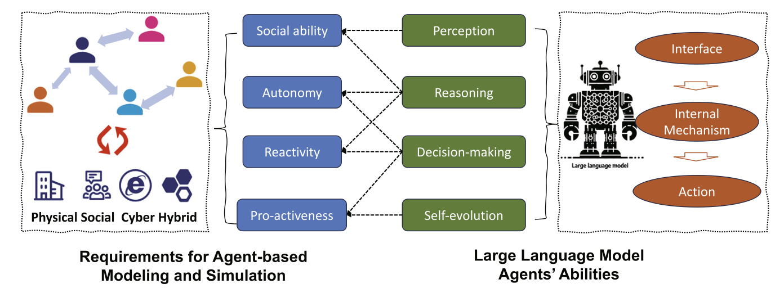
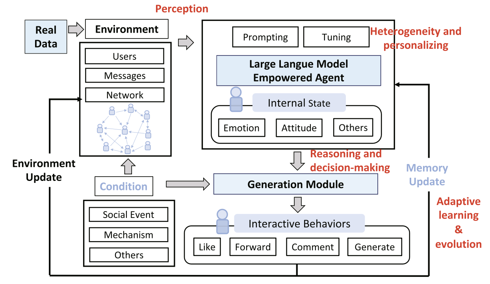
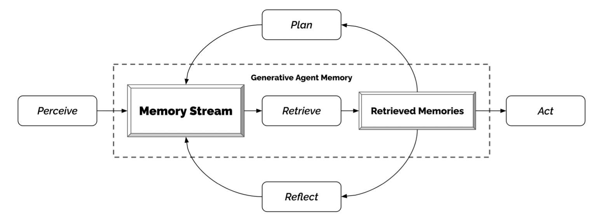
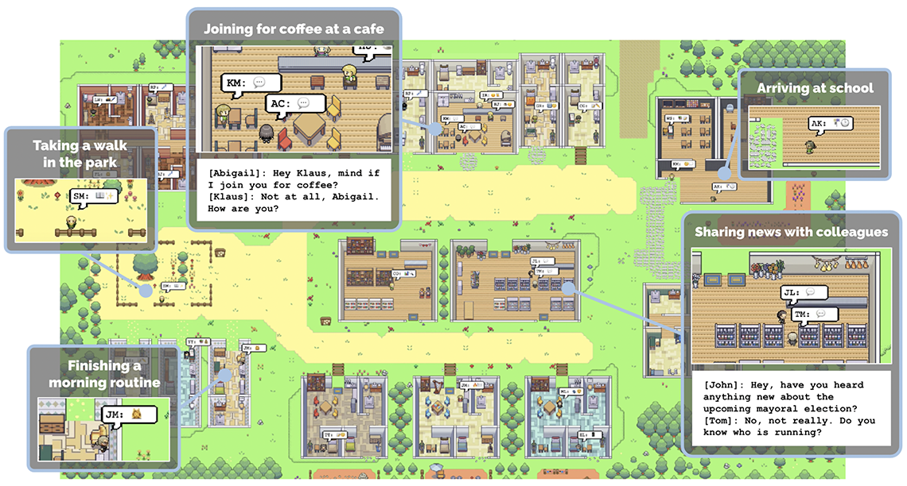
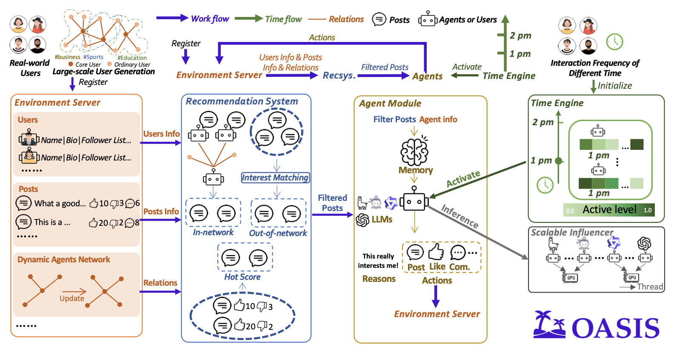
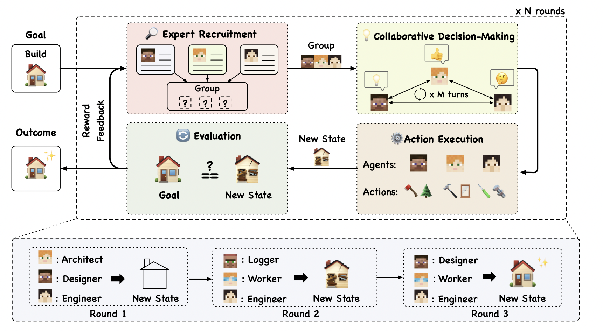
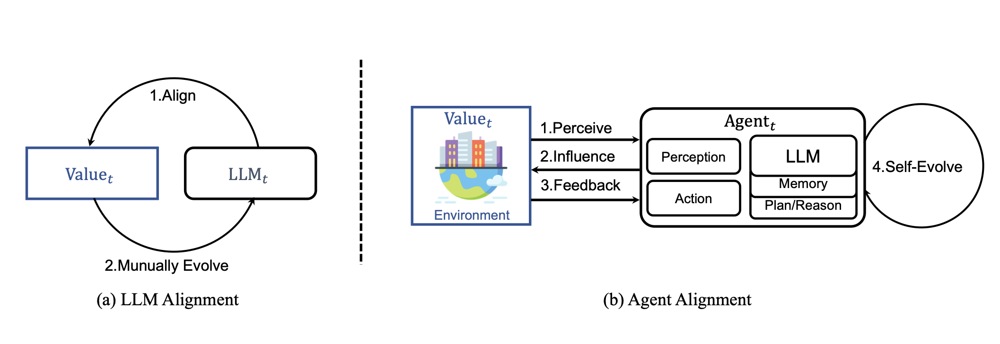
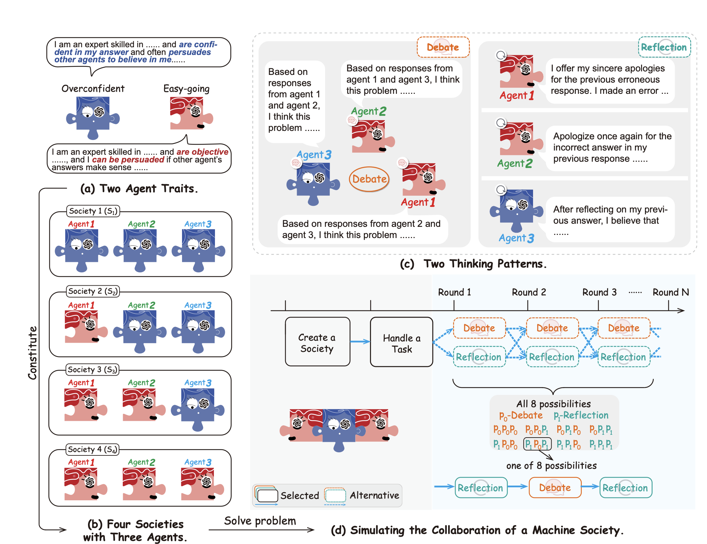

# Chapter 17 Emergent Behavior in Multi-LLM Systems

[Course index](../../README.md) · [Original source](https://arxiv.org/html/2610.13455v1#Ch17) · [Raw file](../../raw/originals/book.html)

Retrieved: 2026-11-13T16:41:17.579179+00:00

[Contents](../../CONTENTS.md) · [Full book](../book/full-book-html.md) · [Previous chapter](chapter-16-role-based-interaction-in-multi-llm-systems.md) · [Next chapter](chapter-18-case-study-4-simulating-societies-with-llm-agents.md)

### Chapter 17 Emergent Behavior in Multi-LLM Systems

**What You Will Learn**

In this chapter you will learn how multiple LLM agents behave when they are *not* assigned roles, in order to study emergent behavior in open-ended systems. Specifically, you will be able to:

- Distinguish emergent multi-agent simulations from role-based interaction and explain why open-ended settings call for different *research questions and evaluation* methods.
- Describe the *architecture* of generative agent simulations and how simulation infrastructure scales from a handful of agents to thousands.
- Explain how (global-scale) conventions, norms, and meta-norms *emerge* from (local-scale) agentic interactions in natural language.
- Understand how multi-agent simulation is used as a *scientific instrument* in computational social science.
- Understand the importance of *Open World* benchmark environments for data generation.
- Critically evaluate the validity of claims about concepts translated from a human context, such as emergence, self-organization, or collective intelligence, and assess the *safety risks* that open-ended multi-agent systems introduce.

#### 17.1 What Is Emergent Multi-Agent Behavior?

The previous chapter studied multi-LLM systems in which every agent was assigned a role and interactions were guided by protocols. Research questions concerned behavior within an assigned structure, asking how well a team of agents solve a task in a controlled way. In this chapter agents are placed in an open-ended environment, and the research questions shift from *How do agents behave and perform given a certain global structure?* to *What global structure emerges out of local agents interactions?*

As we have seen in this book, agentic LLMs have enhanced abilities for perception, memory, reasoning, decision-making, and adaptive learning, and they can display heterogeneous personality profiles [[Gao et al., 2023](#bibp.bib30), [Gao et al., 2024](#bibp.bib35)]. Such features make them also suitable for interacting in open-ended multi-agent simulations without prior role assignment, as a proxy for human behavior in a society. Because LLM agents communicate in natural language, the interactions in such simulations are readable and interpretable by researchers. This gives access to intermediate steps and makes simulations much more comparable to human interaction compared to simulations in classic frameworks, meeting long-standing interests from the social sciences. The general structure of LLM-based agents suitable for such simulations is illustrated in Figure [17.1](#Ch17.F1 "Figure 17.1 ‣ 17.1 What Is Emergent Multi-Agent Behavior? ‣ Chapter 17 Emergent Behavior in Multi-LLM Systems ‣ Part V Behavior and Cognition ‣ Agentic Large Language Models") and Figure [17.2](#Ch17.F2 "Figure 17.2 ‣ 17.1 What Is Emergent Multi-Agent Behavior? ‣ Chapter 17 Emergent Behavior in Multi-LLM Systems ‣ Part V Behavior and Cognition ‣ Agentic Large Language Models").

Figure 17.1: 
Agent-based Modeling and LLM-agents [[Gao et al., 2024](#bibp.bib35)]

Figure 17.2: 
Structure of LLM-agents for Multi-Agent Modeling [[Gao et al., 2023](#bibp.bib30)]

##### 17.1.1 From Agent-Based Modeling to Generative Agent Societies

The study of populations of interacting artificial agents has a decades-long history. In agent-based modeling, macro-level patterns and regularities arise bottom-up out of local interactions of simple agents [[Epstein and Axtell, 1996](#bibp.bib44), [Macal and North, 2010](#bibp.bib8)]. One of the most influential results in agent-based modeling was that cooperation and norms can emerge in populations of self-interested agents [[Axelrod, 1986](#bibp.bib12)]. Cultural evolution theory formalized how behavior can spread through a population by means of imitation, communication, and education [[Boyd and Richerson, 1988](#bibp.bib37)]. [Steels [1995]](#bibp.bib10)’s *naming game* demonstrated that even shared vocabularies (which are also in essence conventions) can come into existence from pairwise interactions without central coordination.

In classic agent-based simulations, agents followed hand-coded rules and exchanged abstract information, rather than using natural language like the agents in this Chapter. Another key contrast is that classic agents possess no background knowledge of the world in any sense comparable to what LLM agents have. LLMs allow for an entirely different level of simulations in which agents with rich and diverse personas gossip, persuade, misunderstand, and negotiate in ways that are directly recognizable to humans. Advances in simulation infrastructure make it feasible to run such agents at population scale [[Gao et al., 2024](#bibp.bib35), [Yang et al., 2024](#bibp.bib41)]. The result is a new generation of *generative agent societies* that give a new impulse to the old agent-based modeling research agenda, while also introducing novel methodological problems and considerations.

In Section [16.1.3](chapter-16-role-based-interaction-in-multi-llm-systems.md#Ch16.S1.SS3 "16.1.3 Five Dimensions of Multi-Agent Collaboration ‣ 16.1 From Single-agent to Multi-agent ‣ Chapter 16 Role-Based Interaction in Multi-LLM Systems ‣ Part V Behavior and Cognition ‣ Agentic Large Language Models") we introduced a spectrum of five axes for research control over multi-LLM systems [[Tran et al., 2025](#bibp.bib47)]. The difference between role-based and open-ended simulations is a matter of degree rather than kind. Open-ended simulations sit at one end of the spectrum, opposite role-defined and protocolized interactions. Open-ended simulations still involve design choices that seed the outcomes, but they do so in a less deterministic way, purposefully leaving space for new patterns to emerge. This shifts the focus of the research: instead of evaluating performance on a task or clearly defined goal, studies have an open lens—the interaction pattern is the research goal. Open-ended simulatinos observe and explore in a more ethnographical way how agents behave and interact, which requires different methodologies, as we will now discuss.

##### 17.1.2 A Methodological Note

The methodological issues discussed in Chapters [15](chapter-15-studying-behavior-of-agentic-llms.md#Ch15 "Chapter 15 Studying Behavior of Agentic LLMs ‣ Part V Behavior and Cognition ‣ Agentic Large Language Models") and [16](chapter-16-role-based-interaction-in-multi-llm-systems.md#Ch16 "Chapter 16 Role-Based Interaction in Multi-LLM Systems ‣ Part V Behavior and Cognition ‣ Agentic Large Language Models") all carry over to the open-ended setting: prompt sensitivity, run-to-run variability, cascading hallucinations, mutual reinforcement of weaknesses, and validity of terminology from the human context, all pose challenges for open-ended simulations. We will see that this setting amplifies some problems, while mitigating others. For example, in the absence of protocols that apply every time agents interact, small variations at the level of a single agent may put the entire simulation on a different track. This is what makes open-ended simulations both interesting and brittle. An example of a new issue that the open-ended setting introduces is that there can be a thin line between emergence and retrieval: when LLM agents in an open-ended simulation converge on a norm, it is unclear whether this norm emerges *de novo* from their interaction, or whether it was simply retrieved from their pretrained world knowledge.

Extensive overviews of this emerging field are provided by [Mou et al. [2024]](#bibp.bib14), [Savarimuthu et al. [2024]](#bibp.bib18), and [Xi et al. [2023]](#bibp.bib15). We will discuss
infrastructure and simulation platforms in Section [17.2](#Ch17.S2 "17.2 Simulation Infrastructure ‣ Chapter 17 Emergent Behavior in Multi-LLM Systems ‣ Part V Behavior and Cognition ‣ Agentic Large Language Models"), then go to the emergence of conventions and norms in Section [17.3](#Ch17.S3 "17.3 Emergent Conventions and Norms ‣ Chapter 17 Emergent Behavior in Multi-LLM Systems ‣ Part V Behavior and Cognition ‣ Agentic Large Language Models"), and conclude by discussing the importance of open world environments in Section [17.4](#Ch17.S4 "17.4 Evaluating Agents in Open World Environments ‣ Chapter 17 Emergent Behavior in Multi-LLM Systems ‣ Part V Behavior and Cognition ‣ Agentic Large Language Models"). Finally , we reflect on risks of the open-ended setting, in Section [17.5](#Ch17.S5 "17.5 Risks of Emergent Behavior ‣ Chapter 17 Emergent Behavior in Multi-LLM Systems ‣ Part V Behavior and Cognition ‣ Agentic Large Language Models").
Then, Chapter [18](chapter-18-case-study-4-simulating-societies-with-llm-agents.md#Ch18 "Chapter 18 Case Study 4: Simulating Societies with LLM Agents ‣ Part V Behavior and Cognition ‣ Agentic Large Language Models"), contains a practical case in which you will work hands-on with an open-ended simulation.

#### 17.2 Simulation Infrastructure

Open-ended simulations require infrastructures that, on the one hand, provide a platform where research data is being recorded while agents sustain their interaction and behavior over a longer period of time. On the other hand, those infrastructures should allow for enough space for phenomena to occur bottom-up and unknown structure to emerge, and as such not be limiting. In this section we focus on scale, going from a single simulated community inhabiting a virtual town to societies of a million agents.

##### 17.2.1 Small Worlds

A system called Generative Agents was introduced by [Park et al. [2023]](#bibp.bib36). Generative Agents is an environment where users can interact with a simulated town populated by 25 LLM-based agents. Based on social simulacra techniques proposed earlier [[Park et al., 2022](#bibp.bib31)], each agent was initiated with a unique persona and memory. For each agent, a record is kept of all the experiences and conversations in the simulation. This record is used to synthesize higher-level reflections, and plan further behavior (see Figure [17.3](#Ch17.F3 "Figure 17.3 ‣ 17.2.1 Small Worlds ‣ 17.2 Simulation Infrastructure ‣ Chapter 17 Emergent Behavior in Multi-LLM Systems ‣ Part V Behavior and Cognition ‣ Agentic Large Language Models")).

In Generative Agents, the agents behave somewhat like characters in the video game The Sims [[Nutt and Railton, 2003](#bibp.bib4)]: they initiate conversations, form relationships, spread information, and coordinate ad hoc group activities (see Figure [17.4](#Ch17.F4 "Figure 17.4 ‣ 17.2.1 Small Worlds ‣ 17.2 Simulation Infrastructure ‣ Chapter 17 Emergent Behavior in Multi-LLM Systems ‣ Part V Behavior and Cognition ‣ Agentic Large Language Models")). Note that the interactions are influenced by user input and are therefore semi-autonomous, the simulation is largely unscripted, but not fully. How a simulation works is illustrated by the example of a Valentine’s Day party: the plan for the party was initiated with a user prompt, and subsequently multiple agents spread invitations to one another and show up at the right time with coordinated plans (some are late, just as in real life). The agents developed believable social routines (such as daily schedules, and gossiping) and even exhibit human-like character traits (some agents demonstrated deception or stubbornness, while others showed cooperation). These results show that, with the right starting prompt, social patterns can emerge from dynamic, semi-autonomous, LLM interactions.

Figure 17.3: 
The Memory–Reflection–Planning loop is the enabling design of the Generative Agents system: without retrieval over an ever-growing experience record and periodic reflection, agents lose coherence within hours of simulated time [[Park et al., 2023](#bibp.bib36)]

Figure 17.4: 
Illustration of the Generative Agents simulation featuring 25 agents and an interactive design that allows users to set behavior in motion [[Park et al., 2023](#bibp.bib36)]

##### 17.2.2 Societies of Thousands to a Million Agents

Scaling the Generative Agents architecture beyond 25 agents raises questions about inference cost and environments that are rich enough to occupy thousands of agents.11
1
As you will experience hands-on in the next chapter, running a variant of the Generative Agents architecture with only three active agents is already computationally challenging. A large-scale social simulation is a trade-off between available compute power, total simulation run-time, number of simulated agents, and accuracy of individual agent behavior. Several platforms address these questions.

AgentSociety is a simulation at a large scale, involving over 10,000 agents [[Piao et al., 2025b](#bibp.bib5)]. It couples LLM-driven agents with a realistic urban environment with a focus on mobility, employment, and consumption. It aims not only to study everyday social dynamics (as in Generative Agents), but also offers a testbed for computational social experiments. To allow for the required scale, the simulation runs on a distributed inference backend, with stricter control of agent behavior.

OASIS is a scalable social media simulator for Twitter/X and Reddit [[Yang et al., 2024](#bibp.bib41)]. It supports modeling of up to one million LLM-agents. It is built on CAMEL [[Li et al., 2023](#bibp.bib43)] and has role-based agents as its starting point. In OASIS, not every agent action involves an LLM-call, and not all agents are active all the time. At its large scale, OASIS shows various social group phenomena, including spreading of (mis)information, group polarization, and herd effects. OASIS is built upon an environment server, recommender system, agent module, time engine, and scalable inferencer (see Figure [17.5](#Ch17.F5 "Figure 17.5 ‣ 17.2.2 Societies of Thousands to a Million Agents ‣ 17.2 Simulation Infrastructure ‣ Chapter 17 Emergent Behavior in Multi-LLM Systems ‣ Part V Behavior and Cognition ‣ Agentic Large Language Models")).

Figure 17.5: 
Components of OASIS [[Yang et al., 2024](#bibp.bib41)]

Project Sid [[Ahn et al., 2024](#bibp.bib2)] places up to 1000 agents in a Minecraft world and reports a striking emergence result: agents are observed to develop specialized economic roles (farmers, miners, guards), adhere to collectively adopted rules such as taxation, and transmit cultural and even religious memes across settlements. However, even though the interactions were not scripted, the emergence–retrieval caveat formulated above applies here: the observed roles and behaviors can be expected to be abundantly described in the training data of the LLMs powering the individual agents.

##### 17.2.3 Simulation as a Scientific Instrument

In addition to being impressive showcases of scalable LLM technology, when used carefully, these platforms can be used for intricate computational social experiments. Simulated generative agent societies have been used to study long-standing research questions from the social sciences (Section [17.1](#Ch17.S1 "17.1 What Is Emergent Multi-Agent Behavior? ‣ Chapter 17 Emergent Behavior in Multi-LLM Systems ‣ Part V Behavior and Cognition ‣ Agentic Large Language Models")). AgentSociety, for example, has been used for various case studies including the spread of inflammatory messages, polarization, the effects of universal basic income policies, and the impact of external shocks to a society such as hurricanes [[Piao et al., 2025b](#bibp.bib5), [Piao et al., 2025a](#bibp.bib7)]. Such experiments would be unethical, impractical, or outright impossible to run on human populations. The authors argue that in simulations they can be repeated and changes to the experiment can be be made at every step.

[Li et al. [2024b]](#bibp.bib34) further illustrate the approach for misinformation. Their agents exhibit diverse profiles in terms of gender, age, and the big five personality traits.22
2
Also known as OCEAN: Openness, Conscientiousness, Extraversion, Agreeableness, and Neuroticism. One of the findings is that encouraging comments does not significantly reduce the spread of misinformation, whereas publicly labeling information with accuracy scores and blocking specific influencers proved to be effective strategies, particularly in scale-free networks [[Barabási, 2009](#bibp.bib3)]. The pattern of such studies is characteristic: a candidate intervention is implemented as a change to the simulated platform, and its macro-level effect is measured over many runs. Whether these effects transfer to human populations is precisely the validity question of Section [17.1.2](#Ch17.S1.SS2 "17.1.2 A Methodological Note ‣ 17.1 What Is Emergent Multi-Agent Behavior? ‣ Chapter 17 Emergent Behavior in Multi-LLM Systems ‣ Part V Behavior and Cognition ‣ Agentic Large Language Models"); simulations of this kind are best read as hypothesis generators and pre-tests, not as substitutes for field experiments.

###### A Borderline Case: AgentVerse

AgentVerse [[Chen et al., 2023](#bibp.bib38)] is, strictly speaking, a role-based system of the kind studied in Chapter [16](chapter-16-role-based-interaction-in-multi-llm-systems.md#Ch16 "Chapter 16 Role-Based Interaction in Multi-LLM Systems ‣ Part V Behavior and Cognition ‣ Agentic Large Language Models"). In AgentVerse problem solving is split into four stages of expert recruitment, collaborative decision making, action execution, and evaluation, iterated until the result is satisfactory (Figure [17.6](#Ch17.F6 "Figure 17.6 ‣ A Borderline Case: AgentVerse ‣ 17.2.3 Simulation as a Scientific Instrument ‣ 17.2 Simulation Infrastructure ‣ Chapter 17 Emergent Behavior in Multi-LLM Systems ‣ Part V Behavior and Cognition ‣ Agentic Large Language Models")). We mention it here because of what happened *beyond* the design: agents manifest emergent behaviors such as volunteering, characterized by agents offering assistance to peers, and conformity, where agents adjust deviated behaviors under the criticism of others. Destructive behaviors were also observed, occasionally leading to undesired and detrimental outcomes. The fact that macro-scale behavior emerged in a role-scripted simulation, illustrates that the role-based/emergent distinction is a spectrum: even tightly protocolized systems regularly display behavior that nobody purposely designed. We return to the risks associated with this observation in Section [17.5](#Ch17.S5 "17.5 Risks of Emergent Behavior ‣ Chapter 17 Emergent Behavior in Multi-LLM Systems ‣ Part V Behavior and Cognition ‣ Agentic Large Language Models").

Figure 17.6: 
Four Stages for Decision Making in AgentVerse [[Chen et al., 2023](#bibp.bib38)]

#### 17.3 Emergent Conventions and Norms

Authors have observed emergent patterns in several open-ended multi-agent simulations. In this section we shift focus from the level of infrastructures and interactions to the level of the conventions and norms.

EvolutionaryAgent [[Li et al., 2024a](#bibp.bib22)] studies agent alignment in a multi-agent system, with evolutionary methods that go beyond Reinforcement Learning from Human Feedback (see Figure [17.7](#Ch17.F7 "Figure 17.7 ‣ 17.3 Emergent Conventions and Norms ‣ Chapter 17 Emergent Behavior in Multi-LLM Systems ‣ Part V Behavior and Cognition ‣ Agentic Large Language Models")). EvolutionaryAgent follows a controlled approach to norm emergence: it does not permit the evolution of social norms to be disorderly or random, but it also does not intervene in each step of their evolution. The authors define the initial social norms and a desired direction of evolution. Agents with higher fitness (more norm-conforming) are more likely to reproduce, leading to the diffusion of their strategies, gradually stabilizing and forming new social norms.

Figure 17.7: 
Overview of EvolutionaryAgent [[Li et al., 2024a](#bibp.bib22)]

Defining a complete, realistic, and complex virtual society is challenging. The purpose of the work is to study how, if such a virtual society existed, a system could further enable intricate behaviors of agents, and how this would lead to the emergence of new dynamics. The system provides a sandbox for investigating the safety of AI systems before they impact the real world.

Based on [Steels [1995]](#bibp.bib10)’s naming game, different approaches were implemented, using agents powered by LLaMa 3 and Claude 3.5 [[Kouwenhoven et al., 2024](#bibp.bib6), [Ashery et al., 2024](#bibp.bib20), [Baronchelli, 2023](#bibp.bib19)]. These studies find that globally accepted conventions (or norms) can spontaneously arise from local interactions between communicating LLMs. The authors also demonstrate how strong collective biases can emerge during this process, even when individual agents appear to be unbiased, and how minority groups of committed LLMs can drive social change by establishing new social conventions that can overturn established behaviors.

The emergence of norms is studied at another level by [Horiguchi et al. [2024]](#bibp.bib21), who explore the potential for LLM agents to spontaneously generate and adhere to normative strategies, building upon the foundational work of Axelrod’s *metanorm* games. Metanorms are norms about enforcing norms: the punishment of those who do not punish agents that are breaking norms [[Axelrod, 1986](#bibp.bib12)]. Controlling for the personality traits *vengefulness* and *boldness*, they find that through dialogue, LLM agents can form complex social norms, such as metanorms, purely through natural language interaction.
A related study by [He et al. [2024]](#bibp.bib17) evaluates the capability of LLMs to detect norm violations. Based on simulated data from 80 stories in a household context, they investigated whether 10 norms are violated, and found ChatGPT-4 being able for detect norm violations, with Mistral some distance behind.

[Qiu et al. [2024]](#bibp.bib16) go a step beyond norms, and study the cultural and social awareness of LLM agents. They introduce CASA, a benchmark designed to assess LLM
agents’ sensitivity to cultural and social norms across two web-based tasks: online shopping and social discussion forums. (CASA is based on WebArena [[Qi et al., 2024](#bibp.bib25)].) Current LLMs perform significantly better in non-agent than in agent web-based environments, with agents achieving less than 10% awareness coverage and over 40% violation rates. However, using prompting and fine-tuning on specific datasets, cultural and social awareness can be improved.

Inspired by Minsky’s Society of Mind [[Minsky, 1988](#bibp.bib29)], cooperation mechanisms are explored in [Zhang et al. [2023]](#bibp.bib42)’s agentic LLM simulation. This simulation consists of four different societies of LLM agents, where each agent is characterized by a specific trait (easy-going or overconfident) and engages in cooperation with a distinct thinking pattern (debate or reflection). They find that LLM agents manifest human-like social behaviors, such as conformity and consensus reaching, mirroring foundational social psychology theories. Figure [17.8](#Ch17.F8 "Figure 17.8 ‣ 17.3 Emergent Conventions and Norms ‣ Chapter 17 Emergent Behavior in Multi-LLM Systems ‣ Part V Behavior and Cognition ‣ Agentic Large Language Models") illustrates the societies with different types of agents.

Figure 17.8: 
Agents with Different Traits make up
Diverse Machine Societies [[Zhang et al., 2023](#bibp.bib42)]

The question whether groups of LLM agents can successfully engage in cross-national collaboration and debate is studied by [[Baltaji et al., 2024](#bibp.bib13)]. Multi agent discussions can support collective AI decisions that reflect diverse perspectives, although agents are susceptible to conformity due to perceived peer pressure. They can also lose track of their personas and opinions. Instructions that encourage debate increase the risk of errors.

#### 17.4 Evaluating Agents in Open World Environments

One of the main drivers of agentic LLM research is the problem of plateauing LLM performance due to limited training data. Open World multi-agent interaction aims to address this problem, generating data with multi agent simulations.
Machine learning can learn no more complexity than what is present in the dataset (or environment). The idea of an open world model is that it can create infinite datasets or environments, in which agents can continue to learn, to keep improving their intelligence. How should such unlimited challenges be created? The advent of LLMs has given a new impulse to this research question. This idea is followed, for example, in the multi agent finetuning approach [[Subramaniam et al., 2025](#bibp.bib9)].

Current agents are primarily created and tested in simplified synthetic environments, leading to
a disconnect with real-world scenarios. [Zhou et al. [2023]](#bibp.bib23) build an environment, WebArena,
that is more realistic and reproducible. WebArena is an environment
with fully functional websites from four common domains: e-commerce, social
forum discussions, collaborative software development, and content management.

Games are also often used as benchmarks for interactive behavior. Real-world tasks require handling intricate interactions, advanced spatial reasoning, long-term planning, and continuous exploration of new strategies.
BALROG [[Paglieri et al., 2025](#bibp.bib1)], the system that we used for Case Study 2, incorporates planning environments of varying levels of difficulty, ranging from tasks that are solvable by non-expert humans in seconds to challenging ones that may take years to
master (such as the NetHack Learning Environment).
They find that
while current models achieve partial success in the easier games, they struggle
significantly with more challenging tasks such as vision-based decision-making.

Progress in machine learning depends on the availability of benchmarks. As models evolve, there is a need to create benchmarks that can measure progress on new generative capabilities [[Butt et al., 2024](#bibp.bib40)]. BENCHAGENTS decomposes the benchmark creation process into planning, generation, data verification, and evaluation, each of which is executed by an LLM agent. These agents interact with each other and utilize human-in-the-loop feedback to explicitly improve and flexibly control data diversity and quality. BENCHAGENTS creates benchmarks to evaluate capabilities related to planning and constraint satisfaction.

AgentBoard provides an evaluation of the breadth of existing benchmarks [[Ma et al., 2024](#bibp.bib39)].
Benchmarks should have task diversity. It is necessary to cover various agent tasks such as embodied, web, and tool
tasks. Additionally, multi round interaction is important, to mimic realistic scenarios. Existing benchmarks typically adopt single-round tasks. Furthermore, agents should be evaluated in partially-observable environments, to test if they can actively explore their surroundings. Existing agent benchmarks fail to satisfy all of these criteria [[Ma et al., 2024](#bibp.bib39)].

Research on Open World environments is related to curriculum learning.
Pre-LLMs work already shows that agent societies may create an automated curriculum of ever increasing difficulty [[Elman, 1991](#bibp.bib27), [Bengio et al., 2009](#bibp.bib45), [Silver et al., 2017](#bibp.bib46), [Soviany et al., 2022](#bibp.bib28)], requiring increasing levels of intelligent behavior from the agents [[Racaniere et al., 2019](#bibp.bib33)]. Similar results have been observed for LLMs [[Feng et al., 2023](#bibp.bib24)].
For example, WebArena is used to study self-evolving curricula [[Qi et al., 2024](#bibp.bib25)], which can also help robot training [[Ryu et al., 2024](#bibp.bib32)] or to mitigate hallucination [[Zhao et al., 2024](#bibp.bib26)].

#### 17.5 Risks of Emergent Behavior

Chapter [16](chapter-16-role-based-interaction-in-multi-llm-systems.md#Ch16 "Chapter 16 Role-Based Interaction in Multi-LLM Systems ‣ Part V Behavior and Cognition ‣ Agentic Large Language Models") closed by noting that role assignment introduces risk, since agents may display unintended, even anti-social, behavior simply by playing a part too well. The open-ended setting arguably raises the stakes, since fewer safeguards are built in, and undesirable behavior can arise bottom-up from interaction dynamics. In a sense, this anti-social behavior should not be too surprising, when we remember that the goal of the earliest multi-agent simulations was to find out if cooperative behavior could ever emerge out of the interaction between self-interested agents—which, to the surprise of the researchers, happened, but only under the right circumstances [[Axelrod, 1981](#bibp.bib11)]. The line between cooperative behavior and competitive behavior is thin.

AgentVerse observed destructive behaviors emerging alongside cooperative ones, occasionally leading to detrimental outcomes [[Chen et al., 2023](#bibp.bib38)]. The naming-game studies showed that strong collective biases can emerge from populations of individually unbiased agents, and that small committed minorities can overturn established conventions [[Ashery et al., 2024](#bibp.bib20), [Kouwenhoven et al., 2024](#bibp.bib6)]. These mechanisms are neutral in themselves, but could be exploited by agents that are not well-intended. At platform scale, OASIS and AgentSociety reproduce misinformation spread, group polarization, herding effects, and the propagation of toxic content [[Yang et al., 2024](#bibp.bib41), [Piao et al., 2025a](#bibp.bib7)]; the same fidelity that makes these simulations scientifically useful makes them *in principle* rehearsal spaces for manipulation strategies.

The constructive response is to turn this risk around. EvolutionaryAgent frames its virtual society explicitly as a sandbox for investigating the safety of AI systems before they impact the real world [[Li et al., 2024a](#bibp.bib22)]. If norms among agents can be steered toward a desired direction in simulation, then the same machinery can be used to stress-test alignment approaches under population dynamics rather than in isolation. Open-ended simulation can be used to understand the circumstances when risks first emerge, and to cheaply study defenses against these risks.

#### 17.6 Concluding Remarks

We have covered open-ended multi-LLM simulations without prior role assignment. These simulations give a new impulse to long-standing interests in the social sciences to model self-organizing behaviors, collective intelligence and the development of social
conventions and norms. The scale of such simulations varies from a few interacting agents up to a million.

The availability of infrastructure that supports large scale simulations enables further studies. However, an open question is to what extent autonomous simulations are truly open-ended, and not influenced by the LLM prompts and agent scaffolding. Furthermore, although the purpose of open-ended simulations is to observe emerging behavior, one has to be careful in interpreting behavioral outcome patterns. All LLM agents are pretrained on human-generated data. It is difficult to distinguish which elements of behavioral patterns emerge out of agent-agent interaction, and which elements are merely the result of retrieved pretrained behaviors.

### References

- Ahn et al. (2024)
  A. Ahn, N. Becker, S. Carroll, N. Christie, M. Cortes, A. Demirci, M. Du, F. Li, S. Luo, P. Y. Wang, M. Willows, F. Yang, and G. R. Yang
  Project sid: many-agent simulations toward ai civilization.
  External Links: 2411.00114,
  [Link](https://arxiv.org/abs/2411.00114)
  Cited by: [§17.2.2](#Ch17.S2.SS2.p4.1 "17.2.2 Societies of Thousands to a Million Agents ‣ 17.2 Simulation Infrastructure ‣ Chapter 17 Emergent Behavior in Multi-LLM Systems ‣ Part V Behavior and Cognition ‣ Agentic Large Language Models").

- Ashery et al. (2024)
  A. F. Ashery, L. M. Aiello, and A. Baronchelli
  The dynamics of social conventions in llm populations: spontaneous emergence, collective biases and tipping points.
  arXiv preprint arXiv:2410.08948.
  Cited by: [§17.3](#Ch17.S3.p4.1 "17.3 Emergent Conventions and Norms ‣ Chapter 17 Emergent Behavior in Multi-LLM Systems ‣ Part V Behavior and Cognition ‣ Agentic Large Language Models"),
  [§17.5](#Ch17.S5.p2.1 "17.5 Risks of Emergent Behavior ‣ Chapter 17 Emergent Behavior in Multi-LLM Systems ‣ Part V Behavior and Cognition ‣ Agentic Large Language Models").

- Axelrod (1981)
  R. Axelrod
  The emergence of cooperation among egoists.
  American political science review 75 (2), pp. 306–318.
  Cited by: [§17.5](#Ch17.S5.p1.1 "17.5 Risks of Emergent Behavior ‣ Chapter 17 Emergent Behavior in Multi-LLM Systems ‣ Part V Behavior and Cognition ‣ Agentic Large Language Models").

- Axelrod (1986)
  R. Axelrod
  An evolutionary approach to norms.
  American political science review 80 (4), pp. 1095–1111.
  Cited by: [§17.1.1](#Ch17.S1.SS1.p1.1 "17.1.1 From Agent-Based Modeling to Generative Agent Societies ‣ 17.1 What Is Emergent Multi-Agent Behavior? ‣ Chapter 17 Emergent Behavior in Multi-LLM Systems ‣ Part V Behavior and Cognition ‣ Agentic Large Language Models"),
  [§17.3](#Ch17.S3.p5.1 "17.3 Emergent Conventions and Norms ‣ Chapter 17 Emergent Behavior in Multi-LLM Systems ‣ Part V Behavior and Cognition ‣ Agentic Large Language Models").

- Baltaji et al. (2024)
  R. Baltaji, B. Hemmatian, and L. R. Varshney
  Conformity, confabulation, and impersonation: persona inconstancy in multi-agent llm collaboration.
  arXiv preprint arXiv:2405.03862.
  Cited by: [§17.3](#Ch17.S3.p8.1 "17.3 Emergent Conventions and Norms ‣ Chapter 17 Emergent Behavior in Multi-LLM Systems ‣ Part V Behavior and Cognition ‣ Agentic Large Language Models").

- Barabási (2009)
  A. Barabási
  Scale-free networks: a decade and beyond.
  science 325 (5939), pp. 412–413.
  Cited by: [§17.2.3](#Ch17.S2.SS3.p2.1 "17.2.3 Simulation as a Scientific Instrument ‣ 17.2 Simulation Infrastructure ‣ Chapter 17 Emergent Behavior in Multi-LLM Systems ‣ Part V Behavior and Cognition ‣ Agentic Large Language Models").

- Baronchelli (2023)
  A. Baronchelli
  Shaping new norms for artificial intelligence: a complex systems perspective.
  arXiv preprint arXiv:2307.08564.
  Cited by: [§17.3](#Ch17.S3.p4.1 "17.3 Emergent Conventions and Norms ‣ Chapter 17 Emergent Behavior in Multi-LLM Systems ‣ Part V Behavior and Cognition ‣ Agentic Large Language Models").

- Bengio et al. (2009)
  Y. Bengio, J. Louradour, R. Collobert, and J. Weston
  Curriculum learning.
  In Proceedings of the 26th annual international conference on machine learning,
  pp. 41–48.
  Cited by: [§17.4](#Ch17.S4.p6.1 "17.4 Evaluating Agents in Open World Environments ‣ Chapter 17 Emergent Behavior in Multi-LLM Systems ‣ Part V Behavior and Cognition ‣ Agentic Large Language Models").

- Boyd and Richerson (1988)
  R. Boyd and P. J. Richerson
  Culture and the evolutionary process.
   University of Chicago press.
  Cited by: [§17.1.1](#Ch17.S1.SS1.p1.1 "17.1.1 From Agent-Based Modeling to Generative Agent Societies ‣ 17.1 What Is Emergent Multi-Agent Behavior? ‣ Chapter 17 Emergent Behavior in Multi-LLM Systems ‣ Part V Behavior and Cognition ‣ Agentic Large Language Models").

- Butt et al. (2024)
  N. Butt, V. Chandrasekaran, N. Joshi, B. Nushi, and V. Balachandran
  BENCHAGENTS: automated benchmark creation with agent interaction.
  arXiv preprint arXiv:2410.22584.
  Cited by: [§17.4](#Ch17.S4.p4.1 "17.4 Evaluating Agents in Open World Environments ‣ Chapter 17 Emergent Behavior in Multi-LLM Systems ‣ Part V Behavior and Cognition ‣ Agentic Large Language Models").

- Chen et al. (2023)
  W. Chen, Y. Su, J. Zuo, C. Yang, C. Yuan, C. Qian, C. Chan, Y. Qin, Y. Lu, R. Xie, et al.
  Agentverse: facilitating multi-agent collaboration and exploring emergent behaviors in agents.
  arXiv preprint arXiv:2308.10848 2 (4), pp. 5.
  Cited by: [Figure 17.6](#Ch17.F6 "In A Borderline Case: AgentVerse ‣ 17.2.3 Simulation as a Scientific Instrument ‣ 17.2 Simulation Infrastructure ‣ Chapter 17 Emergent Behavior in Multi-LLM Systems ‣ Part V Behavior and Cognition ‣ Agentic Large Language Models"),
  [Figure 17.6](#Ch17.F6.4 "In A Borderline Case: AgentVerse ‣ 17.2.3 Simulation as a Scientific Instrument ‣ 17.2 Simulation Infrastructure ‣ Chapter 17 Emergent Behavior in Multi-LLM Systems ‣ Part V Behavior and Cognition ‣ Agentic Large Language Models"),
  [§17.2.3](#Ch17.S2.SS3.SSS0.Px1.p1.1 "A Borderline Case: AgentVerse ‣ 17.2.3 Simulation as a Scientific Instrument ‣ 17.2 Simulation Infrastructure ‣ Chapter 17 Emergent Behavior in Multi-LLM Systems ‣ Part V Behavior and Cognition ‣ Agentic Large Language Models"),
  [§17.5](#Ch17.S5.p2.1 "17.5 Risks of Emergent Behavior ‣ Chapter 17 Emergent Behavior in Multi-LLM Systems ‣ Part V Behavior and Cognition ‣ Agentic Large Language Models").

- Elman (1991)
  J. L. Elman
  Incremental learning, or the importance of starting small.
  In Proceedings of the Annual Meeting of the Cognitive Science Society,
  Vol. 13.
  Cited by: [§17.4](#Ch17.S4.p6.1 "17.4 Evaluating Agents in Open World Environments ‣ Chapter 17 Emergent Behavior in Multi-LLM Systems ‣ Part V Behavior and Cognition ‣ Agentic Large Language Models").

- Epstein and Axtell (1996)
  J. M. Epstein and R. Axtell
  Growing artificial societies: social science from the bottom up.
   Brookings Institution Press.
  Cited by: [§17.1.1](#Ch17.S1.SS1.p1.1 "17.1.1 From Agent-Based Modeling to Generative Agent Societies ‣ 17.1 What Is Emergent Multi-Agent Behavior? ‣ Chapter 17 Emergent Behavior in Multi-LLM Systems ‣ Part V Behavior and Cognition ‣ Agentic Large Language Models").

- Feng et al. (2023)
  T. Feng, Z. Wang, and J. Sun
  Citing: large language models create curriculum for instruction tuning.
  arXiv preprint arXiv:2310.02527.
  Cited by: [§17.4](#Ch17.S4.p6.1 "17.4 Evaluating Agents in Open World Environments ‣ Chapter 17 Emergent Behavior in Multi-LLM Systems ‣ Part V Behavior and Cognition ‣ Agentic Large Language Models").

- Gao et al. (2024)
  C. Gao, X. Lan, N. Li, Y. Yuan, J. Ding, Z. Zhou, F. Xu, and Y. Li
  Large language models empowered agent-based modeling and simulation: a survey and perspectives.
  Humanities and Social Sciences Communications 11 (1), pp. 1–24.
  Cited by: [Figure 17.1](#Ch17.F1 "In 17.1 What Is Emergent Multi-Agent Behavior? ‣ Chapter 17 Emergent Behavior in Multi-LLM Systems ‣ Part V Behavior and Cognition ‣ Agentic Large Language Models"),
  [Figure 17.1](#Ch17.F1.4 "In 17.1 What Is Emergent Multi-Agent Behavior? ‣ Chapter 17 Emergent Behavior in Multi-LLM Systems ‣ Part V Behavior and Cognition ‣ Agentic Large Language Models"),
  [§17.1.1](#Ch17.S1.SS1.p2.1 "17.1.1 From Agent-Based Modeling to Generative Agent Societies ‣ 17.1 What Is Emergent Multi-Agent Behavior? ‣ Chapter 17 Emergent Behavior in Multi-LLM Systems ‣ Part V Behavior and Cognition ‣ Agentic Large Language Models"),
  [§17.1](#Ch17.S1.p2.1 "17.1 What Is Emergent Multi-Agent Behavior? ‣ Chapter 17 Emergent Behavior in Multi-LLM Systems ‣ Part V Behavior and Cognition ‣ Agentic Large Language Models").

- Gao et al. (2023)
  C. Gao, X. Lan, Z. Lu, J. Mao, J. Piao, H. Wang, D. Jin, and Y. Li
  $S^{3}$: Social-network simulation system with large language model-empowered agents.
  arXiv preprint arXiv:2307.14984.
  Cited by: [Figure 17.2](#Ch17.F2 "In 17.1 What Is Emergent Multi-Agent Behavior? ‣ Chapter 17 Emergent Behavior in Multi-LLM Systems ‣ Part V Behavior and Cognition ‣ Agentic Large Language Models"),
  [Figure 17.2](#Ch17.F2.4 "In 17.1 What Is Emergent Multi-Agent Behavior? ‣ Chapter 17 Emergent Behavior in Multi-LLM Systems ‣ Part V Behavior and Cognition ‣ Agentic Large Language Models"),
  [§17.1](#Ch17.S1.p2.1 "17.1 What Is Emergent Multi-Agent Behavior? ‣ Chapter 17 Emergent Behavior in Multi-LLM Systems ‣ Part V Behavior and Cognition ‣ Agentic Large Language Models").

- He et al. (2024)
  S. He, S. Ranathunga, S. Cranefield, and B. T. R. Savarimuthu
  Norm violation detection in multi-agent systems using large language models: a pilot study.
  arXiv preprint arXiv:2403.16517.
  Cited by: [§17.3](#Ch17.S3.p5.1 "17.3 Emergent Conventions and Norms ‣ Chapter 17 Emergent Behavior in Multi-LLM Systems ‣ Part V Behavior and Cognition ‣ Agentic Large Language Models").

- Horiguchi et al. (2024)
  I. Horiguchi, T. Yoshida, and T. Ikegami
  Evolution of social norms in llm agents using natural language.
  arXiv preprint arXiv:2409.00993.
  Cited by: [§17.3](#Ch17.S3.p5.1 "17.3 Emergent Conventions and Norms ‣ Chapter 17 Emergent Behavior in Multi-LLM Systems ‣ Part V Behavior and Cognition ‣ Agentic Large Language Models").

- Kouwenhoven et al. (2024)
  T. Kouwenhoven, M. Peeperkorn, and T. Verhoef
  Searching for structure: investigating emergent communication with large language models.
  External Links: 2412.07646,
  [Link](https://arxiv.org/abs/2412.07646)
  Cited by: [§17.3](#Ch17.S3.p4.1 "17.3 Emergent Conventions and Norms ‣ Chapter 17 Emergent Behavior in Multi-LLM Systems ‣ Part V Behavior and Cognition ‣ Agentic Large Language Models"),
  [§17.5](#Ch17.S5.p2.1 "17.5 Risks of Emergent Behavior ‣ Chapter 17 Emergent Behavior in Multi-LLM Systems ‣ Part V Behavior and Cognition ‣ Agentic Large Language Models").

- Li et al. (2023)
  G. Li, H. Hammoud, H. Itani, D. Khizbullin, and B. Ghanem
  Camel: communicative agents for” mind” exploration of large language model society.
  Advances in Neural Information Processing Systems 36, pp. 51991–52008.
  Cited by: [§17.2.2](#Ch17.S2.SS2.p3.1 "17.2.2 Societies of Thousands to a Million Agents ‣ 17.2 Simulation Infrastructure ‣ Chapter 17 Emergent Behavior in Multi-LLM Systems ‣ Part V Behavior and Cognition ‣ Agentic Large Language Models").

- Li et al. (2024a)
  S. Li, T. Sun, Q. Cheng, and X. Qiu
  Agent alignment in evolving social norms.
  arXiv preprint arXiv:2401.04620.
  Cited by: [Figure 17.7](#Ch17.F7 "In 17.3 Emergent Conventions and Norms ‣ Chapter 17 Emergent Behavior in Multi-LLM Systems ‣ Part V Behavior and Cognition ‣ Agentic Large Language Models"),
  [Figure 17.7](#Ch17.F7.4 "In 17.3 Emergent Conventions and Norms ‣ Chapter 17 Emergent Behavior in Multi-LLM Systems ‣ Part V Behavior and Cognition ‣ Agentic Large Language Models"),
  [§17.3](#Ch17.S3.p2.1 "17.3 Emergent Conventions and Norms ‣ Chapter 17 Emergent Behavior in Multi-LLM Systems ‣ Part V Behavior and Cognition ‣ Agentic Large Language Models"),
  [§17.5](#Ch17.S5.p3.1 "17.5 Risks of Emergent Behavior ‣ Chapter 17 Emergent Behavior in Multi-LLM Systems ‣ Part V Behavior and Cognition ‣ Agentic Large Language Models").

- Li et al. (2024b)
  X. Li, Y. Xu, Y. Zhang, and E. C. Malthouse
  Large language model-driven multi-agent simulation for news diffusion under different network structures.
  arXiv preprint arXiv:2410.13909.
  Cited by: [§17.2.3](#Ch17.S2.SS3.p2.1 "17.2.3 Simulation as a Scientific Instrument ‣ 17.2 Simulation Infrastructure ‣ Chapter 17 Emergent Behavior in Multi-LLM Systems ‣ Part V Behavior and Cognition ‣ Agentic Large Language Models").

- Ma et al. (2024)
  C. Ma, J. Zhang, Z. Zhu, C. Yang, Y. Yang, Y. Jin, Z. Lan, L. Kong, and J. He
  AgentBoard: an analytical evaluation board of multi-turn llm agents.
  arXiv preprint arXiv:2401.13178.
  Cited by: [§17.4](#Ch17.S4.p5.1 "17.4 Evaluating Agents in Open World Environments ‣ Chapter 17 Emergent Behavior in Multi-LLM Systems ‣ Part V Behavior and Cognition ‣ Agentic Large Language Models").

- Macal and North (2010)
  C. M. Macal and M. J. North
  Tutorial on agent-based modelling and simulation.
  Journal of Simulation 4 (3), pp. 151–162.
  External Links: ISSN 1747-7786,
  [Link](https://doi.org/10.1057/jos.2010.3),
  [Document](https://dx.doi.org/10.1057/jos.2010.3)
  Cited by: [§17.1.1](#Ch17.S1.SS1.p1.1 "17.1.1 From Agent-Based Modeling to Generative Agent Societies ‣ 17.1 What Is Emergent Multi-Agent Behavior? ‣ Chapter 17 Emergent Behavior in Multi-LLM Systems ‣ Part V Behavior and Cognition ‣ Agentic Large Language Models").

- Minsky (1988)
  M. Minsky
  Society of mind.
   Simon and Schuster.
  Cited by: [§17.3](#Ch17.S3.p7.1 "17.3 Emergent Conventions and Norms ‣ Chapter 17 Emergent Behavior in Multi-LLM Systems ‣ Part V Behavior and Cognition ‣ Agentic Large Language Models").

- Mou et al. (2024)
  X. Mou, X. Ding, Q. He, L. Wang, J. Liang, X. Zhang, L. Sun, J. Lin, J. Zhou, X. Huang, et al.
  From individual to society: a survey on social simulation driven by large language model-based agents.
  arXiv preprint arXiv:2412.03563.
  Cited by: [§17.1.2](#Ch17.S1.SS2.p2.1 "17.1.2 A Methodological Note ‣ 17.1 What Is Emergent Multi-Agent Behavior? ‣ Chapter 17 Emergent Behavior in Multi-LLM Systems ‣ Part V Behavior and Cognition ‣ Agentic Large Language Models").

- Nutt and Railton (2003)
  D. Nutt and D. Railton
  The sims: real life as genre.
  Information Communication & Society 6 (4), pp. 577–592.
  Cited by: [§17.2.1](#Ch17.S2.SS1.p2.1 "17.2.1 Small Worlds ‣ 17.2 Simulation Infrastructure ‣ Chapter 17 Emergent Behavior in Multi-LLM Systems ‣ Part V Behavior and Cognition ‣ Agentic Large Language Models").

- Paglieri et al. (2025)
  D. Paglieri, B. Cupiał, S. Coward, U. Piterbarg, M. Wolczyk, A. Khan, E. Pignatelli, Ł. Kuciński, L. Pinto, R. Fergus, J. N. Foerster, J. Parker-Holder, and T. Rocktäschel
  BALROG: benchmarking agentic LLM and VLM reasoning on games.
  In The Thirteenth International Conference on Learning Representations,
  External Links: [Link](https://openreview.net/forum?id=fp6t3F669F)
  Cited by: [§17.4](#Ch17.S4.p3.1 "17.4 Evaluating Agents in Open World Environments ‣ Chapter 17 Emergent Behavior in Multi-LLM Systems ‣ Part V Behavior and Cognition ‣ Agentic Large Language Models").

- Park et al. (2023)
  J. S. Park, J. O’Brien, C. J. Cai, M. R. Morris, P. Liang, and M. S. Bernstein
  Generative agents: interactive simulacra of human behavior.
  In Proceedings of the 36th annual acm symposium on user interface software and technology,
  pp. 1–22.
  Cited by: [Figure 17.3](#Ch17.F3 "In 17.2.1 Small Worlds ‣ 17.2 Simulation Infrastructure ‣ Chapter 17 Emergent Behavior in Multi-LLM Systems ‣ Part V Behavior and Cognition ‣ Agentic Large Language Models"),
  [Figure 17.3](#Ch17.F3.4 "In 17.2.1 Small Worlds ‣ 17.2 Simulation Infrastructure ‣ Chapter 17 Emergent Behavior in Multi-LLM Systems ‣ Part V Behavior and Cognition ‣ Agentic Large Language Models"),
  [Figure 17.4](#Ch17.F4 "In 17.2.1 Small Worlds ‣ 17.2 Simulation Infrastructure ‣ Chapter 17 Emergent Behavior in Multi-LLM Systems ‣ Part V Behavior and Cognition ‣ Agentic Large Language Models"),
  [Figure 17.4](#Ch17.F4.4 "In 17.2.1 Small Worlds ‣ 17.2 Simulation Infrastructure ‣ Chapter 17 Emergent Behavior in Multi-LLM Systems ‣ Part V Behavior and Cognition ‣ Agentic Large Language Models"),
  [§17.2.1](#Ch17.S2.SS1.p1.1 "17.2.1 Small Worlds ‣ 17.2 Simulation Infrastructure ‣ Chapter 17 Emergent Behavior in Multi-LLM Systems ‣ Part V Behavior and Cognition ‣ Agentic Large Language Models").

- Park et al. (2022)
  J. S. Park, L. Popowski, C. Cai, M. R. Morris, P. Liang, and M. S. Bernstein
  Social simulacra: creating populated prototypes for social computing systems.
  In Proceedings of the 35th Annual ACM Symposium on User Interface Software and Technology,
  pp. 1–18.
  Cited by: [§17.2.1](#Ch17.S2.SS1.p1.1 "17.2.1 Small Worlds ‣ 17.2 Simulation Infrastructure ‣ Chapter 17 Emergent Behavior in Multi-LLM Systems ‣ Part V Behavior and Cognition ‣ Agentic Large Language Models").

- Piao et al. (2025a)
  J. Piao, Z. Lu, C. Gao, F. Xu, F. P. Santos, Y. Li, and J. Evans
  Emergence of human-like polarization among large language model agents.
  External Links: 2501.05171,
  [Link](https://arxiv.org/abs/2501.05171)
  Cited by: [§17.2.3](#Ch17.S2.SS3.p1.1 "17.2.3 Simulation as a Scientific Instrument ‣ 17.2 Simulation Infrastructure ‣ Chapter 17 Emergent Behavior in Multi-LLM Systems ‣ Part V Behavior and Cognition ‣ Agentic Large Language Models"),
  [§17.5](#Ch17.S5.p2.1 "17.5 Risks of Emergent Behavior ‣ Chapter 17 Emergent Behavior in Multi-LLM Systems ‣ Part V Behavior and Cognition ‣ Agentic Large Language Models").

- Piao et al. (2025b)
  J. Piao, Y. Yan, J. Zhang, N. Li, J. Yan, X. Lan, Z. Lu, Z. Zheng, J. Y. Wang, D. Zhou, C. Gao, F. Xu, F. Zhang, K. Rong, J. Su, and Y. Li
  AgentSociety: large-scale simulation of llm-driven generative agents advances understanding of human behaviors and society.
  External Links: 2502.08691,
  [Link](https://arxiv.org/abs/2502.08691)
  Cited by: [§17.2.2](#Ch17.S2.SS2.p2.1 "17.2.2 Societies of Thousands to a Million Agents ‣ 17.2 Simulation Infrastructure ‣ Chapter 17 Emergent Behavior in Multi-LLM Systems ‣ Part V Behavior and Cognition ‣ Agentic Large Language Models"),
  [§17.2.3](#Ch17.S2.SS3.p1.1 "17.2.3 Simulation as a Scientific Instrument ‣ 17.2 Simulation Infrastructure ‣ Chapter 17 Emergent Behavior in Multi-LLM Systems ‣ Part V Behavior and Cognition ‣ Agentic Large Language Models").

- Qi et al. (2024)
  Z. Qi, X. Liu, I. L. Iong, H. Lai, X. Sun, X. Yang, J. Sun, Y. Yang, S. Yao, T. Zhang, et al.
  WebRL: training llm web agents via self-evolving online curriculum reinforcement learning.
  arXiv preprint arXiv:2411.02337.
  Cited by: [§17.3](#Ch17.S3.p6.1 "17.3 Emergent Conventions and Norms ‣ Chapter 17 Emergent Behavior in Multi-LLM Systems ‣ Part V Behavior and Cognition ‣ Agentic Large Language Models"),
  [§17.4](#Ch17.S4.p6.1 "17.4 Evaluating Agents in Open World Environments ‣ Chapter 17 Emergent Behavior in Multi-LLM Systems ‣ Part V Behavior and Cognition ‣ Agentic Large Language Models").

- Qiu et al. (2024)
  H. Qiu, A. R. Fabbri, D. Agarwal, K. Huang, S. Tan, N. Peng, and C. Wu
  Evaluating cultural and social awareness of llm web agents.
  arXiv preprint arXiv:2410.23252.
  Cited by: [§17.3](#Ch17.S3.p6.1 "17.3 Emergent Conventions and Norms ‣ Chapter 17 Emergent Behavior in Multi-LLM Systems ‣ Part V Behavior and Cognition ‣ Agentic Large Language Models").

- Racaniere et al. (2019)
  S. Racaniere, A. K. Lampinen, A. Santoro, D. P. Reichert, V. Firoiu, and T. P. Lillicrap
  Automated curricula through setter-solver interactions.
  arXiv preprint arXiv:1909.12892.
  Cited by: [§17.4](#Ch17.S4.p6.1 "17.4 Evaluating Agents in Open World Environments ‣ Chapter 17 Emergent Behavior in Multi-LLM Systems ‣ Part V Behavior and Cognition ‣ Agentic Large Language Models").

- Ryu et al. (2024)
  K. Ryu, Q. Liao, Z. Li, K. Sreenath, and N. Mehr
  CurricuLLM: automatic task curricula design for learning complex robot skills using large language models.
  arXiv preprint arXiv:2409.18382.
  Cited by: [§17.4](#Ch17.S4.p6.1 "17.4 Evaluating Agents in Open World Environments ‣ Chapter 17 Emergent Behavior in Multi-LLM Systems ‣ Part V Behavior and Cognition ‣ Agentic Large Language Models").

- Savarimuthu et al. (2024)
  B. T. R. Savarimuthu, S. Ranathunga, and S. Cranefield
  Harnessing the power of llms for normative reasoning in mass.
  arXiv preprint arXiv:2403.16524.
  Cited by: [§17.1.2](#Ch17.S1.SS2.p2.1 "17.1.2 A Methodological Note ‣ 17.1 What Is Emergent Multi-Agent Behavior? ‣ Chapter 17 Emergent Behavior in Multi-LLM Systems ‣ Part V Behavior and Cognition ‣ Agentic Large Language Models").

- Silver et al. (2017)
  D. Silver, J. Schrittwieser, K. Simonyan, I. Antonoglou, A. Huang, A. Guez, T. Hubert, L. Baker, M. Lai, A. Bolton, et al.
  Mastering the game of go without human knowledge.
  nature 550 (7676), pp. 354–359.
  Cited by: [§17.4](#Ch17.S4.p6.1 "17.4 Evaluating Agents in Open World Environments ‣ Chapter 17 Emergent Behavior in Multi-LLM Systems ‣ Part V Behavior and Cognition ‣ Agentic Large Language Models").

- Soviany et al. (2022)
  P. Soviany, R. T. Ionescu, P. Rota, and N. Sebe
  Curriculum learning: a survey.
  International Journal of Computer Vision 130 (6), pp. 1526–1565.
  Cited by: [§17.4](#Ch17.S4.p6.1 "17.4 Evaluating Agents in Open World Environments ‣ Chapter 17 Emergent Behavior in Multi-LLM Systems ‣ Part V Behavior and Cognition ‣ Agentic Large Language Models").

- Steels (1995)
  L. Steels
  A self-organizing spatial vocabulary.
  Artificial life 2 (3), pp. 319–332.
  Cited by: [§17.1.1](#Ch17.S1.SS1.p1.1 "17.1.1 From Agent-Based Modeling to Generative Agent Societies ‣ 17.1 What Is Emergent Multi-Agent Behavior? ‣ Chapter 17 Emergent Behavior in Multi-LLM Systems ‣ Part V Behavior and Cognition ‣ Agentic Large Language Models"),
  [§17.3](#Ch17.S3.p4.1 "17.3 Emergent Conventions and Norms ‣ Chapter 17 Emergent Behavior in Multi-LLM Systems ‣ Part V Behavior and Cognition ‣ Agentic Large Language Models").

- Subramaniam et al. (2025)
  V. Subramaniam, Y. Du, J. B. Tenenbaum, A. Torralba, S. Li, and I. Mordatch
  Multiagent finetuning: self improvement with diverse reasoning chains.
  arXiv preprint arXiv:2501.05707.
  Cited by: [§17.4](#Ch17.S4.p1.1 "17.4 Evaluating Agents in Open World Environments ‣ Chapter 17 Emergent Behavior in Multi-LLM Systems ‣ Part V Behavior and Cognition ‣ Agentic Large Language Models").

- Tran et al. (2025)
  K. Tran, D. Dao, M. Nguyen, Q. Pham, B. O’Sullivan, and H. D. Nguyen
  Multi-agent collaboration mechanisms: a survey of llms.
  arXiv preprint arXiv:2501.06322.
  Cited by: [§17.1.1](#Ch17.S1.SS1.p3.1 "17.1.1 From Agent-Based Modeling to Generative Agent Societies ‣ 17.1 What Is Emergent Multi-Agent Behavior? ‣ Chapter 17 Emergent Behavior in Multi-LLM Systems ‣ Part V Behavior and Cognition ‣ Agentic Large Language Models").

- Xi et al. (2023)
  Z. Xi, W. Chen, X. Guo, W. He, Y. Ding, B. Hong, M. Zhang, J. Wang, S. Jin, E. Zhou, et al.
  The rise and potential of large language model based agents: a survey.
  arXiv preprint arXiv:2309.07864.
  Cited by: [§17.1.2](#Ch17.S1.SS2.p2.1 "17.1.2 A Methodological Note ‣ 17.1 What Is Emergent Multi-Agent Behavior? ‣ Chapter 17 Emergent Behavior in Multi-LLM Systems ‣ Part V Behavior and Cognition ‣ Agentic Large Language Models").

- Yang et al. (2024)
  Z. Yang, Z. Zhang, Z. Zheng, Y. Jiang, Z. Gan, Z. Wang, Z. Ling, J. Chen, M. Ma, B. Dong, et al.
  Oasis: open agents social interaction simulations on one million agents.
  arXiv preprint arXiv:2411.11581.
  Cited by: [Figure 17.5](#Ch17.F5 "In 17.2.2 Societies of Thousands to a Million Agents ‣ 17.2 Simulation Infrastructure ‣ Chapter 17 Emergent Behavior in Multi-LLM Systems ‣ Part V Behavior and Cognition ‣ Agentic Large Language Models"),
  [Figure 17.5](#Ch17.F5.4 "In 17.2.2 Societies of Thousands to a Million Agents ‣ 17.2 Simulation Infrastructure ‣ Chapter 17 Emergent Behavior in Multi-LLM Systems ‣ Part V Behavior and Cognition ‣ Agentic Large Language Models"),
  [§17.1.1](#Ch17.S1.SS1.p2.1 "17.1.1 From Agent-Based Modeling to Generative Agent Societies ‣ 17.1 What Is Emergent Multi-Agent Behavior? ‣ Chapter 17 Emergent Behavior in Multi-LLM Systems ‣ Part V Behavior and Cognition ‣ Agentic Large Language Models"),
  [§17.2.2](#Ch17.S2.SS2.p3.1 "17.2.2 Societies of Thousands to a Million Agents ‣ 17.2 Simulation Infrastructure ‣ Chapter 17 Emergent Behavior in Multi-LLM Systems ‣ Part V Behavior and Cognition ‣ Agentic Large Language Models"),
  [§17.5](#Ch17.S5.p2.1 "17.5 Risks of Emergent Behavior ‣ Chapter 17 Emergent Behavior in Multi-LLM Systems ‣ Part V Behavior and Cognition ‣ Agentic Large Language Models").

- Zhang et al. (2023)
  J. Zhang, X. Xu, N. Zhang, R. Liu, B. Hooi, and S. Deng
  Exploring collaboration mechanisms for llm agents: a social psychology view.
  arXiv preprint arXiv:2310.02124.
  Cited by: [Figure 17.8](#Ch17.F8 "In 17.3 Emergent Conventions and Norms ‣ Chapter 17 Emergent Behavior in Multi-LLM Systems ‣ Part V Behavior and Cognition ‣ Agentic Large Language Models"),
  [Figure 17.8](#Ch17.F8.4 "In 17.3 Emergent Conventions and Norms ‣ Chapter 17 Emergent Behavior in Multi-LLM Systems ‣ Part V Behavior and Cognition ‣ Agentic Large Language Models"),
  [§17.3](#Ch17.S3.p7.1 "17.3 Emergent Conventions and Norms ‣ Chapter 17 Emergent Behavior in Multi-LLM Systems ‣ Part V Behavior and Cognition ‣ Agentic Large Language Models").

- Zhao et al. (2024)
  Z. Zhao, H. Dong, A. Saha, C. Xiong, and D. Sahoo
  Automatic curriculum expert iteration for reliable llm reasoning.
  arXiv preprint arXiv:2410.07627.
  Cited by: [§17.4](#Ch17.S4.p6.1 "17.4 Evaluating Agents in Open World Environments ‣ Chapter 17 Emergent Behavior in Multi-LLM Systems ‣ Part V Behavior and Cognition ‣ Agentic Large Language Models").

- Zhou et al. (2023)
  S. Zhou, F. F. Xu, H. Zhu, X. Zhou, R. Lo, A. Sridhar, X. Cheng, T. Ou, Y. Bisk, D. Fried, et al.
  Webarena: a realistic web environment for building autonomous agents.
  arXiv preprint arXiv:2307.13854.
  Cited by: [§17.4](#Ch17.S4.p2.1 "17.4 Evaluating Agents in Open World Environments ‣ Chapter 17 Emergent Behavior in Multi-LLM Systems ‣ Part V Behavior and Cognition ‣ Agentic Large Language Models").
