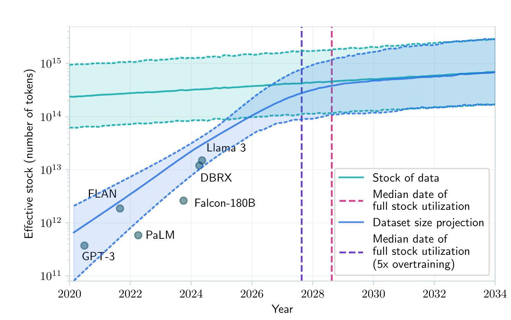
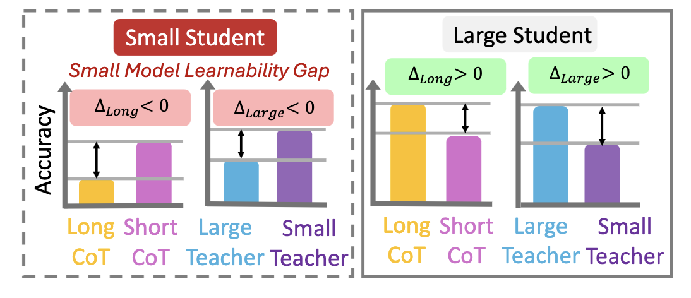
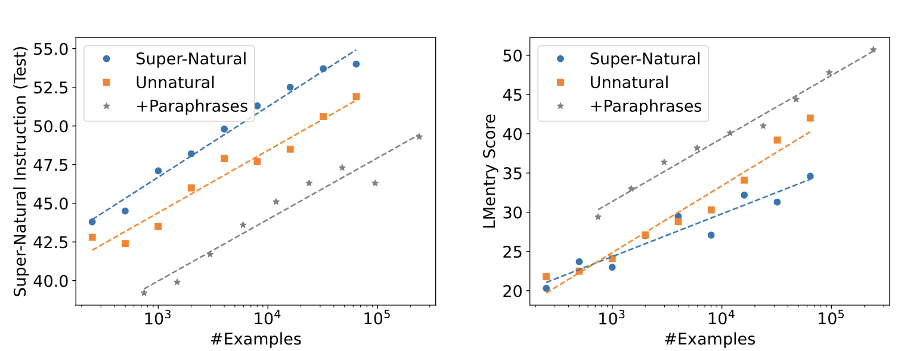
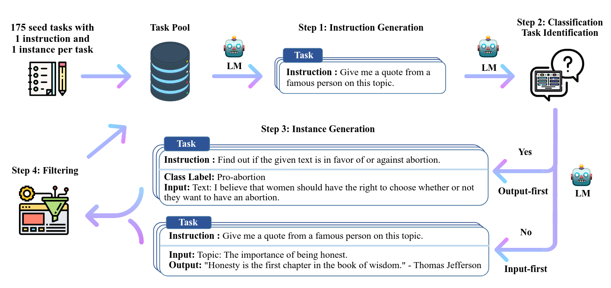

# Chapter 19 *Synthetic Data Generation for Training Agentic LLMs

[Course index](../../README.md) · [Original source](https://arxiv.org/html/2610.13455v1#Ch19) · [Raw file](../../raw/originals/book.html)

Retrieved: 2026-11-13T16:41:17.579179+00:00

[Contents](../../CONTENTS.md) · [Full book](../book/full-book-html.md) · [Previous chapter](chapter-18-case-study-4-simulating-societies-with-llm-agents.md) · [Next chapter](chapter-20-advanced-transformer-and-agentic-architectures.md)

### Chapter 19 \*Synthetic Data Generation for Training Agentic LLMs

**What You Will Learn**

In this chapter you will learn the role that synthetic data can play in the development of agentic large language models.
Specifically, you will be able to:

- Characterize the importance of *data* in the LLM training pipeline.
- Explain the general loop of *distilling knowledge* from stronger models for weaker students.
- Describe the *pipeline components* for which synthetic data is being used as an alternative to human-generated content.
- Outline the various strategies for *curating and evaluating* synthetic data.
- Contrast the advantages and disadvantages of using synthetic data by describing the *risks* of using artificially generated data.

#### 19.1 The Importance of Data

The rapid scaling of LLMs has led to a significant demand for training and evaluation data. Some have coined training data the *digital oil*, reflecting the importance as primary ingredient for AI development. Furthermore, data is increasingly becoming a differentiating factor since other components of the pipeline, such as model architectures, are homogenizing [[Kim et al., 2025a](#bibr.bib56)]. As models continue to scale, they require trillions of words of human-generated text scraped from the internet; however, there is only a limited amount of human-generated data available, which raises the question of whether training data could become the main bottleneck to scaling, see Figure [19.1](#Ch19.F1 "Figure 19.1 ‣ 19.1 The Importance of Data ‣ Chapter 19 *Synthetic Data Generation for Training Agentic LLMs ‣ Part VI Advanced Topics ‣ Agentic Large Language Models") [[Villalobos et al., 2024](#bibr.bib73)]. Moreover, as data requirements grow in scale, the acquisition of data becomes increasingly prohibitive in terms of cost and time, since most of the straightforward sources are becoming exhausted. Furthermore, issues with privacy, copyright, and bias cause the field to be looking beyond the curation of web-based human-generated data, and instead turn towards synthetic data generation [[Liang et al., 2022](#bibr.bib34)].

Figure 19.1: 
Projections of the available human-generated public text and dataset sizes to train LLMs [[Villalobos et al., 2024](#bibr.bib73)]. The intersection of the stock and dataset size projection lines indicates the median year (2028) in which the stock is expected to be fully utilized.

LLMs increasingly generate the data that trains the next generation of LLMs themselves: models are prompted to produce instructions, dialogues, reasoning traces, and even entire training corpora that are then used to finetune, distill and evaluate other models [[Long et al., 2024](#bibr.bib65)]. This self-reinforcing loop lowers the cost and effort of data collection compared to sourcing and annotating human-generated text, while also offering fine-grained control over style, difficulty, and coverage of the resulting datasets. By now, this approach has drawn significant industrial [[Kapania et al., 2025](#bibr.bib57)] and academic interest [[Viswanathan et al., 2025](#bibr.bib58), [Alismail and Lanquillon, 2025](#bibr.bib36)], spanning applications from general-purpose instruction tuning to the more specialized data needed to train agentic behaviors such as tool use, planning, and multi-step reasoning (illustrated in Figure [1.1](chapter-01-introduction.md#Ch1.F1 "Figure 1.1 ‣ 1.2.4 Training Data ‣ 1.2 Concepts and Definitions ‣ Chapter 1 Introduction ‣ Agentic Large Language Models") on page [1.1](chapter-01-introduction.md#Ch1.F1 "Figure 1.1 ‣ 1.2.4 Training Data ‣ 1.2 Concepts and Definitions ‣ Chapter 1 Introduction ‣ Agentic Large Language Models")).

The growing reliance on model-generated data has also introduced a new term in the scaling laws (Chapter [4](chapter-04-scaling-laws-and-efficient-large-language-models.md#Ch4 "Chapter 4 Scaling Laws and Efficient Large Language Models ‣ Part I Language Modeling ‣ Agentic Large Language Models")), one that accounts for the proportion of synthetic data present in a pre-training corpus. Recent work such as SYNTHLLM [[Qin et al., 2025](#bibr.bib78)] illustrates why this matters: by automatically extracting high-level concepts from source documents and recombining them through a graph-based algorithm, it generates synthetic corpora diverse enough to follow a predictable, rectified scaling law across model sizes. In this version of the scaling laws, the gains taper off earlier (before other token budgets typically used in pretraining), and larger models reach their optimal performance on comparatively fewer tokens than smaller ones. This suggests that synthetic data can be tuned not just for volume, but also for the shape of the scaling curve it produces.

Beyond scaling behavior, generating data for agentic capabilities—tool use, planning, and multi-step reasoning—increasingly depends on coordinated multi-agent workflows rather than on a single generator model. Specialized agents can take on distinct roles (e.g., proposing tasks, executing them, critiquing the results), which tends to produce data that is of higher quality, more diverse, and structurally closer to what agentic training actually requires. Matrix [[Wang et al., 2025a](#bibr.bib81)] is one example of this direction: a decentralized framework in which control and data flow are both represented as messages passed between agents through distributed queues, allowing the pipeline to scale horizontally without a central coordinator. Let us have a closer loop on the synthetic training pipeline.

#### 19.2 Distillation Loop

Using synthetic data in the agentic LLM training pipeline follows the overall distillation loop, as shown in Figure [19.2](#Ch19.F2 "Figure 19.2 ‣ 19.2 Distillation Loop ‣ Chapter 19 *Synthetic Data Generation for Training Agentic LLMs ‣ Part VI Advanced Topics ‣ Agentic Large Language Models"). A generator (a strong model, or an orchestration of several agents) uses a small amount of seed or real data to generate a large pool of raw synthetic data. That pool is then *curated* (Section [19.4](#Ch19.S4 "19.4 Data Curation ‣ Chapter 19 *Synthetic Data Generation for Training Agentic LLMs ‣ Part VI Advanced Topics ‣ Agentic Large Language Models")) before being used to train or *distill* a model. Crucially, the resulting model can itself become the generator for the next iteration. This closing of the self-reinforcing loop brings considerable risk to training stability and downstream performance (see also the discussion of stability in metalearning, Chapter [8](chapter-08-metalearning.md#Ch8 "Chapter 8 Metalearning ‣ Part II Reasoning ‣ Agentic Large Language Models")).

Seed /real dataGeneratorteacher / multi-agentRaw syntheticdata(Intrinsic)evaluationCurationfilter, score, dedupTrain /distillModel(student)(Extrinsic)evaluationimproved model becomes next-generation teacher

Figure 19.2: The synthetic-data loop that organizes this chapter. A generator produces raw synthetic data from a small seed set, followed by curation filtering and scoring. The data trains or distills a model, which is then evaluated and can be used as the generator of the next iteration (dashed).

Distillation is the special case of synthetic-data generation in which the generator is a *stronger model whose capability we are trying to transfer*. In knowledge distillation, a compact *student* model learns to copy a more capable *teacher* [[Hinton et al., 2015](#bibr.bib3), [Hu et al., 2022](#bibr.bib42)]. It can do so by directly optimizing against the teacher’s output predictions, or it can do so by simply training on synthetic data emitted by a teacher. The goal of distillation is to get a more efficient version of the teacher, both at inference time and in terms of data cost, without sacrificing too much task performance. Distillation has been applied widely, including in agentic settings [[Li et al., 2025a](#bibr.bib12), [Du et al., 2025](#bibr.bib14), e.g.,]. Distillation can also be used to derive preference data for instruction tuning. Zephyr [[Tunstall et al., 2024](#bibr.bib61)], for example, was trained with AI feedback, where outputs are generated and ranked by strong teacher models, aligning a small model with user intent at minimal data and training cost.

###### Four axes of distillation

Concrete distillation methods can be organized along four axes.
(1) The *signal*: whether the student imitates teacher logits, full output sequences, or a scalar reward derived from the teacher.
(2) The *data source*: whether the sequences being scored are generated by the teacher or sampled from the student.
(3) The *timing*: whether that data is produced once up front (off-policy) or continuously as the student changes (on-policy).
(4) The *teacher identity*: whether the teacher is a stronger separate model or the student itself.

We will now discuss these four axes of distillation.

##### 19.2.1 Signal: The Distillation Objective

When we have *white-box* access to the teacher’s ($q$) probabilities, the student $p_{\theta}$ is trained to make the student’s next-token distribution match the teacher’s. In distillation, we often soften the distributions with a shared temperature $\tau$ (so $q^{\tau}(\cdot)\propto\exp(z/\tau)$ for logits $z$). A generic distillation loss over a corpus of sequences is

|  |  |  |  |
| --- | --- | --- | --- |
|  | $$ \mathcal{L}(\theta)=\mathrm{E}_{x}\left[\sum_{t}D\big(q^{\tau}(\cdot\mid x_{<t})\,\|\,p^{\tau}_{\theta}(\cdot\mid x_{<t})\big)\right], $$ |  | (19.1) |

where the sum runs over token positions $t$, $D$ is a divergence (most commonly the KL divergence), and the temperature $\tau>1$ flattens both distributions so that the student also learns from the teacher’s *relative* confidence. When only the teacher’s *text* is available (*black-box* distillation, the usual case when distilling from a proprietary API), we no longer observe $q$ but only some tokens that we sample from it. The soft target $q^{\tau}(\cdot\mid x_{<t})$ then collapses to a one-hot vector on the sampled token, the divergence $D$ becomes the token-level cross-entropy, and Equation [19.1](#Ch19.E1 "In 19.2.1 Signal: The Distillation Objective ‣ 19.2 Distillation Loop ‣ Chapter 19 *Synthetic Data Generation for Training Agentic LLMs ‣ Part VI Advanced Topics ‣ Agentic Large Language Models") reduces to ordinary supervised fine-tuning on the teacher’s generations. In Section [19.3](#Ch19.S3 "19.3 Simulating Human-generated Content ‣ Chapter 19 *Synthetic Data Generation for Training Agentic LLMs ‣ Part VI Advanced Topics ‣ Agentic Large Language Models") we discuss the Self-Instruct technique [[Wang et al., 2023b](#bibr.bib60)]. This methods perform distillation from the data side, and is therefore a black-box approach.

##### 19.2.2 Data Source: Teacher-Student Paradigm

In distillation, the intuitive assumption is that a bigger, stronger teacher is always better. However, there are exceptions [[Xu et al., 2025a](#bibr.bib51), [Li et al., 2025b](#bibr.bib50)]. A capable teacher may produce traces that are too long, too complex, or stylistically mismatched for a small student to absorb. This phenomenon is known as the *small model learnability gap*. Figure [19.3](#Ch19.F3 "Figure 19.3 ‣ 19.2.2 Data Source: Teacher-Student Paradigm ‣ 19.2 Distillation Loop ‣ Chapter 19 *Synthetic Data Generation for Training Agentic LLMs ‣ Part VI Advanced Topics ‣ Agentic Large Language Models") illustrates a situation where small students learn more from the shorter reasoning of a weaker teacher than from the elaborate chains of thought of a frontier model. The practical implication is that the teacher should be chosen relative to the current capabilities of the student rather than maximized in isolation [[Zhang et al., 2026a](#bibr.bib52)].

Figure 19.3: 
Visualization of the Small Model Learnability Gap, where small student models do not consistently benefit from long CoT reasoning and instead perform better when fine-tuned on shorter CoT reasoning from smaller teachers [[Li et al., 2025b](#bibr.bib50)]

##### 19.2.3 Timing: Off-policy versus On-policy Distillation

The third axis concerns timing. The most common recipe in distillation is *off-policy* distillation. Here we sample a fixed dataset of completions from the teacher and then fine-tune the student on them (as in the black-box case above). This is a simple and parallelizable approach, but it suffers from a train/inference mismatch. The student is only once shown teacher-generated token sequences at training time, yet at deployment time it must continue its *own*, possibly flawed, sequences, which may be different than the ones it has been trained on. This *exposure bias* compounds over long agentic trajectories.

*On-policy* distillation addresses this by sampling sequences from the student itself and having the teacher score them, all within the loop. Generalized Knowledge Distillation (GKD) trains the student on its self-generated output sequences using teacher feedback on those sequences [[Agarwal et al., 2024](#bibr.bib28)]. The student is corrected exactly on the distribution of the states that it actually visits.

This on-policy view makes the connection to reinforcement learning through imitation learning explicit. The per-token teacher divergence in Equation [19.1](#Ch19.E1 "In 19.2.1 Signal: The Distillation Objective ‣ 19.2 Distillation Loop ‣ Chapter 19 *Synthetic Data Generation for Training Agentic LLMs ‣ Part VI Advanced Topics ‣ Agentic Large Language Models") acts as a *dense, token-level reward*.
Distillation is turned into a form of reinforcement learning where the teacher, rather than a sparse outcome checker, supplies the reward signal [[Lu and Lab, 2025](#bibr.bib29)]. Hybrid schemes push this idea further by selectively imitating the teacher only where it helps during a reinforcement learning phase [[Zhang et al., 2026b](#bibr.bib69)].

##### 19.2.4 Teacher Identity: Self-Distillation and Self-Improvement

The teacher and student model do not have to be different. When the teacher and student model are the same, distillation becomes self-improvement: the model generates candidate solutions, keeps the ones that pass a check, and trains on them. STaR [[Zelikman et al., 2022a](#bibr.bib5)] bootstraps reasoning in this way, iteratively generating rationales, retaining those that reach the correct answer, and finetuning on them.

Another approach is Self-Play Finetuning (SPIN) [[Chen et al., 2024](#bibr.bib6)]. In this method the model distinguishes its own generations from reference data across iterations, improving alignment without any external teacher. Perhaps surprisingly, even *repeated* self-distillation, with no new data source, can yield measurable gains, up to a point [[Pareek et al., 2024](#bibr.bib13)].

Self-improvement is most powerful when candidate outputs can be *verified* cheaply. In such cases, an external signal can still be incorporated effectively. This is the case for problems defined in code and math, as solutions are easy to execute and check. CURE, for example, is a reinforcement learning framework whose reward co-evolves a model’s coding and unit-test-generation abilities from their interaction outcomes. There is no ground-truth code as supervision. Since code is easy to execute and check, the coder and the test-writer act as mutually adapting agents, enabling long-horizon optimization on hard problems. The same principle underlies self-challenging and self-evolving agents, which propose their own increasingly difficult tasks and update their generation policy over time [[Zhou et al., 2025](#bibr.bib32), [Huang et al., 2025](#bibr.bib20), [Wang et al., 2025b](#bibr.bib31)].

#### 19.3 Simulating Human-generated Content

The move away from naturally occurring human-generated text, either directly obtained or scraped from the web, is perhaps best seen in the evolution from curated human-generated instruction data towards datasets where synthetic generation plays a more central role. We will now discuss these methods, where datasets are, in their core, still based on human-generated data.

As an example of a resource where humans still underpin most of the data, Natural Instructions [[Mishra et al., 2022](#bibr.bib59)], contains 61 distinct tasks, their human-authored instructions, and 193k task instances (input-output pairs). The instructions were gathered from instruction documents for existing NLP datasets, all mapped to a unified schema. Experiments with LLMs indicate that models benefit from observing the instructions alongside examples, although these models have remained far behind an estimated performance upper bound.

Subsequent work focuses on increasing the number of unique tasks and task types [[Wang et al., 2022](#bibr.bib62)], varying the length of the instructions [[Bach et al., 2022](#bibr.bib63)], or including particularly difficult tasks [[Srivastava et al., 2023](#bibr.bib2)]. Importantly, all these meta-datasets (datasets of datasets) are still ultimately built from human benchmarks: every sample they contain is authored by a person. Therefore, there is a practical limit to how much of this data can be freely found online.

Because these approaches rely on large amounts of human supervision in the form of crowd-sourced datasets, recent work focuses on generating synthetic data that fills the same role. Here, we see the creation of datasets such as Unnatural Instructions [[Honovich et al., 2023](#bibr.bib64)], which contain creative and diverse instructions collected with little human labor, instead relying on prompting various LLMs. Experiments indicate that training models on the somewhat noisy Unnatural Instructions dataset yields results comparable to those trained on high-quality, human-curated data, as shown in Figure [19.4](#Ch19.F4 "Figure 19.4 ‣ 19.3 Simulating Human-generated Content ‣ Chapter 19 *Synthetic Data Generation for Training Agentic LLMs ‣ Part VI Advanced Topics ‣ Agentic Large Language Models"). This result suggests that machine-generated data offers a cost-efficient alternative to human labor for expanding and diversifying training datasets.

Figure 19.4: 
Scaling experiments comparing Unnatural Instructions with Super-Natural Instructions [[Honovich et al., 2023](#bibr.bib64)], with model performance controlling for dataset size, tested on two benchmarks: Super-Natural Instructions (left) and LMentry (right).

The simulation of human-like text, code, and reasoning by generative models has unlocked new methodologies for both training and evaluating machine learning systems. By prompting strong models, researchers can generate highly diverse and complex datasets that mimic human content generation. For example, PersonaHub [[Ge et al., 2025](#bibr.bib74)] steers a generation process with a large-scale collection of personas, using them to prompt LLMs towards a far greater diversity of synthetic data than unconditioned generation would produce.

Similar to self-improvement, training on synthetic data has shown much promise in domains where model outputs are relatively easy to verify, such as mathematics [[Yang et al., 2023](#bibr.bib84), [Liu et al., 2023](#bibr.bib85)], programming [[Haluptzok et al., 2023](#bibr.bib86)], and games [[Wang et al., 2023a](#bibr.bib4)].

##### 19.3.1 Generating Training Data

We will now focus on generating training data. The use of synthetic data for training has transitioned from a niche data augmentation technique to a core component of modern model alignment and reasoning pipelines. Techniques such as Self-Instruct [[Wang et al., 2023b](#bibr.bib60)] have demonstrated that smaller, open-weight models can be instruction-tuned using data generated entirely by a stronger, proprietary model. The process, as shown in Figure [19.5](#Ch19.F5 "Figure 19.5 ‣ 19.3.1 Generating Training Data ‣ 19.3 Simulating Human-generated Content ‣ Chapter 19 *Synthetic Data Generation for Training Agentic LLMs ‣ Part VI Advanced Topics ‣ Agentic Large Language Models"), involves seeding an LLM with a small set of human-written instructions and prompting it to iteratively generate novel task descriptions, inputs, and outputs. The simulated human content allows models to acquire complex zero-shot capabilities without the need for large groups of human annotators.

Figure 19.5: 
Self-Instruct pipeline [[Wang et al., 2023b](#bibr.bib60)].

###### Leveraging existing data

Other approaches combine curated human data with synthetic data, instead of replacing one with the other. [Gunasekar et al. [2023]](#bibr.bib77) show that training on a mixture of human-written textbooks and synthetically generated text yields highly capable language models, suggesting that curated human data and machine-generated data are complements rather than substitutes. One challenge is that synthetically generated data tends to lack diversity and inherits errors and hallucinations, even when it is seeded with human-generated data. Subsequent improvements use a generation process that is based on ground truth documents [[Lupidi et al., 2025](#bibr.bib8), [Yue et al., 2024](#bibr.bib33)].

A complementary way to amplify a limited seed set is *backtranslation*. This approach was originally introduced in machine translation to synthesize parallel data by translating sentences from a source language to a target language, and then back into a source language [[Edunov et al., 2018](#bibr.bib70)]. The same principle can be repurposed for reasoning tasks: instead of only generating specific solutions for a single problem, we generate new problems that are consistent with an existing solution. MathGenie [[Lu et al., 2024](#bibr.bib71)] applies this idea to mathematical reasoning by taking a seed set of question–solution pairs. It augments the solutions, and then back-translates them into new questions. Because each newly generated question is grounded in a verified solution, this approach expands both the size and the diversity of the training data while reducing errors and hallucinations.

###### Human-in-the-loop approaches

Fully automatic generation pipelines are not always sufficient. Models can struggle to generate specific scenarios or domain-relevant cases. The reason for these failures is usually that the generating LLM has specific blind spots, which can also make it difficult to generate genuinely informative data [[Lippmann et al., 2024](#bibr.bib47)].

Such problems motivate human-in-the-loop approaches, in which people steer, filter, or revise machine-generated content rather than authoring it from scratch.

WANLI [[Liu et al., 2022](#bibr.bib49)] pairs a language model that proposes challenging natural language inference examples with human annotators who filter and relabel them, combining the scalability of automatic generation with human quality control.

EvalAssist [[Santillán Cooper et al., 2025](#bibr.bib48)] applies a similar principle to evaluation tooling, using synthetic data to support and accelerate human judgment. A related strategy is to prompt the language model to produce an initial seed text, which human raters then edit before the result is used to bootstrap a larger fully-synthetic dataset. In this way, the human effort is spent on correcting the model rather than on authoring every example.

##### 19.3.2 Generating Evaluation Data

Beyond training, synthetic generation plays a critical role in evaluation. Traditional static benchmarks suffer from rapid data contamination, where test sets inadvertently leak into the pretraining corpora of modern LLMs. To mitigate this, dynamic evaluation frameworks [[Kiela et al., 2021](#bibr.bib43)] increasingly rely on synthetic data generation to create bespoke, single-use test cases.

Furthermore, the *LLM-as-a-judge* paradigm [[Zheng et al., 2024](#bibr.bib1)] simulates human evaluation by prompting a strong model to grade the outputs of other models, highly correlating the models with human preference and significantly reducing the latency of evaluation cycles.

Further creation of dedicated hard benchmarks for LLMs can once again be done with human-in-the-loop approaches, such as the MATH2 benchmark. For this benchmark, multiple LLMs are used to iteratively generate and adjust mathematical questions and solutions through multi-turn prompting. Human annotators then further expand on the questions and check the answers, again aided by LLMs in the process [[Shah et al., 2024](#bibr.bib30)]. Other approaches to efficient generation of synthetic evaluation data shift the task for annotators from coming up with new samples, to editing samples to be harder for the LLM [[Yuan et al., 2021](#bibr.bib46)].

###### Automated red teaming

One specific use case for machine-generated evaluation is through the safety-oriented evaluation by means of *automated red teaming*. In this approach, one LLM generates adversarial prompts to probe a target model for vulnerabilities before deployment [[Ganguli et al., 2022](#bibr.bib10)]. By synthesizing many potentially malicious prompts, researchers can stress-test and harden models against toxic outputs, jailbreaks, and misalignments at a scale that human red teams cannot match [[Perez et al., 2022](#bibr.bib11)]. Because the same generated prompts can subsequently be used to finetune the target model against those failures, red teaming sits at the boundary between synthetic evaluation and synthetic training data.

##### 19.3.3 Generating Agentic Data

In agentic settings, data must be synthesized for an entire trajectory (and not just in single instruction-response pairs). As the agent is interacting with its environment, a full sequence of tool calls, observations, and decisions is produced [[Kang et al., 2025](#bibr.bib67)]. This goes beyond data that trains or evaluates a regular LLM operating on a single input-output pair. Generating agentic data is a more complex problem than generating data to instruct the underlying LLM itself, even though the same generative models are typically used to produce it. Let us look at an example.

###### **Example 2****.**

Consider synthesizing a single training trajectory for a tool-using agent, roughly following the two-phase recipe of APIGen-MT [[Prabhakar et al., 2025](#bibr.bib45)].

First a *task proposer* invents a plausible user goal and a set of available tools, together with a ground-truth answer:

*User:* “What will the weather be in Leiden this weekend, and should I bring an umbrella?”  *Tools:* get_forecast(city, days).

An *actor* model then rolls out the interaction, emitting the intermediate tool call and consuming its (simulated) observation before answering:

get_forecast("Leiden", 2) $\rightarrow$ {sat: rain, sun: clear} $\rightarrow$ *“Rain on Saturday, clear on Sunday—bring an umbrella for Saturday.”*

Finally a *verifier* checks that the emitted call is well-formed, that its arguments match the request, and that the final answer is consistent with the observation. Only trajectories that pass verification are kept.

Note what had to be synthesized: not just a single input–output pair, but the goal, the tool schema, the call, the observation, and a checker that verifies the whole trace.

Methods for agentic generation usually involve entire orchestrations of agents for multi-turn conversations including human inputs and tool use [[Wu et al., 2024](#bibr.bib15)]. APIGen-MT [[Prabhakar et al., 2025](#bibr.bib45)] exemplifies this shift with a two-phase framework that generates verifiable and diverse multi-turn agent data. TOUCAN [[Xu et al., 2025b](#bibr.bib79)] pursues a similar goal at a larger scale, simulating realistic tool calls to construct a large tool-agentic dataset. Beyond generating trajectories for a fixed skill, some work synthesizes data explicitly to transfer a new skill or behavior from a strong model to a weaker one, a process referred to as Generative Teaching [[Crispino et al., 2024](#bibr.bib44)]. Furthermore, agentic synthetic data is not limited to text, analogous generation pipelines extend to images, tabular data, and other forms of interaction or behavioral data.

For the generation of agentic synthetic data, controlling the task complexity is a recurring challenge. Deep-research agents, for example, aim to solve complex question-answering tasks through long-horizon interactions with online tools, but the data typically used to train them lacks fine-grained control over difficulty and quality, yielding synthetic data that falls short of capturing sufficient complexity. [Pandit et al. [2025]](#bibr.bib80) address this issue with a pipeline that synthesizes question-answer pairs that progressively increase task complexity until a frontier baseline web agent fails. This curriculum learning approach calibrates task-difficulty directly against agent capability rather than a fixed heuristic.

AReaL-SEA [[Gao et al., 2026](#bibr.bib82)] addresses reliability from a complementary angle. Here, a multi-agent engine synthesizes tool-grounded dialogues in combination with executable per-instance checkers. Next, a closed-loop self-evolving process updates the prompts over time to improve reliability.

#### 19.4 Data Curation

Once synthetic data has been generated, we need to check it for quality and curate it. Usually, this means filtering, scoring, and selecting samples so that only the examples that are useful are retained. Evaluating synthetic data usefulness can be approached in two complementary ways: *extrinsically*, by measuring its effect on a downstream task, or *intrinsically*, by examining properties of the generated data (or the generative process) directly.

In practice, curation is implemented as a multi-stage filtering pipeline in which criteria that we will discuss below are turned into concrete operators. Typical stages include *semantic deduplication* (removing near-duplicate examples via embedding similarity to preserve diversity), *perplexity filtering* (discarding incoherent or off-distribution text using a reference model), rule-based or format checks, and *reward-model or judge scoring* to retain only high-fidelity samples. The seminal *Textbooks Are All You Need* paper [[Gunasekar et al., 2023](#bibr.bib77)] is a reminder that this curation step often matters as much as the volume of data: aggressive filtering for quality can outweigh sheer quantity. Without it, models readily learn the generative artifacts and statistical anomalies of their teachers.

##### 19.4.1 Extrinsic evaluation

Extrinsic evaluation answers a simple question: does the synthetic data actually help on a downstream task? This topic is also referred to as *utility*. In practice, utility is measured by training or finetuning a model on the synthetic data (alone or mixed with real data) and evaluating it on a held-out, real-world test set. Extrinsic evaluation is the most direct measure of whether synthetic data is useful. For example, if the performance (e.g., in terms of perplexity) of a pretrained model increases when synthetic data is included, we can conclude that the data is useful. However, it is also the most expensive: it requires a full training run before any signal is available. If we make changes to the generation process or select a different set, we need to retrain and evaluate our model. This makes the extrinsic evaluation a poor fit for filtering or selecting individual examples during generation.

##### 19.4.2 Intrinsic evaluation

Intrinsic evaluation instead looks at characteristics of the generations themselves, without the cost of a downstream training run. A number of quality aspects have been proposed for evaluating synthetic text [[Ramesh et al., 2025](#bibr.bib55)]. Rather than evaluating at the output level, it is also possible to benchmark the language models of the generative process directly [[Kim et al., 2025b](#bibr.bib53)]. This can give an earlier and cheaper signal than inspecting the generated data.

###### Data correctness

A generated example is only useful if its content is factually and logically sound. Since synthetic data often comes from other LLMs, it inherits the generating model’s failure modes. This includes hallucinated facts, inconsistent reasoning, or labels that do not match the content. These errors can subsequently propagate into models that are trained on them. Correctness is typically checked by comparing generations against human-generated labels [[Long et al., 2024](#bibr.bib65), [Chim et al., 2025](#bibr.bib35)], performing verification (e.g., a rule-based checker or a separate judge model) [[Chen et al., 2025a](#bibr.bib39), [Yang et al., 2025](#bibr.bib38), [Setlur et al., 2024](#bibr.bib37)], or through consistency checks across multiple generations for the same input [[Zelikman et al., 2022b](#bibr.bib41), [Seegmiller et al., 2025](#bibr.bib40)].

###### Data diversity

A key problem in creating synthetic data is maintaining diversity. Logit suppression and temperature sampling can improve data diversity but come at a cost of data correctness [[Chung et al., 2023](#bibr.bib72)]. Diversity is also difficult to measure: lexical heuristics (e.g., ROUGE) or neural heuristics (embedding-based similarity) are commonly used as proxies, but each captures only a fraction of the possible variation in the data.

MetaSynth addresses this problem by generating synthetic data that enhances diversity through meta-prompting, where a language model orchestrates multiple expert LLM agents to collaboratively generate data [[Riaz et al., 2025](#bibr.bib66)].

###### Data contamination

A serious risk for synthetic data is contamination [[Deng et al., 2024](#bibr.bib19), [Balloccu et al., 2024](#bibr.bib7)]. The generating LLM is pretrained on large, imperfectly filtered web datasets, and can memorize benchmarks and reproduce or closely paraphrase them when prompted to generate new training examples.
After many steps, synthetically generated data converges to that of existing benchmarks. This inflates evaluation scores artificially, for example in the case of code generation benchmarks [[Matton et al., 2024](#bibr.bib23)]. Solutions for this type of leakage should go beyond simple exact-match filters, and requires n-gram overlap search against known benchmarks, membership-inference-style probing [[Puerto et al., 2025](#bibr.bib22), [Huang et al., 2026](#bibr.bib21)], or dynamic dataset construction pipelines [[Chen et al., 2025b](#bibr.bib18)].

###### Fairness and biases

LLMs inherit and amplify social biases from their own training data. If we, in turn, use the LLMs to generate synthetic corpora, we risk further perpetuating stereotypical associations, skewed demographic representation, or unequal generation quality across social groups [[Gallegos et al., 2024](#bibr.bib24)]. This is of particular concern for synthetic data because it is produced at scale and often consumed directly as training material for new LLMs.

Finally, intrinsic metrics are only proxies for usefulness. A dataset can score well on diversity or pass correctness checks while failing to improve, or even harm, extrinsic evaluation. Lexical and neural diversity heuristics measure surface-level variation and can fail to spot redundancy in ways that matter (e.g., repeated reasoning patterns) or overestimate diversity. Correctness checks further depend on the availability of a trusted reference, rule-based verifier, or judge model, which for open-ended or subjective generations may not exist, or may be unreliable. For these reasons, intrinsic evaluation is best treated as an additional check rather than a true replacement for extrinsic evaluation.

#### 19.5 Risks

As should be clear by now, using synthetic data for training agentic LLMs is a solution that is not without problems. We will discuss several more risks associated with synthetic data, including model collapse, bias amplification, security and privacy vulnerabilities, and legal and ethical concerns.

##### 19.5.1 Model Collapse

The defining risk of the loop in Figure [19.2](#Ch19.F2 "Figure 19.2 ‣ 19.2 Distillation Loop ‣ Chapter 19 *Synthetic Data Generation for Training Agentic LLMs ‣ Part VI Advanced Topics ‣ Agentic Large Language Models") is that it feeds on its own output. *Model collapse* is the well-documented phenomenon where training successive model generations on recursively generated AI data causes the diversity of the original distribution to disappear [[Shumailov et al., 2024](#bibr.bib75)]. Rare events and low-probability linguistic nuance are sampled less often, so each generation forgets a little more of the distribution’s long-tailed behavior until the model converges to a repetitive, high-probability model. Some experiments show that repeated training on purely synthetic data yields diminishing and eventually negative returns [[Singh et al., 2024](#bibr.bib76)], and concentrating a corpus on a few synthetic sources, rather than many, increases the fragility of the resulting model [[Schaffelder and Gatt, 2025](#bibr.bib83)]. Similarly, small students distilled from a teacher are prone to hallucination and often fail on long-tailed knowledge [[Kandpal et al., 2023](#bibr.bib68)]. More subtly, imitating a teacher can produce a student that matches the teacher’s *style* while lagging on *factuality*, a gap which is usually only revealed by targeted capability benchmarks [[Gudibande et al., 2023](#bibr.bib16)]. The standard mitigation is to keep anchoring the corpus with real human data rather than training on synthetic data alone.

##### 19.5.2 Bias Amplification

Because generative models over-represent the majority modes of their training distribution, synthesizing data tends to cut off the diverse, long-tail perspectives found in natural human discourse [[van der Meer et al., 2024](#bibr.bib9)]. A student trained on such data can therefore exhibit an amplified, caricatured version of the teacher’s social biases. The student model reproduces stereotypical associations, skewed demographic representation, or unequal generation quality across groups [[Gallegos et al., 2024](#bibr.bib24)]. This concern is larger for synthetic data than for original model outputs because the data is produced at scale and consumed directly as training material, and each round of the loop compounds the previous round.

##### 19.5.3 Security Risks

There are also security risks associated with synthetic training data. Relying on generated data introduces new attack vectors for maliciously polluting training data. If the teacher model or any stage of the generation pipeline is compromised, an adversary can mount a data-poisoning attack. Because synthetic corpora are typically too large to audit exhaustively, subtle back doors or malicious instruction–response pairs can be inserted, which remain dormant until triggered in the deployed student. Poisoning even a tiny fraction of a web-scale corpus has been shown to be practical and cheap [[Carlini et al., 2024](#bibr.bib87)], and the risk is heightened when the “teacher” is an uncontrolled third-party model whose training data and alignment are opaque.

##### 19.5.4 Privacy Preservation

Synthetic generation is frequently mentioned as a solution for data privacy. The idea is that synthetic data does not contain personally identifiable information (PII) [[Dwork and Roth, 2014](#bibr.bib26)], yet is able to reflect the statistical properties of private data (such as medical records).

However, in this type of data there is a substantial risk of memorization. Without strict privacy guarantees during the generation phase, generative models can unintentionally reconstruct and therefore leak exact snippets of the sensitive human data on which they were originally trained [[Carlini et al., 2021](#bibr.bib17)].
Privacy evaluations show that off-the-shelf privacy-preserving methods can fail [[Ramesh et al., 2024](#bibr.bib54)].

Common privacy approaches rely on differential privacy [[Dwork et al., 2006](#bibr.bib25)], a guarantee on the generative process that bounds how much the output distribution can change when a single individual’s record is added to or removed from the dataset. This bound is controlled by a privacy budget, where smaller values enforce stronger protection at the cost of greater utility loss [[Yue et al., 2023](#bibr.bib27)].

##### 19.5.5 Copyright and Terms of Use

Part of the appeal of synthetic data is that it sidesteps the unclear legal status of scraping internet-scale human text, which has already produced copyright litigation. The 2025 *Bartz v. Anthropic* settlement in the US is illustrative. A district court found LLM training itself *exceedingly* transformative and thus a candidate for fair use, however, liability still arose from how the underlying corpus was *obtained*, namely the ingestion of hundreds of thousands of pirated books, and Anthropic settled at roughly $3,000 per work (about $1.5 billion in total), with parallels in other legal cases such as *Kadrey v. Meta*. This shows that to an increasing degree the data underlying training is scrutinized for copyright and terms of use.

Synthetic data does not fully escape this issue. Distilling from a proprietary model raises a distinct issue: the terms of service of most commercial LLM APIs explicitly forbid using their outputs to train competing models. Data generated by a black-box teacher may therefore be legally problematic regardless of copyright. Such a tension surfaced publicly in 2025 amid accusations that competing systems had been trained on the outputs of frontier APIs. For practitioners, this means that the licence of the *generator* is as important to check as the licence of any human data it replaces.

#### 19.6 Concluding Remarks

Synthetic data has moved from a niche augmentation method to a central ingredient of the LLM pipeline (Chapter [3](chapter-03-the-large-language-model-training-pipeline.md#Ch3 "Chapter 3 The Large Language Model Training Pipeline ‣ Part I Language Modeling ‣ Agentic Large Language Models")), driven by the prospect that human text becomes a scaling bottleneck (Chapter [4](chapter-04-scaling-laws-and-efficient-large-language-models.md#Ch4 "Chapter 4 Scaling Laws and Efficient Large Language Models ‣ Part I Language Modeling ‣ Agentic Large Language Models")). Strong models and multi-agent orchestrations can simulate instruction data, evaluation benchmarks, and, more recently, whole agentic *trajectories* of tool calls and decisions (Chapters [9](chapter-09-interaction-styles-for-agentic-llms.md#Ch9 "Chapter 9 Interaction Styles for Agentic LLMs ‣ Part III Agents ‣ Agentic Large Language Models") and [11](chapter-11-how-agents-use-tools-to-act-in-the-world.md#Ch11 "Chapter 11 How Agents Use Tools to Act in the World ‣ Part IV Tools and Assistants ‣ Agentic Large Language Models")).

Because raw generations are noisy, curation, extrinsic utility together with intrinsic checks on correctness, diversity, and contamination, are as important as generation itself. The various setups can be considered forms of knowledge distillation organized along the axes of signal, data source, timing (off- vs. on-policy), and teacher identity.

Reusing synthetic data from the same model for self-improvement has promises for enabling verifiable reasoning (Chapter [6](chapter-06-multi-step-reasoning-in-llms.md#Ch6 "Chapter 6 Multi-step Reasoning in LLMs ‣ Part II Reasoning ‣ Agentic Large Language Models")). However, in all these pipelines we need to be careful about what data these models are consuming: without real-data anchoring and careful auditing, model collapse, bias amplification, security, privacy, and licensing risks all compound with every iteration.

### References

- Agarwal et al. (2024)
  R. Agarwal, N. Vieillard, Y. Zhou, P. Stanczyk, S. Ramos Garea, M. Geist, and O. Bachem
  On-policy distillation of language models: learning from self-generated mistakes.
  In International Conference on Learning Representations,
  Vol. 2024, pp. 21246–21263.
  Cited by: [§19.2.3](#Ch19.S2.SS3.p2.1 "19.2.3 Timing: Off-policy versus On-policy Distillation ‣ 19.2 Distillation Loop ‣ Chapter 19 *Synthetic Data Generation for Training Agentic LLMs ‣ Part VI Advanced Topics ‣ Agentic Large Language Models").

- Alismail and Lanquillon (2025)
  A. Alismail and C. Lanquillon
  A survey of llm-based methods for synthetic data generation and the rise of agentic workflows.
  In International Conference on Human-Computer Interaction,
  pp. 119–135.
  Cited by: [§19.1](#Ch19.S1.p2.1 "19.1 The Importance of Data ‣ Chapter 19 *Synthetic Data Generation for Training Agentic LLMs ‣ Part VI Advanced Topics ‣ Agentic Large Language Models").

- Bach et al. (2022)
  S. H. Bach, V. Sanh, Z. Yong, A. Webson, C. Raffel, N. V. Nayak, A. Sharma, T. Kim, M. S. Bari, T. Fevry, Z. Alyafeai, M. Dey, A. Santilli, Z. Sun, S. Ben-David, C. Xu, G. Chhablani, H. Wang, J. A. Fries, M. S. Al-shaibani, S. Sharma, U. Thakker, K. Almubarak, X. Tang, D. Radev, M. T. Jiang, and A. M. Rush
  PromptSource: an integrated development environment and repository for natural language prompts.
  In Proceedings of the 60th Annual Meeting of the Association for Computational Linguistics: System Demonstrations, V. Basile, Z. Kozareva, and S. Stajner (Eds.),
  Dublin, Ireland, pp. 93–104.
  External Links: [Link](https://aclanthology.org/2022.acl-demo.9/),
  [Document](https://dx.doi.org/10.18653/v1/2022.acl-demo.9)
  Cited by: [§19.3](#Ch19.S3.p3.1 "19.3 Simulating Human-generated Content ‣ Chapter 19 *Synthetic Data Generation for Training Agentic LLMs ‣ Part VI Advanced Topics ‣ Agentic Large Language Models").

- Balloccu et al. (2024)
  S. Balloccu, P. Schmidtová, M. Lango, and O. Dusek
  Leak, cheat, repeat: data contamination and evaluation malpractices in closed-source LLMs.
  In Proceedings of the 18th Conference of the European Chapter of the Association for Computational Linguistics (Volume 1: Long Papers), Y. Graham and M. Purver (Eds.),
  St. Julian’s, Malta, pp. 67–93.
  External Links: [Link](https://aclanthology.org/2024.eacl-long.5/),
  [Document](https://dx.doi.org/10.18653/v1/2024.eacl-long.5)
  Cited by: [§19.4.2](#Ch19.S4.SS2.SSS0.Px3.p1.1 "Data contamination ‣ 19.4.2 Intrinsic evaluation ‣ 19.4 Data Curation ‣ Chapter 19 *Synthetic Data Generation for Training Agentic LLMs ‣ Part VI Advanced Topics ‣ Agentic Large Language Models").

- Carlini et al. (2024)
  N. Carlini, M. Jagielski, C. A. Choquette-Choo, D. Paleka, W. Pearce, H. Anderson, A. Terzis, K. Thomas, and F. Tramèr
  Poisoning web-scale training datasets is practical.
  In 2024 IEEE Symposium on Security and Privacy (SP),
  Vol. , pp. 407–425.
  External Links: [Document](https://dx.doi.org/10.1109/SP54263.2024.00179)
  Cited by: [§19.5.3](#Ch19.S5.SS3.p1.1 "19.5.3 Security Risks ‣ 19.5 Risks ‣ Chapter 19 *Synthetic Data Generation for Training Agentic LLMs ‣ Part VI Advanced Topics ‣ Agentic Large Language Models").

- Carlini et al. (2021)
  N. Carlini, F. Tramèr, E. Wallace, M. Jagielski, A. Herbert-Voss, K. Lee, A. Roberts, T. Brown, D. Song, Ú. Erlingsson, A. Oprea, and C. Raffel
  Extracting training data from large language models.
  In 30th USENIX Security Symposium (USENIX Security 21),
  pp. 2633–2650.
  External Links: ISBN 978-1-939133-24-3,
  [Link](https://www.usenix.org/conference/usenixsecurity21/presentation/carlini-extracting)
  Cited by: [§19.5.4](#Ch19.S5.SS4.p2.1 "19.5.4 Privacy Preservation ‣ 19.5 Risks ‣ Chapter 19 *Synthetic Data Generation for Training Agentic LLMs ‣ Part VI Advanced Topics ‣ Agentic Large Language Models").

- Chen et al. (2025a)
  M. Chen, P. Arthur, Q. Feng, C. D. V. Hoang, Y. Hong, M. K. Moghaddam, O. Nezami, D. T. Nguyen, G. Tangari, D. Vu, T. Vu, M. Johnson, K. Kenthapadi, D. Dharmasiri, L. Duong, and Y. Li
  Mastering the craft of data synthesis for CodeLLMs.
  In Proceedings of the 2025 Conference of the Nations of the Americas Chapter of the Association for Computational Linguistics: Human Language Technologies (Volume 1: Long Papers), L. Chiruzzo, A. Ritter, and L. Wang (Eds.),
  Albuquerque, New Mexico, pp. 12484–12500.
  External Links: [Link](https://aclanthology.org/2025.naacl-long.620/),
  [Document](https://dx.doi.org/10.18653/v1/2025.naacl-long.620),
  ISBN 979-8-89176-189-6
  Cited by: [§19.4.2](#Ch19.S4.SS2.SSS0.Px1.p1.1 "Data correctness ‣ 19.4.2 Intrinsic evaluation ‣ 19.4 Data Curation ‣ Chapter 19 *Synthetic Data Generation for Training Agentic LLMs ‣ Part VI Advanced Topics ‣ Agentic Large Language Models").

- Chen et al. (2025b)
  S. Chen, Y. Chen, Z. Li, Y. Jiang, Z. Wan, Y. He, D. Ran, T. Gu, H. Li, T. Xie, and B. Ray
  Benchmarking large language models under data contamination: a survey from static to dynamic evaluation.
  In Proceedings of the 2025 Conference on Empirical Methods in Natural Language Processing, C. Christodoulopoulos, T. Chakraborty, C. Rose, and V. Peng (Eds.),
  Suzhou, China, pp. 10080–10098.
  External Links: [Link](https://aclanthology.org/2025.emnlp-main.511/),
  [Document](https://dx.doi.org/10.18653/v1/2025.emnlp-main.511),
  ISBN 979-8-89176-332-6
  Cited by: [§19.4.2](#Ch19.S4.SS2.SSS0.Px3.p1.1 "Data contamination ‣ 19.4.2 Intrinsic evaluation ‣ 19.4 Data Curation ‣ Chapter 19 *Synthetic Data Generation for Training Agentic LLMs ‣ Part VI Advanced Topics ‣ Agentic Large Language Models").

- Chen et al. (2024)
  Z. Chen, Y. Deng, H. Yuan, K. Ji, and Q. Gu
  Self-play fine-tuning converts weak language models to strong language models.
  arXiv preprint arXiv:2401.01335.
  Cited by: [§19.2.4](#Ch19.S2.SS4.p2.1 "19.2.4 Teacher Identity: Self-Distillation and Self-Improvement ‣ 19.2 Distillation Loop ‣ Chapter 19 *Synthetic Data Generation for Training Agentic LLMs ‣ Part VI Advanced Topics ‣ Agentic Large Language Models").

- Chim et al. (2025)
  J. Chim, J. Ive, and M. Liakata
  Evaluating synthetic data generation from user generated text.
  Computational Linguistics 51 (1), pp. 191–233.
  External Links: [Link](https://aclanthology.org/2025.cl-1.6/),
  [Document](https://dx.doi.org/10.1162/coli%5Fa%5F00540)
  Cited by: [§19.4.2](#Ch19.S4.SS2.SSS0.Px1.p1.1 "Data correctness ‣ 19.4.2 Intrinsic evaluation ‣ 19.4 Data Curation ‣ Chapter 19 *Synthetic Data Generation for Training Agentic LLMs ‣ Part VI Advanced Topics ‣ Agentic Large Language Models").

- Chung et al. (2023)
  J. Chung, E. Kamar, and S. Amershi
  Increasing diversity while maintaining accuracy: text data generation with large language models and human interventions.
  In Proceedings of the 61st Annual Meeting of the Association for Computational Linguistics (Volume 1: Long Papers), A. Rogers, J. Boyd-Graber, and N. Okazaki (Eds.),
  Toronto, Canada, pp. 575–593.
  External Links: [Link](https://aclanthology.org/2023.acl-long.34/),
  [Document](https://dx.doi.org/10.18653/v1/2023.acl-long.34)
  Cited by: [§19.4.2](#Ch19.S4.SS2.SSS0.Px2.p1.1 "Data diversity ‣ 19.4.2 Intrinsic evaluation ‣ 19.4 Data Curation ‣ Chapter 19 *Synthetic Data Generation for Training Agentic LLMs ‣ Part VI Advanced Topics ‣ Agentic Large Language Models").

- Crispino et al. (2024)
  N. Crispino, K. Montgomery, F. Zeng, D. Song, and C. Wang
  Agent instructs large language models to be general zero-shot reasoners.
  In Proceedings of the 41st International Conference on Machine Learning, R. Salakhutdinov, Z. Kolter, K. Heller, A. Weller, N. Oliver, J. Scarlett, and F. Berkenkamp (Eds.),
  Proceedings of Machine Learning Research, Vol. 235, pp. 9458–9549.
  External Links: [Link](https://proceedings.mlr.press/v235/crispino24a.html)
  Cited by: [§19.3.3](#Ch19.S3.SS3.p2.1 "19.3.3 Generating Agentic Data ‣ 19.3 Simulating Human-generated Content ‣ Chapter 19 *Synthetic Data Generation for Training Agentic LLMs ‣ Part VI Advanced Topics ‣ Agentic Large Language Models").

- Deng et al. (2024)
  C. Deng, Y. Zhao, Y. Heng, Y. Li, J. Cao, X. Tang, and A. Cohan
  Unveiling the spectrum of data contamination in language model: a survey from detection to remediation.
  In Findings of the Association for Computational Linguistics: ACL 2024, L. Ku, A. Martins, and V. Srikumar (Eds.),
  Bangkok, Thailand, pp. 16078–16092.
  External Links: [Link](https://aclanthology.org/2024.findings-acl.951/),
  [Document](https://dx.doi.org/10.18653/v1/2024.findings-acl.951)
  Cited by: [§19.4.2](#Ch19.S4.SS2.SSS0.Px3.p1.1 "Data contamination ‣ 19.4.2 Intrinsic evaluation ‣ 19.4 Data Curation ‣ Chapter 19 *Synthetic Data Generation for Training Agentic LLMs ‣ Part VI Advanced Topics ‣ Agentic Large Language Models").

- Du et al. (2025)
  W. Du, P. Aggarwal, S. Welleck, and Y. Yang
  Agentic-r1: distilled dual-strategy reasoning.
  In Proceedings of the 2025 Conference on Empirical Methods in Natural Language Processing, C. Christodoulopoulos, T. Chakraborty, C. Rose, and V. Peng (Eds.),
  Suzhou, China, pp. 12029–12043.
  External Links: [Link](https://aclanthology.org/2025.emnlp-main.604/),
  [Document](https://dx.doi.org/10.18653/v1/2025.emnlp-main.604),
  ISBN 979-8-89176-332-6
  Cited by: [§19.2](#Ch19.S2.p2.1 "19.2 Distillation Loop ‣ Chapter 19 *Synthetic Data Generation for Training Agentic LLMs ‣ Part VI Advanced Topics ‣ Agentic Large Language Models").

- Dwork et al. (2006)
  C. Dwork, F. McSherry, K. Nissim, and A. Smith
  Calibrating noise to sensitivity in private data analysis.
  In Theory of cryptography conference,
  pp. 265–284.
  Cited by: [§19.5.4](#Ch19.S5.SS4.p3.1 "19.5.4 Privacy Preservation ‣ 19.5 Risks ‣ Chapter 19 *Synthetic Data Generation for Training Agentic LLMs ‣ Part VI Advanced Topics ‣ Agentic Large Language Models").

- Dwork and Roth (2014)
  C. Dwork and A. Roth
  The algorithmic foundations of differential privacy.
  Foundations and trends® in theoretical computer science 9 (3-4), pp. 211–487.
  Cited by: [§19.5.4](#Ch19.S5.SS4.p1.1 "19.5.4 Privacy Preservation ‣ 19.5 Risks ‣ Chapter 19 *Synthetic Data Generation for Training Agentic LLMs ‣ Part VI Advanced Topics ‣ Agentic Large Language Models").

- Edunov et al. (2018)
  S. Edunov, M. Ott, M. Auli, and D. Grangier
  Understanding back-translation at scale.
  In Proceedings of the 2018 Conference on Empirical Methods in Natural Language Processing, E. Riloff, D. Chiang, J. Hockenmaier, and J. Tsujii (Eds.),
  Brussels, Belgium, pp. 489–500.
  External Links: [Link](https://aclanthology.org/D18-1045/),
  [Document](https://dx.doi.org/10.18653/v1/D18-1045)
  Cited by: [§19.3.1](#Ch19.S3.SS1.SSS0.Px1.p2.1 "Leveraging existing data ‣ 19.3.1 Generating Training Data ‣ 19.3 Simulating Human-generated Content ‣ Chapter 19 *Synthetic Data Generation for Training Agentic LLMs ‣ Part VI Advanced Topics ‣ Agentic Large Language Models").

- Gallegos et al. (2024)
  I. O. Gallegos, R. A. Rossi, J. Barrow, M. M. Tanjim, S. Kim, F. Dernoncourt, T. Yu, R. Zhang, and N. K. Ahmed
  Bias and fairness in large language models: a survey.
  Computational linguistics 50 (3), pp. 1097–1179.
  Cited by: [§19.4.2](#Ch19.S4.SS2.SSS0.Px4.p1.1 "Fairness and biases ‣ 19.4.2 Intrinsic evaluation ‣ 19.4 Data Curation ‣ Chapter 19 *Synthetic Data Generation for Training Agentic LLMs ‣ Part VI Advanced Topics ‣ Agentic Large Language Models"),
  [§19.5.2](#Ch19.S5.SS2.p1.1 "19.5.2 Bias Amplification ‣ 19.5 Risks ‣ Chapter 19 *Synthetic Data Generation for Training Agentic LLMs ‣ Part VI Advanced Topics ‣ Agentic Large Language Models").

- Ganguli et al. (2022)
  D. Ganguli, L. Lovitt, J. Kernion, A. Askell, Y. Bai, S. Kadavath, B. Mann, E. Perez, N. Schiefer, K. Ndousse, A. Jones, S. Bowman, A. Chen, T. Conerly, N. DasSarma, D. Drain, N. Elhage, S. El-Showk, S. Fort, Z. Hatfield-Dodds, T. Henighan, D. Hernandez, T. Hume, J. Jacobson, S. Johnston, S. Kravec, C. Olsson, S. Ringer, E. Tran-Johnson, D. Amodei, T. Brown, N. Joseph, S. McCandlish, C. Olah, J. Kaplan, and J. Clark
  Red teaming language models to reduce harms: methods, scaling behaviors, and lessons learned.
  External Links: 2209.07858,
  [Link](https://arxiv.org/abs/2209.07858)
  Cited by: [§19.3.2](#Ch19.S3.SS2.SSS0.Px1.p1.1 "Automated red teaming ‣ 19.3.2 Generating Evaluation Data ‣ 19.3 Simulating Human-generated Content ‣ Chapter 19 *Synthetic Data Generation for Training Agentic LLMs ‣ Part VI Advanced Topics ‣ Agentic Large Language Models").

- Gao et al. (2026)
  J. Gao, J. Chen, C. He, S. Xu, D. Jin, and Y. Wu
  From self-evolving synthetic data to verifiable-reward rl: post-training multi-turn interactive tool-using agents.
  External Links: 2601.22607,
  [Link](https://arxiv.org/abs/2601.22607)
  Cited by: [§19.3.3](#Ch19.S3.SS3.p4.1 "19.3.3 Generating Agentic Data ‣ 19.3 Simulating Human-generated Content ‣ Chapter 19 *Synthetic Data Generation for Training Agentic LLMs ‣ Part VI Advanced Topics ‣ Agentic Large Language Models").

- Ge et al. (2025)
  T. Ge, X. Chan, X. Wang, D. Yu, H. Mi, and D. Yu
  Scaling synthetic data creation with 1,000,000,000 personas.
  External Links: 2406.20094,
  [Link](https://arxiv.org/abs/2406.20094)
  Cited by: [§19.3](#Ch19.S3.p5.1 "19.3 Simulating Human-generated Content ‣ Chapter 19 *Synthetic Data Generation for Training Agentic LLMs ‣ Part VI Advanced Topics ‣ Agentic Large Language Models").

- Gudibande et al. (2023)
  A. Gudibande, E. Wallace, C. Snell, X. Geng, H. Liu, P. Abbeel, S. Levine, and D. Song
  The false promise of imitating proprietary llms.
  External Links: 2305.15717,
  [Link](https://arxiv.org/abs/2305.15717)
  Cited by: [§19.5.1](#Ch19.S5.SS1.p1.1 "19.5.1 Model Collapse ‣ 19.5 Risks ‣ Chapter 19 *Synthetic Data Generation for Training Agentic LLMs ‣ Part VI Advanced Topics ‣ Agentic Large Language Models").

- Gunasekar et al. (2023)
  S. Gunasekar, Y. Zhang, J. Aneja, C. C. T. Mendes, A. D. Giorno, S. Gopi, M. Javaheripi, P. Kauffmann, G. de Rosa, O. Saarikivi, A. Salim, S. Shah, H. S. Behl, X. Wang, S. Bubeck, R. Eldan, A. T. Kalai, Y. T. Lee, and Y. Li
  Textbooks are all you need.
  External Links: 2306.11644,
  [Link](https://arxiv.org/abs/2306.11644)
  Cited by: [§19.3.1](#Ch19.S3.SS1.SSS0.Px1.p1.1 "Leveraging existing data ‣ 19.3.1 Generating Training Data ‣ 19.3 Simulating Human-generated Content ‣ Chapter 19 *Synthetic Data Generation for Training Agentic LLMs ‣ Part VI Advanced Topics ‣ Agentic Large Language Models"),
  [§19.4](#Ch19.S4.p2.1 "19.4 Data Curation ‣ Chapter 19 *Synthetic Data Generation for Training Agentic LLMs ‣ Part VI Advanced Topics ‣ Agentic Large Language Models").

- Haluptzok et al. (2023)
  P. Haluptzok, M. Bowers, and A. T. Kalai
  Language models can teach themselves to program better.
  In The Eleventh International Conference on Learning Representations,
  External Links: [Link](https://openreview.net/forum?id=SaRj2ka1XZ3)
  Cited by: [§19.3](#Ch19.S3.p6.1 "19.3 Simulating Human-generated Content ‣ Chapter 19 *Synthetic Data Generation for Training Agentic LLMs ‣ Part VI Advanced Topics ‣ Agentic Large Language Models").

- Hinton et al. (2015)
  G. Hinton, O. Vinyals, and J. Dean
  Distilling the knowledge in a neural network.
  arXiv preprint arXiv:1503.02531.
  Cited by: [§19.2](#Ch19.S2.p2.1 "19.2 Distillation Loop ‣ Chapter 19 *Synthetic Data Generation for Training Agentic LLMs ‣ Part VI Advanced Topics ‣ Agentic Large Language Models").

- Honovich et al. (2023)
  O. Honovich, T. Scialom, O. Levy, and T. Schick
  Unnatural instructions: tuning language models with (almost) no human labor.
  In Proceedings of the 61st Annual Meeting of the Association for Computational Linguistics (Volume 1: Long Papers), A. Rogers, J. Boyd-Graber, and N. Okazaki (Eds.),
  Toronto, Canada, pp. 14409–14428.
  External Links: [Link](https://aclanthology.org/2023.acl-long.806/),
  [Document](https://dx.doi.org/10.18653/v1/2023.acl-long.806)
  Cited by: [Figure 19.4](#Ch19.F4 "In 19.3 Simulating Human-generated Content ‣ Chapter 19 *Synthetic Data Generation for Training Agentic LLMs ‣ Part VI Advanced Topics ‣ Agentic Large Language Models"),
  [Figure 19.4](#Ch19.F4.4 "In 19.3 Simulating Human-generated Content ‣ Chapter 19 *Synthetic Data Generation for Training Agentic LLMs ‣ Part VI Advanced Topics ‣ Agentic Large Language Models"),
  [§19.3](#Ch19.S3.p4.1 "19.3 Simulating Human-generated Content ‣ Chapter 19 *Synthetic Data Generation for Training Agentic LLMs ‣ Part VI Advanced Topics ‣ Agentic Large Language Models").

- Hu et al. (2022)
  C. Hu, X. Li, D. Liu, X. Chen, J. Wang, and X. Liu
  Teacher-student architecture for knowledge learning: a survey.
  External Links: 2210.17332,
  [Link](https://arxiv.org/abs/2210.17332)
  Cited by: [§19.2](#Ch19.S2.p2.1 "19.2 Distillation Loop ‣ Chapter 19 *Synthetic Data Generation for Training Agentic LLMs ‣ Part VI Advanced Topics ‣ Agentic Large Language Models").

- Huang et al. (2025)
  C. Huang, W. Yu, X. Wang, H. Zhang, Z. Li, R. Li, J. Huang, H. Mi, and D. Yu
  R-zero: self-evolving reasoning llm from zero data.
  arXiv preprint arXiv:2508.05004.
  Cited by: [§19.2.4](#Ch19.S2.SS4.p3.1 "19.2.4 Teacher Identity: Self-Distillation and Self-Improvement ‣ 19.2 Distillation Loop ‣ Chapter 19 *Synthetic Data Generation for Training Agentic LLMs ‣ Part VI Advanced Topics ‣ Agentic Large Language Models").

- Huang et al. (2026)
  Y. Huang, H. Wang, X. Bai, J. Wang, J. Liu, Z. Wang, W. Ni, S. Wang, and T. Qi
  Robust membership inference for large language models under adversarial generative corruption.
  In Proceedings of the 64th Annual Meeting of the Association for Computational Linguistics (Volume 1: Long Papers), M. Liakata, V. P. Moreira, J. Zhang, and D. Jurgens (Eds.),
  San Diego, California, United States, pp. 39531–39547.
  External Links: [Link](https://aclanthology.org/2026.acl-long.1835/),
  [Document](https://dx.doi.org/10.18653/v1/2026.acl-long.1835),
  ISBN 979-8-89176-390-6
  Cited by: [§19.4.2](#Ch19.S4.SS2.SSS0.Px3.p1.1 "Data contamination ‣ 19.4.2 Intrinsic evaluation ‣ 19.4 Data Curation ‣ Chapter 19 *Synthetic Data Generation for Training Agentic LLMs ‣ Part VI Advanced Topics ‣ Agentic Large Language Models").

- Kandpal et al. (2023)
  N. Kandpal, H. Deng, A. Roberts, E. Wallace, and C. Raffel
  Large language models struggle to learn long-tail knowledge.
  In Proceedings of the 40th International Conference on Machine Learning, A. Krause, E. Brunskill, K. Cho, B. Engelhardt, S. Sabato, and J. Scarlett (Eds.),
  Proceedings of Machine Learning Research, Vol. 202, pp. 15696–15707.
  External Links: [Link](https://proceedings.mlr.press/v202/kandpal23a.html)
  Cited by: [§19.5.1](#Ch19.S5.SS1.p1.1 "19.5.1 Model Collapse ‣ 19.5 Risks ‣ Chapter 19 *Synthetic Data Generation for Training Agentic LLMs ‣ Part VI Advanced Topics ‣ Agentic Large Language Models").

- Kang et al. (2025)
  M. Kang, J. Jeong, S. Lee, J. Cho, and S. J. Hwang
  Distilling LLM agent into small models with retrieval and code tools.
  In The Thirty-ninth Annual Conference on Neural Information Processing Systems,
  External Links: [Link](https://openreview.net/forum?id=VkicTqszOn)
  Cited by: [§19.3.3](#Ch19.S3.SS3.p1.1 "19.3.3 Generating Agentic Data ‣ 19.3 Simulating Human-generated Content ‣ Chapter 19 *Synthetic Data Generation for Training Agentic LLMs ‣ Part VI Advanced Topics ‣ Agentic Large Language Models").

- Kapania et al. (2025)
  S. Kapania, S. Ballard, A. Kessler, and J. W. Vaughan
  Examining the expanding role of synthetic data throughout the ai development pipeline.
  In Proceedings of the 2025 ACM Conference on Fairness, Accountability, and Transparency,
  FAccT ’25, New York, NY, USA, pp. 45–60.
  External Links: ISBN 9798400714825,
  [Link](https://doi.org/10.1145/3715275.3732005),
  [Document](https://dx.doi.org/10.1145/3715275.3732005)
  Cited by: [§19.1](#Ch19.S1.p2.1 "19.1 The Importance of Data ‣ Chapter 19 *Synthetic Data Generation for Training Agentic LLMs ‣ Part VI Advanced Topics ‣ Agentic Large Language Models").

- Kiela et al. (2021)
  D. Kiela, M. Bartolo, Y. Nie, D. Kaushik, A. Geiger, Z. Wu, B. Vidgen, G. Prasad, A. Singh, P. Ringshia, Z. Ma, T. Thrush, S. Riedel, Z. Waseem, P. Stenetorp, R. Jia, M. Bansal, C. Potts, and A. Williams
  Dynabench: rethinking benchmarking in NLP.
  In Proceedings of the 2021 Conference of the North American Chapter of the Association for Computational Linguistics: Human Language Technologies, K. Toutanova, A. Rumshisky, L. Zettlemoyer, D. Hakkani-Tur, I. Beltagy, S. Bethard, R. Cotterell, T. Chakraborty, and Y. Zhou (Eds.),
  Online, pp. 4110–4124.
  External Links: [Link](https://aclanthology.org/2021.naacl-main.324/),
  [Document](https://dx.doi.org/10.18653/v1/2021.naacl-main.324)
  Cited by: [§19.3.2](#Ch19.S3.SS2.p1.1 "19.3.2 Generating Evaluation Data ‣ 19.3 Simulating Human-generated Content ‣ Chapter 19 *Synthetic Data Generation for Training Agentic LLMs ‣ Part VI Advanced Topics ‣ Agentic Large Language Models").

- Kim et al. (2025a)
  S. Kim, J. Moon, J. Oh, I. Choi, and J. Yang
  Survey and evaluation of converging architecture in llms based on footsteps of operations.
  IEEE Open Journal of the Computer Society 6 (), pp. 1214–1226.
  External Links: [Document](https://dx.doi.org/10.1109/OJCS.2025.3587005)
  Cited by: [§19.1](#Ch19.S1.p1.1 "19.1 The Importance of Data ‣ Chapter 19 *Synthetic Data Generation for Training Agentic LLMs ‣ Part VI Advanced Topics ‣ Agentic Large Language Models").

- Kim et al. (2025b)
  S. Kim, J. Suk, X. Yue, V. Viswanathan, S. Lee, Y. Wang, K. Gashteovski, C. Lawrence, S. Welleck, and G. Neubig
  Evaluating language models as synthetic data generators.
  In Proceedings of the 63rd Annual Meeting of the Association for Computational Linguistics (Volume 1: Long Papers), W. Che, J. Nabende, E. Shutova, and M. T. Pilehvar (Eds.),
  Vienna, Austria, pp. 6385–6403.
  External Links: [Link](https://aclanthology.org/2025.acl-long.320/),
  [Document](https://dx.doi.org/10.18653/v1/2025.acl-long.320),
  ISBN 979-8-89176-251-0
  Cited by: [§19.4.2](#Ch19.S4.SS2.p1.1 "19.4.2 Intrinsic evaluation ‣ 19.4 Data Curation ‣ Chapter 19 *Synthetic Data Generation for Training Agentic LLMs ‣ Part VI Advanced Topics ‣ Agentic Large Language Models").

- Li et al. (2025a)
  W. Li, J. Lin, Z. Jiang, J. Cao, X. Liu, J. Zhang, Z. Huang, Q. Chen, W. Sun, Q. Wang, H. Lu, T. Qin, C. Zhu, Y. Yao, S. Fan, X. Li, T. Wang, P. Liu, K. Zhu, H. Zhu, D. Shi, P. Wang, Y. Guan, X. Tang, M. Liu, Y. E. Jiang, J. Yang, J. Liu, G. Zhang, and W. Zhou
  Chain-of-agents: end-to-end agent foundation models via multi-agent distillation and agentic rl.
  External Links: 2508.13167,
  [Link](https://arxiv.org/abs/2508.13167)
  Cited by: [§19.2](#Ch19.S2.p2.1 "19.2 Distillation Loop ‣ Chapter 19 *Synthetic Data Generation for Training Agentic LLMs ‣ Part VI Advanced Topics ‣ Agentic Large Language Models").

- Li et al. (2025b)
  Y. Li, X. Yue, Z. Xu, F. Jiang, L. Niu, B. Y. Lin, B. Ramasubramanian, and R. Poovendran
  Small models struggle to learn from strong reasoners.
  In Findings of the Association for Computational Linguistics: ACL 2025, W. Che, J. Nabende, E. Shutova, and M. T. Pilehvar (Eds.),
  Vienna, Austria, pp. 25366–25394.
  External Links: [Link](https://aclanthology.org/2025.findings-acl.1301/),
  [Document](https://dx.doi.org/10.18653/v1/2025.findings-acl.1301),
  ISBN 979-8-89176-256-5
  Cited by: [Figure 19.3](#Ch19.F3 "In 19.2.2 Data Source: Teacher-Student Paradigm ‣ 19.2 Distillation Loop ‣ Chapter 19 *Synthetic Data Generation for Training Agentic LLMs ‣ Part VI Advanced Topics ‣ Agentic Large Language Models"),
  [Figure 19.3](#Ch19.F3.4 "In 19.2.2 Data Source: Teacher-Student Paradigm ‣ 19.2 Distillation Loop ‣ Chapter 19 *Synthetic Data Generation for Training Agentic LLMs ‣ Part VI Advanced Topics ‣ Agentic Large Language Models"),
  [§19.2.2](#Ch19.S2.SS2.p1.1 "19.2.2 Data Source: Teacher-Student Paradigm ‣ 19.2 Distillation Loop ‣ Chapter 19 *Synthetic Data Generation for Training Agentic LLMs ‣ Part VI Advanced Topics ‣ Agentic Large Language Models").

- Liang et al. (2022)
  W. Liang, G. A. Tadesse, D. Ho, L. Fei-Fei, M. Zaharia, C. Zhang, and J. Zou
  Advances, challenges and opportunities in creating data for trustworthy ai.
  Nature Machine Intelligence 4 (8), pp. 669–677.
  Cited by: [§19.1](#Ch19.S1.p1.1 "19.1 The Importance of Data ‣ Chapter 19 *Synthetic Data Generation for Training Agentic LLMs ‣ Part VI Advanced Topics ‣ Agentic Large Language Models").

- Lippmann et al. (2024)
  P. Lippmann, M. T. J. Spaan, and J. Yang
  Illuminating blind spots of language models with targeted agent-in-the-loop synthetic data.
  External Links: 2403.17860,
  [Link](https://arxiv.org/abs/2403.17860)
  Cited by: [§19.3.1](#Ch19.S3.SS1.SSS0.Px2.p1.1 "Human-in-the-loop approaches ‣ 19.3.1 Generating Training Data ‣ 19.3 Simulating Human-generated Content ‣ Chapter 19 *Synthetic Data Generation for Training Agentic LLMs ‣ Part VI Advanced Topics ‣ Agentic Large Language Models").

- Liu et al. (2022)
  A. Liu, S. Swayamdipta, N. A. Smith, and Y. Choi
  WANLI: worker and AI collaboration for natural language inference dataset creation.
  In Findings of the Association for Computational Linguistics: EMNLP 2022, Y. Goldberg, Z. Kozareva, and Y. Zhang (Eds.),
  Abu Dhabi, United Arab Emirates, pp. 6826–6847.
  External Links: [Link](https://aclanthology.org/2022.findings-emnlp.508/),
  [Document](https://dx.doi.org/10.18653/v1/2022.findings-emnlp.508)
  Cited by: [§19.3.1](#Ch19.S3.SS1.SSS0.Px2.p3.1 "Human-in-the-loop approaches ‣ 19.3.1 Generating Training Data ‣ 19.3 Simulating Human-generated Content ‣ Chapter 19 *Synthetic Data Generation for Training Agentic LLMs ‣ Part VI Advanced Topics ‣ Agentic Large Language Models").

- Liu et al. (2023)
  B. Liu, S. Bubeck, R. Eldan, J. Kulkarni, Y. Li, A. Nguyen, R. Ward, and Y. Zhang
  TinyGSM: achieving ¿80% on gsm8k with small language models.
  External Links: 2312.09241,
  [Link](https://arxiv.org/abs/2312.09241)
  Cited by: [§19.3](#Ch19.S3.p6.1 "19.3 Simulating Human-generated Content ‣ Chapter 19 *Synthetic Data Generation for Training Agentic LLMs ‣ Part VI Advanced Topics ‣ Agentic Large Language Models").

- Long et al. (2024)
  L. Long, R. Wang, R. Xiao, J. Zhao, X. Ding, G. Chen, and H. Wang
  On LLMs-driven synthetic data generation, curation, and evaluation: a survey.
  In Findings of the Association for Computational Linguistics: ACL 2024, L. Ku, A. Martins, and V. Srikumar (Eds.),
  Bangkok, Thailand, pp. 11065–11082.
  External Links: [Link](https://aclanthology.org/2024.findings-acl.658/),
  [Document](https://dx.doi.org/10.18653/v1/2024.findings-acl.658)
  Cited by: [§19.1](#Ch19.S1.p2.1 "19.1 The Importance of Data ‣ Chapter 19 *Synthetic Data Generation for Training Agentic LLMs ‣ Part VI Advanced Topics ‣ Agentic Large Language Models"),
  [§19.4.2](#Ch19.S4.SS2.SSS0.Px1.p1.1 "Data correctness ‣ 19.4.2 Intrinsic evaluation ‣ 19.4 Data Curation ‣ Chapter 19 *Synthetic Data Generation for Training Agentic LLMs ‣ Part VI Advanced Topics ‣ Agentic Large Language Models").

- Lu and Lab (2025)
  K. Lu and T. M. Lab
  On-policy distillation.
  Thinking Machines Lab: Connectionism.
  Note: https://thinkingmachines.ai/blog/on-policy-distillation
  External Links: [Document](https://dx.doi.org/10.64434/tml.20251026)
  Cited by: [§19.2.3](#Ch19.S2.SS3.p3.1 "19.2.3 Timing: Off-policy versus On-policy Distillation ‣ 19.2 Distillation Loop ‣ Chapter 19 *Synthetic Data Generation for Training Agentic LLMs ‣ Part VI Advanced Topics ‣ Agentic Large Language Models").

- Lu et al. (2024)
  Z. Lu, A. Zhou, H. Ren, K. Wang, W. Shi, J. Pan, M. Zhan, and H. Li
  MathGenie: generating synthetic data with question back-translation for enhancing mathematical reasoning of LLMs.
  In Proceedings of the 62nd Annual Meeting of the Association for Computational Linguistics (Volume 1: Long Papers), L. Ku, A. Martins, and V. Srikumar (Eds.),
  Bangkok, Thailand, pp. 2732–2747.
  External Links: [Link](https://aclanthology.org/2024.acl-long.151/),
  [Document](https://dx.doi.org/10.18653/v1/2024.acl-long.151)
  Cited by: [§19.3.1](#Ch19.S3.SS1.SSS0.Px1.p2.1 "Leveraging existing data ‣ 19.3.1 Generating Training Data ‣ 19.3 Simulating Human-generated Content ‣ Chapter 19 *Synthetic Data Generation for Training Agentic LLMs ‣ Part VI Advanced Topics ‣ Agentic Large Language Models").

- Lupidi et al. (2025)
  A. M. Lupidi, C. Gemmell, N. Cancedda, J. Yu, J. E. Weston, J. N. Foerster, R. Raileanu, and M. Lomeli
  Source2Synth: synthetic data generation and curation grounded in real data sources.
  In Will Synthetic Data Finally Solve the Data Access Problem?,
  External Links: [Link](https://openreview.net/forum?id=z9rR3btRFI)
  Cited by: [§19.3.1](#Ch19.S3.SS1.SSS0.Px1.p1.1 "Leveraging existing data ‣ 19.3.1 Generating Training Data ‣ 19.3 Simulating Human-generated Content ‣ Chapter 19 *Synthetic Data Generation for Training Agentic LLMs ‣ Part VI Advanced Topics ‣ Agentic Large Language Models").

- Matton et al. (2024)
  A. Matton, T. Sherborne, D. Aumiller, E. Tommasone, M. Alizadeh, J. He, R. Ma, M. Voisin, E. Gilsenan-McMahon, and M. Gallé
  On leakage of code generation evaluation datasets.
  In Findings of the Association for Computational Linguistics: EMNLP 2024, Y. Al-Onaizan, M. Bansal, and Y. Chen (Eds.),
  Miami, Florida, USA, pp. 13215–13223.
  External Links: [Link](https://aclanthology.org/2024.findings-emnlp.772/),
  [Document](https://dx.doi.org/10.18653/v1/2024.findings-emnlp.772)
  Cited by: [§19.4.2](#Ch19.S4.SS2.SSS0.Px3.p1.1 "Data contamination ‣ 19.4.2 Intrinsic evaluation ‣ 19.4 Data Curation ‣ Chapter 19 *Synthetic Data Generation for Training Agentic LLMs ‣ Part VI Advanced Topics ‣ Agentic Large Language Models").

- Mishra et al. (2022)
  S. Mishra, D. Khashabi, C. Baral, and H. Hajishirzi
  Cross-task generalization via natural language crowdsourcing instructions.
  In Proceedings of the 60th Annual Meeting of the Association for Computational Linguistics (Volume 1: Long Papers), S. Muresan, P. Nakov, and A. Villavicencio (Eds.),
  Dublin, Ireland, pp. 3470–3487.
  External Links: [Link](https://aclanthology.org/2022.acl-long.244/),
  [Document](https://dx.doi.org/10.18653/v1/2022.acl-long.244)
  Cited by: [§19.3](#Ch19.S3.p2.1 "19.3 Simulating Human-generated Content ‣ Chapter 19 *Synthetic Data Generation for Training Agentic LLMs ‣ Part VI Advanced Topics ‣ Agentic Large Language Models").

- Pandit et al. (2025)
  S. Pandit, X. Nguyen, Y. Ming, A. Xu, J. Wang, C. Xiong, and S. Joty
  Synthesizing agentic data for web agents with progressive difficulty enhancement mechanisms.
  External Links: 2510.13913,
  [Link](https://arxiv.org/abs/2510.13913)
  Cited by: [§19.3.3](#Ch19.S3.SS3.p3.1 "19.3.3 Generating Agentic Data ‣ 19.3 Simulating Human-generated Content ‣ Chapter 19 *Synthetic Data Generation for Training Agentic LLMs ‣ Part VI Advanced Topics ‣ Agentic Large Language Models").

- Pareek et al. (2024)
  D. Pareek, S. S. Du, and S. Oh
  Understanding the gains from repeated self-distillation.
  External Links: 2407.04600,
  [Link](https://arxiv.org/abs/2407.04600)
  Cited by: [§19.2.4](#Ch19.S2.SS4.p2.1 "19.2.4 Teacher Identity: Self-Distillation and Self-Improvement ‣ 19.2 Distillation Loop ‣ Chapter 19 *Synthetic Data Generation for Training Agentic LLMs ‣ Part VI Advanced Topics ‣ Agentic Large Language Models").

- Perez et al. (2022)
  E. Perez, S. Huang, F. Song, T. Cai, R. Ring, J. Aslanides, A. Glaese, N. McAleese, and G. Irving
  Red teaming language models with language models.
  In Proceedings of the 2022 Conference on Empirical Methods in Natural Language Processing, Y. Goldberg, Z. Kozareva, and Y. Zhang (Eds.),
  Abu Dhabi, United Arab Emirates, pp. 3419–3448.
  External Links: [Link](https://aclanthology.org/2022.emnlp-main.225/),
  [Document](https://dx.doi.org/10.18653/v1/2022.emnlp-main.225)
  Cited by: [§19.3.2](#Ch19.S3.SS2.SSS0.Px1.p1.1 "Automated red teaming ‣ 19.3.2 Generating Evaluation Data ‣ 19.3 Simulating Human-generated Content ‣ Chapter 19 *Synthetic Data Generation for Training Agentic LLMs ‣ Part VI Advanced Topics ‣ Agentic Large Language Models").

- Prabhakar et al. (2025)
  A. Prabhakar, Z. Liu, M. Zhu, J. Zhang, T. M. Awalgaonkar, S. Wang, Z. Liu, H. Chen, T. Hoang, J. C. Niebles, S. Heinecke, W. Yao, H. Wang, S. Savarese, and C. Xiong
  APIGen-mt: agentic pipeline for multi-turn data generation via simulated agent-human interplay.
  In Advances in Neural Information Processing Systems, D. Belgrave, C. Zhang, H. Lin, R. Pascanu, P. Koniusz, M. Ghassemi, and N. Chen (Eds.),
  Vol. 38, pp. .
  External Links: [Link](https://proceedings.neurips.cc/paper_files/paper/2025/file/5e3661f7fe4c8ac5652d62eb3d3c96ea-Paper-Datasets_and_Benchmarks_Track.pdf)
  Cited by: [§19.3.3](#Ch19.S3.SS3.p2.1 "19.3.3 Generating Agentic Data ‣ 19.3 Simulating Human-generated Content ‣ Chapter 19 *Synthetic Data Generation for Training Agentic LLMs ‣ Part VI Advanced Topics ‣ Agentic Large Language Models"),
  [Example 2](#Thmexample2.p1.1 "Example 2. ‣ 19.3.3 Generating Agentic Data ‣ 19.3 Simulating Human-generated Content ‣ Chapter 19 *Synthetic Data Generation for Training Agentic LLMs ‣ Part VI Advanced Topics ‣ Agentic Large Language Models").

- Puerto et al. (2025)
  H. Puerto, M. Gubri, S. Yun, and S. J. Oh
  Scaling up membership inference: when and how attacks succeed on large language models.
  In Findings of the Association for Computational Linguistics: NAACL 2025, L. Chiruzzo, A. Ritter, and L. Wang (Eds.),
  Albuquerque, New Mexico, pp. 4165–4182.
  External Links: [Link](https://aclanthology.org/2025.findings-naacl.234/),
  [Document](https://dx.doi.org/10.18653/v1/2025.findings-naacl.234),
  ISBN 979-8-89176-195-7
  Cited by: [§19.4.2](#Ch19.S4.SS2.SSS0.Px3.p1.1 "Data contamination ‣ 19.4.2 Intrinsic evaluation ‣ 19.4 Data Curation ‣ Chapter 19 *Synthetic Data Generation for Training Agentic LLMs ‣ Part VI Advanced Topics ‣ Agentic Large Language Models").

- Qin et al. (2025)
  Z. Qin, Q. Dong, X. Zhang, L. Dong, X. Huang, Z. Yang, M. KHADEMI, D. Zhang, H. H. Awadalla, Y. R. Fung, W. Chen, M. Cheng, and F. Wei
  Scaling laws of synthetic data for language model.
  In Second Conference on Language Modeling,
  External Links: [Link](https://openreview.net/forum?id=UmUXPXHtdl)
  Cited by: [§19.1](#Ch19.S1.p3.1 "19.1 The Importance of Data ‣ Chapter 19 *Synthetic Data Generation for Training Agentic LLMs ‣ Part VI Advanced Topics ‣ Agentic Large Language Models").

- Ramesh et al. (2024)
  K. Ramesh, N. Gandhi, P. Madaan, L. Bauer, C. Peris, and A. Field
  Evaluating differentially private synthetic data generation in high-stakes domains.
  In Findings of the Association for Computational Linguistics: EMNLP 2024, Y. Al-Onaizan, M. Bansal, and Y. Chen (Eds.),
  Miami, Florida, USA, pp. 15254–15269.
  External Links: [Link](https://aclanthology.org/2024.findings-emnlp.894/),
  [Document](https://dx.doi.org/10.18653/v1/2024.findings-emnlp.894)
  Cited by: [§19.5.4](#Ch19.S5.SS4.p2.1 "19.5.4 Privacy Preservation ‣ 19.5 Risks ‣ Chapter 19 *Synthetic Data Generation for Training Agentic LLMs ‣ Part VI Advanced Topics ‣ Agentic Large Language Models").

- Ramesh et al. (2025)
  K. Ramesh, D. Smolyak, Z. Zhao, N. Gandhi, R. Agarwal, M. V. Bjarnadóttir, and A. Field
  SynthTextEval: synthetic text data generation and evaluation for high-stakes domains.
  In Proceedings of the 2025 Conference on Empirical Methods in Natural Language Processing: System Demonstrations, I. Habernal, P. Schulam, and J. Tiedemann (Eds.),
  Suzhou, China, pp. 487–499.
  External Links: [Link](https://aclanthology.org/2025.emnlp-demos.35/),
  [Document](https://dx.doi.org/10.18653/v1/2025.emnlp-demos.35),
  ISBN 979-8-89176-334-0
  Cited by: [§19.4.2](#Ch19.S4.SS2.p1.1 "19.4.2 Intrinsic evaluation ‣ 19.4 Data Curation ‣ Chapter 19 *Synthetic Data Generation for Training Agentic LLMs ‣ Part VI Advanced Topics ‣ Agentic Large Language Models").

- Riaz et al. (2025)
  H. Riaz, S. S. Bhabesh, V. Arannil, M. Ballesteros, and G. Horwood
  MetaSynth: meta-prompting-driven agentic scaffolds for diverse synthetic data generation.
  In Findings of the Association for Computational Linguistics: ACL 2025, W. Che, J. Nabende, E. Shutova, and M. T. Pilehvar (Eds.),
  Vienna, Austria, pp. 18770–18803.
  External Links: [Link](https://aclanthology.org/2025.findings-acl.962/),
  [Document](https://dx.doi.org/10.18653/v1/2025.findings-acl.962),
  ISBN 979-8-89176-256-5
  Cited by: [§19.4.2](#Ch19.S4.SS2.SSS0.Px2.p2.1 "Data diversity ‣ 19.4.2 Intrinsic evaluation ‣ 19.4 Data Curation ‣ Chapter 19 *Synthetic Data Generation for Training Agentic LLMs ‣ Part VI Advanced Topics ‣ Agentic Large Language Models").

- Santillán Cooper et al. (2025)
  M. Santillán Cooper, Z. Ashktorab, H. J. Do, E. Miehling, W. Geyer, J. Gajcin, E. M. Daly, Q. Pan, and M. Desmond
  Synthetic data for evaluation: supporting LLM-as-a-judge workflows with EvalAssist.
  In Proceedings of the 2025 Conference on Empirical Methods in Natural Language Processing: System Demonstrations, I. Habernal, P. Schulam, and J. Tiedemann (Eds.),
  Suzhou, China, pp. 1–11.
  External Links: [Link](https://aclanthology.org/2025.emnlp-demos.1/),
  [Document](https://dx.doi.org/10.18653/v1/2025.emnlp-demos.1),
  ISBN 979-8-89176-334-0
  Cited by: [§19.3.1](#Ch19.S3.SS1.SSS0.Px2.p4.1 "Human-in-the-loop approaches ‣ 19.3.1 Generating Training Data ‣ 19.3 Simulating Human-generated Content ‣ Chapter 19 *Synthetic Data Generation for Training Agentic LLMs ‣ Part VI Advanced Topics ‣ Agentic Large Language Models").

- Schaffelder and Gatt (2025)
  M. Schaffelder and A. Gatt
  Synthetic eggs in many baskets: the impact of synthetic data diversity on llm fine-tuning.
  External Links: 2511.01490,
  [Link](https://arxiv.org/abs/2511.01490)
  Cited by: [§19.5.1](#Ch19.S5.SS1.p1.1 "19.5.1 Model Collapse ‣ 19.5 Risks ‣ Chapter 19 *Synthetic Data Generation for Training Agentic LLMs ‣ Part VI Advanced Topics ‣ Agentic Large Language Models").

- Seegmiller et al. (2025)
  P. Seegmiller, K. Mehta, S. Saha, C. Tao, S. Oraby, A. Gupta, T. Chung, M. Bansal, and N. Peng
  FLAMES: improving LLM math reasoning via a fine-grained analysis of the data synthesis pipeline.
  In Findings of the Association for Computational Linguistics: EMNLP 2025, C. Christodoulopoulos, T. Chakraborty, C. Rose, and V. Peng (Eds.),
  Suzhou, China, pp. 24746–24766.
  External Links: [Link](https://aclanthology.org/2025.findings-emnlp.1346/),
  [Document](https://dx.doi.org/10.18653/v1/2025.findings-emnlp.1346),
  ISBN 979-8-89176-335-7
  Cited by: [§19.4.2](#Ch19.S4.SS2.SSS0.Px1.p1.1 "Data correctness ‣ 19.4.2 Intrinsic evaluation ‣ 19.4 Data Curation ‣ Chapter 19 *Synthetic Data Generation for Training Agentic LLMs ‣ Part VI Advanced Topics ‣ Agentic Large Language Models").

- Setlur et al. (2024)
  A. Setlur, S. Garg, X. Geng, N. Garg, V. Smith, and A. Kumar
  RL on incorrect synthetic data scales the efficiency of llm math reasoning by eight-fold.
  In Advances in Neural Information Processing Systems, A. Globerson, L. Mackey, D. Belgrave, A. Fan, U. Paquet, J. Tomczak, and C. Zhang (Eds.),
  Vol. 37, pp. 43000–43031.
  External Links: [Document](https://dx.doi.org/10.52202/079017-1361),
  [Link](https://proceedings.neurips.cc/paper_files/paper/2024/file/4b77d5b896c321a29277524a98a50215-Paper-Conference.pdf)
  Cited by: [§19.4.2](#Ch19.S4.SS2.SSS0.Px1.p1.1 "Data correctness ‣ 19.4.2 Intrinsic evaluation ‣ 19.4 Data Curation ‣ Chapter 19 *Synthetic Data Generation for Training Agentic LLMs ‣ Part VI Advanced Topics ‣ Agentic Large Language Models").

- Shah et al. (2024)
  V. Shah, D. Yu, K. Lyu, S. Park, J. Yu, Y. He, N. R. Ke, M. Mozer, Y. Bengio, S. Arora, et al.
  Ai-assisted generation of difficult math questions.
  arXiv preprint arXiv:2407.21009.
  Cited by: [§19.3.2](#Ch19.S3.SS2.p3.1 "19.3.2 Generating Evaluation Data ‣ 19.3 Simulating Human-generated Content ‣ Chapter 19 *Synthetic Data Generation for Training Agentic LLMs ‣ Part VI Advanced Topics ‣ Agentic Large Language Models").

- Shumailov et al. (2024)
  I. Shumailov, Z. Shumaylov, Y. Zhao, Y. Gal, N. Papernot, and R. Anderson
  The curse of recursion: training on generated data makes models forget.
  External Links: 2305.17493,
  [Link](https://arxiv.org/abs/2305.17493)
  Cited by: [§19.5.1](#Ch19.S5.SS1.p1.1 "19.5.1 Model Collapse ‣ 19.5 Risks ‣ Chapter 19 *Synthetic Data Generation for Training Agentic LLMs ‣ Part VI Advanced Topics ‣ Agentic Large Language Models").

- Singh et al. (2024)
  A. Singh, J. D. Co-Reyes, R. Agarwal, A. Anand, P. Patil, X. Garcia, P. J. Liu, J. Harrison, J. Lee, K. Xu, A. T. Parisi, A. Kumar, A. A. Alemi, A. Rizkowsky, A. Nova, B. Adlam, B. Bohnet, G. F. Elsayed, H. Sedghi, I. Mordatch, I. Simpson, I. Gur, J. Snoek, J. Pennington, J. Hron, K. Kenealy, K. Swersky, K. Mahajan, L. A. Culp, L. Xiao, M. Bileschi, N. Constant, R. Novak, R. Liu, T. Warkentin, Y. Bansal, E. Dyer, B. Neyshabur, J. Sohl-Dickstein, and N. Fiedel
  Beyond human data: scaling self-training for problem-solving with language models.
  Transactions on Machine Learning Research.
  Note: Expert Certification
  External Links: ISSN 2835-8856,
  [Link](https://openreview.net/forum?id=lNAyUngGFK)
  Cited by: [§19.5.1](#Ch19.S5.SS1.p1.1 "19.5.1 Model Collapse ‣ 19.5 Risks ‣ Chapter 19 *Synthetic Data Generation for Training Agentic LLMs ‣ Part VI Advanced Topics ‣ Agentic Large Language Models").

- Srivastava et al. (2023)
  A. Srivastava, A. Rastogi, A. Rao, A. A. Shoeb, A. Abid, A. Fisch, A. R. Brown, A. Santoro, A. Gupta, A. Garriga-Alonso, et al.
  Beyond the imitation game: quantifying and extrapolating the capabilities of language models.
  Transactions on machine learning research.
  Cited by: [§19.3](#Ch19.S3.p3.1 "19.3 Simulating Human-generated Content ‣ Chapter 19 *Synthetic Data Generation for Training Agentic LLMs ‣ Part VI Advanced Topics ‣ Agentic Large Language Models").

- Tunstall et al. (2024)
  L. Tunstall, E. E. Beeching, N. Lambert, N. Rajani, K. Rasul, Y. Belkada, S. Huang, L. V. Werra, C. Fourrier, N. Habib, N. Sarrazin, O. Sanseviero, A. M. Rush, and T. Wolf
  Zephyr: direct distillation of LM alignment.
  In First Conference on Language Modeling,
  External Links: [Link](https://openreview.net/forum?id=aKkAwZB6JV)
  Cited by: [§19.2](#Ch19.S2.p2.1 "19.2 Distillation Loop ‣ Chapter 19 *Synthetic Data Generation for Training Agentic LLMs ‣ Part VI Advanced Topics ‣ Agentic Large Language Models").

- van der Meer et al. (2024)
  M. van der Meer, P. Vossen, C. M. Jonker, and P. K. Murukannaiah
  An empirical analysis of diversity in argument summarization.
  In Proceedings of the 18th Conference of the European Chapter of the Association for Computational Linguistics (Volume 1: Long Papers), Y. Graham and M. Purver (Eds.),
  St. Julian’s, Malta, pp. 2028–2045.
  External Links: [Link](https://aclanthology.org/2024.eacl-long.123/),
  [Document](https://dx.doi.org/10.18653/v1/2024.eacl-long.123)
  Cited by: [§19.5.2](#Ch19.S5.SS2.p1.1 "19.5.2 Bias Amplification ‣ 19.5 Risks ‣ Chapter 19 *Synthetic Data Generation for Training Agentic LLMs ‣ Part VI Advanced Topics ‣ Agentic Large Language Models").

- Villalobos et al. (2024)
  P. Villalobos, A. Ho, J. Sevilla, T. Besiroglu, L. Heim, and M. Hobbhahn
  Position: will we run out of data? limits of LLM scaling based on human-generated data.
  In Forty-first International Conference on Machine Learning,
  External Links: [Link](https://openreview.net/forum?id=ViZcgDQjyG)
  Cited by: [Figure 19.1](#Ch19.F1 "In 19.1 The Importance of Data ‣ Chapter 19 *Synthetic Data Generation for Training Agentic LLMs ‣ Part VI Advanced Topics ‣ Agentic Large Language Models"),
  [Figure 19.1](#Ch19.F1.4 "In 19.1 The Importance of Data ‣ Chapter 19 *Synthetic Data Generation for Training Agentic LLMs ‣ Part VI Advanced Topics ‣ Agentic Large Language Models"),
  [§19.1](#Ch19.S1.p1.1 "19.1 The Importance of Data ‣ Chapter 19 *Synthetic Data Generation for Training Agentic LLMs ‣ Part VI Advanced Topics ‣ Agentic Large Language Models").

- Viswanathan et al. (2025)
  V. Viswanathan, X. Yue, A. Liu, Y. Wang, and G. Neubig
  Synthetic data in the era of large language models.
  In Proceedings of the 63rd Annual Meeting of the Association for Computational Linguistics (Volume 5: Tutorial Abstracts), Y. Arase, D. Jurgens, and F. Xia (Eds.),
  Vienna, Austria, pp. 11–12.
  External Links: [Link](https://aclanthology.org/2025.acl-tutorials.7/),
  [Document](https://dx.doi.org/10.18653/v1/2025.acl-tutorials.7),
  ISBN 979-8-89176-255-8
  Cited by: [§19.1](#Ch19.S1.p2.1 "19.1 The Importance of Data ‣ Chapter 19 *Synthetic Data Generation for Training Agentic LLMs ‣ Part VI Advanced Topics ‣ Agentic Large Language Models").

- Wang et al. (2025a)
  D. Wang, Y. Li, A. Ni, C. Yeh, Y. Emad, X. Lei, L. Robbins, K. Padthe, H. Xu, X. Li, A. Celikyilmaz, R. Raghavendra, L. Huang, C. Wu, and S. Li
  Matrix: peer-to-peer multi-agent synthetic data generation framework.
  External Links: 2511.21686,
  [Link](https://arxiv.org/abs/2511.21686)
  Cited by: [§19.1](#Ch19.S1.p4.1 "19.1 The Importance of Data ‣ Chapter 19 *Synthetic Data Generation for Training Agentic LLMs ‣ Part VI Advanced Topics ‣ Agentic Large Language Models").

- Wang et al. (2023a)
  G. Wang, Y. Xie, Y. Jiang, A. Mandlekar, C. Xiao, Y. Zhu, L. Fan, and A. Anandkumar
  Voyager: an open-ended embodied agent with large language models.
  arXiv preprint arXiv:2305.16291.
  Cited by: [§19.3](#Ch19.S3.p6.1 "19.3 Simulating Human-generated Content ‣ Chapter 19 *Synthetic Data Generation for Training Agentic LLMs ‣ Part VI Advanced Topics ‣ Agentic Large Language Models").

- Wang et al. (2025b)
  Y. Wang, L. Yang, Y. Tian, K. Shen, and M. Wang
  Co-evolving llm coder and unit tester via reinforcement learning.
  In Advances in Neural Information Processing Systems, D. Belgrave, C. Zhang, H. Lin, R. Pascanu, P. Koniusz, M. Ghassemi, and N. Chen (Eds.),
  Vol. 38, pp. 143630–143664.
  External Links: [Link](https://proceedings.neurips.cc/paper_files/paper/2025/file/d38653cdaa8e992549e1e9e1621610d7-Paper-Conference.pdf)
  Cited by: [§19.2.4](#Ch19.S2.SS4.p3.1 "19.2.4 Teacher Identity: Self-Distillation and Self-Improvement ‣ 19.2 Distillation Loop ‣ Chapter 19 *Synthetic Data Generation for Training Agentic LLMs ‣ Part VI Advanced Topics ‣ Agentic Large Language Models").

- Wang et al. (2023b)
  Y. Wang, Y. Kordi, S. Mishra, A. Liu, N. A. Smith, D. Khashabi, and H. Hajishirzi
  Self-instruct: aligning language models with self-generated instructions.
  In Proceedings of the 61st Annual Meeting of the Association for Computational Linguistics (Volume 1: Long Papers), A. Rogers, J. Boyd-Graber, and N. Okazaki (Eds.),
  Toronto, Canada, pp. 13484–13508.
  External Links: [Link](https://aclanthology.org/2023.acl-long.754/),
  [Document](https://dx.doi.org/10.18653/v1/2023.acl-long.754)
  Cited by: [Figure 19.5](#Ch19.F5 "In 19.3.1 Generating Training Data ‣ 19.3 Simulating Human-generated Content ‣ Chapter 19 *Synthetic Data Generation for Training Agentic LLMs ‣ Part VI Advanced Topics ‣ Agentic Large Language Models"),
  [Figure 19.5](#Ch19.F5.4 "In 19.3.1 Generating Training Data ‣ 19.3 Simulating Human-generated Content ‣ Chapter 19 *Synthetic Data Generation for Training Agentic LLMs ‣ Part VI Advanced Topics ‣ Agentic Large Language Models"),
  [§19.2.1](#Ch19.S2.SS1.p2.1 "19.2.1 Signal: The Distillation Objective ‣ 19.2 Distillation Loop ‣ Chapter 19 *Synthetic Data Generation for Training Agentic LLMs ‣ Part VI Advanced Topics ‣ Agentic Large Language Models"),
  [§19.3.1](#Ch19.S3.SS1.p1.1 "19.3.1 Generating Training Data ‣ 19.3 Simulating Human-generated Content ‣ Chapter 19 *Synthetic Data Generation for Training Agentic LLMs ‣ Part VI Advanced Topics ‣ Agentic Large Language Models").

- Wang et al. (2022)
  Y. Wang, S. Mishra, P. Alipoormolabashi, Y. Kordi, A. Mirzaei, A. Naik, A. Ashok, A. S. Dhanasekaran, A. Arunkumar, D. Stap, E. Pathak, G. Karamanolakis, H. Lai, I. Purohit, I. Mondal, J. Anderson, K. Kuznia, K. Doshi, K. K. Pal, M. Patel, M. Moradshahi, M. Parmar, M. Purohit, N. Varshney, P. R. Kaza, P. Verma, R. S. Puri, R. Karia, S. Doshi, S. K. Sampat, S. Mishra, S. Reddy A, S. Patro, T. Dixit, and X. Shen
  Super-NaturalInstructions: generalization via declarative instructions on 1600+ NLP tasks.
  In Proceedings of the 2022 Conference on Empirical Methods in Natural Language Processing, Y. Goldberg, Z. Kozareva, and Y. Zhang (Eds.),
  Abu Dhabi, United Arab Emirates, pp. 5085–5109.
  External Links: [Link](https://aclanthology.org/2022.emnlp-main.340/),
  [Document](https://dx.doi.org/10.18653/v1/2022.emnlp-main.340)
  Cited by: [§19.3](#Ch19.S3.p3.1 "19.3 Simulating Human-generated Content ‣ Chapter 19 *Synthetic Data Generation for Training Agentic LLMs ‣ Part VI Advanced Topics ‣ Agentic Large Language Models").

- Wu et al. (2024)
  Q. Wu, G. Bansal, J. Zhang, Y. Wu, B. Li, E. Zhu, L. Jiang, X. Zhang, S. Zhang, J. Liu, A. H. Awadallah, R. W. White, D. Burger, and C. Wang
  AutoGen: enabling next-gen LLM applications via multi-agent conversation.
  In ICLR 2024 Workshop on Large Language Model (LLM) Agents,
  External Links: [Link](https://openreview.net/forum?id=uAjxFFing2)
  Cited by: [§19.3.3](#Ch19.S3.SS3.p2.1 "19.3.3 Generating Agentic Data ‣ 19.3 Simulating Human-generated Content ‣ Chapter 19 *Synthetic Data Generation for Training Agentic LLMs ‣ Part VI Advanced Topics ‣ Agentic Large Language Models").

- Xu et al. (2025a)
  Z. Xu, F. Jiang, L. Niu, B. Y. Lin, and R. Poovendran
  Stronger models are not always stronger teachers for instruction tuning.
  In Proceedings of the 2025 Conference of the Nations of the Americas Chapter of the Association for Computational Linguistics: Human Language Technologies (Volume 1: Long Papers), L. Chiruzzo, A. Ritter, and L. Wang (Eds.),
  Albuquerque, New Mexico, pp. 4392–4405.
  External Links: [Link](https://aclanthology.org/2025.naacl-long.224/),
  [Document](https://dx.doi.org/10.18653/v1/2025.naacl-long.224),
  ISBN 979-8-89176-189-6
  Cited by: [§19.2.2](#Ch19.S2.SS2.p1.1 "19.2.2 Data Source: Teacher-Student Paradigm ‣ 19.2 Distillation Loop ‣ Chapter 19 *Synthetic Data Generation for Training Agentic LLMs ‣ Part VI Advanced Topics ‣ Agentic Large Language Models").

- Xu et al. (2025b)
  Z. Xu, A. M. Soria, S. Tan, A. Roy, A. S. Agrawal, R. Poovendran, and R. Panda
  TOUCAN: synthesizing 1.5m tool-agentic data from real-world mcp environments.
  External Links: 2510.01179,
  [Link](https://arxiv.org/abs/2510.01179)
  Cited by: [§19.3.3](#Ch19.S3.SS3.p2.1 "19.3.3 Generating Agentic Data ‣ 19.3 Simulating Human-generated Content ‣ Chapter 19 *Synthetic Data Generation for Training Agentic LLMs ‣ Part VI Advanced Topics ‣ Agentic Large Language Models").

- Yang et al. (2025)
  C. Yang, X. Lin, C. Xu, X. Jiang, S. Ma, A. Liu, H. Xiong, and J. Guo
  LongFaith: enhancing long-context reasoning in LLMs with faithful synthetic data.
  In Findings of the Association for Computational Linguistics: ACL 2025, W. Che, J. Nabende, E. Shutova, and M. T. Pilehvar (Eds.),
  Vienna, Austria, pp. 3236–3256.
  External Links: [Link](https://aclanthology.org/2025.findings-acl.169/),
  [Document](https://dx.doi.org/10.18653/v1/2025.findings-acl.169),
  ISBN 979-8-89176-256-5
  Cited by: [§19.4.2](#Ch19.S4.SS2.SSS0.Px1.p1.1 "Data correctness ‣ 19.4.2 Intrinsic evaluation ‣ 19.4 Data Curation ‣ Chapter 19 *Synthetic Data Generation for Training Agentic LLMs ‣ Part VI Advanced Topics ‣ Agentic Large Language Models").

- Yang et al. (2023)
  K. Yang, A. Swope, A. Gu, R. Chalamala, P. Song, S. Yu, S. Godil, R. J. Prenger, and A. Anandkumar
  LeanDojo: theorem proving with retrieval-augmented language models.
  In Advances in Neural Information Processing Systems, A. Oh, T. Naumann, A. Globerson, K. Saenko, M. Hardt, and S. Levine (Eds.),
  Vol. 36, pp. 21573–21612.
  External Links: [Link](https://proceedings.neurips.cc/paper_files/paper/2023/file/4441469427094f8873d0fecb0c4e1cee-Paper-Datasets_and_Benchmarks.pdf)
  Cited by: [§19.3](#Ch19.S3.p6.1 "19.3 Simulating Human-generated Content ‣ Chapter 19 *Synthetic Data Generation for Training Agentic LLMs ‣ Part VI Advanced Topics ‣ Agentic Large Language Models").

- Yuan et al. (2021)
  A. Yuan, D. Ippolito, V. Nikolaev, C. Callison-Burch, A. Coenen, and S. Gehrmann
  SynthBio: a case study in faster curation of text datasets.
  In Thirty-fifth Conference on Neural Information Processing Systems Datasets and Benchmarks Track (Round 2),
  External Links: [Link](https://openreview.net/forum?id=Fkpr2RYDvI1)
  Cited by: [§19.3.2](#Ch19.S3.SS2.p3.1 "19.3.2 Generating Evaluation Data ‣ 19.3 Simulating Human-generated Content ‣ Chapter 19 *Synthetic Data Generation for Training Agentic LLMs ‣ Part VI Advanced Topics ‣ Agentic Large Language Models").

- Yue et al. (2023)
  X. Yue, H. Inan, X. Li, G. Kumar, J. McAnallen, H. Shajari, H. Sun, D. Levitan, and R. Sim
  Synthetic text generation with differential privacy: a simple and practical recipe.
  In Proceedings of the 61st Annual Meeting of the Association for Computational Linguistics (Volume 1: Long Papers), A. Rogers, J. Boyd-Graber, and N. Okazaki (Eds.),
  Toronto, Canada, pp. 1321–1342.
  External Links: [Link](https://aclanthology.org/2023.acl-long.74/),
  [Document](https://dx.doi.org/10.18653/v1/2023.acl-long.74)
  Cited by: [§19.5.4](#Ch19.S5.SS4.p3.1 "19.5.4 Privacy Preservation ‣ 19.5 Risks ‣ Chapter 19 *Synthetic Data Generation for Training Agentic LLMs ‣ Part VI Advanced Topics ‣ Agentic Large Language Models").

- Yue et al. (2024)
  X. Yue, T. Zheng, G. Zhang, and W. Chen
  MAmmoTH2: scaling instructions from the web.
  In Advances in Neural Information Processing Systems, A. Globerson, L. Mackey, D. Belgrave, A. Fan, U. Paquet, J. Tomczak, and C. Zhang (Eds.),
  Vol. 37, pp. 90629–90660.
  External Links: [Document](https://dx.doi.org/10.52202/079017-2877),
  [Link](https://proceedings.neurips.cc/paper_files/paper/2024/file/a4ca07aa108036f80cbb5b82285fd4b1-Paper-Conference.pdf)
  Cited by: [§19.3.1](#Ch19.S3.SS1.SSS0.Px1.p1.1 "Leveraging existing data ‣ 19.3.1 Generating Training Data ‣ 19.3 Simulating Human-generated Content ‣ Chapter 19 *Synthetic Data Generation for Training Agentic LLMs ‣ Part VI Advanced Topics ‣ Agentic Large Language Models").

- Zelikman et al. (2022a)
  E. Zelikman, J. Mu, N. D. Goodman, and Y. T. Wu
  Star: self-taught reasoner bootstrapping reasoning with reasoning.
  Advances in Neural Information Processing Systems (NeurIPS).
  Cited by: [§19.2.4](#Ch19.S2.SS4.p1.1 "19.2.4 Teacher Identity: Self-Distillation and Self-Improvement ‣ 19.2 Distillation Loop ‣ Chapter 19 *Synthetic Data Generation for Training Agentic LLMs ‣ Part VI Advanced Topics ‣ Agentic Large Language Models").

- Zelikman et al. (2022b)
  E. Zelikman, Y. Wu, J. Mu, and N. Goodman
  STaR: bootstrapping reasoning with reasoning.
  In Advances in Neural Information Processing Systems, S. Koyejo, S. Mohamed, A. Agarwal, D. Belgrave, K. Cho, and A. Oh (Eds.),
  Vol. 35, pp. 15476–15488.
  External Links: [Link](https://proceedings.neurips.cc/paper_files/paper/2022/file/639a9a172c044fbb64175b5fad42e9a5-Paper-Conference.pdf)
  Cited by: [§19.4.2](#Ch19.S4.SS2.SSS0.Px1.p1.1 "Data correctness ‣ 19.4.2 Intrinsic evaluation ‣ 19.4 Data Curation ‣ Chapter 19 *Synthetic Data Generation for Training Agentic LLMs ‣ Part VI Advanced Topics ‣ Agentic Large Language Models").

- Zhang et al. (2026a)
  H. Zhang, S. Yang, X. Liang, C. Shang, Y. Jiang, C. Tao, J. Xiong, H. K. So, R. Xie, A. X. Chang, and N. Wong
  Find your optimal teacher: personalized data synthesis via router-guided multi-teacher distillation.
  In Proceedings of the 64th Annual Meeting of the Association for Computational Linguistics (Volume 1: Long Papers), M. Liakata, V. P. Moreira, J. Zhang, and D. Jurgens (Eds.),
  San Diego, California, United States, pp. 14619–14637.
  External Links: [Link](https://aclanthology.org/2026.acl-long.666/),
  [Document](https://dx.doi.org/10.18653/v1/2026.acl-long.666),
  ISBN 979-8-89176-390-6
  Cited by: [§19.2.2](#Ch19.S2.SS2.p1.1 "19.2.2 Data Source: Teacher-Student Paradigm ‣ 19.2 Distillation Loop ‣ Chapter 19 *Synthetic Data Generation for Training Agentic LLMs ‣ Part VI Advanced Topics ‣ Agentic Large Language Models").

- Zhang et al. (2026b)
  Z. Zhang, S. Jiang, Y. Shen, Y. Zhang, D. Ram, S. Yang, Z. Tu, W. Xia, and S. Soatto
  Reinforcement-aware knowledge distillation for LLM reasoning.
  In Forty-third International Conference on Machine Learning,
  External Links: [Link](https://openreview.net/forum?id=0RBMhFule7)
  Cited by: [§19.2.3](#Ch19.S2.SS3.p3.1 "19.2.3 Timing: Off-policy versus On-policy Distillation ‣ 19.2 Distillation Loop ‣ Chapter 19 *Synthetic Data Generation for Training Agentic LLMs ‣ Part VI Advanced Topics ‣ Agentic Large Language Models").

- Zheng et al. (2024)
  L. Zheng, W. Chiang, Y. Sheng, S. Zhuang, Z. Wu, Y. Zhuang, Z. Lin, Z. Li, D. Li, E. Xing, et al.
  Judging llm-as-a-judge with mt-bench and chatbot arena.
  Advances in Neural Information Processing Systems 36.
  Cited by: [§19.3.2](#Ch19.S3.SS2.p2.1 "19.3.2 Generating Evaluation Data ‣ 19.3 Simulating Human-generated Content ‣ Chapter 19 *Synthetic Data Generation for Training Agentic LLMs ‣ Part VI Advanced Topics ‣ Agentic Large Language Models").

- Zhou et al. (2025)
  Y. Zhou, S. Levine, J. Weston, X. Li, and S. Sukhbaatar
  Self-challenging language model agents.
  In Advances in Neural Information Processing Systems, D. Belgrave, C. Zhang, H. Lin, R. Pascanu, P. Koniusz, M. Ghassemi, and N. Chen (Eds.),
  Vol. 38, pp. 113959–113991.
  External Links: [Link](https://proceedings.neurips.cc/paper_files/paper/2025/file/a5a305fac88fb4ae40969cfec5eef48d-Paper-Conference.pdf)
  Cited by: [§19.2.4](#Ch19.S2.SS4.p3.1 "19.2.4 Teacher Identity: Self-Distillation and Self-Improvement ‣ 19.2 Distillation Loop ‣ Chapter 19 *Synthetic Data Generation for Training Agentic LLMs ‣ Part VI Advanced Topics ‣ Agentic Large Language Models").
