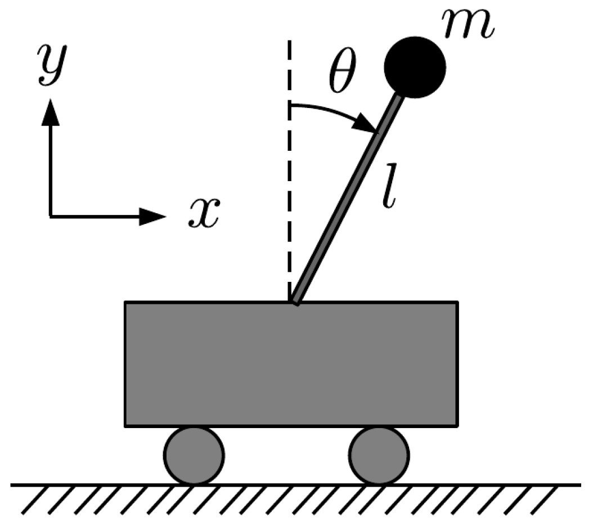
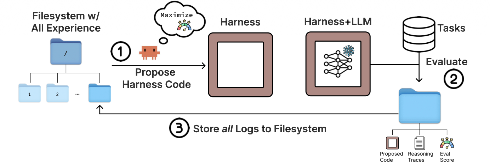
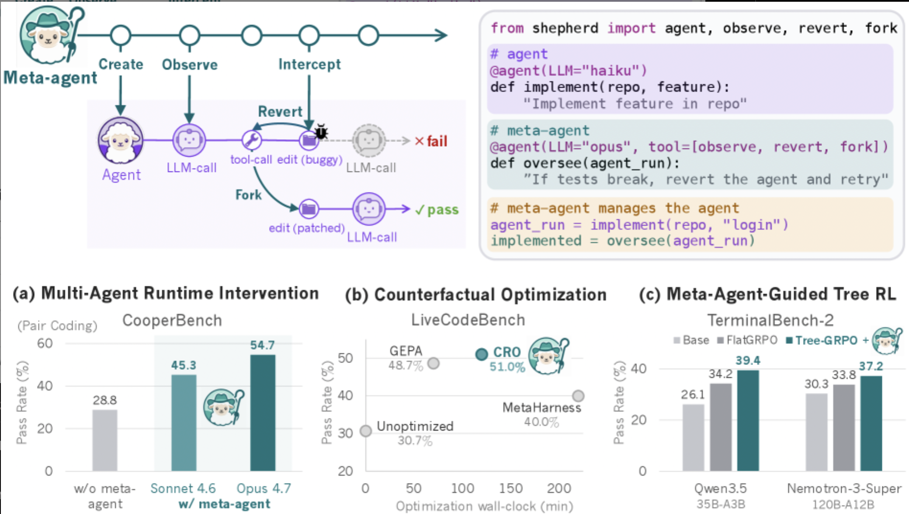

# Chapter 20 *Advanced Transformer and Agentic Architectures

[Course index](../../README.md) · [Original source](https://arxiv.org/html/2610.13455v1#Ch20) · [Raw file](../../raw/originals/book.html)

Retrieved: 2026-11-13T16:41:17.579179+00:00

[Contents](../../CONTENTS.md) · [Full book](../book/full-book-html.md) · [Previous chapter](chapter-19-synthetic-data-generation-for-training-agentic-llms.md) · [Next chapter](chapter-21-mechanistic-interpretability-for-llm-agents.md)

### Chapter 20 \*Advanced Transformer and Agentic Architectures

**What You Will Learn**

In this chapter you will learn about advanced transformer and agentic architectures. Specifically, you
will be able to:

- Understand the concept of *Turing-completeness*, and learn that transformers are, in principle, Turing-complete.
- Understand that transformer models can perform planning, when we train them on *decision traces*, instead of on natural language.
- Describe how embeddings can be connected directly to other embeddings, in *looped language models*, skipping tokenization layers.
- Describe how agents can perform *reinforcement learning in-context*, by storing a history of state-action-reward triples.
- Describe the advantages and disadvantages of *self-modifying* agents.
- Understand how metalearning can be applied to harness design, to create a *meta-harness* that improves the basic harness.

#### 20.1 Transformer Architectures

The success of large language models has spawned interesting new research avenues into transformer architectures. LLMs were good at language, but not at other problem types such as reasoning and planning. This caused researchers to explore the limits of the types of computations that transformers were able to do, and we will discuss some of the topics in the following sections. Specifically, they asked the questions whether transformers were Turing complete (Section [20.1.1](#Ch20.S1.SS1 "20.1.1 Transformers are Turing-complete ‣ 20.1 Transformer Architectures ‣ Chapter 20 *Advanced Transformer and Agentic Architectures ‣ Part VI Advanced Topics ‣ Agentic Large Language Models"))? The weak performance on planning problems prompted studies that trained transformers directly on decision traces, to see if that allowed them to be able to plan and backtrack (Section [20.1.2](#Ch20.S1.SS2 "20.1.2 Pretraining Backtracking on Decision Traces ‣ 20.1 Transformer Architectures ‣ Chapter 20 *Advanced Transformer and Agentic Architectures ‣ Part VI Advanced Topics ‣ Agentic Large Language Models")). Next, we will look at looped language models, where multiple models are connected directly at the level of the embeddings.

##### 20.1.1 Transformers are Turing-complete

The difficulty of LLMs to manage state at inference time suggests that LLMs are limited in the type of computations that they can perform. In theoretical computer science the concept of Turing completeness indicates whether a certain model of computation is powerful enough to be able to perform any type of computation of a certain category (which includes being able to manage state values correctly). This concept was introduced in a famous paper by Alan Turing in 1936, in which he proved that a certain type of machine would be powerful enough to do so [[Turing, 1936](#bibs.bib16)].
To be called Turing complete, a system must be able to simulate any other computational device and be able to process any problem that can be expressed in an algorithm (but perhaps take infinite time and memory to do so).
It turns out that it is not too difficult to achieve Turing completeness; most general purpose programming languages are Turing complete.11
1
For example, the Python programming language is Turing complete, but simple regular expression matching, without backreferencing, is not.

The difficulty of LLMs—and of transformer-based models in general—to manage state would suggest that the transformer architecture may not be Turing complete.
Interestingly, already in 2021 [Pérez et al. [2021]](#bibs.bib40) have studied this question, and have proven that the transformer architecture is able to simulate a Turing machine, and is thus Turing complete.

This is an encouraging result, since it indicates that there is no fundamental reason why transformers would not be able to manage state correctly. It may well be a matter of finding the right prompt, or finding the right pretraining and finetuning dataset.

Unfortunately, the fact that something is theoretically possible, does not mean that achieving it will be easy, or that it can be done efficiently. For example, it might be that certain architectural extensions to the transformer architecture would enhance the ease with which efficient state management can be achieved.
We will now discuss methods that have been developed so that LLMs can efficiently solve decision making and planning problems.

##### 20.1.2 Pretraining Backtracking on Decision Traces

The finding that transformers are Turing-complete encourages research in planning and decision making.
In this section we will discuss studies that pretrain a transformer architecture on decision traces, to good results. Note that this section is *not* about transformers that are trained on natural language—LLMs—but on transformers trained on decision traces.

Figure 20.1: The Cartpole Problem: Balance the Pole just by Moving the Cart Left or Right

First we discuss pretraining transformers directly on decision traces: sequences of state-action-reward triples, *not* language tokens. Several works study whether transformer networks can be trained to perform reinforcement learning—to learn from feedback, to perform learned policies, and to explore to learn better actions. [Chen et al. [2021]](#bibs.bib14), [Lee et al. [2023]](#bibs.bib15), [Wang et al. [2024]](#bibs.bib18) showed that basic transformer architectures can indeed be pretrained and finetuned on decision traces from typical planning problems. When an empty (non-language trained) transformer is pretrained on decision traces, it can exhibit in-context reinforcement learning (ICRL). So far, this has been shown using toy problems such as Boyan’s chain and Cartpole (see Figure [20.1](#Ch20.F1 "Figure 20.1 ‣ 20.1.2 Pretraining Backtracking on Decision Traces ‣ 20.1 Transformer Architectures ‣ Chapter 20 *Advanced Transformer and Agentic Architectures ‣ Part VI Advanced Topics ‣ Agentic Large Language Models")).
Furthermore, in the games of Chess and Hex encouraging results were achieved by pretraining the decision transformer on minimax [[Markeeva et al., 2024](#bibs.bib11), [Knuth and Moore, 1975](#bibs.bib10)] and MCTS [[Browne et al., 2012](#bibs.bib37)] search traces [[Schultz et al., 2024](#bibs.bib39), [Kempinski et al., 2025](#bibs.bib17)]. Transformers were able to learn to lookahead and search a few steps. Other works report encouraging results in the game of Othello [[Li et al., 2023](#bibs.bib1), [Kempinski et al., 2025](#bibs.bib17), [Chen et al., 2025](#bibs.bib12)].

A further work that studies how transformer architectures can be trained to perform decisions is *self backtracking* [[Yang et al., 2026a](#bibs.bib23)]. In this approach the model is again trained on decision traces. However, a new kind of token is introduced, $<$backtrack$>$, that prompts the model to perform explicit backtracking at inference time. The model is trained on a dataset of decisions, and when an error is encountered during training, the $<$backtrack$>$ token is learned, to find an alternative solution. At inference time, then, this backtracking is performed. A mechanism that consists of expansion/backtracking/selection is executed by the model, so that alternative solutions for the state in question are examined.

The self backtracking approach reports good results on typical planning problems such as the 24-game and maze navigation, compared to standard baselines on small versions of DeepSeek-R1 and Qwen3. Through the introduction of a new type of token and new backtracking-functionality in the model, this approach allows enhanced-transformer models to perform search, blurring the line between training and inference.

These are encouraging results, although it is still an open question to what extend the weakness of transformers in managing state has been solved. Performing inference-time ICRL on larger problems is an area of active research.

##### 20.1.3 LoopedLLM and Recursive Multi-Agent Systems

Improving the expressive power of transformers brings them closer to a general purpose programming architecture. We will discuss two other developments: looped language models and recursive systems.

It is easy to connect LLM agents at the language level: just let them speak to each other in natural language, on which they are all trained. However, this necessitates many (de)tokenization steps, which take time and introduces differences between embeddings. Can we directly connect embeddings, bypassing the tokenizers, and do training and inference at that level?

[Giannou et al. [2023]](#bibs.bib36)
show how looped transformers (transformers whose input neurons are directly connected to transformer
output neurons, either from the same or from another model) can emulate a basic
calculator, a basic linear algebra library, and in-context learning
algorithms that employ backpropagation. Looped transformers are a powerful architecture, see for example [Yang et al. [2023]](#bibs.bib28), [Saunshi et al. [2025]](#bibs.bib30), [Zhu et al. [2025]](#bibs.bib29).

A further development of direct embedding-to-embedding connections is recursive multi-agent systems [[Yang et al., 2026b](#bibs.bib13)]. This approach connects heterogeneous
agents in a collaboration loop, enabling in-distribution
latent thought generation and cross-agent latent state transfer. An inner-outer loop learning algorithm (metalearning, see Chapter [8](chapter-08-metalearning.md#Ch8 "Chapter 8 Metalearning ‣ Part II Reasoning ‣ Agentic Large Language Models")) performs whole-system co-optimization through shared
gradient-based credit assignment across recursion rounds. Experiments with four agents over benchmarks from mathematics,
science, medicine, search, and code generation, showed stable multi-agent training. In comparison with other single/multi-agent and
recursive baselines, accuracy is improved by a few percentage points, inference is twice as fast, and token usage is reduced by comparable ratio.

An innovation of RecursiveMAS is the introduction of a two-level recursive-link. Training a multi-agent system is difficult because gradients must flow through multiple models, and this process can become unstable. RecursiveMAS improves this process by freezing the parameters of the underlying LLMs and only training the lightweight RecursiveLink modules. The training occurs in two stages.

#### 20.2 Agentic Architectures

In addition to new transformer architectures, the work on agentic LLMs has also led to advanced agentic architectures. First, we will look at in-context reinforcement learning, where we will see that LLMs are able to perform policy improvement when the prompt is given a history of state-action-reward triples. Second, we will look at self-modifying agents, and discuss the advantages and disadvantages of this approach. Finally, we will look at meta agents.

Environment: $T(s,a)\rightarrow s^{\prime},R(s^{\prime})\rightarrow r$Agent: $r$ improves $\pi_{\theta}(s)\rightarrow a$$(s^{\prime},r)$$a$

Figure 20.2: 
For reference, the standard reinforcement learning loop where the agent learns a $\theta$-parameterized policy $\pi_{\theta}$ from feedback rewards $r$ from the environment upon its actions $a$, selected from policy $\pi_{\theta}$, etc. [[Sutton and Barto, 2018](#bibs.bib38)]

##### 20.2.1 In-Context Reinforcement Learning

Recall from Section [2.2.3](chapter-02-foundations-of-language-modeling-with-llms.md#Ch2.S2.SS3 "2.2.3 Reinforcement Learning ‣ 2.2 Machine Learning Methods For Natural Language Processing ‣ Chapter 2 Foundations of Language Modeling with LLMs ‣ Part I Language Modeling ‣ Agentic Large Language Models") that the goal of reinforcement learning is to compute a policy that has an optimal action for each state [[Sutton and Barto, 2018](#bibs.bib38)].
As the agent converges towards this policy, in each timestep, the agent learns these actions from feedback from its environment, the rewards.
These rewards reinforce the confidence of the agent in the policy’s actions in each state (see Figure [20.2](#Ch20.F2 "Figure 20.2 ‣ 20.2 Agentic Architectures ‣ Chapter 20 *Advanced Transformer and Agentic Architectures ‣ Part VI Advanced Topics ‣ Agentic Large Language Models")). The self-reflection approaches from the previous section borrow many ideas from reinforcement learning for the agentic harness. We will now discuss related methods that optimize prompts by in-context reinforcement learning, where the LLM performs prompt improvement.

Reinforcement-type learning mechanisms have been observed to emerge directly in LLMs, when environment histories were provided to the LLM by an external prompt optimizer: the LLM in certain self-reflection loops can perform policy-improvement. This phenomenon is called in-context reinforcement learning (ICRL) [[Song et al., 2025](#bibs.bib21)], see Figure [20.3](#Ch20.F3 "Figure 20.3 ‣ 20.2.1 In-Context Reinforcement Learning ‣ 20.2 Agentic Architectures ‣ Chapter 20 *Advanced Transformer and Agentic Architectures ‣ Part VI Advanced Topics ‣ Agentic Large Language Models").

[Krishnamurthy et al. [2024]](#bibs.bib19) asked the question whether generic LLMs that are trained on language can explore in-context, and whether they can learn in-context from feedback. This question has since been answered positively by various studies [[Demircan et al., 2024](#bibs.bib20), [Song et al., 2025](#bibs.bib21), [Moeini et al., 2025](#bibs.bib22), [Monea et al., 2024](#bibs.bib41), [Nie et al., 2024](#bibs.bib42), [Wang et al., 2024](#bibs.bib18)].

In ICRL, an external harness iteratively calls the LLM, feeding it a sequence of action, state, and reward triples, in-context (Figure [20.3](#Ch20.F3 "Figure 20.3 ‣ 20.2.1 In-Context Reinforcement Learning ‣ 20.2 Agentic Architectures ‣ Chapter 20 *Advanced Transformer and Agentic Architectures ‣ Part VI Advanced Topics ‣ Agentic Large Language Models")). The history of triples grows in each iteration. The LLM reacts by improving its implicit policy, providing increasingly good action choices in each iteration, thus we conclude that it performs the essence of reinforcement learning inside the LLM.

In ICRL, the agent-algorithm selects an *action*, to sample a step and get an answer (a *state*, *reward* pair) from the environment, see Figure [20.3](#Ch20.F3 "Figure 20.3 ‣ 20.2.1 In-Context Reinforcement Learning ‣ 20.2 Agentic Architectures ‣ Chapter 20 *Advanced Transformer and Agentic Architectures ‣ Part VI Advanced Topics ‣ Agentic Large Language Models"). A Markov decision process, or MDP, is a process in which all relevant information to calculate the next state is contained in the previous state and the action taken. Therefore, the prompt for the policy-LLM contains all relevant information, it accumulates the history of $(s,a,r)$-triples, which the LLM can use to improve the policy of the best action for each state.

Environment: $T(s,a)\rightarrow s^{\prime},R(s^{\prime})\rightarrow r$Agent: $\pi_{LLM_{P\pi}}(s,r)\rightarrow a$history $\cup(s^{\prime},a,r)$$a$

Figure 20.3: ICRL: Prompt Optimization with Reinforcement Learning

For state, the history of answers is a natural choice, but, in general, how to best model LLM prompt improvement as an MDP is still an active area of research.

In ICRL the agent uses the LLM for the policy-function. The LLM can also be used (with a different prompt) to play the role of environment, as in a self-reflection harness.

In-context reinforcement learning
occurs in a multi-round prompting harness, where, after the environment-LLM generates a response at the current round, a numerical reward is calculated by the LLM for the response that the LLM just calculated. At the next round, the agent-LLM is prompted again with the same task and a context that now consists of the previous responses and rewards. The quality of the agent-LLM’s response increases as the context becomes longer.
Just like a reinforcement learning algorithm, the LLM is able to maximize the numeric reward, at inference time. [Song et al. [2025]](#bibs.bib21) report how the ICRL approach was validated on the applications of tree of thoughts (Game of 24, creative writing, and ScienceWorld), outperforming self refine and reflexion.

How does the ICRL process work, inside the LLM? At
inference time the LLM performs a forward pass through the transformer network, computing the inference token. This forward pass has been found to
implicitly perform reinforcement learning [[Wang et al., 2024](#bibs.bib18)].
In other words,
in-weights learning is where the model has learned the right answer from its trained weights, at training time;
in-context learning is where the model has learned the right answer at inference time from few-shot examples provided in its context; and
in-context reinforcement learning is where the LLM has learned the right answer using (apparent) reinforcement learning on a growing sequence of the state-action-reward triples that it produced itself through inference. Thus, the reinforcing algorithm, optimizing the policy, is done implicitly by the LLM forward pass (inference step) when a sequence of prompts or history is given in the context.

Note that the LLM can be used for the agent, as a policy optimizer, and for the environment, to calculate the next state and reward. To ensure that the agent is learning without accidentally benefiting from the environment’s knowledge, it is better to use a separate LLM. This, too, is an active area of research.

##### 20.2.2 Self-Modifying Hyperagents

In this book, we have discussed self-reflective prompt improvers that are based on search algorithms and reinforcement learning. The code for these external algorithms is written by human researchers, and does not change as the agent is learning. The approach by which the prompt is improved is limited by these static algorithms.

LLMs excel at manipulating and judging computer code [[Zhuge et al., 2024](#bibs.bib35)]. We could, in principle, easily ask them to generate code for an agentic prompt harness, or for an in-context reinforcement learning harness. We could even ask the LLM to run the code on a particular problem instance, and, based on the outcome of the experiment, ask for an improvement of the prompt-improver code.
If the LLM is good at using experiment-results for writing prompt-improvement code, this approach could work better than standard approaches from the published literature.

Self-modifying code (computer programs that alter their own instructions while they are being executed) has a long history in computer science [[Cai et al., 2007](#bibs.bib24)], as an alternative to conditional branching statements. Many computer languages support it, from assembly languages, to Lisp [[Abelson and Sussman, 2022](#bibs.bib25)] and Python. It is a powerful method that can be used for performance improvement, for example in just-in-time compilation [[Ansel et al., 2011](#bibs.bib34)]. However, programs become less predictable, which may cause problems in finding errors in the program, and raises security concerns. For this reason the use is sometimes discouraged when predictability of programs is important.

An advantage of self-modifying agents is open-endedness: they can continuously improve themselves, without fixed boundaries set by static algorithms [[Schmidhuber, 2007](#bibs.bib32)]. A challenge is to do this safely [[Zhang et al., 2026b](#bibs.bib33)].
In Darwin-Gödel-Machine-Hyperagents the authors integrate (1) an agent to solve the target task with (2) a meta agent to modify itself and the task agent, into a single (editable) program. Note that the meta-level modification procedure is itself editable, enabling self-modification. This allows, in principle, not only improving the task-solving behavior, but also the mechanism that generates future improvements [[Zhang et al., 2026c](#bibs.bib27)]. The experiments, however, do not achieve full openness, as they use a fixed task distribution, as well as fixed parent selection and evaluation protocols.

As approaches become more open-ended, paradoxically, a challenge becomes to control the process of improvement, to ensure that it does not degenerate, but keeps improving [[Cemri et al., 2025](#bibs.bib26), [Ecoffet et al., 2020](#bibs.bib31)].
In general, the problem of powerful metalearning approaches is to ensure stable learning processes. Powerful generation requires powerful evaluation—adaptation to fit the environment.

##### 20.2.3 Meta Agents

The two-level optimization process of metalearning that we have seen in many self-reflection approaches, can be applied as an explicit design principle in harness design for agents. Recently, several such architectures have been published. In these designs, the inner learning loop is formed by the harness and the LLM, and the outer learning loop improves the configuration of this inner harness. The inner harness configuration typically performs prompt management, memory management, tool use, and security and control, and can be represented as language or code. The outer loop analyzes execution traces of the inner loop, to improve the configuration or code of the inner harness. We will briefly describe some of these approaches.

Self improving coding agent [[Robeyns et al., 2025](#bibs.bib8)] is based on the idea of self-modifying agents. They demonstrate that an agent system, equipped with basic coding tools, can
autonomously edit itself. Their approach improves performance on software engineering benchmark
tasks, achieving substantial performance gains from 17 to 53 percent.

Figure 20.4: 
Illustration of the Meta Harness approach [[Lee et al., 2026](#bibs.bib2)]

Meta harness [[Lee et al., 2026](#bibs.bib2)] also achieves good results, using external memory and text optimization. Figure [20.4](#Ch20.F4 "Figure 20.4 ‣ 20.2.3 Meta Agents ‣ 20.2 Agentic Architectures ‣ Chapter 20 *Advanced Transformer and Agentic Architectures ‣ Part VI Advanced Topics ‣ Agentic Large Language Models") illustrates how meta harness works. (1) A filesystem has all prior
candidates’ source code, execution traces, and scores; the agent reads this, and generates code for a new harness. (2) The proposed harness is evaluated on evaluation tasks. (3) All proposed code, reasoning
traces, and evaluation scores are stored in the filesystem in a new directory, and the loop repeats.

Self harness [[Zhang et al., 2026a](#bibs.bib7)] and Agentic Harness Engineering [[Lin et al., 2026](#bibs.bib6)] further explore harness design, achieving substantial improvements on software engineering tasks. Recursive self-evolving agents [[Nguyen et al., 2026](#bibs.bib5)] focuses on the selection aspect of self-improving agents.

Another use case is described by [Luo et al. [2026]](#bibs.bib9). They use a meta harness to design a harness for turning a scientific paper into a conference-poster. This work thus has contributions on two levels: a method for making a meta-harness, and a concrete harness for designing posters—which the authors, obviously, use on their own paper.

Figure 20.5: 
Illustration of the Shepherd Meta Agent Environment [[Yu et al., 2026](#bibs.bib4)]

The Shepherd system [[Yu et al., 2026](#bibs.bib4)] provides a functional meta agent programming environment.22
2
<https://shepherd-agents.ai> Shepherd defines LLM agents as Python functions, allowing an agent’s execution traces to be monitored, rolled-back, forked, modified, and resumed. Early experiments show significant performance improvements on three different benchmarks, as illustrated in Figure [20.5](#Ch20.F5 "Figure 20.5 ‣ 20.2.3 Meta Agents ‣ 20.2 Agentic Architectures ‣ Chapter 20 *Advanced Transformer and Agentic Architectures ‣ Part VI Advanced Topics ‣ Agentic Large Language Models").

A comprehensive survey with more approaches on self-improving agent designs is [Ren et al. [2026]](#bibs.bib3). Their taxonomy explicitly recognizes the two-level architecture.

#### 20.3 Concluding Remarks

In this chapter we have discussed some advanced architectures, at the level of the transformers, and at the level of the agents. Both are highly active fields of research.

### References

- Abelson and Sussman (2022)
  H. Abelson and G. J. Sussman
  Structure and interpretation of computer programs: javascript edition.
   MIT press.
  Cited by: [§20.2.2](#Ch20.S2.SS2.p3.1 "20.2.2 Self-Modifying Hyperagents ‣ 20.2 Agentic Architectures ‣ Chapter 20 *Advanced Transformer and Agentic Architectures ‣ Part VI Advanced Topics ‣ Agentic Large Language Models").

- Ansel et al. (2011)
  J. Ansel, P. Marchenko, U. Erlingsson, E. Taylor, B. Chen, D. L. Schuff, D. Sehr, C. L. Biffle, and B. Yee
  Language-independent sandboxing of just-in-time compilation and self-modifying code.
  In Proceedings of the 32nd ACM SIGPLAN conference on Programming language design and implementation,
  pp. 355–366.
  Cited by: [§20.2.2](#Ch20.S2.SS2.p3.1 "20.2.2 Self-Modifying Hyperagents ‣ 20.2 Agentic Architectures ‣ Chapter 20 *Advanced Transformer and Agentic Architectures ‣ Part VI Advanced Topics ‣ Agentic Large Language Models").

- Browne et al. (2012)
  C. B. Browne, E. Powley, D. Whitehouse, S. M. Lucas, P. I. Cowling, P. Rohlfshagen, S. Tavener, D. Perez, S. Samothrakis, and S. Colton
  A survey of monte carlo tree search methods.
  IEEE Transactions on Computational Intelligence and AI in games 4 (1), pp. 1–43.
  Cited by: [§20.1.2](#Ch20.S1.SS2.p2.1 "20.1.2 Pretraining Backtracking on Decision Traces ‣ 20.1 Transformer Architectures ‣ Chapter 20 *Advanced Transformer and Agentic Architectures ‣ Part VI Advanced Topics ‣ Agentic Large Language Models").

- Cai et al. (2007)
  H. Cai, Z. Shao, and A. Vaynberg
  Certified self-modifying code.
  In Proceedings of the 28th ACM SIGPLAN Conference on Programming Language Design and Implementation,
  pp. 66–77.
  Cited by: [§20.2.2](#Ch20.S2.SS2.p3.1 "20.2.2 Self-Modifying Hyperagents ‣ 20.2 Agentic Architectures ‣ Chapter 20 *Advanced Transformer and Agentic Architectures ‣ Part VI Advanced Topics ‣ Agentic Large Language Models").

- Cemri et al. (2025)
  M. Cemri, M. Z. Pan, S. Yang, L. A. Agrawal, B. Chopra, R. Tiwari, K. Keutzer, A. Parameswaran, D. Klein, K. Ramchandran, et al.
  Why do multi-agent llm systems fail?.
  arXiv preprint arXiv:2503.13657.
  Cited by: [§20.2.2](#Ch20.S2.SS2.p5.1 "20.2.2 Self-Modifying Hyperagents ‣ 20.2 Agentic Architectures ‣ Chapter 20 *Advanced Transformer and Agentic Architectures ‣ Part VI Advanced Topics ‣ Agentic Large Language Models").

- Chen et al. (2021)
  L. Chen, K. Lu, A. Rajeswaran, K. Lee, A. Grover, M. Laskin, P. Abbeel, A. Srinivas, and I. Mordatch
  Decision transformer: reinforcement learning via sequence modeling.
  Advances in neural information processing systems 34, pp. 15084–15097.
  Cited by: [§20.1.2](#Ch20.S1.SS2.p2.1 "20.1.2 Pretraining Backtracking on Decision Traces ‣ 20.1 Transformer Architectures ‣ Chapter 20 *Advanced Transformer and Agentic Architectures ‣ Part VI Advanced Topics ‣ Agentic Large Language Models").

- Chen et al. (2025)
  X. Chen, Y. Yuan, J. Li, S. Belongie, M. de Rijke, and A. Søgaard
  What if othello-playing language models could see?.
  arXiv preprint arXiv:2507.14520.
  Cited by: [§20.1.2](#Ch20.S1.SS2.p2.1 "20.1.2 Pretraining Backtracking on Decision Traces ‣ 20.1 Transformer Architectures ‣ Chapter 20 *Advanced Transformer and Agentic Architectures ‣ Part VI Advanced Topics ‣ Agentic Large Language Models").

- Demircan et al. (2024)
  C. Demircan, T. Saanum, A. K. Jagadish, M. Binz, and E. Schulz
  Sparse autoencoders reveal temporal difference learning in large language models.
  arXiv preprint arXiv:2410.01280.
  Cited by: [§20.2.1](#Ch20.S2.SS1.p3.1 "20.2.1 In-Context Reinforcement Learning ‣ 20.2 Agentic Architectures ‣ Chapter 20 *Advanced Transformer and Agentic Architectures ‣ Part VI Advanced Topics ‣ Agentic Large Language Models").

- Ecoffet et al. (2020)
  A. Ecoffet, J. Clune, and J. Lehman
  Open questions in creating safe open-ended ai: tensions between control and creativity.
  In Artificial Life Conference Proceedings 32,
  pp. 27–35.
  Cited by: [§20.2.2](#Ch20.S2.SS2.p5.1 "20.2.2 Self-Modifying Hyperagents ‣ 20.2 Agentic Architectures ‣ Chapter 20 *Advanced Transformer and Agentic Architectures ‣ Part VI Advanced Topics ‣ Agentic Large Language Models").

- Giannou et al. (2023)
  A. Giannou, S. Rajput, J. Sohn, K. Lee, J. D. Lee, and D. Papailiopoulos
  Looped transformers as programmable computers.
  In International Conference on Machine Learning,
  pp. 11398–11442.
  Cited by: [§20.1.3](#Ch20.S1.SS3.p3.1 "20.1.3 LoopedLLM and Recursive Multi-Agent Systems ‣ 20.1 Transformer Architectures ‣ Chapter 20 *Advanced Transformer and Agentic Architectures ‣ Part VI Advanced Topics ‣ Agentic Large Language Models").

- Kempinski et al. (2025)
  B. Kempinski, I. Gemp, K. Larson, M. Lanctot, Y. Bachrach, and T. Kachman
  Game of thoughts: iterative reasoning in game-theoretic domains with large language models.
  In Proc. of the 24th International Conference on Autonomous Agents and Multiagent Systems,
  pp. 1088–1097.
  Cited by: [§20.1.2](#Ch20.S1.SS2.p2.1 "20.1.2 Pretraining Backtracking on Decision Traces ‣ 20.1 Transformer Architectures ‣ Chapter 20 *Advanced Transformer and Agentic Architectures ‣ Part VI Advanced Topics ‣ Agentic Large Language Models").

- Knuth and Moore (1975)
  D. E. Knuth and R. W. Moore
  An analysis of alpha-beta pruning.
  Artificial intelligence 6 (4), pp. 293–326.
  Cited by: [§20.1.2](#Ch20.S1.SS2.p2.1 "20.1.2 Pretraining Backtracking on Decision Traces ‣ 20.1 Transformer Architectures ‣ Chapter 20 *Advanced Transformer and Agentic Architectures ‣ Part VI Advanced Topics ‣ Agentic Large Language Models").

- Krishnamurthy et al. (2024)
  A. Krishnamurthy, K. Harris, D. J. Foster, C. Zhang, and A. Slivkins
  Can large language models explore in-context?.
  arXiv preprint arXiv:2403.15371.
  Cited by: [§20.2.1](#Ch20.S2.SS1.p3.1 "20.2.1 In-Context Reinforcement Learning ‣ 20.2 Agentic Architectures ‣ Chapter 20 *Advanced Transformer and Agentic Architectures ‣ Part VI Advanced Topics ‣ Agentic Large Language Models").

- Lee et al. (2023)
  J. Lee, A. Xie, A. Pacchiano, Y. Chandak, C. Finn, O. Nachum, and E. Brunskill
  Supervised pretraining can learn in-context reinforcement learning.
  Advances in Neural Information Processing Systems 36, pp. 43057–43083.
  Cited by: [§20.1.2](#Ch20.S1.SS2.p2.1 "20.1.2 Pretraining Backtracking on Decision Traces ‣ 20.1 Transformer Architectures ‣ Chapter 20 *Advanced Transformer and Agentic Architectures ‣ Part VI Advanced Topics ‣ Agentic Large Language Models").

- Lee et al. (2026)
  Y. Lee, R. Nair, Q. Zhang, K. Lee, O. Khattab, and C. Finn
  Meta-harness: end-to-end optimization of model harnesses.
  arXiv preprint arXiv:2603.28052.
  Cited by: [Figure 20.4](#Ch20.F4 "In 20.2.3 Meta Agents ‣ 20.2 Agentic Architectures ‣ Chapter 20 *Advanced Transformer and Agentic Architectures ‣ Part VI Advanced Topics ‣ Agentic Large Language Models"),
  [Figure 20.4](#Ch20.F4.4 "In 20.2.3 Meta Agents ‣ 20.2 Agentic Architectures ‣ Chapter 20 *Advanced Transformer and Agentic Architectures ‣ Part VI Advanced Topics ‣ Agentic Large Language Models"),
  [§20.2.3](#Ch20.S2.SS3.p3.1 "20.2.3 Meta Agents ‣ 20.2 Agentic Architectures ‣ Chapter 20 *Advanced Transformer and Agentic Architectures ‣ Part VI Advanced Topics ‣ Agentic Large Language Models").

- Li et al. (2023)
  K. Li, A. K. Hopkins, D. Bau, F. Viégas, H. Pfister, and M. Wattenberg
  Emergent world representations: exploring a sequence model trained on a synthetic task.
  In The Eleventh International Conference on Learning Representations,
  External Links: [Link](https://openreview.net/forum?id=DeG07_TcZvT)
  Cited by: [§20.1.2](#Ch20.S1.SS2.p2.1 "20.1.2 Pretraining Backtracking on Decision Traces ‣ 20.1 Transformer Architectures ‣ Chapter 20 *Advanced Transformer and Agentic Architectures ‣ Part VI Advanced Topics ‣ Agentic Large Language Models").

- Lin et al. (2026)
  J. Lin, S. Liu, C. Pan, L. Lin, S. Dou, Z. Xi, X. Huang, H. Yan, Z. Han, T. Gui, et al.
  Agentic harness engineering: observability-driven automatic evolution of coding-agent harnesses.
  arXiv preprint arXiv:2604.25850.
  Cited by: [§20.2.3](#Ch20.S2.SS3.p4.1 "20.2.3 Meta Agents ‣ 20.2 Agentic Architectures ‣ Chapter 20 *Advanced Transformer and Agentic Architectures ‣ Part VI Advanced Topics ‣ Agentic Large Language Models").

- Luo et al. (2026)
  Y. Luo, H. Jiang, J. Zou, X. Huang, W. Yan, H. Li, Z. Yue, J. Li, X. Chen, X. Zhao, et al.
  AutoDesign: meta-harness optimization for long-horizon agentic design.
  arXiv preprint arXiv:2608.13560.
  Cited by: [§20.2.3](#Ch20.S2.SS3.p5.1 "20.2.3 Meta Agents ‣ 20.2 Agentic Architectures ‣ Chapter 20 *Advanced Transformer and Agentic Architectures ‣ Part VI Advanced Topics ‣ Agentic Large Language Models").

- Markeeva et al. (2024)
  L. Markeeva, S. McLeish, B. Ibarz, W. Bounsi, O. Kozlova, A. Vitvitskyi, C. Blundell, T. Goldstein, A. Schwarzschild, and P. Veličković
  The clrs-text algorithmic reasoning language benchmark.
  arXiv preprint arXiv:2406.04229.
  Cited by: [§20.1.2](#Ch20.S1.SS2.p2.1 "20.1.2 Pretraining Backtracking on Decision Traces ‣ 20.1 Transformer Architectures ‣ Chapter 20 *Advanced Transformer and Agentic Architectures ‣ Part VI Advanced Topics ‣ Agentic Large Language Models").

- Moeini et al. (2025)
  A. Moeini, J. Wang, J. Beck, E. Blaser, S. Whiteson, R. Chandra, and S. Zhang
  A survey of in-context reinforcement learning.
  arXiv preprint arXiv:2502.07978.
  Cited by: [§20.2.1](#Ch20.S2.SS1.p3.1 "20.2.1 In-Context Reinforcement Learning ‣ 20.2 Agentic Architectures ‣ Chapter 20 *Advanced Transformer and Agentic Architectures ‣ Part VI Advanced Topics ‣ Agentic Large Language Models").

- Monea et al. (2024)
  G. Monea, A. Bosselut, K. Brantley, and Y. Artzi
  Llms are in-context reinforcement learners.
  Cited by: [§20.2.1](#Ch20.S2.SS1.p3.1 "20.2.1 In-Context Reinforcement Learning ‣ 20.2 Agentic Architectures ‣ Chapter 20 *Advanced Transformer and Agentic Architectures ‣ Part VI Advanced Topics ‣ Agentic Large Language Models").

- Nguyen et al. (2026)
  M. Nguyen, Q. Nguyen, and P. Vuong
  Recursive self-evolving agents via held-out selection.
  arXiv preprint arXiv:2606.28374.
  Cited by: [§20.2.3](#Ch20.S2.SS3.p4.1 "20.2.3 Meta Agents ‣ 20.2 Agentic Architectures ‣ Chapter 20 *Advanced Transformer and Agentic Architectures ‣ Part VI Advanced Topics ‣ Agentic Large Language Models").

- Nie et al. (2024)
  A. Nie, Y. Su, B. Chang, J. N. Lee, E. H. Chi, Q. V. Le, and M. Chen
  Evolve: evaluating and optimizing llms for exploration.
  arXiv preprint arXiv:2410.06238.
  Cited by: [§20.2.1](#Ch20.S2.SS1.p3.1 "20.2.1 In-Context Reinforcement Learning ‣ 20.2 Agentic Architectures ‣ Chapter 20 *Advanced Transformer and Agentic Architectures ‣ Part VI Advanced Topics ‣ Agentic Large Language Models").

- Pérez et al. (2021)
  J. Pérez, P. Barceló, and J. Marinkovic
  Attention is turing-complete.
  Journal of Machine Learning Research 22 (75), pp. 1–35.
  Cited by: [§20.1.1](#Ch20.S1.SS1.p2.1 "20.1.1 Transformers are Turing-complete ‣ 20.1 Transformer Architectures ‣ Chapter 20 *Advanced Transformer and Agentic Architectures ‣ Part VI Advanced Topics ‣ Agentic Large Language Models").

- Ren et al. (2026)
  Z. Ren, Y. Chen, D. Guo, G. Rong, T. Li, R. Xiong, Q. Lan, W. Wang, L. Nanbo, Y. Yang, et al.
  Self-improvements in modern agentic systems: a survey.
  arXiv preprint arXiv:2607.13104.
  Cited by: [§20.2.3](#Ch20.S2.SS3.p7.1 "20.2.3 Meta Agents ‣ 20.2 Agentic Architectures ‣ Chapter 20 *Advanced Transformer and Agentic Architectures ‣ Part VI Advanced Topics ‣ Agentic Large Language Models").

- Robeyns et al. (2025)
  M. Robeyns, M. Szummer, and L. Aitchison
  A self-improving coding agent.
  arXiv preprint arXiv:2504.15228.
  Cited by: [§20.2.3](#Ch20.S2.SS3.p2.1 "20.2.3 Meta Agents ‣ 20.2 Agentic Architectures ‣ Chapter 20 *Advanced Transformer and Agentic Architectures ‣ Part VI Advanced Topics ‣ Agentic Large Language Models").

- Saunshi et al. (2025)
  N. Saunshi, N. Dikkala, Z. Li, S. Kumar, and S. J. Reddi
  Reasoning with latent thoughts: on the power of looped transformers.
  arXiv preprint arXiv:2502.17416.
  Cited by: [§20.1.3](#Ch20.S1.SS3.p3.1 "20.1.3 LoopedLLM and Recursive Multi-Agent Systems ‣ 20.1 Transformer Architectures ‣ Chapter 20 *Advanced Transformer and Agentic Architectures ‣ Part VI Advanced Topics ‣ Agentic Large Language Models").

- Schmidhuber (2007)
  J. Schmidhuber
  Gödel machines: fully self-referential optimal universal self-improvers.
  In Artificial general intelligence,
  pp. 199–226.
  Cited by: [§20.2.2](#Ch20.S2.SS2.p4.1 "20.2.2 Self-Modifying Hyperagents ‣ 20.2 Agentic Architectures ‣ Chapter 20 *Advanced Transformer and Agentic Architectures ‣ Part VI Advanced Topics ‣ Agentic Large Language Models").

- Schultz et al. (2024)
  J. Schultz, J. Adamek, M. Jusup, M. Lanctot, M. Kaisers, S. Perrin, D. Hennes, J. Shar, C. Lewis, A. Ruoss, et al.
  Mastering board games by external and internal planning with language models.
  arXiv preprint arXiv:2412.12119.
  Cited by: [§20.1.2](#Ch20.S1.SS2.p2.1 "20.1.2 Pretraining Backtracking on Decision Traces ‣ 20.1 Transformer Architectures ‣ Chapter 20 *Advanced Transformer and Agentic Architectures ‣ Part VI Advanced Topics ‣ Agentic Large Language Models").

- Song et al. (2025)
  K. Song, A. Moeini, P. Wang, L. Gong, R. Chandra, Y. Qi, and S. Zhang
  Reward is enough: llms are in-context reinforcement learners.
  arXiv preprint arXiv:2506.06303.
  Cited by: [§20.2.1](#Ch20.S2.SS1.p2.1 "20.2.1 In-Context Reinforcement Learning ‣ 20.2 Agentic Architectures ‣ Chapter 20 *Advanced Transformer and Agentic Architectures ‣ Part VI Advanced Topics ‣ Agentic Large Language Models"),
  [§20.2.1](#Ch20.S2.SS1.p3.1 "20.2.1 In-Context Reinforcement Learning ‣ 20.2 Agentic Architectures ‣ Chapter 20 *Advanced Transformer and Agentic Architectures ‣ Part VI Advanced Topics ‣ Agentic Large Language Models"),
  [§20.2.1](#Ch20.S2.SS1.p8.1 "20.2.1 In-Context Reinforcement Learning ‣ 20.2 Agentic Architectures ‣ Chapter 20 *Advanced Transformer and Agentic Architectures ‣ Part VI Advanced Topics ‣ Agentic Large Language Models").

- Sutton and Barto (2018)
  R. S. Sutton and A. G. Barto
  Reinforcement learning.
  2 edition, Adaptive Computation and Machine Learning series, Bradford Books, Cambridge, MA.
  Cited by: [Figure 20.2](#Ch20.F2 "In 20.2 Agentic Architectures ‣ Chapter 20 *Advanced Transformer and Agentic Architectures ‣ Part VI Advanced Topics ‣ Agentic Large Language Models"),
  [Figure 20.2](#Ch20.F2.4 "In 20.2 Agentic Architectures ‣ Chapter 20 *Advanced Transformer and Agentic Architectures ‣ Part VI Advanced Topics ‣ Agentic Large Language Models"),
  [§20.2.1](#Ch20.S2.SS1.p1.1 "20.2.1 In-Context Reinforcement Learning ‣ 20.2 Agentic Architectures ‣ Chapter 20 *Advanced Transformer and Agentic Architectures ‣ Part VI Advanced Topics ‣ Agentic Large Language Models").

- Turing (1936)
  A. Turing
  On computable numbers, with an application to the entscheidungsproblem.
  J. of Math 58 (345-363), pp. 5.
  Cited by: [§20.1.1](#Ch20.S1.SS1.p1.1 "20.1.1 Transformers are Turing-complete ‣ 20.1 Transformer Architectures ‣ Chapter 20 *Advanced Transformer and Agentic Architectures ‣ Part VI Advanced Topics ‣ Agentic Large Language Models").

- Wang et al. (2024)
  J. Wang, E. Blaser, H. Daneshmand, and S. Zhang
  Transformers learn temporal difference methods for in-context reinforcement learning.
  arXiv preprint arXiv:2405.13861.
  Cited by: [§20.1.2](#Ch20.S1.SS2.p2.1 "20.1.2 Pretraining Backtracking on Decision Traces ‣ 20.1 Transformer Architectures ‣ Chapter 20 *Advanced Transformer and Agentic Architectures ‣ Part VI Advanced Topics ‣ Agentic Large Language Models"),
  [§20.2.1](#Ch20.S2.SS1.p3.1 "20.2.1 In-Context Reinforcement Learning ‣ 20.2 Agentic Architectures ‣ Chapter 20 *Advanced Transformer and Agentic Architectures ‣ Part VI Advanced Topics ‣ Agentic Large Language Models"),
  [§20.2.1](#Ch20.S2.SS1.p9.1 "20.2.1 In-Context Reinforcement Learning ‣ 20.2 Agentic Architectures ‣ Chapter 20 *Advanced Transformer and Agentic Architectures ‣ Part VI Advanced Topics ‣ Agentic Large Language Models").

- Yang et al. (2023)
  L. Yang, K. Lee, R. Nowak, and D. Papailiopoulos
  Looped transformers are better at learning learning algorithms.
  arXiv preprint arXiv:2311.12424.
  Cited by: [§20.1.3](#Ch20.S1.SS3.p3.1 "20.1.3 LoopedLLM and Recursive Multi-Agent Systems ‣ 20.1 Transformer Architectures ‣ Chapter 20 *Advanced Transformer and Agentic Architectures ‣ Part VI Advanced Topics ‣ Agentic Large Language Models").

- Yang et al. (2026a)
  X. Yang, X. Zhu, D. Zhang, W. Wei, J. Shao, Z. Zhou, L. Guo, and Y. Li
  Step back to leap forward: self-backtracking for symbolic reasoning and planning in language models.
  In Proceedings of the AAAI Conference on Artificial Intelligence,
  Vol. 40, pp. 27657–27665.
  Cited by: [§20.1.2](#Ch20.S1.SS2.p3.1 "20.1.2 Pretraining Backtracking on Decision Traces ‣ 20.1 Transformer Architectures ‣ Chapter 20 *Advanced Transformer and Agentic Architectures ‣ Part VI Advanced Topics ‣ Agentic Large Language Models").

- Yang et al. (2026b)
  X. Yang, J. Zou, R. Pan, R. Qiu, P. Lu, S. Diao, J. Jiang, H. Tong, T. Zhang, M. J. Buehler, J. He, and J. Zou
  Recursive multi-agent systems.
  External Links: 2604.25917,
  [Link](https://arxiv.org/abs/2604.25917)
  Cited by: [§20.1.3](#Ch20.S1.SS3.p4.1 "20.1.3 LoopedLLM and Recursive Multi-Agent Systems ‣ 20.1 Transformer Architectures ‣ Chapter 20 *Advanced Transformer and Agentic Architectures ‣ Part VI Advanced Topics ‣ Agentic Large Language Models").

- Yu et al. (2026)
  S. Yu, D. Chong, A. Nandi, D. Soylu, J. Sun, C. D. Manning, and W. Shi
  Shepherd: enabling programmable meta-agents via reversible agentic execution traces.
  arXiv preprint arXiv:2605.10913.
  Cited by: [Figure 20.5](#Ch20.F5 "In 20.2.3 Meta Agents ‣ 20.2 Agentic Architectures ‣ Chapter 20 *Advanced Transformer and Agentic Architectures ‣ Part VI Advanced Topics ‣ Agentic Large Language Models"),
  [Figure 20.5](#Ch20.F5.4 "In 20.2.3 Meta Agents ‣ 20.2 Agentic Architectures ‣ Chapter 20 *Advanced Transformer and Agentic Architectures ‣ Part VI Advanced Topics ‣ Agentic Large Language Models"),
  [§20.2.3](#Ch20.S2.SS3.p6.1 "20.2.3 Meta Agents ‣ 20.2 Agentic Architectures ‣ Chapter 20 *Advanced Transformer and Agentic Architectures ‣ Part VI Advanced Topics ‣ Agentic Large Language Models").

- Zhang et al. (2026a)
  H. Zhang, S. Zhang, K. Li, C. Zhang, Y. Chen, Y. Zhang, L. Bai, and S. Hu
  Self-harness: harnesses that improve themselves.
  arXiv preprint arXiv:2606.09498.
  Cited by: [§20.2.3](#Ch20.S2.SS3.p4.1 "20.2.3 Meta Agents ‣ 20.2 Agentic Architectures ‣ Chapter 20 *Advanced Transformer and Agentic Architectures ‣ Part VI Advanced Topics ‣ Agentic Large Language Models").

- Zhang et al. (2026b)
  J. Zhang, S. Hu, C. Lu, R. Lange, and J. Clune
  Darwin godel machine: open-ended evolution of self-improving agents.
  External Links: 2505.22954,
  [Link](https://arxiv.org/abs/2505.22954)
  Cited by: [§20.2.2](#Ch20.S2.SS2.p4.1 "20.2.2 Self-Modifying Hyperagents ‣ 20.2 Agentic Architectures ‣ Chapter 20 *Advanced Transformer and Agentic Architectures ‣ Part VI Advanced Topics ‣ Agentic Large Language Models").

- Zhang et al. (2026c)
  J. Zhang, B. Zhao, W. Yang, J. Foerster, J. Clune, M. Jiang, S. Devlin, and T. Shavrina
  Hyperagents.
  External Links: 2603.19461,
  [Link](https://arxiv.org/abs/2603.19461)
  Cited by: [§20.2.2](#Ch20.S2.SS2.p4.1 "20.2.2 Self-Modifying Hyperagents ‣ 20.2 Agentic Architectures ‣ Chapter 20 *Advanced Transformer and Agentic Architectures ‣ Part VI Advanced Topics ‣ Agentic Large Language Models").

- Zhu et al. (2025)
  R. Zhu, Z. Wang, K. Hua, T. Zhang, Z. Li, H. Que, B. Wei, Z. Wen, F. Yin, H. Xing, et al.
  Scaling latent reasoning via looped language models.
  arXiv preprint arXiv:2510.25741.
  Cited by: [§20.1.3](#Ch20.S1.SS3.p3.1 "20.1.3 LoopedLLM and Recursive Multi-Agent Systems ‣ 20.1 Transformer Architectures ‣ Chapter 20 *Advanced Transformer and Agentic Architectures ‣ Part VI Advanced Topics ‣ Agentic Large Language Models").

- Zhuge et al. (2024)
  M. Zhuge, C. Zhao, D. Ashley, W. Wang, D. Khizbullin, Y. Xiong, Z. Liu, E. Chang, R. Krishnamoorthi, Y. Tian, et al.
  Agent-as-a-judge: evaluate agents with agents.
  arXiv preprint arXiv:2410.10934.
  Cited by: [§20.2.2](#Ch20.S2.SS2.p2.1 "20.2.2 Self-Modifying Hyperagents ‣ 20.2 Agentic Architectures ‣ Chapter 20 *Advanced Transformer and Agentic Architectures ‣ Part VI Advanced Topics ‣ Agentic Large Language Models").
