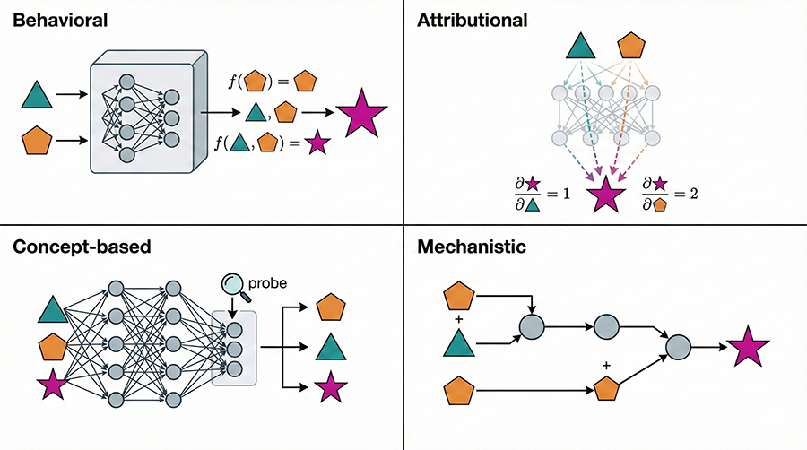

# Chapter 21 *Mechanistic Interpretability for LLM Agents

[Course index](../../README.md) · [Original source](https://arxiv.org/html/2610.13455v1#Ch21) · [Raw file](../../raw/originals/book.html)

Retrieved: 2026-11-13T16:41:17.579179+00:00

[Contents](../../CONTENTS.md) · [Full book](../book/full-book-html.md) · [Previous chapter](chapter-20-advanced-transformer-and-agentic-architectures.md) · [Next chapter](chapter-22-cognitive-perspectives-on-agentic-llms.md)

### Chapter 21 \*Mechanistic Interpretability for LLM Agents

**What You Will Learn**

In this chapter you will learn how to look inside the black box of
large language models using tools from explainable artificial
intelligence and mechanistic interpretability. Specifically, you
will be able to:

- Distinguish between the four main interpretability paradigms: *behavioral*, *attributional*, *concept-based*, and *mechanistic interpretability*.
- Explain how hallucination relates to *faithfulness*, and describe how mechanistic methods can identify the internal circuits responsible for model failures.
- Describe the *residual stream* formulation of the transformer and explain how information is iteratively refined across layers.
- Apply the *logit lens* and tuned lens to visualize how a model’s predictions evolve through its layers.
- Explain *polysemanticity and superposition*, and understand why individual neurons are poor units of interpretation.
- Use *sparse autoencoders* for dictionary learning to decompose model activations into monosemantic, human-interpretable features.
- Perform *circuit analysis and activation patching* to identify and causally verify the internal algorithms responsible for specific model behaviors.

#### 21.1 Opening the LLM

How do LLMs work inside? Opening up the black box of large neural architectures is an important topic of research. We wish to understand how the billions of neurons embed representations, how they reason and how they come to conclusions. The field of explainable artificial intelligence (XAI) provides many different methods to do so [[Minh et al., 2022](#bibt.bib19), [Rios et al., 2020](#bibt.bib21), [Van Stein et al., 2022](#bibt.bib22), [Selvaraju et al., 2017](#bibt.bib23), [Ali et al., 2022](#bibt.bib24)].

Static XAI methods from the classical machine learning community have been quite successful [[Molnar, 2020](#bibt.bib11)]. Methods exist to relate how input pictures map to output classes, for example using feature maps [[Ren et al., 2016](#bibt.bib10), [Kohonen, 1982](#bibt.bib9), [Redmon et al., 2016](#bibt.bib7)]. Counterfactual analysis [[Karimi et al., 2020](#bibt.bib8), [Huang et al., 2024](#bibt.bib25)], LIME [[Ribeiro et al., 2016](#bibt.bib6)] and SHAP [[Lundberg and Lee, 2017](#bibt.bib5)], among others, help understand how inputs map to outputs for structured data. These methods belong to the *behavioral* and *attributional* class of explainability algorithms, where the model is seen as a black-box (Figure [21.1](#Ch21.F1 "Figure 21.1 ‣ 21.1 Opening the LLM ‣ Chapter 21 *Mechanistic Interpretability for LLM Agents ‣ Part VI Advanced Topics ‣ Agentic Large Language Models")). Attribution methods such as SHAP and LIME approximate the contributions of different input features to the final output. Behavioral analysis such as achieved by using counterfactual methods provide insight into which features matter (but not perse how much they matter).

Figure 21.1: Taxonomy of *Interpretability Paradigms*. Behavioral interpretability treats the model as a black box, mapping input-output relations ($f(x)=y$). Attributional methods quantify the influence of specific input features on the final output using gradients or saliency. Concept-based interpretability employs probes to identify high-level, human-understandable representations within hidden layers. Mechanistic interpretability aims to reverse-engineer the specific causal circuits and internal algorithms that govern model behavior.

Moving beyond surface-level input-output correlations, *concept-based* interpretability seeks to identify whether specific, human-understandable information is encoded within the model’s internal states. This is primarily investigated through *linear probing*, where a simple supervised classifier is trained on frozen hidden activations to detect the presence of particular semantic concepts—such as parts of speech, sentiment, or factual entities [[Alain and Bengio, 2016](#bibt.bib26), [Belinkov, 2022](#bibt.bib27)]. While attribution methods highlight *which* parts of the input are influential, probing allows researchers to verify *what* knowledge the model represents at different layers (Figure [21.1](#Ch21.F1 "Figure 21.1 ‣ 21.1 Opening the LLM ‣ Chapter 21 *Mechanistic Interpretability for LLM Agents ‣ Part VI Advanced Topics ‣ Agentic Large Language Models")). However, a known limitation of probing is the *causal gap*: discovering that a concept is represented in a layer does not necessarily mean the model uses that information for its final prediction.

More recently, dynamic methods have been developed to uncover patterns under the hood of large transformer models. These belong to the sub-domain of mechanistic interpretability (MI). The goal of MI is to uncover the mechanisms by which the model dynamically comes to conclusions [[Nanda et al., 2023](#bibt.bib2), [Bereska and Gavves, 2024](#bibt.bib4), [Ferrando et al., 2024](#bibt.bib3), [Rai et al., 2024](#bibt.bib15)].
In other words, MI seeks a low-level, causal explanation of a model’s behavior in terms of its internal activations and connections, analogous to decompiling a program’s binary into readable code.
Methods such as sparse autoencoders [[Cunningham et al., 2023](#bibt.bib14), [Makelov et al., 2024](#bibt.bib12)], neural lenses [[Black et al., 2022](#bibt.bib13)] and circuit discovery [[Conmy et al., 2023](#bibt.bib17)] are being used to successfully enhance insight into how LLMs work, for example, in chess [[Davis and Sukthankar, 2024](#bibt.bib18)].

XAI and MI in particular are active areas of research that will allow us to better understand how LLMs reason and come to conclusions [[Sharkey et al., 2025](#bibt.bib16)]. Once a better understanding is reached, LLMs can be improved accordingly, for example, to reduce hallucinations.

This chapter will dive deeper into the many facets of MI.

#### 21.2 Hallucination and Faithfulness in Model Reasoning

A significant barrier to the deployment of LLMs in high-stakes environments is the phenomenon of *hallucination*: the generation of syntactically plausible but factually incorrect content. From an interpretability perspective, the challenge lies in distinguishing whether a model’s output is the result of a robust *internal computation* or a *post-hoc justification*. This distinction is formalized as the study of *faithfulness*, the degree to which a model’s stated reasoning (e.g., in chain of thought prompting) is causally responsible for its final output.

Mechanistic interpretability (MI) provides the tools necessary to move beyond behavioral metrics of accuracy and toward a causal understanding of model failure modes. For instance, research using sparse autoencoders (SAEs) has identified specific *honesty* or *knowledge-retrieval* circuits [[Lindsey et al., 2025](#bibt.bib1)]. In these studies, researchers identified latent features that activate when a model encounters unfamiliar entities; a failure in the inhibitory logic of these circuits, where the model proceeds to generate tokens despite low activation in the relevant *knowledge* feature, directly results in fabricated answers.

Furthermore, MI allows us to investigate the *causal necessity* of intermediate reasoning steps. While a model may produce a convincing chain of thought (CoT), it remains possible that the model has already calculated the final answer via a separate internal shortcut and is merely generating the CoT as a *stochastic parrot*.

To test this, [Chen et al. [2026]](#bibt.bib20) utilized *causal mediation analysis* combined with SAEs to intervene on the latent thought process during arithmetic tasks. By injecting the latent activations from a CoT-enabled run into a standard zero-shot run, they demonstrated that in sufficiently large models, these intermediate thoughts significantly boosted solution confidence. This provides empirical evidence that for larger architectures, the CoT is not merely cosmetic but represents a *faithful* causal link in the model’s reasoning chain.

Conversely, the absence of such causal links in smaller models suggests that *faithful reasoning* may be an emergent property of scale, appearing only when the model possesses sufficient parameters to represent complex, multi-step algorithms. Developing robust metrics to quantify this faithfulness is a critical frontier in AI safety; by peeking into the model’s activations, we can potentially develop hallucination detectors that trigger when a model’s internal confidence features do not align with its external verbosity.

#### 21.3 The Residual Stream and Iterative Refinement

Before exploring specific MI methods it is necessary to establish a formal mental model of the transformer architecture. Unlike classical feed-forward networks where each layer replaces the representation of the previous one, modern transformers operate on a *residual stream* [[Elhage et al., 2021](#bibt.bib34)].

Formally, let $h_{\ell}\in\mathbb{R}^{d_{model}}$ be the state of the hidden representation after layer $\ell$. The Transformer architecture is defined by the recurrence:

|  |  |  |  |
| --- | --- | --- | --- |
|  | $$ h_{\ell}=h_{\ell-1}+\mathcal{F}_{\ell}(h_{\ell-1}) $$ |  | (21.1) |

where $\mathcal{F}_{\ell}$ represents the computation performed by the $\ell$-th layer (comprising multi-head attention and feed-forward blocks).

This structure implies that the final representation $h_{L}$ is a cumulative sum of the initial embedding $x_{embed}$ and the contributions ($\Delta h$) from every subsequent layer:

|  |  |  |  |
| --- | --- | --- | --- |
|  | $$ h_{L}=x_{embed}+\sum_{\ell=1}^{L}\Delta h_{\ell} $$ |  | (21.2) |

In this view, the residual stream acts as a high-dimensional *communication channel*. Individual layers do not transform the entire state; rather, they read information from the stream, perform a local computation and write their results back into the stream via vector addition. This additive nature ensures that information can persist across many layers, and more importantly, it justifies the linear decomposition of the model’s final output.

#### 21.4 Polysemanticity and Superposition

Figure 21.2: The concept of polysemanticity in LLMs and other transformer based models

A primary bottleneck in reverse-engineering neural networks is *polysemanticity* (Figure [21.2](#Ch21.F2 "Figure 21.2 ‣ 21.4 Polysemanticity and Superposition ‣ Chapter 21 *Mechanistic Interpretability for LLM Agents ‣ Part VI Advanced Topics ‣ Agentic Large Language Models")): the empirical observation that individual neurons frequently activate for multiple, semantically unrelated concepts. This phenomenon is deeply linked to *superposition*, a regime where a model represents $n$ features in $m$ dimensions, where $n>m$. Under the *linear representation hypothesis*, models exploit the high-dimensional geometry of activation space to store features as almost-orthogonal vectors. While this allows for efficient information compression, it results in a basis mismatch where the fixed neuron basis does not align with the true feature basis.

A formalization was provided by [Elhage et al. [2022]](#bibt.bib29), who demonstrated using toy models that superposition is a mathematically principled strategy for models to maximize information density when features are sparse. They identified *phase transitions* in feature encoding: as the sparsity of a concept increases, the model can pack more features into the same number of dimensions, albeit at the cost of interference or noise between those features.

To resolve this entanglement, researchers have turned to *dictionary learning*, most notably via *sparse autoencoders* (SAEs). The objective is to learn a linear transformation that maps the tangled neuron activations into a much higher-dimensional, sparse latent space. [Bricken et al. [2023]](#bibt.bib30) successfully applied this to small-scale transformers, demonstrating that the resulting SAE features are significantly more monosemantic and human-interpretable than the original neurons. This suggested that models are not inherently uninterpretable, but rather that we have been looking at them through the wrong coordinate system.

Subsequent work has explored whether architectural modifications can mitigate the emergence of polysemanticity. For instance, [Liu et al. [2023]](#bibt.bib31) and others have investigated how different activation functions or regularization penalties (e.g., $L_{1}$ sparsity) can pressure the model into adopting a more aligned, interpretable internal basis. Despite these advances, polysemanticity remains a pervasive challenge in state-of-the-art models. The current consensus in MI is that interpreting a model requires moving beyond the “neuron-as-a-unit” paradigm and instead identifying the underlying *sparse feature basis* in which the model’s causal logic is actually computed.

#### 21.5 The Logit Lens

A fundamental intuition in mechanistic interpretability is that a transformer model does not compute its output in a single leap at the final layer. Instead, it iteratively refines a representation within the *residual stream*. The *logit lens
11
1
First introduced in the following blog post: <https://www.lesswrong.com/posts/AcKRB8wDpdaN6v6ru/interpreting-gpt-the-logit-lens>. An updated implementation is provided by [[Wang, 2025](#bibt.bib33)].* provides a window into this process by decoding the hidden states of intermediate layers directly into the output vocabulary space.

##### 21.5.1 Formal Mechanism

Consider a transformer with $L$ layers. Let $x_{0}$ be the initial embedding of a token, and $h_{\ell}$ be the state of the residual stream after layer $\ell\in\{1,\dots,L\}$. In a standard forward pass, the final hidden state $h_{L}$ is converted into logits $y$ via the layer norm (LN) and the unembedding matrix $W_{U}\in\mathbb{R}^{d_{model}\times|V|}$:

|  |  |  |  |
| --- | --- | --- | --- |
|  | $$ y=\text{Softmax}(\text{LN}(h_{L})W_{U}) $$ |  | (21.3) |

The logit lens generalizes this by applying the *same* unembedding transformation to intermediate states $h_{\ell}$:

|  |  |  |  |
| --- | --- | --- | --- |
|  | $$ \hat{y}_{\ell}=\text{Softmax}(\text{LN}(h_{\ell})W_{U}) $$ |  | (21.4) |

where $\hat{y}_{\ell}$ represents the model’s tentative probability distribution at layer $\ell$. By visualizing these distributions across all layers, researchers can observe the *evolution of belief* as the model moves from vague semantic clusters to specific token predictions.

Input: “The”Layer 1Layer 2$\vdots$Layer $L$**Residual Stream**Layer Norm + $W_{U}$ + Softmax“cat”Final ModelPrediction $y$**Logit Lens**Layer Norm + $W_{U}$ + Softmax“dog”Lens Output $\hat{y}_{\ell}$

Figure 21.3: Visualization of the *logit lens*. The residual stream is intercepted at an intermediate layer (e.g., Layer 2) and decoded using the model’s final unembedding matrix ($W_{U}$). This reveals the current belief of the model at that specific step, though it may be noisy in early layers.

###### Direct Logit Attribution

While the logit lens provides an aggregate view of the residual stream $h_{\ell}$, we often wish to isolate the contribution of a *single* layer or head. Because the final logit $y$ is a linear function of the cumulative sum of layer outputs, we can compute the *direct logit attribution* (DLA) of layer $\ell$ by projecting its specific output $\Delta h_{\ell}$ directly into the vocabulary space:

|  |  |  |  |
| --- | --- | --- | --- |
|  | $$ \text{DLA}(\ell)=\text{LN}(\Delta h_{\ell})W_{U} $$ |  | (21.5) |

DLA allows researchers to determine which specific components are writing the correct answer into the stream, rather than just identifying where the answer becomes visible. In the study of factual recall, DLA often reveals that a single knowledge-producing layer provides the vast majority of the probability boost for the correct token.

##### 21.5.2 From the Logit Lens to the Tuned Lens

While the initial logit lens is highly informative for the final third of a network, it often yields gibberish or high-entropy distributions in early layers. This occurs because the residual stream at layer 2, for example, is not yet formatted for the output distribution; it may be storing low-level positional information that is mathematically orthogonal to the unembedding matrix $W_{U}$.

Input: “The”Layer 1Layer 2$\vdots$Layer $L$**Residual Stream**Layer Norm + $W_{U}$ + Softmax“cat”Final ModelPrediction $y$**Tuned Lens**Learned AffineTransform $\phi_{2}(h_{2})$Softmax“cat”Tuned Output $y_{tuned,2}$Training Signal(Minimize KL Div.)

Figure 21.4: Visualization of the *Tuned Lens*. Unlike the naive lens, this method uses a layer-specific, *learned* transformation ($\phi_{\ell}$) to decode the residual stream. This transformation is trained to align the intermediate representation with the final output distribution, providing a clearer picture of information emergence in early layers.

To bridge this gap, [Belrose et al. [2023]](#bibt.bib32) introduced the *tuned lens*. Instead of using the static $W_{U}$, the tuned lens trains a layer-specific affine transformation $\phi_{\ell}$ to map $h_{\ell}$ to the logit space:

|  |  |  |  |
| --- | --- | --- | --- |
|  | $$ y_{tuned,\ell}=\text{Softmax}(\phi_{\ell}(h_{\ell})) $$ |  | (21.6) |

The transformation $\phi_{\ell}$ is trained to minimize the KL-divergence between $y_{tuned,\ell}$ and the model’s actual final output $y$. This effectively translates the internal language of early layers into the output vocabulary, revealing that factual information often emerges much earlier in the network than the naive logit lens would suggest.

##### 21.5.3 Applications and Interpretations

Lenses serve as a critical diagnostic tool for identifying *early exit* candidates and locating specific knowledge neurons. For instance, if the logit for a specific fact (e.g., Paris) jumps from the 100th to the 1st rank at layer 14, it suggests that the attention heads or MLP sub-layers in layer 14 are responsible for the factual retrieval.

Variants such as the *attention lens* [[Sakarvadia et al., 2023](#bibt.bib35)] apply similar logic to the outputs of individual attention heads, allowing us to see what each head contributes to the prediction in isolation. Collectively, these tools shift our view of the transformer from a sequential pipeline to a *cumulative iterative refiner* of latent information.

#### 21.6 Circuit Analysis

A central objective of MI is the identification of *circuits*: minimal subgraphs of a model’s computation graph that are both necessary and sufficient to implement a specific high-level function. Unlike behavioral analysis, circuit discovery seeks to explain *how* information is transformed step-by-step, from input embeddings to the final logit.

##### 21.6.1 The Prototypical Circuit: Induction Heads

The discovery of the *induction head* represents a landmark in transformer interpretability [[Olsson et al., 2022](#bibt.bib36)]. Induction heads are a specialized circuit consisting of at least two attention heads that implement a prefix-matching algorithm. Formally, given a sequence $[A][B]\dots[A]$, an induction head at the current position $[A]$ attends to the previous occurrence of $[A]$ and *copies* the subsequent token $[B]$ into the residual stream (Figure [21.5](#Ch21.F5 "Figure 21.5 ‣ The Mechanism of Composition ‣ 21.6.1 The Prototypical Circuit: Induction Heads ‣ 21.6 Circuit Analysis ‣ Chapter 21 *Mechanistic Interpretability for LLM Agents ‣ Part VI Advanced Topics ‣ Agentic Large Language Models")).

###### The Mechanism of Composition

To understand how the two heads in an induction circuit communicate, we must define the three types of *attention composition* [[Elhage et al., 2021](#bibt.bib34)]:

- V-Composition: The output (Value) of a previous head is used as the input to a subsequent head.
- Q-Composition / K-Composition: The output of a previous head affects *where* a subsequent head looks by writing into the Query or Key vectors of a token.

An induction head typically relies on *K-Composition*: a previous token head in an early layer writes information about the preceding token into the residual stream. The induction head in a later layer then uses this information in its Key vector to match the current prefix, allowing it to attend to the correct historical token $[B]$.

Random TokensCategory40idsnodestruction…Repeat of Random TokensCategory40idsnodestructionattention**prefix** of attended-to-token= current token
Attended-to-token is **copied**. The correspondinglogitis increased for the next token.

Figure 21.5: *Mechanics of an Induction Head Circuit.* Induction heads implement a prefix-matching algorithm where the model identifies a previous occurrence of the current token (the prefix) and attends to the subsequent token to predict a repeat sequence.

[Olsson et al. [2022]](#bibt.bib36) observed that these heads emerge during a specific phase transition in training, coinciding with a sharp increase in the model’s in-context learning capabilities. This was one of the first instances where a complex capability was traced to a specific, discrete algorithm implemented across multiple layers.

##### 21.6.2 Methodologies for Circuit Discovery

Manually identifying circuits is labor-intensive. The study of the *indirect object identification (IOI)* task by [Wang et al. [2022]](#bibt.bib37) remains the standard for manual tracing. By utilizing *path patching*, they identified a network of 26 attention heads (classified into roles such as *Name Movers*, *S-Inhibition Heads*, and *Duplicate Token Detectors*) that collectively perform coreference resolution. *Coreference resolution* refers to the process of identifying when different tokens in a text refer to the same underlying entity. For example, in the IOI task, the model must determine that a later mention of a name (the indirect object) refers back to a specific person introduced earlier in the sentence, a computation implemented by a specialized sub-network of attention heads.

However, scaling these findings to frontier models requires *automated circuit discovery (ACD)*.

- 

  ACD: [Conmy et al. [2023]](#bibt.bib17) introduced an algorithm that performs recursive ablation to prune edges in the computation graph, preserving only those whose removal significantly degrades model performance on a specific task.
- 

  Sparse Feature Circuits: Moving beyond neurons, more recent frameworks integrate sparse autoencoders (SAEs) to trace circuits in *feature space* rather than neuron space [[Marks et al., 2024](#bibt.bib38)]. By treating SAE features as the nodes and the weights between them as edges, researchers can build attribution graphs that visualize the flow of human-understandable concepts (e.g., *refusal*, *translation*, or *grammar checking*).

###### Evaluation: Faithfulness, Completeness, and Minimality

It is vital to distinguish between a *suggested* circuit and a *causal* circuit. A circuit is considered *faithful* if the model’s performance is preserved when all components outside the circuit are ablated. It is *complete* if it captures all pathways the model uses to solve the task.

As models scale, we find that algorithms are often represented redundantly or in a distributed manner across the residual stream. Therefore, circuit tracing is not merely a search for a single wire, but an attempt to map the *causal mediation* of information through the high-dimensional latent space of the model.

#### 21.7 Activation Patching and Causal Interventions

While observational tools such as the logit lens or probing can identify correlations between internal states and outputs, *activation patching* (also termed *causal tracing* or *interchange interventions*) allows researchers to make definitive causal claims. This technique is a practical application of *causal mediation analysis* [[Vig et al., 2020](#bibt.bib39)], designed to isolate the effect of a specific model component on a downstream behavior (Figure [21.6](#Ch21.F6 "Figure 21.6 ‣ 21.7 Activation Patching and Causal Interventions ‣ Chapter 21 *Mechanistic Interpretability for LLM Agents ‣ Part VI Advanced Topics ‣ Agentic Large Language Models")).

**Clean Input ($x_{clean}$)**Layer 1Component $z_{i,\ell}$Layer 3**Correct Output****Corrupted Input ($x_{corr}$)**Layer 1Ablated/NoisyLayer 3**Restored Output?****Patch Activation**Source of InformationTarget of InterventionMeasure Change in Target Probability

Figure 21.6: *Activation Patching.* Activations from a *clean run* (where the model succeeds) are swapped into a *corrupted run* (where the model fails). By observing whether this interchange intervention restores the correct output, we can causally verify if the patched component is responsible for the specific reasoning task.

###### Formal Framework

The procedure involves two distinct forward passes:

1. Clean Run ($x_{clean}$): An input that produces the target behavior (e.g., *The Eiffel Tower is in **Paris***).
2. Corrupted/Counterfactual Run ($x_{corr}$): A modified input where the target behavior disappears (e.g., *The Colosseum is in **Rome*** or adding Gaussian noise to the embedding of *Eiffel Tower*).

Let $z_{i,\ell}$ be the activation of component $i$ at layer $\ell$. In activation patching, we compute a *patched run* by replacing the activation $z^{corr}_{i,\ell}$ with $z^{clean}_{i,\ell}$ during the corrupted forward pass. We then measure the *probability recovery*:

|  |  |  |  |
| --- | --- | --- | --- |
|  | $$ \text{Effect}=\frac{P(y_{target}|\text{patched})-P(y_{target}|\text{corr})}{P(y_{target}|\text{clean})-P(y_{target}|\text{corr})} $$ |  | (21.7) |

An Effect score near 1.0 indicates that the patched component is a sufficient causal mediator for the information being studied.

###### Locating Knowledge and Circuits

Activation patching has led to significant architectural insights. [Meng et al. [2022]](#bibt.bib40) utilized massive patching sweeps to demonstrate that factual associations are often localized within specific MLP blocks in the middle layers of a model. They found that patching these *knowledge neurons* could force a model to output a specific fact even when the input context was corrupted.

Beyond localization, patching is the primary tool for *path patching*, which identifies interactions between components. In the indirect object identification study mentioned before, [Wang et al. [2022]](#bibt.bib37) patched specific attention heads to trace how information flows from *duplicate token detectors* to *name movers*. This reveals the *computational graph* of the model, moving beyond simple localization to understand the internal algorithm.

###### Scalability and Attribution Patching

A major challenge of activation patching is its computational cost, as a full sweep requires a forward pass for every component in the model. To mitigate this, researchers use *attribution patching* [[Syed et al., 2024](#bibt.bib41)], which uses gradients to linearly approximate the effect of a patch. This allows for rapid hypothesis generation, where the most promising causal candidates are later validated with exact (but slower) activation patching. This surgery-like precision makes patching an indispensable part of the MI toolkit for moving from speculative interpretation to rigorous causal proof.

#### 21.8 Sparse Autoencoders: Dictionary Learning for Feature Discovery

As discussed in the context of superposition, neural networks often represent more features than they have dimensions ($n>d$). To resolve this tangled representation, we utilize *sparse autoencoders* (SAEs), a form of unsupervised dictionary learning designed to project activations into a higher-dimensional sparse latent space where features are approximately monosemantic.

$x_{1}$$x_{2}$$x_{3}$$\vdots$$x_{d}$**Input Activation**$x\in\mathbb{R}^{d}$Low Dim $d$$c_{3}$$c_{6}$$\vdots$**Sparse Latent Features**$c\in\mathbb{R}^{N}$High Dim $N$($N\gg d$)Mostly Zero(Sparse)$\hat{x}_{1}$$\hat{x}_{2}$$\hat{x}_{3}$$\vdots$$\hat{x}_{d}$**Reconstruction**$\hat{x}\in\mathbb{R}^{d}$Encoder $W_{enc}$+ Sparsity (e.g., ReLU)Decoder $W_{dec}$**Reconstruction Loss: $\|x-\hat{x}\|^{2}$****Sparsity Penalty:**$+\lambda\|c\|_{1}$

Figure 21.7: *Architecture of a Sparse Autoencoder.* The model projects lower-dimensional input activations ($x\in\mathbb{R}^{d}$) into a much higher-dimensional latent space ($c\in\mathbb{R}^{N}$, where $N\gg d$). A sparsity penalty (e.g., $L_{1}$ regularization on $c$) forces most hidden units to be inactive (grey), resulting in a sparse set of active, interpretable features (teal) that are used to reconstruct the original input.

###### Formal Architecture and Training Objective

An SAE consists of an encoder that maps a model activation $x\in\mathbb{R}^{d}$ to a high-dimensional hidden state $c\in\mathbb{R}^{N}$ (where $N\gg d$), and a decoder that attempts to reconstruct the original activation (Figure [21.7](#Ch21.F7 "Figure 21.7 ‣ 21.8 Sparse Autoencoders: Dictionary Learning for Feature Discovery ‣ Chapter 21 *Mechanistic Interpretability for LLM Agents ‣ Part VI Advanced Topics ‣ Agentic Large Language Models")).

The encoder is typically defined as:

|  |  |  |  |
| --- | --- | --- | --- |
|  | $$ c=\text{ReLU}(W_{enc}(x-b_{dec})+b_{enc}) $$ |  | (21.8) |

And the reconstruction is given by:

|  |  |  |  |
| --- | --- | --- | --- |
|  | $$ \hat{x}=W_{dec}c+b_{dec} $$ |  | (21.9) |

To ensure the model learns a *sparse* dictionary rather than a simple identity mapping, we optimize a loss function combining reconstruction fidelity with a sparsity-inducing penalty:

|  |  |  |  |
| --- | --- | --- | --- |
|  | $$ \mathcal{L}=\|x-\hat{x}\|^{2}+\lambda\|c\|_{1} $$ |  | (21.10) |

where $\lambda$ controls the trade-off between reconstruction accuracy and feature sparsity. Recent advancements, such as *JumpReLU SAEs* [[Rajamanoharan et al., 2024](#bibt.bib43)], utilize a thresholded activation function to achieve near-binary on-off feature behavior, which more closely aligns with the theoretical ideal of discrete semantic features.

##### 21.8.1 Monosemanticity and Shadow Models

The efficacy of SAEs has been validated across various scales. [Cunningham et al. [2023]](#bibt.bib14) demonstrated that SAEs could recover latent features in GPT-2 representing specific grammatical concepts (e.g., numerical context), while [Gao et al. [2024]](#bibt.bib42) successfully scaled this to billion-parameter models, identifying features for programming languages and sentiment.

A profound implication of this work is the ability to construct a *shadow model*: by replacing a model’s polysemantic MLP layers with a sparse feature-based approximation, we can preserve model performance while rendering the internal computation legible. [Bricken et al. [2023]](#bibt.bib30) showed that these SAE features are significantly more monosemantic than the original neurons, effectively untangling the superposed states into a basis that humans can reason about.

In the context of circuit tracing, researchers have moved beyond simple autoencoders to *transcoders* [[Dunefsky et al., 2024](#bibt.bib44)]. While a standard SAE reconstructs a single layer’s activations ($x\rightarrow\hat{x}$), a transcoder is trained to map activations from layer $\ell$ to the *output* of layer $\ell$ (e.g., $x\rightarrow\text{MLP}(x)$). This forces the latent features $c$ to represent the actual computational transformation performed by the layer, providing a direct map of how information is processed rather than just how it is stored.

###### Evaluation and Open Challenges

Evaluating SAEs requires metrics that balance *faithfulness* (how much performance is lost when using features?) and *interpretability* (can humans or automated LLM-probes reliably describe the feature?). Despite the success of SAEs, challenges such as feature splitting, where a single semantic concept is divided across multiple redundant features, and the difficulty of interpreting very rare features remain active areas of research.

#### 21.9 Concluding Remarks

##### 21.9.1 Outlook and Emerging Directions

Mechanistic interpretability has transitioned from a niche curiosity to a rigorous discipline that seeks to bridge the gap between statistical performance and scientific understanding. As the field matures, several frontier directions are defining the research agenda for the next decade.

The most pressing challenge remains the interpretability labor bottleneck. While manual circuit discovery on GPT-2 was a breakthrough, the sheer number of features in frontier models like GPT-4 or Claude 3 necessitates automated workflows. *Automated interpretability* [[Bills et al., 2023](#bibt.bib45)] utilizes LLMs to generate and test hypotheses about the semantic meaning of millions of latent features discovered via SAEs. This recursive loop—using a model to interpret its own predecessors—is likely the only path toward the complete transparency of trillion-parameter systems.

To move beyond just-so stories, the field is adopting more rigorous validation frameworks. *Causal scrubbing* [[Chan et al., 2022](#bibt.bib46)] represents the current state-of-the-art for hypothesis testing. By systematically replacing components of a proposed circuit with their expected values under a specific hypothesis and measuring the performance drop, researchers can quantitatively measure the *faithfulness* of their explanations. This moves MI closer to a formal verification science, where one can prove that a model uses a specific algorithm.

Mechanistic interpretability is increasingly viewed as a prerequisite for robust *AI alignment*. By identifying the circuits responsible for deceptive alignment or situational awareness, researchers hope to build safety buffers that detect if a model is merely producing a user-pleasing answer while internally calculating a different, potentially harmful outcome. Furthermore, understanding the *training dynamics*, such as the *grokking* phenomenon where a model suddenly moves from memorization to generalization [[Nanda et al., 2023](#bibt.bib2)], allows us to intervene during the training process to steer models toward more interpretable and safe representations.

While this chapter focused on language models, the principles of MI are being rapidly extended to other domains, for example to *time-series transformers* [[Kalnāre et al., 2026](#bibt.bib28)]. Time-series transformers present unique challenges, as the tokens lack discrete human semantics, requiring the development of new dictionary learning techniques for continuous signals. Similarly, interpreting vision transformers and multi-agent reinforcement learning systems will require a synthesis of spatial, temporal and social interpretability lenses.

##### 21.9.2 Further Reading

The journey from post-hoc behavioral observation to mechanistic circuit diagrams represents a paradigm shift in AI research. We are no longer satisfied with models that merely work; we demand to know *how* they work. By combining the microscope of sparse autoencoders with the scalpel of activation (and attention) patching, the community is building a comprehensive map of the transformer’s mind, one circuit at a time.

**Further Reading**

For those interested in the foundational research that defined this field, we highly recommend the [Transformer Circuits Thread](https://transformer-circuits.pub/)22
2
<https://transformer-circuits.pub/>.

### References

- Alain and Bengio (2016)
  G. Alain and Y. Bengio
  Understanding intermediate layers using linear classifier probes.
  arXiv preprint arXiv:1610.01644.
  Cited by: [§21.1](#Ch21.S1.p3.1 "21.1 Opening the LLM ‣ Chapter 21 *Mechanistic Interpretability for LLM Agents ‣ Part VI Advanced Topics ‣ Agentic Large Language Models").

- Ali et al. (2022)
  A. Ali, T. Schnake, O. Eberle, G. Montavon, K. Müller, and L. Wolf
  XAI for transformers: better explanations through conservative propagation.
  In International conference on machine learning,
  pp. 435–451.
  Cited by: [§21.1](#Ch21.S1.p1.1 "21.1 Opening the LLM ‣ Chapter 21 *Mechanistic Interpretability for LLM Agents ‣ Part VI Advanced Topics ‣ Agentic Large Language Models").

- Belinkov (2022)
  Y. Belinkov
  Probing classifiers: promises, shortcomings, and advances.
  Computational Linguistics 48 (1), pp. 207–219.
  Cited by: [§21.1](#Ch21.S1.p3.1 "21.1 Opening the LLM ‣ Chapter 21 *Mechanistic Interpretability for LLM Agents ‣ Part VI Advanced Topics ‣ Agentic Large Language Models").

- Belrose et al. (2023)
  N. Belrose, Z. Furman, L. Smith, D. Halawi, I. Ostrovsky, L. McKinney, S. Biderman, and J. Steinhardt
  Eliciting latent predictions from transformers with the tuned lens.
  arXiv preprint arXiv:2303.08112.
  Cited by: [§21.5.2](#Ch21.S5.SS2.p2.1 "21.5.2 From the Logit Lens to the Tuned Lens ‣ 21.5 The Logit Lens ‣ Chapter 21 *Mechanistic Interpretability for LLM Agents ‣ Part VI Advanced Topics ‣ Agentic Large Language Models").

- Bereska and Gavves (2024)
  L. Bereska and E. Gavves
  Mechanistic interpretability for ai safety–a review.
  arXiv preprint arXiv:2404.14082.
  Cited by: [§21.1](#Ch21.S1.p4.1 "21.1 Opening the LLM ‣ Chapter 21 *Mechanistic Interpretability for LLM Agents ‣ Part VI Advanced Topics ‣ Agentic Large Language Models").

- Bills et al. (2023)
  S. Bills, N. Cammarata, D. Mossing, H. Tillman, L. Gao, G. Goh, I. Sutskever, J. Leike, J. Wu, and W. Saunders
  Language models can explain neurons in language models.
  Note: <https://openaipublic.blob.core.windows.net/neuron-explainer/paper/index.html>
  Cited by: [§21.9.1](#Ch21.S9.SS1.p2.1 "21.9.1 Outlook and Emerging Directions ‣ 21.9 Concluding Remarks ‣ Chapter 21 *Mechanistic Interpretability for LLM Agents ‣ Part VI Advanced Topics ‣ Agentic Large Language Models").

- Black et al. (2022)
  S. Black, L. Sharkey, L. Grinsztajn, E. Winsor, D. Braun, J. Merizian, K. Parker, C. R. Guevara, B. Millidge, G. Alfour, et al.
  Interpreting neural networks through the polytope lens.
  arXiv preprint arXiv:2211.12312.
  Cited by: [§21.1](#Ch21.S1.p4.1 "21.1 Opening the LLM ‣ Chapter 21 *Mechanistic Interpretability for LLM Agents ‣ Part VI Advanced Topics ‣ Agentic Large Language Models").

- Bricken et al. (2023)
  T. Bricken, A. Templeton, J. Batson, B. Chen, A. Jermyn, T. Conerly, N. Turner, C. Anil, C. Denison, A. Askell, R. Lasenby, Y. Wu, S. Kravec, N. Schiefer, T. Maxwell, N. Joseph, Z. Hatfield-Dodds, A. Tamkin, K. Nguyen, B. McLean, J. E. Burke, T. Hume, S. Carter, T. Henighan, and C. Olah
  Towards monosemanticity: decomposing language models with dictionary learning.
  Transformer Circuits Thread.
  Note: https://transformer-circuits.pub/2023/monosemantic-features/index.html
  Cited by: [§21.4](#Ch21.S4.p3.1 "21.4 Polysemanticity and Superposition ‣ Chapter 21 *Mechanistic Interpretability for LLM Agents ‣ Part VI Advanced Topics ‣ Agentic Large Language Models"),
  [§21.8.1](#Ch21.S8.SS1.p2.1 "21.8.1 Monosemanticity and Shadow Models ‣ 21.8 Sparse Autoencoders: Dictionary Learning for Feature Discovery ‣ Chapter 21 *Mechanistic Interpretability for LLM Agents ‣ Part VI Advanced Topics ‣ Agentic Large Language Models").

- Chan et al. (2022)
  L. Chan, A. Garriga-Alonso, N. Goldwosky-Dill, R. Greenblatt, J. Nitishinskaya, A. Radhakrishnan, B. Shlegeris, and N. Thomas
  Causal scrubbing, a method for rigorously testing interpretability hypotheses.
  AI Alignment Forum.
  Note: <https://www.alignmentforum.org/posts/JvZhhzycHu2Yd57RN/causal-scrubbing-a-method-for-rigorously-testing>
  Cited by: [§21.9.1](#Ch21.S9.SS1.p3.1 "21.9.1 Outlook and Emerging Directions ‣ 21.9 Concluding Remarks ‣ Chapter 21 *Mechanistic Interpretability for LLM Agents ‣ Part VI Advanced Topics ‣ Agentic Large Language Models").

- Chen et al. (2026)
  X. Chen, A. Plaat, and N. van Stein
  How does chain of thought think? mechanistic interpretability of chain-of-thought reasoning with sparse autoencoding.
  In AAAI2026, arXiv preprint arXiv:2507.22928,
  Cited by: [§21.2](#Ch21.S2.p4.1 "21.2 Hallucination and Faithfulness in Model Reasoning ‣ Chapter 21 *Mechanistic Interpretability for LLM Agents ‣ Part VI Advanced Topics ‣ Agentic Large Language Models").

- Conmy et al. (2023)
  A. Conmy, A. Mavor-Parker, A. Lynch, S. Heimersheim, and A. Garriga-Alonso
  Towards automated circuit discovery for mechanistic interpretability.
  Advances in Neural Information Processing Systems 36, pp. 16318–16352.
  Cited by: [§21.1](#Ch21.S1.p4.1 "21.1 Opening the LLM ‣ Chapter 21 *Mechanistic Interpretability for LLM Agents ‣ Part VI Advanced Topics ‣ Agentic Large Language Models"),
  [1st item](#Ch21.S6.I2.i1.p1.1 "In 21.6.2 Methodologies for Circuit Discovery ‣ 21.6 Circuit Analysis ‣ Chapter 21 *Mechanistic Interpretability for LLM Agents ‣ Part VI Advanced Topics ‣ Agentic Large Language Models").

- Cunningham et al. (2023)
  H. Cunningham, A. Ewart, L. Riggs, R. Huben, and L. Sharkey
  Sparse autoencoders find highly interpretable features in language models.
  arXiv preprint arXiv:2309.08600.
  Cited by: [§21.1](#Ch21.S1.p4.1 "21.1 Opening the LLM ‣ Chapter 21 *Mechanistic Interpretability for LLM Agents ‣ Part VI Advanced Topics ‣ Agentic Large Language Models"),
  [§21.8.1](#Ch21.S8.SS1.p1.1 "21.8.1 Monosemanticity and Shadow Models ‣ 21.8 Sparse Autoencoders: Dictionary Learning for Feature Discovery ‣ Chapter 21 *Mechanistic Interpretability for LLM Agents ‣ Part VI Advanced Topics ‣ Agentic Large Language Models").

- Davis and Sukthankar (2024)
  A. L. Davis and G. Sukthankar
  Decoding chess mastery: a mechanistic analysis of a chess language transformer model.
  In International Conference on Artificial General Intelligence,
  pp. 63–72.
  Cited by: [§21.1](#Ch21.S1.p4.1 "21.1 Opening the LLM ‣ Chapter 21 *Mechanistic Interpretability for LLM Agents ‣ Part VI Advanced Topics ‣ Agentic Large Language Models").

- Dunefsky et al. (2024)
  J. Dunefsky, P. Chlenski, and N. Nanda
  Transcoders find interpretable llm feature circuits.
  Advances in Neural Information Processing Systems 37, pp. 24375–24410.
  Cited by: [§21.8.1](#Ch21.S8.SS1.p3.1 "21.8.1 Monosemanticity and Shadow Models ‣ 21.8 Sparse Autoencoders: Dictionary Learning for Feature Discovery ‣ Chapter 21 *Mechanistic Interpretability for LLM Agents ‣ Part VI Advanced Topics ‣ Agentic Large Language Models").

- Elhage et al. (2022)
  N. Elhage, T. Hume, C. Olsson, N. Schiefer, T. Henighan, S. Kravec, Z. Hatfield-Dodds, R. Lasenby, D. Drain, C. Chen, et al.
  Toy models of superposition.
  arXiv preprint arXiv:2209.10652.
  Cited by: [§21.4](#Ch21.S4.p2.1 "21.4 Polysemanticity and Superposition ‣ Chapter 21 *Mechanistic Interpretability for LLM Agents ‣ Part VI Advanced Topics ‣ Agentic Large Language Models").

- Elhage et al. (2021)
  N. Elhage, N. Nanda, C. Olsson, T. Henighan, N. Joseph, B. Mann, A. Askell, Y. Bai, A. Chen, T. Conerly, et al.
  A mathematical framework for transformer circuits.
  Transformer Circuits Thread 1 (1), pp. 12.
  Cited by: [§21.3](#Ch21.S3.p1.1 "21.3 The Residual Stream and Iterative Refinement ‣ Chapter 21 *Mechanistic Interpretability for LLM Agents ‣ Part VI Advanced Topics ‣ Agentic Large Language Models"),
  [§21.6.1](#Ch21.S6.SS1.SSS0.Px1.p1.1 "The Mechanism of Composition ‣ 21.6.1 The Prototypical Circuit: Induction Heads ‣ 21.6 Circuit Analysis ‣ Chapter 21 *Mechanistic Interpretability for LLM Agents ‣ Part VI Advanced Topics ‣ Agentic Large Language Models").

- Ferrando et al. (2024)
  J. Ferrando, G. Sarti, A. Bisazza, and M. R. Costa-jussà
  A primer on the inner workings of transformer-based language models.
  arXiv preprint arXiv:2405.00208.
  Cited by: [§21.1](#Ch21.S1.p4.1 "21.1 Opening the LLM ‣ Chapter 21 *Mechanistic Interpretability for LLM Agents ‣ Part VI Advanced Topics ‣ Agentic Large Language Models").

- Gao et al. (2024)
  L. Gao, T. D. la Tour, H. Tillman, G. Goh, R. Troll, A. Radford, I. Sutskever, J. Leike, and J. Wu
  Scaling and evaluating sparse autoencoders.
  arXiv preprint arXiv:2406.04093.
  Cited by: [§21.8.1](#Ch21.S8.SS1.p1.1 "21.8.1 Monosemanticity and Shadow Models ‣ 21.8 Sparse Autoencoders: Dictionary Learning for Feature Discovery ‣ Chapter 21 *Mechanistic Interpretability for LLM Agents ‣ Part VI Advanced Topics ‣ Agentic Large Language Models").

- Huang et al. (2024)
  Q. Huang, S. Kitharidis, T. Bäck, and N. van Stein
  TX-gen: multi-objective optimization for sparse counterfactual explanations for time-series classification.
  In Proceedings of the 1st International Conference on Explainable AI for Neural and Symbolic Methods - Volume 1: EXPLAINS,
  pp. 62–74.
  External Links: [Document](https://dx.doi.org/10.5220/0013066400003886),
  ISBN 978-989-758-720-7
  Cited by: [§21.1](#Ch21.S1.p2.1 "21.1 Opening the LLM ‣ Chapter 21 *Mechanistic Interpretability for LLM Agents ‣ Part VI Advanced Topics ‣ Agentic Large Language Models").

- Kalnāre et al. (2026)
  M. Kalnāre, S. Kitharidis, T. Bäck, and N. van Stein
  Mechanistic interpretability for transformer-based time series classification.
  In Computational Intelligence, F. Marcelloni, K. Madani, N. van Stein, and J. Filipe (Eds.),
  Cham, pp. 249–270.
  External Links: ISBN 978-3-032-15638-9
  Cited by: [§21.9.1](#Ch21.S9.SS1.p5.1 "21.9.1 Outlook and Emerging Directions ‣ 21.9 Concluding Remarks ‣ Chapter 21 *Mechanistic Interpretability for LLM Agents ‣ Part VI Advanced Topics ‣ Agentic Large Language Models").

- Karimi et al. (2020)
  A. Karimi, G. Barthe, B. Balle, and I. Valera
  Model-agnostic counterfactual explanations for consequential decisions.
  In International conference on artificial intelligence and statistics,
  pp. 895–905.
  Cited by: [§21.1](#Ch21.S1.p2.1 "21.1 Opening the LLM ‣ Chapter 21 *Mechanistic Interpretability for LLM Agents ‣ Part VI Advanced Topics ‣ Agentic Large Language Models").

- Kohonen (1982)
  T. Kohonen
  Self-organized formation of topologically correct feature maps.
  Biological cybernetics 43 (1), pp. 59–69.
  Cited by: [§21.1](#Ch21.S1.p2.1 "21.1 Opening the LLM ‣ Chapter 21 *Mechanistic Interpretability for LLM Agents ‣ Part VI Advanced Topics ‣ Agentic Large Language Models").

- Lindsey et al. (2025)
  J. Lindsey, W. Gurnee, E. Ameisen, B. Chen, A. Pearce, N. L. Turner, C. Citro, D. Abrahams, S. Carter, B. Hosmer, J. Marcus, M. Sklar, A. Templeton, T. Bricken, C. McDougall, H. Cunningham, T. Henighan, A. Jermyn, A. Jones, A. Persic, Z. Qi, T. B. Thompson, S. Zimmerman, K. Rivoire, T. Conerly, C. Olah, and J. Batson
  On the biology of a large language model.
  Transformer Circuits Thread.
  External Links: [Link](https://transformer-circuits.pub/2025/attribution-graphs/biology.html)
  Cited by: [§21.2](#Ch21.S2.p2.1 "21.2 Hallucination and Faithfulness in Model Reasoning ‣ Chapter 21 *Mechanistic Interpretability for LLM Agents ‣ Part VI Advanced Topics ‣ Agentic Large Language Models").

- Liu et al. (2023)
  Z. Liu, E. Gan, and M. Tegmark
  Seeing is believing: brain-inspired modular training for mechanistic interpretability.
  Entropy 26 (1), pp. 41.
  Cited by: [§21.4](#Ch21.S4.p4.1 "21.4 Polysemanticity and Superposition ‣ Chapter 21 *Mechanistic Interpretability for LLM Agents ‣ Part VI Advanced Topics ‣ Agentic Large Language Models").

- Lundberg and Lee (2017)
  S. M. Lundberg and S. Lee
  A unified approach to interpreting model predictions.
  Advances in neural information processing systems 30.
  Cited by: [§21.1](#Ch21.S1.p2.1 "21.1 Opening the LLM ‣ Chapter 21 *Mechanistic Interpretability for LLM Agents ‣ Part VI Advanced Topics ‣ Agentic Large Language Models").

- Makelov et al. (2024)
  A. Makelov, G. Lange, and N. Nanda
  Towards principled evaluations of sparse autoencoders for interpretability and control.
  arXiv preprint arXiv:2405.08366.
  Cited by: [§21.1](#Ch21.S1.p4.1 "21.1 Opening the LLM ‣ Chapter 21 *Mechanistic Interpretability for LLM Agents ‣ Part VI Advanced Topics ‣ Agentic Large Language Models").

- Marks et al. (2024)
  S. Marks, C. Rager, E. J. Michaud, Y. Belinkov, D. Bau, and A. Mueller
  Sparse feature circuits: discovering and editing interpretable causal graphs in language models.
  arXiv preprint arXiv:2403.19647.
  Cited by: [2nd item](#Ch21.S6.I2.i2.p1.1 "In 21.6.2 Methodologies for Circuit Discovery ‣ 21.6 Circuit Analysis ‣ Chapter 21 *Mechanistic Interpretability for LLM Agents ‣ Part VI Advanced Topics ‣ Agentic Large Language Models").

- Meng et al. (2022)
  K. Meng, D. Bau, A. Andonian, and Y. Belinkov
  Locating and editing factual associations in gpt.
  Advances in neural information processing systems 35, pp. 17359–17372.
  Cited by: [§21.7](#Ch21.S7.SS0.SSS0.Px2.p1.1 "Locating Knowledge and Circuits ‣ 21.7 Activation Patching and Causal Interventions ‣ Chapter 21 *Mechanistic Interpretability for LLM Agents ‣ Part VI Advanced Topics ‣ Agentic Large Language Models").

- Minh et al. (2022)
  D. Minh, H. X. Wang, Y. F. Li, and T. N. Nguyen
  Explainable artificial intelligence: a comprehensive review.
  Artificial Intelligence Review, pp. 1–66.
  Cited by: [§21.1](#Ch21.S1.p1.1 "21.1 Opening the LLM ‣ Chapter 21 *Mechanistic Interpretability for LLM Agents ‣ Part VI Advanced Topics ‣ Agentic Large Language Models").

- Molnar (2020)
  C. Molnar
  Interpretable machine learning.
   Leanpub.
  External Links: ISBN 9780244768522,
  [Link](https://books.google.nl/books?id=jBm3DwAAQBAJ)
  Cited by: [§21.1](#Ch21.S1.p2.1 "21.1 Opening the LLM ‣ Chapter 21 *Mechanistic Interpretability for LLM Agents ‣ Part VI Advanced Topics ‣ Agentic Large Language Models").

- Nanda et al. (2023)
  N. Nanda, L. Chan, T. Lieberum, J. Smith, and J. Steinhardt
  Progress measures for grokking via mechanistic interpretability.
  arXiv preprint arXiv:2301.05217.
  Cited by: [§21.1](#Ch21.S1.p4.1 "21.1 Opening the LLM ‣ Chapter 21 *Mechanistic Interpretability for LLM Agents ‣ Part VI Advanced Topics ‣ Agentic Large Language Models"),
  [§21.9.1](#Ch21.S9.SS1.p4.1 "21.9.1 Outlook and Emerging Directions ‣ 21.9 Concluding Remarks ‣ Chapter 21 *Mechanistic Interpretability for LLM Agents ‣ Part VI Advanced Topics ‣ Agentic Large Language Models").

- Olsson et al. (2022)
  C. Olsson, N. Elhage, N. Nanda, N. Joseph, N. DasSarma, T. Henighan, B. Mann, A. Askell, Y. Bai, A. Chen, et al.
  In-context learning and induction heads.
  arXiv preprint arXiv:2209.11895.
  Cited by: [§21.6.1](#Ch21.S6.SS1.SSS0.Px1.p2.1 "The Mechanism of Composition ‣ 21.6.1 The Prototypical Circuit: Induction Heads ‣ 21.6 Circuit Analysis ‣ Chapter 21 *Mechanistic Interpretability for LLM Agents ‣ Part VI Advanced Topics ‣ Agentic Large Language Models"),
  [§21.6.1](#Ch21.S6.SS1.p1.1 "21.6.1 The Prototypical Circuit: Induction Heads ‣ 21.6 Circuit Analysis ‣ Chapter 21 *Mechanistic Interpretability for LLM Agents ‣ Part VI Advanced Topics ‣ Agentic Large Language Models").

- Rai et al. (2024)
  D. Rai, Y. Zhou, S. Feng, A. Saparov, and Z. Yao
  A practical review of mechanistic interpretability for transformer-based language models.
  arXiv preprint arXiv:2407.02646.
  Cited by: [§21.1](#Ch21.S1.p4.1 "21.1 Opening the LLM ‣ Chapter 21 *Mechanistic Interpretability for LLM Agents ‣ Part VI Advanced Topics ‣ Agentic Large Language Models").

- Rajamanoharan et al. (2024)
  S. Rajamanoharan, T. Lieberum, N. Sonnerat, A. Conmy, V. Varma, J. Kramár, and N. Nanda
  Jumping ahead: improving reconstruction fidelity with jumprelu sparse autoencoders.
  arXiv preprint arXiv:2407.14435.
  Cited by: [§21.8](#Ch21.S8.SS0.SSS0.Px1.p3.2 "Formal Architecture and Training Objective ‣ 21.8 Sparse Autoencoders: Dictionary Learning for Feature Discovery ‣ Chapter 21 *Mechanistic Interpretability for LLM Agents ‣ Part VI Advanced Topics ‣ Agentic Large Language Models").

- Redmon et al. (2016)
  J. Redmon, S. Divvala, R. Girshick, and A. Farhadi
  You only look once: unified, real-time object detection.
  In Proceedings of the IEEE conference on computer vision and pattern recognition,
  pp. 779–788.
  Cited by: [§21.1](#Ch21.S1.p2.1 "21.1 Opening the LLM ‣ Chapter 21 *Mechanistic Interpretability for LLM Agents ‣ Part VI Advanced Topics ‣ Agentic Large Language Models").

- Ren et al. (2016)
  S. Ren, K. He, R. Girshick, X. Zhang, and J. Sun
  Object detection networks on convolutional feature maps.
  IEEE transactions on pattern analysis and machine intelligence 39 (7), pp. 1476–1481.
  Cited by: [§21.1](#Ch21.S1.p2.1 "21.1 Opening the LLM ‣ Chapter 21 *Mechanistic Interpretability for LLM Agents ‣ Part VI Advanced Topics ‣ Agentic Large Language Models").

- Ribeiro et al. (2016)
  M. T. Ribeiro, S. Singh, and C. Guestrin
  ” Why should i trust you?” explaining the predictions of any classifier.
  In Proceedings of the 22nd ACM SIGKDD international conference on knowledge discovery and data mining,
  pp. 1135–1144.
  Cited by: [§21.1](#Ch21.S1.p2.1 "21.1 Opening the LLM ‣ Chapter 21 *Mechanistic Interpretability for LLM Agents ‣ Part VI Advanced Topics ‣ Agentic Large Language Models").

- Rios et al. (2020)
  T. Rios, B. van Stein, S. Menzel, T. Back, B. Sendhoff, and P. Wollstadt
  Feature visualization for 3d point cloud autoencoders.
  In 2020 International Joint Conference on Neural Networks (IJCNN),
  pp. 1–9.
  Cited by: [§21.1](#Ch21.S1.p1.1 "21.1 Opening the LLM ‣ Chapter 21 *Mechanistic Interpretability for LLM Agents ‣ Part VI Advanced Topics ‣ Agentic Large Language Models").

- Sakarvadia et al. (2023)
  M. Sakarvadia, A. Khan, A. Ajith, D. Grzenda, N. Hudson, A. Bauer, K. Chard, and I. Foster
  Attention lens: a tool for mechanistically interpreting the attention head information retrieval mechanism.
  arXiv preprint arXiv:2310.16270.
  Cited by: [§21.5.3](#Ch21.S5.SS3.p2.1 "21.5.3 Applications and Interpretations ‣ 21.5 The Logit Lens ‣ Chapter 21 *Mechanistic Interpretability for LLM Agents ‣ Part VI Advanced Topics ‣ Agentic Large Language Models").

- Selvaraju et al. (2017)
  R. R. Selvaraju, M. Cogswell, A. Das, R. Vedantam, D. Parikh, and D. Batra
  Grad-cam: visual explanations from deep networks via gradient-based localization.
  In Proceedings of the IEEE international conference on computer vision,
  pp. 618–626.
  Cited by: [§21.1](#Ch21.S1.p1.1 "21.1 Opening the LLM ‣ Chapter 21 *Mechanistic Interpretability for LLM Agents ‣ Part VI Advanced Topics ‣ Agentic Large Language Models").

- Sharkey et al. (2025)
  L. Sharkey, B. Chughtai, J. Batson, J. Lindsey, J. Wu, L. Bushnaq, N. Goldowsky-Dill, S. Heimersheim, A. Ortega, J. Bloom, et al.
  Open problems in mechanistic interpretability.
  arXiv preprint arXiv:2501.16496.
  Cited by: [§21.1](#Ch21.S1.p5.1 "21.1 Opening the LLM ‣ Chapter 21 *Mechanistic Interpretability for LLM Agents ‣ Part VI Advanced Topics ‣ Agentic Large Language Models").

- Syed et al. (2024)
  A. Syed, C. Rager, and A. Conmy
  Attribution patching outperforms automated circuit discovery.
  In Proceedings of the 7th BlackboxNLP Workshop: Analyzing and Interpreting Neural Networks for NLP,
  pp. 407–416.
  Cited by: [§21.7](#Ch21.S7.SS0.SSS0.Px3.p1.1 "Scalability and Attribution Patching ‣ 21.7 Activation Patching and Causal Interventions ‣ Chapter 21 *Mechanistic Interpretability for LLM Agents ‣ Part VI Advanced Topics ‣ Agentic Large Language Models").

- Van Stein et al. (2022)
  B. Van Stein, E. Raponi, Z. Sadeghi, N. Bouman, R. C. Van Ham, and T. Bäck
  A comparison of global sensitivity analysis methods for explainable ai with an application in genomic prediction.
  IEEE Access 10, pp. 103364–103381.
  Cited by: [§21.1](#Ch21.S1.p1.1 "21.1 Opening the LLM ‣ Chapter 21 *Mechanistic Interpretability for LLM Agents ‣ Part VI Advanced Topics ‣ Agentic Large Language Models").

- Vig et al. (2020)
  J. Vig, S. Gehrmann, Y. Belinkov, S. Qian, D. Nevo, Y. Singer, and S. Shieber
  Investigating gender bias in language models using causal mediation analysis.
  Advances in neural information processing systems 33, pp. 12388–12401.
  Cited by: [§21.7](#Ch21.S7.p1.1 "21.7 Activation Patching and Causal Interventions ‣ Chapter 21 *Mechanistic Interpretability for LLM Agents ‣ Part VI Advanced Topics ‣ Agentic Large Language Models").

- Wang et al. (2022)
  K. Wang, A. Variengien, A. Conmy, B. Shlegeris, and J. Steinhardt
  Interpretability in the wild: a circuit for indirect object identification in gpt-2 small.
  arXiv preprint arXiv:2211.00593.
  Cited by: [§21.6.2](#Ch21.S6.SS2.p1.1 "21.6.2 Methodologies for Circuit Discovery ‣ 21.6 Circuit Analysis ‣ Chapter 21 *Mechanistic Interpretability for LLM Agents ‣ Part VI Advanced Topics ‣ Agentic Large Language Models"),
  [§21.7](#Ch21.S7.SS0.SSS0.Px2.p2.1 "Locating Knowledge and Circuits ‣ 21.7 Activation Patching and Causal Interventions ‣ Chapter 21 *Mechanistic Interpretability for LLM Agents ‣ Part VI Advanced Topics ‣ Agentic Large Language Models").

- Wang (2025)
  Z. Wang
  LogitLens4LLMs: extending logit lens analysis to modern large language models.
  External Links: 2503.11667,
  [Link](https://arxiv.org/abs/2503.11667)
  Cited by: [footnote 1](#Ch21.footnote1 "In 21.5 The Logit Lens ‣ Chapter 21 *Mechanistic Interpretability for LLM Agents ‣ Part VI Advanced Topics ‣ Agentic Large Language Models").
