# Chapter 22 *Cognitive Perspectives on Agentic LLMs

[Course index](../../README.md) · [Original source](https://arxiv.org/html/2610.13455v1#Ch22) · [Raw file](../../raw/originals/book.html)

Retrieved: 2026-11-13T16:41:17.579179+00:00

[Contents](../../CONTENTS.md) · [Full book](../book/full-book-html.md) · [Previous chapter](chapter-21-mechanistic-interpretability-for-llm-agents.md) · [Next chapter](chapter-23-future-directions-for-agentic-llms.md)

### Chapter 22 \*Cognitive Perspectives on Agentic LLMs

**What You Will Learn**

In this chapter you will learn what can and cannot currently be said about the *cognitive status* of LLMs and agentic LLMs. Specifically, you will be able to:

- Distinguish the levels of *behavior*, *internal representations*, and *mechanisms*.
- Characterize the debate on whether LLMs *understand* linguistic content.
- Evaluate the evidence for and against *world models* and spatial representations in LLMs, and explain why this matters for agents that plan and act.
- Explain what is known about the representations underlying *Theory of Mind* performance, and how this relates to the knowing-doing gap.
- Describe the debate about LLM *metacognition* and *introspection* and explain why self-reports are weak evidence.
- Outline how scientific theories of *consciousness* are applied to LLMs, and reflect on the risks of both over- and under-attributing mental states.
- Discuss how agentic extensions (memory, tools, multi-modality, action) affect each of these questions in theory, given that little evidence is currently available.

#### 22.1 From Behavior to Cognition

In Part V we have seen many examples of LLMs and agentic LLMs performing on a par with humans or acting in human-like ways. For instance, models passed false-belief tests, mirrored aggregate human moral judgments, or gave empathetic responses. Yet we also saw that such behavior is often brittle (small perturbations can lead models astray), and what models *say* in text is sometimes badly aligned with what they *do* as agents (the knowing-doing gap). At several points we postponed the questions that naturally follow: Does passing a false-belief test mean a model has Theory of Mind (Section [15.5](chapter-15-studying-behavior-of-agentic-llms.md#Ch15.S5 "15.5 Theory of Mind ‣ Chapter 15 Studying Behavior of Agentic LLMs ‣ Part V Behavior and Cognition ‣ Agentic Large Language Models"))? Does a model that responds in an empathetic way feel anything (Section [15.3.3](chapter-15-studying-behavior-of-agentic-llms.md#Ch15.S3.SS3 "15.3.3 Sensitivity to Emotional and Affective Cues ‣ 15.3 The Basic Social Toolkit ‣ Chapter 15 Studying Behavior of Agentic LLMs ‣ Part V Behavior and Cognition ‣ Agentic Large Language Models"))? What does it mean for an agentic LLM to reflect on its own or another agent’s behavior (Section [16.3](chapter-16-role-based-interaction-in-multi-llm-systems.md#Ch16.S3 "16.3 Role-Based Task Solving and Teamwork ‣ Chapter 16 Role-Based Interaction in Multi-LLM Systems ‣ Part V Behavior and Cognition ‣ Agentic Large Language Models"))? And how do any of these compare to the underlying capacities in humans or other animals?

In this chapter we discuss these questions without taking a stance in the sometimes heated debate. We focus no longer on what a model says or does, but on whether the underlying representations or processes deserve the names we use for human cognition: understanding, thinking, world model, Theory of Mind, consciousness, and so on. As such, the questions underlying this chapter go back to the early days of AI as a field: Alan Turing famously suggested a behavioral test to answer the question whether machines can think [[Turing, 1950](#bibu.bib90)] and John Searle argued that no amount of behavioral success is ever enough to settle the debate [[Searle, 1980](#bibu.bib91)]. What is new, firstly, is that current LLMs can pass the Turing Test [[Jones and Bergen, 2025](#bibu.bib89), [Gibney, 2025](#bibu.bib88)] and, as we have seen throughout Part V, a broad array of other behavioral tests that are associated with sophisticated cognitive functioning in humans. That makes the debate less hypothetical than in Turing’s and Searle’s times. Secondly, interpretability techniques (Chapter [21](chapter-21-mechanistic-interpretability-for-llm-agents.md#Ch21 "Chapter 21 *Mechanistic Interpretability for LLM Agents ‣ Part VI Advanced Topics ‣ Agentic Large Language Models")) enables us to complement behavioral data with evidence about *internal representations* (what information is encoded) and *mechanisms* (how it is computed and used), opening new opportunities for cognitive research that informs our understanding of both machines and humans.

Before getting started, conceptual clarifications are needed regarding the levels at which evidence for cognitive claims is situated, the distinction between competence and performance, and the unit of analysis for each cognitive skill.

##### 22.1.1 Three Levels of Evidence

For the questions of this chapter we distinguish three levels at which we can gather evidence for claims about machine cognition: the *behavioral* level (testing what the model does while treating it as a black box), the *representational* level (what information its activations encode), and the *mechanistic* level (whether that information is causally used).
11
1
Note that Chapter [21](chapter-21-mechanistic-interpretability-for-llm-agents.md#Ch21 "Chapter 21 *Mechanistic Interpretability for LLM Agents ‣ Part VI Advanced Topics ‣ Agentic Large Language Models") defines four interpretability paradigms: behavioral, attributional, concept-based, and mechanistic. The first two paradigms are collapsed into the behavioral level, while the third and fourth paradigm align with the representational and mechanistic levels respectively. Note further that Marr’s computational, algorithmic, and implementational levels of analysis [[Marr, 2010](#bibu.bib64)] are similar but not identical to our division here. Evidence gathered at each level has its advantages and disadvantages, calling for an approach in which insights from different levels are integrated. As an illustration we use the false-belief test of Section [15.5](chapter-15-studying-behavior-of-agentic-llms.md#Ch15.S5 "15.5 Theory of Mind ‣ Chapter 15 Studying Behavior of Agentic LLMs ‣ Part V Behavior and Cognition ‣ Agentic Large Language Models") in which Maxi’s chocolate is moved from the blue to the green cupboard in his absence.

###### The behavioral level

At the behavioral level, we do the test and score the answer (as in Part V). Advantages include that this works with any system (including base- and fine-tuned model variants, open and closed LLMs, agentic or not) and that test outcomes can in principle be directly compared to human scores. The main disadvantage is that the same test answer can just as well result from genuine belief-tracking as from memorization (test items plus answers being in the training data) or surface heuristics and spurious correlations [[Hu et al., 2025](#bibu.bib103), [Kouwenhoven et al., 2026](#bibu.bib92), for discussion see]. Perturbing test formats, for example by describing the cupboard doors as transparent, narrow down the options, but the evidence remains indirect.

###### The representational level

At the representational level, we ask what information is encoded in the model. The main method is *linear probing*: a small classifier is trained to predict a property from the activations at a given layer (cf. Chapter [21](chapter-21-mechanistic-interpretability-for-llm-agents.md#Ch21 "Chapter 21 *Mechanistic Interpretability for LLM Agents ‣ Part VI Advanced Topics ‣ Agentic Large Language Models") and [Alain and Bengio [2016]](#bibu.bib107), [Belinkov [2022]](#bibu.bib108)). In this way the presence or absence of certain concepts can be verified. In the case of the false-belief test we can ask if we can decode where Maxi *thinks* the chocolate is, separately from where it is actually located. If so, the model encodes the key distinction on which the test hinges. Two cautions apply, as will be discussed in more detail: (1) a sufficiently powerful probe may learn the task itself (rather than decoding it from the model; [[Hewitt and Liang, 2019](#bibu.bib23)]), and (2) information that can be decoded from a model may not be used by it.

###### The mechanistic level

At the mechanistic level that latter caution is addressed by observing the effect of different interventions on model behavior. Examples are ablation, patching activations from one run into another, or steering activations along a direction found by a probe (Chapter [21](chapter-21-mechanistic-interpretability-for-llm-agents.md#Ch21 "Chapter 21 *Mechanistic Interpretability for LLM Agents ‣ Part VI Advanced Topics ‣ Agentic Large Language Models")). For example, if shifting Maxi’s encoded belief from blue to green makes the model answer that he will look in the green cupboard, the representation is likely to be *causally* involved in the model’s behavior. The strongest evidence for cognitive claims comes from this third level. However, as we will see, such evidence is currently scarce in the literature. One reason is that it requires access to weights, restricting research mostly to small models and narrow tasks.
22
2
An exception is when developers of frontier models do this kind of research themselves [[Templeton et al., 2024](#bibu.bib110), [Lindsey et al., 2025](#bibu.bib68), as in]. Though insightful, this poses questions of independent replicability.

In this chapter we thus get a more elaborate picture of how *construct validity* can be achieved. When a model’s behavior is robust under perturbation, the relevant variables are represented internally. When those representations are then causally used, we have a high degree of support for the presence and validity of a capability. Table [22.1](#Ch22.T1 "Table 22.1 ‣ The mechanistic level ‣ 22.1.1 Three Levels of Evidence ‣ 22.1 From Behavior to Cognition ‣ Chapter 22 *Cognitive Perspectives on Agentic LLMs ‣ Part VI Advanced Topics ‣ Agentic Large Language Models") summarizes the evidence for the (presumed) capabilities discussed in this chapter. What stands out is that evidence on the behavioral level dominates everywhere. For bare LLMs, representational and mechanistic evidence are strongest for world models, but only in a limited domains (such as game board representation). For agentic LLMs, representational and mechanistic evidence is mostly absent alltogether at this moment.

|  | **Behavioral** | **Representational** | **Mechanistic** |
| --- | --- | --- | --- |
| Linguistic understanding (Sect. [22.2](#Ch22.S2 "22.2 Understanding Linguistic Content ‣ Chapter 22 *Cognitive Perspectives on Agentic LLMs ‣ Part VI Advanced Topics ‣ Agentic Large Language Models")) |  *Extensive.* Benchmarks; perturbed and counterfactual task variants [[Wu et al., 2024](#bibu.bib70)] |  *Growing.* Conceptual spaces for color and direction recovered from text [[Abdou et al., 2021](#bibu.bib54), [Patel and Pavlick, 2022](#bibu.bib71)] |  *Sparse.* Circuits for narrow linguistic tasks [[Wang et al., 2022](#bibu.bib109)] |
| World models (Sect. [22.3](#Ch22.S3 "22.3 World Models and Spatial Cognition ‣ Chapter 22 *Cognitive Perspectives on Agentic LLMs ‣ Part VI Advanced Topics ‣ Agentic Large Language Models")) |  *Growing.* Navigation, planning, and game tasks [[Momennejad et al., 2023b](#bibu.bib72), [Paglieri et al., 2025](#bibu.bib73)] |  *Growing.* Board state, space, and time decodable [[Li et al., 2023](#bibu.bib74), [Gurnee and Tegmark, 2024](#bibu.bib75)] |  *Growing.* Editing the board representation changes moves [[Li et al., 2023](#bibu.bib74), [Nanda et al., 2023](#bibu.bib76)] |
| Theory of Mind (Sect. [22.4](#Ch22.S4 "22.4 Social Cognition and Theory of Mind ‣ Chapter 22 *Cognitive Perspectives on Agentic LLMs ‣ Part VI Advanced Topics ‣ Agentic Large Language Models")) | *Extensive.* See Section [15.5](chapter-15-studying-behavior-of-agentic-llms.md#Ch15.S5 "15.5 Theory of Mind ‣ Chapter 15 Studying Behavior of Agentic LLMs ‣ Part V Behavior and Cognition ‣ Agentic Large Language Models") |  *Sparse.* Beliefs of self and other decodable [[Zhu et al., 2024](#bibu.bib77), [Bortoletto et al., 2024](#bibu.bib78)] |  *Sparse.* Steering belief representations alters answers [[Zhu et al., 2024](#bibu.bib77)] |
| Self-knowledge (Sect. [22.5](#Ch22.S5 "22.5 Metacognition, Introspection, and Self-Knowledge ‣ Chapter 22 *Cognitive Perspectives on Agentic LLMs ‣ Part VI Advanced Topics ‣ Agentic Large Language Models")) |  *Growing.* Calibration, self-prediction [[Kadavath et al., 2022](#bibu.bib79), [Binder et al., 2025](#bibu.bib80)] |  *Sparse.* Truthfulness directions [[Azaria and Mitchell, 2023](#bibu.bib81), [Burns et al., 2023](#bibu.bib82)] |  *Sparse.* Concept injection; faithfulness tests [[Lindsey, 2025](#bibu.bib83), [Turpin et al., 2023](#bibu.bib84)] |
| Consciousness (Sect. [22.6](#Ch22.S6 "22.6 Consciousness ‣ Chapter 22 *Cognitive Perspectives on Agentic LLMs ‣ Part VI Advanced Topics ‣ Agentic Large Language Models")) |  *Sparse.* Self-reports, generally considered weak evidence [[Perez and Long, 2023b](#bibu.bib85)] |  *Hardly.* No agreed measure. Architectures assessed against indicator properties derived from theories of consciousness [[Butlin et al., 2023](#bibu.bib86)] |  *Sparse.* Ablation of J-space activations making a case for its functional involvement in higher-order tasks [[Gurnee et al., 2026](#bibu.bib8)] |

(a) Bare LLMs

|  | **Behavioral** | **Representational** | **Mechanistic** |
| --- | --- | --- | --- |
| Linguistic understanding (Sect. [22.2](#Ch22.S2 "22.2 Understanding Linguistic Content ‣ Chapter 22 *Cognitive Perspectives on Agentic LLMs ‣ Part VI Advanced Topics ‣ Agentic Large Language Models")) | *None.* | — | — |
| World models (Sect. [22.3](#Ch22.S3 "22.3 World Models and Spatial Cognition ‣ Chapter 22 *Cognitive Perspectives on Agentic LLMs ‣ Part VI Advanced Topics ‣ Agentic Large Language Models")) |  *Sparse.* LLM as simulator inside a planner [[Hao et al., 2023](#bibu.bib96), [Gu et al., 2024](#bibu.bib97)] | — | — |
| Theory of Mind (Sect. [22.4](#Ch22.S4 "22.4 Social Cognition and Theory of Mind ‣ Chapter 22 *Cognitive Perspectives on Agentic LLMs ‣ Part VI Advanced Topics ‣ Agentic Large Language Models")) | *Sparse.* Scaffolds in coordination games (Chapter [16](chapter-16-role-based-interaction-in-multi-llm-systems.md#Ch16 "Chapter 16 Role-Based Interaction in Multi-LLM Systems ‣ Part V Behavior and Cognition ‣ Agentic Large Language Models")); no interventions during interaction | — | — |
| Self-knowledge (Sect. [22.5](#Ch22.S5 "22.5 Metacognition, Introspection, and Self-Knowledge ‣ Chapter 22 *Cognitive Perspectives on Agentic LLMs ‣ Part VI Advanced Topics ‣ Agentic Large Language Models")) |  *Sparse.* Unverified completion reports [[Shapira et al., 2026](#bibu.bib93)]; test-vs-deployment detection [[Needham et al., 2025](#bibu.bib69)] | — | — |
| Consciousness (Sect. [22.6](#Ch22.S6 "22.6 Consciousness ‣ Chapter 22 *Cognitive Perspectives on Agentic LLMs ‣ Part VI Advanced Topics ‣ Agentic Large Language Models")) |  *Hardly.* Self-reports and task preferences in agentic settings [[Gray et al., 2025](#bibu.bib98)] |  *Hardly.* Language-agent architectures assessed against global workspace theory [[Goldstein and Kirk-Giannini, 2024](#bibu.bib25)] | — |

(b) Agentic LLMs, studied in interaction

Table 22.1: Sources of evidence for the topics of this chapter at the behavioral, representational, and mechanistic level, for (1) bare LLMs and (2) agentic LLMs. The amount of available work is indicated along with a few representative studies. For agentic LLMs, evidence available at the time of writing is overall sparse.

##### 22.1.2 Competence and Performance

Successful completion of a single test does not establish the presence of a capacity, and neither does failure prove its absence. In the cognitive sciences a distinction is made between *competence*, the underlying capacity, and *performance*, how that capacity is expressed on a particular occasion and under particular constraints [[Chomsky, 1965](#bibu.bib63)]. [Firestone [2020]](#bibu.bib46) argues that comparisons between humans and machines should respect this distinction. For example, a child may fail a false-belief test because she does not understand how the question is worded. In a similar way, LLM performance can depend on factors such as prompt format, tokenization, context length, and output constraints. A base model that cannot respond in the format required in one particular false-belief test may nonetheless show the relevant competence in the probabilities it assigns to alternative completions [[Kouwenhoven et al., 2026](#bibu.bib92)]. Comparisons can also be uneven, for example when human participants receive instructions, practice trials, and attention checks, whereas models are tested zero-shot [[Lampinen, 2024](#bibu.bib47)].

The competence-performance distinction helps us to avoid two opposite errors. On one side is *anthropomorphism*: reading human-like tendencies into model’s output and actions too easily. As the example of the CASA paradigm showed (Section [15.3.2](chapter-15-studying-behavior-of-agentic-llms.md#Ch15.S3.SS2.SSS0.Px3 "Does user politeness affect LLM performance? ‣ 15.3.2 Politeness and Social Etiquette ‣ 15.3 The Basic Social Toolkit ‣ Chapter 15 Studying Behavior of Agentic LLMs ‣ Part V Behavior and Cognition ‣ Agentic Large Language Models")), this tendency is deeply ingrained also among researchers. On the other side is what primatologist Frans de Waal has characterized as *anthropodenial* [[de Waal, 1999](#bibu.bib87)] or what [Millière and Rathkopf [2026]](#bibu.bib65) call *anthropocentric bias*: missing or dismissing a capacity because it is not achieved in a recognizably human way, or holding models to standards that humans would not meet either.

##### 22.1.3 The Unit of Analysis: Model, System, Environment?

A returning question is what counts as the unit of analysis: a capacity that is absent in a bare LLM may arise at the level of the *system* once an agentic harness is added or the model is placed in a multi-agent environment. In Chapter [16](chapter-16-role-based-interaction-in-multi-llm-systems.md#Ch16 "Chapter 16 Role-Based Interaction in Multi-LLM Systems ‣ Part V Behavior and Cognition ‣ Agentic Large Language Models") we discussed an example where explicit reasoning and verification steps turned failed coordination in Hanabi into reasonable play.

Philosophers and cognitive scientists have made a similar point about humans: cognition is not what happens in the bare brain. Instead, the *4-E view* of cognition was adopted [[Noë, 2009](#bibu.bib6), [Carney, 2020](#bibu.bib62)]:

1. Embodied: cognition is shaped by the entire physical body and its sensorimotor capacities, not just neural activity in the brain;
2. Embedded: mental processes are situated within and constrained by specific environments, each with their physical, social, and cultural properties;
3. Enactive: perception and thought emerge through dynamic, real-time interactions with the world, rather than passive internal calculations;
4. Extended: cognitive processes extend into the environment to incorporate external tools, technology, and aids like notebooks or calculators as active parts of thinking.

According to the *extended* view on cognition, a notebook that is reliably consulted can play the same functional role as biological memory, and should count as part of the cognitive process and system [[Clark and Chalmers, 1998](#bibu.bib27)]. Compare this to the distinction between bare and agentic LLMs relevant the questions in this chapter. In a bare model, working memory is the context window, while long-term knowledge is stored in the weights, where it can only be changed by (further) training. Agentic harnesses add external storage much like a notebook: logs of past interactions, facts, and data that are retrieved when relevant.

Throughout the chapter, this will be relevant since different studies target different units of analysis when they speak about cognition. We will take this into account when discussing each of the cognitive capabilities selected for this chapter: understanding linguistic content (Section [22.2](#Ch22.S2 "22.2 Understanding Linguistic Content ‣ Chapter 22 *Cognitive Perspectives on Agentic LLMs ‣ Part VI Advanced Topics ‣ Agentic Large Language Models")), world models of the spatial (Section [22.3](#Ch22.S3 "22.3 World Models and Spatial Cognition ‣ Chapter 22 *Cognitive Perspectives on Agentic LLMs ‣ Part VI Advanced Topics ‣ Agentic Large Language Models")) and social (Section [22.4](#Ch22.S4 "22.4 Social Cognition and Theory of Mind ‣ Chapter 22 *Cognitive Perspectives on Agentic LLMs ‣ Part VI Advanced Topics ‣ Agentic Large Language Models")) environment, introspection and self-knowledge (Section [22.5](#Ch22.S5 "22.5 Metacognition, Introspection, and Self-Knowledge ‣ Chapter 22 *Cognitive Perspectives on Agentic LLMs ‣ Part VI Advanced Topics ‣ Agentic Large Language Models")), and finally, the most speculative topic, consciousness (Section [22.6](#Ch22.S6 "22.6 Consciousness ‣ Chapter 22 *Cognitive Perspectives on Agentic LLMs ‣ Part VI Advanced Topics ‣ Agentic Large Language Models")).

#### 22.2 Understanding Linguistic Content

Chapter [15](chapter-15-studying-behavior-of-agentic-llms.md#Ch15 "Chapter 15 Studying Behavior of Agentic LLMs ‣ Part V Behavior and Cognition ‣ Agentic Large Language Models") showed that LLMs resolve many conversational implicatures: they can correctly infer, for example, that a colleague who is praised only for being *always on time* may not be held in particularly high regard, since what needs to be read between the lines is something like *the only positive thing I can think of in their case is punctuality*. Can a model that can draw this inference be said to *understand* what it reads and writes? On this question, the field remains deeply divided.

##### 22.2.1 The Skeptical Case

The classic argument can be found in Searle’s *Chinese Room* thought experiment [[Searle, 1980](#bibu.bib91)]. A person who knows no Chinese sits in a room with a rule book for manipulating Chinese symbols. Questions are passed in, the rules are followed, and fluent answers are passed out, yet the person understands nothing.33
3
Today we find the formulation of this thought experiment tendentious: the framing of the Chinese language, with 1.3 billion native speakers world wide, as *unintelligible* in Searle’s article implies a strong Western bias that would call for a reflection, at minimum. Searle concludes that symbol manipulation (syntax) is not sufficient for meaning (semantics). [Harnad [1990]](#bibu.bib61) reformulates this as the *symbol-grounding problem*: a system in which symbols are defined only in terms of other symbols is like the situation where someone without prior knowledge of the language is trying to learn Chinese from a Chinese–Chinese dictionary. At some point, to gain meaning, symbols must connect to something language-external, such as perceptions and interactions with the physical or social world.

[Bender and Koller [2020]](#bibu.bib60) applied this reasoning to LLMs in their *octopus test*. Two people stranded on separate islands communicate through an underwater cable. A hyper-intelligent octopus taps the cable, learns the statistical patterns in their messages, and eventually impersonates one of them. The deception works for small talk, but breaks down when the other islander asks for help with defending against a bear. The octopus has never had access to the world to which the words refer. In the authors’ view, a system trained on linguistic form alone cannot learn meaning, no matter how large it becomes. In the same spirit, [Bender et al. [2021]](#bibu.bib112) describe LLMs as *stochastic parrots* that glue together linguistic forms on the basis of probabilistic patterns, without any reference to meaning.

##### 22.2.2 Replies to the Skeptical Case

Three kinds of reply have been given to the skeptical case. First, meaning may not require reference in the first place. [Piantadosi and Hill [2022]](#bibu.bib59) defend a *conceptual role* view, in which the meaning of a concept lies largely in its relations to other concepts. Many human concepts (*justice*, *prime number*, *quark*) are not directly grounded in perception either, and the relations between concepts that give meaning to such words are exactly what can be learned from text. Second, reference may not require grounding in the individual speaker. We can refer to Peano or to the Andromeda galaxy without any perceptual contact, because we belong to a linguistic community in which these words have a history of use. [Mandelkern and Linzen [2024]](#bibu.bib58) argue that LLMs, trained on the products of that community, may inherit reference in much the same way. Third, [Pavlick [2023]](#bibu.bib57) argues that the question is ultimately empirical: whether LLM representations have the structure that grounding is supposed to provide should be settled by studying those representations (the representational column of Table [22.1](#Ch22.T1 "Table 22.1 ‣ The mechanistic level ‣ 22.1.1 Three Levels of Evidence ‣ 22.1 From Behavior to Cognition ‣ Chapter 22 *Cognitive Perspectives on Agentic LLMs ‣ Part VI Advanced Topics ‣ Agentic Large Language Models")), rather than by thought experiment alone.

[Mitchell and Krakauer [2023]](#bibu.bib56) summarize and synthesize the debate and note that the field is split: in a 2022 survey among NLP researchers, about half agreed that a model trained on text alone could understand language in a non-trivial sense [[Michael et al., 2022](#bibu.bib55)]. They suggest that the question may have no single answer, and that LLMs force us to distinguish between different kinds of understanding.

##### 22.2.3 Evidence

Various sources of evidence have been presented in favor of the view that concepts can be grounded based on learning from text at scale alone. Other results support the opposite view.

###### Structure that mirrors the world

[Abdou et al. [2021]](#bibu.bib54) show that the geometry of color-term representations in text-only models aligns with the geometry of human color perception, even though these models have never seen a color. [Patel and Pavlick [2022]](#bibu.bib71) present GPT-3 with a few examples of direction terms (*left*, *north*) in a grid world rendered as text. The model generalizes to unseen terms, also when the world is rotated, but not when the mapping is scrambled. This indicates that the conceptual structure learned from text is isomorphic to that of the grounded domain.

###### Signs of shallowness

Other results show that such structure can be present in ways that differ from human understanding. Models trained on *A is B* often fail to infer *B is A*: they can name a celebrity’s parent but not the celebrity when given the parent, a failure known as the *reversal curse* [[Berglund et al., 2024](#bibu.bib53)]. The failure concerns knowledge stored in the weights. When both facts are supplied in the context window, models reverse them without difficulty, so the curse reflects how facts are stored during training rather than an inability to grasp that the relation is symmetric. [McCoy et al. [2024a]](#bibu.bib52) show that accuracy depends on how probable the *answer* is as a piece of text: GPT-4 decodes a simple code correctly in 51% of cases when the solution is a high-probability sentence, but in only 13% when it is a low-probability one. Humans are not immune to probability effects either, as anyone who has overlooked a typo in a predictable sentence knows. But a gap of this size is much larger than we would expect if the task were *understood* in a robust sense. Reasoning models perform much better on such tasks, but their accuracy and the length of reasoning still depend on the probability of the output [[McCoy et al., 2024b](#bibu.bib66)]. Similarly, performance drops dramatically on counterfactual variants of familiar tasks, such as arithmetic in base 9 [[Wu et al., 2024](#bibu.bib70)]. Finally, [Mancoridis et al. [2025]](#bibu.bib51) describe *Potemkin understanding*, named after film set villages that exist of only facades without the actual houses behind them. This is similar to the knowing-doing gap, described in Part V, now appearing within language itself: models have been observed to correctly define a concept such as an ABAB rhyme scheme, and then fail to apply it in ways that no human who can give the definition would.

Together, these results fit the distinction between formal and functional competence [[Mahowald et al., 2023](#bibu.bib100)]: near-human mastery of form, combined with understanding-in-use that is real but uneven and tied to the statistics of the training data.

##### 22.2.4 The Agentic Perspective

The octopus could only tap into a cable and pick up signals from it. Multi-modal LLMs receive images and audio and agentic LLMs can act and interact. An agent that writes code and observes whether or not it fails when running it, or deletes a file and can no longer access it, receives feedback from the world on its use of words such as *file* and *delete*. This provides the kind of connection between perception and action that skeptics asked for, and it weakens the premise of the octopus argument. However, the feedback reaches the model mostly as text in its context window, and reaches its weights only if agentic trajectories are used for further training. It also comes without physical stakes: a model cannot “die” or “hurt itself” because of its actions, at least not in any meaningful sense, yet. Whether agentic embedding actually changes the representations discussed above has, to our knowledge, not been tested.

##### 22.2.5 Conclusion

Neither *stochastic parrot* nor *full understander* fits the current evidence. Text-only training yields conceptual structure that mirrors aspects of the world, but that structure is deployed in ways that remain sensitive to surface statistics. The philosophical dispute is partly a dispute about words; the empirical questions of how robust the structure is, and whether action improves it, remain open.

#### 22.3 World Models and Spatial Cognition

In nature, acting well requires predicting the consequences of actions before taking them. This applies no less to AI agents that act in the world, especially in the case of irreversible actions such as the destructive ones reported in Section [15.6](chapter-15-studying-behavior-of-agentic-llms.md#Ch15.S6 "15.6 Moral Judgment and Behavior ‣ Chapter 15 Studying Behavior of Agentic LLMs ‣ Part V Behavior and Cognition ‣ Agentic Large Language Models").
The idea that intelligent behavior relies on an internal model of the world that can be used to try out alternatives before acting, goes back to the early days of psychology as a science: [Craik [1943]](#bibu.bib22) proposed that organisms carry a *small-scale model* of external reality in their heads for this reason. [Tolman [1948]](#bibu.bib26) showed that rats form *cognitive maps*: after having learned a maze, they can take shortcuts they have never walked. A parallel can be drawn with reinforcement learning, where a world model is a learned model of the environment’s dynamics that allows planning [[Ha and Schmidhuber, 2018](#bibu.bib105)]. Whether LLMs have such models is contested. According to [LeCun and others [2022]](#bibu.bib94), autoregressive LLMs lack them in principle, which is why he proposes a different architecture for future generative models. From a vast body of literature that has emerged on this topic over the past years, we review several representative studies, primarily focused on spatial cognition, providing evidence for and against the existence of world models in LLMs.

##### 22.3.1 Evidence For

The best-known case is Othello-GPT [[Li et al., 2023](#bibu.bib74)], illustrated in Figure [22.1](#Ch22.F1 "Figure 22.1 ‣ 22.3.1 Evidence For ‣ 22.3 World Models and Spatial Cognition ‣ Chapter 22 *Cognitive Perspectives on Agentic LLMs ‣ Part VI Advanced Topics ‣ Agentic Large Language Models"). A small transformer was trained only to predict legal moves in sequences of Othello moves. The model was never told the rules or shown a board. Nevertheless, probes could recover the full board state from its activations, and when the authors edited this internal board, the model predicted moves that were legal for the edited board rather than the actual one. The probes in this study were nonlinear, however, so the first caution of Section [22.1.1](#Ch22.S1.SS1 "22.1.1 Three Levels of Evidence ‣ 22.1 From Behavior to Cognition ‣ Chapter 22 *Cognitive Perspectives on Agentic LLMs ‣ Part VI Advanced Topics ‣ Agentic Large Language Models") applies: perhaps the probe computed the board, rather than the model. [Nanda et al. [2023]](#bibu.bib76) resolved this issue. The board state turned out to be linearly decodable, and editable along linear directions with the same effect on the moves, but only when squares were coded as *mine* or *yours* rather than black or white. With this qualification, the case provides evidence at all three levels. A broader lesson is also that a model’s variables need not be the ones we expect.

Move sequence F5 D6 C3 …

Transformer-layers $1\dots\ell$

Transformer-layers $\ell{+}1\dots L$

Predicted-legal moves
$h_{\ell}$*(1) behavioral*decoded boardedited board*(2) representational: probe*edit*(3) mechanistic: patch edited *$h_{\ell}$

Figure 22.1: 
Schematic of the Othello-GPT experiments [[Li et al., 2023](#bibu.bib74), [Nanda et al., 2023](#bibu.bib76)], which provide evidence at all three levels of Section [22.1.1](#Ch22.S1.SS1 "22.1.1 Three Levels of Evidence ‣ 22.1 From Behavior to Cognition ‣ Chapter 22 *Cognitive Perspectives on Agentic LLMs ‣ Part VI Advanced Topics ‣ Agentic Large Language Models"). (1) The model, trained only on move sequences, predicts legal moves. (2) A probe decodes the board state from the activations $h_{\ell}$ at an intermediate layer. (3) When the decoded board is edited (here one piece is flipped) and the activations are changed accordingly, the model predicts moves that are legal for the edited board. The board is drawn as $4\times 4$ for readability; the real board is $8\times 8$.

Outside the specific context of a game board, [Gurnee and Tegmark [2024]](#bibu.bib75) find linear representations of space and time in Llama-2: the coordinates of cities and landmarks, and the dates of historical figures and events, can be decoded from activations robustly across prompts.

Regarding planning ahead, there is some evidence for a limited form of Craik’s *trying out alternatives before acting* in attribution-graph analyses (Chapter [21](chapter-21-mechanistic-interpretability-for-llm-agents.md#Ch21 "Chapter 21 *Mechanistic Interpretability for LLM Agents ‣ Part VI Advanced Topics ‣ Agentic Large Language Models")) of a production model, Claude 3.5 Haiku [[Lindsey et al., 2025](#bibu.bib68)]. When writing a rhyming couplet, the model activates features for candidate rhyme words at the end of the first line, before it writes the second. Interventions that suppressed the planned word, or injected a different word, changed the second line. The model thus represents a goal state ahead of time and uses it to shape what it produces in between. Such planning over the span of a single line provides evidence against the view that a next-token predictor can only look one token ahead. This is potentially relevant in the context of spatial planning as well, but future work will have to determine whether to what degree models actually do this.

##### 22.3.2 Evidence Against

Other studies indicate what the limitations of LLM’s abilities to represent s are. CogEval, a cognitive science-inspired protocol for the systematic evaluation of cognitive capacities in LLMs, tests models for routes, shortcuts, and detours [[Momennejad et al., 2023a](#bibu.bib18)]. Frontier models at the time, including GPT-4, failed systematically: they hallucinated route options and got caught in loops. On EWoK, a test for basic physical and social world knowledge with minimal pairs, LLMs stayed below human performance [[Ivanova et al., 2025](#bibu.bib17)]. Citetyamada2024spatial show that accuracy varies strongly with the type of structure that needs to be navigated. When grids, hexagonal and triangular grids, rings, or trees are described in text and models need to navigate them, LLMs seem to capture certain spatial aspects well, while failing on others. Adding vision does not seem to help: vision-language models (VLMs) struggle with relations as basic as *left of* and *under* [[Kamath et al., 2023](#bibu.bib15)], in line with the limited benefit of the visual channel for Theory of Mind (Section [15.5](chapter-15-studying-behavior-of-agentic-llms.md#Ch15.S5 "15.5 Theory of Mind ‣ Chapter 15 Studying Behavior of Agentic LLMs ‣ Part V Behavior and Cognition ‣ Agentic Large Language Models")). An extensive recent study shows that many of the documented issues with VLMs persist today [[Wang et al., 2026](#bibu.bib16)].

Generative models trained on taxi rides in Manhattan, were able to predict the next turn almost perfectly on any route. Yet when perfectly valid though unlikely detours were introduced, performance collapsed. When researchers reconstructed the street map from their predictions, it was full of impossible streets and flyovers [[Vafa et al., 2024](#bibu.bib21)]. This shows that next-token prediction accuracy can overstate how coherent a model’s world model actually is. In a follow-up study, [Vafa et al. [2025]](#bibu.bib20) showed that models trained on planetary orbits were able to predict trajectories accurately, but the implicit force laws that they extracted did not, like Newton’s, generalize well to new physics tasks. Along similar lines, [Nikankin et al. [2025]](#bibu.bib19) show that LLMs perform arithmatic with a *bag of heuristics* rather than with algorithms and laws. They found evidence for the existence of many local representations that each handle a narrow numerical pattern.

##### 22.3.3 The Agentic Perspective

The system-level view suggests a way forward. An agent does not need to carry the world model entirely in its activations: it can maintain an explicit map, a notes file, or a program that simulates the environment, and consult it when needed. Where spatial states must be tracked over long horizons, agents struggle, as you have experienced with NetHack in BALROG from Case Study 2.

The world model is then a property of the system rather than the model, and it is inspectable. A complementary development is the use of world models learned from video, which generate interactive environments in which agents can be trained [[Bruce et al., 2024](#bibu.bib99)]. This connects to the open-world environments of Section [17.4](chapter-17-emergent-behavior-in-multi-llm-systems.md#Ch17.S4 "17.4 Evaluating Agents in Open World Environments ‣ Chapter 17 Emergent Behavior in Multi-LLM Systems ‣ Part V Behavior and Cognition ‣ Agentic Large Language Models").

##### 22.3.4 Conclusion

How can Othello-GPT and the Manhattan result both be true? An important key is the coverage of the training data. In the study by [Vafa et al. [2024]](#bibu.bib21), an Othello model trained on *randomly* generated games passed the coherence tests, whereas one trained on human championship games did not. Random play likely covers all corners of the state space, whereas human play, like sensible taxi routes, cover only a small part of it. A model recovers the structure of the world to the extent that its data force it to.

It helps to distinguish a weak from a strong sense. In the weak sense, a model has a world model if the state of the world can be decoded from its activations. In the strong sense, the model must also be *coherent* (one consistent model rather than many local fragments), *causally used*, and support generalization to new situations.

The evidence shows mostly that LLMs have world models in the weak sense. Depending on the density of the data in a certain domain, they can recover a coherent world model, amounting to the strong sense: an example of this is a model trained on sufficient random Othello games. Models trained on data that reflect how humans act in the world and write about it, which cover only the parts people found worth describing, end up with something more like a collection of partly inconsistent sketches than a full map. The same goes for regularities extracted from physics simulations: they suffice for local predictions but to not generalize well to other contexts.

#### 22.4 Social Cognition and Theory of Mind

As we have seen in Section [15.5](chapter-15-studying-behavior-of-agentic-llms.md#Ch15.S5 "15.5 Theory of Mind ‣ Chapter 15 Studying Behavior of Agentic LLMs ‣ Part V Behavior and Cognition ‣ Agentic Large Language Models"), frontier LLMs match human performance on many Theory of Mind (ToM) tests. However, this performance is brittle under simple perturbations of the test formats and predicting others’ mental states verbally (literal ToM) does not always carry over to behaving in line with the prediction (functional ToM). The questions whether this means that LLMs can be said to *have* ToM, and whether this would be ToM *in any human sense*, were postponed and will be picked up here.

##### 22.4.1 Beliefs at the Representational and Mechanistic Levels

[Zhu et al. [2024]](#bibu.bib77) presented two relatively small models (Mistral-7B and DeepSeek-7B) with false-belief stories and trained linear probes on the activations of attention heads. The probes could separately decode the belief of the protagonist and the state of the world as known to the omniscient reader, meaning that the model keeps the two perspectives apart. Applied to the Maxi story, this would mean that Maxi’s belief was that the chocolate was still in the blue cupboard, while the omniscient reader’s belief was updated to the green cupboard as the chocolate was moved in Maxi’s absence. The self-other distinction that we discussed for empathy in Section [15.3.3](chapter-15-studying-behavior-of-agentic-llms.md#Ch15.S3.SS3 "15.3.3 Sensitivity to Emotional and Affective Cues ‣ 15.3 The Basic Social Toolkit ‣ Chapter 15 Studying Behavior of Agentic LLMs ‣ Part V Behavior and Cognition ‣ Agentic Large Language Models") thus seems to be represented in the tested models: they can appreciate that someone else (the protagonist) has a belief that is different from theirs (as omniscient reader of the test).

In their experiments, steering activations along the probe directions changed performance on ToM tasks. This also occurred on tasks other than the one that the probe was trained on, suggesting that the represented beliefs are of causal importance for behavior. In other words, there is not just evidence on the representational level, but also on the mechanistic level.

[Bortoletto et al. [2024]](#bibu.bib78) extend this line of work to several model families and sizes. They further find evidence that the quality and reliability of belief representations increase with model size and instruction tuning. They also show that the brittleness observed at the behavioral level extends to the representational level: while representations of the omniscient perspective are rather stable, the representation of other’s beliefs are sensitive to prompt variations, even to variations that should not matter.

##### 22.4.2 Human and Machine Routes to Similar Behavior

Children develop ToM between the ages of 3-7. They do so partly on the basis of innate propensities to empathize with others and partly through learning from their environments. Their ToM development also benefits from joint attention, pretend play, targeted conversations about what others want and think, and other kinds of embodied and interactive experience [[Apperly, 2011](#bibu.bib104)]. Linguistic input also plays an important role in this development. Studies have demonstrated links between ToM development and the acquisition of cognitive verbs [[Milligan et al., 2007](#bibu.bib45)] and the mastery of negation [[De Villiers and De Villiers, 2014](#bibu.bib44)] and sentence complementation [[Lohmann and Tomasello, 2003](#bibu.bib43)]. A vast tradition of research shows that in particular narrative competence, the ability to tell and understand stories, scaffolds the development of ToM skills in children, adolescents, and adults [[Hutto, 2008](#bibu.bib42), [Van Duijn, 2016](#bibu.bib50), [Nicolopoulou and Ünlütabak, 2017](#bibu.bib41), e.g.]. LLMs acquire their ability to solve ToM tasks almost solely on the basis of linguistic input.
44
4
The role of post-training in the development of ToM is largely unclear, although there are indications that supervised fine-tuning enhances ToM performance [[Kouwenhoven et al., 2026](#bibu.bib92)]. Their lack of interactive embedding in a real social environment is compensated with scale: LLMs need multiple orders of magnitude more linguistic input before ToM competence begins to emerge [[Trott et al., 2023](#bibu.bib95), [Kouwenhoven et al., 2026](#bibu.bib92)]. This is an indication that similar test scores produced by children and LLMs do not support the claim that the underlying computations are similar [[Hu et al., 2025](#bibu.bib103)].

It should be added that the debate about *human* processing of ToM tasks is itself also not settled. According to (1) *theory-theory*, we apply folk-psychological theories to others [[Gopnik and Wellman, 1992](#bibu.bib49)]. According to (2) *simulation-theory*, we use our own mind and body as a model: we imagine being in the other’s situation to infer what they feel and think [[Goldman, 2006](#bibu.bib48)]. Two-systems (3) advocates argue that we need both: simulation for quick and automatic inference, complemented by theory-theory for slower and more deliberate social reasoning [[Apperly and Butterfill, 2009](#bibu.bib40)].

It is unclear whether any of these three views is helpful in describing ToM processing in LLMs. Given that simulation presupposes a body and a mental and emotional life of one’s own, it is hard to imagine how this would look in LLMs. On the other hand, looking at the role-play account discussed in Section [22.6](#Ch22.S6 "22.6 Consciousness ‣ Chapter 22 *Cognitive Perspectives on Agentic LLMs ‣ Part VI Advanced Topics ‣ Agentic Large Language Models"), generating text *as a character* is what LLMs seem to do often. There is a parallel with simulation: humans adopt a perspective and produce what someone in that position would be likely say. Folk-psychological theories, in turn, can be based on text sources available in abundant quantity in LLM training data. Human text contains abundant mental-state language. Take, for example, children’s stories. The essence of Little Red Riding Hood revolves around the false-belief plot of her *not knowing* that the wolf ate grandmother and took her place in the bed. Little Red Riding Hood *wonders* why grandmother has such big ears, and so on. In a sense, such fairytales, but also novels, film scripts, and other fiction genres, can be considered to be large ToM training sets for LLMs. Abstractions distilled from these genres are likely to play a major role in LLMs’ capacity to perform ToM tasks, but the exact mechanisms is yet to be mapped out.

In conclusion, while the debate over theory-driven versus simulation-driven ToM is not settled for humans, it is even more unclear how this distinction applies to LLMs.

##### 22.4.3 The Literal––Functional Gap Revisited

In Part V we have identified three candidate explanations for the gap between literal and functional ToM, or between knowing and doing: (1) the capacity is lacking, (2) the capacity is present but is not deployed spontaneously, or (3) the representations are present but are not connected to action selection. Explanation (2) seems to be supported by the success of scaffolding approaches such as Social Chain-of-Thought [[Akata et al., 2025](#bibu.bib111)]. This is consistent with the probing results discussed above, which show that the relevant belief representations exist in models, but says nothing yet about (3), their actual deployment in action.

A possible explanation is that LLMs invoke the relevant knowledge only when a context *looks like a ToM problem*. If this remains implicit, the relevant representations are not used for action selection unless the question is asked explicitly (like Social Chain-of-Thought does). This explanation is supported by experiments showing that altered ToM scenarios can trigger the wrong outcome to be produced: for example, if the context looks like a classic false-belief scenario but is actually a case of straightforward *true-belief*, models can be inclined to apply false-belief reasoning nevertheless [[Ullman, 2023](#bibu.bib102), [Kouwenhoven et al., 2026](#bibu.bib92)]. Note that humans also find the knowing-doing distinction difficult. One may know the rules of the game of chess, but actually applying them in one’s mind to play out a few moves of the game takes a significant mental effort, that only few can master. Kahneman’s system 2 thinking requires much concentration effort for humans [[Kahneman, 2011](#bibu.bib106)]. Note that external tools can be helpful, humans may use a piece of paper to keep track of board states, and likewise LLMs can be augmented by a harness to externally track states, as we have seen in Parts II and III.

In agentic LLMs, the decisive experiment would apply causal interventions at the mechanistic level to represented beliefs *during* interaction in a game such as Hanabi, where the context requires ToM reasoning without explicit ToM questions being asked. To our knowledge this has not been done, as shown by the empty agent cell for ToM in Table [22.1](#Ch22.T1 "Table 22.1 ‣ The mechanistic level ‣ 22.1.1 Three Levels of Evidence ‣ 22.1 From Behavior to Cognition ‣ Chapter 22 *Cognitive Perspectives on Agentic LLMs ‣ Part VI Advanced Topics ‣ Agentic Large Language Models").

##### 22.4.4 Mindreading LLMs

Humans, in turn, apply their ToM to LLMs. A study showed that a majority of participants in a representative US sample attributed some degree of conscious and folk-psychological experience to ChatGPT [[Colombatto and Fleming, 2024](#bibu.bib39)]. Such attributions correlated positively with frequency of use. This fits the CASA paradigm discussed earlier (Section [15.3.2](chapter-15-studying-behavior-of-agentic-llms.md#Ch15.S3.SS2.SSS0.Px3 "Does user politeness affect LLM performance? ‣ 15.3.2 Politeness and Social Etiquette ‣ 15.3 The Basic Social Toolkit ‣ Chapter 15 Studying Behavior of Agentic LLMs ‣ Part V Behavior and Cognition ‣ Agentic Large Language Models")), and we return to it in Section [22.6](#Ch22.S6 "22.6 Consciousness ‣ Chapter 22 *Cognitive Perspectives on Agentic LLMs ‣ Part VI Advanced Topics ‣ Agentic Large Language Models").

##### 22.4.5 Conclusion

On current evidence, LLM Theory of Mind matches human behavior and performance on static tests. There is limited evidence that matching extends to the representational and mechanistic levels. LLMs represent beliefs as distinct from reality, and these representations can be causally involved in answering ToM questions. Compared to humans, there seem to be both parallels and differences in how belief-representations are acquired and applied. Connections between representations and action planning are brittle and often rely on explicit activation. What further constrains the discussion about human-LLM parallels is that the debate about human ToM acquisition and processing itself is unresolved.

#### 22.5 Metacognition, Introspection, and Self-Knowledge

So far we asked what LLMs represent about language, the world, and other minds. We now ask what they represent about their own inner workings. This is particularly important for agentic LLMs. In order to execute a multi-step task, an agent must know, for instance, what it does not know, when to verify a piece of information, how much effort a task is likely to take, and when the task is actually finished. Questions of this kind are traditionally grouped under the concept of *metacognition*.

In psychology, metacognition is usually understood as a loop between *monitoring* and *control* [[Nelson, 1990](#bibu.bib13)]: a system assesses some aspect of its own cognitive process, such as its uncertainty or progress on a sub-task, and uses that assessment to regulate what it does next. For example, by switching strategy, checking an intermediate outcome, asking for help, or stopping. [Liu et al. [2026]](#bibu.bib14) adopt this classic loop as the conceptual framework for a review on metacognition in LLMs. The distinction is relevant to this section because the evidence for the two halves of the loop is not equally strong: a model may represent information about the quality of its answer without reliably acting on that information—another instance of the knowing–doing gap (Section [15.5.2](chapter-15-studying-behavior-of-agentic-llms.md#Ch15.S5.SS2.SSS0.Px1 "ToM and Reasoning Models ‣ 15.5.2 Boosting ToM: Enhancement Strategies ‣ 15.5 Theory of Mind ‣ Chapter 15 Studying Behavior of Agentic LLMs ‣ Part V Behavior and Cognition ‣ Agentic Large Language Models")).

A terminological note: in the LLM literature, the term *metacognition* is used in a wide range of contexts that match the psychological concept only loosely, ranging from calibrated confidence scores to verbalized reflections on given output. For each finding below, we therefore ask what exactly is monitored, how we know, and whether the result is used to control further generation steps or actions.

##### 22.5.1 Monitoring: Knowing What You Know

Two properties of confidence judgments should be distinguished. Metacognitive *calibration* asks whether confidence matches accuracy: are answers given with 80% confidence also 80% of the time correct? Metacognitive *sensitivity* asks whether confidence discriminates between correct and incorrect answers: is the model more confident when it is right than when it is wrong? Psychologists use measures derived from signal detection theory, such as meta-$d^{\prime}$ and the ratio meta-$d^{\prime}/d^{\prime}$ (the M-ratio), to express metacognitive sensitivity relative to task performance [[Maniscalco and Lau, 2012](#bibu.bib12)]. These measures are now also being applied to LLMs.

Already in 2022, [Kadavath et al. [2022]](#bibu.bib79) showed that LLMs can rather accurately assess what they know and do not know. When asked various sorts of multiple-choice questions, models were able to assign scores that were well calibrated. Models could also evaluate the correctness of their answers rather well and they could be trained to predict whether they know the answer to a question before answer options were presented.

These findings have been replicated and extended in several studies since. However, three caveats apply. Mixed results across studies suggest that metacognitive sensitivity is task- and domain-dependent [[Liu et al., 2026](#bibu.bib14)]. First, metacognitive calibration and sensitivity vary across tasks, domains, and models [[Liu et al., 2026](#bibu.bib14)]. Second, post-training with human feedback degraded the calibration of GPT-4’s answer probabilities [[Achiam et al., 2024](#bibu.bib11)], possibly because the reward models used in such training tend to favor confident responses [[Leng et al., 2025](#bibu.bib10)]. Conversely, post-training can have a positive effect [[Lindsey, 2025](#bibu.bib83)]. Third, the result depends on how confidence is elicited: verbalized confidence estimates, self-reported numbers (e.g. prompting for a confidence score on a 0-100 scale), and confidence derived from token probabilities do not measure the same thing [[Liu et al., 2026](#bibu.bib14)]. When models are asked to verbalize their confidence, they are mostly overconfident [[Xiong et al., 2024](#bibu.bib7)].

##### 22.5.2 Introspection

The question whether humans have privileged access to their own inner states also applies to LLMs: do they have a kind of access that an external observer, who is presented with the same behavioral data, has not? [Binder et al. [2025]](#bibu.bib80) fine-tuned a model to predict its own behavior in hypothetical situations. It could do so with higher accuracy than a second model that was trained on the behavioral data of the first. This suggests that the first model has access to internal information that is not available from the behavior alone. In contrast, when models’ verbalized judgments about their own linguistic knowledge (e.g. whether a sentence is grammatical) were compared with the probabilities they actually assign to sentences, the judgments did not track the model’s own probabilities better than those of other models [[Song et al., 2025](#bibu.bib4)].

[Lindsey [2025]](#bibu.bib83) tested introspection causally through *concept injection*. An activation pattern corresponding to, for instance, writing in ALL CAPS was added to the model’s activations for a simple query. When the model was asked whether it noticed anything unusual, in at least some trials it was able to sensibly verbalize the injected concept. In the case of ALL CAPS, it could indicate that it noticed an “overly intense, high-volume concept.”

Researchers have also asked whether reasoning traces can be seen as self-reports reflecting inner states. [Turpin et al. [2023]](#bibu.bib84) demonstrated that when multiple-choice examples in the prompt always had the correct answer in the first position, models followed this bias. When prompted for explanations, they generally motivated their answer choice with rationalizations rather than explicating the bias. This is consistent with findings by [Chen et al. [2025]](#bibu.bib3). When hints about the answer were planted in the prompt, the models used them, but acknowledged this in only a minority of their reasoning traces. It should be noted that humans do something similar. In classic experiments, participants confidently gave reasons for their choices that demonstrably were not the causes of those choices [[Nisbett and Wilson, 1977](#bibu.bib2)].

Overall, results indicating privileged access to a model’s own inner states are mixed. If the capacity exists, it is narrow, unreliable, and dependent on the experimental setup.

##### 22.5.3 The Agentic Perspective

The agents of [Shapira et al. [2026]](#bibu.bib93) reported tasks as completed while the state of the system showed otherwise. This can be seen as a failure of self-monitoring: the claim about one’s own state was never checked against the world. For humans many such checks are habitual in work and other everyday settings, but for agents they have to be designed in as verification steps, tests, or state checks after each action. Agent architectures do exactly this, for instance with separate monitors that detect when retrieval results and reasoning in a deep-search agent stop being consistent and trigger corrective actions [[Sun et al., 2026](#bibu.bib1)]. As with world models, metacognition may arise at the level of a system as a whole rather than within a single model.

##### 22.5.4 Conslusion

LLM metacognition, introspection, and self-knowledge are detectable, but also limited in multiple ways. On the monitoring side, a model’s verbalizations, internal probabilities, and activations carry different degrees of information about the reliability of its answers. Evidence for privileged introspective access is mixed and points towards limited access at best. On the control side, evidence is even thinner: monitoring signals are often not used to regulate behavior. This leaves space for agentic setups that can design for behavior that is functionally equivalent to what humans achieve with metacognitive control.

#### 22.6 Consciousness

Can a machine be conscious? The question has been around for ages and used to belong to the domains of speculation, thought experiment, and science fiction. Yet today we see this question discussed regarding LLMs and Agentic LLMs by leading scientists and philosophers of consciousness. In this section we outline how the question can be approached and why it remains open.

##### 22.6.1 Definitions

What distinguishes consciousness from the broader label of intelligence? In his classic paper What Is It Like to Be a Bat?, [Nagel [1974]](#bibu.bib38) suggests that a system is *phenomenally conscious* if there is “something it is like” to be that system. This positions consciousness as property that is to be experienced *from within* and makes it by definition hard to access from an outside vantage point. [Block [1995]](#bibu.bib37) makes a distinction with *access consciousness*, defined as availability of information (from the senses, memory, and other faculties) for reasoning, reflection, and the control of action. Both these subtypes of consciousness should be distinguished from *sentience*, which refers to experience that has a valence, such as pleasure, suffering, and desire. Functional capacities, such as spatial orientation, Theory of Mind, and metacognition (discussed above), can in principle be present without sentience or consciousness. Conversely, while most animals score poorly on at least the latter two of these functional capacities, they are plausibly sentient.

From our perspective as human observers and users of LLMs, we often freely use expressions such as *the system wants $\dots$* or *the agent decides $\ldots$*. It is important to distinguish between the pragmatic use of such attributions and making commitment about the ontological status of such mental states [[van Dijk et al., 2023](#bibu.bib35)]. [Dennett [1987]](#bibu.bib36) also makes distinction in his *intentional stance*, which is the practice of attributing beliefs, desires, and other mental states, to any system whose behavior can be predicted well by doing so. Saying about a thermostat that *it will switch on the heating once it finds the room too cold* provides a workable model of that system without needing any evidence of an inner life that functions like ours. While some argue that this is all there is to expressions like the *LLM understands $\ldots$* or *this agents wants $\ldots$*, others argue that there is depth to such expressions in the case of LLMs that is worth exploring.

##### 22.6.2 Functionalism and Theory-Driven Assessment

In line with what we have discussed in Part V and above, [Butlin et al. [2023]](#bibu.bib86) argue that behavior alone is a poor guide for the inner workings of LLMs. Therefore they suggest to start from leading scientific theories of consciousness and derive *indicator properties* from these that can be held against current AI architectures and system properties. Their account rests on the premise of *computational functionalism*, the view that performing computations of the right kind is both necessary and sufficient for consciousness. What matters is the functional organization of a system (which information it represents, how it transforms that information, and how its components interact), not the material substrate that realizes the processing.

In this view, consciousness is *substrate-independent*, which is often illustrated with the following thought experiment. Suppose you have a brain injury that affects only one or a couple of neurons and advancements in micro medicine make it possible to replace the affected neurons by silicon-based counterparts that fulfill the exact same function as their biological predecessors did. Your brain function remains completely functionally equivalent. Would you say that you are no longer conscious? What if more neurons undergo replacement after subsequent injuries, up until the point that a quarter of your brain contains silicon-based neuron equivalents? Or half, or three quarters? Following [Searle [1980]](#bibu.bib91) this view remains contested in biological views that hold that consciousness depends on specific properties of living neural tissue (see Section [22.6.3](#Ch22.S6.SS3 "22.6.3 Rejections of Functionalism ‣ 22.6 Consciousness ‣ Chapter 22 *Cognitive Perspectives on Agentic LLMs ‣ Part VI Advanced Topics ‣ Agentic Large Language Models") below).

[Butlin et al. [2023]](#bibu.bib86) argue that functionalism should be adopted as a working hypothesis rather than a matter of fact, because it makes the consciousness question empirically tractable: scientific theories that specify the relevant computations can be translated into checkable properties of AI architectures. We list the main indicators and the authors’ assessments of these, but note that the paper was written in 2023 and that an agentic dimension is missing; we will return to that below.

###### Recurrent processing

Consciousness is linked to recurrent rather than purely feedforward processing. Algorithmic recurrence is (in a limited sense) a property of RNNs or LSTMs, but a Transformer’s forward pass is not recurrent.

###### Global workspace theory

For humans this theory holds that specialized parallel modules compete for a limited-capacity workspace whose contents are globally broadcast back to all modules. The transformer’s residual stream (Section [21.3](chapter-21-mechanistic-interpretability-for-llm-agents.md#Ch21.S3 "21.3 The Residual Stream and Iterative Refinement ‣ Chapter 21 *Mechanistic Interpretability for LLM Agents ‣ Part VI Advanced Topics ‣ Agentic Large Language Models")) has been suggested to function as such a workspace, but the case is weak given that it is not a clear bottleneck and there is no genuine recurrence or broadcast back to modules. Recent work, however, suggests a sparse, capacity-limited subspace within the residual stream does behave as a bottleneck (see below) [[Gurnee et al., 2026](#bibu.bib8)].

###### Higher-order theories

In this view a state becomes conscious when a higher-order metacognitive mechanism monitors first-order perceptual representations (tagging them as e.g. reliable rather than noise) and feeds belief-formation and action-selection system. The authors see no current system that implements this combination, but also highlight that it would be technically possible with existing components.

###### Attention schema theory

According to this theory consciousness arises from a system’s simplified predictive model of its own attention, which it uses to represent and enable control over its current state of attention. The authors note that machine attention is only a loose analogue of the type of attention meant in this theory and certainly does not amount to a self-model that enables steering current attention.

###### Predictive processing

In this theory perception is framed as prediction-error minimization. There are elements of this in how LLMs are trained, but the authors view this more as a general framework for cognition, not as a standalone indicator of consciousness.

###### Agency

By this account learning from feedback and selecting outputs in light of specific goals is taken as a form of consciousness. The authors suggest that reinforcement learning suffices for the basic form, but that this involves externally set goals that are not as such part of the system.

###### Embodiment

The authors highlight that a physical body is itself not the key feature here, but a model of the system’s output affects its input, which helps to distinguish self-caused from world-caused changes. They discuss various systems that have variants of such models, either through control over robots or virtual avatars, but argue that they are still weak or uncertain candidates for the full, end-to-end version of embodiment found across the animal kingdom.

Overall, the authors take the stance that no current AI system is a strong candidate for consciousness by their defined indicators, but they see no obvious technical barriers to building systems that satisfy many of the indicators in the near future. As we will see below, the agentic dimension is highly relevant to this debate.

[Chalmers [2023]](#bibu.bib24) reached a similar conclusion in the same year. He lists what LLMs lack by his account: biology, senses, a body, world models and self-models, recurrent processing, a global workspace, and unified agency. Two of these obstacles are the topics of the above Sections [22.3](#Ch22.S3 "22.3 World Models and Spatial Cognition ‣ Chapter 22 *Cognitive Perspectives on Agentic LLMs ‣ Part VI Advanced Topics ‣ Agentic Large Language Models") and [22.5](#Ch22.S5 "22.5 Metacognition, Introspection, and Self-Knowledge ‣ Chapter 22 *Cognitive Perspectives on Agentic LLMs ‣ Part VI Advanced Topics ‣ Agentic Large Language Models"), and the evidence there suggests that various aspects of these are currently overcome or in the process of being developed. Chalmers put his credence that current LLMs are conscious below ten percent, but gave considerably higher odds to extended successors. Table [22.2](#Ch22.T2 "Table 22.2 ‣ Embodiment ‣ 22.6.2 Functionalism and Theory-Driven Assessment ‣ 22.6 Consciousness ‣ Chapter 22 *Cognitive Perspectives on Agentic LLMs ‣ Part VI Advanced Topics ‣ Agentic Large Language Models") gives a simplified overview.

Recent work in mechanistic interpretability work has focused on the question whether there is a global workspace that emerges in the forward pass of frontier LLMs. [Gurnee et al. [2026]](#bibu.bib8) introduce the idea of the *Jacobian Lens*, which involves assigning to each vocabulary token a direction in the residual stream that encodes the model’s disposition to verbalize that token, averaged over contexts. They identify the *J-space*, which holds only a few dozen active concepts at a time, and argue that it has the functional profile that Global Workspace Theory associates with conscious access. Its contents determine to an important degree what the model reports, can be summoned on instruction while the model does something else, carry unspoken intermediate steps in multi-step reasoning, and can be swapped to redirect many different downstream computations at once. Ablating it leaves routine processing such as parsing, classification, and fluent continuation largely intact, but impairs the kind of flexible inference that makes current frontier models so powerful on an array of complex tasks. The authors take no position on phenomenal consciousness and stress that the parallel is functional rather than architectural: there is no input from and feedback into encapsulated modules: broadcast happens across layer depth within a single feedforward pass rather than through recurrent loops. The findings strengthen the case made by [Butlin et al. [2023]](#bibu.bib86) for an approach based on indicators and leaves disagreements with biological naturalists (Section [22.6.3](#Ch22.S6.SS3 "22.6.3 Rejections of Functionalism ‣ 22.6 Consciousness ‣ Chapter 22 *Cognitive Perspectives on Agentic LLMs ‣ Part VI Advanced Topics ‣ Agentic Large Language Models") below) untouched, sinse that disagreement does not concern the facts about LLMs, rather the premises of what it means to be conscious.

| **Theory** | **Indicator (simplified)** | **Bare LLM** | **Agentic system** |
| --- | --- | --- | --- |
| Recurrent processing | Feedback loops in processing | Debated: feedforward per token, recurrent only through its own output | Same |
| Global workspace | Limited-capacity workspace with global broadcast | Debated | Closer: shared memory buffer feeding perception, planning, and action modules |
| Higher-order theories | Monitoring of own representations | Weak and unreliable (Sect. [22.5](#Ch22.S5 "22.5 Metacognition, Introspection, and Self-Knowledge ‣ Chapter 22 *Cognitive Perspectives on Agentic LLMs ‣ Part VI Advanced Topics ‣ Agentic Large Language Models")) | Verification modules monitor outputs, not internal states |
| Attention schema | Model of own attention | No evidence | No evidence |
| Agency and embodiment | Goal pursuit with feedback; body model | Largely absent | Agency partly; embodiment only in robotics |
| Biological views | Life, metabolism, bodily regulation | Absent | Absent |

Table 22.2: 
Simplified overview of indicator properties for consciousness and the extent to which bare LLMs and agentic systems satisfy them. After [Butlin et al. [2023]](#bibu.bib86) and [Goldstein and Kirk-Giannini [2024]](#bibu.bib25); the assessments in the last two columns are debated.

##### 22.6.3 Rejections of Functionalism

[[Seth, 2025](#bibu.bib33)] counters functionalism and defends a position referred to as *biological naturalism*. According to this position, consciousness is deeply intertwined with our nature as living organisms: its function is regulate a precarious body that has to keep itself in existence. Properties of intelligent systems such as prediction-error minimization, and capacities such as spatial orientation, Theory of Mind, and self-reflection, should be viewed in service of staying alive. There may be local similarities between these properties and capacities in natural and artificial systems, but in the latter they are not causally connected in a biological chain of existence. In other words, for a biological naturalist being conscious requires having skin in the game.55
5
Seth’s article was published in *Brain and Behavioural Sciences* and is followed, according to the journal’s conventional format, by open peer commentaries. Leonard Dung’s Why I Am Not a Biological Naturalist is one of these commentaries contains a counterargument. [Aru et al. [2023]](#bibu.bib34) share this line of argumentation and add that LLM inputs lack the rich 4E information content (see Section [22.1.3](#Ch22.S1.SS3 "22.1.3 The Unit of Analysis: Model, System, Environment? ‣ 22.1 From Behavior to Cognition ‣ Chapter 22 *Cognitive Perspectives on Agentic LLMs ‣ Part VI Advanced Topics ‣ Agentic Large Language Models")) of our sensory contact with the world. From a neuroscience perspective, LLMs therefore miss key features of the thalamocortical system known to be linked to consciousness in mammals.

For biological naturalists, artificial consciousness would be more likely as systems (1) become more life-like and start having autonomous evolutionary and developmental trajectories to which properties of their intelligence are causally connected, (2) have richer information streams that connect them with the outside world. Note that the disagreement with computational functionalists is thus mainly about the premises of what consciousness is, not about the facts concerning LLMs.

##### 22.6.4 Self-Reports and Inner Life

LLMs produce first-person reports of experience, thinking steps, emotions, and more. There are at least two reasons why these should be discounted. First, LLMs are trained on human texts that are full of such descriptions. The descriptions therefore need not have a link to the LLM and the current context itself, but can be external to both. Second, in the *role-play* account of [Shanahan et al. [2023]](#bibu.bib32), a model structurally acts as a character. This also disconnects self-reports from the model itself: the same model can play characters that claim to be conscious just as well as characters that deny it. This what has been called the *gaming problem*: the abundance of markers for mental properties in the training data makes that those markers can no longer be reliably used [[Birch, 2024](#bibu.bib31)]. It has been suggested that self-reports could become more informative and reliable if models would be trained to introspect accurately on questions with computationally verifiable answers [[Perez and Long, 2023a](#bibu.bib30)], but Section [22.5](#Ch22.S5 "22.5 Metacognition, Introspection, and Self-Knowledge ‣ Chapter 22 *Cognitive Perspectives on Agentic LLMs ‣ Part VI Advanced Topics ‣ Agentic Large Language Models") shows how far we currently are from that situation.

In Section [15.3.3](chapter-15-studying-behavior-of-agentic-llms.md#Ch15.S3.SS3 "15.3.3 Sensitivity to Emotional and Affective Cues ‣ 15.3 The Basic Social Toolkit ‣ Chapter 15 Studying Behavior of Agentic LLMs ‣ Part V Behavior and Cognition ‣ Agentic Large Language Models") we set aside whether LLMs *feel* anything. On the behavioral level, anxiety-inducing prompts change subsequent self-reports: they raise the scores of LLMs on anxiety questionnaires, whereas relaxation prompts partly reverse this [[Ben-Zion et al., 2026](#bibu.bib29)]. These findings carry the above two caveats: the questions can be answered irrespective of the model’s actual inner state, by relying on associations between different aspects of anxiety learned during training. On the representational level, emotion concepts correspond to directions in activation space, and, at the mechanistic level, steering along these directions changes the model’s outputs [[Zou et al., 2025](#bibu.bib67)]. Arguably, these states thus modulate behavior much as emotions do in humans and other animals. On a functionalist account, this makes them emotion-like states [[Moerland et al., 2018](#bibu.bib28)], but whether they are felt in any way comparable to how emotions are experiences by humans and other animals, inherits all of the uncertainty discussed above.

##### 22.6.5 The Agentic Perspective

At the time of writing, work targeting the specific intersection between consciousness and agentic LLMs is sparse. However, agentic architectures have been argued to be relevant to least one theory of LLM consciousness. [Goldstein and Levinstein [2024]](#bibu.bib101) observe that LLM agents of the kind discussed in Chapter [17](chapter-17-emergent-behavior-in-multi-llm-systems.md#Ch17 "Chapter 17 Emergent Behavior in Multi-LLM Systems ‣ Part V Behavior and Cognition ‣ Agentic Large Language Models"), with a memory stream, retrieval, reflection, and planning modules that communicate through a shared buffer, come close to the architecture that Global Workspace Theory (GWT) requires. If GWT is correct, they argue, such agents are or could easily be made conscious – and those who find this conclusion implausible should take it as evidence against GWT. Persistent memory and long-term goals also address the lack of unified agency that Chalmers noted.

An interesting note made by [Gurnee et al. [2026]](#bibu.bib8) is that the J-space may emulate some functions in a single forward pass that are also attributed to recurrent processing in agentic architectures and chain-of-thought prompting. Problems solved with written-out reasoning were much more robust to J-space ablation, which suggests that the model would otherwise hold such reasoning internally. This brings the debate back to the question at what level—or any form of cognitive functioning—is attributed: the border between what happens strictly inside the model and what emerges at system-level cannot be drawn a priori and depends on the task, format of the prompt, availability of tools, interactions, and other contextual factors. Note that this is precisely what cognitive externalists have argued for human cognitive functioning as well [[Noë, 2009](#bibu.bib6)].

##### 22.6.6 Conclusion

In the case of consciousness and experience of inner states, making the possible errors introduced at the beginning of this chapter can both be costly. Anthropomorphisation is already happening and brings risks of emotional dependence, misplaced trust, and manipulation. Anthropo-denial would, if such systems were consciousness or sentient to some degree, bring moral errors on a large scale. [Birch [2024]](#bibu.bib31) argues for precautions that are proportionate to the probability, and [Butlin et al. [2023]](#bibu.bib86) argue that the probability is high enough to start assessing systems now and some developers have indeed started research programs on model welfare. For example, Anthropic has included a welfare assessment in the documentation of the Opus 4 model release, and has allowed some of its models to end persistently abusive conversations, as a low-cost precaution in case model welfare matters.66
6
<https://www.anthropic.com/research/end-subset-conversations> Whatever one thinks of the probabilities, the topic has moved from philosophy seminars to engineering practice.

#### 22.7 Concluding Remarks

This chapter asked what lies behind the behavior surveyed in Part V, and whether this is anything like the cognition that drives behavior in humans and animals. Four general threads have been identified.

First, the degree to which internal representations are structured in ways that make sense to a human observer, varies across tasks and domains. LLMs trained on text can develop representations that mirror geography, board states, the beliefs of story characters, and traits of the persona they play, and in some cases it can be shown mechanistically that these representations are used. The image of the stochastic parrot does not fit these findings: after all, the presence of a causal chain from representation to behavior in at least some cases, falsifies the claim that LLMs operate at the surface-level only. But the same methods reveal how incoherent representations can be, and how responses can rely on patchy heuristics. This is in part because human text covers the world unevenly and in part because surface statistics suffice in some domains to satisfy training objectives. Therefore, the image of a mind that *understands* does not fit either. LLMs are a new kind of system, and our vocabulary for cognition, developed for humans and other animals, applies to them only imperfectly.

Second, the knowing–doing gap returned in the cognitive domain. Models represent more than they spontaneously use or report: we saw belief-states that do not guide action, definitions that are not applied, and computations that are described in the wrong way. A plausible hypothesis is that structured prompts and scaffolds work because they connect existing representations to behavior. Agentic loops can in theory provide such structure and scaffolding autonomously. At this point this has hardly been tested empirically: all representational and mechanistic evidence concerns bare models. For agents, the last column of Table [22.1](#Ch22.T1 "Table 22.1 ‣ The mechanistic level ‣ 22.1.1 Three Levels of Evidence ‣ 22.1 From Behavior to Cognition ‣ Chapter 22 *Cognitive Perspectives on Agentic LLMs ‣ Part VI Advanced Topics ‣ Agentic Large Language Models") holds behavioral entries only.

A third point is that we can now describe agentic extension as *moving cognition from the model to the system*. World states can be kept in explicit, externally stored and updated maps, self-monitoring can be implemented as verification steps, and a memory that is shared between agents can act as a workspace. According to the *extended mind* thesis in philosophy, if we reliably consult a notebook as external memory, also for humans this becomes part of our cognitive system [[Clark and Chalmers, 1998](#bibu.bib27)]. Cognitive architectures for agentic LLMs are designed in this spirit [[Sumers et al., 2024](#bibu.bib9)]. An advantage is that externalized cognition adds to the technology’s transparency because it can be inspected.

Fourth, on consciousness the honest position is uncertainty on all levels. Theories disagree on whether any digital system could be conscious, self-reports and other behavioral aspects are unreliable determinants, and it is as of yet unclear how interpretability techniques can be made informative on this question. What can be done now is to avoid designs that mislead users in over-attributing consciousness. Researchers argue that it is time to start assessing model welfare [[Butlin et al., 2023](#bibu.bib86), [Long et al., 2024](#bibu.bib5)].

### References

- Abdou et al. (2021)
  M. Abdou, A. Kulmizev, D. Hershcovich, S. Frank, E. Pavlick, and A. Søgaard
  Can language models encode perceptual structure without grounding? a case study in color.
  In Proceedings of the 25th Conference on Computational Natural Language Learning, A. Bisazza and O. Abend (Eds.),
  Online, pp. 109–132.
  External Links: [Link](https://aclanthology.org/2021.conll-1.9/),
  [Document](https://dx.doi.org/10.18653/v1/2021.conll-1.9)
  Cited by: [§22.2.3](#Ch22.S2.SS3.SSS0.Px1.p1.1 "Structure that mirrors the world ‣ 22.2.3 Evidence ‣ 22.2 Understanding Linguistic Content ‣ Chapter 22 *Cognitive Perspectives on Agentic LLMs ‣ Part VI Advanced Topics ‣ Agentic Large Language Models"),
  [22.1(a)](#Ch22.T1.st1.3.2.3.1.1 "In Table 22.1 ‣ The mechanistic level ‣ 22.1.1 Three Levels of Evidence ‣ 22.1 From Behavior to Cognition ‣ Chapter 22 *Cognitive Perspectives on Agentic LLMs ‣ Part VI Advanced Topics ‣ Agentic Large Language Models").

- Achiam et al. (2024)
  J. Achiam, S. Adler, S. Agarwal, L. Ahmad, I. Akkaya, F. L. Aleman, D. Almeida, J. Altenschmidt, S. Altman, S. Anadkat, R. Avila, I. Babuschkin, S. Balaji, V. Balcom, P. Baltescu, H. Bao, M. Bavarian, J. Belgum, I. Bello, J. Berdine, G. Bernadett-Shapiro, C. Berner, L. Bogdonoff, O. Boiko, M. Boyd, A. Brakman, G. Brockman, et al.
  GPT-4 technical report.
  External Links: 2303.08774,
  [Link](https://arxiv.org/abs/2303.08774)
  Cited by: [§22.5.1](#Ch22.S5.SS1.p3.1 "22.5.1 Monitoring: Knowing What You Know ‣ 22.5 Metacognition, Introspection, and Self-Knowledge ‣ Chapter 22 *Cognitive Perspectives on Agentic LLMs ‣ Part VI Advanced Topics ‣ Agentic Large Language Models").

- Akata et al. (2025)
  E. Akata, L. Schulz, J. Coda-Forno, S. J. Oh, M. Bethge, and E. Schulz
  Playing repeated games with large language models.
  Nature Human Behaviour 9 (7), pp. 1380–1390.
  Cited by: [§22.4.3](#Ch22.S4.SS3.p1.1 "22.4.3 The Literal––Functional Gap Revisited ‣ 22.4 Social Cognition and Theory of Mind ‣ Chapter 22 *Cognitive Perspectives on Agentic LLMs ‣ Part VI Advanced Topics ‣ Agentic Large Language Models").

- Alain and Bengio (2016)
  G. Alain and Y. Bengio
  Understanding intermediate layers using linear classifier probes.
  arXiv preprint arXiv:1610.01644.
  Cited by: [§22.1.1](#Ch22.S1.SS1.SSS0.Px2.p1.1 "The representational level ‣ 22.1.1 Three Levels of Evidence ‣ 22.1 From Behavior to Cognition ‣ Chapter 22 *Cognitive Perspectives on Agentic LLMs ‣ Part VI Advanced Topics ‣ Agentic Large Language Models").

- Apperly and Butterfill (2009)
  I. A. Apperly and S. A. Butterfill
  Do humans have two systems to track beliefs and belief-like states?.
  Psychological Review 116 (4), pp. 953–970.
  External Links: [Document](https://dx.doi.org/10.1037/a0016923)
  Cited by: [§22.4.2](#Ch22.S4.SS2.p2.1 "22.4.2 Human and Machine Routes to Similar Behavior ‣ 22.4 Social Cognition and Theory of Mind ‣ Chapter 22 *Cognitive Perspectives on Agentic LLMs ‣ Part VI Advanced Topics ‣ Agentic Large Language Models").

- Apperly (2011)
  I. Apperly
  Mindreaders: the Cognitive Basis of ”Theory of Mind”.
   Psychology Press.
  Cited by: [§22.4.2](#Ch22.S4.SS2.p1.1 "22.4.2 Human and Machine Routes to Similar Behavior ‣ 22.4 Social Cognition and Theory of Mind ‣ Chapter 22 *Cognitive Perspectives on Agentic LLMs ‣ Part VI Advanced Topics ‣ Agentic Large Language Models").

- Aru et al. (2023)
  J. Aru, M. E. Larkum, and J. M. Shine
  The feasibility of artificial consciousness through the lens of neuroscience.
  Trends in Neurosciences 46 (12), pp. 1008–1017.
  External Links: [Document](https://dx.doi.org/10.1016/j.tins.2023.09.009)
  Cited by: [§22.6.3](#Ch22.S6.SS3.p1.1 "22.6.3 Rejections of Functionalism ‣ 22.6 Consciousness ‣ Chapter 22 *Cognitive Perspectives on Agentic LLMs ‣ Part VI Advanced Topics ‣ Agentic Large Language Models").

- Azaria and Mitchell (2023)
  A. Azaria and T. Mitchell
  The internal state of an LLM knows when it’s lying.
  In Findings of the Association for Computational Linguistics: EMNLP 2023, H. Bouamor, J. Pino, and K. Bali (Eds.),
  Singapore, pp. 967–976.
  External Links: [Document](https://dx.doi.org/10.18653/v1/2023.findings-emnlp.68),
  [Link](https://aclanthology.org/2023.findings-emnlp.68)
  Cited by: [22.1(a)](#Ch22.T1.st1.3.5.3.1.1 "In Table 22.1 ‣ The mechanistic level ‣ 22.1.1 Three Levels of Evidence ‣ 22.1 From Behavior to Cognition ‣ Chapter 22 *Cognitive Perspectives on Agentic LLMs ‣ Part VI Advanced Topics ‣ Agentic Large Language Models").

- Belinkov (2022)
  Y. Belinkov
  Probing classifiers: promises, shortcomings, and advances.
  Computational Linguistics 48 (1), pp. 207–219.
  Cited by: [§22.1.1](#Ch22.S1.SS1.SSS0.Px2.p1.1 "The representational level ‣ 22.1.1 Three Levels of Evidence ‣ 22.1 From Behavior to Cognition ‣ Chapter 22 *Cognitive Perspectives on Agentic LLMs ‣ Part VI Advanced Topics ‣ Agentic Large Language Models").

- Ben-Zion et al. (2026)
  Z. Ben-Zion, Z. Elyoseph, T. Spiller, et al.
  Inducing state anxiety in LLM agents reproduces human-like biases in consumer decision-making.
  npj Artificial Intelligence 2, pp. 55.
  External Links: [Document](https://dx.doi.org/10.1038/s44387-026-00122-1),
  [Link](https://doi.org/10.1038/s44387-026-00122-1)
  Cited by: [§22.6.4](#Ch22.S6.SS4.p2.1 "22.6.4 Self-Reports and Inner Life ‣ 22.6 Consciousness ‣ Chapter 22 *Cognitive Perspectives on Agentic LLMs ‣ Part VI Advanced Topics ‣ Agentic Large Language Models").

- Bender et al. (2021)
  E. M. Bender, T. Gebru, A. McMillan-Major, and S. Shmitchell
  On the dangers of stochastic parrots: can language models be too big?.
  In Proceedings of the 2021 ACM Conference on Fairness, Accountability, and Transparency,
  FAccT ’21, New York, NY, USA, pp. 610–623.
  External Links: ISBN 9781450383097,
  [Link](https://doi.org/10.1145/3442188.3445922),
  [Document](https://dx.doi.org/10.1145/3442188.3445922)
  Cited by: [§22.2.1](#Ch22.S2.SS1.p2.1 "22.2.1 The Skeptical Case ‣ 22.2 Understanding Linguistic Content ‣ Chapter 22 *Cognitive Perspectives on Agentic LLMs ‣ Part VI Advanced Topics ‣ Agentic Large Language Models").

- Bender and Koller (2020)
  E. M. Bender and A. Koller
  Climbing towards NLU: On meaning, form, and understanding in the age of data.
  In Proceedings of the 58th Annual Meeting of the Association for Computational Linguistics, D. Jurafsky, J. Chai, N. Schluter, and J. Tetreault (Eds.),
  Online, pp. 5185–5198.
  External Links: [Link](https://aclanthology.org/2020.acl-main.463/),
  [Document](https://dx.doi.org/10.18653/v1/2020.acl-main.463)
  Cited by: [§22.2.1](#Ch22.S2.SS1.p2.1 "22.2.1 The Skeptical Case ‣ 22.2 Understanding Linguistic Content ‣ Chapter 22 *Cognitive Perspectives on Agentic LLMs ‣ Part VI Advanced Topics ‣ Agentic Large Language Models").

- Berglund et al. (2024)
  L. Berglund, M. Tong, M. Kaufmann, M. Balesni, A. C. Stickland, T. Korbak, and O. Evans
  The reversal curse: llms trained on ”a is b” fail to learn ”b is a”.
  External Links: 2309.12288,
  [Link](https://arxiv.org/abs/2309.12288)
  Cited by: [§22.2.3](#Ch22.S2.SS3.SSS0.Px2.p1.1 "Signs of shallowness ‣ 22.2.3 Evidence ‣ 22.2 Understanding Linguistic Content ‣ Chapter 22 *Cognitive Perspectives on Agentic LLMs ‣ Part VI Advanced Topics ‣ Agentic Large Language Models").

- Binder et al. (2025)
  F. J. Binder, J. Chua, T. Korbak, H. Sleight, J. Hughes, R. Long, E. Perez, M. Turpin, and O. Evans
  Looking inward: language models can learn about themselves by introspection.
  In The Thirteenth International Conference on Learning Representations,
  External Links: [Link](https://openreview.net/forum?id=eb5pkwIB5i)
  Cited by: [§22.5.2](#Ch22.S5.SS2.p1.1 "22.5.2 Introspection ‣ 22.5 Metacognition, Introspection, and Self-Knowledge ‣ Chapter 22 *Cognitive Perspectives on Agentic LLMs ‣ Part VI Advanced Topics ‣ Agentic Large Language Models"),
  [22.1(a)](#Ch22.T1.st1.3.5.2.1.1 "In Table 22.1 ‣ The mechanistic level ‣ 22.1.1 Three Levels of Evidence ‣ 22.1 From Behavior to Cognition ‣ Chapter 22 *Cognitive Perspectives on Agentic LLMs ‣ Part VI Advanced Topics ‣ Agentic Large Language Models").

- Birch (2024)
  J. Birch
  Large language models and the gaming problem.
  In The Edge of Sentience: Risk and Precaution in Humans, Other Animals, and AI,
  External Links: ISBN 9780192870421,
  [Document](https://dx.doi.org/10.1093/9780191966729.003.0017),
  [Link](https://doi.org/10.1093/9780191966729.003.0017),
  https://academic.oup.com/book/0/chapter/475705460/chapter-pdf/60013387/workid-ukac0026318-book-part-22.pdf
  Cited by: [§22.6.4](#Ch22.S6.SS4.p1.1 "22.6.4 Self-Reports and Inner Life ‣ 22.6 Consciousness ‣ Chapter 22 *Cognitive Perspectives on Agentic LLMs ‣ Part VI Advanced Topics ‣ Agentic Large Language Models"),
  [§22.6.6](#Ch22.S6.SS6.p1.1 "22.6.6 Conclusion ‣ 22.6 Consciousness ‣ Chapter 22 *Cognitive Perspectives on Agentic LLMs ‣ Part VI Advanced Topics ‣ Agentic Large Language Models").

- Block (1995)
  N. Block
  On a confusion about a function of consciousness.
  Behavioral and Brain Sciences 18 (2), pp. 227–247.
  External Links: [Document](https://dx.doi.org/10.1017/S0140525X00038188)
  Cited by: [§22.6.1](#Ch22.S6.SS1.p1.1 "22.6.1 Definitions ‣ 22.6 Consciousness ‣ Chapter 22 *Cognitive Perspectives on Agentic LLMs ‣ Part VI Advanced Topics ‣ Agentic Large Language Models").

- Bortoletto et al. (2024)
  M. Bortoletto, C. Ruhdorfer, L. Shi, and A. Bulling
  Benchmarking mental state representations in language models.
  In ICML 2024 Workshop on Mechanistic Interpretability,
  External Links: [Link](https://openreview.net/forum?id=yEwEVoH9Be)
  Cited by: [§22.4.1](#Ch22.S4.SS1.p3.1 "22.4.1 Beliefs at the Representational and Mechanistic Levels ‣ 22.4 Social Cognition and Theory of Mind ‣ Chapter 22 *Cognitive Perspectives on Agentic LLMs ‣ Part VI Advanced Topics ‣ Agentic Large Language Models"),
  [22.1(a)](#Ch22.T1.st1.3.4.3.1.1 "In Table 22.1 ‣ The mechanistic level ‣ 22.1.1 Three Levels of Evidence ‣ 22.1 From Behavior to Cognition ‣ Chapter 22 *Cognitive Perspectives on Agentic LLMs ‣ Part VI Advanced Topics ‣ Agentic Large Language Models").

- Bruce et al. (2024)
  J. Bruce, M. D. Dennis, A. Edwards, J. Parker-Holder, Y. Shi, E. Hughes, M. Lai, A. Mavalankar, R. Steigerwald, C. Apps, et al.
  Genie: generative interactive environments.
  In Forty-first International Conference on Machine Learning,
  Cited by: [§22.3.3](#Ch22.S3.SS3.p2.1 "22.3.3 The Agentic Perspective ‣ 22.3 World Models and Spatial Cognition ‣ Chapter 22 *Cognitive Perspectives on Agentic LLMs ‣ Part VI Advanced Topics ‣ Agentic Large Language Models").

- Burns et al. (2023)
  C. Burns, H. Ye, D. Klein, and J. Steinhardt
  Discovering latent knowledge in language models without supervision.
  In The Eleventh International Conference on Learning Representations,
  External Links: [Link](https://openreview.net/forum?id=ETKGuby0hcs)
  Cited by: [22.1(a)](#Ch22.T1.st1.3.5.3.1.1 "In Table 22.1 ‣ The mechanistic level ‣ 22.1.1 Three Levels of Evidence ‣ 22.1 From Behavior to Cognition ‣ Chapter 22 *Cognitive Perspectives on Agentic LLMs ‣ Part VI Advanced Topics ‣ Agentic Large Language Models").

- Butlin et al. (2023)
  P. Butlin, R. Long, E. Elmoznino, Y. Bengio, J. Birch, A. Constant, G. Deane, S. M. Fleming, C. Frith, X. Ji, R. Kanai, C. Klein, G. Lindsay, M. Michel, L. Mudrik, M. A. K. Peters, E. Schwitzgebel, J. Simon, and R. VanRullen
  Consciousness in artificial intelligence: insights from the science of consciousness.
  External Links: 2308.08708,
  [Document](https://dx.doi.org/10.48550/arXiv.2308.08708)
  Cited by: [§22.6.2](#Ch22.S6.SS2.SSS0.Px7.p4.1 "Embodiment ‣ 22.6.2 Functionalism and Theory-Driven Assessment ‣ 22.6 Consciousness ‣ Chapter 22 *Cognitive Perspectives on Agentic LLMs ‣ Part VI Advanced Topics ‣ Agentic Large Language Models"),
  [§22.6.2](#Ch22.S6.SS2.p1.1 "22.6.2 Functionalism and Theory-Driven Assessment ‣ 22.6 Consciousness ‣ Chapter 22 *Cognitive Perspectives on Agentic LLMs ‣ Part VI Advanced Topics ‣ Agentic Large Language Models"),
  [§22.6.2](#Ch22.S6.SS2.p3.1 "22.6.2 Functionalism and Theory-Driven Assessment ‣ 22.6 Consciousness ‣ Chapter 22 *Cognitive Perspectives on Agentic LLMs ‣ Part VI Advanced Topics ‣ Agentic Large Language Models"),
  [§22.6.6](#Ch22.S6.SS6.p1.1 "22.6.6 Conclusion ‣ 22.6 Consciousness ‣ Chapter 22 *Cognitive Perspectives on Agentic LLMs ‣ Part VI Advanced Topics ‣ Agentic Large Language Models"),
  [§22.7](#Ch22.S7.p5.1 "22.7 Concluding Remarks ‣ Chapter 22 *Cognitive Perspectives on Agentic LLMs ‣ Part VI Advanced Topics ‣ Agentic Large Language Models"),
  [22.1(a)](#Ch22.T1.st1.3.6.3.1.1 "In Table 22.1 ‣ The mechanistic level ‣ 22.1.1 Three Levels of Evidence ‣ 22.1 From Behavior to Cognition ‣ Chapter 22 *Cognitive Perspectives on Agentic LLMs ‣ Part VI Advanced Topics ‣ Agentic Large Language Models"),
  [Table 22.2](#Ch22.T2 "In Embodiment ‣ 22.6.2 Functionalism and Theory-Driven Assessment ‣ 22.6 Consciousness ‣ Chapter 22 *Cognitive Perspectives on Agentic LLMs ‣ Part VI Advanced Topics ‣ Agentic Large Language Models"),
  [Table 22.2](#Ch22.T2.13 "In Embodiment ‣ 22.6.2 Functionalism and Theory-Driven Assessment ‣ 22.6 Consciousness ‣ Chapter 22 *Cognitive Perspectives on Agentic LLMs ‣ Part VI Advanced Topics ‣ Agentic Large Language Models").

- Carney (2020)
  J. Carney
  Thinking avant la lettre: a review of 4e cognition.
  Evolutionary Studies in Imaginative Culture 4 (1), pp. 77–90.
  External Links: [Link](https://doi.org/10.26613/esic.4.1.172),
  [Document](https://dx.doi.org/doi%3A10.26613/esic.4.1.172)
  Cited by: [§22.1.3](#Ch22.S1.SS3.p2.1 "22.1.3 The Unit of Analysis: Model, System, Environment? ‣ 22.1 From Behavior to Cognition ‣ Chapter 22 *Cognitive Perspectives on Agentic LLMs ‣ Part VI Advanced Topics ‣ Agentic Large Language Models").

- Chalmers (2023)
  D. J. Chalmers
  Could a large language model be conscious?.
  arXiv preprint arXiv:2303.07103.
  Cited by: [§22.6.2](#Ch22.S6.SS2.SSS0.Px7.p3.1 "Embodiment ‣ 22.6.2 Functionalism and Theory-Driven Assessment ‣ 22.6 Consciousness ‣ Chapter 22 *Cognitive Perspectives on Agentic LLMs ‣ Part VI Advanced Topics ‣ Agentic Large Language Models").

- Chen et al. (2025)
  Y. Chen, J. Benton, A. Radhakrishnan, J. Uesato, C. Denison, J. Schulman, A. Somani, P. Hase, M. Wagner, F. Roger, V. Mikulik, S. R. Bowman, J. Leike, J. Kaplan, and E. Perez
  Reasoning models don’t always say what they think.
  External Links: 2505.05410,
  [Link](https://arxiv.org/abs/2505.05410)
  Cited by: [§22.5.2](#Ch22.S5.SS2.p3.1 "22.5.2 Introspection ‣ 22.5 Metacognition, Introspection, and Self-Knowledge ‣ Chapter 22 *Cognitive Perspectives on Agentic LLMs ‣ Part VI Advanced Topics ‣ Agentic Large Language Models").

- Chomsky (1965)
  N. Chomsky
  Aspects of the theory of syntax.
   MIT Press, Cambridge, MA.
  Cited by: [§22.1.2](#Ch22.S1.SS2.p1.1 "22.1.2 Competence and Performance ‣ 22.1 From Behavior to Cognition ‣ Chapter 22 *Cognitive Perspectives on Agentic LLMs ‣ Part VI Advanced Topics ‣ Agentic Large Language Models").

- Clark and Chalmers (1998)
  A. Clark and D. Chalmers
  The extended mind.
  analysis 58 (1), pp. 7–19.
  Cited by: [§22.1.3](#Ch22.S1.SS3.p3.1 "22.1.3 The Unit of Analysis: Model, System, Environment? ‣ 22.1 From Behavior to Cognition ‣ Chapter 22 *Cognitive Perspectives on Agentic LLMs ‣ Part VI Advanced Topics ‣ Agentic Large Language Models"),
  [§22.7](#Ch22.S7.p4.1 "22.7 Concluding Remarks ‣ Chapter 22 *Cognitive Perspectives on Agentic LLMs ‣ Part VI Advanced Topics ‣ Agentic Large Language Models").

- Colombatto and Fleming (2024)
  C. Colombatto and S. M. Fleming
  Folk psychological attributions of consciousness to large language models.
  Neuroscience of Consciousness 2024 (1), pp. niae013.
  External Links: ISSN 2057-2107,
  [Document](https://dx.doi.org/10.1093/nc/niae013),
  [Link](https://doi.org/10.1093/nc/niae013),
  https://academic.oup.com/nc/article-pdf/2024/1/niae013/60790962/niae013.pdf
  Cited by: [§22.4.4](#Ch22.S4.SS4.p1.1 "22.4.4 Mindreading LLMs ‣ 22.4 Social Cognition and Theory of Mind ‣ Chapter 22 *Cognitive Perspectives on Agentic LLMs ‣ Part VI Advanced Topics ‣ Agentic Large Language Models").

- Craik (1943)
  K. J. W. Craik
  The nature of explanation.
   Cambridge University Press, Cambridge.
  Cited by: [§22.3](#Ch22.S3.p1.1 "22.3 World Models and Spatial Cognition ‣ Chapter 22 *Cognitive Perspectives on Agentic LLMs ‣ Part VI Advanced Topics ‣ Agentic Large Language Models").

- De Villiers and De Villiers (2014)
  J. G. De Villiers and P. A. De Villiers
  The role of language in theory of mind development.
  Topics in Language Disorders 34 (4), pp. 313–328.
  Cited by: [§22.4.2](#Ch22.S4.SS2.p1.1 "22.4.2 Human and Machine Routes to Similar Behavior ‣ 22.4 Social Cognition and Theory of Mind ‣ Chapter 22 *Cognitive Perspectives on Agentic LLMs ‣ Part VI Advanced Topics ‣ Agentic Large Language Models").

- de Waal (1999)
  F. B. M. de Waal
  Anthropomorphism and anthropodenial.
  Philosophical Topics 27 (1), pp. 255–280.
  External Links: [Document](https://dx.doi.org/10.5840/philtopics199927122)
  Cited by: [§22.1.2](#Ch22.S1.SS2.p2.1 "22.1.2 Competence and Performance ‣ 22.1 From Behavior to Cognition ‣ Chapter 22 *Cognitive Perspectives on Agentic LLMs ‣ Part VI Advanced Topics ‣ Agentic Large Language Models").

- Dennett (1987)
  D. C. Dennett
  The intentional stance.
   The MIT Press, Cambridge, MA.
  External Links: ISBN 9780262040938
  Cited by: [§22.6.1](#Ch22.S6.SS1.p2.1 "22.6.1 Definitions ‣ 22.6 Consciousness ‣ Chapter 22 *Cognitive Perspectives on Agentic LLMs ‣ Part VI Advanced Topics ‣ Agentic Large Language Models").

- Firestone (2020)
  C. Firestone
  Performance vs. competence in human–machine comparisons.
  Proceedings of the National Academy of Sciences 117 (43), pp. 26562–26571.
  External Links: [Document](https://dx.doi.org/10.1073/pnas.1905334117),
  [Link](https://www.pnas.org/doi/abs/10.1073/pnas.1905334117),
  https://www.pnas.org/doi/pdf/10.1073/pnas.1905334117
  Cited by: [§22.1.2](#Ch22.S1.SS2.p1.1 "22.1.2 Competence and Performance ‣ 22.1 From Behavior to Cognition ‣ Chapter 22 *Cognitive Perspectives on Agentic LLMs ‣ Part VI Advanced Topics ‣ Agentic Large Language Models").

- Gibney (2025)
  E. Gibney
  AI language models killed the Turing test: do we even need a replacement?.
  Nature.
  Note: News feature
  External Links: [Document](https://dx.doi.org/10.1038/d41586-025-03386-w),
  [Link](https://doi.org/10.1038/d41586-025-03386-w)
  Cited by: [§22.1](#Ch22.S1.p2.1 "22.1 From Behavior to Cognition ‣ Chapter 22 *Cognitive Perspectives on Agentic LLMs ‣ Part VI Advanced Topics ‣ Agentic Large Language Models").

- Goldman (2006)
  A. I. Goldman
  Simulating minds: the philosophy, psychology, and neuroscience of mindreading.
   Oxford University Press, New York.
  External Links: [Document](https://dx.doi.org/10.1093/0195138929.001.0001)
  Cited by: [§22.4.2](#Ch22.S4.SS2.p2.1 "22.4.2 Human and Machine Routes to Similar Behavior ‣ 22.4 Social Cognition and Theory of Mind ‣ Chapter 22 *Cognitive Perspectives on Agentic LLMs ‣ Part VI Advanced Topics ‣ Agentic Large Language Models").

- Goldstein and Kirk-Giannini (2024)
  S. Goldstein and C. D. Kirk-Giannini
  A case for ai consciousness: language agents and global workspace theory.
  arXiv preprint arXiv:2410.11407.
  Cited by: [22.1(b)](#Ch22.T1.st2.3.6.3.1.1 "In Table 22.1 ‣ The mechanistic level ‣ 22.1.1 Three Levels of Evidence ‣ 22.1 From Behavior to Cognition ‣ Chapter 22 *Cognitive Perspectives on Agentic LLMs ‣ Part VI Advanced Topics ‣ Agentic Large Language Models"),
  [Table 22.2](#Ch22.T2 "In Embodiment ‣ 22.6.2 Functionalism and Theory-Driven Assessment ‣ 22.6 Consciousness ‣ Chapter 22 *Cognitive Perspectives on Agentic LLMs ‣ Part VI Advanced Topics ‣ Agentic Large Language Models"),
  [Table 22.2](#Ch22.T2.13 "In Embodiment ‣ 22.6.2 Functionalism and Theory-Driven Assessment ‣ 22.6 Consciousness ‣ Chapter 22 *Cognitive Perspectives on Agentic LLMs ‣ Part VI Advanced Topics ‣ Agentic Large Language Models").

- Goldstein and Levinstein (2024)
  S. Goldstein and B. A. Levinstein
  Does chatgpt have a mind?.
  External Links: 2407.11015,
  [Link](https://arxiv.org/abs/2407.11015)
  Cited by: [§22.6.5](#Ch22.S6.SS5.p1.1 "22.6.5 The Agentic Perspective ‣ 22.6 Consciousness ‣ Chapter 22 *Cognitive Perspectives on Agentic LLMs ‣ Part VI Advanced Topics ‣ Agentic Large Language Models").

- Gopnik and Wellman (1992)
  A. Gopnik and H. M. Wellman
  Why the child’s theory of mind really is a theory.
  Mind & Language 7 (1–2), pp. 145–171.
  External Links: [Document](https://dx.doi.org/10.1111/j.1468-0017.1992.tb00202.x)
  Cited by: [§22.4.2](#Ch22.S4.SS2.p2.1 "22.4.2 Human and Machine Routes to Similar Behavior ‣ 22.4 Social Cognition and Theory of Mind ‣ Chapter 22 *Cognitive Perspectives on Agentic LLMs ‣ Part VI Advanced Topics ‣ Agentic Large Language Models").

- Gray et al. (2025)
  S. Gray, G. Tambouratzis, S. M. Venugopal, S. Raghavan, R. J. Tong, and Z. Han
  Agentic correlates of consciousness and the pursuit of artificial general intelligence.
  In International Conference on Artificial General Intelligence,
  pp. 225–238.
  Cited by: [22.1(b)](#Ch22.T1.st2.3.6.2.1.1 "In Table 22.1 ‣ The mechanistic level ‣ 22.1.1 Three Levels of Evidence ‣ 22.1 From Behavior to Cognition ‣ Chapter 22 *Cognitive Perspectives on Agentic LLMs ‣ Part VI Advanced Topics ‣ Agentic Large Language Models").

- Gu et al. (2024)
  Y. Gu, K. Zhang, Y. Ning, B. Zheng, B. Gou, T. Xue, C. Chang, S. Srivastava, Y. Xie, P. Qi, et al.
  Is your llm secretly a world model of the internet? model-based planning for web agents.
  arXiv preprint arXiv:2411.06559.
  Cited by: [22.1(b)](#Ch22.T1.st2.3.3.2.1.1 "In Table 22.1 ‣ The mechanistic level ‣ 22.1.1 Three Levels of Evidence ‣ 22.1 From Behavior to Cognition ‣ Chapter 22 *Cognitive Perspectives on Agentic LLMs ‣ Part VI Advanced Topics ‣ Agentic Large Language Models").

- Gurnee et al. (2026)
  W. Gurnee, N. Sofroniew, A. Pearce, M. Piotrowski, I. Kauvar, R. Chen, A. Soligo, P. Bogdan, E. Ong, R. Wang, B. Thompson, D. Abrahams, S. Kantamneni, E. Ameisen, J. Batson, and J. Lindsey
  Verbalizable representations form a global workspace in language models.
  External Links: 2607.15495,
  [Link](https://arxiv.org/abs/2607.15495)
  Cited by: [§22.6.2](#Ch22.S6.SS2.SSS0.Px2.p1.1 "Global workspace theory ‣ 22.6.2 Functionalism and Theory-Driven Assessment ‣ 22.6 Consciousness ‣ Chapter 22 *Cognitive Perspectives on Agentic LLMs ‣ Part VI Advanced Topics ‣ Agentic Large Language Models"),
  [§22.6.2](#Ch22.S6.SS2.SSS0.Px7.p4.1 "Embodiment ‣ 22.6.2 Functionalism and Theory-Driven Assessment ‣ 22.6 Consciousness ‣ Chapter 22 *Cognitive Perspectives on Agentic LLMs ‣ Part VI Advanced Topics ‣ Agentic Large Language Models"),
  [§22.6.5](#Ch22.S6.SS5.p2.1 "22.6.5 The Agentic Perspective ‣ 22.6 Consciousness ‣ Chapter 22 *Cognitive Perspectives on Agentic LLMs ‣ Part VI Advanced Topics ‣ Agentic Large Language Models"),
  [22.1(a)](#Ch22.T1.st1.3.6.4.1.1 "In Table 22.1 ‣ The mechanistic level ‣ 22.1.1 Three Levels of Evidence ‣ 22.1 From Behavior to Cognition ‣ Chapter 22 *Cognitive Perspectives on Agentic LLMs ‣ Part VI Advanced Topics ‣ Agentic Large Language Models").

- Gurnee and Tegmark (2024)
  W. Gurnee and M. Tegmark
  Language models represent space and time.
  In The Twelfth International Conference on Learning Representations,
  External Links: [Link](https://proceedings.iclr.cc/paper_files/paper/2024/file/0a6059857ae5c82ea9726ee9282a7145-Paper-Conference.pdf)
  Cited by: [§22.3.1](#Ch22.S3.SS1.p2.1 "22.3.1 Evidence For ‣ 22.3 World Models and Spatial Cognition ‣ Chapter 22 *Cognitive Perspectives on Agentic LLMs ‣ Part VI Advanced Topics ‣ Agentic Large Language Models"),
  [22.1(a)](#Ch22.T1.st1.3.3.3.1.1 "In Table 22.1 ‣ The mechanistic level ‣ 22.1.1 Three Levels of Evidence ‣ 22.1 From Behavior to Cognition ‣ Chapter 22 *Cognitive Perspectives on Agentic LLMs ‣ Part VI Advanced Topics ‣ Agentic Large Language Models").

- Ha and Schmidhuber (2018)
  D. Ha and J. Schmidhuber
  World models.
  arXiv preprint arXiv:1803.10122.
  Cited by: [§22.3](#Ch22.S3.p1.1 "22.3 World Models and Spatial Cognition ‣ Chapter 22 *Cognitive Perspectives on Agentic LLMs ‣ Part VI Advanced Topics ‣ Agentic Large Language Models").

- Hao et al. (2023)
  S. Hao, Y. Gu, H. Ma, J. J. Hong, Z. Wang, D. Z. Wang, and Z. Hu
  Reasoning with language model is planning with world model.
  arXiv preprint arXiv:2305.14992.
  Cited by: [22.1(b)](#Ch22.T1.st2.3.3.2.1.1 "In Table 22.1 ‣ The mechanistic level ‣ 22.1.1 Three Levels of Evidence ‣ 22.1 From Behavior to Cognition ‣ Chapter 22 *Cognitive Perspectives on Agentic LLMs ‣ Part VI Advanced Topics ‣ Agentic Large Language Models").

- Harnad (1990)
  S. Harnad
  The symbol grounding problem.
  Physica D: Nonlinear Phenomena 42 (1), pp. 335–346.
  External Links: ISSN 0167-2789,
  [Document](https://dx.doi.org/https%3A//doi.org/10.1016/0167-2789%2890%2990087-6),
  [Link](https://www.sciencedirect.com/science/article/pii/0167278990900876)
  Cited by: [§22.2.1](#Ch22.S2.SS1.p1.1 "22.2.1 The Skeptical Case ‣ 22.2 Understanding Linguistic Content ‣ Chapter 22 *Cognitive Perspectives on Agentic LLMs ‣ Part VI Advanced Topics ‣ Agentic Large Language Models").

- Hewitt and Liang (2019)
  J. Hewitt and P. Liang
  Designing and interpreting probes with control tasks.
  In Proceedings of the 2019 conference on empirical methods in natural language processing and the 9th international joint conference on natural language processing (emnlp-ijcnlp),
  pp. 2733–2743.
  Cited by: [§22.1.1](#Ch22.S1.SS1.SSS0.Px2.p1.1 "The representational level ‣ 22.1.1 Three Levels of Evidence ‣ 22.1 From Behavior to Cognition ‣ Chapter 22 *Cognitive Perspectives on Agentic LLMs ‣ Part VI Advanced Topics ‣ Agentic Large Language Models").

- Hu et al. (2025)
  J. Hu, F. Sosa, and T. Ullman
  Re-evaluating theory of mind evaluation in large language models.
  External Links: 2502.21098,
  [Link](https://arxiv.org/abs/2502.21098)
  Cited by: [§22.1.1](#Ch22.S1.SS1.SSS0.Px1.p1.1 "The behavioral level ‣ 22.1.1 Three Levels of Evidence ‣ 22.1 From Behavior to Cognition ‣ Chapter 22 *Cognitive Perspectives on Agentic LLMs ‣ Part VI Advanced Topics ‣ Agentic Large Language Models"),
  [§22.4.2](#Ch22.S4.SS2.p1.1 "22.4.2 Human and Machine Routes to Similar Behavior ‣ 22.4 Social Cognition and Theory of Mind ‣ Chapter 22 *Cognitive Perspectives on Agentic LLMs ‣ Part VI Advanced Topics ‣ Agentic Large Language Models").

- Hutto (2008)
  D. D. Hutto
  Folk psychological narratives: the sociocultural basis of understanding reasons.
   The MIT Press.
  External Links: ISBN 9780262517980,
  [Link](http://www.jstor.org/stable/j.ctt5hhh5p)
  Cited by: [§22.4.2](#Ch22.S4.SS2.p1.1 "22.4.2 Human and Machine Routes to Similar Behavior ‣ 22.4 Social Cognition and Theory of Mind ‣ Chapter 22 *Cognitive Perspectives on Agentic LLMs ‣ Part VI Advanced Topics ‣ Agentic Large Language Models").

- Ivanova et al. (2025)
  A. A. Ivanova, A. Sathe, B. Lipkin, U. Kumar, S. Radkani, T. H. Clark, C. Kauf, J. Hu, R. T. Pramod, G. Grand, V. Paulun, M. Ryskina, E. Akyürek, E. Wilcox, N. Rashid, L. Choshen, R. Levy, E. Fedorenko, J. Tenenbaum, and J. Andreas
  Elements of world knowledge (ewok): a cognition-inspired framework for evaluating basic world knowledge in language models.
  External Links: 2405.09605,
  [Link](https://arxiv.org/abs/2405.09605)
  Cited by: [§22.3.2](#Ch22.S3.SS2.p1.1 "22.3.2 Evidence Against ‣ 22.3 World Models and Spatial Cognition ‣ Chapter 22 *Cognitive Perspectives on Agentic LLMs ‣ Part VI Advanced Topics ‣ Agentic Large Language Models").

- Jones and Bergen (2025)
  C. R. Jones and B. K. Bergen
  Large language models pass the Turing test.
  External Links: 2503.23674,
  [Link](https://arxiv.org/abs/2503.23674)
  Cited by: [§22.1](#Ch22.S1.p2.1 "22.1 From Behavior to Cognition ‣ Chapter 22 *Cognitive Perspectives on Agentic LLMs ‣ Part VI Advanced Topics ‣ Agentic Large Language Models").

- Kadavath et al. (2022)
  S. Kadavath, T. Conerly, A. Askell, T. Henighan, D. Drain, E. Perez, N. Schiefer, Z. Hatfield-Dodds, N. DasSarma, E. Tran-Johnson, S. Johnston, S. El-Showk, A. Jones, N. Elhage, T. Hume, A. Chen, Y. Bai, S. Bowman, S. Fort, D. Ganguli, D. Hernandez, J. Jacobson, J. Kernion, S. Kravec, L. Lovitt, K. Ndousse, C. Olsson, S. Ringer, D. Amodei, T. Brown, J. Clark, N. Joseph, B. Mann, S. McCandlish, C. Olah, and J. Kaplan
  Language models (mostly) know what they know.
  External Links: 2207.05221,
  [Document](https://dx.doi.org/10.48550/arXiv.2207.05221)
  Cited by: [§22.5.1](#Ch22.S5.SS1.p2.1 "22.5.1 Monitoring: Knowing What You Know ‣ 22.5 Metacognition, Introspection, and Self-Knowledge ‣ Chapter 22 *Cognitive Perspectives on Agentic LLMs ‣ Part VI Advanced Topics ‣ Agentic Large Language Models"),
  [22.1(a)](#Ch22.T1.st1.3.5.2.1.1 "In Table 22.1 ‣ The mechanistic level ‣ 22.1.1 Three Levels of Evidence ‣ 22.1 From Behavior to Cognition ‣ Chapter 22 *Cognitive Perspectives on Agentic LLMs ‣ Part VI Advanced Topics ‣ Agentic Large Language Models").

- Kahneman (2011)
  D. Kahneman
  Thinking, fast and slow.
   macmillan.
  Cited by: [§22.4.3](#Ch22.S4.SS3.p2.1 "22.4.3 The Literal––Functional Gap Revisited ‣ 22.4 Social Cognition and Theory of Mind ‣ Chapter 22 *Cognitive Perspectives on Agentic LLMs ‣ Part VI Advanced Topics ‣ Agentic Large Language Models").

- Kamath et al. (2023)
  A. Kamath, J. Hessel, and K. Chang
  What’s ”up” with vision-language models? investigating their struggle with spatial reasoning.
  External Links: 2310.19785,
  [Link](https://arxiv.org/abs/2310.19785)
  Cited by: [§22.3.2](#Ch22.S3.SS2.p1.1 "22.3.2 Evidence Against ‣ 22.3 World Models and Spatial Cognition ‣ Chapter 22 *Cognitive Perspectives on Agentic LLMs ‣ Part VI Advanced Topics ‣ Agentic Large Language Models").

- Kouwenhoven et al. (2026)
  T. Kouwenhoven, M. T. van der Meer, and M. J. van Duijn
  Traces of social competence in large language models.
  In Proceedings of the 30th Conference on Computational Natural Language Learning, C. Bonial and Y. Berzak (Eds.),
  San Diego, California, USA, pp. 742–759.
  External Links: [Link](https://aclanthology.org/2026.conll-main.45/),
  [Document](https://dx.doi.org/10.18653/v1/2026.conll-main.45),
  ISBN 979-8-89176-410-1
  Cited by: [§22.1.1](#Ch22.S1.SS1.SSS0.Px1.p1.1 "The behavioral level ‣ 22.1.1 Three Levels of Evidence ‣ 22.1 From Behavior to Cognition ‣ Chapter 22 *Cognitive Perspectives on Agentic LLMs ‣ Part VI Advanced Topics ‣ Agentic Large Language Models"),
  [§22.1.2](#Ch22.S1.SS2.p1.1 "22.1.2 Competence and Performance ‣ 22.1 From Behavior to Cognition ‣ Chapter 22 *Cognitive Perspectives on Agentic LLMs ‣ Part VI Advanced Topics ‣ Agentic Large Language Models"),
  [§22.4.2](#Ch22.S4.SS2.p1.1 "22.4.2 Human and Machine Routes to Similar Behavior ‣ 22.4 Social Cognition and Theory of Mind ‣ Chapter 22 *Cognitive Perspectives on Agentic LLMs ‣ Part VI Advanced Topics ‣ Agentic Large Language Models"),
  [§22.4.3](#Ch22.S4.SS3.p2.1 "22.4.3 The Literal––Functional Gap Revisited ‣ 22.4 Social Cognition and Theory of Mind ‣ Chapter 22 *Cognitive Perspectives on Agentic LLMs ‣ Part VI Advanced Topics ‣ Agentic Large Language Models"),
  [footnote 4](#Ch22.footnote4 "In 22.4.2 Human and Machine Routes to Similar Behavior ‣ 22.4 Social Cognition and Theory of Mind ‣ Chapter 22 *Cognitive Perspectives on Agentic LLMs ‣ Part VI Advanced Topics ‣ Agentic Large Language Models").

- Lampinen (2024)
  A. Lampinen
  Can language models handle recursively nested grammatical structures? a case study on comparing models and humans.
  Computational Linguistics 50 (4), pp. 1441–1476.
  External Links: [Link](https://aclanthology.org/2024.cl-4.8/),
  [Document](https://dx.doi.org/10.1162/coli%5Fa%5F00525)
  Cited by: [§22.1.2](#Ch22.S1.SS2.p1.1 "22.1.2 Competence and Performance ‣ 22.1 From Behavior to Cognition ‣ Chapter 22 *Cognitive Perspectives on Agentic LLMs ‣ Part VI Advanced Topics ‣ Agentic Large Language Models").

- LeCun et al. (2022)
  Y. LeCun et al.
  A path towards autonomous machine intelligence version 0.9. 2, 2022-06-27.
  Open Review 62 (1), pp. 1–62.
  Cited by: [§22.3](#Ch22.S3.p1.1 "22.3 World Models and Spatial Cognition ‣ Chapter 22 *Cognitive Perspectives on Agentic LLMs ‣ Part VI Advanced Topics ‣ Agentic Large Language Models").

- Leng et al. (2025)
  J. Leng, C. Huang, B. Zhu, and J. Huang
  Taming overconfidence in llms: reward calibration in rlhf.
  External Links: 2410.09724,
  [Link](https://arxiv.org/abs/2410.09724)
  Cited by: [§22.5.1](#Ch22.S5.SS1.p3.1 "22.5.1 Monitoring: Knowing What You Know ‣ 22.5 Metacognition, Introspection, and Self-Knowledge ‣ Chapter 22 *Cognitive Perspectives on Agentic LLMs ‣ Part VI Advanced Topics ‣ Agentic Large Language Models").

- Li et al. (2023)
  K. Li, A. K. Hopkins, D. Bau, F. Viégas, H. Pfister, and M. Wattenberg
  Emergent world representations: exploring a sequence model trained on a synthetic task.
  In The Eleventh International Conference on Learning Representations,
  External Links: [Link](https://openreview.net/forum?id=DeG07_TcZvT)
  Cited by: [Figure 22.1](#Ch22.F1 "In 22.3.1 Evidence For ‣ 22.3 World Models and Spatial Cognition ‣ Chapter 22 *Cognitive Perspectives on Agentic LLMs ‣ Part VI Advanced Topics ‣ Agentic Large Language Models"),
  [Figure 22.1](#Ch22.F1.4 "In 22.3.1 Evidence For ‣ 22.3 World Models and Spatial Cognition ‣ Chapter 22 *Cognitive Perspectives on Agentic LLMs ‣ Part VI Advanced Topics ‣ Agentic Large Language Models"),
  [§22.3.1](#Ch22.S3.SS1.p1.1 "22.3.1 Evidence For ‣ 22.3 World Models and Spatial Cognition ‣ Chapter 22 *Cognitive Perspectives on Agentic LLMs ‣ Part VI Advanced Topics ‣ Agentic Large Language Models"),
  [22.1(a)](#Ch22.T1.st1.3.3.3.1.1 "In Table 22.1 ‣ The mechanistic level ‣ 22.1.1 Three Levels of Evidence ‣ 22.1 From Behavior to Cognition ‣ Chapter 22 *Cognitive Perspectives on Agentic LLMs ‣ Part VI Advanced Topics ‣ Agentic Large Language Models"),
  [22.1(a)](#Ch22.T1.st1.3.3.4.1.1 "In Table 22.1 ‣ The mechanistic level ‣ 22.1.1 Three Levels of Evidence ‣ 22.1 From Behavior to Cognition ‣ Chapter 22 *Cognitive Perspectives on Agentic LLMs ‣ Part VI Advanced Topics ‣ Agentic Large Language Models").

- Lindsey et al. (2025)
  J. Lindsey, W. Gurnee, E. Ameisen, B. Chen, A. Pearce, N. L. Turner, C. Citro, D. Abrahams, S. Carter, B. Hosmer, J. Marcus, M. Sklar, A. Templeton, T. Bricken, C. McDougall, H. Cunningham, T. Henighan, A. Jermyn, A. Jones, A. Persic, Z. Qi, T. B. Thompson, S. Zimmerman, K. Rivoire, T. Conerly, C. Olah, and J. Batson
  On the biology of a large language model.
  Transformer Circuits Thread.
  External Links: [Link](https://transformer-circuits.pub/2025/attribution-graphs/biology.html)
  Cited by: [§22.3.1](#Ch22.S3.SS1.p3.1 "22.3.1 Evidence For ‣ 22.3 World Models and Spatial Cognition ‣ Chapter 22 *Cognitive Perspectives on Agentic LLMs ‣ Part VI Advanced Topics ‣ Agentic Large Language Models"),
  [footnote 2](#Ch22.footnote2 "In The mechanistic level ‣ 22.1.1 Three Levels of Evidence ‣ 22.1 From Behavior to Cognition ‣ Chapter 22 *Cognitive Perspectives on Agentic LLMs ‣ Part VI Advanced Topics ‣ Agentic Large Language Models").

- Lindsey (2025)
  J. Lindsey
  Emergent introspective awareness in large language models.
  Transformer Circuits Thread.
  External Links: [Link](https://transformer-circuits.pub/2025/introspection/index.html)
  Cited by: [§22.5.1](#Ch22.S5.SS1.p3.1 "22.5.1 Monitoring: Knowing What You Know ‣ 22.5 Metacognition, Introspection, and Self-Knowledge ‣ Chapter 22 *Cognitive Perspectives on Agentic LLMs ‣ Part VI Advanced Topics ‣ Agentic Large Language Models"),
  [§22.5.2](#Ch22.S5.SS2.p2.1 "22.5.2 Introspection ‣ 22.5 Metacognition, Introspection, and Self-Knowledge ‣ Chapter 22 *Cognitive Perspectives on Agentic LLMs ‣ Part VI Advanced Topics ‣ Agentic Large Language Models"),
  [22.1(a)](#Ch22.T1.st1.3.5.4.1.1 "In Table 22.1 ‣ The mechanistic level ‣ 22.1.1 Three Levels of Evidence ‣ 22.1 From Behavior to Cognition ‣ Chapter 22 *Cognitive Perspectives on Agentic LLMs ‣ Part VI Advanced Topics ‣ Agentic Large Language Models").

- Liu et al. (2026)
  G. K. Liu, A. Gani, J. Lu, J. Thomas, M. Steyvers, and A. Cohan
  Metacognition in llms: foundations, progress, and opportunities.
  External Links: 2607.11881,
  [Link](https://arxiv.org/abs/2607.11881)
  Cited by: [§22.5.1](#Ch22.S5.SS1.p3.1 "22.5.1 Monitoring: Knowing What You Know ‣ 22.5 Metacognition, Introspection, and Self-Knowledge ‣ Chapter 22 *Cognitive Perspectives on Agentic LLMs ‣ Part VI Advanced Topics ‣ Agentic Large Language Models"),
  [§22.5](#Ch22.S5.p2.1 "22.5 Metacognition, Introspection, and Self-Knowledge ‣ Chapter 22 *Cognitive Perspectives on Agentic LLMs ‣ Part VI Advanced Topics ‣ Agentic Large Language Models").

- Lohmann and Tomasello (2003)
  H. Lohmann and M. Tomasello
  The role of language in the development of false belief understanding: a training study.
  Child Development 74 (4), pp. 1130–1144.
  Cited by: [§22.4.2](#Ch22.S4.SS2.p1.1 "22.4.2 Human and Machine Routes to Similar Behavior ‣ 22.4 Social Cognition and Theory of Mind ‣ Chapter 22 *Cognitive Perspectives on Agentic LLMs ‣ Part VI Advanced Topics ‣ Agentic Large Language Models").

- Long et al. (2024)
  R. Long, J. Sebo, P. Butlin, K. Finlinson, K. Fish, J. Harding, J. Pfau, T. Sims, J. Birch, and D. Chalmers
  Taking ai welfare seriously.
  External Links: 2411.00986,
  [Link](https://arxiv.org/abs/2411.00986)
  Cited by: [§22.7](#Ch22.S7.p5.1 "22.7 Concluding Remarks ‣ Chapter 22 *Cognitive Perspectives on Agentic LLMs ‣ Part VI Advanced Topics ‣ Agentic Large Language Models").

- Mahowald et al. (2023)
  K. Mahowald, A. A. Ivanova, I. A. Blank, N. Kanwisher, J. B. Tenenbaum, and E. Fedorenko
  Dissociating language and thought in large language models: a cognitive perspective.
  arXiv preprint arXiv:2301.06627.
  Cited by: [§22.2.3](#Ch22.S2.SS3.SSS0.Px2.p2.1 "Signs of shallowness ‣ 22.2.3 Evidence ‣ 22.2 Understanding Linguistic Content ‣ Chapter 22 *Cognitive Perspectives on Agentic LLMs ‣ Part VI Advanced Topics ‣ Agentic Large Language Models").

- Mancoridis et al. (2025)
  M. Mancoridis, B. Weeks, K. Vafa, and S. Mullainathan
  Potemkin understanding in large language models.
  External Links: 2506.21521,
  [Link](https://arxiv.org/abs/2506.21521)
  Cited by: [§22.2.3](#Ch22.S2.SS3.SSS0.Px2.p1.1 "Signs of shallowness ‣ 22.2.3 Evidence ‣ 22.2 Understanding Linguistic Content ‣ Chapter 22 *Cognitive Perspectives on Agentic LLMs ‣ Part VI Advanced Topics ‣ Agentic Large Language Models").

- Mandelkern and Linzen (2024)
  M. Mandelkern and T. Linzen
  Do language models’ words refer?.
  Computational Linguistics 50 (3), pp. 1191–1200.
  External Links: [Link](https://aclanthology.org/2024.cl-3.12/),
  [Document](https://dx.doi.org/10.1162/coli%5Fa%5F00522)
  Cited by: [§22.2.2](#Ch22.S2.SS2.p1.1 "22.2.2 Replies to the Skeptical Case ‣ 22.2 Understanding Linguistic Content ‣ Chapter 22 *Cognitive Perspectives on Agentic LLMs ‣ Part VI Advanced Topics ‣ Agentic Large Language Models").

- Maniscalco and Lau (2012)
  B. Maniscalco and H. Lau
  A signal detection theoretic approach for estimating metacognitive sensitivity from confidence ratings.
  Consciousness and Cognition 21 (1), pp. 422–430.
  External Links: [Document](https://dx.doi.org/10.1016/j.concog.2011.09.021)
  Cited by: [§22.5.1](#Ch22.S5.SS1.p1.1 "22.5.1 Monitoring: Knowing What You Know ‣ 22.5 Metacognition, Introspection, and Self-Knowledge ‣ Chapter 22 *Cognitive Perspectives on Agentic LLMs ‣ Part VI Advanced Topics ‣ Agentic Large Language Models").

- Marr (2010)
  D. Marr
  Vision: a computational investigation into the human representation and processing of visual information.
   The MIT Press.
  External Links: ISBN 9780262514620,
  [Document](https://dx.doi.org/10.7551/mitpress/9780262514620.001.0001),
  [Link](https://doi.org/10.7551/mitpress/9780262514620.001.0001)
  Cited by: [footnote 1](#Ch22.footnote1 "In 22.1.1 Three Levels of Evidence ‣ 22.1 From Behavior to Cognition ‣ Chapter 22 *Cognitive Perspectives on Agentic LLMs ‣ Part VI Advanced Topics ‣ Agentic Large Language Models").

- McCoy et al. (2024a)
  R. T. McCoy, S. Yao, D. Friedman, M. D. Hardy, and T. L. Griffiths
  Embers of autoregression show how large language models are shaped by the problem they are trained to solve.
  Proceedings of the National Academy of Sciences 121 (41), pp. e2322420121.
  External Links: [Document](https://dx.doi.org/10.1073/pnas.2322420121),
  [Link](https://www.pnas.org/doi/abs/10.1073/pnas.2322420121),
  https://www.pnas.org/doi/pdf/10.1073/pnas.2322420121
  Cited by: [§22.2.3](#Ch22.S2.SS3.SSS0.Px2.p1.1 "Signs of shallowness ‣ 22.2.3 Evidence ‣ 22.2 Understanding Linguistic Content ‣ Chapter 22 *Cognitive Perspectives on Agentic LLMs ‣ Part VI Advanced Topics ‣ Agentic Large Language Models").

- McCoy et al. (2024b)
  R. T. McCoy, S. Yao, D. Friedman, M. D. Hardy, and T. L. Griffiths
  When a language model is optimized for reasoning, does it still show embers of autoregression? an analysis of openai o1.
  External Links: 2410.01792,
  [Link](https://arxiv.org/abs/2410.01792)
  Cited by: [§22.2.3](#Ch22.S2.SS3.SSS0.Px2.p1.1 "Signs of shallowness ‣ 22.2.3 Evidence ‣ 22.2 Understanding Linguistic Content ‣ Chapter 22 *Cognitive Perspectives on Agentic LLMs ‣ Part VI Advanced Topics ‣ Agentic Large Language Models").

- Michael et al. (2022)
  J. Michael, A. Holtzman, A. Parrish, A. Mueller, A. Wang, A. Chen, D. Madaan, N. Nangia, R. Y. Pang, J. Phang, and S. R. Bowman
  What do nlp researchers believe? results of the nlp community metasurvey.
  External Links: 2208.12852,
  [Link](https://arxiv.org/abs/2208.12852)
  Cited by: [§22.2.2](#Ch22.S2.SS2.p2.1 "22.2.2 Replies to the Skeptical Case ‣ 22.2 Understanding Linguistic Content ‣ Chapter 22 *Cognitive Perspectives on Agentic LLMs ‣ Part VI Advanced Topics ‣ Agentic Large Language Models").

- Millière and Rathkopf (2026)
  R. Millière and C. Rathkopf
  Anthropocentric bias in language model evaluation.
  Computational Linguistics 52 (1), pp. 379–388.
  External Links: [Link](https://aclanthology.org/2026.cl-1.11/),
  [Document](https://dx.doi.org/10.1162/coli.a.582)
  Cited by: [§22.1.2](#Ch22.S1.SS2.p2.1 "22.1.2 Competence and Performance ‣ 22.1 From Behavior to Cognition ‣ Chapter 22 *Cognitive Perspectives on Agentic LLMs ‣ Part VI Advanced Topics ‣ Agentic Large Language Models").

- Milligan et al. (2007)
  K. Milligan, J. W. Astington, and L. A. Dack
  Language and Theory of Mind: Meta-Analysis of the Relation Between Language Ability and False-Belief Understanding.
  Child Development 78 (2), pp. 622–646.
  External Links: [Document](https://dx.doi.org/https%3A//doi.org/10.1111/j.1467-8624.2007.01018.x)
  Cited by: [§22.4.2](#Ch22.S4.SS2.p1.1 "22.4.2 Human and Machine Routes to Similar Behavior ‣ 22.4 Social Cognition and Theory of Mind ‣ Chapter 22 *Cognitive Perspectives on Agentic LLMs ‣ Part VI Advanced Topics ‣ Agentic Large Language Models").

- Mitchell and Krakauer (2023)
  M. Mitchell and D. C. Krakauer
  The debate over understanding in ai’s large language models.
  Proceedings of the National Academy of Sciences 120 (13), pp. e2215907120.
  External Links: [Document](https://dx.doi.org/10.1073/pnas.2215907120),
  [Link](https://www.pnas.org/doi/abs/10.1073/pnas.2215907120),
  https://www.pnas.org/doi/pdf/10.1073/pnas.2215907120
  Cited by: [§22.2.2](#Ch22.S2.SS2.p2.1 "22.2.2 Replies to the Skeptical Case ‣ 22.2 Understanding Linguistic Content ‣ Chapter 22 *Cognitive Perspectives on Agentic LLMs ‣ Part VI Advanced Topics ‣ Agentic Large Language Models").

- Moerland et al. (2018)
  T. M. Moerland, J. Broekens, and C. M. Jonker
  Emotion in reinforcement learning agents and robots: a survey.
  Machine Learning 107 (2), pp. 443–480.
  External Links: [Document](https://dx.doi.org/10.1007/s10994-017-5666-0),
  [Link](https://doi.org/10.1007/s10994-017-5666-0)
  Cited by: [§22.6.4](#Ch22.S6.SS4.p2.1 "22.6.4 Self-Reports and Inner Life ‣ 22.6 Consciousness ‣ Chapter 22 *Cognitive Perspectives on Agentic LLMs ‣ Part VI Advanced Topics ‣ Agentic Large Language Models").

- Momennejad et al. (2023a)
  I. Momennejad, H. Hasanbeig, F. V. Frujeri, H. Sharma, R. O. Ness, N. Jojic, H. Palangi, and J. Larson
  Evaluating cognitive maps and planning in large language models with cogeval.
  In Proceedings of the 37th International Conference on Neural Information Processing Systems,
  NIPS ’23, Red Hook, NY, USA.
  Cited by: [§22.3.2](#Ch22.S3.SS2.p1.1 "22.3.2 Evidence Against ‣ 22.3 World Models and Spatial Cognition ‣ Chapter 22 *Cognitive Perspectives on Agentic LLMs ‣ Part VI Advanced Topics ‣ Agentic Large Language Models").

- Momennejad et al. (2023b)
  I. Momennejad, H. Hasanbeig, F. Vieira Frujeri, H. Sharma, R. O. Ness, N. Jojic, H. Palangi, and J. Larson
  Evaluating cognitive maps and planning in large language models with CogEval.
  In Advances in Neural Information Processing Systems,
  Vol. 36.
  External Links: [Link](https://proceedings.neurips.cc/paper_files/paper/2023/file/dc9d5dcf3e86b83e137bad367227c8ca-Paper-Conference.pdf)
  Cited by: [22.1(a)](#Ch22.T1.st1.3.3.2.1.1 "In Table 22.1 ‣ The mechanistic level ‣ 22.1.1 Three Levels of Evidence ‣ 22.1 From Behavior to Cognition ‣ Chapter 22 *Cognitive Perspectives on Agentic LLMs ‣ Part VI Advanced Topics ‣ Agentic Large Language Models").

- Nagel (1974)
  T. Nagel
  What is it like to be a bat?.
  The Philosophical Review 83 (4), pp. 435–450.
  External Links: [Document](https://dx.doi.org/10.2307/2183914),
  [Link](https://www.jstor.org/stable/2183914)
  Cited by: [§22.6.1](#Ch22.S6.SS1.p1.1 "22.6.1 Definitions ‣ 22.6 Consciousness ‣ Chapter 22 *Cognitive Perspectives on Agentic LLMs ‣ Part VI Advanced Topics ‣ Agentic Large Language Models").

- Nanda et al. (2023)
  N. Nanda, A. Lee, and M. Wattenberg
  Emergent linear representations in world models of self-supervised sequence models.
  In Proceedings of the 6th BlackboxNLP Workshop: Analyzing and Interpreting Neural Networks for NLP, Y. Belinkov, S. Hao, J. Jumelet, N. Kim, A. McCarthy, and H. Mohebbi (Eds.),
  Singapore, pp. 16–30.
  External Links: [Document](https://dx.doi.org/10.18653/v1/2023.blackboxnlp-1.2),
  [Link](https://aclanthology.org/2023.blackboxnlp-1.2)
  Cited by: [Figure 22.1](#Ch22.F1 "In 22.3.1 Evidence For ‣ 22.3 World Models and Spatial Cognition ‣ Chapter 22 *Cognitive Perspectives on Agentic LLMs ‣ Part VI Advanced Topics ‣ Agentic Large Language Models"),
  [Figure 22.1](#Ch22.F1.4 "In 22.3.1 Evidence For ‣ 22.3 World Models and Spatial Cognition ‣ Chapter 22 *Cognitive Perspectives on Agentic LLMs ‣ Part VI Advanced Topics ‣ Agentic Large Language Models"),
  [§22.3.1](#Ch22.S3.SS1.p1.1 "22.3.1 Evidence For ‣ 22.3 World Models and Spatial Cognition ‣ Chapter 22 *Cognitive Perspectives on Agentic LLMs ‣ Part VI Advanced Topics ‣ Agentic Large Language Models"),
  [22.1(a)](#Ch22.T1.st1.3.3.4.1.1 "In Table 22.1 ‣ The mechanistic level ‣ 22.1.1 Three Levels of Evidence ‣ 22.1 From Behavior to Cognition ‣ Chapter 22 *Cognitive Perspectives on Agentic LLMs ‣ Part VI Advanced Topics ‣ Agentic Large Language Models").

- Needham et al. (2025)
  J. Needham, G. Edkins, G. Pimpale, H. Bartsch, and M. Hobbhahn
  Large language models often know when they are being evaluated.
  External Links: 2505.23836,
  [Link](https://arxiv.org/abs/2505.23836)
  Cited by: [22.1(b)](#Ch22.T1.st2.3.5.2.1.1 "In Table 22.1 ‣ The mechanistic level ‣ 22.1.1 Three Levels of Evidence ‣ 22.1 From Behavior to Cognition ‣ Chapter 22 *Cognitive Perspectives on Agentic LLMs ‣ Part VI Advanced Topics ‣ Agentic Large Language Models").

- Nelson (1990)
  T. O. Nelson
  Metamemory: a theoretical framework and new findings.
   G. H. Bower (Ed.),
  Psychology of Learning and Motivation, Vol. 26, pp. 125–173.
  External Links: ISSN 0079-7421,
  [Link](https://www.sciencedirect.com/science/article/pii/S0079742108600535)
  Cited by: [§22.5](#Ch22.S5.p2.1 "22.5 Metacognition, Introspection, and Self-Knowledge ‣ Chapter 22 *Cognitive Perspectives on Agentic LLMs ‣ Part VI Advanced Topics ‣ Agentic Large Language Models").

- Nicolopoulou and Ünlütabak (2017)
  A. Nicolopoulou and B. Ünlütabak
  Narrativity and Mindreading Revisited: Children’s Understanding of Theory of Mind in a Storybook and in Standard False Belief Tasks.
  In Social Environment and Cognition in Language Development, F. N. Ketrez, A. Özyürek, Ş. Özçalişkan, and A. C. Küntay (Eds.),
  pp. 151–166.
  External Links: [Document](https://dx.doi.org/10.1075/tilar.21.10nic)
  Cited by: [§22.4.2](#Ch22.S4.SS2.p1.1 "22.4.2 Human and Machine Routes to Similar Behavior ‣ 22.4 Social Cognition and Theory of Mind ‣ Chapter 22 *Cognitive Perspectives on Agentic LLMs ‣ Part VI Advanced Topics ‣ Agentic Large Language Models").

- Nikankin et al. (2025)
  Y. Nikankin, A. Reusch, A. Mueller, and Y. Belinkov
  Arithmetic without algorithms: language models solve math with a bag of heuristics.
  External Links: 2410.21272,
  [Link](https://arxiv.org/abs/2410.21272)
  Cited by: [§22.3.2](#Ch22.S3.SS2.p2.1 "22.3.2 Evidence Against ‣ 22.3 World Models and Spatial Cognition ‣ Chapter 22 *Cognitive Perspectives on Agentic LLMs ‣ Part VI Advanced Topics ‣ Agentic Large Language Models").

- Nisbett and Wilson (1977)
  R. E. Nisbett and T. D. Wilson
  Telling more than we can know: verbal reports on mental processes.
  Psychological Review 84 (3), pp. 231–259.
  External Links: [Document](https://dx.doi.org/10.1037/0033-295X.84.3.231)
  Cited by: [§22.5.2](#Ch22.S5.SS2.p3.1 "22.5.2 Introspection ‣ 22.5 Metacognition, Introspection, and Self-Knowledge ‣ Chapter 22 *Cognitive Perspectives on Agentic LLMs ‣ Part VI Advanced Topics ‣ Agentic Large Language Models").

- Noë (2009)
  A. Noë
  Out of our heads: why you are not your brain, and other lessons from the biology of consciousness.
   Hill and Wang, New York.
  External Links: ISBN 9781429957199,
  [Link](https://books.google.nl/books?id=llUvnqcEKTcC)
  Cited by: [§22.1.3](#Ch22.S1.SS3.p2.1 "22.1.3 The Unit of Analysis: Model, System, Environment? ‣ 22.1 From Behavior to Cognition ‣ Chapter 22 *Cognitive Perspectives on Agentic LLMs ‣ Part VI Advanced Topics ‣ Agentic Large Language Models"),
  [§22.6.5](#Ch22.S6.SS5.p2.1 "22.6.5 The Agentic Perspective ‣ 22.6 Consciousness ‣ Chapter 22 *Cognitive Perspectives on Agentic LLMs ‣ Part VI Advanced Topics ‣ Agentic Large Language Models").

- Paglieri et al. (2025)
  D. Paglieri, B. Cupiał, S. Coward, U. Piterbarg, M. Wolczyk, A. Khan, E. Pignatelli, Ł. Kuciński, L. Pinto, R. Fergus, J. N. Foerster, J. Parker-Holder, and T. Rocktäschel
  BALROG: benchmarking agentic LLM and VLM reasoning on games.
  In The Thirteenth International Conference on Learning Representations,
  External Links: [Link](https://openreview.net/forum?id=fp6t3F669F)
  Cited by: [22.1(a)](#Ch22.T1.st1.3.3.2.1.1 "In Table 22.1 ‣ The mechanistic level ‣ 22.1.1 Three Levels of Evidence ‣ 22.1 From Behavior to Cognition ‣ Chapter 22 *Cognitive Perspectives on Agentic LLMs ‣ Part VI Advanced Topics ‣ Agentic Large Language Models").

- Patel and Pavlick (2022)
  R. Patel and E. Pavlick
  Mapping language models to grounded conceptual spaces.
  In International Conference on Learning Representations,
  External Links: [Link](https://openreview.net/forum?id=gJcEM8sxHK)
  Cited by: [§22.2.3](#Ch22.S2.SS3.SSS0.Px1.p1.1 "Structure that mirrors the world ‣ 22.2.3 Evidence ‣ 22.2 Understanding Linguistic Content ‣ Chapter 22 *Cognitive Perspectives on Agentic LLMs ‣ Part VI Advanced Topics ‣ Agentic Large Language Models"),
  [22.1(a)](#Ch22.T1.st1.3.2.3.1.1 "In Table 22.1 ‣ The mechanistic level ‣ 22.1.1 Three Levels of Evidence ‣ 22.1 From Behavior to Cognition ‣ Chapter 22 *Cognitive Perspectives on Agentic LLMs ‣ Part VI Advanced Topics ‣ Agentic Large Language Models").

- Pavlick (2023)
  E. Pavlick
  Symbols and grounding in large language models.
  Philosophical Transactions of the Royal Society A: Mathematical, Physical and Engineering Sciences 381 (2251), pp. 20220041.
  External Links: ISSN 1364-503X,
  [Document](https://dx.doi.org/10.1098/rsta.2022.0041),
  [Link](https://doi.org/10.1098/rsta.2022.0041),
  https://royalsocietypublishing.org/rsta/article-pdf/doi/10.1098/rsta.2022.0041/1327415/rsta.2022.0041.pdf
  Cited by: [§22.2.2](#Ch22.S2.SS2.p1.1 "22.2.2 Replies to the Skeptical Case ‣ 22.2 Understanding Linguistic Content ‣ Chapter 22 *Cognitive Perspectives on Agentic LLMs ‣ Part VI Advanced Topics ‣ Agentic Large Language Models").

- Perez and Long (2023a)
  E. Perez and R. Long
  Towards evaluating ai systems for moral status using self-reports.
  External Links: 2311.08576,
  [Link](https://arxiv.org/abs/2311.08576)
  Cited by: [§22.6.4](#Ch22.S6.SS4.p1.1 "22.6.4 Self-Reports and Inner Life ‣ 22.6 Consciousness ‣ Chapter 22 *Cognitive Perspectives on Agentic LLMs ‣ Part VI Advanced Topics ‣ Agentic Large Language Models").

- Perez and Long (2023b)
  E. Perez and R. Long
  Towards evaluating AI systems for moral status using self-reports.
  External Links: 2311.08576,
  [Document](https://dx.doi.org/10.48550/arXiv.2311.08576)
  Cited by: [22.1(a)](#Ch22.T1.st1.3.6.2.1.1 "In Table 22.1 ‣ The mechanistic level ‣ 22.1.1 Three Levels of Evidence ‣ 22.1 From Behavior to Cognition ‣ Chapter 22 *Cognitive Perspectives on Agentic LLMs ‣ Part VI Advanced Topics ‣ Agentic Large Language Models").

- Piantadosi and Hill (2022)
  S. T. Piantadosi and F. Hill
  Meaning without reference in large language models.
  External Links: 2208.02957,
  [Link](https://arxiv.org/abs/2208.02957)
  Cited by: [§22.2.2](#Ch22.S2.SS2.p1.1 "22.2.2 Replies to the Skeptical Case ‣ 22.2 Understanding Linguistic Content ‣ Chapter 22 *Cognitive Perspectives on Agentic LLMs ‣ Part VI Advanced Topics ‣ Agentic Large Language Models").

- Searle (1980)
  J. R. Searle
  Minds, brains, and programs.
  Behavioral and Brain Sciences 3 (3), pp. 417–424.
  External Links: [Document](https://dx.doi.org/10.1017/S0140525X00005756)
  Cited by: [§22.1](#Ch22.S1.p2.1 "22.1 From Behavior to Cognition ‣ Chapter 22 *Cognitive Perspectives on Agentic LLMs ‣ Part VI Advanced Topics ‣ Agentic Large Language Models"),
  [§22.2.1](#Ch22.S2.SS1.p1.1 "22.2.1 The Skeptical Case ‣ 22.2 Understanding Linguistic Content ‣ Chapter 22 *Cognitive Perspectives on Agentic LLMs ‣ Part VI Advanced Topics ‣ Agentic Large Language Models"),
  [§22.6.2](#Ch22.S6.SS2.p2.1 "22.6.2 Functionalism and Theory-Driven Assessment ‣ 22.6 Consciousness ‣ Chapter 22 *Cognitive Perspectives on Agentic LLMs ‣ Part VI Advanced Topics ‣ Agentic Large Language Models").

- Seth (2025)
  A. K. Seth
  Conscious artificial intelligence and biological naturalism.
  Behavioral and Brain Sciences 49, pp. e315.
  External Links: [Document](https://dx.doi.org/10.1017/S0140525X25000032)
  Cited by: [§22.6.3](#Ch22.S6.SS3.p1.1 "22.6.3 Rejections of Functionalism ‣ 22.6 Consciousness ‣ Chapter 22 *Cognitive Perspectives on Agentic LLMs ‣ Part VI Advanced Topics ‣ Agentic Large Language Models").

- Shanahan et al. (2023)
  M. Shanahan, K. McDonell, and L. Reynolds
  Role-play with large language models.
  External Links: 2305.16367,
  [Link](https://arxiv.org/abs/2305.16367)
  Cited by: [§22.6.4](#Ch22.S6.SS4.p1.1 "22.6.4 Self-Reports and Inner Life ‣ 22.6 Consciousness ‣ Chapter 22 *Cognitive Perspectives on Agentic LLMs ‣ Part VI Advanced Topics ‣ Agentic Large Language Models").

- Shapira et al. (2026)
  N. Shapira, C. Wendler, A. Yen, G. Sarti, K. Pal, O. Floody, A. Belfki, A. Loftus, A. R. Jannali, N. Prakash, J. Cui, G. Rogers, J. Brinkmann, C. Rager, A. Zur, M. Ripa, A. Sankaranarayanan, D. Atkinson, R. Gandikota, J. Fiotto-Kaufman, E. Hwang, H. Orgad, P. S. Sahil, N. Taglicht, T. Shabtay, A. Ambus, N. Alon, S. Oron, A. Gordon-Tapiero, Y. Kaplan, V. Shwartz, T. R. Shaham, C. Riedl, R. Mirsky, M. Sap, D. Manheim, T. Ullman, and D. Bau
  Agents of chaos.
  External Links: 2602.20021,
  [Link](https://arxiv.org/abs/2602.20021)
  Cited by: [§22.5.3](#Ch22.S5.SS3.p1.1 "22.5.3 The Agentic Perspective ‣ 22.5 Metacognition, Introspection, and Self-Knowledge ‣ Chapter 22 *Cognitive Perspectives on Agentic LLMs ‣ Part VI Advanced Topics ‣ Agentic Large Language Models"),
  [22.1(b)](#Ch22.T1.st2.3.5.2.1.1 "In Table 22.1 ‣ The mechanistic level ‣ 22.1.1 Three Levels of Evidence ‣ 22.1 From Behavior to Cognition ‣ Chapter 22 *Cognitive Perspectives on Agentic LLMs ‣ Part VI Advanced Topics ‣ Agentic Large Language Models").

- Song et al. (2025)
  S. Song, J. Hu, and K. Mahowald
  Language models fail to introspect about their knowledge of language.
  External Links: 2503.07513,
  [Link](https://arxiv.org/abs/2503.07513)
  Cited by: [§22.5.2](#Ch22.S5.SS2.p1.1 "22.5.2 Introspection ‣ 22.5 Metacognition, Introspection, and Self-Knowledge ‣ Chapter 22 *Cognitive Perspectives on Agentic LLMs ‣ Part VI Advanced Topics ‣ Agentic Large Language Models").

- Sumers et al. (2024)
  T. R. Sumers, S. Yao, K. Narasimhan, and T. L. Griffiths
  Cognitive architectures for language agents.
  External Links: 2309.02427,
  [Link](https://arxiv.org/abs/2309.02427)
  Cited by: [§22.7](#Ch22.S7.p4.1 "22.7 Concluding Remarks ‣ Chapter 22 *Cognitive Perspectives on Agentic LLMs ‣ Part VI Advanced Topics ‣ Agentic Large Language Models").

- Sun et al. (2026)
  Z. Sun, Q. Wang, W. Yu, J. Yang, H. Lu, and J. Xu
  Deep search with hierarchical meta-cognitive monitoring inspired by cognitive neuroscience.
  External Links: 2601.23188,
  [Link](https://arxiv.org/abs/2601.23188)
  Cited by: [§22.5.3](#Ch22.S5.SS3.p1.1 "22.5.3 The Agentic Perspective ‣ 22.5 Metacognition, Introspection, and Self-Knowledge ‣ Chapter 22 *Cognitive Perspectives on Agentic LLMs ‣ Part VI Advanced Topics ‣ Agentic Large Language Models").

- Templeton et al. (2024)
  A. Templeton, T. Conerly, J. Marcus, J. Lindsey, T. Bricken, B. Chen, A. Pearce, C. Citro, E. Ameisen, A. Jones, H. Cunningham, N. L. Turner, C. McDougall, M. MacDiarmid, C. D. Freeman, T. R. Sumers, E. Rees, J. Batson, A. Jermyn, S. Carter, C. Olah, and T. Henighan
  Scaling monosemanticity: extracting interpretable features from claude 3 sonnet.
  Transformer Circuits Thread.
  External Links: [Link](https://transformer-circuits.pub/2024/scaling-monosemanticity/index.html)
  Cited by: [footnote 2](#Ch22.footnote2 "In The mechanistic level ‣ 22.1.1 Three Levels of Evidence ‣ 22.1 From Behavior to Cognition ‣ Chapter 22 *Cognitive Perspectives on Agentic LLMs ‣ Part VI Advanced Topics ‣ Agentic Large Language Models").

- Tolman (1948)
  E. C. Tolman
  Cognitive maps in rats and men..
  Psychological review 55 (4), pp. 189.
  Cited by: [§22.3](#Ch22.S3.p1.1 "22.3 World Models and Spatial Cognition ‣ Chapter 22 *Cognitive Perspectives on Agentic LLMs ‣ Part VI Advanced Topics ‣ Agentic Large Language Models").

- Trott et al. (2023)
  S. Trott, C. Jones, T. Chang, J. Michaelov, and B. Bergen
  Do large language models know what humans know?.
  Cognitive Science 47 (7), pp. e13309.
  External Links: [Document](https://dx.doi.org/https%3A//doi.org/10.1111/cogs.13309),
  [Link](https://onlinelibrary.wiley.com/doi/abs/10.1111/cogs.13309),
  https://onlinelibrary.wiley.com/doi/pdf/10.1111/cogs.13309
  Cited by: [§22.4.2](#Ch22.S4.SS2.p1.1 "22.4.2 Human and Machine Routes to Similar Behavior ‣ 22.4 Social Cognition and Theory of Mind ‣ Chapter 22 *Cognitive Perspectives on Agentic LLMs ‣ Part VI Advanced Topics ‣ Agentic Large Language Models").

- Turing (1950)
  A. M. Turing
  Computing machinery and intelligence.
  Mind 59 (236), pp. 433–460.
  External Links: [Document](https://dx.doi.org/10.1093/mind/LIX.236.433)
  Cited by: [§22.1](#Ch22.S1.p2.1 "22.1 From Behavior to Cognition ‣ Chapter 22 *Cognitive Perspectives on Agentic LLMs ‣ Part VI Advanced Topics ‣ Agentic Large Language Models").

- Turpin et al. (2023)
  M. Turpin, J. Michael, E. Perez, and S. R. Bowman
  Language models don’t always say what they think: unfaithful explanations in chain-of-thought prompting.
  In Advances in Neural Information Processing Systems,
  Vol. 36.
  Cited by: [§22.5.2](#Ch22.S5.SS2.p3.1 "22.5.2 Introspection ‣ 22.5 Metacognition, Introspection, and Self-Knowledge ‣ Chapter 22 *Cognitive Perspectives on Agentic LLMs ‣ Part VI Advanced Topics ‣ Agentic Large Language Models"),
  [22.1(a)](#Ch22.T1.st1.3.5.4.1.1 "In Table 22.1 ‣ The mechanistic level ‣ 22.1.1 Three Levels of Evidence ‣ 22.1 From Behavior to Cognition ‣ Chapter 22 *Cognitive Perspectives on Agentic LLMs ‣ Part VI Advanced Topics ‣ Agentic Large Language Models").

- Ullman (2023)
  T. Ullman
  Large language models fail on trivial alterations to theory-of-mind tasks.
  arXiv preprint arXiv:2302.08399.
  Cited by: [§22.4.3](#Ch22.S4.SS3.p2.1 "22.4.3 The Literal––Functional Gap Revisited ‣ 22.4 Social Cognition and Theory of Mind ‣ Chapter 22 *Cognitive Perspectives on Agentic LLMs ‣ Part VI Advanced Topics ‣ Agentic Large Language Models").

- Vafa et al. (2025)
  K. Vafa, P. G. Chang, A. Rambachan, and S. Mullainathan
  What has a foundation model found? using inductive bias to probe for world models.
  External Links: 2507.06952,
  [Link](https://arxiv.org/abs/2507.06952)
  Cited by: [§22.3.2](#Ch22.S3.SS2.p2.1 "22.3.2 Evidence Against ‣ 22.3 World Models and Spatial Cognition ‣ Chapter 22 *Cognitive Perspectives on Agentic LLMs ‣ Part VI Advanced Topics ‣ Agentic Large Language Models").

- Vafa et al. (2024)
  K. Vafa, J. Y. Chen, A. Rambachan, J. Kleinberg, and S. Mullainathan
  Evaluating the world model implicit in a generative model.
  In Advances in Neural Information Processing Systems, A. Globerson, L. Mackey, D. Belgrave, A. Fan, U. Paquet, J. Tomczak, and C. Zhang (Eds.),
  Vol. 37, pp. 26941–26975.
  External Links: [Document](https://dx.doi.org/10.52202/079017-0846),
  [Link](https://proceedings.neurips.cc/paper_files/paper/2024/file/2f6a6317bada76b26a4f61bb70a7db59-Paper-Conference.pdf)
  Cited by: [§22.3.2](#Ch22.S3.SS2.p2.1 "22.3.2 Evidence Against ‣ 22.3 World Models and Spatial Cognition ‣ Chapter 22 *Cognitive Perspectives on Agentic LLMs ‣ Part VI Advanced Topics ‣ Agentic Large Language Models"),
  [§22.3.4](#Ch22.S3.SS4.p1.1 "22.3.4 Conclusion ‣ 22.3 World Models and Spatial Cognition ‣ Chapter 22 *Cognitive Perspectives on Agentic LLMs ‣ Part VI Advanced Topics ‣ Agentic Large Language Models").

- van Dijk et al. (2023)
  B. van Dijk, T. Kouwenhoven, M. Spruit, and M. J. van Duijn
  Large language models: the need for nuance in current debates and a pragmatic perspective on understanding.
  In Proceedings of the 2023 Conference on Empirical Methods in Natural Language Processing, H. Bouamor, J. Pino, and K. Bali (Eds.),
  Singapore, pp. 12641–12654.
  External Links: [Link](https://aclanthology.org/2023.emnlp-main.779/),
  [Document](https://dx.doi.org/10.18653/v1/2023.emnlp-main.779)
  Cited by: [§22.6.1](#Ch22.S6.SS1.p2.1 "22.6.1 Definitions ‣ 22.6 Consciousness ‣ Chapter 22 *Cognitive Perspectives on Agentic LLMs ‣ Part VI Advanced Topics ‣ Agentic Large Language Models").

- Van Duijn (2016)
  M. J. Van Duijn
  The lazy mindreader. a humanities perspective on mindreading and multiple-order intentionality.
  Ph.D. Thesis, Leiden University.
  Cited by: [§22.4.2](#Ch22.S4.SS2.p1.1 "22.4.2 Human and Machine Routes to Similar Behavior ‣ 22.4 Social Cognition and Theory of Mind ‣ Chapter 22 *Cognitive Perspectives on Agentic LLMs ‣ Part VI Advanced Topics ‣ Agentic Large Language Models").

- Wang et al. (2022)
  K. Wang, A. Variengien, A. Conmy, B. Shlegeris, and J. Steinhardt
  Interpretability in the wild: a circuit for indirect object identification in gpt-2 small.
  arXiv preprint arXiv:2211.00593.
  Cited by: [22.1(a)](#Ch22.T1.st1.3.2.4.1.1 "In Table 22.1 ‣ The mechanistic level ‣ 22.1.1 Three Levels of Evidence ‣ 22.1 From Behavior to Cognition ‣ Chapter 22 *Cognitive Perspectives on Agentic LLMs ‣ Part VI Advanced Topics ‣ Agentic Large Language Models").

- Wang et al. (2026)
  Q. Wang, J. He, Y. Pan, S. Y. Yeo, X. Yang, and S. Li
  MonoSR: open-vocabulary spatial reasoning from monocular images.
  External Links: 2511.19119,
  [Link](https://arxiv.org/abs/2511.19119)
  Cited by: [§22.3.2](#Ch22.S3.SS2.p1.1 "22.3.2 Evidence Against ‣ 22.3 World Models and Spatial Cognition ‣ Chapter 22 *Cognitive Perspectives on Agentic LLMs ‣ Part VI Advanced Topics ‣ Agentic Large Language Models").

- Wu et al. (2024)
  Z. Wu, L. Qiu, A. Ross, E. Akyürek, B. Chen, B. Wang, N. Kim, J. Andreas, and Y. Kim
  Reasoning or reciting? Exploring the capabilities and limitations of language models through counterfactual tasks.
  In Proceedings of the 2024 Conference of the North American Chapter of the Association for Computational Linguistics: Human Language Technologies (Volume 1: Long Papers), K. Duh, H. Gomez, and S. Bethard (Eds.),
  Mexico City, Mexico, pp. 1819–1862.
  External Links: [Document](https://dx.doi.org/10.18653/v1/2024.naacl-long.102),
  [Link](https://aclanthology.org/2024.naacl-long.102)
  Cited by: [§22.2.3](#Ch22.S2.SS3.SSS0.Px2.p1.1 "Signs of shallowness ‣ 22.2.3 Evidence ‣ 22.2 Understanding Linguistic Content ‣ Chapter 22 *Cognitive Perspectives on Agentic LLMs ‣ Part VI Advanced Topics ‣ Agentic Large Language Models"),
  [22.1(a)](#Ch22.T1.st1.3.2.2.1.1 "In Table 22.1 ‣ The mechanistic level ‣ 22.1.1 Three Levels of Evidence ‣ 22.1 From Behavior to Cognition ‣ Chapter 22 *Cognitive Perspectives on Agentic LLMs ‣ Part VI Advanced Topics ‣ Agentic Large Language Models").

- Xiong et al. (2024)
  M. Xiong, Z. Hu, X. Lu, Y. Li, J. Fu, J. He, and B. Hooi
  Can llms express their uncertainty? an empirical evaluation of confidence elicitation in llms.
  In International Conference on Learning Representations,
  Vol. 2024, pp. 23650–23678.
  Cited by: [§22.5.1](#Ch22.S5.SS1.p3.1 "22.5.1 Monitoring: Knowing What You Know ‣ 22.5 Metacognition, Introspection, and Self-Knowledge ‣ Chapter 22 *Cognitive Perspectives on Agentic LLMs ‣ Part VI Advanced Topics ‣ Agentic Large Language Models").

- Zhu et al. (2024)
  W. Zhu, Z. Zhang, and Y. Wang
  Language models represent beliefs of self and others.
  In Proceedings of the 41st International Conference on Machine Learning,
  Proceedings of Machine Learning Research, Vol. 235, pp. 62638–62681.
  External Links: [Link](https://proceedings.mlr.press/v235/zhu24o.html)
  Cited by: [§22.4.1](#Ch22.S4.SS1.p1.1 "22.4.1 Beliefs at the Representational and Mechanistic Levels ‣ 22.4 Social Cognition and Theory of Mind ‣ Chapter 22 *Cognitive Perspectives on Agentic LLMs ‣ Part VI Advanced Topics ‣ Agentic Large Language Models"),
  [22.1(a)](#Ch22.T1.st1.3.4.3.1.1 "In Table 22.1 ‣ The mechanistic level ‣ 22.1.1 Three Levels of Evidence ‣ 22.1 From Behavior to Cognition ‣ Chapter 22 *Cognitive Perspectives on Agentic LLMs ‣ Part VI Advanced Topics ‣ Agentic Large Language Models"),
  [22.1(a)](#Ch22.T1.st1.3.4.4.1.1 "In Table 22.1 ‣ The mechanistic level ‣ 22.1.1 Three Levels of Evidence ‣ 22.1 From Behavior to Cognition ‣ Chapter 22 *Cognitive Perspectives on Agentic LLMs ‣ Part VI Advanced Topics ‣ Agentic Large Language Models").

- Zou et al. (2025)
  A. Zou, L. Phan, S. Chen, J. Campbell, P. Guo, R. Ren, A. Pan, X. Yin, M. Mazeika, A. Dombrowski, S. Goel, N. Li, M. J. Byun, Z. Wang, A. Mallen, S. Basart, S. Koyejo, D. Song, M. Fredrikson, J. Z. Kolter, and D. Hendrycks
  Representation engineering: a top-down approach to ai transparency.
  External Links: 2310.01405,
  [Link](https://arxiv.org/abs/2310.01405)
  Cited by: [§22.6.4](#Ch22.S6.SS4.p2.1 "22.6.4 Self-Reports and Inner Life ‣ 22.6 Consciousness ‣ Chapter 22 *Cognitive Perspectives on Agentic LLMs ‣ Part VI Advanced Topics ‣ Agentic Large Language Models").
