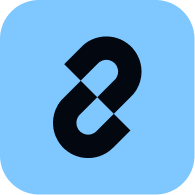
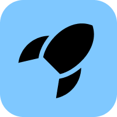
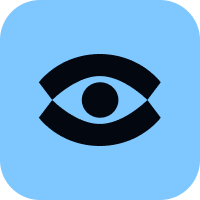

# LangGraph overview

[Course index](../../README.md) · [Original source](https://docs.langchain.com/oss/python/langgraph/overview) · [Raw file](../../raw/optional-readings/ref-399cf6369bd3.html)

Retrieved: 2026-11-13T16:58:44.483431+00:00

# LangGraph overview

Copy pageCopy page

Low-level orchestration framework and runtime for long-running, stateful agents

Copy pageCopy page

LangGraph is a low-level orchestration framework and runtime for long-running, stateful agents. You define workflows as graphs of shared state, nodes, and edges, and can mix deterministic steps with LLM-driven steps in the same graph.
LangGraph focuses on orchestration capabilities such as [durable execution](ref-99e58642fe77.md), [streaming](https://docs.langchain.com/oss/python/langgraph/streaming), and [human-in-the-loop](ref-7dd57631bd24.md). It does not prescribe prompts or agent architecture.
Before you start, learn the building blocks agents use, especially [models](https://docs.langchain.com/oss/python/langchain/models) and [tools](https://docs.langchain.com/oss/python/langchain/tools). Docs examples often use [LangChain](https://docs.langchain.com/oss/python/langchain/overview) for those integrations, but LangGraph does not require LangChain.
If you want a higher-level agent loop first, use [Deep Agents](https://docs.langchain.com/oss/python/deepagents/overview) or LangChain [agents](https://docs.langchain.com/oss/python/langchain/agents). Use LangGraph when you need explicit control over state and control flow.


Show How LangChain products fit together

- [Deep Agents](https://docs.langchain.com/oss/python/deepagents/overview) is an [agent harness](https://docs.langchain.com/oss/python/concepts/products#agent-harnesses-like-the-deep-agents-sdk): planning, subagents, filesystem tools, and context management on top of LangGraph.
- [LangChain](https://docs.langchain.com/oss/python/langchain/overview) is the agent framework: abstractions and integrations for models, tools, and agent loops.
- [LangGraph](ref-399cf6369bd3.md) is the orchestration runtime: durable execution, streaming, human-in-the-loop, and persistence.
- [LangSmith](https://docs.langchain.com/langsmith/observability) is the platform for tracing, evaluation, prompts, and deployment across frameworks.
- [LangSmith Engine](https://docs.langchain.com/langsmith/engine) detects issues in LangGraph agent traces and proposes fixes. You can open a pull request with the proposed fix from the Engine tab.
- [LangSmith Fleet](https://docs.langchain.com/langsmith/fleet/index) is the no-code agent builder for templates, integrations, and routine automation.

For a comparison of the open source stack, see [Frameworks, runtimes, and harnesses](https://docs.langchain.com/oss/python/concepts/products).

## Install

pip

uv

```
pip install -U langgraph
```

```
uv add langgraph
```

Create a minimal graph:

```
from langgraph.graph import StateGraph, MessagesState, START, END

def mock_llm(state: MessagesState):
    return {"messages": [{"role": "ai", "content": "hello world"}]}

graph = StateGraph(MessagesState)
graph.add_node(mock_llm)
graph.add_edge(START, "mock_llm")
graph.add_edge("mock_llm", END)
graph = graph.compile()

graph.invoke({"messages": [{"role": "user", "content": "hi!"}]})
```

For a full calculator agent, see the [LangGraph quickstart](https://docs.langchain.com/oss/python/langgraph/quickstart).

## Capabilities

LangGraph provides the runtime primitives for stateful, long-running workflows. It does not abstract prompts or force a fixed agent architecture.

- **Deterministic and agentic steps**: Combine hand-coded nodes with model-driven nodes in one graph.
- [**Persistence**](ref-99e58642fe77.md): Checkpoint state and resume after failures or pauses.
- [**Human-in-the-loop**](ref-7dd57631bd24.md): Pause execution, inspect or edit state, then continue.
- [**Memory**](https://docs.langchain.com/oss/python/concepts/memory): Short-term thread state and longer-term memory across sessions.
- [**Streaming**](https://docs.langchain.com/oss/python/langgraph/streaming): Stream tokens, state updates, and other events as the graph runs.

## Integrations, deployment, and observability

LangGraph works on its own. However, you can also pair it with other LangChain products:



## LangChain

Integrations and agent abstractions built on LangGraph.

Learn more



## LangSmith Agent Server

Deploy and scale stateful agents, with visual prototyping in Studio.

Learn more



## LangSmith Observability

Trace requests, evaluate outputs, and monitor deployments.

Learn more

## See also

- [LangGraph quickstart](https://docs.langchain.com/oss/python/langgraph/quickstart)
- [Graph API overview](https://docs.langchain.com/oss/python/langgraph/graph-api)
- [Frameworks, runtimes, and harnesses](https://docs.langchain.com/oss/python/concepts/products)
- [Incorporate existing code and other frameworks](https://docs.langchain.com/langsmith/deploy-other-frameworks) (wrap a non-LangGraph agent for LangSmith Agent Server)

---

[Connect these docs](https://docs.langchain.com/use-these-docs) to your agent of choice via MCP for real-time answers.

[Edit this page on GitHub](https://github.com/langchain-ai/docs/edit/main/src/oss/langgraph/overview.mdx) or [file an issue](https://github.com/langchain-ai/docs/issues/new/choose).

Was this page helpful?

YesNo
