# VS Code with Copilot: agent quickstart

[Course index](../../README.md) · [Original source](https://code.visualstudio.com/docs/agents/quickstart) · [Raw file](../../raw/optional-readings/ref-3f891021aedc.html)

Retrieved: 2026-11-13T16:57:51.715401+00:00

# Quickstart: Complete your first task with an agent

Copy as Markdown


- Copy as Markdown
- [View as Markdown](https://code.visualstudio.com/docs/agents/quickstart.md)
- [Ask in VS Code](vscode://GitHub.Copilot-Chat/chat?prompt=Read%20https%3A%2F%2Fcode.visualstudio.com%2Fdocs%2Fagents%2Fquickstart%20and%20answer%20questions%20about%20the%20content.&windowId=_blank)
- [Ask in VS Code Insiders](vscode-insiders://GitHub.Copilot-Chat/chat?prompt=Read%20https%3A%2F%2Fcode.visualstudio.com%2Fdocs%2Fagents%2Fquickstart%20and%20answer%20questions%20about%20the%20content.&windowId=_blank)

---

In this quickstart, you use an AI agent in Visual Studio Code to build a small web app from a natural-language prompt. You then review the generated code, let the agent validate the app with browser tools, and verify the result yourself.

The app uses a single HTML file, so you don't need to install runtimes or build tools.

## Prerequisites

- [Download and install Visual Studio Code](https://code.visualstudio.com/download).
- [Set up GitHub Copilot in VS Code](https://code.visualstudio.com/docs/setup/copilot).

  This quickstart uses Copilot with the recommended session settings shown below. You don't need to compare models or configure additional tools first.

Note

Requests in this quickstart use AI credits from your Copilot plan. Copilot Free includes a monthly allowance. Open the Copilot status dashboard from the Status Bar to monitor your monthly usage. Learn more about [AI credits and model costs](https://code.visualstudio.com/docs/agents/concepts/language-models#_ai-credits-and-model-costs) and [what happens when you reach a limit](https://code.visualstudio.com/docs/agents/agent-troubleshooting/faq#_i-reached-my-inline-suggestions-or-ai-credits-limit).

## 1. Create a project folder

Start by creating an empty folder for the quickstart app. In the next section, you open this folder in VS Code and ask an agent to build the app.

Run the following command in your terminal to create the folder:

```
mkdir agent-quickstart
```

## 2. Build the app

For your first task, follow the **Chat view** tab to work with the agent alongside your code in the editor.

If you prefer a dedicated window for agent tasks across projects, follow the **Agents window** tab instead. Both paths build the same app.

Chat viewAgents window

1. In VS Code, select **File** > **Open Folder** from the menu, and then open the `agent-quickstart` folder.

   If VS Code asks whether you trust the folder, select **Manage** from the notification, and then select **Trust**.

   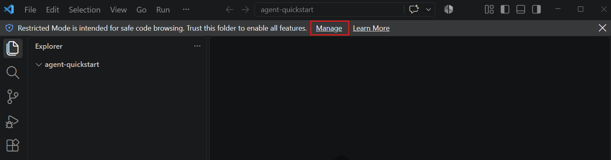
2. Open the Chat view with ⌃⌘I (Windows, Linux Ctrl+Alt+I), and then select `+` to start a new chat.

   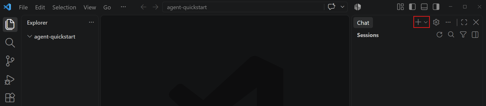
3. Configure the following settings for the chat session. Keep the default values for any other options.

   | Control | Value | Short description |
   | --- | --- | --- |
   | **Session Target** | **Copilot** | Selects the Copilot harness and its tools and workflow for the session. |
   | **Agent** | **Agent** | Uses tools to plan, edit files, run commands, and validate the result. |
   | **Language model** | **Auto** | Automatically selects a model based on task complexity and availability. |
   | **Permissions** | **Manual permissions** | Requests your approval for running tools or accessing resources. The agent can make file edits in your project folder. |

   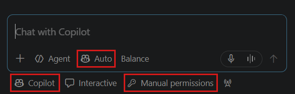
4. Enter the following prompt and press Enter:

   ```
   Create a task list web app in a single index.html file with embedded CSS and JavaScript. Let me add, complete, and delete tasks. Save the tasks in local storage so they persist after a page reload. Use no external libraries.
   ```
5. Follow the agent's progress and review each approval request before you accept it.

   The agent creates the `index.html` file and saves updates as it progresses. Approval prompts appear for actions that aren't covered by your approval settings.

   Tip

   At any time you can stop the agent by selecting the **Stop** button in the chat input or steer it in another direction by sending a new prompt.
6. If the agent asks to open the `index.html` file in the integrated browser, select **Allow in this Session**. You can interact with the app directly in the integrated browser in VS Code.

   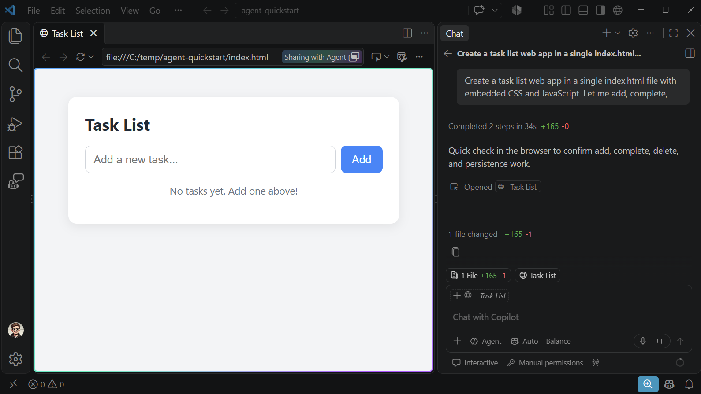

The Agents window is a dedicated window for interacting with agents across different projects.

1. To open the Agents window, select **Open in Agents** in the title bar of VS Code or run **Chat: Open Agents window** from the Command Palette (⇧⌘P (Windows, Linux Ctrl+Shift+P)).

   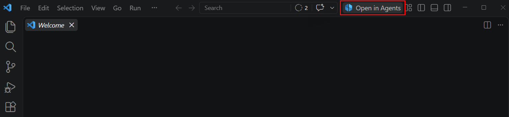
2. Select **New** at the top of the left sidebar to start a new agent session.

   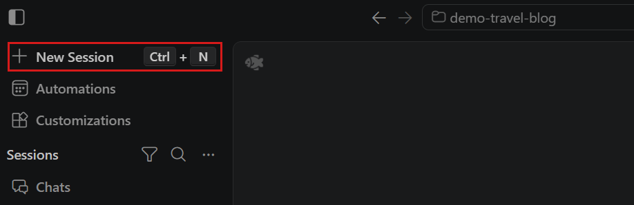
3. Select **This Computer** from the environments dropdown. VS Code lets you connect to agents across different environments, but for this quickstart, you'll use the local environment.

   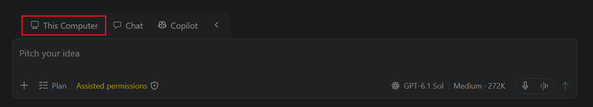
4. Because the Agents window can operate across different projects, select the `agent-quickstart` folder you created earlier from the dropdown.

   If VS Code asks whether you trust the folder, select **Trust**.
5. Configure the following settings for the session. Keep the default values for any other options.

   | Control | Value | Short description |
   | --- | --- | --- |
   | **Session Target** | **Copilot** | Selects the Copilot harness and its tools and workflow for the session. |
   | **Agent** | **Agent** | Uses tools to plan, edit files, run commands, and validate the result. |
   | **Language model** | **Copilot Fusion** / **Auto** | Automatically selects a model based on task complexity and availability. |
   | **Permissions** | **Manual permissions** | Requests your approval for running tools or accessing resources. The agent can make file edits in your project folder. |

   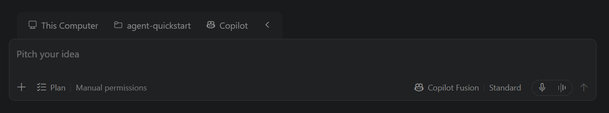
6. Enter the following prompt and press Enter:

   ```
   Create a task list web app in a single index.html file with embedded CSS and JavaScript. Let me add, complete, and delete tasks. Save the tasks in local storage so they persist after a page reload. Use no external libraries.
   ```
7. Follow the agent's progress and review each approval request before you accept it.

   The agent creates the `index.html` file and saves updates as it progresses. Approval prompts appear for actions that aren't covered by your approval settings.

   Tip

   At any time you can stop the agent by selecting the **Stop** button in the chat input or steer it in another direction by sending a new prompt.
8. If the agent asks to open the `index.html` file in the integrated browser, select **Allow in this Session**. You can interact with the app directly in the integrated browser in VS Code.

   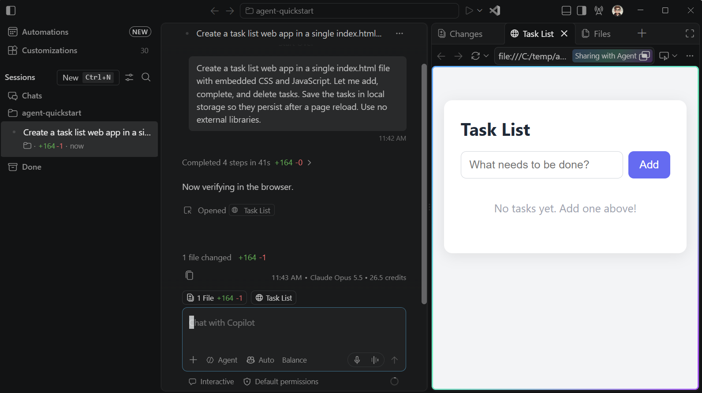

## 3. Review and validate the result

It's important to review the generated code and outcome carefully. You can let the agent validate key scenarios and edge cases for you by running the app in the integrated browser and observing its behavior.

The agent might already have launched the integrated browser to validate that the app runs correctly as part of creating the task list web app in the previous steps.

In the following steps you'll ask the agent to validate the basic functionality of the task list web app.

Chat viewAgents window

1. The Chat view indicates it changed one file and shows diff stats. Select it to review the generated code and its diff.
2. Enter the following prompt to have the agent open the app in the integrated browser and validate its functionality.

   ```
   Open index.html in the integrated browser and validate the app.
   Add a task, mark it complete, and delete it. Then add another task,
   reload the page, and verify that the task persists. If any step fails,
   fix the issue and repeat the complete flow.
   ```
3. Notice how the agent interacts with the integrated browser and autonomously validates different user scenarios.

   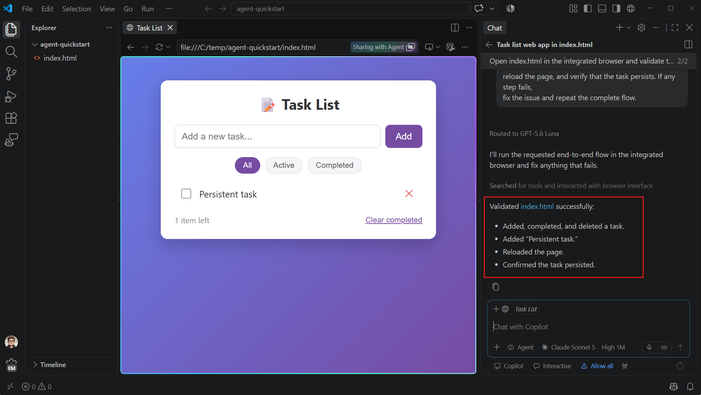

1. Open the **Changes** panel in the right sidebar (⌃⇧G (Windows, Linux Ctrl+Shift+G)) and select `index.html` to review the generated code.

   If you're not happy with a specific part of the result, select it in the diff view and enter feedback to send it to the agent.

   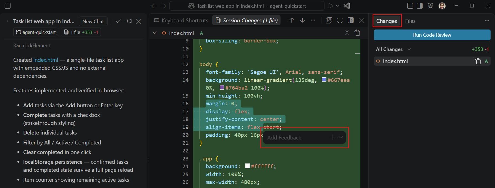
2. Enter the following prompt to have the agent open the app in the integrated browser and validate its functionality.

   ```
   Open index.html in the integrated browser and validate the app.
   Add a task, mark it complete, and delete it. Then add another task,
   reload the page, and verify that the task persists. If any step fails,
   fix the issue and repeat the complete flow.
   ```
3. Notice how the agent interacts with the integrated browser and autonomously validates different user scenarios.

   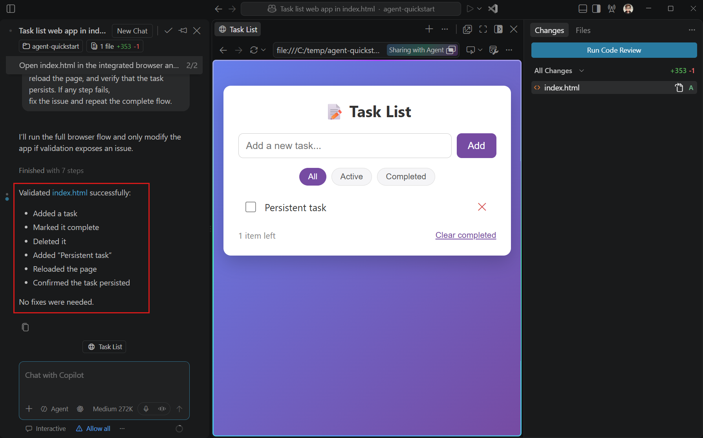

For keyboard and screen reader access to the generated diffs, use the [Accessible Diff Viewer](https://code.visualstudio.com/docs/configure/accessibility/accessibility#_diff-editor-accessibility).

## 4. Verify the result yourself

The agent's validation report helps you find problems, but it doesn't replace your own review. In the integrated browser:

1. Add a task and mark it complete.
2. Reload the page and confirm that the task and its completed state persist.
3. Delete the task and confirm that it doesn't return after another reload.

If a check fails, describe what you observed in chat and ask the agent to fix and retest it. Review the resulting diff before you commit the changes.

You have completed your first task with an agent. The agent interpreted your goal, created the code, exercised the app in the browser, and fixed issues it found. You reviewed both the code and the result.

## Stop, revise, or undo the work

If you're not satisfied with the agent's actions or the results, you have several options:

- **Stop or redirect the current request**: while a request is running, use the **Send** dropdown to choose **Steer with Message** or **Stop and Send**. Stopping doesn't undo actions that already completed.
- **Revise the result**: send a follow-up prompt. In a diff, you can select code and provide focused feedback when the interface offers that action.
- **Undo file changes from a request**: hover over an earlier request and select **Restore Checkpoint**. This restores affected workspace files and chat history. It doesn't reverse terminal commands, network requests, deployments, or changes to external services. Learn more about [reviewing and reverting agent changes](https://code.visualstudio.com/docs/agents/run/review-code-edits).

If a follow-up doesn't resolve the problem, use [Get an agent back on track](https://code.visualstudio.com/docs/agents/guides/get-agent-back-on-track) to choose your next recovery action.

## If your screen looks different

- If the **Copilot** harness or **Agent** isn't available, verify your sign-in and review the [agent harness setup requirements](https://code.visualstudio.com/docs/agents/run/agent-harnesses#_requirements-and-setup). Your organization's policies might restrict specific agents, models, or tools.
- If you reach an AI credits limit, review [what remains available and when allowances reset](https://code.visualstudio.com/docs/agents/agent-troubleshooting/faq#_i-reached-my-inline-suggestions-or-ai-credits-limit).

## Continue in another interface or application

This section is optional. The Agents window and Chat view share your Copilot session, so you can switch between them without losing the conversation.

- From the Agents window, select **Open in Editor** in the title bar. VS Code opens the project in an editor window with the session available in the Chat view.
- Select **Open in Agents** in the application title bar, then select your existing Copilot session from the sessions list.

For other applications, terminal options, or access from another device, see [Continue an existing session](https://code.visualstudio.com/docs/agents/run/sessions/manage-sessions#_continue-between-the-chat-view-and-agents-window). That guide covers the supported routes and their requirements.

## Clean up resources

When you no longer need the app, run these steps to clean up your local resources:

- Close the `agent-quickstart` folder in VS Code.
- Delete the `agent-quickstart` folder from your computer.

## Next steps

- [Apply the workflow to a bounded task in your own project](https://code.visualstudio.com/docs/agents/best-practices#_apply-the-workflow-to-your-project).
- [Explore a codebase without changing files](https://code.visualstudio.com/docs/agents/guides/explore-a-codebase).
- [Build a complete app and learn the editor, browser, and source control workflows](https://code.visualstudio.com/docs/agents/agents-tutorial).
- [Review the recommended security baseline](https://code.visualstudio.com/docs/agents/run/security#_recommended-security-baseline).

11/11/2026
