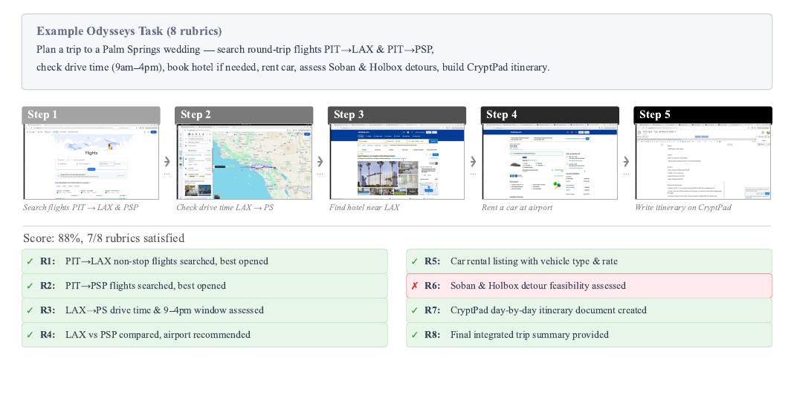
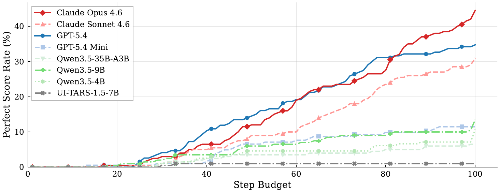

# Odysseys

[Course index](../../README.md) · [Original source](https://odysseys-website.pages.dev/) · [Raw file](../../raw/optional-readings/ref-4bec3d68e90a.html)

Retrieved: 2026-11-13T16:55:44.601057+00:00

# Odysseys

Benchmarking Web Agents on Realistic Long Horizon Tasks

[Lawrence Jang](https://lawrencekjang.github.io/)\*,
[Jing Yu Koh](https://jykoh.com/)\*,
[Daniel Fried](https://dpfried.github.io/),
[Ruslan Salakhutdinov](https://www.cs.cmu.edu/~rsalakhu/)

Carnegie Mellon University · \*Equal contribution

Existing web agent benchmarks have largely converged on short, single-site tasks that frontier models are approaching saturation on. However, real-world web use consists of long-horizon, multi-site workflows. Common tasks such as comparing products across different domains, planning trips across multiple services, or summarizing information from multiple search queries require sustained context and cross-site reasoning over potentially hours of browsing.

To capture and evaluate such behaviors, we introduce Odysseys, a benchmark of 200 long-horizon web tasks derived from real-world browsing sessions and evaluated on the live Internet. We find that binary pass/fail evaluation is inadequate for long-horizon settings and introduce a rubric-based evaluation, annotating each task with a set of graded rubric checkpoints that yields higher agreement with human judgment than commonly used trajectory-level LLM-as-a-judge metrics. We evaluate several leading frontier models and find that the strongest achieves 44.5% perfect task success, leaving substantial headroom. Beyond success rate, we argue that efficiency is a first-class concern for long-horizon agents and introduce a Trajectory Efficiency metric (rubric score per step) on which even frontier agents reach only 1.15%.

[PDF ↓](https://arxiv.org/pdf/2604.24964)
[Paper →](https://odysseysbench.com/paper.html)
[Leaderboard →](https://odysseysbench.com/leaderboard.html)
[Task viewer →](https://odysseysbench.com/viewer.html)
[Task JSON ↗](https://github.com/ljang0/Odysseys/blob/main/data/odysseys.json)

200

tasks

44.5%

best model

## Example task

Each task is a first-person request that a user might realistically give a computer-use agent. Tasks are paired with rubric items that decompose progress into verifiable checkpoints.

Figure 1.
An Odysseys task (with simplified task description), the agent's browsing trajectory, and the rubric-based evaluation that grades partial progress across the full workflow.

## Example trajectories

Recordings of frontier agents executing Odysseys tasks. Pick a task to watch the full browser session.

#### 

easy
Opus 4.6

Full task prompt given to the agent

## Headline result

Performance scales with step budget but plateaus well short of full completion. All models show a broadly sigmoidal curve; frontier API models climb steeper and higher, but none approach the ceiling.

Figure 2.
Perfect rubric rate as a function of step budget, for each evaluated model. Rates stay near zero for the first ~15 steps, rise through the 20 to 70 range, and taper past ~80 as models approach their practical ceiling.

## Contents
