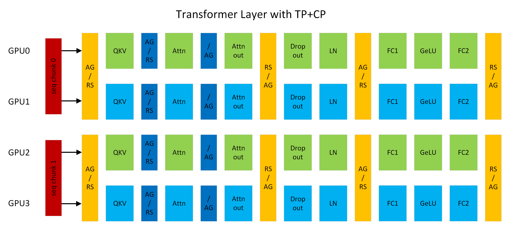
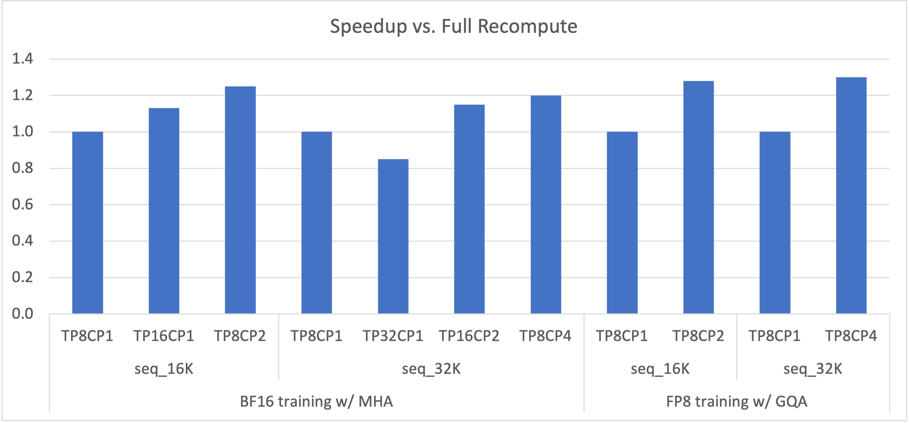

# Megatron Context Parallelism

[Course index](../../README.md) · [Original source](https://docs.nvidia.com/megatron-core/developer-guide/latest/user-guide/features/context_parallel.html) · [Raw file](../../raw/optional-readings/ref-5a91a973dc05.html)

Retrieved: 2026-11-13T16:55:11.112633+00:00

# Context Parallel Overview[#](https://docs.nvidia.com/megatron-core/developer-guide/latest/user-guide/features/context_parallel.html#context-parallel-overview "Link to this heading")

Figure 1: A transformer layer running with TP2CP2. Communications next to Attention are for CP, others are for TP. (AG/RS: all-gather in forward and reduce-scatter in backward, RS/AG: reduce-scatter in forward and all-gather in backward, /AG: no-op in forward and all-gather in backward).[#](https://docs.nvidia.com/megatron-core/developer-guide/latest/user-guide/features/context_parallel.html#id1 "Link to this image")

Context Parallelism (CP) is a parallelization scheme on the sequence-length dimension. Unlike prior SP (sequence parallelism), which only splits the sequence of Dropout and LayerNorm activations, CP partitions the network inputs and all activations along the sequence dimension. With CP, all modules except attention (for example, Linear and LayerNorm) can work as usual without any changes, because they do not have inter-token operations. For attention, the Q (query) of each token must combine with the KV (key and value) of all tokens in the same sequence. CP therefore requires an additional all-gather across GPUs to collect the full sequence of KV. Correspondingly, reduce-scatter is applied to the activation gradients of KV in backward propagation. To reduce activation memory footprint, each GPU stores only the KV of a sequence chunk in forward and gathers KV again in backward. KV communication happens between a GPU and its counterparts in other TP groups. The all-gather and reduce-scatter are implemented as point-to-point communications in a ring topology. Exchanging KV can also leverage MQA or GQA to reduce communication volume, because those variants use one or a few attention heads for KV.

For example, in Figure 1, if the sequence length is 8K, each GPU processes 4K tokens. GPU0 and GPU2 form a CP group and exchange KV with each other; the same pattern applies between GPU1 and GPU3. CP is similar to [Ring Attention](arxiv-2310-01889.md) but targets higher performance by (1) using current open-source and cuDNN flash attention kernels, and (2) avoiding extra work from lower-triangle causal masking while keeping load balanced across GPUs.

## Context Parallelism Benefits[#](https://docs.nvidia.com/megatron-core/developer-guide/latest/user-guide/features/context_parallel.html#context-parallelism-benefits "Link to this heading")

Figure 2: Speedup of 175B GPT with various TP+CP combinations compared to full recomputation (that is, TP8CP1).[#](https://docs.nvidia.com/megatron-core/developer-guide/latest/user-guide/features/context_parallel.html#id2 "Link to this image")

An LLM can hit an out-of-memory (OOM) error on long contexts (long sequence lengths) because activation memory grows about linearly with sequence length. Recomputing activations in backward can avoid OOM but adds significant overhead (about 30 percent with full recomputation). Increasing TP (tensor model parallelism) can also fix OOM, but it can make compute in layers such as Linear too short to hide communication latency. Scaling to more GPUs with larger TP can hit that overlap limit even when OOM is not the driver.

CP addresses these tradeoffs. With CP, each GPU computes on part of the sequence, which scales down both compute and communication by the CP degree. Overlap between them is less of a concern. The activation memory footprint per GPU is also smaller by the CP degree, which reduces OOM risk. As Figure 2 shows, TP and CP together can outperform full recomputation by removing most recompute overhead and balancing compute against communication.

## Enabling Context Parallelism[#](https://docs.nvidia.com/megatron-core/developer-guide/latest/user-guide/features/context_parallel.html#enabling-context-parallelism "Link to this heading")

CP support is included on the GPT code path. Other models that share that path, such as LLaMA, can use CP as well. CP works with TP (tensor model parallelism), PP (pipeline model parallelism), and DP (data parallelism). The total GPU count is TP × CP × PP × DP. CP also works with different attention variants, including MHA, MQA, and GQA, with unidirectional or bidirectional masking.

Enable CP by setting `context_parallel_size=<CP_SIZE>` on the command line. The default `context_parallel_size` is 1, which disables CP. Running with CP requires Megatron Core (>=0.5.0) and Transformer Engine (>=1.1).
