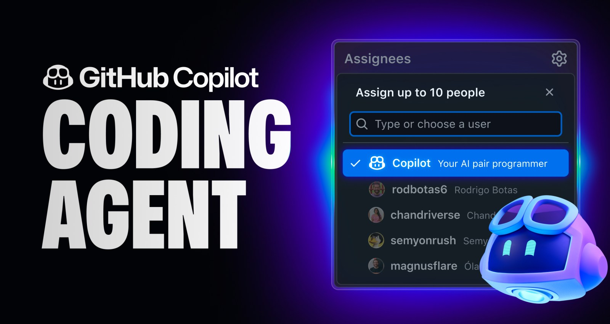
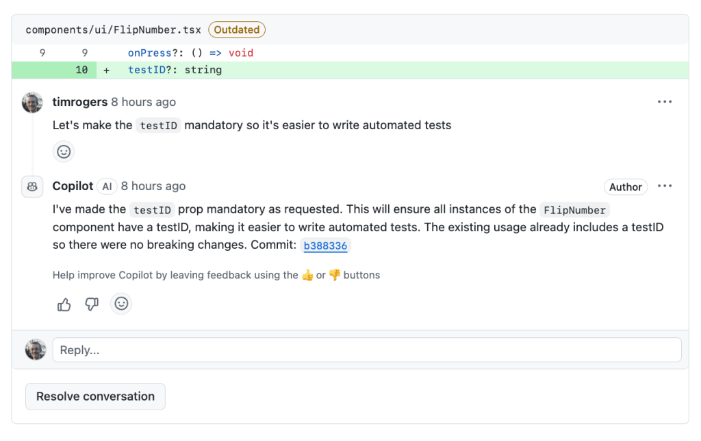
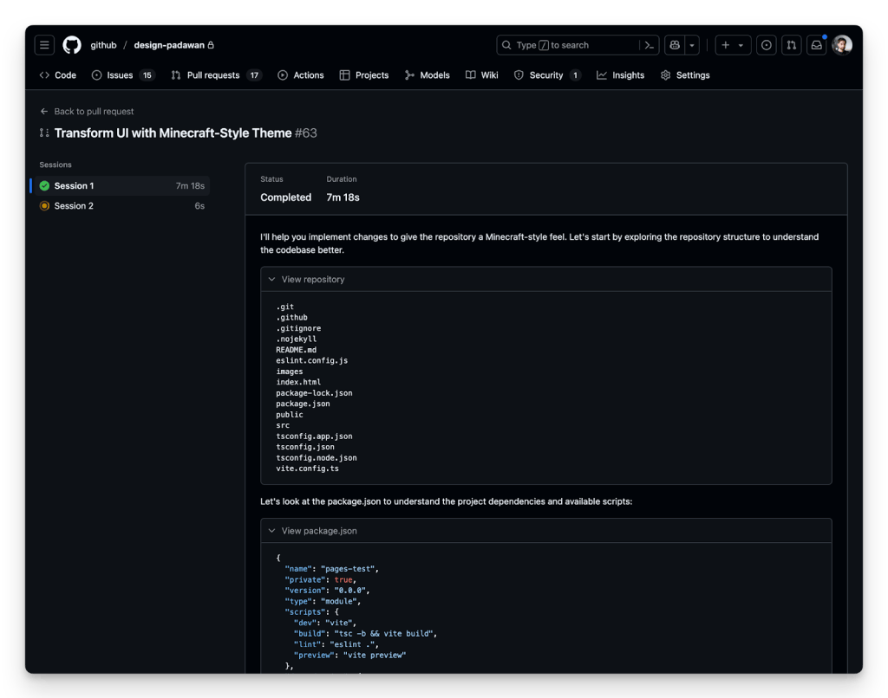
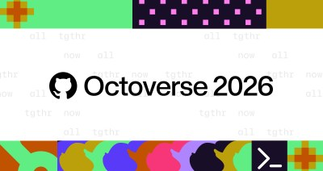

# GitHub Copilot coding agent

[Course index](../../README.md) · [Original source](https://github.blog/news-insights/product-news/github-copilot-meet-the-new-coding-agent/) · [Raw file](../../raw/optional-readings/ref-68c75debbb7b.html)

Retrieved: 2026-11-13T16:57:50.715788+00:00

[Home](https://github.blog/) / [News & insights](https://github.blog/news-insights/) / [Product](https://github.blog/news-insights/product-news/)

# GitHub Copilot: Meet the new coding agent

Implementing features has never been easier: Just assign a task or issue to Copilot. It runs in the background with GitHub Actions and submits its work as a pull request.



[Thomas Dohmke](https://github.blog/author/ashtom/ "Posts by Thomas Dohmke")·[@ashtom](https://github.com/ashtom)

May 19, 2025 
|

Updated May 23, 2025 

|
5 minutes

- Share:

We are excited to introduce [a new coding agent for GitHub Copilot](https://github.com/features/copilot?utm_source=Blog&utm_medium=GitHub&utm_campaign=buildblogtop). Embedded directly into GitHub, the agent starts its work when you assign a GitHub issue to Copilot or prompt it in VS Code. The agent spins up a secure and fully customizable development environment powered by GitHub Actions.

As the agent works, it pushes commits to a draft pull request, and you can track it every step of the way through the agent session logs. Having Copilot on your team doesn’t mean weakening your security posture – existing policies like branch protections still apply in exactly the way you’d expect. Plus, the agent’s pull requests require human approval before any CI/CD workflows are run, creating an extra protection control for the build and deployment environment.

Using state-of-the-art models, the agent excels at low-to-medium complexity tasks in well-tested codebases, from adding features and fixing bugs to extending tests, refactoring code, and improving documentation. You can hand off the time-consuming, but boring tasks to Copilot that will use pull requests, CI/CD, and all of your existing tooling while you focus on the interesting work.

## A detailed look

To run the new coding agent, assign one or more GitHub issues to Copilot. It’s as easy as that. You can do this on [github.com](http://github.com), in GitHub Mobile, or through the GitHub CLI, just as you would assign the same issue to one of your team members or yourself. You can also ask Copilot to open a pull request from Copilot Chat on GitHub or right in VS Code like this:

```
> @github Open a pull request to refactor this query generator into its own class
```

Once an issue is assigned to it, the agent adds an 👀 emoji reaction and starts its work in the background. It boots a virtual machine, clones the repository, configures the environment, and analyzes the codebase with advanced retrieval augmented generation (RAG) powered by GitHub code search. As the agent works, it regularly pushes its changes to a draft pull request as git commits and updates the pull request’s description. Along the way, you’ll see the agent’s reasoning and validation steps in the session logs, making it easy to trace decisions and spot issues.

With the power of Model Context Protocol (MCP), you can give the coding agent access to data and capabilities from outside of GitHub. MCP servers can be configured in the repository’s settings. And, of course, all your GitHub data can be pulled in from the official [GitHub MCP Server](https://github.com/github/github-mcp-server). And the agent isn’t limited to just text – thanks to the power of vision models, it can see images included in GitHub issues you assign to it, so you can share screenshots of a bug or mockups of what your new feature should look like.

Once Copilot is done, it’ll tag you for review and you can leave comments asking for it to make changes. It will pick those comments up automatically and propose code changes. The agent also incorporates context from related issue or PR discussions and follows any custom repository instructions, allowing it to understand both the intent behind the task and the coding standards of the project.


> The Copilot coding agent is opening up doors for human developers to have their own agent-driven team, all working in parallel to amplify their work. We’re now able to assign tasks that would typically detract from deeper, more complex work—allowing developers to focus on high-value coding tasks.
>
> James Zabinski, DevEx Lead at EY

## Integrated, configurable, and secure

All SWE agents need a compute environment to do their work. For agent mode in VS Code, it’s the CPU of your PC or Mac, or a remote development container like GitHub Codespaces. When we started the work on [Project Padawan](https://github.blog/news-insights/product-news/github-copilot-the-agent-awakens/), there was only one answer to which cloud compute we should use: GitHub Actions. Introduced in 2018, Actions is the largest CI/CD ecosystem in the world with more than 25,000 actions in the GitHub Marketplace. Every weekday, GitHub-hosted and self-hosted runners execute more than 40 million daily jobs. Open source projects, startups, and large enterprises all rely on GitHub Actions to run their build, test, and deploy workloads.

Our coding agent is designed from the ground up to keep your project secure and ensures that its work gets a review before it goes to production. The following policies are applied by default:

- The agent can only push to branches it created, keeping your default branch and the ones your team created safe and secure
- The developer who asks the agent to open a pull request *cannot* be the one to approve it – so any “required reviews” rule you have set up in your repository will be honored
- The agent’s internet access is tightly limited to a trusted list of destinations that you can customize
- GitHub Actions workflows won’t run without your approval, giving you the chance to spot-check the agent’s code

Existing repository rulesets and organization policies are considered as well.


> The GitHub Copilot coding agent fits into our existing workflow and converts specifications to production code in minutes. This increases our velocity and enables our team to channel their energy toward higher-level creative work.
>
> Alex Devkar, Senior Vice President, Engineering and Analytics, Carvana

## Get started today

The new coding agent is available to all Copilot Enterprise and Copilot Pro+ customers. All you need to get started is [enabling the agent in the repositories where you want to use it](https://gh.io/copilot-coding-agent-repository-opt-in), and if you’re a Copilot Enterprise user, an administrator will need to [turn on the policy](https://gh.io/copilot-coding-agent-enterprise-policy) too. Additionally, you can now [activate agent mode in more IDEs, including Xcode, Eclipse, Jetbrains, and Visual Studio](https://github.blog/changelog/2025-05-19-agent-mode-and-mcp-support-for-copilot-in-jetbrains-eclipse-and-xcode-now-in-public-preview/).

Beginning June 4, 2025, Copilot coding agent will use one [premium request](https://docs.github.com/en/copilot/managing-copilot/monitoring-usage-and-entitlements/about-premium-requests) per model request the agent makes.

Whether it’s code completions, next edit suggestions, chat, agent mode, or now coding agent, GitHub Copilot has always had one mission: To keep you in the [magical flow state](https://github.blog/developer-skills/career-growth/how-to-get-in-the-flow-while-coding-and-why-its-important/). To do the things you don’t want to do, so you have more time for the things you do. To find the creative spark that brought you to this industry in the first place. Happy coding!

[Visit the Docs to get started with GitHub Copilot coding agent.](https://docs.github.com/en/enterprise-cloud@latest/copilot/using-github-copilot/using-copilot-coding-agent-to-work-on-tasks/about-assigning-tasks-to-copilot)

---

## Tags:

- [agent mode](https://github.blog/tag/agent-mode/)
- [agentic AI](https://github.blog/tag/agentic-ai/)
- [GitHub Copilot](https://github.blog/tag/github-copilot/)

## Written by


### [Thomas Dohmke](https://github.blog/author/ashtom/)

[@ashtom](https://github.com/ashtom)

Fascinated by software development since his childhood in Germany, Thomas Dohmke has built a career building tools to accelerate developer happiness. Previously, Thomas was the Chief Executive Officer of GitHub (2021-2025) where he oversaw the rise of the world’s most widely adopted AI developer tools—including the launches of GitHub Copilot, Copilot Workspace, and GitHub Models. Thomas has also been a celebrated TED speaker and holds a PhD in mechanical engineering from University of Glasgow, UK.

- [agent mode](https://github.blog/tag/agent-mode/)
- [agentic AI](https://github.blog/tag/agentic-ai/)
- [GitHub Copilot](https://github.blog/tag/github-copilot/)

## More on [agent mode](https://github.blog/tag/agent-mode/)

### [WRAP up your backlog with GitHub Copilot coding agent](https://github.blog/ai-and-ml/github-copilot/wrap-up-your-backlog-with-github-copilot-coding-agent/)

An easy-to-remember acronym, WRAP will help you write effective issues, refine your instructions, and get the most out of Copilot coding agent.

[Brittany Ellich](https://github.blog/author/brittanyellich/ "Posts by Brittany Ellich") & [Jason Etcovitch](https://github.blog/author/jasonetco/ "Posts by Jason Etcovitch")

### [A step-by-step guide to modernizing Java projects with GitHub Copilot agent mode](https://github.blog/ai-and-ml/github-copilot/a-step-by-step-guide-to-modernizing-java-projects-with-github-copilot-agent-mode/)

Learn how to use GitHub Copilot agent mode to modernize legacy Java projects with guided upgrades, automated fixes, and cloud-ready migrations.

[Andrea Griffiths](https://github.blog/author/andreagriffiths11/ "Posts by Andrea Griffiths")

## Related posts


[Company news](https://github.blog/news-insights/company-news/)

### [GitHub availability report: October 2026](https://github.blog/news-insights/company-news/github-availability-report-october-2026/)

In October, we experienced eight incidents that resulted in degraded performance across GitHub services.


[Company news](https://github.blog/news-insights/company-news/)

### [GitHub Universe 2026: Evolving every layer of the stack](https://github.blog/news-insights/company-news/github-universe-2026-evolving-every-layer-of-the-stack/)

Today, we laid out our vision for GitHub as the most comprehensive, end-to-end software delivery system in the world.



[News & insights](https://github.blog/news-insights/)

### [Octoverse: Commits, pushes, reach new highs in 2026 as developers build with agents](https://github.blog/news-insights/octoverse/octoverse-commits-pushes-reach-new-highs-in-2026-as-developers-build-with-agents/)

See how a record year of growth reached every industry, every field, and every kind of builder in the 2026 Octoverse report.

## Explore more from GitHub


### Docs

Everything you need to master GitHub, all in one place.

[Go to Docs](https://docs.github.com/)


### GitHub

Build what’s next on GitHub, the place for anyone from anywhere to build anything.

[Start building](https://github.com/)


### Customer stories

Meet the companies and engineering teams that build with GitHub.

[Learn more](https://github.com/customer-stories)


### GitHub Universe 2026

Catch up on the key announcements shaping the future of software development.

[See what's new](https://github.com/events/universe/recap?utm_source=blog-bottom-tile-home-k2k&utm_medium=blog&utm_campaign=universe-2026)

## We do newsletters, too

Discover tips, technical guides, and best practices in our biweekly newsletter just for devs.

Your email address
