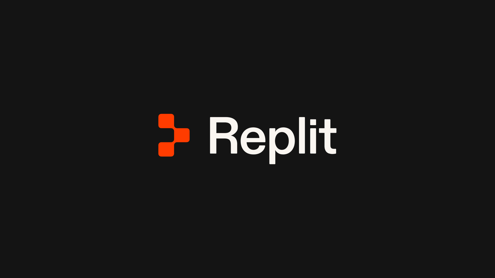
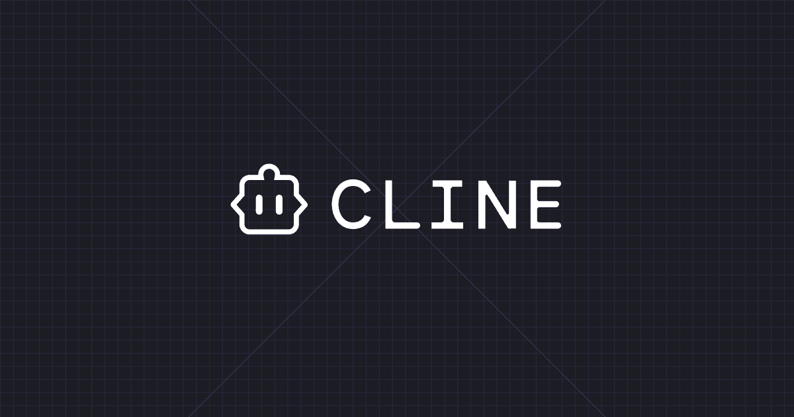

# OpenRouter Provider Analytics

[Course index](../../README.md) · [Original source](https://openrouter.ai/) · [Raw file](../../raw/optional-readings/ref-6dba8b525a6d.html)

Retrieved: 2026-11-13T16:54:41.789330+00:00

# The future is multi-model

Run all your AI workloads securely on one neutral platform, with the best model at the best intelligence per dollar.

[Get API key](https://openrouter.ai/workspaces/default/keys)Use your agent

monthly tokens
:   800T+

users
:   10M+

models
:   600+

## Teams that build on OpenRouter

- 
- 
- 
- 
- 
- 
- 
- 

- 
- 
- 
- 
- 
- 
- 
- 

## One API for every model

600+ models for text, images, video, audio, and more from 80+ providers.

[Discover models⁠](https://openrouter.ai/discover)

Text344Image66Video32Speech37Transcription31Embeddings35Rerank11Decisions32Audio4

[

DeepSeek V4.1 Flash 1017

deepseek/deepseek-v4.1-flash-1017

Tokens this week
:   61.8T

Change from last week
:   -1%](https://openrouter.ai/deepseek/deepseek-v4.1-flash-1017)[

Hy4

tencent/hy4

Tokens this week
:   22.6T](https://openrouter.ai/tencent/hy4)[

DeepSeek V4.1 Flash

deepseek/deepseek-v4.1-flash

Tokens this week
:   17.6T

Change from last week
:   -3%](https://openrouter.ai/deepseek/deepseek-v4.1-flash)[

GLM 5.3 Flash

z-ai/glm-5.3-flash

Tokens this week
:   13T

Change from last week
:   -20%](https://openrouter.ai/z-ai/glm-5.3-flash)[

GPT-6 Luna

openai/gpt-6-luna

Tokens this week
:   8.3T

Change from last week
:   +2%](https://openrouter.ai/openai/gpt-6-luna)[

Step 5 Preview

stepfun/step-5-preview

Tokens this week
:   7.7T

Change from last week
:   +1%](https://openrouter.ai/stepfun/step-5-preview)

## Better, faster, cheaper. Get all three.

OpenRouter picks the model and provider for each request using live data from across our marketplace, so your responses come back faster, fail less, and only cost what the task needs.

[Compare models⁠](https://openrouter.ai/rankings#benchmarks)

model: "openrouter/auto"

- 

  Claude Opus 5.55%
- 

  Grok 4.710%
- 

  Gemini 3.8 Flash25%
- 

  DeepSeek V4.1 Flash60%

Saved this month$48,213.40

## Stay up through outages and rate limits

Failover is on by default, so you don't write retry logic or pay for failed requests. You can also add your own provider keys for extra capacity.

[See how failover works⁠](https://openrouter.ai/docs/guides/routing/provider-selection)

Providers

Anthropic

Amazon Bedrock

Google Vertex

Through OpenRouter

## Your usage, models, and spend all in one place

Bring your own provider keys and keep the deals you've already negotiated. Every request, model, and dollar still shows up in one dashboard for your whole team.

[Learn more about dashboards⁠](https://openrouter.ai/docs/guides/features/activity)

ProductionLast 14 days

Requests
:   1.3M+12%

Tokens
:   8.4B+9%

Spend
:   $0

- Claude Opus 5.5
- GPT-6.1 Sol
- Gemini 4 Argon
- Other

Monthly budget$0 / $2,000

x

Alerts at 80%, stops at 100%.

## Your data, your policies

Choose which providers can see your prompts, whether they can keep them, and which region processes them. We enforce those rules on every request, whatever model you use.

- SSO and SCIM
- Zero data retention
- EU & US in-region routing
- Workspaces and budgets
- Bring your own keys
- Audit logs
- Private endpoints & providers
- Uptime SLAs

[Learn more about guardrails⁠](https://openrouter.ai/docs/guides/features/guardrails)

ProductionWorkspace policy

Zero data retention

Allow prompt training

Processing region

AnyEUUS

Allowed providers

- 

  Anthropic
- 

  OpenAI
- 

  Google Vertex
- 

  Amazon Bedrock
- 

  Azure
- 

  Mistral
- 

  DeepSeek
- 

  Groq
- 

  Together
- 

  Fireworks
- 

  Cerebras
- 

  Cloudflare
- 

  DeepInfra

## What people build on OpenRouter

250k+ apps using OpenRouter with 4.2M+ users globally

[View all⁠](https://openrouter.ai/apps)

[

Replit

The easiest way to go from idea to app](https://replit.com)[

Hermes Agent

An autonomous agent that grows with you](https://openrouter.ai/apps/url/https%3A%2F%2Fhermes-agent.nousresearch.com%2F)[

Cline

The open-source AI coding agent](https://cline.bot/)

## One API key, 600+ models.

Send your first request in a few minutes. Pay as you go, no subscriptions.

[Get started for free](https://openrouter.ai/workspaces/default/keys)Use your agent
