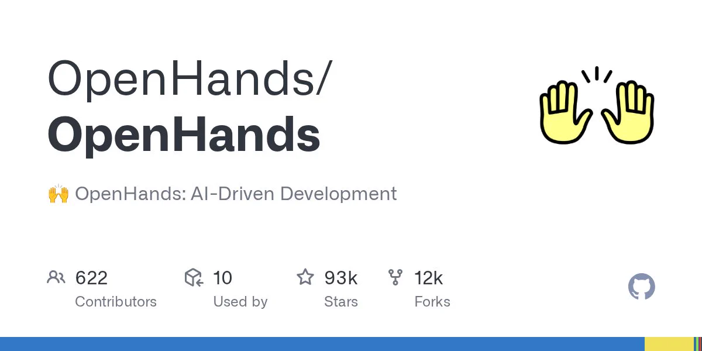

# OpenDevin: original callout

[Course index](../../README.md) · [Original source](https://x.com/JustinLin610/status/1767769034186211557) · [Raw file](../../raw/optional-readings/ref-6e55f120e19a.html)

Retrieved: 2026-11-13T16:57:34.044291+00:00

[Junyang Lin](https://x.com/JustinLin610)[@JustinLin610](https://x.com/JustinLin610)

Me and [@huybery](https://x.com/huybery) are discussing about reproducing Devin. [github.com/opendevin/open…](https://t.co/MPkP78kWmF "https://github.com/opendevin/opendevin") Come and join us and see if we can make something great together!

[

GitHub - OpenHands/OpenHands: 🙌 OpenHands: AI-Driven Development](https://t.co/MPkP78kWmF)[From github.com](https://t.co/MPkP78kWmF)

[4:25 AM · Mar 13, 2024](ref-6e55f120e19a.md)·[192K

Views](https://x.com/JustinLin610/status/1767769034186211557)

[42](https://x.com/compose/post?in_reply_to=1767769034186211557)

267

1.5K

915
