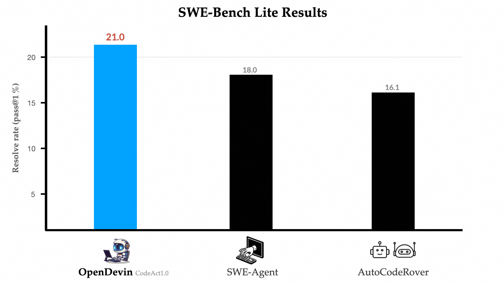
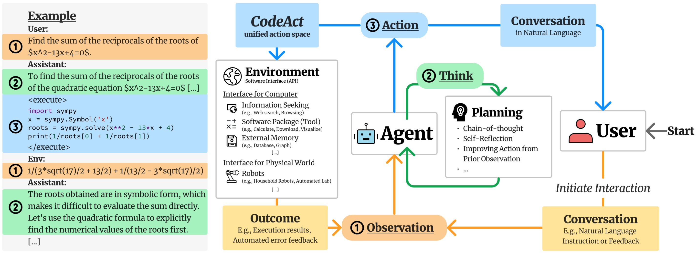

# OpenDevin CodeAct 1.0

[Course index](../../README.md) · [Original source](https://xwang.dev/blog/2024/opendevin-codeact-1.0-swebench/) · [Raw file](../../raw/optional-readings/ref-6f62ba16682a.html)

Retrieved: 2026-11-13T16:57:36.217794+00:00

## What We Did

In the past couple months, there have been a number of amazing demos of agents that promise to make software development easier by autonomously solving some coding tasks. [OpenDevin](https://github.com/OpenDevin/OpenDevin)    was established two months ago to build an **open** framework for software development agents that allows **users** to access the best of these agents in a fully open-source framework, and allows **agent developers and researchers** to evaluate and deliver state-of-the-art agents to users in a community-driven fashion.

Today, the OpenDevin team is happy to make two announcements:

1. Today we introduce **a new state-of-the-art coding agent**, OpenDevin CodeAct 1.0, which achieves **21%** solve rate on SWE-Bench Lite **unassisted**, a 17% relative improvement above the previous state-of-the-art posted by SWE-Agent. OpenDevin CodeAct 1.0 is now the default in OpenDevin v0.5, which you can [download and use today](https://github.com/OpenDevin/OpenDevin).
2. We also are [working on **a new simplified evaluation harness for testing coding agents**](https://github.com/OpenDevin/OpenDevin/pull/1468), which we hope will be easy to use for agent developers and researchers, facilitating comprehensive evaluation and comparison. The current version of the harness is available here ([harness](https://github.com/OpenDevin/OD-SWE-bench/tree/eval)).

  

Figure credit: [Binyuan Hui](https://huybery.github.io/)

## OpenDevin CodeAct 1.0

OpenDevin CodeAct 1.0 is a new agent for solving coding tasks. It is based on [CodeAct](../readings/arxiv-2402-01030.md) ([tweet summary](https://twitter.com/xingyaow_/status/1754556835703751087)), a framework that consolidates LLM agents’ **act**ions into a unified **code** action space. The conceptual idea is illustrated in the following figure.

     

At each turn, the agent can:

1. **Converse:** Communicate with humans in natural language to ask for clarification, confirmation, etc.
2. **CodeAct:** Choose to perform the task by executing code, including executing Linux `bash` commands, or `Python` code (through the [IPython](https://ipython.org/) interpreter).

Inspired by [SWE-Agent](https://swe-agent.com/), the previous state-of-the-art open coding agent on the widely-used [SWE-Bench](https://www.swebench.com/) benchmark, we augmented CodeAct with tools based on bash commands to:

- **Open** files and **goto** a particular line number
- **Scroll** up and down
- **Create** a file at a particular path
- **Search** within a directory or file
- **Find** all files in directory
- **Edit** a segment of a file from one line to another

In addition to incorporating SWE-Agent’s action space, we also (1) added a countdown mechanism from [MINT](https://arxiv.org/abs/2309.10691), which encourages the model to finish its job in the fixed number of interactions, and (2) simplified the process of writing bash commands and action parsing.

## Containerized SWE-Bench Evaluation

[SWE-Bench](https://www.swebench.com/) is a great benchmark that tests the ability of coding agents to solve real-world github issues on a number of popular repositories.

However, due in part to its realism the process of evaluating on SWE-Bench can initially seem **daunting**. Specifically, the evaluation entails a sequence of steps for each prediction across every task instance and its associated codebase:

- Resetting the codebase to its initial state
- Activating an appropriate conda environment and running installation
- Apply the test patch to the codebase
- Apply prediction patch to the codebase, trying automatic fixes upon failure
- Running the testing script and evaluating the result

To help make it easy to perform this process in an efficient, stable, and reproducible manner, the OpenDevin team **containerized the evaluation environment**. This preparation involves setting up all necessary testbeds (codebases at various versions) and their respective conda environments in advance. For each task instance, we initiate a sandbox container where the testbed is pre-configured, ensuring a ready-to-use setup for the agent.

This supports both SWE-Bench-Lite (a smaller benchmark of 300 issues that is more conducive to quick benchmarking) and SWE-Bench (the full dataset of 2,294 issues, work-in-progress). With our evaluation pipeline, we obtained a replicated SWE-agent resolve score of 17.3% (52 out of 300 test instances) on SWE-Bench-Lite using the [released SWE-agent patch predictions](https://github.com/swe-bench/experiments/tree/main/evaluation/test/20240402_sweagent_gpt4), which differs by 2 from the originally reported 18.0% (54 out of 300).

## How Does OpenDevin CodeAct 1.0 Stack Up?

Given this harness, we compared our proposed CodeAct 1.0 agent with three other baselines:

- **OpenDevin MonologueAgent:** the first quick-and-dirty agent that we implemented when OpenDevin started 2 months ago, which was not optimized for accuracy on GitHub issue fixing.
- **[AutoCodeRover](https://arxiv.org/abs/2404.05427):** a method from National University of Singapore that incorporates tools for code search and patching. We report numbers from their paper.
- **SWE-Agent:** the current state-of-the-art on SWE-Bench, which implements similar actions as described above.

We evaluated on SWE-Bench Lite, with our results reported below:

| System | SWE-Bench Lite Resolve Rate (Pass@1) |
| --- | --- |
| **OD Monologue** | 2.7 |
| **AutoCodeRover** | 16.11 (reported) |
| **SWE-Agent** | 18.0 (reported), 17.3 (reproduced) |
| **OD CodeAct 1.0** | **21.0** |

We can see that OpenDevin CodeAct 1.0 convincingly outperforms the other agents, with a relative improvement of 17%! Notably, it also improves drastically over the previous default agent in OpenDevin, solving 7x as many issues properly – a huge leap.

If you want to use this new state-of-the-art coding agent to perform tasks on your own software repos, just head over to our [GitHub repository](https://github.com/OpenDevin/OpenDevin/) and run OpenDevin 0.5 or above!

## Join Us for the Next Steps

CodeAct 1.0 is a big step forward, but it is still far from perfect. Fortunately, the OpenDevin and CodeAct frameworks make it easy to make further improvements by improving prompts, adding additional tools, or adding additional specialized agents.

We would love to have you join our community through [Slack](https://join.slack.com/t/opendevin/shared_invite/zt-2ggtwn3k5-PvAA2LUmqGHVZ~XzGq~ILw) or [Discord](https://discord.gg/ESHStjSjD4), and contribute or post issues on [GitHub](https://github.com/OpenDevin/OpenDevin/)   !
