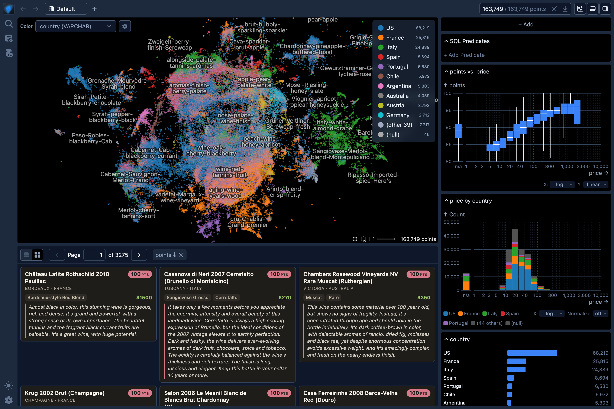
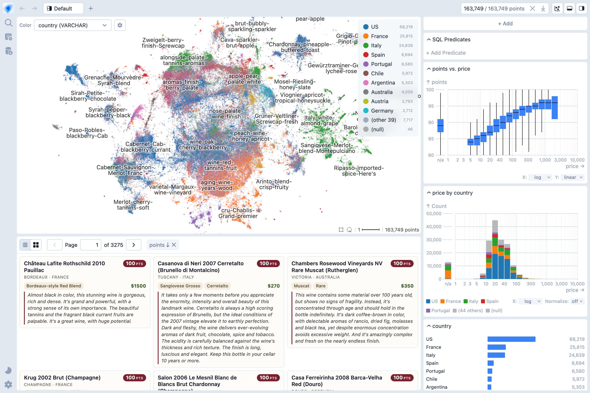

# Embedding Atlas

[Course index](../../README.md) · [Original source](https://apple.github.io/embedding-atlas/) · [Raw file](../../raw/optional-readings/ref-6fa32b7c7361.html)

Retrieved: 2026-11-13T16:58:45.146789+00:00

[Skip to content](ref-6fa32b7c7361.md)

[Embedding Atlas](https://apple.github.io/embedding-atlas/)

Search`⌘``Ctrl``K`

Appearance

# Embedding AtlasScalable, Interactive Visualization

Visualize, cross-filter, and search embeddings and metadata.

[Examples](https://apple.github.io/embedding-atlas/examples/)

[Load Data](https://apple.github.io/embedding-atlas/app/)

[Documentation](https://apple.github.io/embedding-atlas/overview.html)

🏷️

## Automatic data clustering & labeling

Interactively visualize and navigate overall data structure.

🔍

## Real-time search & nearest neighbors

Find similar data to a given query or existing data point.

🚀

## Smooth rendering at scale

Render up to a few million points with density contours, powered by WebGPU.

📊

## Linked dashboards & cross-filtering

Arrange charts and configure cross-filtering between them. Compose custom charts via a chart spec.

🧩

## Multimodal data support

Built-in viewers for text, image, audio, numeric, categorical, and time columns.

🤖

## AI agent access via MCP

AI agents can query, chart, and explore your data via Model Context Protocol.
