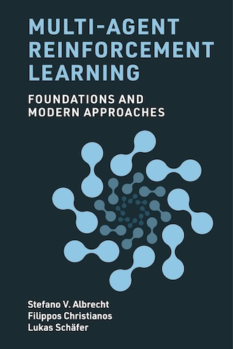

# Multi-Agent Reinforcement Learning: Foundations and Modern Approaches

[Course index](../../README.md) · [Original source](https://www.marl-book.com/) · [Raw file](../../raw/optional-readings/ref-77bc037fa503.html)

Retrieved: 2026-11-13T16:59:25.010614+00:00

MIT Press 2024

# Multi-Agent Reinforcement Learning

Foundations and Modern Approaches

[Stefano V. Albrecht](https://agents-lab.org/stefano-albrecht/)/[Filippos Christianos](https://fchristianos.com/)/[Lukas Schäfer](https://www.lukaschaefer.com/)

The first comprehensive introduction to multi-agent reinforcement learning.

[Download the PDFcolor, 8 MB](multi-agent-reinforcement-learning-book.md)
[Order the bookMIT Press](https://mitpress.mit.edu/9780262049375/multi-agent-reinforcement-learning/)

[Errata for the second printing](https://www.marl-book.com/errata.txt) · report issues to issues~at~marl-book~dot~com



## About the book

Multi-agent reinforcement learning (MARL) is an area of machine learning in which multiple decision-making agents learn to optimally interact in a shared environment. The book gives an introduction to the models, solution concepts, algorithmic ideas, and technical challenges in MARL, and describes modern approaches that integrate deep learning to produce scalable learning algorithms. It comes with a codebase written in Python that implements several of the algorithms discussed, along with a chapter describing how they are implemented. Readers are assumed to have an undergraduate background in basic mathematics and a basic familiarity with programming to use the codebase.

### About the cover

The cover represents a learning process between two agents (shown as dots) that interact repeatedly (edges between dots), spiraling toward a fixed-point solution in the center. For example, two agents repeatedly playing Rock-Paper-Scissors will eventually learn to play the Nash equilibrium strategy of uniformly randomizing between the three actions.

- PublisherMIT Press, 2024
- Chapters11 chapters, in two parts
- PDFFree to download
- ExtrasCode & lecture slides

## Table of contents

Summary of Notation · List of Figures · Preface

1. 1 Introduction

### Part 1 Foundations of Multi-Agent Reinforcement Learning

2. 2 Reinforcement Learning
3. 3 Games: Models of Multi-Agent Interaction
4. 4 Solution Concepts for Games
5. 5 Multi-Agent Reinforcement Learning in Games: First Steps and Challenges
6. 6 Multi-Agent Reinforcement Learning: Foundational Algorithms

### Part 2 Multi-Agent Deep Reinforcement Learning: Algorithms and Practice

7. 7 Deep Learning
8. 8 Deep Reinforcement Learning
9. 9 Multi-Agent Deep Reinforcement Learning
10. 10 Multi-Agent Deep Reinforcement Learning in Practice
11. 11 Multi-Agent Environments

Appendix A: Surveys on Multi-Agent Reinforcement Learning

## News

Follow the authors for updates: [Stefano](https://x.com/s_albrecht), [Filippos](https://x.com/f_christianos), [Lukas](https://x.com/LukasSchaefer96)

1. The Chinese translated edition of the book, published by China Machine Press, is now available ([publisher book page](https://www.cmpbook.com/products/detail?id=332785), [JD online shop](https://item.jd.com/10150741850508.html?spmTag=YTAyNDAuYjAwMjQ5My5jMDAwMDQwMjcuMiUyM3NrdV9jYXJk)).
2. The first printing of the book (released in December 2024) has sold out. A second printing is now in production, and the updated book PDF is available on this page.
3. The Artificial Intelligence Research Institute in Barcelona (IIIA-CSIC) hosted a [summer course](https://iiia.csic.es/en-us/marl-course/) based on the book, given by Stefano V. Albrecht. The [lecture recordings](https://www.youtube.com/playlist?list=PLkoCa1tf0XjCU6GkAfRCkChOOSH6-JC_2) and [coding exercises](https://github.com/marl-book/marl-book-exercises) are now available.

## Code and slides

### Codebase

The book comes with a codebase written in Python, containing implementations of several MARL algorithms presented in the book. Its primary purpose is to provide algorithm code that is self-contained and easy to read.

[Codebase on GitHub](https://github.com/marl-book/codebase)

[Exercises on GitHub](https://github.com/marl-book/marl-book-exercises)

### Lecture slides

Lecture slides for chapters 1 to 9 are available as PDF files and LaTeX sources, so that instructors can make changes as required.

If you use the book or slides in your class, please let us know and we will add your class and institution to a class list.

[Slides on GitHub](https://github.com/marl-book/slides)

## Endorsements

Solicited by MIT Press

> The authors meticulously bring reinforcement learning together with game theory to provide a foundation for research and application of multi-agent reinforcement learning. This book is the perfect starting point for a grounding in the field.

Andrew BartoProfessor Emeritus, University of Massachusetts Amherst; 2024 Turing Award recipient


> Multi-agent reinforcement learning is well positioned to be the next white-hot area of artificial intelligence and this book provides the essential background, concepts, and insights for understanding this exciting and important area of research.

Michael L. LittmanProfessor of Computer Science, Brown University


> This book is the first complete reference for the growing area of multi-agent reinforcement learning. It provides both an essential resource for newcomers to the field and a valuable perspective for established researchers.

Peter StoneProfessor of Computer Science, The University of Texas at Austin


> A landmark textbook to multiagent reinforcement learning, combining game-theoretic foundations with state-of-the-art deep learning. This essential textbook delivers fundamental insights for newcomers, experts and practitioners, featuring real-world applications and advanced algorithms.

Karl TuylsDirector of AI Research, Meta AI; Professor of Computer Science, University of Liverpool


> This will become the standard text of the emerging field of multiagent reinforcement learning. It builds from foundational ideas, incorporating recent breakthroughs in deep learning. This book will help accelerate theoretical and practical progress.

Mykel J. KochenderferProfessor of Aeronautics and Astronautics, Stanford University

## Citation

Stefano V. Albrecht, Filippos Christianos, and Lukas Schäfer. *Multi-Agent Reinforcement Learning: Foundations and Modern Approaches.* MIT Press, 2024.

BibTeX
Copy

```
@book{ marl-book,
  author = {Stefano V. Albrecht and Filippos Christianos and Lukas Sch\"afer},
  title = {Multi-Agent Reinforcement Learning: Foundations and Modern Approaches},
  publisher = {MIT Press},
  year = {2024},
  url = {https://www.marl-book.com}
}
```

## Start reading today

The complete book is available as a free PDF.

[Download the PDF](multi-agent-reinforcement-learning-book.md)
[Order a print copy](https://mitpress.mit.edu/9780262049375/multi-agent-reinforcement-learning/)
