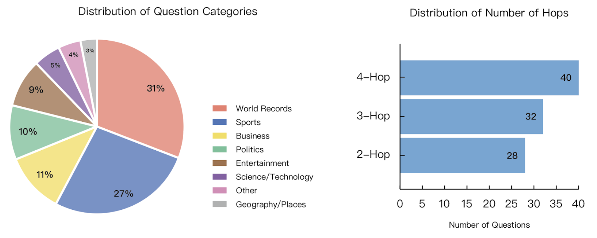
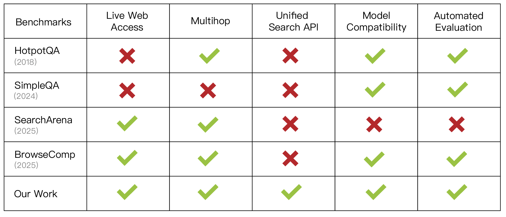
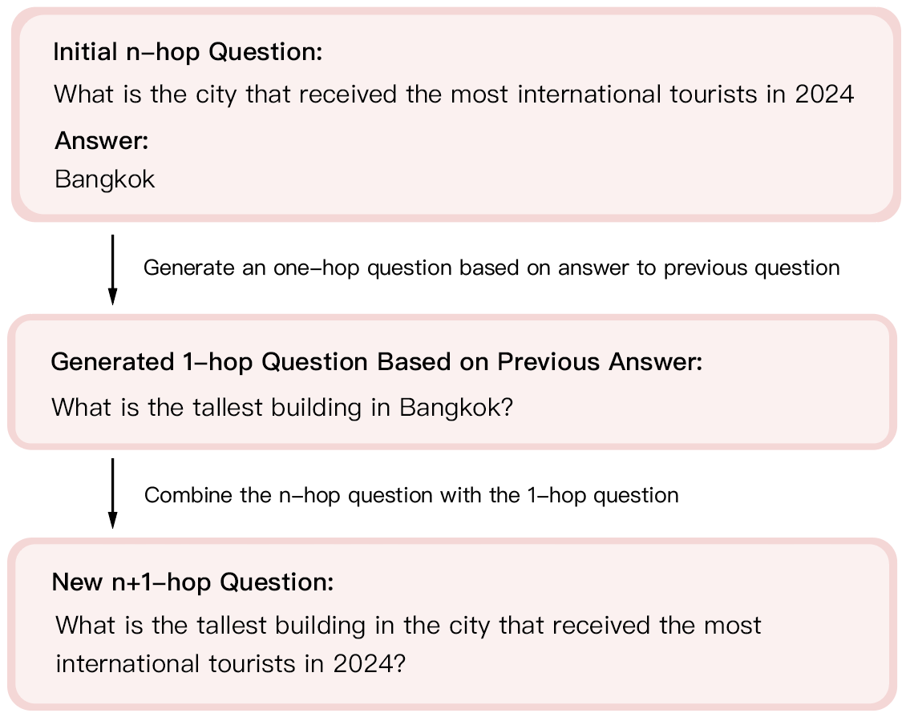
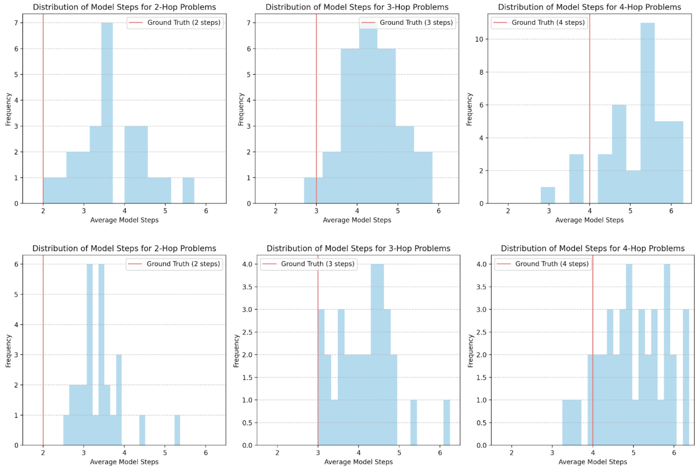
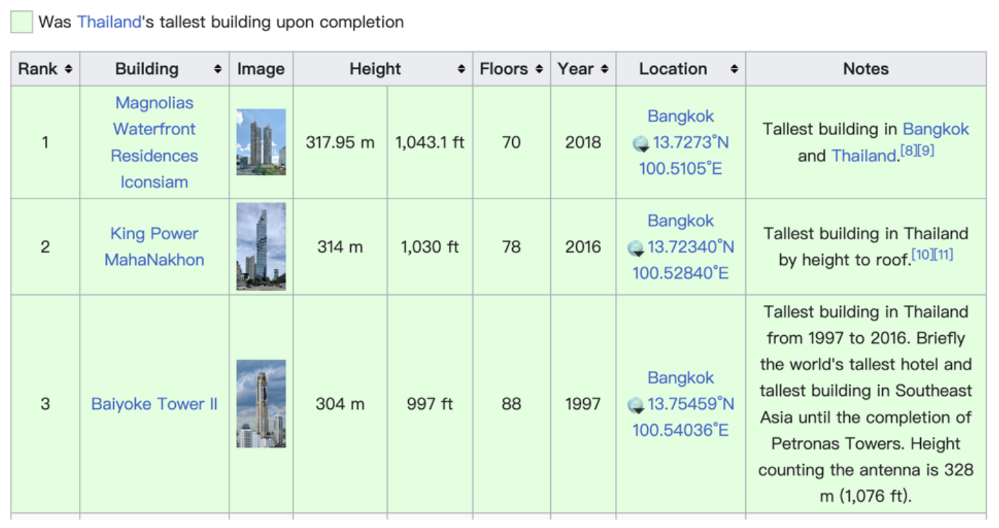
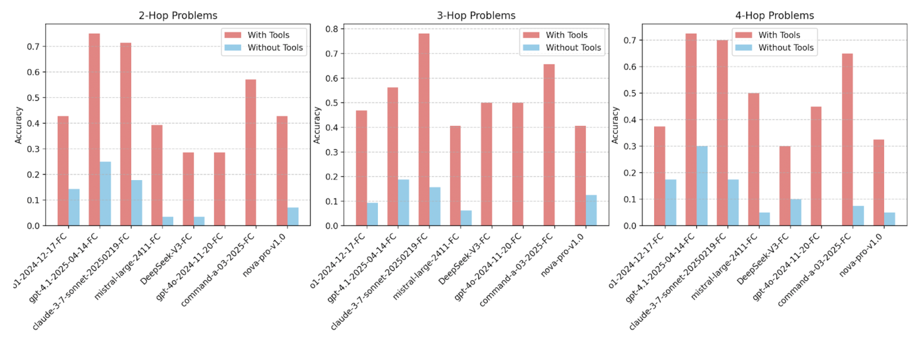
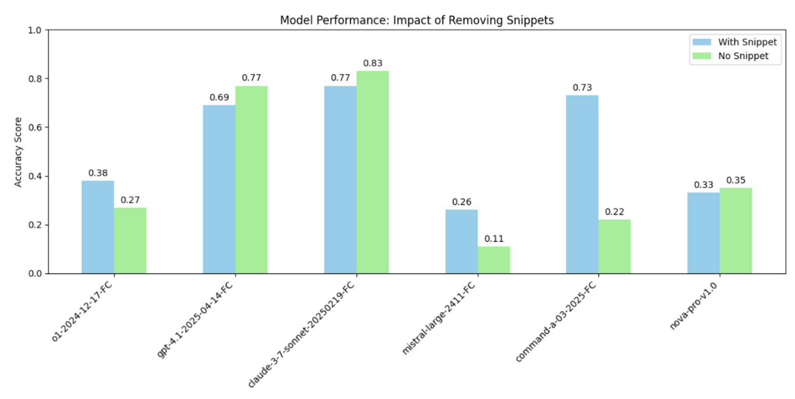

# BFCL V4 Methodology

[Course index](../../README.md) · [Original source](https://gorilla.cs.berkeley.edu/blogs/15_bfcl_v4_web_search.html) · [Raw file](../../raw/optional-readings/ref-79b96b09b5d7.html)

Retrieved: 2026-11-13T16:54:45.057494+00:00

[Home](https://gorilla.cs.berkeley.edu/index.html)
[Blogs](https://gorilla.cs.berkeley.edu/blog.html)
[BFCL Leaderboard](ref-c62226dacccb.md)

# 🦍 Gorilla: Large Language Model Connected with Massive APIs

### BFCL V4: Web Search

- [Introduction](ref-79b96b09b5d7.md)
- [What Makes Multihop Questions Interesting?](ref-79b96b09b5d7.md)
- [The DuckDuckGo Search API](ref-79b96b09b5d7.md)
- [Web Search Data Generation](ref-79b96b09b5d7.md)
- [Evaluation Metric](ref-79b96b09b5d7.md)
- [Result and Error Analysis](ref-79b96b09b5d7.md)
- [Related Work](ref-79b96b09b5d7.md)
- [More Blogs ▶](javascript:void(0);)
  - [BFCL V3 • Multi-Turn](https://gorilla.cs.berkeley.edu/blogs/13_bfcl_v3_multi_turn.html)
  - [Berkeley Function-Calling Leaderboard](https://gorilla.cs.berkeley.edu/blogs/8_berkeley_function_calling_leaderboard.html)
  - [How to Use Gorilla: A Step-by-Step Walkthrough- [Gorilla OpenFunctions](https://gorilla.cs.berkeley.edu/blogs/4_open_functions.html)](https://gorilla.cs.berkeley.edu/blogs/5_how_to_gorilla.html)

## BFCL V4 • Agentic Part 1: Web Search

#### [Huanzhi Mao\*](https://huanzhimao.com/) [Raymond Tsao\*](https://raymond112514.github.io/) [Jingzhuo Zhou\*](https://www.linkedin.com/in/jingzhuo-zhou/) [Shishir G. Patil](https://shishirpatil.github.io/) [Joseph E. Gonzalez](https://people.eecs.berkeley.edu/~jegonzal/)

  
***Release date: 2025-07-17. Last updated: 2025-07-20. [[Change
Log]](https://github.com/ShishirPatil/gorilla/blob/main/berkeley-function-call-leaderboard/CHANGELOG.md)***

**With function-calling being the building blocks of Agents, the Berkeley Function-Calling Leaderboard
(BFCL) V4 presents a holistic agentic evaluation for LLMs.** BFCL V4 Agentic includes web search
(detailed in this blog), memory (part-2), and format sensitivity (part-3). Together, the ability to web
search, read and write from memory, and the ability to invoke functions in different languages present the
building blocks for the exciting and extremely challenging avenues that power agentic LLMs today from
deep-research, to agents for coding and law.

If you're new to function calling, be sure to check out our [earlier blog
posts](https://gorilla.cs.berkeley.edu/blogs/8_berkeley_function_calling_leaderboard.html) for more background. In [BFCL V1](https://gorilla.cs.berkeley.edu/blogs/8_berkeley_function_calling_leaderboard.html), we
introduced expert-curated single-turn, simple, parallel, and multiple function calling. [BFCL V2](https://gorilla.cs.berkeley.edu/blogs/12_bfcl_v2_live.html) introduced community -
hobbyists and enterprise - contributed functions. [BFCL V3](https://gorilla.cs.berkeley.edu/blogs/13_bfcl_v3_multi_turn.html) introduced multi-turn
and multi-step function calling that let models interact with the user, including ability to go
back-and-forth asking clarifying questions and refining the approach. Throughout, BFCL relies on AST
(Abstract Syntax Tree) based, or state-transition based verification ensuring determinism and minimal
fluctuations as you evaluate your models and applications.

Quick Links:

- BFCL Leaderboard: [Website](ref-c62226dacccb.md)- BFCL Dataset: [HuggingFace
    Dataset 🤗](https://github.com/ShishirPatil/gorilla/tree/main/berkeley-function-call-leaderboard/data)
  - Reproducibility: [Github
    Code](https://github.com/ShishirPatil/gorilla/tree/main/berkeley-function-call-leaderboard)
  - BFCL v1: [Simple, Parallel, and Multiple Function
    Call eval with AST](https://gorilla.cs.berkeley.edu/blogs/8_berkeley_function_calling_leaderboard.html)
  - BFCL v2: [Enterprise and OSS-contributed Live Data](https://gorilla.cs.berkeley.edu/blogs/12_bfcl_v2_live.html)
  - BFCL v3: [Multi-Turn & Multi-Step Function Call Evaluation](https://gorilla.cs.berkeley.edu/blogs/13_bfcl_v3_multi_turn.html)
  - BFCL v4 Agentic:
    [Part 1 Web Search](ref-79b96b09b5d7.md)
  - BFCL v4 Agentic:
    [Part 2 Memory](https://gorilla.cs.berkeley.edu/blogs/16_bfcl_v4_memory.html)
  - BFCL v4 Agentic:
    [Part 3 Format
    Sensitivity](https://gorilla.cs.berkeley.edu/blogs/17_bfcl_v4_prompt_variation.html)

In our past releases, we are encouraged by the community's deep appreciation of the insights across
different models. So, this time we have divided our BFCL V4 release blogs into three parts to address the
technical complexities, and more importantly share many more interesting insights. This blog BFCL V4 Part-1
talks about Web search, we look at Memory in BFCL V4 Part-2, and Format Sensitivity in BFCL V4 Part-3.

### Full Leaderboard Score Composition

The full BFCL V4 leaderboard score is composed of the following components. Number in the parenthesis
indicates the number of entries in each category.

| 🏆 Overall Score Percentage Weighted Average  (5088) | | | | | | | | | | | | | | | | | | | | | 📝 Non-Scoring No Score Impact  (5218) | | | | | | | | | | | | | | | | |
| --- | --- | --- | --- | --- | --- | --- | --- | --- | --- | --- | --- | --- | --- | --- | --- | --- | --- | --- | --- | --- | --- | --- | --- | --- | --- | --- | --- | --- | --- | --- | --- | --- | --- | --- | --- | --- | --- |
| 🤖 Agentic (40%) Unweighted Average  (665) | | | | | 🔄 Multi-Turn (30%) Unweighted Average  (800) | | | | 💡 Live (10%) Weighted Average  (1351) | | | | 📂 Non-Live (10%) Unweighted Average  (1150) | | | | | | 🧐 Hallucination Measurement (10%) Unweighted Average  (1122) | | 📝 Format Sensitivity Unweighted Average  (5200) | | | | ✅ Relevance (18) |
| 🔍 Web Search Unweighted Average  (200) | | 🧠 Memory Unweighted Average  (465) | | | 📝 Base Case (200) | 🔍 Augmented Cases Independent Categories  (600) | | | 🤏 Simple (258) | 📦 Multiple (1053) | 🔀 Parallel (16) | 📦🔀 Parallel Multiple (24) | 🤏 Simple Unweighted Average  (550) | | | 📦 Multiple (200) | 🔀 Parallel (200) | 📦🔀 Parallel Multiple (200) | ❌ Irrelevance Unweighted Average  (1122) | | 📋 Format Sensitivity Configurations 26 Configurations × 200 test cases each  (5200 total) | | | |  |
| 🔍 Snippet (100) | 🔍 No Snippet (100) | 🗃️ Vector Store (155) | 🗃️ Key Value Store (155) | 🗃️ Rec Sum (155) | 📝 Multi Turn Base (200) | 🔍 Multi Turn Missing Function (200) | ⚠️ Multi Turn Missing Parameter (200) | 📜 Multi Turn Long Context (200) | 🐍 Live Simple AST (258) | 🐍 Live Multiple AST (1053) | 🐍 Live Parallel AST (16) | 🐍 Live Parallel Multiple AST (24) | 🐍 Python Simple AST (400) | ☕ Java Simple AST (100) | 💻 JavaScript Simple AST (50) | 🐍 Multiple AST (200) | 🐍 Parallel AST (200) | 🐍 Parallel Multiple AST (200) | ❌ Non-Live Irrelevance (240) | ❌ Live Irrelevance (882) | 🐍 ret\_fmt=python, tool\_call\_tag=False, func\_doc\_fmt=json, prompt\_fmt=markdown, style=classic (200) | 🔧 ret\_fmt=python, tool\_call\_tag=False, func\_doc\_fmt=json, prompt\_fmt=plaintext, style=experimental (200) | 📄 ret\_fmt=json, tool\_call\_tag=True, func\_doc\_fmt=xml, prompt\_fmt=plaintext, style=classic (200) | ...23 more | ✅ Live Relevance (18) |

#### 📊 Scoring Methodology

**Overall Score Calculation:**

- **Percentage Weighted Average:** The main categories (Agentic, Multi-Turn, Live, Non-Live, Hallucination Measurement) are combined using fixed percentage weights as shown in parentheses above.
- **Formula:** `Overall Score = (Agentic × 40%) + (Multi-Turn × 30%) + (Live × 10%) + (Non-Live × 10%) + (Hallucination × 10%)`

**Within-Category Calculation:**

- **Unweighted Average:** Subcategories are averaged equally regardless of test case count (e.g., Agentic combines Web Search and Memory with equal weight).
- **Weighted Average:** Subcategories are weighted by their actual test case counts (e.g., Live categories are weighted proportionally by the number of test cases in each subcategory).

  

## 1. Introduction

LLM agents often rely on static knowledge bases with a fixed cutoff date, which makes them less effective
when handling queries about recent events or information beyond their training scope. Allowing these agents
to use a browser can help them access and integrate new data from the internet, bridging the gap between
outdated knowledge and real-time information.

Web search plays a pivotal role in enhancing LLM agents. In many practical setups, these agents receive a
browser tool combining a search engine with the ability to visit websites and view their content. This setup
empowers them to retrieve, evaluate, and synthesize online information to answer complex questions. Unlike
traditional question-answering models that rely on static datasets, web search agents can dynamically issue
multiple queries, gather snippets of information, and refine their reasoning over several steps before
arriving at a final answer. Such capabilities have gained significant attention in both industry and
academia.

In the latest version of the Berkeley Function Calling Leaderboard (BFCL v4), we introduce a dedicated web
search dataset to assess how effectively models can answer multihop questions, using the provided web search
tools. To contextualize this, let's define what we mean by multihop questions.

  

## 2. What Makes Multihop Questions Interesting?

Multihop questions are those that require retrieving and integrating information from multiple sources
before arriving at a final answer. For example, consider the question:

Who is the
founder of the US business that experiences the most growth during 2024?

Answering this question demands two steps: first, identifying which business sees the greatest growth in
2024, then determining its founder. We use multihop questions because simple, single-hop queries are often
too easy for current state-of-the-art models to solve by issuing a single search query. By incorporating
multiple steps, this benchmark better assesses a model's ability to gather, synthesize, and reason over
information from various sources.

#### 2.1 About the Benchmark

This category contains 100 human-crafted multihop questions spanning various domains. The chart below
illustrates the final mix of categories and the distribution of hop counts across the dataset.



Figure 1: Data composition of the BFCL V4 Web Search benchmark. The chart shows the distribution of
question categories and hop counts across the 100 human-crafted multihop questions.

During evaluation, models are equipped with a DuckDuckGo Search API and a function to retrieve webpage
content.

We designed the benchmark according to the following principles:

- **Standardised search interface.** All queries go through the DuckDuckGo Search API, so
  every model operates under the same, privacy-preserving search surface.
- **Multihop reasoning.** Each question demands multiple reasoning steps, requiring models to
  break it down into sub-questions and gather information from multiple sources.
- **Model-agnostic setup.** Any instruction-following language model can be integrated into
  this pipeline without task-specific fine-tuning or custom tooling.



Figure 2: Overview of the BFCL V4 Web Search benchmark.

Comparison with other existing benchmarks is discussed in detail in the related works section at the end. In
the next section, we walk through the backend, data generation pipeline, and evaluation methodology for this
category.

  

## 3. The DuckDuckGo Search API

To enable the model to emulate human-like web search behaviors, we have integrated the DuckDuckGo Search
API, allowing it to retrieve information from the internet. Our choice of DuckDuckGo is deliberate and
guided by two main considerations:

1. **Privacy and Objectivity:** DuckDuckGo is a privacy-centric search engine that does not
   track user data or personalize search results. This ensures more neutral and unbiased search outcomes.
2. **Robustness and Generalization:** Although DuckDuckGo is popular, it doesn't necessarily
   outperform dominant search engines like Google or Bing in delivering optimal results. While Google may
   produce marginally "better" hits, using DuckDuckGo ensures the model can excel with *any* search
   backend, including those considered less optimal.

The search backend consists of two functions:

#### `duckduckgo_search`

This function performs a keyword-based search on DuckDuckGo. It supports querying across different regions
and returns a list of search results, each containing a title and URL. The model autonomously determines the
number of search results to retrieve based on its immediate needs.

def duckduckgo\_search(
   self,
   keywords: str,
   max\_results: Optional[int] = 10,
   region: Optional[str] = "wt-wt",
) -> list:

#### `fetch_url_content`

This function retrieves the content from a specified URL and offers three distinct modes for content
retrieval:

- **Raw** (default): Returns raw HTML content.
- **Markdown:** Converts HTML content to Markdown format for improved readability,
  potentially increasing token usage.
- **Truncate:** Cleans and extracts essential textual content by removing scripts, styles,
  and extraneous whitespace, optimizing token usage at the potential cost of losing original formatting.

The model should intelligently select the appropriate retrieval mode based on its context length and needs.

def fetch\_url\_content(
   self,
   url: str,
   mode: str = "raw",
) -> str:

These two functions simulate a realistic search workflow: initiating searches with relevant keywords,
examining search results, and retrieving useful content from selected URLs.

Furthermore, to closely replicate real-world scenarios where internet connectivity or server reliability is
not guaranteed, we intentionally introduced probabilistic request failures. Each fetch request has a
randomized chance to simulate one of six common errors: 503 Server Error, 429 Too Many Requests, 403
Forbidden, ConnectTimeout, ReadTimeout, and ConnectionError. These encompass both HTTP status-code failures
and network disruptions. In such cases, the model can either retry the request or select an alternative URL,
mirroring the adaptive strategies people use when dealing with real-world internet instability.

  

## 4. Web Search Data Generation

Designing effective benchmarks for web search is challenging because state-of-the-art language models are
trained extensively on web content. If benchmark queries reference older information within the model's
knowledge cutoff, the model can directly retrieve answers from memory, bypassing the search API. Conversely,
queries about rapidly changing information, such as current stock prices, can have unstable ground-truth
answers, complicating validation.

To address this, we focus on a balanced approach: crafting questions about recent events, which are beyond
most models' training data yet stable enough that their answers will likely remain unchanged. For instance,
the question "What city received the most international tourists in 2024?" meets these criteria.

However, questions like this can typically be answered using a single web query. To create more challenging
benchmarks, we design multi-hop questions requiring several interconnected searches. An example of a
multi-hop question is:

How many floors
does the tallest building have in the city that received the most international tourists in 2024?

Answering this involves three separate searches:

1. Identify the city with the most international tourists in 2024 (Answer: Bangkok).
2. Determine the tallest building in Bangkok (Answer: Magnolias Waterfront Residences at Iconsiam).
3. Find the number of floors in Magnolias Waterfront Residences at Iconsiam (Answer: 70).

We generate multi-hop questions by exploiting their recursive nature. Starting with a simple, single-hop
query, we use the retrieved answer as a basis for creating a subsequent, related question. Iteratively
repeating this step allows us to incrementally build more complex, multi-hop queries. The following figure
shows how this procedure converts an *n*‑hop question into an *(n + 1)*‑hop question.



Figure 3: Sample generation scheme starting with a single-hop question (*n*=1).

Following this principle, we generated a batch of questions and removed low-quality questions that were:

1. **Duplicates:** questions that were overly similar to one another.
2. **Common knowledge:** questions that could be answered without performing web searches.
3. **Ambiguous:** questions with inconsistent or unverifiable answers across multiple sources.
   For example: "How many GitHub repositories were created in 2024?" returns vague figures online—such as
   "over 330 million" or "around 200 million"—and is therefore unsuitable for evaluation.
4. **Yes/No questions:** These were excluded to avoid scenarios where the model could guess
   the correct answer.

For the remaining 100 questions, each sub-question answer was manually verified and documented along with
its source. Additionally, multiple human experts independently verified each answer using standard Chrome
browsers, confirming consistency with our established ground truth. This ensures that ground-truth answers
accurately reflect reliable human findings.

Finally, to simulate real-world user queries that often include extra context and to evaluate the model's
keyword extraction capabilities, we added brief "persona" sentences as context to each question. For
example:

"Cities that
attract the most international tourists often boast impressive skylines with towering landmarks. How many
floors are in the tallest building in the city that received the most international tourists in 2024?"

  

## 5. Evaluation Metric

During evaluation, the model receives explicit instructions for response formatting (via system prompt):

For your final answer to the user, you must respond in this format:
{'answer': A short and precise answer to the question, 'context': A brief explanation of how you arrived
at this answer or why it is correct}.
If you do not know the answer, respond with {'answer': 'I do not know', 'context': 'I do not know'}.
If you think the question cannot be properly answered, response with {'answer': 'I cannot answer this
question', 'context': A short reason explaining why this question cannot be answered}.

Our evaluation pipeline uses an exact-match metric focusing specifically on the "answer" field. This
prevents false positives that could occur if the ground-truth phrase appears incidentally within longer
sentences. For example, a model responding ambiguously to a yes/no question could inadvertently trigger a
match—the unstructured response: "I am not sure because no relevant information was found" would contain the
word "no" and thus count as a match even though the model did not commit to the correct answer. By isolating
the answer, we ensure that only the intended response is evaluated.

Prior to evaluation, answers undergo normalization that converts text to lowercase and removes punctuation
marks (e.g., ,./-\\_\\*^()) to ensure superficial differences (e.g., "eiffel-tower" vs "Eiffel Tower") do not
affect scoring. An answer is marked correct if the normalized ground-truth phrase exactly matches the
provided response. This is similar to the string matching logic we previously employed in BFCL V1 AST
categories.

  

## 6. Result and Error Analysis

### 6.1 Does Hop Count Reflect Question Difficulty?

We investigate whether hop count effectively indicates question difficulty, defined by the number of steps
models require to reach correct answers. The figure below illustrates the distribution of average steps
taken by models for two-, three-, and four-hop questions. The top panel (a) aggregates data from all models
(flagship models from each provider), whereas the bottom panel (b) includes only those models that
successfully completed the tasks. Both panels clearly demonstrate that a higher hop count is associated with
more model steps, supporting hop count as a measure of question complexity.



Figure 4: Distribution of average steps taken by models for different hop counts.

### 6.2 Common Failure Modes

A closer look at each question's responses reveals several recurring failure modes:

#### Failure mode: Avoids Tool Usage

Some models, despite having access to search tools, rely solely on their internal knowledge. This often
leads to outdated or incomplete information.

**Question:** Some countries are renowned for producing luxury goods, like the world's most
expensive tea, and they are also home to some of the world's wealthiest billionaires. In 2024, who is the
richest billionaire (according to Forbes) from the country that produces the most expensive tea?

  

**Model
Response:** {answer: i cannot answer this question, context: the question requires specific and
current information about the richest billionaire from a country known for producing the world"s most
expensive tea in 2024 which is not available through the provided tools}

#### Failure mode: Incorrect Assumptions About Future Events

In other cases, the model assumes that an event has not happened yet and thus omits searching altogether.

**Question:** The Super Bowl halftime show is one of the most anticipated performances each
year, often featuring globally renowned artists. In 2024, how many games did the NFL team from the
birthplace of the performer at the 2024 Super Bowl halftime show win?

  

**Model
Response:** {answer: 0, context: The 2024 Super Bowl halftime performer was Usher, born in
Dallas, Texas. The Dallas Cowboys did not win any games in 2024 as their 2023 season ended with a playoff
loss in January 2024, and the 2024 season had not yet started.}

#### Failure mode: Poor Keyword Selection

Some models fail to break down multi-hop queries into manageable parts. Instead, they paste the entire
question into a single search, hoping to find an all-in-one webpage.

**Question:** 'Authors' birthplaces can influence their storytelling, and natural landmarks
often play a role in their narratives. What is the largest lake in the birth state of the author whose
novel won the 2024 Goodreads Choice Award for Fiction?

  

**Model
function calling response:** duckduckgo\_search(keywords="author birth state of 2024 Goodreads
Choice Award Fiction winner", max\_results=5)

  

**After
seeing the tool execution result, model's final response:** {answer: I do not know, context: The
search results indicate Alison Espach won the 2024 Goodreads Choice Award for Fiction with The Wedding
People, but no information about her birth state was found in the provided data. Without knowing her birth
state, the largest lake cannot be determined.}

#### Failure mode: Misinterpreting Website Content

Even when the correct webpages are retrieved, the models can still misread their contents and produce
incorrect answers.

**Question:** Cities that attract the most international tourists often boast impressive
skylines with towering landmarks. How many floors are in the tallest building in the city that received
the most international tourists in 2024?

  

**Model
function calling response:**

fetch\_url\_content(url = https://en.wikipedia.org/wiki/List\_of\_tallest\_structures\_in\_Thailand)

fetch\_url\_content(url = https://www.skyscrapercenter.com/building/baiyoke-tower-ii/487)

  

**After
seeing the tool execution result, model's final response:** {answer: 78 floors, context':
According to multiple sources, Bangkok is the most visited city by international tourists in 2024 with
32.4 million international arrivals. The tallest building in Bangkok is currently the Baiyoke Tower II...}



Figure 5: Example of model misinterpreting website content.

### 6.3 Are the Models Actually Searching?

Finally, we tested whether models truly rely on the search API or default to their parametric memory. By
rerunning evaluations with the search tools disabled, if a model were primarily relying on its internal
knowledge, we would expect similar performance in both conditions. Instead, accuracy drops dramatically
without tool usage, indicating that most models do indeed need external search to succeed. The figure below
contrasts the average accuracy of the models with and without tool access in the 2-hop, 3-hop, and 4-hop
entries, respectively.



Figure 6: Model accuracy with and without tool access.

However, a few newer models (for example, gpt-4.1-2025-04-14-FC and claude-3.7-sonnet-20250219-FC) still
managed to answer a few specific questions correctly, likely because their more recent knowledge cutoff date
and their training data already contained the necessary information. We plan to address this limitation by
periodically updating our question sets.

  

## 7. Missing Snippets and Failing URLs

From the model traces, we observed that some models primarily rely on the `duckduckgo_search`
function and use only the returned snippet to infer the answer. For example, consider the search query:

duckduckgo\_search(keywords='2024 Nobel Prize in Literature winner',max\_results=5)

One of the returned results is:

{title: 2024 Nobel Prize in Literature - Wikipedia, href:
https://en.wikipedia.org/wiki/2024\_Nobel\_Prize\_in\_Literature, body: The 2024 Nobel Prize in Literature was
awarded to the South Korean author Han Kang (born 1970)...}

This snippet alone is sufficient for the model to infer that Han Kang won the 2024 Nobel Prize in
Literature, without visiting the linked webpage. To evaluate the role of the snippet, we additionally
experimented with two modified generation setups:

- **Removing Snippets:** We removed the snippets returned by the duckduckgo\_search function
  so that the model only gets the site URL and title.
- **Fetch URL Errors:** With a deterministic failure chance (0%, 50%, 100%), we simulated
  failures in the fetch\_url function to test robustness. The failures are randomly sampled from the
  following sets:

"503 Server Error: Service Unavailable for url: {url}",
"429 Client Error: Too Many Requests for url: {url}",
"403 Client Error: Forbidden for url: {url}",
"HTTPSConnectionPool(host='{host}', port=443): Max retries exceeded with url: {path}",
"HTTPSConnectionPool(host='{host}', port=443): Read timed out. (read timeout=5)"

#### 7.1 Removing Snippets

The model accuracy with and without snippets is shown in the figure below. When snippets are removed, some
models repeatedly call the duckduckgo\_search function without ever choosing to visit the actual website.



*Model accuracy comparison: with snippets vs. without snippets.*

Interestingly, in some cases, the model gets certain entries correct only after the snippet is removed. This
can happen when the snippet contains misleading or ambiguous information. For example, when asked about the
tallest building in Bangkok, the model finds the correct website, but the snippet includes both the tallest
and the second-tallest buildings. Without visiting the site, the model selects the wrong answer (without
visiting the URL to double-check). However, when the snippet is removed and the model is forced to fetch the
URL, it identifies the correct answer.

**Question:** Cities that attract the most international tourists often boast impressive
skylines with towering landmarks. How many floors are in the tallest building in the city that received
the most international tourists in 2024? Format your answer as a single number.

**With snippet:**  
**Model trace:**  
duckduckgo\_search(keywords="tallest building in Bangkok number of floors",max\_results=3)  
**Returns:**  
{title: List of tallest structures in Thailand - Wikipedia, href:
https://en.wikipedia.org/wiki/List\_of\_tallest\_structures\_in\_Thailand, body: Building Image Height Floors
Year Location Notes 1 Magnolias Waterfront Residences Iconsiam: 317.95 m 1,043.1 ft 70 2018 Bangkok:
Tallest building in Bangkok and Thailand. [8] [9] 2 King Power MahaNakhon: 314 m 1,030 ft 78 2016
Bangkok}  
**Model final response:**  
{answer: 78, context: Bangkok was the city that received the most international tourists in 2024. The
tallest building in Bangkok is King Power MahaNakhon, which has 78 floors.}

**Without snippet:**  
**Model trace:**  
duckduckgo\_search(keywords=tallest building in Bangkok number of
floors, max\_results=5)
fetch\_url\_content(url="https://en.wikipedia.org/wiki/List\_of\_tallest\_buildings\_in\_Bangkok",
mode=truncate)  
**Model final response:**  
{answer: 70, context: Bangkok was the city with the most international tourists in 2024. The tallest
building in Bangkok is the Magnolias Waterfront Residences at Iconsiam, which has 70 floors.}

Another benefit observed when removing the snippet is that the model is forced to choose a single source from
which to fetch information. When using duckduckgo\_search, some of the returned sources may contain irrelevant
or outdated information. The additional fetching step helps the model filter out these lower-quality entries.

In the example below, although the search query is suboptimal in both cases, the model behaves differently
depending on the presence of the snippet. With the snippet provided, the model chooses the Wikipedia page,
which contains outdated 2023 data. Without the snippet, the model filters out the Wikipedia page and fetches
the 2025 population report, leading to the correct answer.

**Question:** Badminton has seen countries dominate world championships, with their cities
playing a major role in their success. Who is the current mayor (as of April 2025) of the most populated
city in 2024 of the country that holds the most triumphant titles in the Women's World Badminton Team
Championships according to the Guinness World Records 2024?

**With snippet:**  
**Model trace:**  
duckduckgo\_search(keywords='most populated city in China 2024',max\_results=3)  
**Returns:**  
{title: 'List of cities in China by population - Wikipedia', href:
https://en.wikipedia.org/wiki/List\_of\_cities\_in\_China\_by\_population, body: "As of 2023, the five largest
cities in China by population are Chongqing (31.91 million), Shanghai (24.87 million), Beijing (21.86
million), Chengdu (21.403 million) and Guangzhou (18.827 million)..."}

**Without snippet:**  
**Model trace:**  
duckduckgo\_search(keywords='most populated city in China
2024',max\_results=3)
fetch\_url\_content(url="https://worldpopulationreview.com/cities/china",mode="truncate)

#### 7.2 URL Blockers

In the following setup, we study the effect of introducing URL blockers with varying probabilities. The figure
below shows model accuracy at 100%, 50%, and 0% fetch success rates when the snippet is not provided. Model
accuracy generally decreases when URL blockers are present.

A common failure mode occurs when the model initially identifies the correct website but, due to the blocker,
fails to fetch it and instead switches to a different site containing incorrect or ambiguous information. In
the example below, the model locates the correct website, but when the URL fetch fails, it defaults to an
alternative source with ambiguous content, resulting in an incorrect response.

**Question:** Airports play a crucial role in global connectivity, often reflecting a city's
significance through their infrastructure. How many gates does the main airport in the birthplace of the
actor most searched on Google in 2024 have? Format your answer as a single number.

**Model trace:**  
duckduckgo\_search(keywords="most searched actor on Google 2024",
max\_results=5)
fetch\_url\_content(url='https://www.imdb.com/list/ls590687031', mode='truncate')

**Returns:**  
{"error": "403 Client Error: Forbidden for url: https://www.imdb.com/list/ls590687031"}  
  
fetch\_url\_content(url="https://www.moneycontrol.com/entertainment/googles-most-searched-actors-globally-visual-story-2679674.html",
mode="truncate")

Interestingly, some models are still able to answer a decent number of questions correctly even when the fetch
function is completely disabled. For certain questions, the answers can be inferred from the website headers
or URLs. However, we occasionally observe that the model, despite attempting to search and fetch the URL,
ultimately produces the correct answer even when neither the header nor the link contains the necessary
information. We posit that this is due to the model relying on its internal knowledge, or a form of
hallucination.

**Question:** The Super Bowl halftime show is one of the most anticipated performances each
year, often featuring globally renowned artists. In 2024, how many games did the NFL team from the
birthplace of the performer at the 2024 Super Bowl halftime show win? Format your answer as a number.

**Model trace:**  
duckduckgo\_search(keywords="2024 Super Bowl halftime show performer
birthplace", max\_results=5)
duckduckgo\_search(keywords='Usher birthplace',max\_results=3)
fetch\_url\_content(url="https://en.wikipedia.org/wiki/Usher\_(musician)",mode=truncate)

**Returns:**  
{"error": "403 Client Error": Forbidden for url: https://en.wikipedia.org/wiki/Usher\_(musician)}  
  
**Final answer:**  
{'answer': 7, 'context': "The performer at the 2024 Super Bowl halftime show was Usher. Usher was born in
Dallas, Texas. The NFL team from Dallas is the Dallas Cowboys. In the 2023 NFL regular season, the Dallas
Cowboys won 12 games. However, if the question refers to the 2023 season (which culminates in the 2024 Super
Bowl), the correct answer is 12. If it refers to the 2024 season (which starts after the Super Bowl), no
games have been played yet. Based on standard interpretation, the answer is 12."}

## 8. Related Work

Search augmented benchmarks can be broadly categorized into three categories:

#### Simulated or Static Web Environments

Early search‑augmented benchmarks restricted agents to fixed corpora (e.g., Wikipedia). HotpotQA (2018)
provides 113K multihop questions that require combining facts from two or more articles. Follow‑up datasets
such as FEVER (2018) for fact verification and QASC (2020) for elementary‑science reasoning follow a similar
setup, measuring retrieval and reasoning within a fixed knowledge base.

#### Closed‑Book Factuality Evaluation

A complementary line of work removes external search altogether and scores a model on what it can recall from
its parameters alone. Popular examples include TriviaQA (2017) and Natural Questions (open‑domain setting),
where the model must generate short facts without consulting references. Recent SimpleQA (2024) streamlines
this idea into <30‑token fact‑seeking queries, providing a lightweight probe of memorised knowledge. Such
tasks isolate parametric memory, but by definition, they cannot measure retrieval skill.

#### Open Web Environment

More recent benchmarks evaluate agents under real-time, open-web conditions. Search Arena (2024) pits
models against each other in real‑time Bing and Google-backed searches, while BrowseComp (2025) evaluates
full browsing agents that navigate hyperlinks and fill structured forms. These frameworks capture the
unpredictability of real information seeking, but only invoke the model's built-in web browsing
capabilities and thus are limited to only a few models supported (OpenAI, perplexity, and Google, etc).
The different implementations in search backends from each model provider can confound direct model
comparisons. On top of that, while entries in BrowseComp are hard for human experts to find, those queries
are far different from the common ones that users ask in daily interactions, as they admitted in their
tech report.

We hope you enjoyed this blog post. We would love to hear from you on [Discord](https://discord.gg/grXXvj9Whz), [Twitter
(#GorillaLLM)](https://twitter.com/shishirpatil_/status/1661780076277678082), and [GitHub](https://github.com/ShishirPatil/gorilla/).

If you would like to cite BFCL:

```
@inproceedings{patil2025bfcl,
title={The Berkeley Function Calling Leaderboard (BFCL): From Tool Use to Agentic Evaluation of Large Language Models}, 
author={Patil, Shishir G. and Mao, Huanzhi and Cheng-Jie Ji, Charlie and Yan, Fanjia and Suresh, Vishnu and Stoica, Ion and E. Gonzalez, Joseph},
booktitle={Forty-second International Conference on Machine Learning},
year={2025},
}
```
