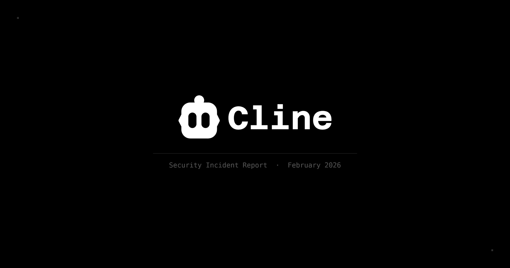

# Cline supply-chain compromise postmortem

[Course index](../../README.md) · [Original source](https://cline.bot/blog/post-mortem-unauthorized-cline-cli-npm) · [Raw file](../../raw/optional-readings/ref-89e3f85f0604.html)

Retrieved: 2026-11-13T16:57:03.137783+00:00

# Post-mortem: Unauthorized Cline CLI npm publish on February 17, 2026

Written by

[Saoud Rizwan](https://cline.bot/blog/author/saoud)

Published on

February 24, 2026



At 3:26 AM PT on February 17th, an unauthorized party used a compromised npm publish token to publish cline@2.3.0 to npm. The published package contained a single modification: an added postinstall script (npm install -g openclaw@latest) that globally installs openclaw, a legitimate open source project. The CLI binary and all other package contents were byte-identical to the previous release. No malicious code was delivered.

By 11:23 AM PT, we had published a corrected version (2.4.0), deprecated 2.3.0, and revoked the compromised token. The exposure window was approximately 8 hours.

The Cline VS Code and Jetbrains extensions were not affected. This incident was limited to the Cline CLI npm package.

## What should you do?

If you use the Cline VS Code extension or JetBrains plugin, no action is required. Those distribution channels were not compromised.

If you use the Cline CLI via npm, check your version:

```
cline --version
```

If you're on 2.3.0 and did not intend to have openclaw installed on your system, update and clean up:

```
npm install -g cline@latest
npm uninstall -g openclaw
```

Versions 2.4.0 and above are clean and now include OIDC provenance attestations linking each published version to a specific GitHub Actions workflow run and source commit.

## What was in cline@2.3.0?

We conducted a full forensic comparison of cline@2.3.0 against the legitimate cline@2.2.3:

- The CLI binary (dist/cli.mjs) is byte-identical to cline@2.2.3. The SHA256 hash matches exactly.
- All other package files (tree-sitter .wasm files, README) are identical.
- The only change was in package.json: the version number was bumped and a postinstall script was added: `"postinstall": "npm install -g openclaw@latest"`

openclaw is a legitimate, non-malicious open source project. Its installation was not authorized or intended, but it does not pose a security risk.

## What was affected?

- The Cline CLI npm package only (version 2.3.0)
- Users who installed this version had openclaw globally installed on their machine

## What was NOT affected?

- The Cline VS Code extension was not compromised at any point. The VS Code Marketplace and OpenVSX tokens were properly rotated on February 9, and no unauthorized versions were published to either registry.
- The Cline JetBrains plugin was not compromised. It lives in a separate repository with separate publishing credentials that were never exposed through this vulnerability.
- The Cline source code repository was not compromised. The vulnerable workflow ran in an ephemeral environment without permission to push code.
- No malicious code was delivered to any user on any platform.
- No user data was accessed or exfiltrated.

## How did it happen?

On December 21, 2025, we added a GitHub Actions workflow to automatically triage incoming GitHub issues. The workflow used claude-code-action and was configured with `allowed_non_write_users: "*"` and access to the Bash tool, meaning any GitHub user could open an issue and Claude would analyze it with the ability to execute shell commands.

This created a prompt injection vulnerability. An attacker could craft an issue title containing instructions that trick Claude into running arbitrary code on the GitHub Actions runner. The workflow itself had limited GitHub permissions (read-only repo access, issues write), but because it ran on the default branch, it shared a cache scope with our nightly release workflow.

GitHub Actions caches are accessible to any workflow in a repository, even if that workflow doesn't explicitly use caching. Although cache entries are immutable, an attacker with code execution in the triage workflow could flood the cache to evict legitimate entries (GitHub evicts immediately after 10 GB). They could then plant poisoned cache entries matching the keys our nightly release workflow expected. When the nightly workflow ran, it would restore the poisoned cache, giving the attacker code execution in a workflow that had access to our publication secrets.

Security researcher Adnan Khan identified this vulnerability and reported it via GitHub Security Advisory on January 1, 2026. The report was not addressed until Adnan publicly disclosed the vulnerability on February 9. Within 30 minutes of the disclosure, we removed the vulnerable workflows and began rotating credentials. The VS Code Marketplace and OpenVSX tokens were rotated successfully. We failed to rotate the NPM token: during the process, the wrong token was deleted while the exposed one remained active. We verified the rotation through npm's org-level token management page, which showed zero active tokens, but the exposed token was not surfaced in that view.

On February 17, a third party used the still-active token to publish cline@2.3.0 with the openclaw postinstall script. The payload was benign, and no attempt was made to modify the CLI binary or introduce malicious code.

## How did we verify nothing else was compromised?

We audited every release published across all four distribution channels during the full exposure window (December 21, 2025 through February 17, 2026).

VS Code Marketplace and OpenVSX: Every extension version and nightly version published during this period was cross-referenced against git tags in our repository and corresponding "Publish Release" or "Publish Nightly Release" GitHub Actions workflow runs. Every version on both registries traces back to an authorized, auditable run. No unauthorized versions were found on either registry.

npm: All tarballs published during the original exposure window were downloaded, extracted, and compared file-by-file against the source code at the corresponding git commit. No unauthorized versions were found.

JetBrains Marketplace: The JetBrains plugin lives in a separate repository with its own publishing credentials that were never exposed through this vulnerability. We audited it for completeness: all versions published during the window have corresponding git tags and successful GitHub Actions workflow runs. No unauthorized versions found.

Source repository: All commits to the cline repository main branch during the exposure window trace to authorized team members or external contributors whose changes were reviewed and merged through pull requests. No unauthorized commits or force pushes were found.

## How are we preventing it from happening again?

The actual user impact here was low (benign payload, small exposure window, CLI-only), but the fact that publication credentials were compromised at all is something we're treating seriously.

Changes we've already made:

- Removed the AI-powered triage workflows entirely. Any future automation will be scoped to read-only operations with no shell access.
- Removed GitHub Actions cache usage from all workflows that handle publication credentials.
- All publication credentials have been rotated and old tokens revoked.
- npm publishing now uses OIDC provenance via GitHub Actions exclusively. There are no long-lived npm tokens. Every published version includes a cryptographic attestation linking it to a specific source commit and workflow run.
- Credential rotation processes now require verification against the actual credential (testing revocation, matching fingerprints), not just checking a management dashboard.

Changes in progress:

- We're establishing a formal vulnerability disclosure and response process with defined SLAs, including active monitoring for [security@cline.bot](mailto:security@cline.bot) and GitHub Security Advisories.
- We're working with third-party security firms to audit our CI/CD infrastructure and identify gaps we might be missing.
- We’re re-evaluating our use of all automation credentials, looking for more secure alternatives, and updating our approval processes for changing these credentials

This incident is a concrete example of how AI agents with broad tool access create new attack surfaces in CI/CD pipelines. Giving an LLM shell access in a CI context where it processes untrusted input is functionally equivalent to giving every GitHub user shell access. The individual techniques involved (prompt injection, cache poisoning, credential theft) aren't new, but the combination is, and it's something the industry is still learning to defend against.

## Acknowledgments

We credit Adnan Khan for discovering and reporting the underlying CI/CD vulnerability. His analysis of the attack chain, including the cache poisoning escalation path and identification of indicators of compromise in our nightly workflows, was thorough and valuable.

The GitHub Security Advisory for the unauthorized npm publish is at [https://github.com/cline/cline/security/advisories/GHSA-9ppg-jx86-fqw7](https://github.com/cline/cline/security/advisories/GHSA-9ppg-jx86-fqw7?ref=cline.ghost.io).

If you have questions, reach out to [security@cline.bot](mailto:security@cline.bot).

## Related Posts

[

### A practical guide to hill climbing

February 26, 2026](https://cline.bot/blog/a-practical-guide-to-hill-climbing)[

### Introducing Cline CLI 2.0: from sidebar to the terminal

February 13, 2026](https://cline.bot/blog/introducing-cline-cli-2-0)[

### Commit messages aren't just for humans

February 18, 2026](https://cline.bot/blog/commit-messages-arent-just-for-humans)
