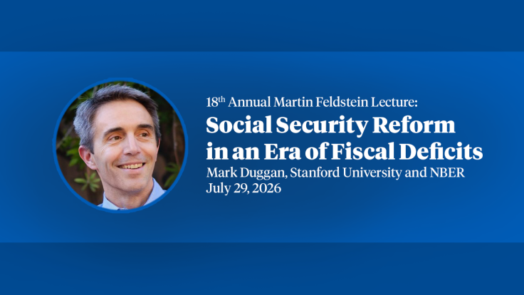
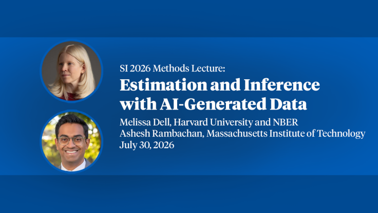

# Automation and New Tasks: How Technology Displaces and Reinstates Labor

[Course index](../../README.md) · [Original source](https://www.nber.org/papers/w25684) · [Raw file](../../raw/optional-readings/ref-93c33c73f992.html)

Retrieved: 2026-11-13T16:59:13.560578+00:00

# Automation and New Tasks: How Technology Displaces and Reinstates Labor

[Daron Acemoglu](https://www.nber.org/people/daron_acemoglu) 

& [Pascual Restrepo](https://www.nber.org/people/pascual_restrepo)

Share

[X](https://twitter.com/intent/?text=Automation%20and%20New%20Tasks%3A%20How%20Technology%20Displaces%20and%20Reinstates%20Labor&url=https://www.nber.org/papers/w25684 "X")
[LinkedIn](https://www.linkedin.com/sharing/share-offsite/?url=https://www.nber.org/papers/w25684 "LinkedIn")
[Facebook](https://www.facebook.com/sharer/sharer.php?u=https://www.nber.org/papers/w25684 "Facebook")
[Bluesky](https://bsky.app/intent/compose?text=Automation%20and%20New%20Tasks%3A%20How%20Technology%20Displaces%20and%20Reinstates%20Labor+https://www.nber.org/papers/w25684 "Bluesky")
[Threads](https://www.threads.net/intent/post?text=Automation%20and%20New%20Tasks%3A%20How%20Technology%20Displaces%20and%20Reinstates%20Labor&url=https://www.nber.org/papers/w25684 "Threads")
[Email](mailto:?subject=Automation and New Tasks: How Technology Displaces and Reinstates Labor&body=https://www.nber.org/papers/w25684 "Email")
[Link](https://www.nber.org/papers/w25684 "Link")

Working Paper 25684

DOI 10.3386/w25684

Issue Date March 2019

We present a framework for understanding the effects of automation and other types of technological changes on labor demand, and use it to interpret changes in US employment over the recent past. At the center of our framework is the allocation of tasks to capital and labor—the task content of production. Automation, which enables capital to replace labor in tasks it was previously engaged in, shifts the task content of production against labor because of a displacement effect. As a result, automation always reduces the labor share in value added and may reduce labor demand even as it raises productivity. The effects of automation are counterbalanced by the creation of new tasks in which labor has a comparative advantage. The introduction of new tasks changes the task content of production in favor of labor because of a reinstatement effect, and always raises the labor share and labor demand. We show how the role of changes in the task content of production—due to automation and new tasks—can be inferred from industry-level data. Our empirical decomposition suggests that the slower growth of employment over the last three decades is accounted for by an acceleration in the displacement effect, especially in manufacturing, a weaker reinstatement effect, and slower growth of productivity than in previous decades.

- Acknowledgements and Disclosures

  Prepared for Journal of Economic Perspectives. We thank the editors Enrico Moretti, Gordon Hanson, and Tim Taylor for their useful guidance and feedback. We also thank David Autor, Nils Lehr, Ben Moll, and Anna Salomons for comments and suggestions. Giovanna Marcolongo and Martina Uccioli provided outstanding research assistance, and Georg Graetz, Joachim Hubmer, Christina Patterson and Gregory Wright generously shared their data and crosswalks with us. We gratefully acknowledge financial support from Google, Microsoft, the Sloan Foundation, the Toulouse Network on Information Technology, the Schmidt Sciences Foundation, the Smith Richardson Foundation, IBM, Accenture, and the National Science Foundation. The views expressed herein are those of the authors and do not necessarily reflect the views of the National Bureau of Economic Research.
- Citation and Citation Data

  Copy Citation

  Daron Acemoglu and Pascual Restrepo, "Automation and New Tasks: How Technology Displaces and Reinstates Labor," NBER Working Paper 25684 (2019), https://doi.org/10.3386/w25684.

  Copy to Clipboard

  Download Citation

## Non-Technical Summaries

- [New Insights on Past and Present Impacts of Automation](https://www.nber.org/digest/jun19/new-insights-past-and-present-impacts-automation)

  Author(s):
  [Daron Acemoglu](https://www.nber.org/people/daron_acemoglu)[Pascual Restrepo](https://www.nber.org/people/pascual_restrepo)

  Rapid wage growth and a stable labor share of national income coincided with automation in the past because other technological...

## Published Versions

Daron Acemoglu & Pascual Restrepo, 2019. "[Automation and New Tasks: How Technology Displaces and Reinstates Labor,](http://doi.org/10.1257/jep.33.2.3)" Journal of Economic Perspectives, vol 33(2), pages 3-30. citation courtesy of 

## Related

### Topics

[Labor Economics](https://www.nber.org/topics/labor-economics)

[Labor Supply and Demand](https://www.nber.org/taxonomy/term/571)

### Programs

[Labor Studies](https://www.nber.org/programs-projects/programs-working-groups/labor-studies)

## More from the NBER

In addition to [**working papers**](https://www.nber.org/papers), the NBER disseminates affiliates’ latest findings through a range of free periodicals—the [**NBER Reporter**](https://www.nber.org/reporter), the [**NBER Digest**](https://www.nber.org/digest), the [**Bulletin on Health**](https://www.nber.org/bulletin-health), the [**Bulletin on the Economics of Alzheimer's**](https://www.nber.org/ba?page=1&perPage=50), and the [**Bulletin on Entrepreneurship**](https://www.nber.org/bulletin-entrepreneurship)—as well as [**research spotlights, lectures, and panel videos**](https://www.nber.org/research/videos?page=1&perPage=50)**.**

[2026, 18th Annual Feldstein Lecture, Mark Duggan, "Social Security Reform in an Era of Fiscal Deficits"](https://www.nber.org/research/videos/2026-18th-annual-feldstein-lecture-mark-duggan-social-security-reform-era-fiscal-deficits)

- Feldstein Lecture

- Presenter:
  [Mark Duggan](https://www.nber.org/people/mark_duggan)

Mark Duggan, who is currently the Wayne and Jodi Cooperman Professor of Economics at Stanford University and will soon...

[2026, Methods Lecture, Melissa Dell and Ashesh Rambachan, "Estimation and Inference with AI-Generated Data"](https://www.nber.org/research/videos/2026-methods-lecture-melissa-dell-and-ashesh-rambachan-estimation-and-inference-ai-generated-data)

- Methods Lectures

- Presenters:
  [Melissa Dell](https://www.nber.org/people/melissa_dell) 

  & [Ashesh Rambachan](https://www.nber.org/people/ashesh_rambachan)

Research Associate Melissa Dell of Harvard University and Ashesh Rambachan of MIT delivered the 2026 Methods...

[2026, SI Household Finance, Paul Goldsmith-Pinkham, "Using AI in Household Finance Research: A Practical Guide"](https://www.nber.org/research/videos/2026-si-household-finance-paul-goldsmith-pinkham-using-ai-household-finance-research-practical-guide)

- Video

- Presenter:
  [Paul Goldsmith-Pinkham](https://www.nber.org/people/paul_goldsmithpinkham)

Supported by the Vanguard Group
