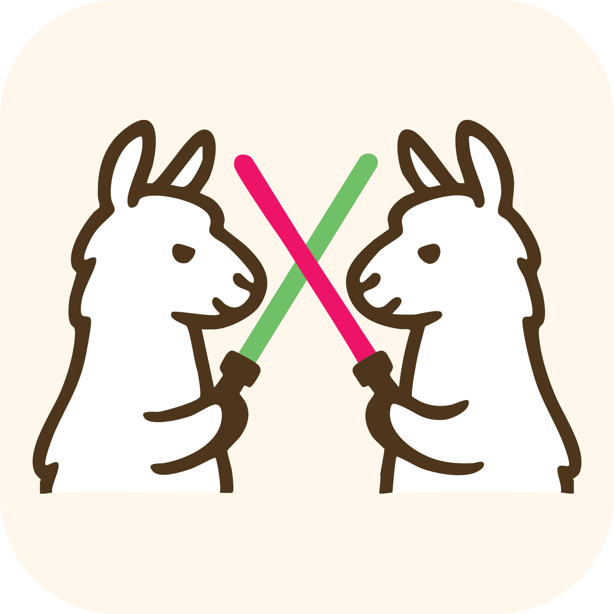

# mini-SWE-agent

[Course index](../../README.md) · [Original source](https://mini-swe-agent.com/latest/) · [Raw file](../../raw/optional-readings/ref-ad5dac935a68.html)

Retrieved: 2026-11-13T16:55:57.886840+00:00

[](https://mini-swe-agent.com/latest/assets/mini-swe-agent-banner.svg)

# The 100 line AI agent that's actually useful

[](https://join.slack.com/t/swe-bench/shared_invite/zt-36pj9bu5s-o3_yXPZbaH2wVnxnss1EkQ)
[](https://github.com/SWE-agent/mini-swe-agent)
[](https://pypi.org/project/mini-swe-agent/)

This is mini-swe-agent v2

Read the [migration guide](https://mini-swe-agent.com/latest/advanced/v2_migration/). For the previous version, check out the [v1 documentation](https://mini-swe-agent.com/v1/) or the [v1 branch](https://github.com/SWE-agent/mini-swe-agent/tree/v1).

In 2024, [SWE-bench](https://swebench.com) & [SWE-agent](https://swe-agent.com) helped kickstart the coding agent revolution.

We now ask: **What if our agent was 100x simpler, and still worked nearly as well?**

`mini` is

- **Widely adopted**: Used by Meta, NVIDIA, Essential AI, IBM, Nebius, Anyscale, Princeton University, Stanford University, and many more.
- **Minimal**: Just [100 lines of python](https://github.com/SWE-agent/mini-swe-agent/blob/main/src/minisweagent/agents/default.py) (+100 total for [env](https://github.com/SWE-agent/mini-swe-agent/blob/main/src/minisweagent/environments/local.py),
  [model](https://github.com/SWE-agent/mini-swe-agent/blob/main/src/minisweagent/models/litellm_model.py), [script](https://github.com/SWE-agent/mini-swe-agent/blob/main/src/minisweagent/run/hello_world.py)) — no fancy dependencies!
- **Performant:** Scores >74% on the [SWE-bench verified benchmark](https://www.swebench.com/); starts much faster than Claude Code
- **Deployable:** Supports **local environments**, **docker/podman**, **singularity/apptainer**, **bublewrap**, **contree**, and more
- **Compatible:** Supports all models via **litellm**, **openrouter**, **portkey**, and more. Support for `/completion` and `/response` endpoints, interleaved thinking etc.
- Built by the Princeton & Stanford team behind [SWE-bench](https://swebench.com), [SWE-agent](https://swe-agent.com), and more
- **Tested:** [](https://codecov.io/gh/SWE-agent/mini-swe-agent)

Why use mini-SWE-agent for research?

[SWE-agent](https://swe-agent.com/latest/) jump-started the development of AI agents in 2024. Back then, we placed a lot of emphasis on tools and special interfaces for the agent. However, one year later, a lot of this is not needed at all to build a useful agent!

In fact, the `mini` agent:

- **Does not have any tools other than bash** — it doesn't even use the tool-calling interface of the LMs.
  This means that you can run it with literally any model.
  When running in sandboxed environments you also don't need to take care of installing a single package — all it needs is bash.
- **Has a completely linear history** — every step of the agent just appends to the messages and that's it.
  So there's no difference between the trajectory and the messages that you pass on to the LM.
  Great for debugging & fine-tuning.
- **Executes actions with `subprocess.run`** — every action is completely independent (as opposed to keeping a stateful shell session running). This makes it trivial to execute the actions in sandboxes (literally just switch out `subprocess.run` with `docker exec`) and to scale up effortlessly.
  Seriously, this is [a big deal](https://mini-swe-agent.com/latest/faq/#why-no-shell-session), trust me.

This makes it perfect as a baseline system and for a system that puts the language model (rather than the agent scaffold) in the middle of our attention.
You can see the result on the [SWE-bench (bash only)](https://www.swebench.com/) leaderboard, that evaluates the performance of different LMs with `mini`.


Why use mini-SWE-agent as a tool?

Some agents are overfitted research artifacts. Others are UI-heavy frontend monsters.

The `mini` agent wants to be a hackable tool, not a black box.

- **Simple** enough to understand at a glance
- **Convenient** enough to use in daily workflows
- **Flexible** to extend

Unlike other agents (including our own [swe-agent](https://swe-agent.com/latest/)), it is radically simpler, because it:

- **Does not have any tools other than bash** — it doesn't even use the tool-calling interface of the LMs.
  Instead of implementing custom tools for every specific thing the agent might want to do, the focus is fully on the LM utilizing the shell to its full potential.
  Want it to do something specific like opening a PR?
  Just tell the LM to figure it out rather than spending time to implement it in the agent.
- **Executes actions with `subprocess.run`** — every action is completely independent (as opposed to keeping a stateful shell session running).
  This is [a big deal](https://mini-swe-agent.com/latest/faq/#why-no-shell-session) for the stability of the agent, trust me.
- **Has a completely linear history** — every step of the agent just appends to the messages that are passed to the LM in the next step and that's it.
  This is great for debugging and understanding what the LM is prompted with.

Should I use mini-SWE-agent or swe-agent?

You should consider `mini-swe-agent` your default choice.
In particular, you should use `mini-swe-agent` if

- You want a quick command line tool that works locally
- You want an agent with a very simple control flow
- You want even faster, simpler & more stable sandboxing & benchmark evaluations
- You are doing FT or RL and don't want to overfit to a specific agent scaffold

You should use `swe-agent` if

- You want to experiment with different sets of tools, each with their own interface
- You want to experiment with different history processors

What you get with both

- Excellent performance on SWE-Bench
- A trajectory browser

|  |  |
| --- | --- |
| [**CLI**](https://mini-swe-agent.com/latest/usage/mini) (`mini`) | [**Batch inference**](https://mini-swe-agent.com/latest/usage/swebench/) |
| [mini](https://github.com/SWE-agent/swe-agent-media/blob/main/media/mini/png/mini.png?raw=true) | [swebench](https://github.com/SWE-agent/swe-agent-media/blob/main/media/mini/png/swebench.png?raw=true) |
| [**Trajectory browser**](https://mini-swe-agent.com/latest/usage/inspector/) | [**Python bindings**](https://mini-swe-agent.com/latest/advanced/cookbook/) |
| [inspector](https://github.com/SWE-agent/swe-agent-media/blob/main/media/mini/png/inspector.png?raw=true) | ``` agent = DefaultAgent(     LitellmModel(model_name=...),     LocalEnvironment(), ) agent.run("Write a sudoku game") ``` |

Upgrading to v2?

Check out our [v2 migration guide](https://mini-swe-agent.com/latest/advanced/v2_migration/) for all the changes and how to update your code.

## Continue reading:

[launch
Installation & Quick Start

Get started with mini-SWE-agent](https://mini-swe-agent.com/latest/quickstart/)
[flash\_on
Usage: Simple UI

Learn to use the `mini` command](https://mini-swe-agent.com/latest/usage/mini/)
[help
FAQ

Common questions and answers](https://mini-swe-agent.com/latest/faq/)
[settings
Configuration

Setup and customize your agent](https://mini-swe-agent.com/latest/advanced/yaml_configuration/)
[fitness\_center
Power up

Start hacking the agent!](https://mini-swe-agent.com/latest/advanced/cookbook/)

## 📣 News

- [mini-swe-agent now powers Ramp SWE-Bench](https://labs.ramp.com/swebench)
- [mini-swe-agent beats Claude Code and Codex on DeepSWE](https://deepswe.datacurve.ai/blog#evaluation-harness)
- [Run mini-swe-agent on our new & extremely challenging benchmark, ProgramBench](https://mini-swe-agent.com/latest/usage/programbench/)
- [New tutorial on building minimal AI agents](https://minimal-agent.com/)
- Nov 19: [Gemini 3 Pro reaches 74% on SWE-bench verified with mini-swe-agent!](https://x.com/KLieret/status/1991164693839270372)
- Aug 19: [New blogpost: Randomly switching between GPT-5 and Sonnet 4 boosts performance](https://www.swebench.com/post-250820-mini-roulette.html)

## 📣 New features

Please check the [github release notes](https://github.com/SWE-agent/mini-swe-agent/releases) for the latest updates.

## 📣 Documentation updates

- Jul 27: More notes on [local models](https://mini-swe-agent.com/latest/models/local_models/)

[bug\_report
Something broken/unclear?

Open an issue on GitHub!](https://github.com/SWE-agent/SWE-agent/issues/new)
[help
Open-ended discussions

Join our Slack!](https://join.slack.com/t/swe-bench/shared_invite/zt-36pj9bu5s-o3_yXPZbaH2wVnxnss1EkQ)

Our projects

[
SWE-agent](https://swe-agent.com/ "SWE-agent")
[
SWE-ReX](https://swe-rex.com/ "SWE-rex")
[
SWE-smith](https://swesmith.com "SWE-smith")
[
SWE-bench](https://swebench.com "SWE-bench")
[
CodeClash](https://codeclash.ai "CodeClash")
[
sb-cli](https://www.swebench.com/sb-cli/ "sb-cli")
