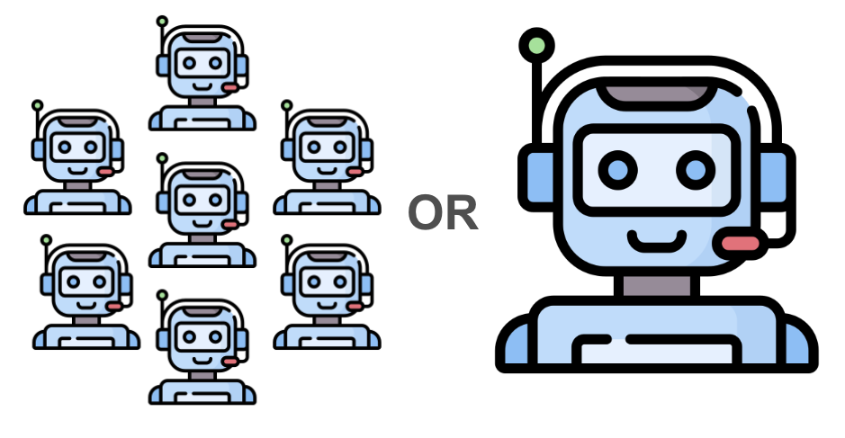
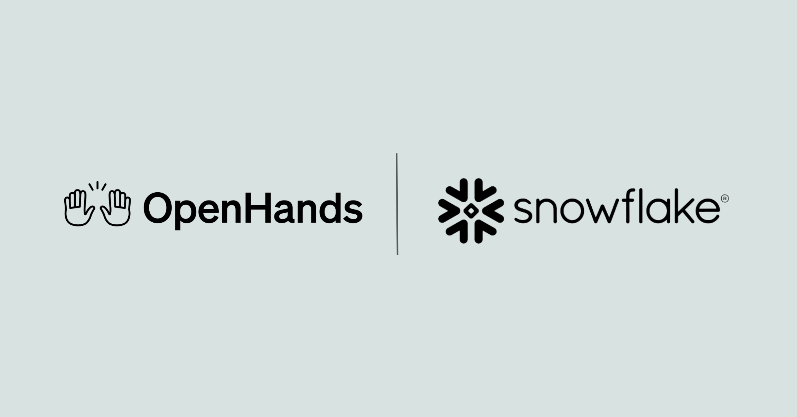

# Don't Sleep on Single-Agent Systems

[Course index](../../README.md) · [Original source](https://www.openhands.dev/blog/dont-sleep-on-single-agent-systems) · [Raw file](../../raw/optional-readings/ref-b067890a8880.html)

Retrieved: 2026-11-13T16:55:45.490468+00:00

[← Back to Blog](https://www.openhands.dev/blog)

# Don't Sleep on Single-agent Systems

Written by

Graham Neubig

Published on

September 26, 2024

Recently "**multi-agent system**" is one of the hottest buzzwords in AI, the focus of popular open-source frameworks like [MetaGPT](https://github.com/geekan/MetaGPT) and [Autogen](https://microsoft.github.io/autogen/), as well as [hackathons](https://medium.com/@kyeg/announcing-the-sthe-first-multi-agent-hackathon-ever-b5e76f534b0d), and many research papers. But in this post, I'd like to take a look at this trend and argue that there are some strong arguments to be made for **single-agent systems**. In doing so, I'll draw on our experience building [OpenHands](ref-b5a44c85aa77.md), a framework for software development agents.

In the summary, we'll discuss:

- The elements that go into modern AI agents – large language models, prompts, and action spaces
- An illustrative example of a multi-agent system
- Some issues with multi-agent systems
- How we can transition from using multiple specialized agents to one strong agent, and some of the remaining issues to be addressed

## What makes an LLM-based Agent?

Recently most practical agents are based on large language models like [Claude](https://www.anthropic.com/claude) by Anthropic or the [OpenAI language models](https://platform.openai.com/docs/models). But a language model is not enough to build an agent, you need at least three components

- **The Underlying LLM**
- **The Prompt:** This can be the system prompt that is used to specify the model's general behavior, or the type of information that you pull in from the agent's surrounding environment.
- **The Action Space:** These are the tools that we provide to the agent to allow it to act in the world.

In general, when we talk about multi-agent systems, we're varying at least one of these three components.

## A Multi-agent Example

For instance, let's say we're building an AI software developer. We could look at [CodeR](arxiv-2406-01304.md), a multi-agent framework for AI software development. It includes several agents, all using the same underlying LM but varying the prompt and action space:

- **Manager:** This agent has a *prompt* that specifies that it should write a plan for other agents to execute, and an *action space* of output plans.
- **Reproducer:** This agent has a *prompt* that tells it to reproduce the issue, and an *action space* of writing code into a file reproduce.py that reproduces the error.
- **Fault Localizer:** This agent has a *prompt* that tells it to find the files that are causing the error, and an *action space* of using tools from software engineering for fault localization and listing up files for later consumption.
- **Editor:** This agent has a *prompt* that takes in the results of the reproducer and fault localizer, and an *action space* that allows it to make edits to files.
- **Verifier:** This agent has a *prompt* that takes in the results of the other agents and asks it to verify the results, and an *action space* of outputting a yes/no decision of whether the issue is resolved or not.

This is a very intuitive structure for building a system, but there are a number of difficulties in building such systems.

## Some Issues with Multi-agent Systems

When building a multi-agent system, you can encounter a number of difficulties:

- **Getting the Structure Right:** Multi-agent systems add structure to solve problems. This is great when the problem the agent faces exactly matches the specified structure, but what if it doesn't? For instance, what if the verifier wants to perform file localization to be sure that it has verified the answer properly? Because these agents are completely separate, the verifier would not have access to the tools necessary to do its job.
- **Preserving Context:** Multi-agent systems typically pass information between multiple agents, but this can be a source of information loss. For instance, if the fault localizer passes only a summary of its work on to the further agents, it often results in loss of important contextual information that could be useful to the downstream agents for their jobs.
- **Maintainability:** Finally, each of these agents is typically its own separate code base, or at least a separate prompt. Because of this, multi-agent systems can have larger and more complex codebases.

Interestingly, a lot of these challenges map onto human organizations as well! I think we have all had experience of being on teams that were poorly organized, had poor communication, or had issues with maintaining the necessary skill sets when one of the members left, for instance.

## How can we make Excellent Single-agent Systems

It is important to note that there's a reason why people make multi-agent systems – specialized agents work well on specific tasks when you are able to give each agent the structure and tools that they need to do a good job! Will a single agent be able to compete? I believe that this may be easier than we think – we already have created a good prototype for this in the [CodeActAgent implemented in OpenHands](https://github.com/OpenHands/OpenHands/tree/main/openhands/agenthub/codeact_agent). Let's take a look at what is necessary to have a good single LLM, single action space, and single prompting technique.

**Single LLM:** This is the relatively easy part. Recently, we have excellent general-purpose LLMs, including closed ones such as Claude and GPT-4o, and open ones such as [llama-3.1](https://ai.meta.com/blog/meta-llama-3-1/) or [Qwen-2.5](https://qwenlm.github.io/blog/qwen2.5/). While these models cannot do everything, they have a very broad variety of capabilities. If they are lacking a particular capability, they can be [continually trained](https://arxiv.org/abs/2402.01364) to add that ability without major decreases in other abilities.

**Single Action Space:** This is also not so hard. If we have multiple agents with disparate tools at their disposal, we can (1) provide models with relatively general tools that can solve problems, and (2) in the case that different agents have different toolboxes we can concatenate them together. For instance, in OpenHands we provide tools that allow agents to (a) write code, (b) run code, and (c) perform web browsing. This general approach makes it possible to take advantage of software tools that have already been created for human developers, making them remarkably versatile, and subsuming most of the things that other multi-agent systems are able to do.

**Single Prompting Technique:** This is the place where things are tricky! We need to make sure that the agent gets the appropriate directions on how to solve its task, as well as the appropriate information from its environment.

There are a couple options here:

- *Concatenate All the Prompts:* If we have a multi-agent system with 10 different prompts, why not just concatenate them all together? Recently we have long-context models that can handle up to hundreds of thousands or millions of tokens (Claude stands at 200k tokens, and Llama stands at 128k). This is the approach we currently take in OpenHands. There a couple of downsides to this however. The first is cost, longer prompts cost more money and time, although features such as [Anthropic's prompt caching](https://www.anthropic.com/news/prompt-caching) make this much more affordable than it was before. Another downside to this is that LLMs can be [distracted by being provided with too much extra context](https://arxiv.org/abs/2307.03172), although again the more powerful language models are getting better and better at identifying important information from long contexts.
- *Retrieval-augmented Prompting:* Another possible option is to resort to retrieval. Just like [retrieval-augmented generation](https://learnbybuilding.ai/tutorials/rag-from-scratch) systems cut down on very long contexts for efficiency or accuracy reasons, we could perform retrieval-augmented prompting. There is some [research work](https://arxiv.org/abs/2209.11755) on selecting the examples that we provide to LLMs in prompts, but as far as I know less research work in the context of agents.

Finding the best method for this is still an active research question, but one that I believe is surmountable. If you'd be interested in tackling it together with us, [jump on the OpenHands slack](https://join.slack.com/t/openhands-ai/shared_invite/zt-34zm4j0gj-Qz5kRHoca8DFCbqXPS~f_A) and we'd be happy to discuss more!

## Conclusion

None of this is to say that multi-agent systems don't have their place. For instance, in situations where one agent has access to privileged information, or in a situation where different agents are acting on behalf of different people then multi-agent systems are certainly the way to go!

The purpose of this post is just to get us to think critically about the trend of adding complexity to our systems. Sometimes simple is best, and with powerful models, powerful tools, and versatile prompts, we are already well on our path there.

If any of this resonates with you, you can try out strong open-source software developers based on a single generalist AI agent through our [open-source](ref-b5a44c85aa77.md) or [online](https://app.all-hands.dev/) versions, or [join our community](https://github.com/OpenHands/OpenHands?tab=readme-ov-file#-join-our-community) and [contribute](https://github.com/OpenHands/OpenHands/blob/main/CONTRIBUTING.md)!

ONE VISUAL WORKSPACE

## Run parallel agents in one workspace

Keep every agent, task, and result visible in Agent Canvas, then turn the workflows that work into repeatable automations.

[Download Agent Canvas→](https://hubs.la/Q04nHKLl0)

✓

Citation

[

What's New in OpenHands Enterprise: Super Admin, Identity Providers, and Smarter Automations](https://www.openhands.dev/blog/super-admin-and-smarter-automations-in-openhands-enterprise)[

How to Set Up an AI Code Review Agent with OpenHands](https://www.openhands.dev/blog/build-an-ai-code-review-agent)[

Post-Train a Model for Your Own Agent Harness with OpenHands and Snowflake](https://www.openhands.dev/blog/post-train-ai-models-openhands-snowflake)

# Get useful insights in our blog

Insights and updates from the OpenHands team

Sign up for our newsletter for updates, events, and community insights.

### Thank you for your submission!

Building the open standard for autonomous software development.

OpenHands is the foundation for secure, transparent, model-agnostic coding agents - empowering every software team to build faster with full control.

Join The Community

[Join The Community](https://www.openhands.dev/community)

© 2026 OpenHands - All rights reserved

[Privacy Policy](https://www.openhands.dev/privacy)[Contact](https://www.openhands.dev/contact)

