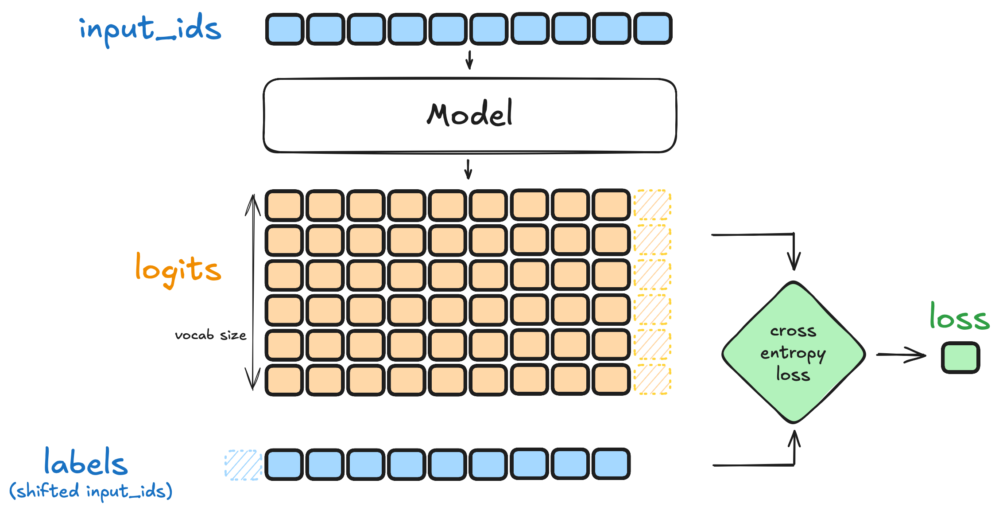
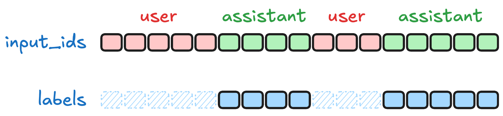
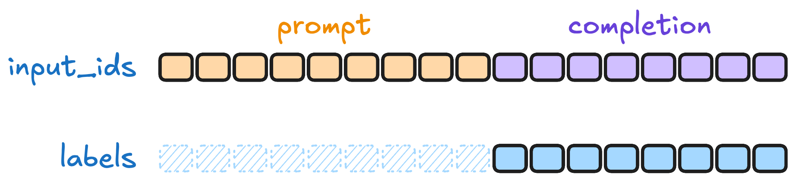

# TRL: SFTTrainer

[Course index](../../README.md) · [Original source](https://huggingface.co/docs/trl/en/sft_trainer) · [Raw file](../../raw/optional-readings/ref-b5fa93404333.html)

Retrieved: 2026-11-13T16:56:20.039795+00:00

TRL documentation

SFT Trainer

# TRL

 🏡 View all docsAWS Trainium & InferentiaAccelerateBitsandbytesCLIChat UIDataset viewerDatasetsDeploying on AWSDiffusersGoogle CloudGoogle TPUsGradioHubHub Python LibraryHuggingface.jsInference Endpoints (dedicated)Inference ProvidersKernelsLeRobotLeaderboardsLightevalMicrosoft AzureOpenEnvOptimumPEFTReachy MiniSafetensorsSentence TransformersTRLTasksText Embeddings InferenceTokenizersTrackioTransformersTransformers.jsXetsmolagentstimm

Search documentation

mainv1.18.0v1.17.1v1.16.0v1.15.0v1.14.2v1.13.0v1.12.0v1.11.0v1.10.0v1.9.2v1.8.0v1.7.1v1.6.0v1.5.1v1.4.0v1.3.0v1.2.0v1.1.0v1.0.0v0.29.1v0.28.0v0.27.2v0.26.2v0.25.1v0.24.0v0.23.1v0.22.2v0.21.0v0.20.0v0.19.1v0.18.1v0.17.0v0.16.1v0.15.2v0.14.0v0.13.0v0.12.2v0.11.4v0.10.1v0.9.6v0.8.6v0.7.11v0.6.0v0.5.0v0.4.7v0.3.1v0.2.1v0.1.1 EN


Join the Hugging Face community

and get access to the augmented documentation experience

Collaborate on models, datasets and Spaces

Faster examples with accelerated inference

Switch between documentation themes

[Sign Up](https://huggingface.co/join)

to get started

Copy page

 

# SFT Trainer

[](https://huggingface.co/models?other=sft,trl) [](https://github.com/huggingface/smol-course/tree/main/1_instruction_tuning)

## Overview

TRL supports the Supervised Fine-Tuning (SFT) Trainer for training language models.

[SFTTrainer](https://huggingface.co/docs/trl/v1.18.0/en/sft_trainer#trl.SFTTrainer) doesn’t natively support diffusion models like DiffusionGemma, but it can be easily extended to do so, see the [block-diffusion SFT example](https://github.com/huggingface/trl/blob/main/examples/sft_diffusion_gemma/sft_diffusion_gemma.py).

This post-training method was contributed by [Younes Belkada](https://huggingface.co/ybelkada).

## Quick start

This example demonstrates how to train a language model using the [SFTTrainer](https://huggingface.co/docs/trl/v1.18.0/en/sft_trainer#trl.SFTTrainer) from TRL. We train a [Qwen 3 0.6B](https://huggingface.co/Qwen/Qwen3-0.6B) model on the [Capybara dataset](https://huggingface.co/datasets/trl-lib/Capybara), a compact, diverse multi-turn dataset to benchmark reasoning and generalization.

Copied

```
from trl import SFTTrainer
from datasets import load_dataset

trainer = SFTTrainer(
    model="Qwen/Qwen3-0.6B",
    train_dataset=load_dataset("trl-lib/Capybara", split="train"),
)
trainer.train()
```

  

## Expected dataset type and format

SFT supports both [language modeling](https://huggingface.co/docs/trl/en/dataset_formats#language-modeling) and [prompt-completion](https://huggingface.co/docs/trl/en/dataset_formats#prompt-completion) datasets. The [SFTTrainer](https://huggingface.co/docs/trl/v1.18.0/en/sft_trainer#trl.SFTTrainer) is compatible with both [standard](https://huggingface.co/docs/trl/en/dataset_formats#standard) and [conversational](https://huggingface.co/docs/trl/en/dataset_formats#conversational) dataset formats. When provided with a conversational dataset, the trainer will automatically apply the chat template to the dataset.

Copied

```
# Standard language modeling
{"text": "The sky is blue."}

# Conversational language modeling
{"messages": [{"role": "user", "content": "What color is the sky?"},
              {"role": "assistant", "content": "It is blue."}]}

# Standard prompt-completion
{"prompt": "The sky is",
 "completion": " blue."}

# Conversational prompt-completion
{"prompt": [{"role": "user", "content": "What color is the sky?"}],
 "completion": [{"role": "assistant", "content": "It is blue."}]}
```

If your dataset is not in one of these formats, you can preprocess it to convert it into the expected format. Here is an example with the [FreedomIntelligence/medical-o1-reasoning-SFT](https://huggingface.co/datasets/FreedomIntelligence/medical-o1-reasoning-SFT) dataset:

Copied

```
from datasets import load_dataset

dataset = load_dataset("FreedomIntelligence/medical-o1-reasoning-SFT", "en")

def preprocess_function(example):
    return {
        "prompt": [{"role": "user", "content": example["Question"]}],
        "completion": [
            {"role": "assistant", "content": f"<think>{example['Complex_CoT']}</think>{example['Response']}"}
        ],
    }

dataset = dataset.map(preprocess_function, remove_columns=["Question", "Response", "Complex_CoT"])
print(next(iter(dataset["train"])))
```

Copied

```
{
    "prompt": [
        {
            "content": "Given the symptoms of sudden weakness in the left arm and leg, recent long-distance travel, and the presence of swollen and tender right lower leg, what specific cardiac abnormality is most likely to be found upon further evaluation that could explain these findings?",
            "role": "user",
        }
    ],
    "completion": [
        {
            "content": "<think>Okay, let's see what's going on here. We've got sudden weakness [...] clicks into place!</think>The specific cardiac abnormality most likely to be found in [...] the presence of a PFO facilitating a paradoxical embolism.",
            "role": "assistant",
        }
    ],
}
```

 

## Looking deeper into the SFT method

Supervised Fine-Tuning (SFT) is the simplest and most commonly used method to adapt a language model to a target dataset. The model is trained in a fully supervised fashion using pairs of input and output sequences. The goal is to minimize the negative log-likelihood (NLL) of the target sequence, conditioning on the input.

This section breaks down how SFT works in practice, covering the key steps: **preprocessing**, **tokenization** and **loss computation**.

### Preprocessing and tokenization

During training, each example is expected to contain a **text field** or a **(prompt, completion)** pair, depending on the dataset format. For more details on the expected formats, see [Dataset formats](https://huggingface.co/docs/trl/en/dataset_formats).
The [SFTTrainer](https://huggingface.co/docs/trl/v1.18.0/en/sft_trainer#trl.SFTTrainer) tokenizes each input using the model’s tokenizer. If both prompt and completion are provided separately, they are concatenated before tokenization.

### Computing the loss



The loss used in SFT is the **token-level cross-entropy loss**, defined as: LSFT(θ)=−∑t=1Tlog⁡pθ(yt∣y<t),
\mathcal{L}\_{\text{SFT}}(\theta) = - \sum\_{t=1}^{T} \log p\_\theta(y\_t \mid y\_{<t}),
LSFT​(θ)=−t=1∑T​logpθ​(yt​∣y<t​),

where yt y\_t yt​ is the target token at timestep t t t, and the model is trained to predict the next token given the previous ones. In practice, padding tokens are masked out during loss computation.

> The paper [On the Generalization of SFT: A Reinforcement Learning Perspective with Reward Rectification](https://huggingface.co/papers/2508.05629) proposes an alternative loss function, called **Dynamic Fine-Tuning (DFT)**, which aims to improve generalization by rectifying the reward signal. This method can be enabled by setting `loss_type="dft"` in the [SFTConfig](https://huggingface.co/docs/trl/v1.18.0/en/sft_trainer#trl.SFTConfig). For more details, see [Paper Index - Dynamic Fine-Tuning](https://huggingface.co/docs/trl/en/paper_index#on-the-generalization-of-sft-a-reinforcement-learning-perspective-with-reward-rectification).

### Label shifting and masking

During training, the loss is computed using a **one-token shift**: the model is trained to predict each token in the sequence based on all previous tokens. Specifically, the input sequence is shifted right by one position to form the target labels.
Padding tokens (if present) are ignored in the loss computation by applying an ignore index (default: `-100`) to the corresponding positions. This ensures that the loss focuses only on meaningful, non-padding tokens.

## Logged metrics

While training and evaluating, we record the following metrics:

- `global_step`: The total number of optimizer steps taken so far.
- `epoch`: The current epoch number, based on dataset iteration.
- `num_tokens`: The total number of tokens processed so far.
- `loss`: The average cross-entropy loss computed over non-masked tokens in the current logging interval.
- `entropy`: The average entropy of the model’s predicted token distribution over non-masked tokens.
- `aux_loss`: The load-balancing auxiliary loss of a Mixture-of-Experts model, before it is scaled by `router_aux_loss_coef` and added to the loss. Logged only when the model is a MoE model and `router_aux_loss_coef` is nonzero.
- `mean_token_accuracy`: The proportion of non-masked tokens for which the model’s top-1 prediction matches the ground truth token.
- `learning_rate`: The current learning rate, which may change dynamically if a scheduler is used.
- `grad_norm`: The L2 norm of the gradients, computed before gradient clipping.

## Customization

 

### Model initialization

You can directly pass the kwargs of the `from_pretrained()` method to the [SFTConfig](https://huggingface.co/docs/trl/v1.18.0/en/sft_trainer#trl.SFTConfig). For example, if you want to load a model in a different precision, analogous to

Copied

```
model = AutoModelForCausalLM.from_pretrained("Qwen/Qwen3-0.6B", dtype=torch.bfloat16)
```

you can do so by passing the `model_init_kwargs={"dtype": torch.bfloat16}` argument to the [SFTConfig](https://huggingface.co/docs/trl/v1.18.0/en/sft_trainer#trl.SFTConfig).

Copied

```
from trl import SFTConfig

training_args = SFTConfig(
    model_init_kwargs={"dtype": torch.bfloat16},
)
```

Note that all keyword arguments of `from_pretrained()` are supported.

### Packing

[SFTTrainer](https://huggingface.co/docs/trl/v1.18.0/en/sft_trainer#trl.SFTTrainer) supports *example packing*, where multiple examples are packed in the same input sequence to increase training efficiency. To enable packing, simply pass `packing=True` to the [SFTConfig](https://huggingface.co/docs/trl/v1.18.0/en/sft_trainer#trl.SFTConfig) constructor.

Copied

```
training_args = SFTConfig(packing=True)
```

For more details on packing, see [Packing](https://huggingface.co/docs/trl/en/reducing_memory_usage#packing).

### Train on assistant messages only

To train on assistant messages only, use a [conversational](https://huggingface.co/docs/trl/en/dataset_formats#conversational) dataset and set `assistant_only_loss=True` in the [SFTConfig](https://huggingface.co/docs/trl/v1.18.0/en/sft_trainer#trl.SFTConfig). This setting ensures that loss is computed **only** on the assistant responses, ignoring user or system messages.

Copied

```
training_args = SFTConfig(assistant_only_loss=True)
```



> This functionality requires the chat template to include `` and `` keywords. For known model families (e.g. Qwen3), TRL automatically patches the template when `assistant_only_loss=True`. See [Chat Templates](ref-09763e84d70f.md) for the full list of bundled training templates. For other models, check that your chat template includes these keywords. See [HuggingFaceTB/SmolLM3-3B](https://huggingface.co/HuggingFaceTB/SmolLM3-3B/blob/main/chat_template.jinja#L76-L82) for an example.

> With a [vision dataset](ref-b5fa93404333.md), assistant-only loss requires `transformers>=5.18.0` and a conversational [language modeling](https://huggingface.co/docs/trl/en/dataset_formats#language-modeling) dataset.

### Train on completion only

To train on completion only, use a [prompt-completion](https://huggingface.co/docs/trl/en/dataset_formats#prompt-completion) dataset. By default, the trainer computes the loss on the completion tokens only, ignoring the prompt tokens. If you want to train on the full sequence, set `completion_only_loss=False` in the [SFTConfig](https://huggingface.co/docs/trl/v1.18.0/en/sft_trainer#trl.SFTConfig).

Copied

```
from trl import SFTConfig, SFTTrainer
from datasets import load_dataset

# Load a prompt-completion dataset; loss is computed on the completion only by default
dataset = load_dataset("trl-lib/kto-mix-14k", split="train")

trainer = SFTTrainer(
    model="Qwen/Qwen2.5-0.5B-Instruct",
    args=SFTConfig(completion_only_loss=True),  # True by default for prompt-completion datasets
    train_dataset=dataset,
)
trainer.train()
```



> Training on completion only is compatible with training on assistant messages only. In this case, use a [conversational](https://huggingface.co/docs/trl/en/dataset_formats#conversational) [prompt-completion](https://huggingface.co/docs/trl/en/dataset_formats#prompt-completion) dataset and set `assistant_only_loss=True` in the [SFTConfig](https://huggingface.co/docs/trl/v1.18.0/en/sft_trainer#trl.SFTConfig).

### Train adapters with PEFT

We support tight integration with 🤗 PEFT library, allowing any user to conveniently train adapters and share them on the Hub, rather than training the entire model.

Copied

```
from datasets import load_dataset
from trl import SFTTrainer
from peft import LoraConfig

dataset = load_dataset("trl-lib/Capybara", split="train")

trainer = SFTTrainer(
    "Qwen/Qwen3-0.6B",
    train_dataset=dataset,
    peft_config=LoraConfig(),
)

trainer.train()
```

You can also continue training your `PeftModel`. For that, first load a `PeftModel` outside [SFTTrainer](https://huggingface.co/docs/trl/v1.18.0/en/sft_trainer#trl.SFTTrainer) and pass it directly to the trainer without the `peft_config` argument being passed.

Copied

```
from datasets import load_dataset
from trl import SFTTrainer
from peft import AutoPeftModelForCausalLM

model = AutoPeftModelForCausalLM.from_pretrained("trl-lib/Qwen3-4B-LoRA", is_trainable=True)
dataset = load_dataset("trl-lib/Capybara", split="train")

trainer = SFTTrainer(
    model=model,
    train_dataset=dataset,
)

trainer.train()
```

> When training adapters, you typically use a higher learning rate (≈1e‑4) since only new parameters are being learned.
>
> Copied
>
> ```
> SFTConfig(learning_rate=1e-4, ...)
> ```

### Rapid Experimentation for SFT

RapidFire AI is an open-source experimentation engine that sits on top of TRL and lets you launch multiple SFT configurations at once, even on a single GPU. Instead of trying configurations sequentially, RapidFire lets you **see all their learning curves earlier, stop underperforming runs, and clone promising ones with new settings in flight** without restarting. For more information, see [RapidFire AI Integration](https://huggingface.co/docs/trl/en/rapidfire_integration).

### Train with Unsloth

Unsloth is an open‑source framework for fine‑tuning and reinforcement learning that trains LLMs (like Llama, Mistral, Gemma, DeepSeek, and more) up to 2× faster with up to 70% less VRAM, while providing a streamlined, Hugging Face–compatible workflow for training, evaluation, and deployment. For more information, see [Unsloth Integration](https://huggingface.co/docs/trl/en/unsloth_integration).

## Instruction tuning example

**Instruction tuning** teaches a base language model to follow user instructions and engage in conversations. This requires:

1. **Chat template**: Defines how to structure conversations into text sequences, including role markers (user/assistant), special tokens, and turn boundaries. Read more about chat templates in [Chat templates](ref-00296737268a.md).
2. **Conversational dataset**: Contains instruction-response pairs

This example shows how to transform the [Qwen 3 0.6B Base](https://huggingface.co/Qwen/Qwen3-0.6B-Base) model into an instruction-following model using the [Capybara dataset](https://huggingface.co/datasets/trl-lib/Capybara) and a chat template from [HuggingFaceTB/SmolLM3-3B](https://huggingface.co/HuggingFaceTB/SmolLM3-3B). The SFT Trainer automatically handles tokenizer updates and special token configuration.

Copied

```
from trl import SFTConfig, SFTTrainer
from datasets import load_dataset

trainer = SFTTrainer(
    model="Qwen/Qwen3-0.6B-Base",
    args=SFTConfig(
        output_dir="Qwen3-0.6B-Instruct",
        chat_template_path="HuggingFaceTB/SmolLM3-3B",
    ),
    train_dataset=load_dataset("trl-lib/Capybara", split="train"),
)
trainer.train()
```

> Some base models, like those from Qwen, have a predefined chat template in the model’s tokenizer. In these cases, it is not necessary to apply `clone_chat_template()`, as the tokenizer already handles the formatting. However, it is necessary to align the EOS token with the chat template to ensure the model’s responses terminate correctly. In these cases, specify `eos_token` in [SFTConfig](https://huggingface.co/docs/trl/v1.18.0/en/sft_trainer#trl.SFTConfig); for example, for `Qwen/Qwen2.5-1.5B`, one should set `eos_token="<|im_end|>"`.

Once trained, your model can now follow instructions and engage in conversations using its new chat template.

Copied

```
>>> from transformers import pipeline
>>> pipe = pipeline("text-generation", model="Qwen3-0.6B-Instruct/checkpoint-5000")
>>> prompt = "<|im_start|>user\nWhat is the capital of France? Answer in one word.<|im_end|>\n<|im_start|>assistant\n"
>>> response = pipe(prompt)
>>> response[0]["generated_text"]
'<|im_start|>user\nWhat is the capital of France? Answer in one word.<|im_end|>\n<|im_start|>assistant\nThe capital of France is Paris.'
```

Alternatively, use the structured conversation format (recommended):

Copied

```
>>> prompt = [{"role": "user", "content": "What is the capital of France? Answer in one word."}]
>>> response = pipe(prompt)
>>> response[0]["generated_text"]
[{'role': 'user', 'content': 'What is the capital of France? Answer in one word.'}, {'role': 'assistant', 'content': 'The capital of France is Paris.'}]
```

 

## Tool Calling with SFT

The [SFTTrainer](https://huggingface.co/docs/trl/v1.18.0/en/sft_trainer#trl.SFTTrainer) fully supports fine-tuning models with *tool calling* capabilities. In this case, each dataset example should include:

- The conversation messages, including any tool calls (`tool_calls`) and tool responses (`tool` role messages)
- The list of available tools in the `tools` column, typically provided as JSON schemas

For details on the expected dataset structure, see the [Dataset Format — Tool Calling](https://huggingface.co/docs/trl/en/dataset_formats#tool-calling) section.

## Training Vision Language Models

[SFTTrainer](https://huggingface.co/docs/trl/v1.18.0/en/sft_trainer#trl.SFTTrainer) fully supports training Vision-Language Models (VLMs). To train a VLM, provide a dataset with either an `image` column (single image per sample) or an `images` column (list of images per sample). For more information on the expected dataset structure, see the [Dataset Format — Vision Dataset](https://huggingface.co/docs/trl/en/dataset_formats#vision-dataset) section.
An example of such a dataset is the [LLaVA Instruct Mix](https://huggingface.co/datasets/trl-lib/llava-instruct-mix).

Copied

```
from trl import SFTConfig, SFTTrainer
from datasets import load_dataset

trainer = SFTTrainer(
    model="Qwen/Qwen2.5-VL-3B-Instruct",
    args=SFTConfig(max_length=None),
    train_dataset=load_dataset("trl-lib/llava-instruct-mix", split="train"),
)
trainer.train()
```

> For VLMs, truncating may remove image tokens, leading to errors during training. To avoid this, set `max_length=None` in the [SFTConfig](https://huggingface.co/docs/trl/v1.18.0/en/sft_trainer#trl.SFTConfig). This allows the model to process the full sequence length without truncating image tokens.
>
> Copied
>
> ```
> SFTConfig(max_length=None, ...)
> ```
>
> Only use `max_length` when you’ve verified that truncation won’t remove image tokens for the entire dataset.

## SFTTrainer

### class trl.SFTTrainer

  [< source >](https://github.com/huggingface/trl/blob/v1.18.0/trl/trainer/sft_trainer.py#L517) 

( model: str | PreTrainedModel | PeftModelargs: trl.trainer.sft\_config.SFTConfig | transformers.training\_args.TrainingArguments | None = Nonedata\_collator: collections.abc.Callable[[list[typing.Any]], dict[str, typing.Any]] | None = Nonetrain\_dataset: datasets.arrow\_dataset.Dataset | datasets.iterable\_dataset.IterableDataset | None = Noneeval\_dataset: datasets.arrow\_dataset.Dataset | datasets.iterable\_dataset.IterableDataset | datasets.dataset\_dict.DatasetDict | datasets.dataset\_dict.IterableDatasetDict | dict[str, datasets.arrow\_dataset.Dataset | datasets.iterable\_dataset.IterableDataset] | None = Noneprocessing\_class: transformers.tokenization\_utils\_base.PreTrainedTokenizerBase | transformers.processing\_utils.ProcessorMixin | None = Nonecompute\_loss\_func: collections.abc.Callable | None = Nonecompute\_metrics: collections.abc.Callable[[transformers.trainer\_utils.EvalPrediction], dict] | None = Nonecallbacks: list[transformers.trainer\_callback.TrainerCallback] | None = Noneoptimizers: tuple[typing.Optional[torch.optim.Optimizer], typing.Optional[torch.optim.lr\_scheduler.LambdaLR]] = (None, None)optimizer\_cls\_and\_kwargs: tuple[type[torch.optim.Optimizer], dict[str, typing.Any]] | None = Nonepreprocess\_logits\_for\_metrics: collections.abc.Callable[[torch.Tensor, torch.Tensor], torch.Tensor] | None = Nonequantization\_config: BitsAndBytesConfig | None = Nonepeft\_config: PeftConfig | None = Noneformatting\_func: collections.abc.Callable[[dict], str] | None = None )

Parameters

- **model** (`str` or [PreTrainedModel](https://huggingface.co/docs/transformers/v5.23.0/en/main_classes/model#transformers.PreTrainedModel) or `PeftModel`) —
  Model to be trained. Can be either:
  - A string, being the *model id* of a pretrained model hosted inside a model repo on huggingface.co, or a
    path to a *directory* containing model weights saved using
    [save\_pretrained](https://huggingface.co/docs/transformers/v5.23.0/en/main_classes/model#transformers.PreTrainedModel.save_pretrained), e.g., `'./my_model_directory/'`. The model is loaded
    using `<ModelArchitecture>.from_pretrained` (where `<ModelArchitecture>` is derived from the model
    config) with the keyword arguments in `args.model_init_kwargs`. If `dtype` is not specified in
    `args.model_init_kwargs`, it defaults to `float32`. This differs from
    [from\_pretrained](https://huggingface.co/docs/transformers/v5.23.0/en/main_classes/model#transformers.PreTrainedModel.from_pretrained), where (since Transformers v5) the dtype is inferred
    from the model config.
  - A [PreTrainedModel](https://huggingface.co/docs/transformers/v5.23.0/en/main_classes/model#transformers.PreTrainedModel) object. Only causal language models are supported.
  - A `PeftModel` object. Only causal language models are supported.
- **args** ([SFTConfig](https://huggingface.co/docs/trl/v1.18.0/en/sft_trainer#trl.SFTConfig), *optional*) —
  Configuration for this trainer. If `None`, a default configuration is used.
- **data\_collator** (`DataCollator`, *optional*) —
  Function to use to form a batch from a list of elements of the processed `train_dataset` or `eval_dataset`.
  Will default to `DataCollatorForLanguageModeling`, or to
  `DataCollatorForVisionLanguageModeling` if the dataset contains images.
- **train\_dataset** ([Dataset](https://huggingface.co/docs/datasets/v5.2.0/en/package_reference/main_classes#datasets.Dataset) or [IterableDataset](https://huggingface.co/docs/datasets/v5.2.0/en/package_reference/main_classes#datasets.IterableDataset)) —
  Dataset to use for training. This trainer supports both [language modeling](ref-b5fa93404333.md) type and
  [prompt-completion](ref-b5fa93404333.md) type. The format of the samples can be either:
  - [Standard](https://huggingface.co/docs/trl/en/dataset_formats#standard): Each sample contains plain text.
  - [Conversational](https://huggingface.co/docs/trl/en/dataset_formats#conversational): Each sample contains structured messages (e.g., role
    and content).

  The trainer also supports pre-tokenized datasets, recognized by a required `input_ids` column. An optional
  `labels` column (`-100` on tokens excluded from the loss) is used as is if present; otherwise labels are
  built from the optional `assistant_masks` / `completion_mask` columns (which are folded in then dropped,
  `completion_mask` only when `completion_only_loss=True`), or default to a copy of `input_ids`. Sequences
  are truncated to `max_length` during preparation. With `skip_prepare_dataset=True`, preparation is skipped
  and the collator is expected to handle the dataset as is.

  When `train_dataset` is an [IterableDataset](https://huggingface.co/docs/datasets/v5.2.0/en/package_reference/main_classes#datasets.IterableDataset) (e.g. a streaming dataset), `max_steps` must be
  set in the training arguments, since its length cannot be inferred and the total number of training steps
  is required to bound the training loop and configure the learning rate scheduler.
- **eval\_dataset** ([Dataset](https://huggingface.co/docs/datasets/v5.2.0/en/package_reference/main_classes#datasets.Dataset), [IterableDataset](https://huggingface.co/docs/datasets/v5.2.0/en/package_reference/main_classes#datasets.IterableDataset), [DatasetDict](https://huggingface.co/docs/datasets/v5.2.0/en/package_reference/main_classes#datasets.DatasetDict), [IterableDatasetDict](https://huggingface.co/docs/datasets/v5.2.0/en/package_reference/main_classes#datasets.IterableDatasetDict) or `dict[str, Dataset | IterableDataset]`) —
  Dataset to use for evaluation. It must meet the same requirements as `train_dataset`.
- **processing\_class** ([PreTrainedTokenizerBase](https://huggingface.co/docs/transformers/v5.23.0/en/internal/tokenization_utils#transformers.PreTrainedTokenizerBase), [ProcessorMixin](https://huggingface.co/docs/transformers/v5.23.0/en/main_classes/processors#transformers.ProcessorMixin), *optional*) —
  Processing class used to process the data. If `None`, the processing class is loaded from the model’s name
  with [from\_pretrained](https://huggingface.co/docs/transformers/v5.23.0/en/model_doc/auto#transformers.AutoProcessor.from_pretrained). A padding token, `tokenizer.pad_token`, must be set.
  If the processing class has not set a padding token, `tokenizer.eos_token` will be used as the default.
- **compute\_loss\_func** (`Callable`, *optional*) —
  A function that accepts the model outputs, the labels, and the number of items in the entire accumulated
  batch (batch\_size \* gradient\_accumulation\_steps) and returns the loss. This is deprecated and will be
  removed in v2.0.0: subclass [SFTTrainer](https://huggingface.co/docs/trl/v1.18.0/en/sft_trainer#trl.SFTTrainer) and override `compute_loss` instead.
- **compute\_metrics** (`Callable[[EvalPrediction], dict]`, *optional*) —
  The function that will be used to compute metrics at evaluation. Must take a
  [EvalPrediction](https://huggingface.co/docs/transformers/v5.23.0/en/internal/trainer_utils#transformers.EvalPrediction) and return a dictionary string to metric values. When passing
  [SFTConfig](https://huggingface.co/docs/trl/v1.18.0/en/sft_trainer#trl.SFTConfig) with `batch_eval_metrics` set to `True`, your `compute_metrics` function must take a boolean
  `compute_result` argument. This will be triggered after the last eval batch to signal that the function
  needs to calculate and return the global summary statistics rather than accumulating the batch-level
  statistics. The logits it receives are recomputed with an extra forward pass. This is deprecated and will
  be removed in v2.0.0.
- **callbacks** (list of [TrainerCallback](https://huggingface.co/docs/transformers/v5.23.0/en/main_classes/callback#transformers.TrainerCallback), *optional*) —
  List of callbacks to customize the training loop. Will add those to the list of default callbacks detailed
  in [here](https://huggingface.co/docs/transformers/main_classes/callback).

  If you want to remove one of the default callbacks used, use the [remove\_callback](https://huggingface.co/docs/transformers/v5.23.0/en/main_classes/trainer#transformers.Trainer.remove_callback)
  method.
- **optimizers** (`tuple[torch.optim.Optimizer | None, torch.optim.lr_scheduler.LambdaLR | None]`, *optional*, defaults to `(None, None)`) —
  A tuple containing the optimizer and the scheduler to use. Will default to an instance of `AdamW` on your
  model and a scheduler given by [get\_linear\_schedule\_with\_warmup](https://huggingface.co/docs/transformers/v5.23.0/en/main_classes/optimizer_schedules#transformers.get_linear_schedule_with_warmup) controlled by `args`.
- **optimizer\_cls\_and\_kwargs** (`tuple[Type[torch.optim.Optimizer], Dict[str, Any]]`, *optional*) —
  A tuple containing the optimizer class and keyword arguments to use. Overrides `optim` and `optim_args` in
  `args`. Incompatible with the `optimizers` argument.

  Unlike `optimizers`, this argument avoids the need to place model parameters on the correct devices before
  initializing the Trainer.
- **preprocess\_logits\_for\_metrics** (`Callable[[torch.Tensor, torch.Tensor], torch.Tensor]`, *optional*) —
  A function that preprocess the logits right before caching them at each evaluation step. Must take two
  tensors, the logits and the labels, and return the logits once processed as desired. The modifications made
  by this function will be reflected in the predictions received by `compute_metrics`.

  Note that the labels (second parameter) will be `None` if the dataset does not have them.
- **quantization\_config** ([BitsAndBytesConfig](https://huggingface.co/docs/transformers/v5.23.0/en/main_classes/quantization#transformers.BitsAndBytesConfig), *optional*) —
  Quantization configuration used when loading the model from a model identifier. Combine with `peft_config`
  for QLoRA training. Ignored if the model is already instantiated.
- **peft\_config** (`PeftConfig`, *optional*) —
  PEFT configuration used to wrap the model. If `None`, the model is not wrapped.
- **formatting\_func** (`Callable`, *optional*) —
  Formatting function applied to the dataset before tokenization. Applying the formatting function explicitly
  converts the dataset into a [language modeling](ref-b5fa93404333.md) type.

Trainer for Supervised Fine-Tuning (SFT) method.

This class is a wrapper around the [Trainer](https://huggingface.co/docs/transformers/v5.23.0/en/main_classes/trainer#transformers.Trainer) class and inherits all of its attributes and methods.

Example:

Copied

```
>>> from trl import SFTTrainer
>>> from datasets import load_dataset

>>> dataset = load_dataset("roneneldan/TinyStories", split="train[:1%]")

>>> trainer = SFTTrainer(
...     model="Qwen/Qwen2.5-0.5B-Instruct",
...     train_dataset=dataset,
... )
>>> trainer.train()
```

#### train

  [< source >](https://github.com/huggingface/trl/blob/v1.18.0/transformers/trainer.py#L1450) 

( resume\_from\_checkpoint: str | bool | None = Nonetrial: optuna.Trial | dict[str, Any] | None = Noneignore\_keys\_for\_eval: list[str] | None = None ) → `~trainer_utils.TrainOutput`

Parameters

- **resume\_from\_checkpoint** (`str` or `bool`, *optional*) —
  If a `str`, local path to a saved checkpoint as saved by a previous instance of `Trainer`. If a
  `bool` and equals `True`, load the last checkpoint in *args.output\_dir* as saved by a previous instance
  of `Trainer`. If present, training will resume from the model/optimizer/scheduler states loaded here.
- **trial** (`optuna.Trial` or `dict[str, Any]`, *optional*) —
  The trial run or the hyperparameter dictionary for hyperparameter search.
- **ignore\_keys\_for\_eval** (`list[str]`, *optional*) —
  A list of keys in the output of your model (if it is a dictionary) that should be ignored when
  gathering predictions for evaluation during the training.

  

Returns

`~trainer_utils.TrainOutput`

Object containing the global step count, training loss, and metrics.

Main training entry point.

#### save\_model

  [< source >](https://github.com/huggingface/trl/blob/v1.18.0/transformers/trainer.py#L4077) 

( output\_dir: str | None = None\_internal\_call: bool = False )

Will save the model, so you can reload it using `from_pretrained()`.

Will only save from the main process.

#### push\_to\_hub

  [< source >](https://github.com/huggingface/trl/blob/v1.18.0/transformers/trainer.py#L4337) 

( commit\_message: str | None = 'End of training'blocking: bool = Truetoken: str | None = Nonerevision: str | None = Noneprivate: bool | None = None\*\*kwargs )

Parameters

- **commit\_message** (`str`, *optional*, defaults to `"End of training"`) —
  Message to commit while pushing.
- **blocking** (`bool`, *optional*, defaults to `True`) —
  Whether the function should return only when the `git push` has finished.
- **token** (`str`, *optional*, defaults to `None`) —
  Token with write permission to overwrite Trainer’s original args.
- **revision** (`str`, *optional*) —
  The git revision to commit from. Defaults to the head of the “main” branch.
- **private** (`bool`, *optional*) —
  Whether to make the repo private when it is created. Defaults to `args.hub_private_repo`. Has no
  effect if the repo already exists.
- **kwargs** (`dict[str, Any]`, *optional*) —
  Additional keyword arguments passed along to `~Trainer.create_model_card`.

Upload `self.model` and `self.processing_class` to the 🤗 model hub on the repo `self.args.hub_model_id`.

## SFTConfig

### class trl.SFTConfig

  [< source >](https://github.com/huggingface/trl/blob/v1.18.0/trl/trainer/sft_config.py#L23) 

( output\_dir: str | None = Noneper\_device\_train\_batch\_size: int = 8num\_train\_epochs: float = 3.0max\_steps: int = -1learning\_rate: float = 2e-05lr\_scheduler\_type: transformers.trainer\_utils.SchedulerType | str = 'linear'lr\_scheduler\_kwargs: dict | str | None = Nonewarmup\_steps: float = 0optim: transformers.training\_args.OptimizerNames | str = 'adamw\_torch\_fused'optim\_args: str | None = Noneweight\_decay: float = 0.0adam\_beta1: float = 0.9adam\_beta2: float = 0.999adam\_epsilon: float = 1e-08optim\_target\_modules: None | str | list[str] = Nonegradient\_accumulation\_steps: int = 1average\_tokens\_across\_devices: bool = Truemax\_grad\_norm: float = 1.0label\_smoothing\_factor: float = 0.0bf16: bool | None = Nonefp16: bool = Falsebf16\_full\_eval: bool = Falsefp16\_full\_eval: bool = Falsetf32: bool | None = Noneactivation\_checkpointing: bool | None = Noneactivation\_checkpointing\_kwargs: dict[str, typing.Any] | str | None = Nonegradient\_checkpointing: bool = Truegradient\_checkpointing\_kwargs: dict[str, typing.Any] | str | None = Nonetorch\_compile: bool = Falsetorch\_compile\_backend: str | None = Nonetorch\_compile\_mode: str | None = Noneuse\_liger\_kernel: bool = Falseliger\_kernel\_config: dict[str, bool] | None = Noneuse\_cache: bool = Falseneftune\_noise\_alpha: float | None = Nonetorch\_empty\_cache\_steps: int | None = Noneauto\_find\_batch\_size: bool = Falselogging\_strategy: transformers.trainer\_utils.IntervalStrategy | str = 'steps'logging\_steps: float = 10logging\_first\_step: bool = Falselog\_on\_each\_node: bool = Truelogging\_nan\_inf\_filter: bool = Trueinclude\_num\_input\_tokens\_seen: str | bool = 'no'log\_level: str = 'passive'log\_level\_replica: str = 'warning'disable\_tqdm: bool | None = Nonereport\_to: None | str | list[str] = 'none'run\_name: str | None = Noneproject: str = 'huggingface'trackio\_space\_id: str | None = Nonetrackio\_bucket\_id: str | None = Nonetrackio\_static\_space\_id: typing.Union[str, NoneType, typing.Literal[False]] = Noneeval\_strategy: transformers.trainer\_utils.IntervalStrategy | str = 'no'eval\_steps: float | None = Noneeval\_delay: float = 0per\_device\_eval\_batch\_size: int = 8prediction\_loss\_only: bool = Falseeval\_on\_start: bool = Falseeval\_do\_concat\_batches: bool = Trueeval\_use\_gather\_object: bool = Falseeval\_accumulation\_steps: int | None = Noneinclude\_for\_metrics: list[str] = <factory>batch\_eval\_metrics: bool = Falsesave\_only\_model: bool = Falsesave\_strategy: transformers.trainer\_utils.SaveStrategy | str = 'steps'save\_steps: float = 500save\_on\_each\_node: bool = Falsesave\_total\_limit: int | None = Noneenable\_jit\_checkpoint: bool = Falsepush\_to\_hub: bool = Falsehub\_token: str | None = Nonehub\_private\_repo: bool | None = Nonehub\_model\_id: str | None = Nonehub\_strategy: transformers.trainer\_utils.HubStrategy | str = 'every\_save'hub\_always\_push: bool = Falsehub\_revision: str | None = Noneload\_best\_model\_at\_end: bool = Falsemetric\_for\_best\_model: str | None = Nonegreater\_is\_better: bool | None = Noneignore\_data\_skip: bool = Falserestore\_callback\_states\_from\_checkpoint: bool = Falsefull\_determinism: bool = Falseseed: int = 42data\_seed: int | None = Noneuse\_cpu: bool = Falseaccelerator\_config: dict | str | None = Noneparallelism\_config: accelerate.parallelism\_config.ParallelismConfig | None = Nonedataloader\_drop\_last: bool = Falsedataloader\_num\_workers: int = 0dataloader\_pin\_memory: bool = Truedataloader\_persistent\_workers: bool = Falsedataloader\_prefetch\_factor: int | None = Nonedataloader\_multiprocessing\_context: str | None = Nonedataloader\_in\_order: bool = Trueremove\_unused\_columns: bool = Truelabel\_names: list[str] | None = Nonetrain\_sampling\_strategy: str = 'random'length\_column\_name: str = 'length'ddp\_find\_unused\_parameters: bool | None = Noneddp\_bucket\_cap\_mb: int | None = Noneddp\_broadcast\_buffers: bool | None = Noneddp\_static\_graph: bool | None = Noneddp\_backend: str | None = Noneddp\_timeout: int = 1800fsdp: str | None = Nonefsdp\_config: dict[str, typing.Any] | str | None = Nonedeepspeed: dict | str | None = Nonedebug: str | list[transformers.debug\_utils.DebugOption] = ''skip\_memory\_metrics: bool = Truedo\_train: bool = Falsedo\_eval: bool = Falsedo\_predict: bool = Falseresume\_from\_checkpoint: str | None = Nonelocal\_rank: int = -1model\_init\_kwargs: dict[str, typing.Any] | str | None = Nonetrust\_remote\_code: bool = Falserouter\_aux\_loss\_coef: float | None = Nonechat\_template\_path: str | None = Nonedataset\_text\_field: str = 'text'dataset\_kwargs: dict[str, typing.Any] | str | None = Nonedataset\_num\_proc: int | None = Noneeos\_token: str | None = Nonemax\_length: int | None = 1024truncation\_mode: str = 'keep\_start'shuffle\_dataset: bool = Falsepacking: bool = Falsepacking\_strategy: str = 'bfd'padding\_free: bool = Falsepad\_to\_multiple\_of: int | str | None = 'auto'eval\_packing: bool | None = Nonecompletion\_only\_loss: bool | None = Noneassistant\_only\_loss: bool = Falseloss\_type: str = 'nll'activation\_offloading: bool = Falsepad\_token: str | None = None )

Parameters that control the model

- **model\_init\_kwargs** (`dict[str, Any]`, *optional*) —
  Keyword arguments for [from\_pretrained](https://huggingface.co/docs/transformers/v5.23.0/en/model_doc/auto#transformers.AutoModelForCausalLM.from_pretrained), used when the `model`
  argument of the [SFTTrainer](https://huggingface.co/docs/trl/v1.18.0/en/sft_trainer#trl.SFTTrainer) is provided as a string. The `revision` value is also used when loading the
  processing class.
- **trust\_remote\_code** (`bool`, *optional*, defaults to `False`) —
  Whether to allow loading models and tokenizers that ship custom Python code from the Hub. Forwarded to
  [from\_pretrained](https://huggingface.co/docs/transformers/v5.23.0/en/model_doc/auto#transformers.AutoModelForCausalLM.from_pretrained) and [from\_pretrained](https://huggingface.co/docs/transformers/v5.23.0/en/model_doc/auto#transformers.AutoProcessor.from_pretrained).
- **router\_aux\_loss\_coef** (`float`, *optional*) —
  Coefficient of the load-balancing auxiliary loss for Mixture-of-Experts (MoE) models, added to the training
  loss with this weight. When not set, the value declared by the model config is used. Set to `0.0` to
  disable it. Fails when used with a non-MoE model.
- **chat\_template\_path** (`str`, *optional*) —
  If specified, sets the model’s chat template. This can either be the path to a tokenizer (local directory
  or Hugging Face Hub model) or a direct path to a Jinja template file. When using a Jinja file, you must
  ensure that any special tokens referenced in the template are added to the tokenizer and that the model’s
  embedding layer is resized accordingly.

Parameters that control the data preprocessing

- **dataset\_text\_field** (`str`, *optional*, defaults to `"text"`) —
  Name of the column that contains text data in the dataset.
- **dataset\_kwargs** (`dict[str, Any]`, *optional*) —
  Dictionary of optional keyword arguments for the dataset preparation. The only supported key is
  `skip_prepare_dataset`. When the dataset contains images, `skip_prepare_dataset` is automatically treated
  as `True` regardless of the provided value, since preprocessing is done on the fly.
- **dataset\_num\_proc** (`int`, *optional*) —
  Number of processes to use for processing the dataset.
- **eos\_token** (`str`, *optional*) —
  Token used to indicate the end of a turn or sequence. If `None`, it defaults to
  `processing_class.eos_token`.
- **max\_length** (`int` or `None`, *optional*, defaults to `1024`) —
  Maximum length of the tokenized sequence. Sequences longer than `max_length` are truncated from the left or
  right depending on `truncation_mode`. If `None`, no truncation is applied. When packing is enabled, this
  value sets the sequence length.
- **truncation\_mode** (`str`, *optional*, defaults to `"keep_start"`) —
  Truncation mode to use when the sequence exceeds `max_length`. The only supported value is `"keep_start"`.
  The `"keep_end"` value is deprecated and will be removed in v2.0.0.
- **shuffle\_dataset** (`bool`, *optional*, defaults to `False`) —
  Whether to shuffle the dataset.
- **packing** (`bool`, *optional*, defaults to `False`) —
  Whether to group multiple sequences into fixed-length blocks to improve computational efficiency and reduce
  padding. Uses `max_length` to define sequence length.
- **packing\_strategy** (`str`, *optional*, defaults to `"bfd"`) —
  Strategy for packing sequences. Can be `"bfd"` (best-fit decreasing, truncates overflow), `"bfd_split"`
  (best-fit decreasing, splits overflow sequences), or `"wrapped"` (aggressive, cuts mid-sequence).
- **padding\_free** (`bool`, *optional*, defaults to `False`) —
  Whether to perform forward passes without padding by flattening all sequences in the batch into a single
  continuous sequence. This reduces memory usage by eliminating padding overhead. Currently, this is only
  supported with the FlashAttention 2 or 3, which can efficiently handle the flattened batch structure. When
  packing is enabled with strategy `"bfd"`, padding-free is enabled, regardless of the value of this
  parameter.
- **pad\_to\_multiple\_of** (`int` or `str`, *optional*, defaults to `"auto"`) —
  If set, the sequences will be padded to a multiple of this value. `"auto"` pads to a multiple of 128 on
  Neuron (AWS Trainium), which compiles once per input shape, and does not pad elsewhere.
- **eval\_packing** (`bool`, *optional*) —
  Whether to pack the eval dataset. If `None`, uses the same value as `packing`.

Parameters that control the training

- **completion\_only\_loss** (`bool`, *optional*) —
  Whether to compute loss only on the completion part of the sequence. If set to `True`, loss is computed
  only on the completion, which is supported only for [prompt-completion](ref-b5fa93404333.md) datasets. If
  `False`, loss is computed on the entire sequence. If `None` (default), the behavior depends on the dataset:
  loss is computed on the completion for [prompt-completion](ref-b5fa93404333.md) datasets, and on the full
  sequence for [language modeling](ref-b5fa93404333.md) datasets.
- **assistant\_only\_loss** (`bool`, *optional*, defaults to `False`) —
  Whether to compute loss only on the assistant part of the sequence. If set to `True`, loss is computed only
  on the assistant responses, which is supported only for [conversational](ref-b5fa93404333.md) datasets. If
  `False`, loss is computed on the entire sequence.
- **loss\_type** (`str`, *optional*, defaults to `"nll"`) —
  Type of loss to use. Possible values are:
  - `"nll"`: standard negative log-likelihood.
  - `"dft"`: Dynamic Fine-Tuning, as described in [this paper](https://huggingface.co/papers/2508.05629).
  - `"chunked_nll"`: deprecated alias of `"nll"`, which computes the loss the same way. It will be removed in
    v2.0.0.
- **activation\_offloading** (`bool`, *optional*, defaults to `False`) —
  Whether to offload the activations to the CPU.

Deprecated parameters

- **pad\_token** —

  Parameter `pad_token` is deprecated and will be removed in version v2.0.0. Set `tokenizer.pad_token`
  directly and pass it as `processing_class` to the trainer instead.

Configuration class for the [SFTTrainer](https://huggingface.co/docs/trl/v1.18.0/en/sft_trainer#trl.SFTTrainer).

This class includes only the parameters that are specific to SFT training. For a full list of training arguments,
please refer to the [TrainingArguments](https://huggingface.co/docs/transformers/v5.23.0/en/main_classes/trainer#transformers.TrainingArguments) documentation. Note that default values in this class may
differ from those in [TrainingArguments](https://huggingface.co/docs/transformers/v5.23.0/en/main_classes/trainer#transformers.TrainingArguments).

Using [HfArgumentParser](https://huggingface.co/docs/transformers/v5.23.0/en/internal/trainer_utils#transformers.HfArgumentParser) we can turn this class into [argparse](https://docs.python.org/3/library/argparse#module-argparse) arguments that can be specified on the
command line.

> These parameters have default values different from [TrainingArguments](https://huggingface.co/docs/transformers/v5.23.0/en/main_classes/trainer#transformers.TrainingArguments):
>
> - `logging_steps`: Defaults to `10` instead of `500`.
> - `gradient_checkpointing`: Defaults to `True` instead of `False`.
> - `bf16`: Defaults to `True` if `fp16` is not set, instead of `False`.
> - `learning_rate`: Defaults to `2e-5` instead of `5e-5`.

 [Update on GitHub](https://github.com/huggingface/trl/blob/main/docs/source/sft_trainer.md)

[←RLOO](https://huggingface.co/docs/trl/en/rloo_trainer) [Command Line Interface (CLI)→](https://huggingface.co/docs/trl/en/clis)
