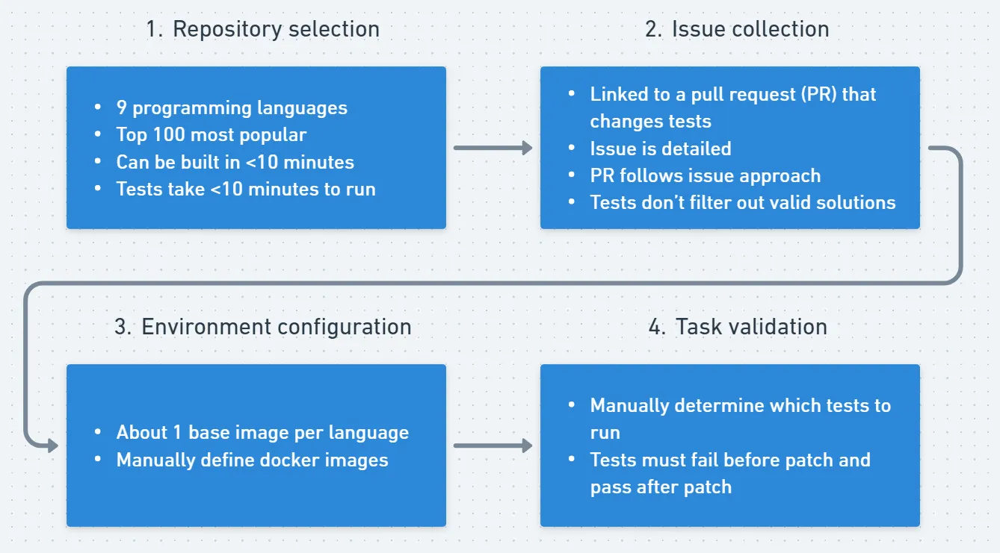
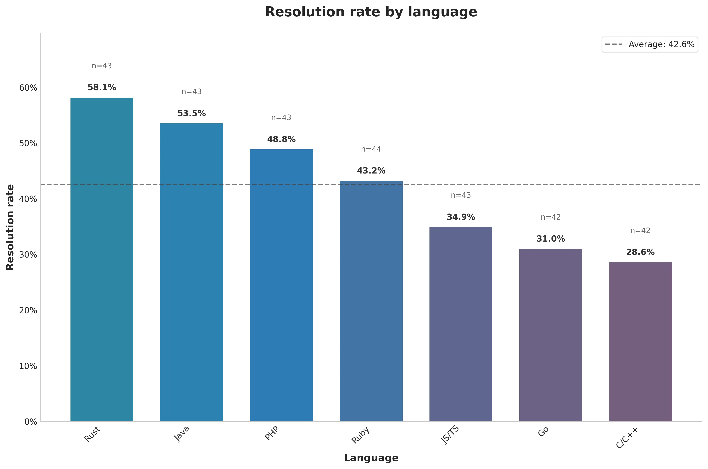
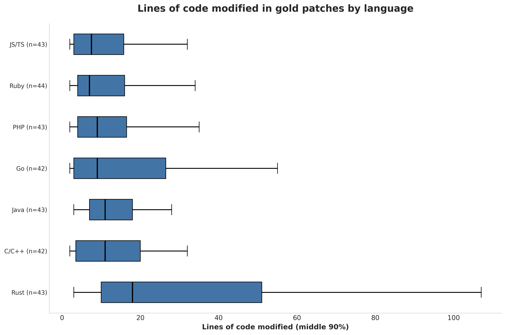
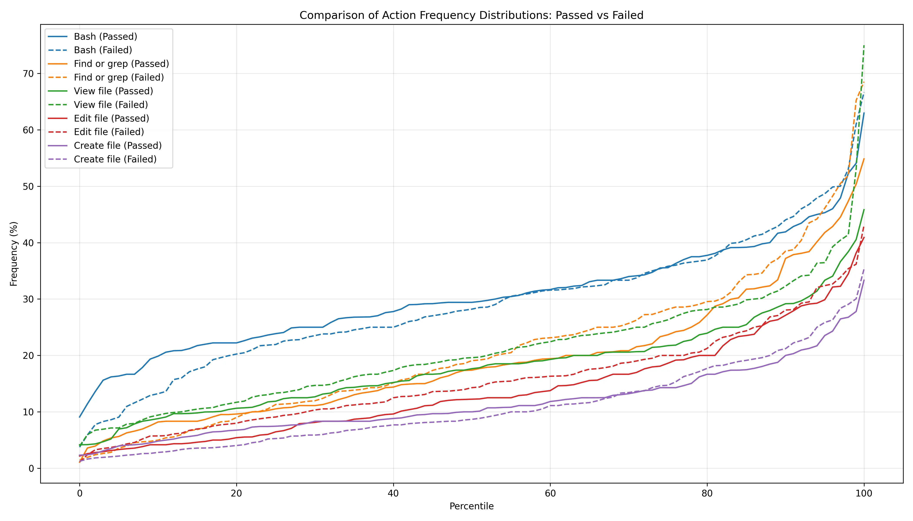
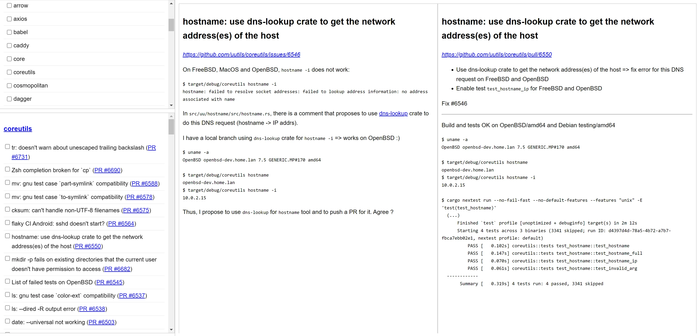
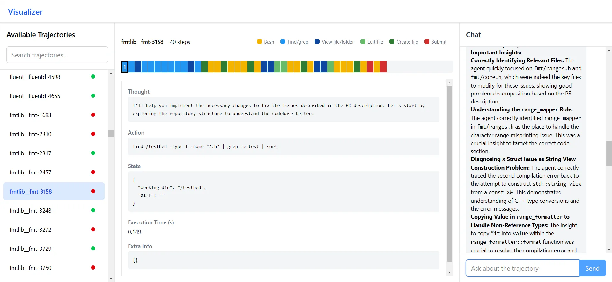

# SWE-bench Multilingual

[Course index](../../README.md) · [Original source](https://www.swebench.com/multilingual.html) · [Raw file](../../raw/optional-readings/ref-c18ff82e46ba.html)

Retrieved: 2026-11-13T16:55:53.545416+00:00

[SWE-bench](https://www.swebench.com/)


[SWE-bench](https://www.swebench.com/)


# SWE-bench Multilingual

300 curated SWE-bench style tasks from 42 repositories representing 9 programming languages

Kabir Khandpur, Kilian Lieret, Carlos E. Jimenez, Ofir Press, John Yang

  

[GitHub](https://github.com/SWE-bench/SWE-bench)
[Dataset](https://huggingface.co/datasets/SWE-bench/SWE-bench_Multilingual)

Originally posted as a [blog post on Kabir's website](https://kabirk.com/multilingual).

## Summary

This post introduces SWE-bench Multilingual, a new benchmark in the SWE-bench family designed to evaluate the software engineering capabilities of LLMs across a range of programming languages. SWE-bench Multilingual consists of 300 curated software engineering tasks derived from real-world GitHub pull requests across 42 repositories and 9 programming languages. The repositories span a wide range of application domains, including web frameworks, data storage and processing tools, core utilities, and common libraries.
  
  
Using the SWE-agent framework, **Claude 3.7 Sonnet achieves a 43% resolution rate on SWE-bench Multilingual**, compared to 63% on SWE-bench Verified, highlighting room for improvement in languages other than Python.
  
  
The dataset is available on [HuggingFace](https://huggingface.co/datasets/SWE-bench/SWE-bench_Multilingual) with evaluation code integrated into the [SWE-bench repository](https://github.com/swe-bench/SWE-bench). Please [email me](https://www.swebench.com/cdn-cgi/l/email-protection#80ebe1e2e9f2aeebe8e1eee4f0f5f2c0e7ede1e9ecaee3efed) with any questions or feedback!

## Introduction

SWE-bench is a standard benchmark to evaluate LLMs on software engineering capabilities. The benchmark dataset consists of 500 GitHub issues from 17 different Python projects. Given its focus on Python, the benchmark is not representative of LLM performance in different programming languages and domains. To broaden SWE-bench's evaluation capability, I developed SWE-bench Multilingual in collaboration with the SWE-bench team to accomplish the following goals:

1. Provide a benchmark to evaluate model and agent performance across a large variety of programming languages and domains. Existing agent frameworks often rely on Python-specific tooling, effectively overfitting to SWE-bench Verified.
2. Remain fully compatible with SWE-bench, so existing users can easily evaluate on Multilingual without needing to change their infrastructure.
3. Create a high-quality dataset that is comprehensive but small enough to run quickly. While concurrent work like [Multi-SWE-bench](https://multi-swe-bench.github.io/#/) provides more task instances in multiple languages, this dataset is purposely limited to 300 high-quality tasks so that the evaluation is easy to run quickly.

To achieve these goals, the Multilingual dataset provides 300 tasks across 42 repositories and 9 popular programming languages: C, C++, Go, Java, JavaScript, TypeScript, PHP, Ruby and Rust. See [Appendix A](ref-c18ff82e46ba.md) for dataset details.

## Benchmark construction

SWE-bench Multilingual follows the same collection strategy, dataset format and evaluation protocol as SWE-bench. Task instances correspond to real-world GitHub issues and their resolving pull requests (PRs). An agent receives the issue description and a repository snapshot at the pre-solution state and generates code modifications that resolve the issue. Success is determined by passing two sets of unit tests derived from the original PR: fail-to-pass (F2P) tests, which ensure the specific issue is fixed, and pass-to-pass (P2P) tests, which verify that existing functionality remains intact.



*Figure 1. Collection pipeline*

#### 1. Repository selection

First, 9 popular programming languages are selected based on the annual [Stack Overflow Developer Survey](https://survey.stackoverflow.co/2024/technology). Then, from the top 100 most starred repositories in these languages are selected from [GitHub-Ranking](https://github.com/EvanLi/Github-Ranking), repositories where the primary language is English and there are a large number of candidate issues are selected.
The public contribution guidelines and GitHub action workflow files are used to determine the correct commands to build the codebase and run tests. About 30% of repositories are discarded here because they can't be built locally, take too long to build, or take too long to run tests.

#### 2. Issue collection

For each repository, the SWE-bench collection pipeline is used to collect issue-PR pairs where the PR contains at least one test file. An issue is rejected if it doesn't describe the problem in sufficient detail, if the corresponding pull request implemented a different approach than the one proposed in the issue, if the pull request contains changes related to multiple issues, and if tests filter out valid solutions (for example, by checking for a specific error message).

#### 3. Environment configuration

The original SWE-bench repository defines three layers of docker images:

1. A base image that installs the language runtime and operating system packages for all the repositories in that language.
2. An environment image that installs the conda and pip packages required to run tests for a particular task instance. This image acts as a cache to avoid re-downloading dependencies between test runs.
3. An instance image that runs the test. For each instance, the install and test commands are manually specified.

Multilingual provides base and instance images but opts to skip defining environment images. While environment images worked well for SWE-bench, given its numerous tasks from a few repositories sharing dependencies, Multilingual's 300 tasks across 42 repositories rarely share dependencies, making pre-built environment images less beneficial and significantly increasing manual curation effort compared to the original SWE-bench.

#### 4. Task validation

A final manual verification procedure is conducted before including a task instance in the dataset.

1. Clone the repository and check out the commit specified by the issue.
2. Run instance-specific pre-install and install commands.
3. Run relevant tests, including tests added by the pull request. If tests added by the pull request pass without any code changes, the task instance is discarded.
4. Apply the test files.
5. Build the codebase.
6. Apply the “gold” patch, i.e. the non-test code changes introduced by the pull request.
7. Run relevant tests again and verify that they pass.
8. Parse the test logs to get the list of tests passing and failing tests for inclusion in the dataset.

## Results

To establish baseline performance, I evaluated SWE-agent + Claude 3.7 Sonnet on the Multilingual dataset. With a cost limit of $2.50, this setup correctly resolves 43% of tasks.
  
  
Resolution rate varies by language (figure 2), with Rust having the highest resolution rate and C/C++ the lowest.



*Figure 2. Resolution rate by language*

It's possible that the difference in resolution rate is because the dataset happens to contain more difficult tasks in some languages. In the absence of human annotations of difficulty, the number of lines of code modified by the gold patch can be used as an estimate of task difficulty. Figure 3 shows that difficulty distribution within a language isn't obviously correlated with resolution rate. For example, solutions to Rust tasks modify more lines of code on average, yet SWE-agent had the highest resolution rate in Rust.



*Figure 3. Lines of code updated by language*

From this limited analysis, it's hard to say what factors are most important in determining resolution rate, though it looks like language and difficulty are both relevant.
[Appendix B](ref-c18ff82e46ba.md) contains more cuts of the resolution rate statistics.

#### Agent trajectories

Manual inspection of agent trajectories didn't reveal any obvious patterns in the trajectories of successful and failed tasks (see [Appendix C](ref-c18ff82e46ba.md) for more notes). The distribution of the actions that SWE-agent took was very similar between successful and failed tasks (figure 5), suggesting that model capabilities are the limiting factor in resolution rate rather then agent design.



*Figure 5. Action frequency distribution in successful vs. failed tasks. Each action type has two lines - a solid line for successful tasks and a dashed line of the same color for failed ones. Every solid and dashed line pair are similar, indicating actions that are used similarly between successful and failed attempts.*

#### Limitations

**Most tasks require only a few lines of code.** SWE-bench's collection strategy looks for issues where the problem is well-defined and unit tests are unambiguous. This naturally selects for pull requests where only a few lines of code are modified. In SWE-bench Multilingual, the gold patch modifies 10 lines of code at the median and 110 lines at the 95th percentile. Real-world software engineering tasks often require significantly larger code modifications.

**Only one model is evaluated.** Due to budget constraints, only Claude 3.7 Sonnet was evaluated. Other models or agent frameworks may score higher on this dataset, possibly comparable in score to their performance on SWE-bench Verified.

**No human annotations.** The dataset is manually curated, but no human annotations of difficulty are included, as is done in SWE-bench Verified and Multi-SWE-bench.

## Conclusion

SWE-bench Multilingual suggests that LLMs are more proficient in Python than other languages. The dataset is available on [HuggingFace](https://huggingface.co/datasets/SWE-bench/SWE-bench_Multilingual) with evaluation code integrated into the [SWE-bench repository](https://github.com/swe-bench/SWE-bench). Please [email me](https://www.swebench.com/cdn-cgi/l/email-protection#caa1aba8a3b8e4a1a2aba4aebabfb88aada7aba3a6e4a9a5a7) with any questions or feedback!

---

## Appendix A: Dataset

#### Overview

| Repository | Language | Issue Count |
| --- | --- | --- |
| redis/redis | C | 12 |
| jqlang/jq | C | 9 |
| nlohmann/json | C++ | 1 |
| micropython/micropython | C | 5 |
| valkey-io/valkey | C | 4 |
| fmtlib/fmt | C++ | 11 |
| caddyserver/caddy | Go | 14 |
| hashicorp/terraform | Go | 5 |
| prometheus/prometheus | Go | 8 |
| gohugoio/hugo | Go | 7 |
| gin-gonic/gin | Go | 8 |
| google/gson | Java | 9 |
| apache/druid | Java | 5 |
| projectlombok/lombok | Java | 17 |
| apache/lucene | Java | 9 |
| reactivex/rxjava | Java | 1 |
| javaparser/javaparser | Java | 2 |
| babel/babel | JavaScript/TypeScript | 5 |
| vuejs/core | JavaScript/TypeScript | 5 |
| facebook/docusaurus | JavaScript/TypeScript | 5 |
| immutable-js/immutable-js | JavaScript/TypeScript | 2 |
| mrdoob/three.js | JavaScript/TypeScript | 3 |
| preactjs/preact | JavaScript/TypeScript | 17 |
| axios/axios | JavaScript/TypeScript | 6 |
| phpoffice/phpspreadsheet | PHP | 10 |
| laravel/framework | PHP | 13 |
| php-cs-fixer/php-cs-fixer | PHP | 10 |
| briannesbitt/carbon | PHP | 10 |
| jekyll/jekyll | Ruby | 5 |
| fluent/fluentd | Ruby | 12 |
| fastlane/fastlane | Ruby | 7 |
| jordansissel/fpm | Ruby | 2 |
| faker-ruby/faker | Ruby | 2 |
| rubocop/rubocop | Ruby | 16 |
| tokio-rs/tokio | Rust | 9 |
| uutils/coreutils | Rust | 5 |
| nushell/nushell | Rust | 5 |
| tokio-rs/axum | Rust | 7 |
| burntsushi/ripgrep | Rust | 2 |
| sharkdp/bat | Rust | 8 |
| astral-sh/ruff | Rust | 7 |

#### Median values

| Repository | Issue text | Gold patch | | Number of tests | |
| --- | --- | --- | --- | --- | --- |
| Word count | Lines | Files | F2P | P2P |
| apache/druid | 165 | 11 | 1 | 1 | 2 |
| apache/lucene | 135 | 7 | 2 | 1 | 11 |
| astral-sh/ruff | 134 | 14 | 1 | 1 | 34 |
| axios/axios | 197 | 5 | 1 | 1 | 2 |
| babel/babel | 197 | 2 | 1 | 1 | 105 |
| briannesbitt/carbon | 376 | 16 | 1 | 1 | 32 |
| burntsushi/ripgrep | 368 | 44 | 2 | 1 | 42 |
| caddyserver/caddy | 126 | 16 | 1 | 1 | 0 |
| facebook/docusaurus | 245 | 23 | 1 | 1 | 34 |
| faker-ruby/faker | 118 | 3 | 1 | 1 | 12 |
| fastlane/fastlane | 1129 | 5 | 1 | 1 | 9 |
| fluent/fluentd | 234 | 8 | 1 | 1 | 2 |
| fmtlib/fmt | 81 | 8 | 1 | 1 | 42 |
| gin-gonic/gin | 158 | 2 | 1 | 1 | 7 |
| gohugoio/hugo | 126 | 4 | 1 | 1 | 12 |
| google/gson | 115 | 9 | 1 | 2 | 2 |
| hashicorp/terraform | 277 | 43 | 1 | 2 | 16 |
| immutable-js/immutable-js | 156 | 9 | 2 | 2 | 21 |
| javaparser/javaparser | 182 | 82 | 1 | 1 | 1 |
| jekyll/jekyll | 181 | 10 | 1 | 1 | 4 |
| jordansissel/fpm | 75 | 28 | 1 | 4 | 22 |
| jqlang/jq | 106 | 32 | 2 | 1 | 27 |
| laravel/framework | 170 | 4 | 1 | 1 | 19 |
| micropython/micropython | 98 | 8 | 1 | 1 | 18 |
| mrdoob/three.js | 158 | 6 | 3 | 1 | 13 |
| nlohmann/json | 373 | 6 | 2 | 1 | 21 |
| nushell/nushell | 223 | 15 | 1 | 1 | 14 |
| php-cs-fixer/php-cs-fixer | 140 | 10 | 1 | 1 | 70 |
| phpoffice/phpspreadsheet | 250 | 12 | 2 | 2 | 11 |
| preactjs/preact | 187 | 7 | 1 | 1 | 16 |
| projectlombok/lombok | 161 | 11 | 2 | 1 | 4 |
| prometheus/prometheus | 161 | 29 | 1 | 2 | 10 |
| reactivex/rxjava | 264 | 5 | 1 | 1 | 56 |
| redis/redis | 140 | 14 | 1 | 1 | 13 |
| rubocop/rubocop | 150 | 10 | 2 | 2 | 40 |
| sharkdp/bat | 212 | 18 | 2 | 1 | 2 |
| tokio-rs/axum | 182 | 64 | 4 | 1 | 7 |
| tokio-rs/tokio | 174 | 7 | 1 | 1 | 16 |
| uutils/coreutils | 67 | 24 | 1 | 1 | 17 |
| valkey-io/valkey | 256 | 7 | 1 | 1 | 4 |
| vuejs/core | 246 | 11 | 1 | 1 | 26 |

## Appendix B: Evaluation results

#### Resolution rate by repository

| Repository | Language | Resolved | Unresolved | Resolution rate |
| --- | --- | --- | --- | --- |
| micropython/micropython | C | 0 | 5 | 0.0% |
| babel/babel | JS/TS | 0 | 5 | 0.0% |
| faker-ruby/faker | Ruby | 0 | 2 | 0.0% |
| caddyserver/caddy | Go | 2 | 12 | 14.3% |
| briannesbitt/carbon | PHP | 2 | 8 | 20.0% |
| facebook/docusaurus | JS/TS | 1 | 4 | 20.0% |
| jqlang/jq | C | 2 | 7 | 22.2% |
| valkey-io/valkey | C | 1 | 3 | 25.0% |
| fmtlib/fmt | C++ | 3 | 8 | 27.3% |
| gohugoio/hugo | Go | 2 | 5 | 28.6% |
| astral-sh/ruff | Rust | 2 | 5 | 28.6% |
| preactjs/preact | JS/TS | 5 | 12 | 29.4% |
| rubocop/rubocop | Ruby | 5 | 11 | 31.2% |
| apache/lucene | Java | 3 | 6 | 33.3% |
| prometheus/prometheus | Go | 3 | 5 | 37.5% |
| gin-gonic/gin | Go | 3 | 5 | 37.5% |
| uutils/coreutils | Rust | 2 | 3 | 40.0% |
| jekyll/jekyll | Ruby | 2 | 3 | 40.0% |
| projectlombok/lombok | Java | 7 | 10 | 41.2% |
| redis/redis | C | 5 | 7 | 41.7% |
| phpoffice/phpspreadsheet | PHP | 5 | 5 | 50.0% |
| fluent/fluentd | Ruby | 6 | 6 | 50.0% |
| immutable-js/immutable-js | JS/TS | 1 | 1 | 50.0% |
| jordansissel/fpm | Ruby | 1 | 1 | 50.0% |
| php-cs-fixer/php-cs-fixer | PHP | 5 | 5 | 50.0% |
| axios/axios | JS/TS | 3 | 3 | 50.0% |
| burntsushi/ripgrep | Rust | 1 | 1 | 50.0% |
| tokio-rs/tokio | Rust | 5 | 4 | 55.6% |
| tokio-rs/axum | Rust | 4 | 3 | 57.1% |
| vuejs/core | JS/TS | 3 | 2 | 60.0% |
| hashicorp/terraform | Go | 3 | 2 | 60.0% |
| mrdoob/three.js | JS/TS | 2 | 1 | 66.7% |
| google/gson | Java | 6 | 3 | 66.7% |
| laravel/framework | PHP | 9 | 4 | 69.2% |
| fastlane/fastlane | Ruby | 5 | 2 | 71.4% |
| sharkdp/bat | Rust | 6 | 2 | 75.0% |
| apache/druid | Java | 4 | 1 | 80.0% |
| nushell/nushell | Rust | 5 | 0 | 100.0% |
| nlohmann/json | C++ | 1 | 0 | 100.0% |
| javaparser/javaparser | Java | 2 | 0 | 100.0% |
| reactivex/rxjava | Java | 1 | 0 | 100.0% |

#### Resolution rate by language

| Language | Resolved | Unresolved | Total | Resolution rate |
| --- | --- | --- | --- | --- |
| C/C++ | 12 | 30 | 42 | 28.57% |
| Go | 13 | 29 | 42 | 30.95% |
| JavaScript/TypeScript | 15 | 28 | 43 | 34.88% |
| Ruby | 19 | 25 | 44 | 43.18% |
| PHP | 21 | 22 | 43 | 48.84% |
| Java | 23 | 20 | 43 | 53.49% |
| Rust | 25 | 18 | 43 | 58.14% |
| **Total** | **128** | **172** | **300** | **42.67%** |

#### Resolution rate by year

| Year | Resolved | Unresolved | Resolution rate |
| --- | --- | --- | --- |
| ≤2021 | 16 | 22 | 42.1% |
| 2022 | 24 | 30 | 44.4% |
| 2023 | 27 | 48 | 36.0% |
| 2024 | 54 | 63 | 46.2% |
| 2025 | 7 | 9 | 43.8% |

## Appendix C: Miscellaneous notes

#### Issue selection

During the collection process, I needed to inspect a large number of candidate issues for inclusion in the dataset. I wrote a web app to make it easier to determine whether issues were unsuitable by showing the issue and pull request description side by side. The app also let me keep track of the issues I'd already looked at.



*Figure 6. Issue inspection app*

#### Agent trajectory inspection

To help look for patterns in the trajectories of successful and failed tasks, I created a web app that displays the actions taken by the SWE-agent in a task. A chat pane on the side let me ask questions about the trajectory. Unfortunately, I wasn't able to find any patterns in the trajectories.



*Figure 7. Agent trajectory inspection app*

Nonetheless, I found the pattern of visual inspection to be very useful and a perfect use case for vibe coding. I'll continue to make small user interfaces like this in future projects.

#### Notes for agent improvements

**Support link following.** A common pattern in bug reports is to provide a link to a reproduction on sites like stackblitz. Many open-source agents are currently unable to follow links or understand how to use such websites to reproduce the issue. SWE-bench Multilingual therefore doesn't include any such issues, but future agents should have this capability.
  
  
**Support multiple languages.** As the SWE-bench Multimodal paper notes, many open-source agent frameworks hardcode Python support.
> …except for SWE-agent, the systems that we study (Agentless, Moatless, and AutoCodeRover) impose fixed, procedural problem-solving workflows. Every system starts with a bug localization step that relies on abstract syntax tree (AST) parsing libraries to identify programmatic symbols.

---


## Correspondence

For questions about SWE-bench Multilingual, please contact:

[{[email protected],[email protected]}](https://www.swebench.com/cdn-cgi/l/email-protection#2e454f4c475c0045464f404a5e5b5c6e49434f4742004d414302444146404c576e5d5a4f4048415c4a004b4a5b)

---


## Citation

If you use SWE-bench Multilingual in your research, please cite the SWE-smith paper:

BibTeX
APA
MLA

Copy

```
@misc{yang2025swesmith,
  title={SWE-smith: Scaling Data for Software Engineering Agents}, 
  author={John Yang and Kilian Lieret and Carlos E. Jimenez and Alexander Wettig and Kabir Khandpur and Yanzhe Zhang and Binyuan Hui and Ofir Press and Ludwig Schmidt and Diyi Yang},
  year={2025},
  eprint={2504.21798},
  archivePrefix={arXiv},
  primaryClass={cs.SE},
  url={https://arxiv.org/abs/2504.21798}, 
}
```

Copy

```
Yang, J., Lieret, K., Jimenez, C. E., Wettig, A., Khandpur, K., Zhang, Y., Hui, B., Press, O., Schmidt, L., & Yang, D. (2025). SWE-smith: Scaling Data for Software Engineering Agents. arXiv preprint arXiv:2504.21798.
```

Copy

```
Yang, John, et al. "SWE-smith: Scaling Data for Software Engineering Agents." arXiv preprint arXiv:2504.21798 (2025).
```
