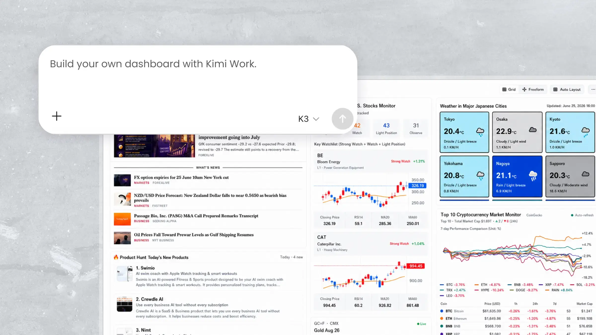
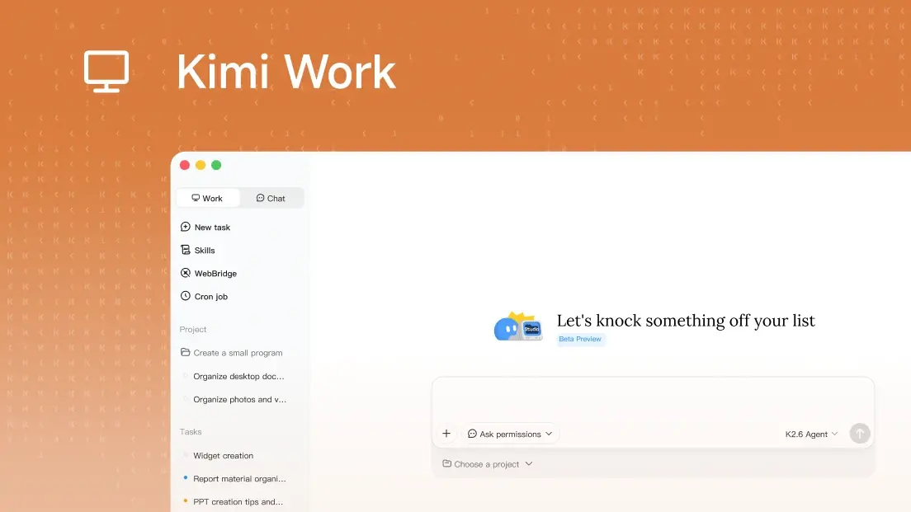
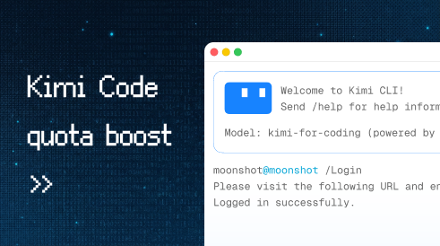
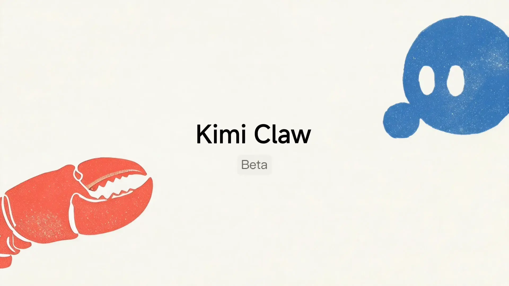
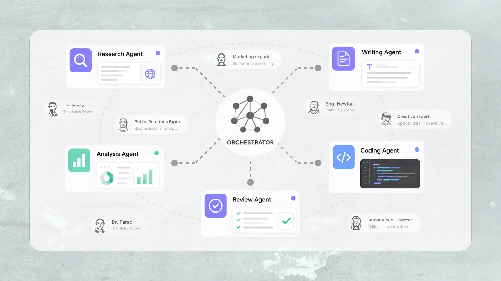

# Kimi K3 Pricing

[Course index](../../README.md) · [Original source](https://www.kimi.ai/resources/kimi-k3-pricing) · [Raw file](../../raw/optional-readings/ref-d5ad370f5e10.html)

Retrieved: 2026-11-13T16:55:22.312563+00:00

# Kimi K3 Pricing Explained: Plans and API Costs

8 min read/Updated: 2026-10-27

[Subscribe Now](https://www.kimi.ai/membership/pricing)

Kimi K3 is the world's first open 3T-class model, a 2.8T-parameter flagship built for frontier intelligence in long-horizon coding, knowledge work, and reasoning, with native vision and a 1M-token context window. It is available across Kimi.com, Kimi Work, Kimi Code, and the Kimi API. Below is an overview of Kimi membership plans and Kimi K3 API pricing to help you choose the right way to access it.

## Kimi K3 membership plans & usage tiers

The easiest way to use Kimi K3 is through a Kimi membership. Kimi offers tiered plans that scale with your needs, from casual daily use to intensive agentic workflows. Higher tiers unlock more agent credits, higher concurrency, and extra-long chat capacity of up to 1M tokens powered by Kimi K3.

[Subscribe Now](https://www.kimi.ai/membership/pricing)

| Plan / benefit | Free | Plus | Pro | Max | Ultra |
| --- | --- | --- | --- | --- | --- |
| Annual billing: effective monthly | $0 | $15 / month | $31 / month | $79 / month | $159 / month |
| Agent credits | Basic | More | 2× | 5× | 10× |
| Agent concurrent tasks | 1 | 2 | 2 | 4 | 4 |
| Agent priority generation queue | / | 4× speed | 4× speed | 4× speed | 4× speed |
| Scheduled tasks | 2 | 10 | 15 | 20 | 25 |
| Widget tasks | 2 | 10 | 15 | 20 | 25 |
| Projects | 2 | 20 | 20 | 100 | 100 |
| Project storage | 500MB | 20GB | 20GB | 50GB | 50GB |
| Swarm: concurrent subtasks | / | 2 | 4 | 8 | 8 |
| Dream Memory | / | Included | Included | Included | Included |
| Self-evolving Skill | / | Included | Included | Included | Included |
| Goal mode | / | / | Included | Included | Included |
| Kimi Claw: cloud, Android local, and desktop | / | / | Included | Included | Included |
| Publish a website with a database | / | Included | Included | Included | Included |

All prices above reflect annual billing. Monthly billing is also available at USD 19, 39, 99, and 199 per month respectively. Max and Ultra unlock K3's extra-long chat capacity, supporting up to 1M tokens of context for ultra-long conversations, large codebases, and document-heavy research. For the latest plan details, see the [official membership page](https://www.kimi.ai/membership/pricing).

[Subscribe Now](https://www.kimi.ai/membership/pricing)

## Kimi K3 API pricing

The Kimi K3 API pricing uses a token-based model, with usage billed per 1M tokens (1,000,000 tokens) for both input and output processing, enabling clear and predictable cost control.

| Model | Unit | Input Price (Cache Hit) | Input Price (Cache Miss) | Output Price | Context Window |
| --- | --- | --- | --- | --- | --- |
| kimi-k3 | 1M tokens | $0.30 | $3.00 | $15.00 | 1,048,576 tokens |

Kimi K3 is Kimi's flagship model for long-horizon coding and end-to-end knowledge work. It always reasons, with reasoning effort set through the top-level reasoning\_effort field. The model supports automatic context caching, tool calls, JSON mode, structured outputs, and a full 1M-token context window in a single request.

[Get API Credits](https://platform.kimi.ai/console/pay)

## How Kimi K3 API billing works

Kimi K3 API uses a token-based pricing model for each request, where every interaction with the model consumes tokens that are billed according to their type. Within this model, tokens are generally categorized into three types: input tokens, cached input tokens, and output tokens.

### Input tokens

Input tokens represent everything sent to the model, including:

- User prompts
- System instructions
- Conversation history or context
  These tokens determine how much context the model needs to process before generating a response. With a 1M-token context window, Kimi K3 can take in entire codebases, long documents, and extended multi-turn histories in one request.

### Cached input tokens

Cached input tokens occur when previously processed context is reused.

- If the same or similar context is reused, it is billed at $0.30 per 1M tokens instead of $3.00, a 90% reduction
- This significantly improves efficiency for repetitive workflows
- It is especially useful in long-context applications and multi-turn interactions, where large shared context is sent repeatedly

### Output tokens

Output tokens are generated by the model in response to a request. They represent the actual AI-generated content, such as:

- Text responses
- Code generation
- Structured outputs
  Because output generation requires additional computation, it is typically priced higher than input tokens.

[Get API Credits](https://platform.kimi.ai/console/pay)

## Conclusion

Kimi K3 offers flexible pricing for everyday users and developers alike: membership plans for the full Kimi experience, and a token-based API with automatic context caching that cuts input costs by 90%. Choose the path that fits your workflow, and start with Kimi K3 today.

## FAQ

### How is Kimi K3 API pricing calculated?

Kimi K3 API pricing is calculated based on token usage, billed per 1M tokens (1,000,000 tokens). Input tokens are billed at $3.00 per 1M tokens on a cache miss, or $0.30 per 1M tokens on a cache hit. Output tokens are billed at $15.00 per 1M tokens. All prices exclude applicable taxes, which are calculated at checkout based on your billing region.

### How much can I save with context caching?

When previously processed context is reused, cached input tokens are billed at $0.30 per 1M tokens instead of $3.00, a 90% reduction in input costs. This is especially useful in long-context applications and multi-turn interactions where the same context is sent repeatedly.

### Should I use the API or a Kimi membership plan?

Use a Kimi membership plan if you want to access Kimi K3 directly in the Kimi workspace, with agent capabilities, and extra-long chat capacity included. Use the API if you are building custom tools, agents, or production applications that require programmatic access and fine-grained control over token consumption.

### How many tokens does Kimi K3 support per request?

Kimi K3 supports a context window of 1M tokens (1,048,576 tokens), enabling it to handle entire codebases, long documents, and complex multi-step agentic tasks within a single request.

### Which membership plans include K3 extra-long chat capacity?

The Max and Ultra plans unlock K3 extra-long chat capacity, supporting conversations with up to 1M tokens of context. All other membership features, such as agent tasks and Swarm, scale across tiers as shown in the plan comparison table.

You Might Also Like

Kimi Work Dashboard: Personalized AI Dashboard and Widgets

2026-09-11

Kimi Work: The Local AI Agent for Your Desktop

2026-10-08

Kimi Code: Next-Gen AI Code Agent for Terminal & IDE

2026-10-10

Kimi Claw: 1-click OpenClaw Cloud Deployment & 24/7 AI Agent

2026-08-12

Multi-Agent System Explained: What It Is, Benefits, & Uses

2026-10-08
