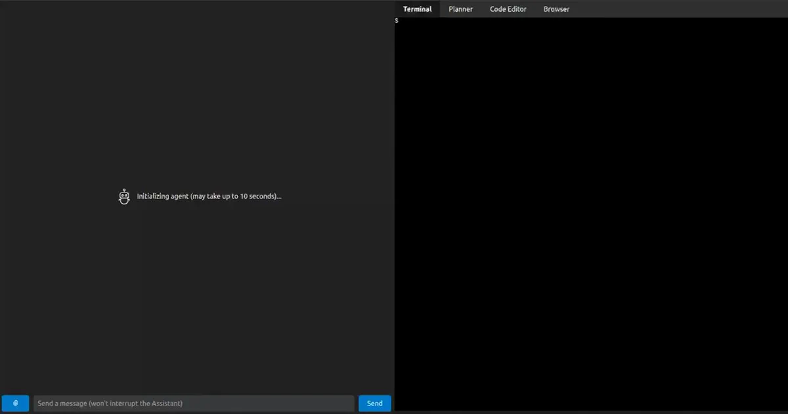

# OpenDevin: early frontend demo

[Course index](../../README.md) · [Original source](https://x.com/gneubig/status/1772735837479792761) · [Raw file](../../raw/optional-readings/ref-e2274cfcd6df.html)

Retrieved: 2026-11-13T16:57:35.138713+00:00

[Graham Neubig](https://x.com/gneubig)[@gneubig](https://x.com/gneubig)

The OpenDevin open-source coding assistant is really taking shape! We now have a frontend that connects to a rudimentary agent that solves coding tasks, a docker sandbox, and other things.
Next up is optimizing accuracy, we welcome contributions! [github.com/OpenDevin/Open…](https://t.co/3GpbxU5paL "https://github.com/OpenDevin/OpenDevin/")

00:00

[9:22 PM · Mar 26, 2024](ref-e2274cfcd6df.md)·[39.9K

Views](https://x.com/gneubig/status/1772735837479792761)

[3](https://x.com/compose/post?in_reply_to=1772735837479792761)

60

314

154
