# SkillRefiner: offline skill refinement

[Course index](../../README.md) · [Original source](https://www.alphaxiv.org/abs/2610.skillrefiner-offline-skill-refinement) · [Raw file](../../raw/optional-readings/ref-eb2d1e8cfb37.html)

Retrieved: 2026-11-13T16:57:53.956205+00:00

Submitted 01 Oct 2026

en

# SkillRefiner: Offline Skill Refinement from Historical Agent Traces

#1 in Software engineering · OctoberalphaXiv Exclusive

[OpenHands](https://www.alphaxiv.org/organizations/openhands)[UT Austin](https://www.alphaxiv.org/organizations/ut-austin)[NYU](https://www.alphaxiv.org/organizations/new-york-university)

[CMU](https://www.alphaxiv.org/organizations/cmu)

[Anirudh Khatry](https://www.alphaxiv.org/@anirudh-khatry)[Calvin Smith](https://www.alphaxiv.org/@calvin-smith)[Greg Durrett](https://www.alphaxiv.org/@greg-durrett)[Isil Dillig](https://www.alphaxiv.org/@isil-dillig)[Graham Neubig](https://www.alphaxiv.org/@graham-neubig)+1 moreShow less

## Abstract

Skills capture procedural knowledge that helps agents solve complex tasks. Existing skill-refinement methods improve these instructions by generating new rollouts with candidate skills, which can be costly or impractical when environments are not replayable or supervision arrives only after deployment. We introduce SKILLREFINER, an offline method that refines deployed agent skills from historical execution traces and observed outcomes. SKILLREFINER summarizes long trajectories, clusters recurring behaviors and failure modes, and derives targeted edits from each cluster. Successful clusters reinforce effective behavior, while failure clusters produce guardrails and procedural corrections that are checked against supporting evidence. We evaluate SKILLREFINER on spreadsheet manipulation, mathematical reasoning, and production pull-request review. SkillRefiner improves over both the LLM and human authored skills across all settings[p8] while using 1.4–42× fewer refinement tokens than competing refinement methods.[p15]

[View Paper](https://www.alphaxiv.org/pdf/2610.skillrefiner-offline-skill-refinement)[PDF](ref-eb2d1e8cfb37-pdf.md)145

Save

Cite

## From the authors

[View full on X](https://x.com/AnirudhKhatry/status/2106071467259543893)

[Anirudh Khatry@AnirudhKhatry](https://x.com/AnirudhKhatry)

Deployed agents pile up execution traces. The question is whether we can automatically refine skills based on existing rollouts.

Introducing SkillRefiner: Offline skill refinement from the traces you already have! 🧵

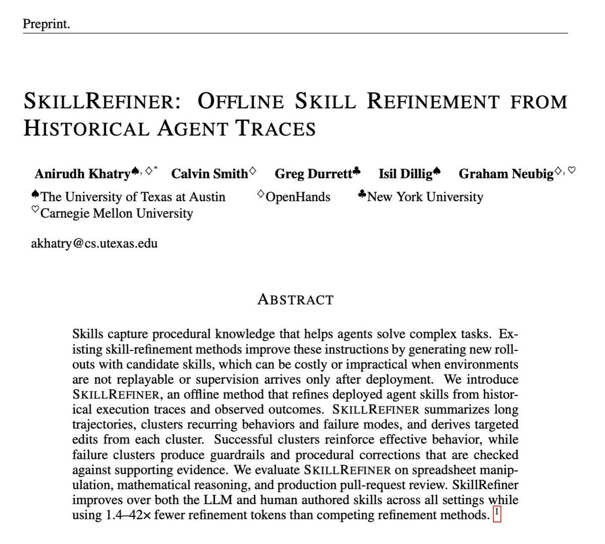

Most skill optimizers ignore existing traces and generate fresh rollouts instead. Repeated rollouts are expensive and not feasible when the environment doesn’t support replays.

SkillRefiner learns entirely from prior rollouts and is 1.4-42x cheaper!

How it works:

Summarize each trace, attaching grader feedback to failures

Cluster successes and failures separately

Propose one skill edit per cluster

Check failure-derived edits against the evidence

Merge into the skill

Edits target recurring patterns, not one-off noise.

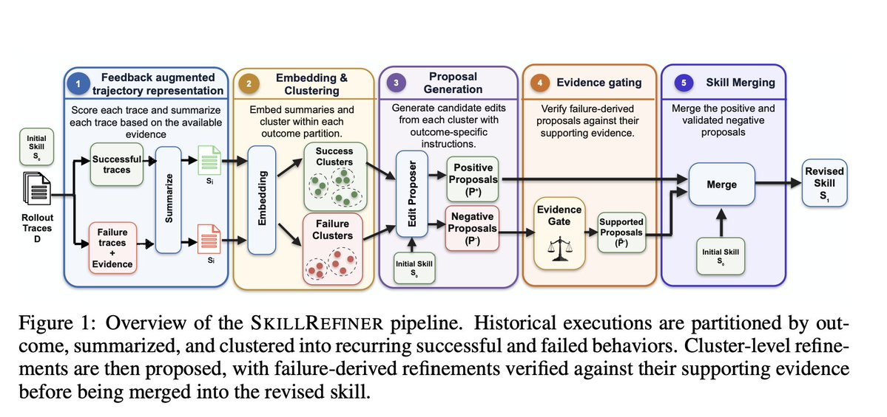

Show full threadShow less

Example from SpreadsheetBench: lookup, date-filter, and aggregation failures look unrelated.

Clustering reveals one shared cause: the agent checked cell values before the workbook was recalculated. SkillRefiner replaces several task-specific fixes with a single rule.

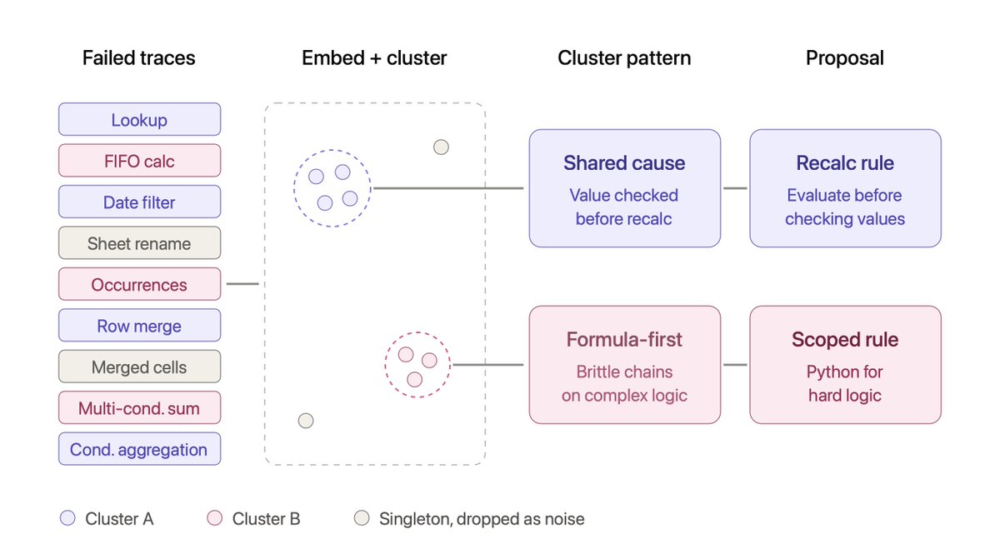

We evaluate SkillRefiner across 3 very different domains:

📊 Spreadsheet manipulation

🧮 Mathematical reasoning

💻 Production pull-request review

We employ the OpenHands agent using gpt-5.4-mini and Minimax M2.7.

Across all 8 evaluation settings, SkillRefiner improves the initial skill while saving considerable cost!

SkillRefiner requires no new rollouts and is 1.4-42x cheaper than competing offline and online refinement methods.

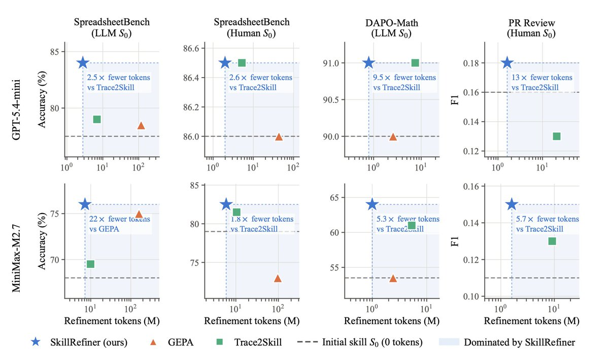

We ablate by removing each stage from SkillRefiner. We find the biggest drops upon removing:

clustering: up to −11.5 pts

failure-derived edits: up to −9 pts

evidence gating: up to −6.5 pts

We find that failures teach more than successes!

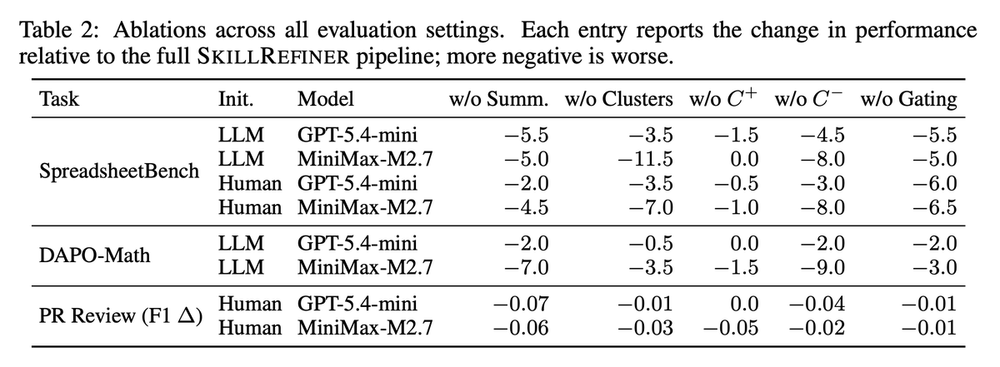

Check out our full paper: [Read PDF](https://www.alphaxiv.org/pdf/2610.skillrefiner-offline-skill-refinement)

Full code and datasets to be released soon!

Work done at [@OpenHandsDev](https://x.com/OpenHandsDev) with wonderful collaborators Calvin Smith, [@gregd\_nlp](https://x.com/gregd_nlp), [@IsilDillig](https://x.com/IsilDillig), and [@gneubig](https://x.com/gneubig)!

## AI Overview

CopyEdit

SKILLREFINER treats an agent's past runs as supervision for improving its instructions, even when the work cannot readily be replayed or its outcome arrives late. Production code review shows the problem. An agent writes its review now, but quality is revealed only later, when developers revise the code and it becomes clear which suggestions matched issues they addressed, typically days to weeks later.[p6] Replay-based refinement assumes tasks can be replayed and evaluated quickly, and that assumption can fail for deployed tasks with delayed human feedback.[p1] SKILLREFINER learns from records of prior work instead of repeatedly asking the agent to redo tasks with candidate instructions. The authors report gains across their evaluation settings, including this delayed-feedback setting.[p8]

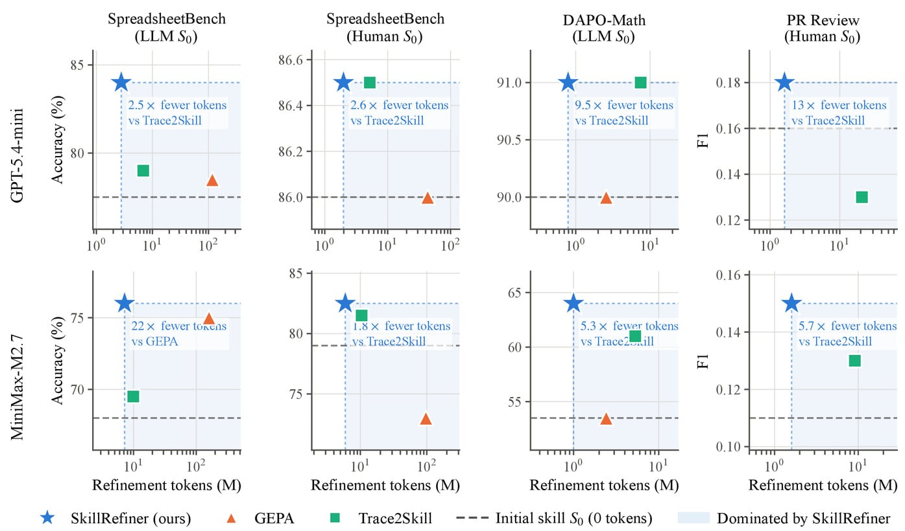

The plots compare refinement-token use with held-out task performance. In the PR Review panels, SkillRefiner sits above and left of Trace2Skill for both GPT-5.4-mini and MiniMax-M2.7. The PR panels do not include GEPA.

## Turning traces into reusable instructions

A skill is reusable natural-language procedural guidance for an agent. SKILLREFINER takes historical traces, their outcomes, and any available evaluator feedback. It summarizes each trace's context, strategy, and salient actions, then embeds the summaries. Successful runs and failed runs are clustered separately, and the method proposes one edit per cluster. Edits derived from failures are checked against the evidence. Supported failure edits and success-derived reinforcements are then merged into the initial skill. No new agent executions are generated during refinement.[p3] Singleton clusters are treated as noise and do not independently generate edits.[p4]

The two kinds of cluster work differently. A success cluster supplies repeated behavior to reinforce. A failure cluster points to a recurring problem, and the LLM supplies a proposed remedy from its pretrained knowledge. That remedy is a hypothesis, and the traces do not prove it correct.[p4] The evidence gate checks whether the targeted behavior occurred and is plausibly connected to failure. The gate does not revise the proposal or replay the task.[p5] When positive and negative guidance conflict, the merge is instructed to restrict a behavior only in the context where failure was observed, so useful behavior is kept elsewhere.[p5]

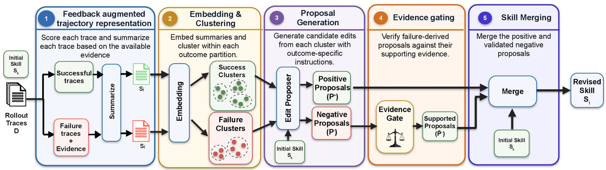

Rollout traces split into successful and failed traces, with evidence attached to failures. Both streams are summarized, embedded, and clustered separately. Negative proposals pass through an evidence gate before the initial skill and accepted proposals merge into a revised skill.

## What the comparisons establish

The closest prior work, [Trace2Skill](https://www.alphaxiv.org/abs/2603.25158), also turns historical traces into a skill. It does so by proposing patches from individual runs and consolidating them.[p10] [GEPA](https://www.alphaxiv.org/abs/2507.19457) takes a different approach: it generates new executions to evaluate candidates, using a budget of five candidate revisions.[p6]

The first comparison uses held-out SpreadsheetBench tasks, where accuracy means the output workbook passes the benchmark's evaluator.[p6] With an LLM-authored initial skill and GPT-5.4-mini, SkillRefiner reaches 84.0% accuracy, compared with 79.0% for Trace2Skill and 78.5% for GEPA. The result is significant against both baselines by paired bootstrap (p < 0.05, N = 10,000).[p7] In the same setting, refinement used 2.78 million tokens, versus 6.87 million for Trace2Skill and 117.22 million for GEPA.[p15] These counts cover refinement tokens only. They exclude the cost of collecting the historical rollouts and do not establish lower wall-clock time or total compute.[p15]

The second comparison is a component ablation, which tests the mechanism directly. With SpreadsheetBench, an LLM-authored initial skill, and MiniMax-M2.7, each component was removed in turn:

- Removing failure-cluster proposals reduces performance by 8.0 points.
- Removing success-cluster proposals produces a 0.0-point change.
- Removing evidence gating reduces performance by 5.0 points.

Across settings, removing failure-derived proposals hurts more than removing success-derived ones in seven of eight cases. The authors also note that successful executions provide useful signals in some cases.[p8] These results support the pipeline's components, but they do not establish that any individual repair is correct.

## History as feedback

In PR Review, developer revisions serve as delayed supervision. An LLM judge matches agent suggestions to developer-addressed issues to compute F1, which is a proxy for review usefulness. GEPA cannot be applied in this setting because immediate replay with automated feedback is unavailable.[p8] The paper's contribution is an offline method that refines skills from prior executions without repeatedly generating new rollouts.[p10] Its distinctive step is compiling repeated, outcome-separated patterns into conditional, evidence-checked guidance, rather than treating every trace as an isolated lesson. Its main boundary is that failure-derived fixes remain LLM hypotheses that are checked against evidence but never replayed.

## Audio

Audio summary

Re-generate the summary with our new system for an improved script, citations within the audio, and more.

Sign up to generate

0:00--:--

Show full transcript

## Similar papers

[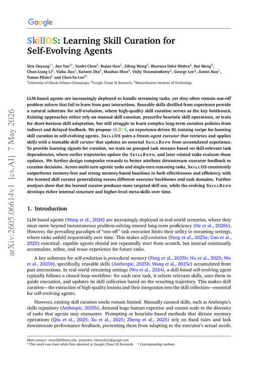SkillOS: Learning Skill Curation for Self-Evolving Agents07 May 2026](https://www.alphaxiv.org/abs/2605.06614)[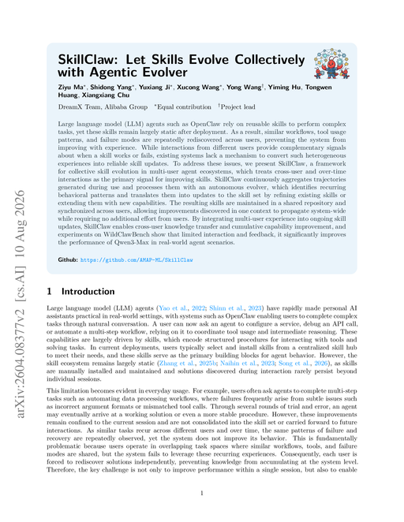SkillClaw: Let Skills Evolve Collectively with Agentic Evolver10 Aug 2026](https://www.alphaxiv.org/abs/2604.08377)[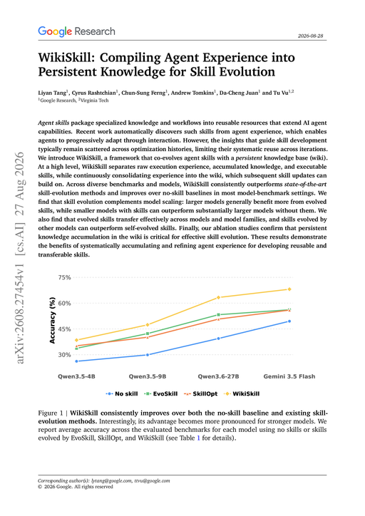WikiSkill: Compiling Agent Experience into Persistent Knowledge for Skill Evolution27 Aug 2026](https://www.alphaxiv.org/abs/2608.27454)[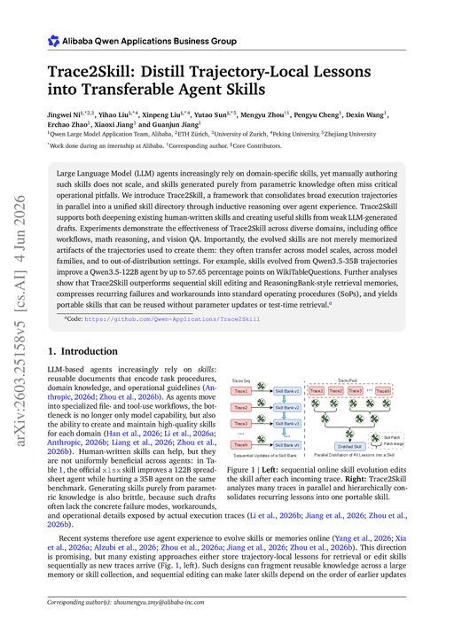Trace2Skill: Distill Trajectory-Local Lessons into Transferable Agent Skills04 Jun 2026](https://www.alphaxiv.org/abs/2603.25158)[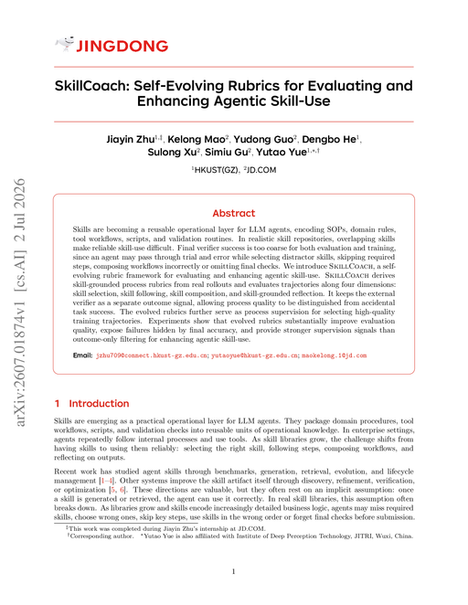SkillCoach: Self-Evolving Rubrics for Evaluating and Enhancing Agentic Skill-Use02 Jul 2026](https://www.alphaxiv.org/abs/2607.01874)

Show moreShow less

[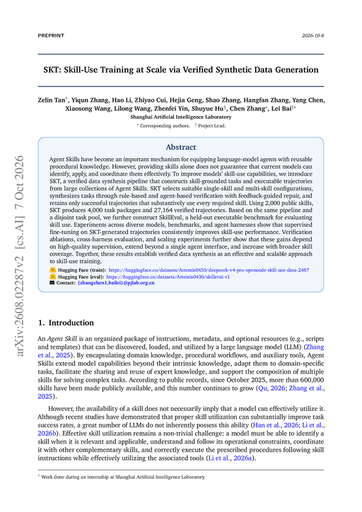SKT: Skill-Use Training at Scale via Verified Synthetic Data Generation07 Oct 2026](https://www.alphaxiv.org/abs/2608.02287)[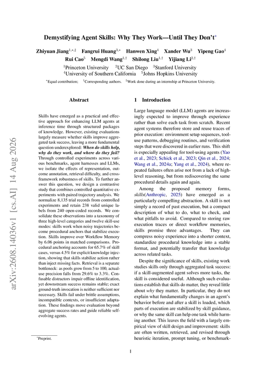Demystifying Agent Skills: Why They Work-Until They Don't14 Aug 2026](https://www.alphaxiv.org/abs/2608.14036)[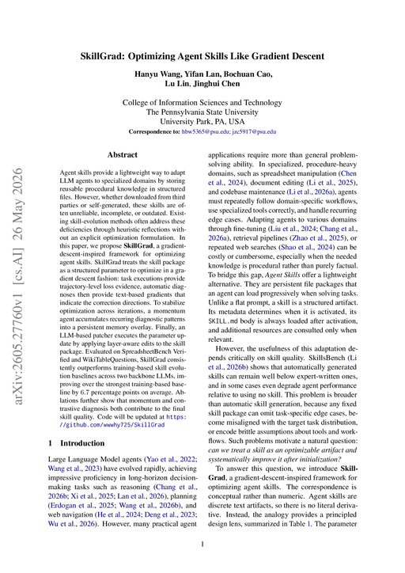SkillGrad: Optimizing Agent Skills Like Gradient Descent26 May 2026](https://www.alphaxiv.org/abs/2605.27760)[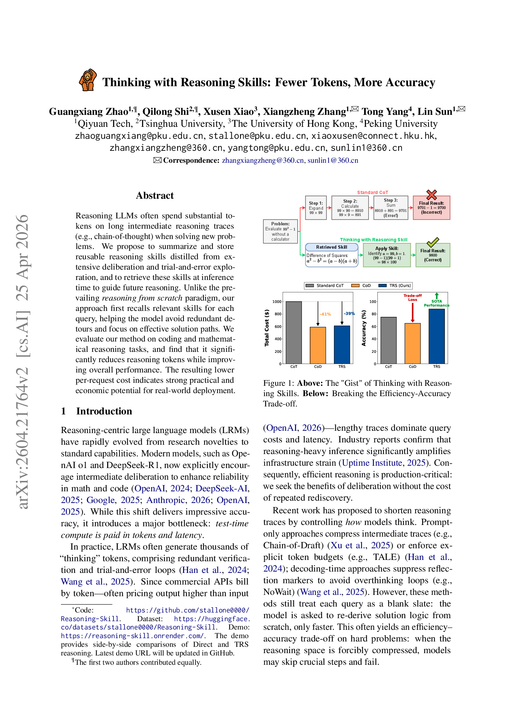Thinking with Reasoning Skills: Fewer Tokens, More Accuracy25 Apr 2026](https://www.alphaxiv.org/abs/2604.21764)[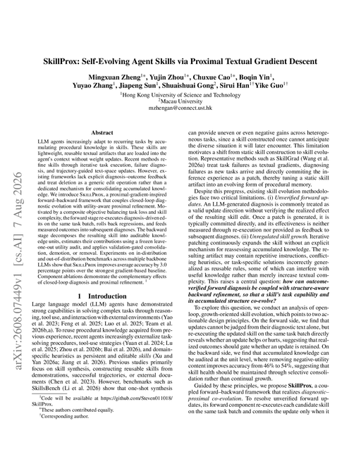SkillProx: Self-Evolving Agent Skills via Proximal Textual Gradient Descent07 Aug 2026](https://www.alphaxiv.org/abs/2608.07449)

## Discussion

Comment
