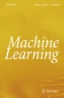
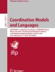

# REINFORCE

[Course index](../../README.md) · [Original source](https://doi.org/10.1007/BF00992696) · [Raw file](../../raw/optional-readings/ref-fa03f3992632.html)

Retrieved: 2026-11-13T16:56:24.469368+00:00

# Simple statistical gradient-following algorithms for connectionist reinforcement learning

- Published: May 1992

- Volume 8, pages 229–256 (1992)
- [Cite this article](ref-fa03f3992632.md)

[Download PDF](ref-fa03f3992632-pdf.md)

[View saved research](https://link.springer.com/saved-research)

[
Machine Learning](https://link.springer.com/journal/10994)
[Aims and scope](https://link.springer.com/journal/10994/aims-and-scope)
[Submit manuscript](https://submission.springernature.com/new-submission/10994/3)

Simple statistical gradient-following algorithms for connectionist reinforcement learning

[Download PDF](ref-fa03f3992632-pdf.md)

- [Ronald J. Williams](ref-fa03f3992632.md)[1](ref-fa03f3992632.md)

- 110k Accesses
- 5173 Citations
- 88 
  Altmetric
- 11 Mentions
- [Explore all metrics](https://link.springer.com/article/10.1007/BF00992696/metrics)

## Abstract

This article presents a general class of associative reinforcement learning algorithms for connectionist networks containing stochastic units. These algorithms, called REINFORCE algorithms, are shown to make weight adjustments in a direction that lies along the gradient of expected reinforcement in both immediate-reinforcement tasks and certain limited forms of delayed-reinforcement tasks, and they do this without explicitly computing gradient estimates or even storing information from which such estimates could be computed. Specific examples of such algorithms are presented, some of which bear a close relationship to certain existing algorithms while others are novel but potentially interesting in their own right. Also given are results that show how such algorithms can be naturally integrated with backpropagation. We close with a brief discussion of a number of additional issues surrounding the use of such algorithms, including what is known about their limiting behaviors as well as further considerations that might be used to help develop similar but potentially more powerful reinforcement learning algorithms.

## Article PDF

[Download](ref-fa03f3992632-pdf.md) to read the full article text

### Similar content being viewed by others

### [Gradient Correction for Asynchronous Stochastic Gradient Descent in Reinforcement Learning](https://link.springer.com/chapter/10.1007/978-3-031-70392-8_127?fromPaywallRec=false)

Chapter
© 2024

### [Towards Reinforcement Learning-based Aggregate Computing](https://link.springer.com/chapter/10.1007/978-3-031-08143-9_5?fromPaywallRec=false)

Chapter
© 2022

### [Abstracting Reinforcement Learning Agents with Prior Knowledge](https://link.springer.com/chapter/10.1007/978-3-030-03098-8_27?fromPaywallRec=false)

Chapter
© 2018

### Explore related subjects

Discover the latest articles, books and news in related subjects, suggested using machine learning.

- [Artificial Intelligence](https://link.springer.com/subjects/artificial-intelligence)
- [Algorithms](https://link.springer.com/subjects/algorithms)
- [Machine Learning](https://link.springer.com/subjects/machine-learning)
- [Stochastic Learning and Adaptive Control](https://link.springer.com/subjects/stochastic-learning-and-adaptive-control)
- [Learning algorithms](https://link.springer.com/subjects/learning-algorithms)
- [Operant Conditioning](https://link.springer.com/subjects/operant-conditioning)
- [Reinforcement Learning in Multi-Agent Systems](https://link.springer.com/subjects/reinforcement-learning-in-multi-agent-systems)

## References

- Barto, A.G. (1985). Learning by statistical cooperation of self-interested neuron-like computing elements.*Human Neurobiology*, 4, 229–256.

  [Google Scholar](http://scholar.google.com/scholar_lookup?&title=Learning%20by%20statistical%20cooperation%20of%20self-interested%20neuron-like%20computing%20elements&journal=Human%20Neurobiology&volume=4&pages=229-256&publication_year=1985&author=Barto%2CA.G.)
- Barto, A.G. & Anandan, P. (1985). Pattern recognizing stochastic learning automata.*IEEE Transactions on Systems, Man, and Cybernetics*, 15, 360–374.

  [Google Scholar](http://scholar.google.com/scholar_lookup?&title=Pattern%20recognizing%20stochastic%20learning%20automata&journal=IEEE%20Transactions%20on%20Systems%2C%20Man%2C%20and%20Cybernetics&volume=15&pages=360-374&publication_year=1985&author=Barto%2CA.G.&author=Anandan%2CP.)
- Barto, A.G. & Anderson, C.W. (1985). Structural learning in connectionist systems.*Proceedings of the Seventh Annual Conference of the Cognitive Science Society*, (pp. 43–53). Irvine, CA.
- Barto, A.G., Sutton, R.S., & Anderson, C.W. (1983). Neuronlike elements that can solve difficult learning control problems.*IEEE Transactions on Systems, Man, and Cybernetics*, 13, 835–846.

  [Google Scholar](http://scholar.google.com/scholar_lookup?&title=Neuronlike%20elements%20that%20can%20solve%20difficult%20learning%20control%20problems&journal=IEEE%20Transactions%20on%20Systems%2C%20Man%2C%20and%20Cybernetics&volume=13&pages=835-846&publication_year=1983&author=Barto%2CA.G.&author=Sutton%2CR.S.&author=Anderson%2CC.W.)
- Barto, A.G., Sutton, R.S., & Brouwer, P.S. (1981). Associative search network: A reinforcement learning associative memory.*Biological Cybernetics*, 40, 201–211.

  [Google Scholar](http://scholar.google.com/scholar_lookup?&title=Associative%20search%20network%3A%20A%20reinforcement%20learning%20associative%20memory&journal=Biological%20Cybernetics&volume=40&pages=201-211&publication_year=1981&author=Barto%2CA.G.&author=Sutton%2CR.S.&author=Brouwer%2CP.S.)
- Barto, A.G., & Jordan, M.I. (1987). Gradient following without back-propagation in layered networks.*Proceedings of the First Annual International Conference on Neural Networks*, Vol. II (pp. 629–636). San Diego, CA.
- Barto, A.G., Sutton, R.S., & Watkins, C.J.C.H. (1990). Learning and sequential decision making. In: M. Gabriel & J.W. Moore (Eds.),*Learning and computational neuroscience: Foundations of adaptive networks*. Cambridge, MA: MIT Press.

  [Google Scholar](http://scholar.google.com/scholar_lookup?&title=Learning%20and%20sequential%20decision%20making&publication_year=1990&author=Barto%2CA.G.&author=Sutton%2CR.S.&author=Watkins%2CC.J.C.H.)
- Dayan, P. (1990). Reinforcement comparison. In D.S. Touretzky, J.L. Elman, T.J. Sejnowski, & G.E. Hinton (Eds.),*Proceedings of the 1990 Connectionist Models Summer School* (pp. 45–51). San Mateo, CA: Morgan Kaufmann.

  [Google Scholar](http://scholar.google.com/scholar_lookup?&title=Reinforcement%20comparison&pages=45-51&publication_year=1990&author=Dayan%2CP.)
- Goodwin, G.C. & Sin, K.S. (1984).*Adaptive filtering prediction and control*. Englewood Cliffs, NJ: Prentice-Hall.

  [Google Scholar](http://scholar.google.com/scholar_lookup?&title=Adaptive%20filtering%20prediction%20and%20control&publication_year=1984&author=Goodwin%2CG.C.&author=Sin%2CK.S.)
- Gullapalli, V. (1990). A stochastic reinforcement learning algorithm for learning real-valued functions.*Neural Networks*, 3, 671–692.

  [Google Scholar](http://scholar.google.com/scholar_lookup?&title=A%20stochastic%20reinforcement%20learning%20algorithm%20for%20learning%20real-valued%20functions&journal=Neural%20Networks&volume=3&pages=671-692&publication_year=1990&author=Gullapalli%2CV.)
- Hinton, G.E. & Sejnowski, T.J. (1986). Learning and relearning in Boltzmann machines. In: D.E. Rumelhart & J.L. McClelland, (Eds.),*Parallel distributed processing: Explorations in the microstructure of cognition. Vol. 1: Foundations*. Cambridge, MA: MIT Press.

  [Google Scholar](http://scholar.google.com/scholar_lookup?&title=Learning%20and%20relearning%20in%20Boltzmann%20machines&publication_year=1986&author=Hinton%2CG.E.&author=Sejnowski%2CT.J.)
- Jordan, M.I. & Rumelhart, D.E. (1990).*Forward models: supervised learning with a distal teacher*. (Occasional Paper — 40). Cambridge, MA: Massachusetts Institute of Technology, Center for Cognitive Science.

  [Google Scholar](http://scholar.google.com/scholar_lookup?&title=Forward%20models%3A%20supervised%20learning%20with%20a%20distal%20teacher&publication_year=1990&author=Jordan%2CM.I.&author=Rumelhart%2CD.E.)
- leCun, Y. (1985). Une procedure d'apprentissage pour resau a sequil assymetrique [A learning procedure for asymmetric threshold networks].*Proceedings of Cognitiva, 85*, 599–604.

  [Google Scholar](http://scholar.google.com/scholar_lookup?&title=Une%20procedure%20d%27apprentissage%20pour%20resau%20a%20sequil%20assymetrique%20%5BA%20learning%20procedure%20for%20asymmetric%20threshold%20networks%5D&journal=Proceedings%20of%20Cognitiva&volume=85&pages=599-604&publication_year=1985&author=leCun%2CY.)
- Munro, P. (1987). A dual back-propagation scheme for scalar reward learning.*Proceedings of the Ninth Annual Conference of the Cognitive Science Society* (pp. 165–176). Seattle, WA.
- Narendra, K.S. & Thathatchar, M.A.L. (1989).*Learning Automata: An introduction*. Englewood Cliffs, NJ: Prentice Hall.

  [Google Scholar](http://scholar.google.com/scholar_lookup?&title=Learning%20Automata%3A%20An%20introduction&publication_year=1989&author=Narendra%2CK.S.&author=Thathatchar%2CM.A.L.)
- Narendra, K.S. & Wheeler, R.M., Jr. (1983). An*N*-player sequential stochastic game with identical payoffs.*IEEE Transactions on Systems, Man, and Cybernetics*, 13, 1154–1158.

  [Google Scholar](http://scholar.google.com/scholar_lookup?&title=AnN-player%20sequential%20stochastic%20game%20with%20identical%20payoffs&journal=IEEE%20Transactions%20on%20Systems%2C%20Man%2C%20and%20Cybernetics&volume=13&pages=1154-1158&publication_year=1983&author=Narendra%2CK.S.&author=Wheeler%2CR.M.)
- Nilsson, N.J. (1980).*Principles of artificial intelligence*. Palo Alto, CA: Tioga.

  [Google Scholar](http://scholar.google.com/scholar_lookup?&title=Principles%20of%20artificial%20intelligence&publication_year=1980&author=Nilsson%2CN.J.)
- Parker, D.B. (1985).*Learning-logic*. (Technical Report TR-47). Cambridge, MA: Massachusetts Institute of Technology, Center for Computational Research in Economics and Management Science.

  [Google Scholar](http://scholar.google.com/scholar_lookup?&title=Learning-logic&publication_year=1985&author=Parker%2CD.B.)
- Rohatgi, V.K. (1976)*An introduction to probability theory and mathematical statistics*. New York: Wiley.

  [Google Scholar](http://scholar.google.com/scholar_lookup?&title=An%20introduction%20to%20probability%20theory%20and%20mathematical%20statistics&publication_year=1976&author=Rohatgi%2CV.K.)
- Rumelhart, D.E., Hinton, G.E., & Williams, R.J. (1986). Learning internal representations by error propagation. In: D.E. Rumelhart & J.L. McClelland, (Eds.),*Parallel distributed processing: Explorations in the microstructure of cognition. Vol. 1: Foundations*. Cambridge: MIT Press.

  [Google Scholar](http://scholar.google.com/scholar_lookup?&title=Learning%20internal%20representations%20by%20error%20propagation&publication_year=1986&author=Rumelhart%2CD.E.&author=Hinton%2CG.E.&author=Williams%2CR.J.)
- Schmidhuber, J.H. & Huber, R. (1990). Learning to generate focus trajectories for attentive vision. (Technical Report FKI-128-90). Technische Universität München, Institut für Informatik.
- Sutton, R.S. (1984).*Temporal credit assignment in reinforcement learning*. Ph.D. Dissertation, Dept. of Computer and Information Science, University of Massachusetts, Amherst, MA.

  [Google Scholar](http://scholar.google.com/scholar_lookup?&title=Temporal%20credit%20assignment%20in%20reinforcement%20learning&publication_year=1984&author=Sutton%2CR.S.)
- Sutton, R.S. (1988). Learning to predict by the methods of temporal differences.*Machine Learning*, 3, 9–44.

  [Google Scholar](http://scholar.google.com/scholar_lookup?&title=Learning%20to%20predict%20by%20the%20methods%20of%20temporal%20differences&journal=Machine%20Learning&volume=3&pages=9-44&publication_year=1988&author=Sutton%2CR.S.)
- Thathatchar, M.A.L. & Sastry, P.S. (1985). A new approach to the design of reinforcement schemes for learning automata.*IEEE Transactions on Systems, Man, and Cybernetics*, 15, 168–175.

  [Google Scholar](http://scholar.google.com/scholar_lookup?&title=A%20new%20approach%20to%20the%20design%20of%20reinforcement%20schemes%20for%20learning%20automata&journal=IEEE%20Transactions%20on%20Systems%2C%20Man%2C%20and%20Cybernetics&volume=15&pages=168-175&publication_year=1985&author=Thathatchar%2CM.A.L.&author=Sastry%2CP.S.)
- Wheeler, R.M., Jr. & Narendra K.S. (1986). Decentralized learning in finite Markov chains.*IEEE Transactions on Automatic Control*, 31, 519–526.

  [Google Scholar](http://scholar.google.com/scholar_lookup?&title=Decentralized%20learning%20in%20finite%20Markov%20chains&journal=IEEE%20Transactions%20on%20Automatic%20Control&volume=31&pages=519-526&publication_year=1986&author=Wheeler%2CR.M.&author=Narendra%2CK.S.)
- Watkins, C.J.C.H. (1989).*Learning from delayed rewards*. Ph.D. Dissertation, Cambridge University, Cambridge, England.

  [Google Scholar](http://scholar.google.com/scholar_lookup?&title=Learning%20from%20delayed%20rewards&publication_year=1989&author=Watkins%2CC.J.C.H.)
- Werbos, P.J. (1974).*Beyond regression: new tools for prediction and analysis in the behavioral sciences*. Ph.D. Dissertation, Harvard University, Cambridge, MA.

  [Google Scholar](http://scholar.google.com/scholar_lookup?&title=Beyond%20regression%3A%20new%20tools%20for%20prediction%20and%20analysis%20in%20the%20behavioral%20sciences&publication_year=1974&author=Werbos%2CP.J.)
- Williams, R.J. (1986).*Reinforcement learning in connectionist networks: A mathematical analysis*. (Technical Report 8605). San Diego: University of California, Institute for Cognitive Science.

  [Google Scholar](http://scholar.google.com/scholar_lookup?&title=Reinforcement%20learning%20in%20connectionist%20networks%3A%20A%20mathematical%20analysis&publication_year=1986&author=Williams%2CR.J.)
- Williams, R.J. (1987a).*Reinforcement-learning connectionist systems*. (Technical Report NU-CCS-87-3). Boston, MA: Northeastern University, College of Computer Science.

  [Google Scholar](http://scholar.google.com/scholar_lookup?&title=Reinforcement-learning%20connectionist%20systems&publication_year=1987&author=Williams%2CR.J.)
- Williams, R.J. (1987b). A class of gradient-estimating algorithms for reinforcement learning in neural networks.*Proceedings of the First Annual International Conference on Neural Networks*, Vol. II (pp. 601–608). San Diego, CA.
- Williams, R.J. (1988a). On the use of backpropagation in associative reinforcement learning.*Proceedings of the Second Annual International Conference on Neural Networks*, Vol. I (pp. 263–270). San Diego, CA.
- Williams, R.J. (1988b).*Toward a theory of reinforcement-learning connectionist systems*. (Technical Report NU-CCS-88-3). Boston, MA: Northeastern University, College of Computer Science.

  [Google Scholar](http://scholar.google.com/scholar_lookup?&title=Toward%20a%20theory%20of%20reinforcement-learning%20connectionist%20systems&publication_year=1988&author=Williams%2CR.J.)
- Williams, R.J. & Peng, J. (1991). Function optimization using connectionist reinforcement learning algorithms.*Connection Science*, 3, 241–268.

  [Google Scholar](http://scholar.google.com/scholar_lookup?&title=Function%20optimization%20using%20connectionist%20reinforcement%20learning%20algorithms&journal=Connection%20Science&volume=3&pages=241-268&publication_year=1991&author=Williams%2CR.J.&author=Peng%2CJ.)

[Download references](https://citation-needed.springer.com/v2/references/10.1007/BF00992696?format=refman&flavour=references)

## Author information

### Authors and Affiliations

1. College of Computer Science, 161 CN, Northeastern University, 360 Huntington Ave., 02115, Boston, MA

   Ronald J. Williams

Authors

1. Ronald J. Williams

   [View author publications](https://link.springer.com/search?sortBy=newestFirst&contributor=Ronald%20J.%20Williams)

   Search author on:[PubMed](https://www.ncbi.nlm.nih.gov/entrez/query.fcgi?cmd=search&term=Ronald%20J.%20Williams) [Google Scholar](https://scholar.google.co.uk/scholar?as_q=&num=10&btnG=Search+Scholar&as_epq=&as_oq=&as_eq=&as_occt=any&as_sauthors=%22Ronald%20J.%20Williams%22&as_publication=&as_ylo=&as_yhi=&as_allsubj=all&hl=en)

## Rights and permissions

[Reprints and permissions](https://s100.copyright.com/AppDispatchServlet?title=Simple%20statistical%20gradient-following%20algorithms%20for%20connectionist%20reinforcement%20learning&author=Ronald%20J.%20Williams&contentID=10.1007%2FBF00992696&copyright=Kluwer%20Academic%20Publishers&publication=0885-6125&publicationDate=1992-05&publisherName=SpringerNature&orderBeanReset=true)

## About this article

### Cite this article

Williams, R.J. Simple statistical gradient-following algorithms for connectionist reinforcement learning.
*Mach Learn* **8**, 229–256 (1992). https://doi.org/10.1007/BF00992696

[Download citation](https://citation-needed.springer.com/v2/references/10.1007/BF00992696?format=refman&flavour=citation)

- Issue date: May 1992
- DOI: https://doi.org/10.1007/BF00992696

### Share this article

Anyone you share the following link with will be able to read this content:

Get shareable link

Sorry, a shareable link is not currently available for this article.

Copy shareable link to clipboard

Provided by the Springer Nature SharedIt content-sharing initiative

### Keywords

- [Reinforcement learning](https://link.springer.com/search?query=Reinforcement%20learning&facet-discipline="Computer%20Science")
- [connectionist networks](https://link.springer.com/search?query=connectionist%20networks&facet-discipline="Computer%20Science")
- [gradient descent](https://link.springer.com/search?query=gradient%20descent&facet-discipline="Computer%20Science")
- [mathematical analysis](https://link.springer.com/search?query=mathematical%20analysis&facet-discipline="Computer%20Science")

Advertisement
