# Diagnosing a performance regression on Terminal-Bench with Docent

[Course index](../../README.md) · [Original source](https://transluce.org/docent/blog/terminal-bench) · [Raw file](../../raw/readings/ref-5f9387d31d17.html)

Retrieved: 2026-11-13T16:47:14.987276+00:00

# Diagnosing a performance regression on Terminal-Bench with Docent

Why does GPT-5.1 Codex underperform GPT-5 Codex?

The Docent Team

\* Correspondence to: selena@transluce.org

Transluce | Published: February 11, 2026

[Terminal-Bench](https://www.tbench.ai/leaderboard/terminal-bench/2.0) evaluates how well models carry out complex tasks in the terminal. On the official leaderboard, GPT-5.1 Codex underperforms GPT-5 Codex by 6.5 percentage points, even with the same scaffold. What explains the regression?

We used [Docent](https://docs.transluce.org/introduction), our tool for analyzing traces at scale, to compare failed runs from one model against successful runs from a different model on the same task. We analyzed traces from re-running Terminal-Bench ourselves. On our own dataset, GPT-5.1 Codex underperformed GPT-5 Codex by 11.4 percentage points, a discrepancy in the same direction as the 6.5 percentage point gap on the official leaderboard.

**In under an hour, Docent finds that the regression probably stems from timeout errors, not performance.** GPT-5.1 Codex times out at nearly twice the rate of GPT-5 Codex (49% vs. 29%), but Terminal-Bench's system prompt never mentions the time constraint. Although GPT-5 Codex tends toward engineering failures like corrupting file writes, GPT-5.1 Codex tends to time out during long-running processes like training runs, large package installs, or password cracking. GPT-5.1 Codex's strategies may be more effective absent time constraints, but the evaluation setup cuts them short. When we filter to tasks where neither model times out, GPT-5.1 Codex actually outperforms GPT-5 Codex by 7 percentage points.

You can replicate our analysis with 5 minutes of setup by following along below.

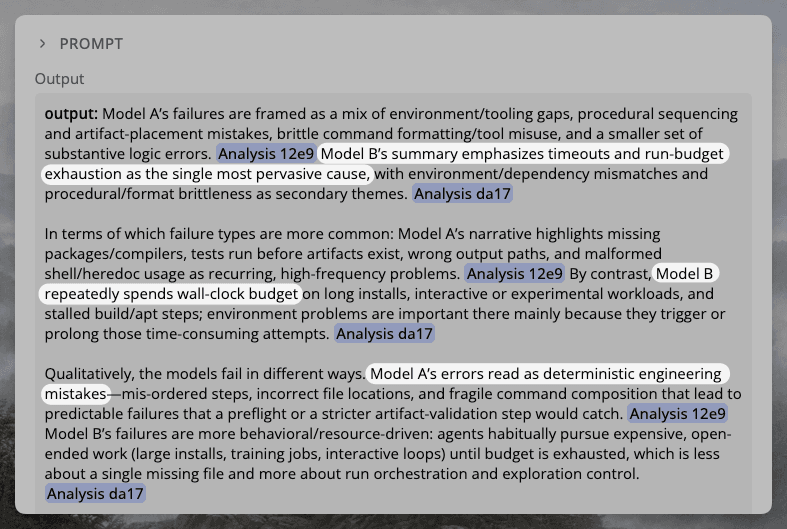

Docent summarizes the performance difference by analyzing all pairs of traces in a dataset. In this case, Model A is GPT-5 Codex and Model B is GPT-5.1 Codex

# Walkthrough

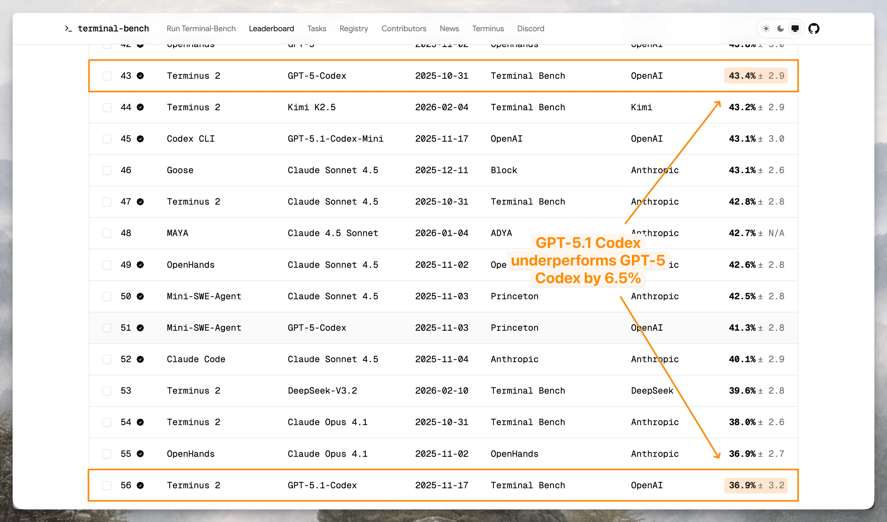

GPT-5.1 Codex underperforms GPT-5 Codex by 6.5% on the official Terminal-Bench leaderboard.

We'll (1) pair failed and successful runs on the same task to identify differences between models, (2) synthesize across tasks to surface systematic differences between the two models, and (3) validate the emerging hypothesis quantitatively using Docent's query language. Each step starts with a natural language prompt, which Claude Code translates into a Docent SDK script. The investigation results appear in the Docent UI.

**Want to follow along?** You can replicate this analysis with 5 minutes of setup.

1. Click "Clone Collection" to copy [our Terminal-Bench collection](https://docent.transluce.org/dashboard/ee8a1051-3ae6-4d24-bccc-daf08dc5598f/agent_run) into your account. Create your free Docent account if you don't have one.
2. [Install Claude Code](https://code.claude.com/docs/en/quickstart#step-1-install-claude-code) and `cd` into any directory where you want Claude to write your Docent scripts.
3. Run `claude`. Then, run `/plugin marketplace add TransluceAI/claude-code-plugins` and `/plugin install docent@transluce-plugins` to install the Docent plugin.
4. Restart Claude Code after installing the plugin by typing `exit` and then re-running `claude`.
5. Verify the plugin is installed by starting to type `/analysis`, but avoid hitting enter or actually running the command. Claude Code should display the Docent plugin.

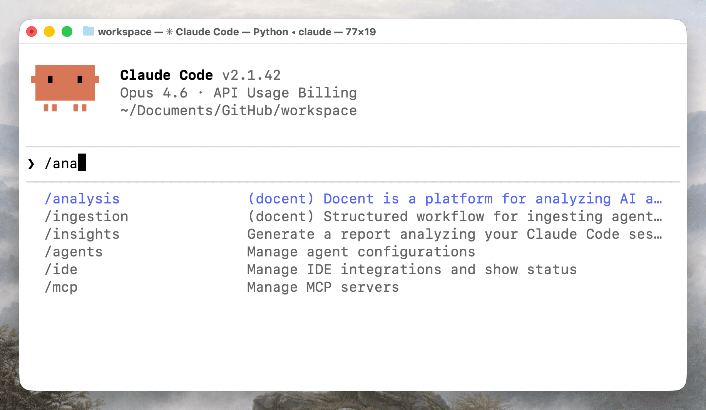

6. Find your collection ID and API key. Create `docent.env` and add them as `DOCENT_API_KEY` and `COLLECTION_ID`. Alternatively, run `/analysis`, or run `/analysis collection ID: <YOUR_COLLECTION_ID> API Key: <YOUR_API_KEY>`

▶

Where to find your collection ID and API key

You can find the collection ID in the top left corner of the page, next to your collection name. You can find or generate an API key on [the Docent settings page](https://docent.transluce.org/settings/api-keys).

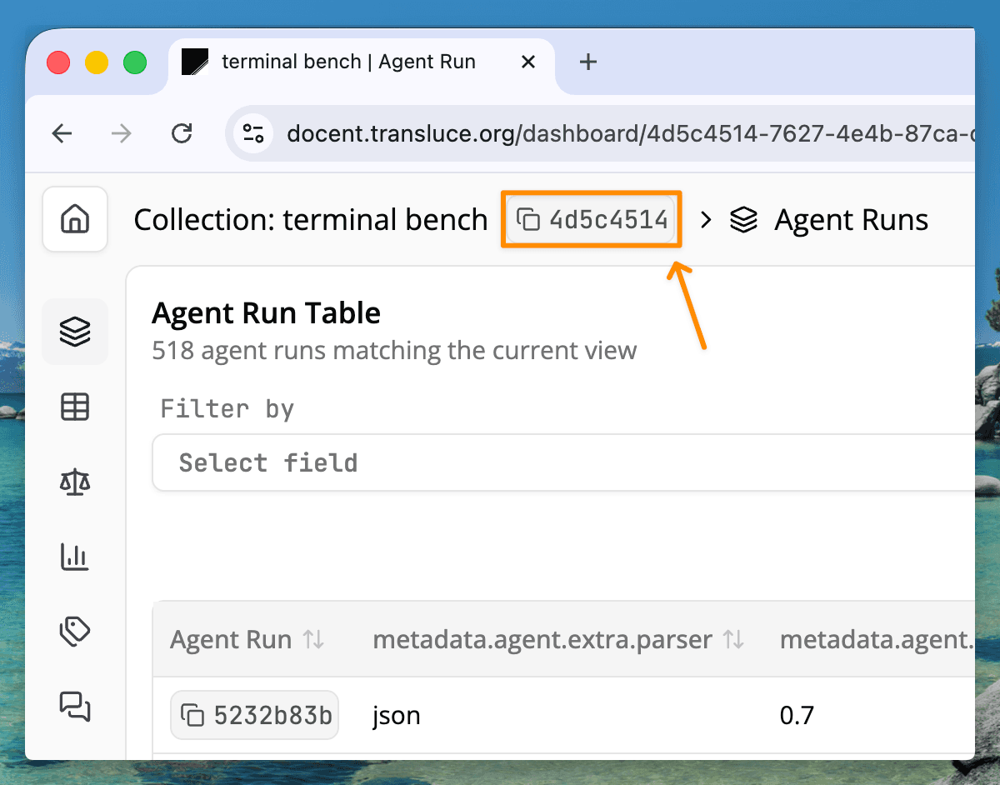

Copy the collection ID by clicking in the top left corner.

▶

Questions? Chat with a dev by clicking in the bottom left of the Docent UI. Setup should take around 5 minutes, so let us know if you're encountering any difficulties.

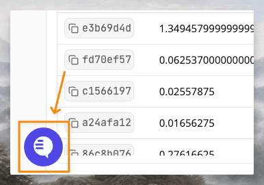

## Step 1: Analyzing 100+ pairs of failed and successful runs

Let's start by putting a failed run from one model next to a successful run by a different model on the same task. We prompt Claude Code to do this across all pairs in our dataset:

> /analysis For each task, find runs where one model scored reward = 0 and the other scored reward = 1. For each failed run, compare it to a successful run from the other model on the same task and write a short paragraph explaining the cause of the failure. Group results by model.

Claude Code translates this into an SDK script that loads the relevant traces into context and sends them to an LLM judge. The script is visible and editable, so you can verify or adjust the analysis before it runs.

▶

Generated script: Compare failed runs to successful runs

```
"""
For each task where one model scored reward=0 and the other scored reward=1,
compare the failed run against a successful run and explain the cause of failure.
"""

from collections import defaultdict
from docent.sdk.client import Docent
from docent.sdk.llm_request import LLMRequest
from docent.sdk.llm_context import Prompt, AgentRunRef

client = Docent()
COLLECTION_ID = "a48b08ff-55ac-497a-8987-4af52a50d41f"

MODEL_A = "openai/gpt-5-codex"
MODEL_B = "openai/gpt-5.1-codex"

# --- Fetch all runs with reward scores ---
result = client.execute_dql(COLLECTION_ID, """
SELECT task, model_name, reward, agent_run_id
FROM (
    SELECT
        id AS agent_run_id,
        metadata_json->>'task' AS task,
        metadata_json->'agent'->>'model_name' AS model_name,
        CAST(metadata_json->'scores'->>'reward' AS DOUBLE PRECISION) AS reward
    FROM agent_runs
    WHERE metadata_json->'scores' ? 'reward'
) AS subq
""")
rows = client.dql_result_to_dicts(result)

# --- Group by task and model ---
task_model = defaultdict(lambda: defaultdict(list))
for r in rows:
    task_model[r["task"]][r["model_name"]].append(
        {"reward": r["reward"], "id": r["agent_run_id"]}
    )

# --- Find divergent pairs: one model=0, the other=1 ---
divergent = []
for task, models in task_model.items():
    for failed_model, success_model in [(MODEL_A, MODEL_B), (MODEL_B, MODEL_A)]:
        zeros = [r for r in models.get(failed_model, []) if r["reward"] == 0]
        ones = [r for r in models.get(success_model, []) if r["reward"] == 1]
        if zeros and ones:
            for failed_run in zeros:
                divergent.append(
                    {
                        "task": task,
                        "failed_model": failed_model,
                        "failed_run_id": failed_run["id"],
                        "success_model": success_model,
                        "success_run_id": ones[0]["id"],
                    }
                )

# --- Build LLMRequests ---
PROMPT_TEMPLATE = (
    "Below are two agent runs on the same task ({task}). "
    "The first run FAILED (reward=0, model: {failed_model}). "
    "The second run SUCCEEDED (reward=1, model: {success_model}).\n\n"
    "Failed run:\n"
)
PROMPT_SUFFIX = (
    "\n\nSuccessful run:\n"
)
PROMPT_INSTRUCTION = (
    "\n\nCompare the two runs. In a short paragraph, explain the cause of the "
    "failure in the first run. Focus on what the failed agent did wrong or "
    "differently that led to reward=0, referencing specific actions or mistakes. "
    "Be concrete and specific."
)

requests = []
for d in divergent:
    failed_ref = AgentRunRef(id=d["failed_run_id"], collection_id=COLLECTION_ID)
    success_ref = AgentRunRef(id=d["success_run_id"], collection_id=COLLECTION_ID)

    prompt = Prompt([
        PROMPT_TEMPLATE.format(
            task=d["task"],
            failed_model=d["failed_model"],
            success_model=d["success_model"],
        ),
        failed_ref,
        PROMPT_SUFFIX,
        success_ref,
        PROMPT_INSTRUCTION,
    ])

    requests.append(
        LLMRequest(
            prompt=prompt,
            metadata={
                "task": d["task"],
                "failed_model": d["failed_model"],
                "failed_run_id": d["failed_run_id"],
                "success_model": d["success_model"],
                "success_run_id": d["success_run_id"],
            },
        )
    )

# --- Submit ---
result_set = client.submit_llm_requests(
    collection_id=COLLECTION_ID,
    requests=requests,
    model_string="openai/gpt-5-mini",
    result_set_name="failure-analysis/divergent-by-model/v1",
)

print(f"Submitted {len(requests)} requests to result set: {result_set.name}")
print(f"Result set ID: {result_set.id}")
```

In the Results tab of Docent's web UI, we can browse analysis of each pair. Every result is a short explanation of why the failed run diverged from the successful one.

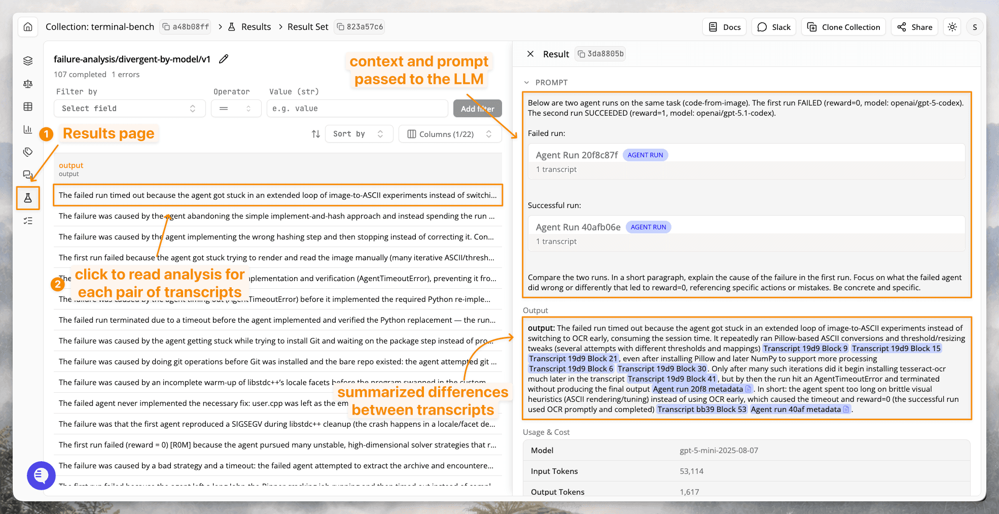

Docent identifies the differences between a failed run by one model and successful run by another model on the same task. Each analysis is stochastic, so your output may look slightly different.

Clicking on a citation jumps to the relevant section of the original trace, so we can verify the analysis against the source material.

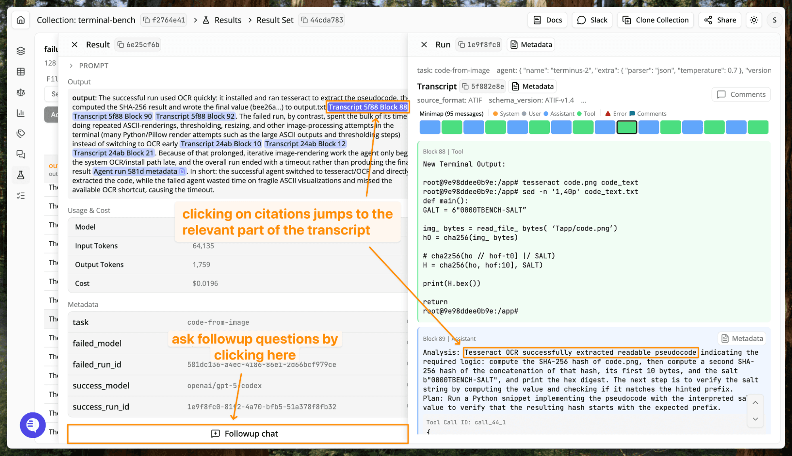

Dig deeper by clicking on citations, which jump to the relevant block in the original transcript, or clicking followup chat, which immediately populates an LLM chat with the relevant transcripts in context.

Citations and the followup chat are useful for targeted reading, so we can investigate strategically instead of skimming a random sample. But we've only looked at individual pairs. To understand what's systematically different between the two models, we need to look across all of them.

## Step 2: Synthesizing model differences across all pairs of runs

Manually synthesizing across 100+ pair analyses would mean reading each one and building a mental model of the recurring patterns. With Docent, it's another prompt to Claude Code. Enter the following in the same Claude Code session as the prompt before:

> /analysis Based on the previous result, summarize the difference in failure modes between the two models.

Docent loads and compresses all of the per-pair analyses into context and produces a summary of the key differences.

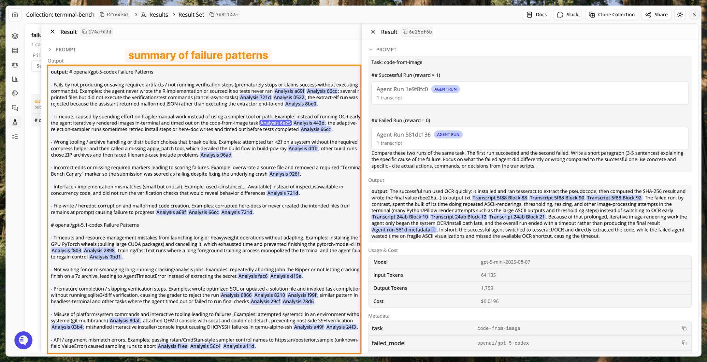

Docent summarizes the conclusions from comparing each pair of runs across the entire collection.

The two models fail in characteristically different ways. GPT-5 Codex failures cluster around execution mistakes: not writing or running verification steps and corrupted file writes. GPT-5.1 Codex failures cluster around poor time management: mismanaging long-running or heavyweight operations, such as installing GPU packages instead of CPU ones, or aborting training jobs instead of waiting, triggering a timeout error.

## Step 3: Testing the timeout hypothesis

To test whether timeout errors explain the gap, we can query our run metadata directly. Docent supports ad hoc data exploration via [Docent Query Language](https://docs.transluce.org/concepts/docent-query-language), a subset of SQL that our Claude Code skill can generate from natural language. Try running the following prompt:

> Analyze the timeout rate per model. The exception field in the metadata indicates whether the agent timed out

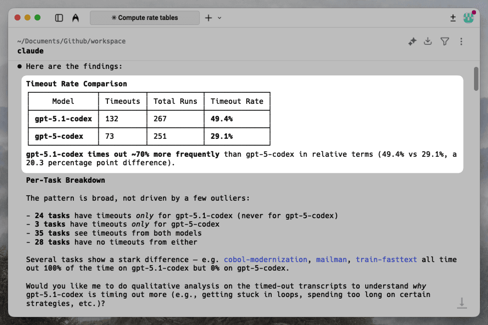

Claude Code uses Docent Query Language to group by model and quantitatively compare timeout rates.

Nearly half of GPT-5.1 Codex's runs time out (49.4%), compared to fewer than one in three for GPT-5 Codex (29.1%). The pattern is broad rather than driven by a few outliers: 24 tasks produce timeouts only for GPT-5.1 Codex, while just 3 tasks time out exclusively for GPT-5 Codex.

If timeouts account for the gap, then the two models should perform more similarly on tasks where neither times out (see the [footnotes](ref-5f9387d31d17.md) for more detail). We can test this directly:

> Filter to tasks where neither model times out across all rollouts. Create and display a pivot table that shows rollouts and reward per model per task. Then compute the macro-average reward per model on this subset of tasks.

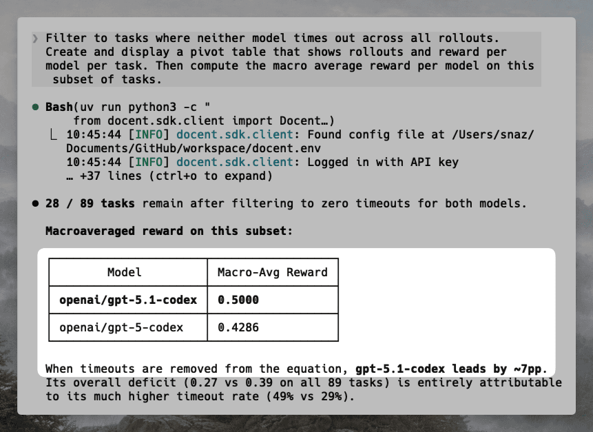

When timeouts are removed from the equation, GPT-5.1 Codex leads by ~7pp. Its overall deficit (0.27 vs 0.39 on all 89 tasks) is entirely attributable to its much higher timeout rate (49% vs 29%).

On the subset of tasks without timeouts, the performance difference actually flips! GPT-5.1 Codex outperforms GPT-5 Codex by about 7 percentage points.

## Conclusion

A lower benchmark score is easy to interpret as a capability deficit, but Terminal-Bench's system prompt never mentions a timeout constraint. GPT-5.1 Codex may be choosing long-horizon strategies that the eval cutoff terminates prematurely. This kind of hypothesis is difficult to reach by skimming a handful of traces, but emerges from systematically analyzing the full dataset.

In less than an hour, Docent analyzed traces containing 256M+ tokens and identified that GPT-5.1 Codex's 11.4 percentage point deficit is concentrated in timeout errors. On tasks where neither model times out, it actually outperforms GPT-5 Codex.

This walkthrough covered one common pattern (pairwise comparison of failed and successful runs), but Docent can be adapted to other questions as well: why a harness works with Opus 4.6 but not GPT-5.3 Codex, whether a score drop reflects broken environments or genuine capability differences, or detecting cheating that inflates eval results.

- **Want to go further?** Use Docent's [rubric refinement agent](https://docs.transluce.org/tutorials/rubric-refinement) to quantify how often a failure pattern appears across your dataset — take a few examples of a behavior, and Docent will operationalize it into a precise classifier you can run over every trace.
- **Try Docent on your own data.** Read our [Quickstart](https://docs.transluce.org/quickstart) to ingest your traces and start analyzing.
- **Questions or feedback?** [Get in touch](https://docs.google.com/forms/d/e/1FAIpQLSe_vYg8UJMwZJDaYTCFkxxJxOibpkZK4llVmWoCSqiRN2Q-cQ/viewform). We'd love to hear what you're working on.

## Footnotes

- We re-ran Terminal-Bench with three rollouts per task per model. Our absolute scores are lower than the official leaderboard and the gap is wider (11.4 vs. 6.5 percentage points), but the direction and rough magnitude of the regression are consistent. Readers should treat this analysis as illustrative of Docent's workflow rather than a definitive characterization of either model.
- Most benchmarks report the microaverage, i.e. the average reward across all runs of a particular model. Since some of our tasks had uneven rollout counts, we reported the macro-average by averaging reward within a task, and then averaging reward across all tasks. This ensures that each task is weighted evenly.

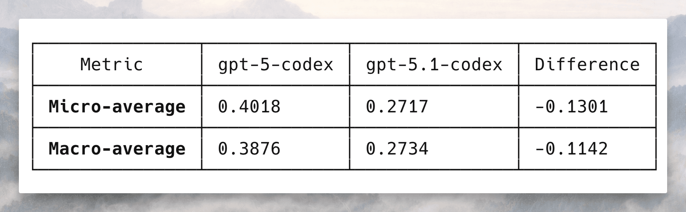

- Filtering to tasks where no run from either model times out may bias the result toward tasks that are easier.
- In rare edge cases, the agent may succeed despite timing out. In [one trace](https://docent.transluce.org/dashboard/ee8a1051-3ae6-4d24-bccc-daf08dc5598f/agent_run/c138bb9b-547a-487a-bc4b-e5e1ff1558d5) we examined, the agent passed the Terminal-Bench tests but repeatedly failed on a suite of its own test cases. Since Terminal-Bench only grades the final file state, the run was marked as a success despite the timeout exception.
