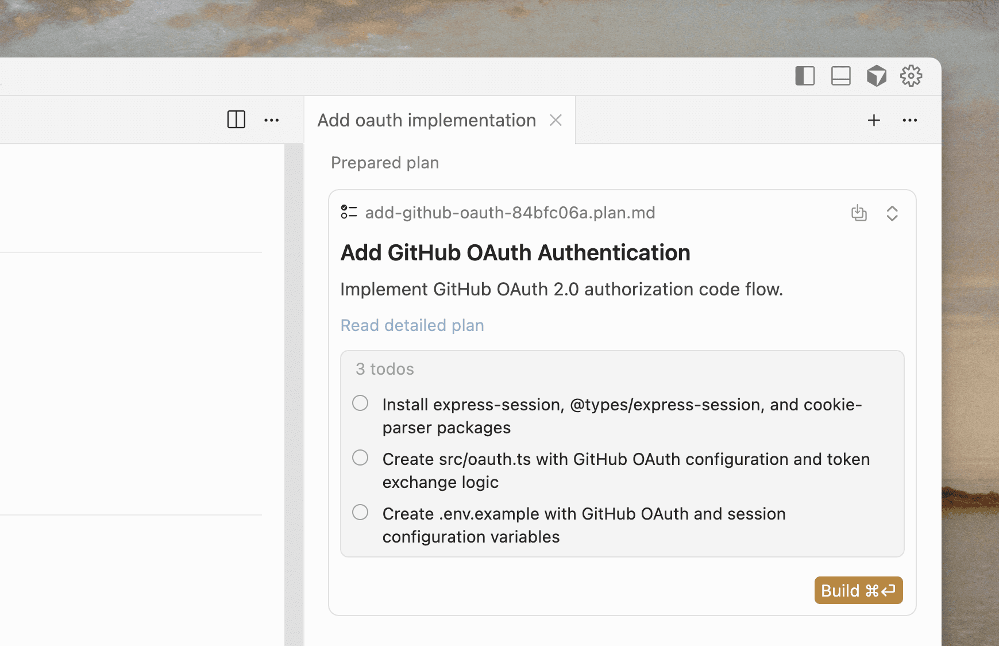

# Cursor: Introducing Plan Mode

[Course index](../../README.md) · [Original source](https://cursor.com/blog/plan-mode) · [Raw file](../../raw/readings/ref-8478702a8e1e.html)

Retrieved: 2026-11-13T16:45:55.255788+00:00

[Blog](https://cursor.com/blog) / [product](https://cursor.com/blog/topic/product)

Oct 7, 2025·[product](https://cursor.com/blog/topic/product)

# Introducing Plan Mode

Jai Smith · 2 min read

Cursor can now create plans, research your codebase, and run longer agents.

Plan mode gives the model new tools to create and update plans, as well as an interactive editor to modify plans inline. Most new features at Cursor now begin with Agent writing a plan. We’ve seen this significantly improve the code generated.

When you prompt Agent to create a plan, Cursor researches your codebase to find relevant files, review docs, and ask clarifying questions. When you’re happy with the plan, it creates a Markdown file with file paths and code references. You can edit the plan directly, including adding or removing to-dos.

### [#](ref-8478702a8e1e.md)How to use Plan Mode

- Start planning by pressing Shift + Tab in the agent input.
- Answer clarifying questions on your requirements for the best output quality.
- Review or edit the detailed plan, then build directly from your plan when ready.
- Optionally, save the plan as a Markdown file in your repository for future reference.

Cursor will also suggest plan mode automatically when you describe complex tasks.

Try Plan Mode in our latest release.
