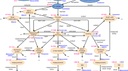
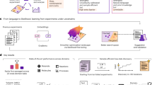
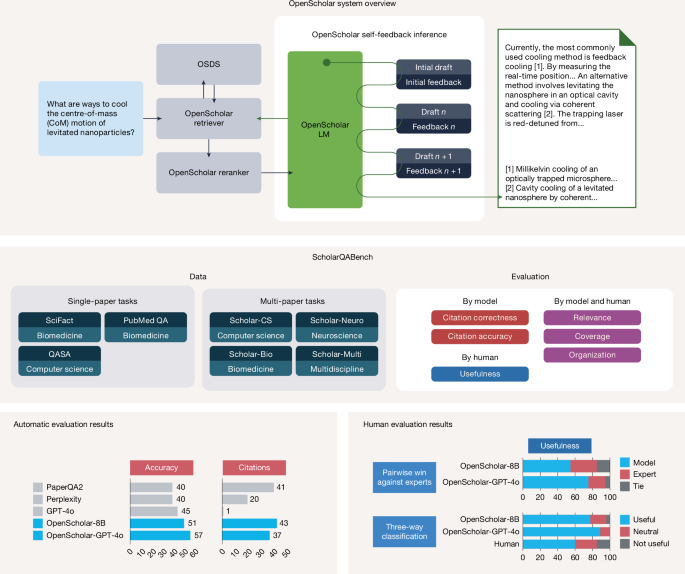

# OpenScholar

[Course index](../../README.md) · [Original source](https://www.nature.com/articles/s41586-025-10072-4) · [Raw file](../../raw/readings/ref-dc3f47c33a4d.html)

Retrieved: 2026-11-13T16:46:54.604401+00:00

[Download PDF](ref-dc3f47c33a4d-pdf.md)

- Article
- [Open access](https://www.springernature.com/gp/open-science/about/the-fundamentals-of-open-access-and-open-research)
- Published: 04 February 2026

# Synthesizing scientific literature with retrieval-augmented language models

- [Akari Asai](ref-dc3f47c33a4d-pdf.md) 
  [ORCID: orcid.org/0000-0002-1055-6657](https://orcid.org/0000-0002-1055-6657)[1](ref-dc3f47c33a4d-pdf.md),[2](ref-dc3f47c33a4d-pdf.md),
- [Jacqueline He](ref-dc3f47c33a4d-pdf.md)[1](ref-dc3f47c33a4d-pdf.md)[na1](ref-dc3f47c33a4d-pdf.md),
- [Rulin Shao](ref-dc3f47c33a4d-pdf.md)[1](ref-dc3f47c33a4d-pdf.md)[na1](ref-dc3f47c33a4d-pdf.md),
- [Weijia Shi](ref-dc3f47c33a4d-pdf.md)[1](ref-dc3f47c33a4d-pdf.md),
- [Amanpreet Singh](ref-dc3f47c33a4d-pdf.md)[2](ref-dc3f47c33a4d-pdf.md),
- [Joseph Chee Chang](ref-dc3f47c33a4d-pdf.md)[2](ref-dc3f47c33a4d-pdf.md),
- [Kyle Lo](ref-dc3f47c33a4d-pdf.md)[2](ref-dc3f47c33a4d-pdf.md),
- [Luca Soldaini](ref-dc3f47c33a4d-pdf.md)[2](ref-dc3f47c33a4d-pdf.md),
- [Sergey Feldman](ref-dc3f47c33a4d-pdf.md)[2](ref-dc3f47c33a4d-pdf.md),
- [Mike D’Arcy](ref-dc3f47c33a4d-pdf.md) 
  [ORCID: orcid.org/0000-0003-0355-7157](https://orcid.org/0000-0003-0355-7157)[2](ref-dc3f47c33a4d-pdf.md),
- [David Wadden](ref-dc3f47c33a4d-pdf.md)[2](ref-dc3f47c33a4d-pdf.md),
- [Matt Latzke](ref-dc3f47c33a4d-pdf.md) 
  [ORCID: orcid.org/0000-0002-9984-1277](https://orcid.org/0000-0002-9984-1277)[2](ref-dc3f47c33a4d-pdf.md),
- [Jenna Sparks](ref-dc3f47c33a4d-pdf.md)[2](ref-dc3f47c33a4d-pdf.md),
- [Jena D. Hwang](ref-dc3f47c33a4d-pdf.md)[2](ref-dc3f47c33a4d-pdf.md),
- [Varsha Kishore](ref-dc3f47c33a4d-pdf.md)[1](ref-dc3f47c33a4d-pdf.md),[2](ref-dc3f47c33a4d-pdf.md),
- [Minyang Tian](ref-dc3f47c33a4d-pdf.md)[3](ref-dc3f47c33a4d-pdf.md),
- [Pan Ji](ref-dc3f47c33a4d-pdf.md)[4](ref-dc3f47c33a4d-pdf.md),
- [Shengyan Liu](ref-dc3f47c33a4d-pdf.md) 
  [ORCID: orcid.org/0000-0003-0582-7085](https://orcid.org/0000-0003-0582-7085)[3](ref-dc3f47c33a4d-pdf.md),
- [Hao Tong](ref-dc3f47c33a4d-pdf.md) 
  [ORCID: orcid.org/0009-0008-4341-3864](https://orcid.org/0009-0008-4341-3864)[3](ref-dc3f47c33a4d-pdf.md),
- [Bohao Wu](ref-dc3f47c33a4d-pdf.md)[3](ref-dc3f47c33a4d-pdf.md),
- [Yanyu Xiong](ref-dc3f47c33a4d-pdf.md) 
  [ORCID: orcid.org/0000-0002-4399-6253](https://orcid.org/0000-0002-4399-6253)[5](ref-dc3f47c33a4d-pdf.md),
- [Luke Zettlemoyer](ref-dc3f47c33a4d-pdf.md)[1](ref-dc3f47c33a4d-pdf.md),
- [Graham Neubig](ref-dc3f47c33a4d-pdf.md)[6](ref-dc3f47c33a4d-pdf.md),
- [Daniel S. Weld](ref-dc3f47c33a4d-pdf.md)[1](ref-dc3f47c33a4d-pdf.md),[2](ref-dc3f47c33a4d-pdf.md),
- [Doug Downey](ref-dc3f47c33a4d-pdf.md)[2](ref-dc3f47c33a4d-pdf.md),
- [Wen-tau Yih](ref-dc3f47c33a4d-pdf.md) 
  [ORCID: orcid.org/0000-0003-4263-395X](https://orcid.org/0000-0003-4263-395X)[1](ref-dc3f47c33a4d-pdf.md),
- [Pang Wei Koh](ref-dc3f47c33a4d-pdf.md)[1](ref-dc3f47c33a4d-pdf.md),[2](ref-dc3f47c33a4d-pdf.md) &
- …
- [Hannaneh Hajishirzi](ref-dc3f47c33a4d-pdf.md)[1](ref-dc3f47c33a4d-pdf.md),[2](ref-dc3f47c33a4d-pdf.md)

Show authors

[*Nature*](https://www.nature.com/)
**volume 650**, pages 857–863 (2026) [Cite this article](ref-dc3f47c33a4d-pdf.md)

[View saved research](https://www.nature.com/saved-research)

- 202k Accesses
- 91 Citations
- 392 Altmetric
- [Metrics details](https://www.nature.com/articles/s41586-025-10072-4/metrics)

This article has been [updated](ref-dc3f47c33a4d-pdf.md)

## Abstract

Scientific progress depends on the ability of researchers to synthesize the growing body of literature. Can large language models (LLMs) assist scientists in this task? Here we introduce OpenScholar, a specialized retrieval-augmented language model (LM)[1](https://www.nature.com/articles/s41586-025-10072-4#ref-CR1 "Asai, A., Min, S., Zhong, Z. & Chen, D. Retrieval-based language models and applications. In Proc. 61st Annual Meeting of the Association for Computational Linguistics (Volume 6: Tutorial Abstracts) (eds Chen, Y.-N., Mieskes, M. & Reddy, S.) 41–46 (ACL, 2023).") that answers scientific queries by identifying relevant passages from 45 million open-access papers and synthesizing citation-backed responses. To evaluate OpenScholar, we develop ScholarQABench, the first large-scale multi-domain benchmark for literature search, comprising 2,967 expert-written queries and 208 long-form answers across computer science, physics, neuroscience and biomedicine. Despite being a smaller open model, OpenScholar-8B outperforms GPT-4o by 6.1% and PaperQA2 by 5.5% in correctness on a challenging multi-paper synthesis task from the new ScholarQABench. Although GPT-4o hallucinates citations 78–90% of the time, OpenScholar achieves citation accuracy on par with human experts. OpenScholar’s data store, retriever and self-feedback inference loop improve off-the-shelf LMs: for instance, OpenScholar-GPT-4o improves the correctness of GPT-4o by 12%. In human evaluations, experts preferred OpenScholar-8B and OpenScholar-GPT-4o responses over expert-written ones 51% and 70% of the time, respectively, compared with 32% for GPT-4o. We open-source all artefacts, including our code, models, data store, datasets and a public demo.

### Similar content being viewed by others

### [Evaluating the performance of large language models versus human researchers on real world complex medical queries](https://www.nature.com/articles/s41598-025-21689-w?fromPaywallRec=false)

Article
Open access
29 October 2025

### [The SciQA Scientific Question Answering Benchmark for Scholarly Knowledge](https://www.nature.com/articles/s41598-023-33607-z?fromPaywallRec=false)

Article
Open access
04 May 2023

### [Large language models as uncertainty-calibrated optimizers for experimental discovery](https://www.nature.com/articles/s42256-026-01283-z?fromPaywallRec=false)

Article
Open access
28 August 2026

### Explore related subjects

Discover the latest articles and news in related subjects.

- [Computer science](https://www.nature.com/subjects/computer-science)
- [Information technology](https://www.nature.com/subjects/information-technology)
- [Bibliometric Methods in Higher Education Analysis](https://www.nature.com/subjects/bibliometric-methods-in-higher-education-analysis)

## Main

Synthesizing knowledge from the scientific literature is essential for discovering new directions, refining methodologies and supporting evidence-based decisions, yet the rapid growth of publications makes it increasingly difficult for researchers to stay informed. Effective synthesis requires precise retrieval, accurate attribution and access to up-to-date literature. LLMs can assist but suffer from hallucinations[2](https://www.nature.com/articles/s41586-025-10072-4#ref-CR2 "Mallen, A. et al. When not to trust language models: investigating effectiveness of parametric and non-parametric memories. In Proc. 61st Annual Meeting of the Association for Computational Linguistics (Volume 1: Long Papers) (eds Rogers, A., Boyd-Graber, J. & Okazaki, N.) 9802–9822 (ACL, 2023)."),[3](https://www.nature.com/articles/s41586-025-10072-4#ref-CR3 "Mishra, A. et al. Fine-grained hallucination detection and editing for language models. In Proc. 1st Conf. Language Modeling (Philadelphia, 2024; 
                  https://colmweb.org
                  
                )."), outdated pre-training data[4](https://www.nature.com/articles/s41586-025-10072-4#ref-CR4 "Kasai, J. et al. RealTime QA: what’s the answer right now? In Proc. 37th Int. Conf. Neural Information Processing Systems (NeurIPS ’23) (eds Oh, A. et al.) 49025–49043 (Curran Associates, 2023).") and limited attribution. In our experiments, GPT-4o fabricated citations in 78–90% of cases when asked to cite recent literature across fields such as computer science and biomedicine.

Retrieval-augmented LMs[5](https://www.nature.com/articles/s41586-025-10072-4#ref-CR5 "Lewis, P. et al. Retrieval-augmented generation for knowledge-intensive NLP tasks. In Proc. 34th Int. Conf. Neural Information Processing Systems (NIPS ’20) (eds Larochelle, H., Ranzato, M., Hadsell, R., Balcan, M. F. & Lin, H.) 9459–9474 (Curran Associates, 2020)."),[6](https://www.nature.com/articles/s41586-025-10072-4#ref-CR6 "Guu, K., Lee, K., Tung, Z., Pasupat, P. & Chang, M. Retrieval augmented language model pre-training. In Proc. 37th International Conference on Machine Learning (eds Daumé, H. & Singh, A.) 3929–3938 (PMLR, 2020)."),[7](https://www.nature.com/articles/s41586-025-10072-4#ref-CR7 "Asai, A., Wu, Z., Wang, Y., Sil, A. & Hajishirzi, H. Self-RAG: learning to retrieve, generate, and critique through self-reflection. In Proc. 12th Int. Conf. Learning Representations (eds Kim. B et al.) (2024).") mitigate some of these issues by incorporating external knowledge at inference time and have encouraged systems for literature search and synthesis[8](https://www.nature.com/articles/s41586-025-10072-4#ref-CR8 "Agarwal, S., Laradji, I.H., Charlin, L. & Pal, C. Litllm: a toolkit for scientific literature review. Preprint at 
                  https://arxiv.org/abs/2402.01788v1
                  
                 (2024)."),[9](https://www.nature.com/articles/s41586-025-10072-4#ref-CR9 "Zheng, Y. et al. OpenResearcher: unleashing AI for accelerated scientific research. In Proc. 2024 Conf. Empirical Methods in Natural Language Processing: System Demonstrations (eds Hernández Farías, D. I., Hope, T. & Li, M.) 209–218 (Association for Computational Linguistics, 2024)."),[10](https://www.nature.com/articles/s41586-025-10072-4#ref-CR10 "Skarlinski, M. D. et al. Language agents achieve superhuman synthesis of scientific knowledge. Preprint at 
                  https://arxiv.org/abs/2409.13740
                  
                 (2024)."). However, most rely on black-box application programming interfaces (APIs) or general-purpose LMs and lack open, domain-specific retrieval data stores (processed corpora with retrieval indices) tailored to scientific domains. Evaluations for literature synthesis are also limited, typically focusing on narrow, single-discipline studies[8](https://www.nature.com/articles/s41586-025-10072-4#ref-CR8 "Agarwal, S., Laradji, I.H., Charlin, L. & Pal, C. Litllm: a toolkit for scientific literature review. Preprint at 
                  https://arxiv.org/abs/2402.01788v1
                  
                 (2024)."),[9](https://www.nature.com/articles/s41586-025-10072-4#ref-CR9 "Zheng, Y. et al. OpenResearcher: unleashing AI for accelerated scientific research. In Proc. 2024 Conf. Empirical Methods in Natural Language Processing: System Demonstrations (eds Hernández Farías, D. I., Hope, T. & Li, M.) 209–218 (Association for Computational Linguistics, 2024).") or simplified tasks such as multiple-choice question answering[10](https://www.nature.com/articles/s41586-025-10072-4#ref-CR10 "Skarlinski, M. D. et al. Language agents achieve superhuman synthesis of scientific knowledge. Preprint at 
                  https://arxiv.org/abs/2409.13740
                  
                 (2024).").

To address the challenges of accurate, comprehensive and transparent scientific literature synthesis, we introduce OpenScholar (Fig. [1](ref-dc3f47c33a4d-pdf.md), top), to our knowledge the first fully open, retrieval-augmented LM specifically designed for scientific research tasks. OpenScholar integrates a domain-specialized data store (OpenScholar DataStore, OSDS), adaptive retrieval modules and a new self-feedback-guided generation mechanism that enables iterative refinement of long-form outputs. OSDS is a fully open, up-to-date corpus of 45 million scientific papers and 236 million passage embeddings, offering a reproducible foundation for training and inference. OpenScholar retrieves from OSDS using trained retrievers and rerankers, generates cited responses and iteratively refines them by means of a self-feedback loop to improve factuality, coverage and citation accuracy. This same pipeline is used to generate high-quality synthetic data, enabling the training of a compact 8B model (OpenScholar-8B) and retrievers without relying on proprietary LMs.

**Fig. 1: Overview of OpenScholar, ScholarQABench and evaluation results.**

[Full size image](https://www.nature.com/articles/s41586-025-10072-4/figures/1)

Top, overview of OpenScholar. OpenScholar consists of a specialized data store (OSDS), retrievers and LMs and iteratively improves responses using self-feedback inference with retrieval. Middle, overview of ScholarQABench. ScholarQABench consists of 2,200 expert-written questions across several scientific disciplines and we introduce automatic and human evaluation protocols for ScholarQABench. Bottom, automatic and human evaluation results: experimental results from the ScholarQABench computer science subset (Scholar-CS, 100 questions) show that OpenScholar with our trained 8B or GPT-4o substantially outperforms other systems and is preferred over experts more than 50% of the time in human evaluations. Our human evaluations were conducted by 16 experts with PhDs across 108 questions from Scholar-Multi.

To evaluate OpenScholar, we introduce ScholarQABench (Fig. [1](ref-dc3f47c33a4d-pdf.md), middle), to our knowledge the first multidisciplinary benchmark for open-ended scientific synthesis. Unlike previous benchmarks focused on short-form outputs, multiple-choice formats or domain reasoning tasks[10](https://www.nature.com/articles/s41586-025-10072-4#ref-CR10 "Skarlinski, M. D. et al. Language agents achieve superhuman synthesis of scientific knowledge. Preprint at 
                  https://arxiv.org/abs/2409.13740
                  
                 (2024)."),[11](https://www.nature.com/articles/s41586-025-10072-4#ref-CR11 "Phan, L. et al. Humanity’s last exam. Preprint at 
                  https://arxiv.org/abs/2501.14249
                  
                 (2025)."),[12](https://www.nature.com/articles/s41586-025-10072-4#ref-CR12 "Wang, X. et al. Scibench: evaluating college-level scientific problem-solving abilities of large language models. In Proc. 41st Int. Conf. Machine Learning (eds Salakhutdinov, R. et al.) 50622–50649 (PMLR, 2024)."), ScholarQABench requires long-form responses grounded in up-to-date literature from numerous papers. It includes 3,000 research questions and 250 expert-written answers across computer science, physics, biomedicine and neuroscience, authored by experienced PhD students and postdocs to reflect real-world literature review practices. To overcome the difficulties of evaluating long-form, comprehensive responses[13](https://www.nature.com/articles/s41586-025-10072-4#ref-CR13 "Xu, F. et al. KIWI: a dataset of knowledge-intensive writing instructions for answering research questions. In Findings of the Association for Computational Linguistics: ACL 2024 (eds Ku, L.-W., Martins, A. & Srikumar, V.) 12969–12990 (ACL, 2024)."),[14](https://www.nature.com/articles/s41586-025-10072-4#ref-CR14 "Xu, F., Song, Y., Iyyer, M. & Choi, E. A critical evaluation of evaluations for long-form question answering. In Proc. 61st Annual Meeting of the Association for Computational Linguistics (Volume 1: Long Papers) (eds Rogers, A., Boyd-Graber, J. & Okazaki, N.) 3225–3245 (ACL, 2023)."),[15](https://www.nature.com/articles/s41586-025-10072-4#ref-CR15 "Kamoda, G., Asai, A., Brassard, A. & Sakaguchi, K. Quantifying the influence of evaluation aspects on long-form response assessment. In Proc. 31st Int. Conf. Computational Linguistics (eds Rambow, O. et al.) 8787–8808 (ACL, 2025)."),[16](https://www.nature.com/articles/s41586-025-10072-4#ref-CR16 "Krishna, K., Roy, A. & Iyyer, M. Hurdles to progress in long-form question answering. In Proc. 2021 Conf. North American Chapter of the Association for Computational Linguistics: Human Language Technologies (eds Toutanova, K. et al.) 4940–4957 (ACL, 2021)."), ScholarQABench introduces a rigorous evaluation protocol combining automatic metrics (for example, citation accuracy) with human rubric-based assessments of coverage, coherence, writing quality and factual correctness to enable reliable assessments of the detailed long-form answers of LMs. Our expert analysis shows that the proposed multifaceted evaluation pipeline achieves high agreement with expert judgements, reliably capturing coverage, coherence, writing quality and factual correctness in long-form scientific answers.

We evaluated proprietary and open models (for example, GPT-4o, Llama 3.1 8B and 70B) with and without retrieval capabilities, as well as specialized systems such as PaperQA2 (ref. [10](https://www.nature.com/articles/s41586-025-10072-4#ref-CR10 "Skarlinski, M. D. et al. Language agents achieve superhuman synthesis of scientific knowledge. Preprint at 
                  https://arxiv.org/abs/2409.13740
                  
                 (2024).")), on ScholarQABench. Although GPT-4o demonstrated strong general performance, it struggled with citation accuracy and coverage, often producing inaccurate or non-existent citations. OpenScholar outperformed both LM-only and retrieval-augmented pipelines, surpassing proprietary and open-source systems. Notably, using fully open-source checkpoints, OpenScholar-8B outperformed PaperQA2, built on proprietary LMs, and production systems such as Perplexity Pro, achieving 6% and 10% improvements, respectively. Furthermore, OpenScholar’s use of smaller, efficient retrievers substantially reduced costs. The OpenScholar pipeline can also enhance off-the-shelf LMs. For example, when using GPT-4o as the underlying model, OpenScholar-GPT-4o achieves a 12% improvement in correctness compared with GPT-4o alone. Furthermore, although expert human performance exceeds that of GPT-4o and other competitive baselines, OpenScholar systems match or surpass expert humans in both answer correctness and citation accuracy. Our extensive evaluations demonstrate the importance of the core components of OpenScholar, including reranking, self-feedback and verification, as well as the value of combining diverse retrieval pipelines and training domain-specialized retrieval systems.

As well as automatic evaluations on ScholarQABench, we conducted detailed expert assessments with 16 scientists from fields such as computer science, physics and biomedicine. These experts performed pairwise and fine-grained evaluations of the outputs of OpenScholar against 108 expert-written responses to literature synthesis queries in ScholarQABench. OpenScholar, when paired with GPT-4o and our trained 8B model, consistently outperformed expert-written responses, with win rates of 70% and 51%, respectively. By contrast, vanilla GPT-4o (that is, without retrieval) struggled with information coverage and was rated as less helpful than human experts, achieving only a 31% win rate against human responses. Overall, these findings demonstrate that OpenScholar can produce high-quality outputs that are not only on par with expert-written answers but, in some cases, above par, particularly in terms of coverage and organization. We also released the first public demo for scientific literature synthesis, powered by OpenScholar-8B. Since launch, the demo has been used by more than 30,000 users and has collected nearly 90,000 user queries across diverse scientific fields.

## OpenScholar performance on ScholarQABench

We first provide an overview of our key results of OpenScholar on our newly created expert-annotated benchmark, ScholarQABench. Table [1](ref-dc3f47c33a4d-pdf.md) shows scores for several aspects of the main baselines.

**Table 1 Results of ScholarQABench**

[Full size table](https://www.nature.com/articles/s41586-025-10072-4/tables/1)

### Baseline models

We compare three settings. (1) Parametric LMs (no retrieval): Llama 3.1 8B/70B (ref. [17](https://www.nature.com/articles/s41586-025-10072-4#ref-CR17 "Dubey, A. et al. The Llama 3 herd of models. Preprint at 
                  https://arxiv.org/abs/2407.21783v1
                  
                 (2024).")) and GPT-4o (gpt-4o-2024-05-13 (ref. [18](https://www.nature.com/articles/s41586-025-10072-4#ref-CR18 "Hurst, A. et al. Gpt-4o System Card. Preprint at 
                  https://arxiv.org/abs/2410.21276
                  
                 (2024)."))) generate answers and a list of paper titles. We verify that the titles exist and, when they do, fetch their abstracts as citations. (2) Retrieval-augmented generation (RAG) baselines: using our OSDS (RAGOSDS), we retrieve the top *N* passages and concatenate them with the input, following standard RAG pipelines[2](https://www.nature.com/articles/s41586-025-10072-4#ref-CR2 "Mallen, A. et al. When not to trust language models: investigating effectiveness of parametric and non-parametric memories. In Proc. 61st Annual Meeting of the Association for Computational Linguistics (Volume 1: Long Papers) (eds Rogers, A., Boyd-Graber, J. & Okazaki, N.) 9802–9822 (ACL, 2023)."),[18](https://www.nature.com/articles/s41586-025-10072-4#ref-CR18 "Hurst, A. et al. Gpt-4o System Card. Preprint at 
                  https://arxiv.org/abs/2410.21276
                  
                 (2024)."). (3) Our method (OpenScholar): a custom inference pipeline with a trained 8B model (OpenScholar-8B) and with Llama 3.1 70B and GPT-4o back ends (OpenScholar-70B, OpenScholar-GPT-4o). For multi-paper tasks, we also test Perplexity Pro. We use the paid subscription version; because there is no API, we collect final predictions through selenium, and cannot extract citations, and PaperQA2 (ref. [10](https://www.nature.com/articles/s41586-025-10072-4#ref-CR10 "Skarlinski, M. D. et al. Language agents achieve superhuman synthesis of scientific knowledge. Preprint at 
                  https://arxiv.org/abs/2409.13740
                  
                 (2024).")). As the data store of PaperQA2 is not public, we use OSDS as its retrieval source.

### Main results

On single-paper tasks, OpenScholar consistently outperforms other models. OpenScholar-8B and OpenScholar-70B outperform Llama 3.1 8B and 70B with and without retrieval augmentation in terms of final accuracy and citation accuracy (Table [1](ref-dc3f47c33a4d-pdf.md)). OpenScholar-70B even matches or outperforms GPT-4o on PubMedQA and QASA. We also found that OpenScholar models consistently show substantial improvements in terms of citation accuracy compared with standard RAG baselines (RAGOSDS).

In multi-paper tasks, we report the Scholar-CS rubric score—the number of expert-annotated answer rubrics satisfied by the response of a model (see [Methods](ref-dc3f47c33a4d-pdf.md) for scoring details)—as our primary measure of correctness. We also evaluate overall writing quality with a LLM judge (‘LLM’) on Scholar-Multi and track citation accuracy across all datasets. OpenScholar-8B, OpenScholar-70B and OpenScholar-GPT-4o, which use the OpenScholar pipeline with our fine-tuned Llama 3.1 8B-based LM and off-the-shelf Llama 3.1 70B and GPT-4o as the generator LM, respectively, demonstrate strong performance. Specifically, OpenScholar-GPT-4o provides a 12.7-point improvement over GPT-4o alone in the Scholar-CS rubric score and a 5.3 improvement over standard RAG. When combined with trained OpenScholar-8B, OpenScholar greatly outperforms the pipeline that uses off-the-shelf Llama 3.1 8B, showcasing the benefits of domain-specific training. Furthermore, OpenScholar-8B shows better rubric performance by a substantial margin than proprietary systems such as GPT-4o, Perplexity Pro or PaperQA2, which use GPT-4o models for passage reranking, summarization and answer generation. Although we found that PaperQA2 matches or even outperforms OpenScholar in citation accuracy, its responses often rely on only one or a few papers, summarizing each retrieved snippet individually. This leads to limited coverage and contributes to its lower performance on the Scholar-CS rubric and LLM judge scores. These findings highlight the importance of balancing both precision and recall in effective literature synthesis. Notably, by making use of efficient retrieval pipelines with lightweight bi-encoders, cross-encoders and in-house models, OpenScholar-8B and OpenScholar-GPT-4o achieve much lower costs—orders of magnitude cheaper than PaperQA2—while maintaining high performance.

### Limitations of parametric LMs

On both single-paper and multi-paper tasks, we observe that non-retrieval augmented baselines struggle—retrieval is almost always conducive to achieving better performance—and models without any retrieval often struggle to generate correct citations and show limited coverage on multi-paper tasks. Table [2](ref-dc3f47c33a4d-pdf.md) presents statistics on the cited papers in the outputs of four models. We report the number of fully fabricated citations (‘No. of hallucinated’) by verifying whether the cited paper titles exist using the Semantic Scholar API. Across models, the share of cited papers that actually exist is very low: despite plausible-looking reference lists, 78–98% of titles are fabricated, with the worst rates in biomedicine. This mirrors previous findings that LLMs hallucinate on long-tail, underrepresented knowledge[2](https://www.nature.com/articles/s41586-025-10072-4#ref-CR2 "Mallen, A. et al. When not to trust language models: investigating effectiveness of parametric and non-parametric memories. In Proc. 61st Annual Meeting of the Association for Computational Linguistics (Volume 1: Long Papers) (eds Rogers, A., Boyd-Graber, J. & Okazaki, N.) 9802–9822 (ACL, 2023)."),[19](https://www.nature.com/articles/s41586-025-10072-4#ref-CR19 "Kandpal, N., Deng, H., Roberts, A., Wallace, E. & Raffel, C. Large language models struggle to learn long-tail knowledge. In Proc. 40th International Conference on Machine Learning (eds Krause, A. et al.) 15696–15707 (PMLR, 2023).") and we suggest that the effect is amplified in scientific areas undercovered on the open web. Repeating the analysis on GPT-5, which was released in August 2025, lowers title-level hallucination to 39% but fabricated citations remain common. Examples of model responses, as well as a list of paper titles, are available in Supplementary Tables [19](ref-dc3f47c33a4d-pdf.md) and [20](ref-dc3f47c33a4d-pdf.md). We also noticed that, even when citations refer to real papers, most of them are not substantiated by the corresponding abstracts, resulting in near-zero citation accuracy.

**Table 2 Statistics of hallucinated papers in the computer science and biomedicine domains**

[Full size table](https://www.nature.com/articles/s41586-025-10072-4/tables/2)

We also observe that such models generate responses with limited coverage. On Scholar-Multi, non-retrieval models (Llama 3.1 8B, 70B and GPT-4o) consistently exhibit much lower average scores compared with retrieval-augmented models. This discrepancy is primarily driven by substantially lower coverage scores; for instance, Llama 3.1 8B achieves a coverage score of 3.45, whereas Llama 3.1 8B + OSDS (a standard RAG baseline) improves the coverage score to 4.01. These results suggest that relying on the parametric knowledge of models alone is particularly difficult in scientific domains, especially for smaller LMs.

### Human performance on ScholarQABench

We also analysed expert performance on this challenging literature synthesis task. Specifically, we evaluated human-written answers on the two subsets of ScholarQABench with long-form human annotations: Scholar-CS and Scholar-Multi. For both, we applied the same evaluation pipeline used for model-generated responses to assess rubric and citation accuracy. For Scholar-Multi, rubric evaluation is not available, but we conducted expert evaluations on both human and model responses and compare the results in the next section. Table [3](ref-dc3f47c33a4d-pdf.md) compares human performance with OpenScholar-GPT-4o, OpenScholar-8B, PaperQA2 and GPT-4o (no retrieval). Our analysis shows that human-written answers remain strong baselines for quality and relevance. On rubric-based evaluations, human responses outperform GPT-4o without retrieval by 9.6 points and OpenScholar-8B by 2.9 points. PaperQA2 demonstrates high citation accuracy but its scores for rubrics, organization, coverage, and relevance are lower. By contrast, OpenScholar-GPT-4o achieves even higher rubric scores than human experts and OpenScholar-8B matches expert-level citation accuracy. We found that OpenScholar tends to produce more comprehensive responses than humans or other baseline systems, citing a greater number of papers, as reflected in both answer length and citation count. In Supplementary Information Section [6](ref-dc3f47c33a4d-pdf.md), we present a detailed human analysis of model-written and human-written answers and further examine key factors for improving scientific literature synthesis.

**Table 3 Expert-written answer stats**

[Full size table](https://www.nature.com/articles/s41586-025-10072-4/tables/3)

### Ablations and analysis

#### Ablations of inference components

We ablate inference components by removing: (1) reranking (use top *N* OSDS results only); (2) feedback (generate once then attribute); and (3) citation verification (omit the final check). For OpenScholar-8B, we also ablate training by swapping in off-the-shelf Llama 3.1 8B with the same inference pipeline (as in OpenScholar-GPT-4o). Extended Data Table [2](ref-dc3f47c33a4d-pdf.md) shows notable drops in both correctness and citation accuracy for all removals, with the largest losses from removing reranking. Feedback removal hurts GPT-4o more than our trained 8B (probably because the latter learned feedback patterns during training) and skipping post-hoc attribution reduces both citation accuracy and final correctness. The gap between trained versus vanilla OpenScholar-8B underscores the value of domain-specific training.

#### Ablations of retrieval

We also compare OSDS-only (dense retrieval), S2-only (Semantic Scholar keyword API), web-only (You.com) and their combination. To isolate retrieval, we use our 8B LM without self-feedback or citation verification and rerank to the top 15 with OpenScholar reranker. On Scholar-CS (Extended Data Table [2](ref-dc3f47c33a4d-pdf.md)), web-only performs worst (45.9 correctness, 12.6 citation F1), S2-only improves especially on citations (47.9/39.1) and the combined pipeline is best (49.6/47.6). Tailored, literature-focused retrieval (dense + API + reranking) yields the strongest factuality and attribution.

We analyse how the number of retrieved passages (top *N*) affects performance. We compare standard RAG and OpenScholar with our trained 8B model and Llama 3.1 8B, evaluating generation and citation accuracy on Scholar-CS. Extended Data Figs. [3](ref-dc3f47c33a4d-pdf.md) and [4](ref-dc3f47c33a4d-pdf.md) summarize the results. Although Llama 3.1 is trained to accept up to 128,000 tokens, its performance degrades beyond a certain context size: increasing top *N* from 5 to 10 improves correctness but larger *N* harms both correctness and citation accuracy. This suggests that, despite long-context capacity, smaller LMs may struggle to effectively use many passages without specialized training. By contrast, our trained 8B model remains strong up to *N* = 20 and larger models (for example, Llama 3.1 70B) are more robust to longer contexts.

## Expert evaluation of OpenScholar’s effectiveness

To complement automatic metrics and examine the strengths and limits of OpenScholar, we ran expert evaluations comparing human-written answers with those generated by LLM systems. This study involved more than 100 literature review questions and more than 15 participants, including PhD students, research scientists and university professors with expertise in the relevant fields. In total, we curated more than 400 fine-grained expert evaluations of expert and model answers.

### Evaluation design

We use 108 question-answer (QA) pairs from Scholar-Multi, written by experts (expert writers). We evaluated three set-ups on these questions: GPT-4o (no external retrieval), OpenScholar with GPT-4o as the generator (OpenScholar-GPT-4o) and OpenScholar with our trained 8B model (OpenScholar-8B), each producing answers with citations. We then recruited a separate group of PhD-level domain experts to rate the model-generated answers against expert-written answers.

In particular, each evaluation involves presenting a question, a model-generated answer and a human-written answer. Expert raters then conduct fine-grained assessments of each answer and provide pairwise preference judgements between the two. For fine-grained evaluations, we use the five-scale evaluation criteria described in [Methods](ref-dc3f47c33a4d-pdf.md) (coverage, relevance and organization), with annotators scoring both model and human answers using the same rubrics. Detailed prompts are presented in Supplementary Information Section [6](ref-dc3f47c33a4d-pdf.md). For usefulness, annotators assign scores on a scale from 1 to 5, which we convert into three classes: not useful (1, 2), neutral (3) and useful (4, 5). We then calculate the percentage of answers that fall into the useful category. For pairwise preference, annotators either choose one of the answers or mark a ‘tie’ if they judge both answers to be of equal quality. Optionally, experts provide explanations on why one answer is better than the other.

#### Details of expert writers

Our expert writers for question and answer writing are 12 PhD students and postdoctoral researchers from research institutions across the USA, all of whom have at least three years of research experience and have published several papers in journals or conferences in their fields. The expert areas covered by our writers include the computer science (natural language processing, computer vision, humancomputer interaction), physics (astrophysics, photonics/optics) and biomedical (neuroscience, bioimaging) domains and we assign our expert annotators to questions in their expertise. On average, we paid US$35–40 per person.

#### Details of expert raters

Sixteen expert raters from the three fields contributed to our evaluations, with 12 of them also participating in answer generation. All expert raters meet the same qualifications as those who composed the answers. To minimize potential biases, we ensured that raters did not evaluate responses to their own questions by assigning evaluation tasks to different groups of experts. Each instance was reviewed by one to three expert raters, depending on availability. The inter-annotator agreement was 0.68 using pairwise comparison with ties and 0.70 using a relaxed approach, in which ties were merged. On average, each expert rater spent five minutes per instance on evaluation and received compensation ranging from US$25 to US$35.

### Expert evaluation results

#### Overall result

Table [4](ref-dc3f47c33a4d-pdf.md) presents the average scores for each evaluation aspect, alongside the relative win rates against human responses. Extended Data Fig. [5](ref-dc3f47c33a4d-pdf.md) illustrates the score distributions for human, GPT-4o and OpenScholar with Llama 3.1 8B and GPT-4o. Notably, both OpenScholar-GPT-4o and our OpenScholar-8B versions outperform human answers in more than 50% of cases, with their advantage primarily attributed to their ability to provide a greater breadth and depth of information (coverage). By contrast, GPT-4o, which lacks retrieval capabilities, demonstrates greatly limited coverage and wins in fewer than 35% of cases, with its overall usefulness rated much lower than responses from humans and the other two models. These results highlight that, even for state-of-the-art models, synthesizing and answering scientific literature review questions remains a challenging task, consistent with our findings on ScholarQABench. Overall, OpenScholar-GPT-4o and OpenScholar-8B are rated as useful in 80% and 72% of the queries, respectively.

**Table 4 Expert rater evaluations of literature synthesis responses written by expert writers and LMs**

[Full size table](https://www.nature.com/articles/s41586-025-10072-4/tables/4)

Although the performance of OpenScholar using an open 8B LM already surpasses that of human experts, the output of the 8B model is judged to be less organized or fluent than the present state-of-the-art private LLM-based OpenScholar. We found that GPT-4o incorporates feedback more effectively and tends to generate longer and more fluent outputs, leading to much higher organization scores compared with both the OpenScholar-8B as well as human responses.

#### Effects of length control on model responses

Although we found that model outputs are often preferred over expert-written outputs, one potential confounding factor is the large difference in their output length—OpenScholar-GPT-4o and OpenScholar-8B are 2.4 times and 2.0 times longer than expert-written answers, respectively, which affects judgement[20](https://www.nature.com/articles/s41586-025-10072-4#ref-CR20 "Dubois, Y., Galambosi, B., Liang, P. & Hashimoto, T. B. Length-controlled alpacaeval: a simple way to debias automatic evaluators. In Proc. 1st Conf. Language Modeling (Philadelphia, 2025; 
                  https://colmweb.org
                  
                )."). To understand the effect of output length, we conducted a controlled experiment. For a random sample of 50 questions, we generate abbreviated responses for OpenScholar-GPT-4o by prompting GPT-4o to create summaries of responses that are less than 300 words. This led to OpenScholar answers that average around 333 words, which is close to the average length of human answers. We then repeat the human evaluation, considering both fine-grained and overall responses. On average, the shortened GPT-4o scores 4.5 for organization, 4.6 for coverage and 4.6 for relevance. The shortened OpenScholar-GPT-4o responses are preferred or tied with expert answers in 75% of the queries. The experimental results show that the superior performance of the model is not only because of the increased length of the OpenScholar answers. Moreover, the explanations of human annotators often mention that both shortened OpenScholar and human answers could be improved by incorporating more details, implying that a 300-word restriction may limit the usefulness of answers.

#### Analyses on human explanations for pairwise judgements

We randomly sampled 59 instances with free-form explanations of pairwise preferences and conducted a manual analysis to identify factors that influence overall preferences. Specifically, we examined whether the explanations referenced one or more of the following four categories: organization, relevance, coverage and citations. Although the first three categories align with the fine-grained human evaluation criteria, the citation category also considers the quality of the cited papers (for example, whether the system includes seminal papers in the field). Our analysis (Supplementary Information Table [27](ref-dc3f47c33a4d-pdf.md)) revealed that 12%, 23%, 29% and 9% of the explanations cited organization, relevance, coverage and citation accuracy, respectively, as key factors in pairwise decisions. This suggests that coverage plays a crucial role in how humans assess the quality of responses, with annotators largely favouring model-generated answers for their greater coverage and depth of information. However, annotators also noted that the citations provided by models could be improved, pointing out that the suggested papers were occasionally outdated or less relevant compared with more representative work.

## Discussion

To further research on LM-based systems that can help scientists navigate the complex, ever-growing task of scientific literature review, we introduce OpenScholar and ScholarQABench. OpenScholar, the first fully open retrieval-augmented system, uses open-weight LLMs and trained retrieval models to iteratively refine scientific output, addressing challenges such as hallucinations and citation accuracy. ScholarQABench, a new large-scale benchmark, provides a standardized way to evaluate literature review automation across several scientific domains. In evaluations using ScholarQABench, OpenScholar demonstrates substantial improvements, outperforming existing systems such as GPT-4o and the concurrent proprietary system PaperQA2. Our expert evaluation across three scientific disciplines reveals that OpenScholar generates answers that are more helpful than those produced by expert annotators, who required an hour per annotation. Specifically, OpenScholar, using our trained 8B and GPT-4o achieves a 51% and 70% win rate against human-generated answers, respectively. We open-source the OpenScholar code, data, model checkpoints, data stores and ScholarQABench, along with a public demo, to support and accelerate future research efforts. Our public demo has engaged more than 30,000 users across diverse scientific disciplines. Future work can further improve OpenScholar by integrating user feedback from this platform to enhance retrieval quality, improve citation accuracy and optimize overall usability.

## Limitations

We highlight several limitations of our work in this section. It is important to note that we do not claim that LM-based systems can fully automate scientific literature synthesis. To further advance research in this area, we are releasing both ScholarQABench and OpenScholar to the community.

### Limitations of ScholarQABench

First, expert annotation is costly and time-consuming, so our human-written evaluation sets are small (for example, 110 for computer science long-form question answering; 108 expert answers), which may introduce variance and annotator-expertise bias. We open-source data and annotation pipelines to facilitate scaling.

Second, our automatic evaluation may not perfectly capture quality. In Scholar-CS, we combine length, excerpts and rubric items with heuristic weights. Annotators often requested ancillary elements (background, elaborations, challenges) that are not strictly required and LLMs tend to supply these, potentially inflating scores or enabling exploitation of rubric style. Despite good correlations with expert judgements, scoring emphases and aggregation merit refinement. Our citation precision/recall is sentence-level and can be overly strict when adjacent sentences carry support. Annotations reflect specific time points (July 2024 for Scholar-CS, September 2024 for Scholar-Multi); for fair comparison, papers published after these dates should be excluded. We recommend using the OSDS or restricting sources to publications up to October 2024 for ScholarQABench v1 and we plan regular updates.

Third, ScholarQABench is a static, public benchmark, raising future contamination risks. Although multi-paper synthesis data were newly written by experts, public availability may expose it during training or search[21](https://www.nature.com/articles/s41586-025-10072-4#ref-CR21 "Wu, M. et al. Reasoning or memorization? Unreliable results of reinforcement learning due to data contamination. In Proc. 40th Annual AAAI Conference on Artificial Intelligence (2026)."),[22](https://www.nature.com/articles/s41586-025-10072-4#ref-CR22 "Jiang, M. et al. Investigating data contamination for pre-training language models. In Proc. 2024 Conf. North American Chapter of the Association for Computational Linguistics: Human Language Technologies (Volume 1: Long Papers) (eds Duh, K., Gomez, H. & Bethard, S.) 8706–8719 (ACL, 2024)."). We will continue updating the benchmark and monitoring its use.

Last, ScholarQABench primarily focuses on computer science, biomedicine and physics, with no instances from social sciences or other engineering and scientific disciplines. We recognize that our findings may not fully generalize to other domains, particularly those with more restricted access to paper data.

### Limitations of OpenScholar

Although OpenScholar demonstrates strong performance on ScholarQABench and in human evaluations, as discussed in the relevant sections, our expert annotators identified several limitations.

First, as highlighted by our expert annotators, OpenScholar does not consistently retrieve the most representative or relevant papers for certain queries. Enhancing retrieval methodologies by incorporating further information, such as citation networks or metadata such as publication recency, could substantially improve its performance. OpenScholar outputs may contain factual inaccuracies or unsupported information, particularly in versions based on our 8B model, which has limited capacity for instruction-following and scientific knowledge. Future work can explore training that further improves OpenScholar-8B. In parallel, although competitive, OpenScholar-GPT-4o relies on invoking the proprietary GPT-4o through the OpenAI API, which may evolve over time, making exact result replication a challenge. Furthermore, note that OpenScholar does not use license-protected papers at inference time. There are continuing discussions on how to ensure fair data use in retrieval-augmented LMs and we leave the exploration of properly incorporating copyright-protected content to future work.

We encourage future research to address these limitations and continue improving LM-based systems for scientific literature review.

#### Limitations of our expert evaluation process

In our human evaluations, annotators performed fine-grained assessments on aspects such as coverage, relevance, organization and usefulness, whereas other factors, such as citation precision and recall, were separately evaluated. As a result, when assessing usefulness or pairwise preferences, annotators may have focused more on the overall quality of writing instead of carefully evaluating factual correctness or citation accuracy. We leave a more detailed human analysis of citation accuracy, validity and factuality for future work.

Our evaluations were conducted by 16 PhD students and postdoctoral professionals and we made an effort to align their expertise with the evaluated topics. However, because research often necessitates deep domain knowledge, the annotators may not have captured more nuanced differences for questions outside their immediate areas of expertise. Furthermore, these evaluations were based on 108 questions that span three scientific disciplines, meaning that findings may not fully generalize to other fields or domains.

## Methods

### OpenScholar

OpenScholar (detailed in Extended Data Fig. [1](ref-dc3f47c33a4d-pdf.md)) is a new retrieval-augmented LM designed to ensure reliable, high-quality responses to a range of information-seeking queries about scientific literature.

#### Task formulation and challenges

Given a scientific query *x*, the task is to identify relevant papers, synthesize their findings and generate a response *y* that effectively addresses the query. This response should be accompanied by a set of citations, **C** = *c*1, *c*2,…, *c**K*, in which each citation *c**i* corresponds to an existing scientific paper. Each *c**i* in **C** corresponds to specific passages from scientific literature and should be provided as an in-line citation, linked to the relevant spans of text in *y*, following standard practice in scientific writing. These citations allow researchers to trace the output back to the original literature, ensuring transparency and verifiability.

However, this task presents several challenges: (1) retrieving high-recall, high-precision scientific content from a vast, domain-specific corpus; (2) synthesizing accurate, non-hallucinated responses grounded in the retrieved evidence; and (3) producing citation-aware outputs that align generated text with appropriate references at a fine-grained level. A further challenge lies in the scarcity of resources: to our knowledge, there is limited availability of large-scale, up-to-date scientific corpora, especially those suitable for dense retrieval, as well as a lack of supervised training data for both retrieval and generation in scientific domains.

#### Overview of OpenScholar

To address these challenges, OpenScholar introduces several key innovations that extend the standard RAG (refs. [1](https://www.nature.com/articles/s41586-025-10072-4#ref-CR1 "Asai, A., Min, S., Zhong, Z. & Chen, D. Retrieval-based language models and applications. In Proc. 61st Annual Meeting of the Association for Computational Linguistics (Volume 6: Tutorial Abstracts) (eds Chen, Y.-N., Mieskes, M. & Reddy, S.) 41–46 (ACL, 2023)."),[5](https://www.nature.com/articles/s41586-025-10072-4#ref-CR5 "Lewis, P. et al. Retrieval-augmented generation for knowledge-intensive NLP tasks. In Proc. 34th Int. Conf. Neural Information Processing Systems (NIPS ’20) (eds Larochelle, H., Ranzato, M., Hadsell, R., Balcan, M. F. & Lin, H.) 9459–9474 (Curran Associates, 2020).")) model for scientific literature synthesis. Specifically, OpenScholar combines domain-specialized retrieval, citation-aware generation and a new self-feedback inference mechanism, all built on top of a fully open and large-scale scientific data store.

Formally, OpenScholar consists of three key components: a data store **D**, a retriever \({R}\) and a generator LM \({G}\). In standard retrieval-augmented inference pipelines, the process begins with \({R}\), which retrieves a set of passages **P** = {*p*1, *p*2,…, *p**N*} from **D**—a large-scale corpus of previously published scientific papers—based on semantic relevance to the input query *x*. These passages serve as context for the next step. The generator LM \({G}\) then takes both the retrieved passages **P** and the input query *x* to produce the output *y* along with corresponding citations **C**. Formally, this process can be represented as:

$$y,{\bf{C}}={G}(x,{R}(x,{\bf{D}})),$$

in which each *c**i* in **C** corresponds to a specific passage from **P**.

OpenScholar introduces new technical contributions to address the aforementioned challenges. (1) To address the lack of large-scale, up-to-date scientific corpora, we construct OSDS, a database of 45 million scientific papers with precomputed dense embeddings, representing, to our knowledge, the largest and most up to date scientific paper data store available. (2) To enable high-recall, high-precision retrieval and support LM training in scientific domains, we design a retrieval pipeline that integrates both our trained OpenScholar retriever and OpenScholar reranker, optimized on scientific data to select the top *N* passages for the generator \({G}\)—and complementary retrieval APIs—ensuring broader coverage and improved relevance. (3) To improve factuality and evidence grounding, we introduce iterative self-feedback inference with retrieval and citation verification, in which the LM first produces an initial draft *y*0 with \({G}\) and then iteratively refines it using retrieval-augmented self-feedback. (4) To enhance citation accuracy and overall output quality, we use this inference pipeline to generate high-quality training data, enabling the training of specialized LMs that produce more accurate and citation-aware long-form answers.

#### OpenScholar retrieval pipeline

Extended Data Fig. [1](ref-dc3f47c33a4d-pdf.md) (top left) shows our retrieval pipeline, consisting of a data store **D**, a bi-encoder retriever *θ*bi and a cross-encoder reranker *θ*cross. We first select initial candidate paragraphs using **D** and *θ*bi, as well as external APIs, and then refine and identify the top *N* relevant paragraphs using *θ*cross.

### Scientific paper collection and data store construction

Although previous work often used a small subset of scientific papers, such as arXiv papers from 2023 to 2024 (ref. [9](https://www.nature.com/articles/s41586-025-10072-4#ref-CR9 "Zheng, Y. et al. OpenResearcher: unleashing AI for accelerated scientific research. In Proc. 2024 Conf. Empirical Methods in Natural Language Processing: System Demonstrations (eds Hernández Farías, D. I., Hope, T. & Li, M.) 209–218 (Association for Computational Linguistics, 2024).")), it is important to have a diverse set of papers to improve the quality and coverage of model generation[23](https://www.nature.com/articles/s41586-025-10072-4#ref-CR23 "Shao, R. et al. Scaling retrieval-based language models with a trillion-token datastore. In Proc. 38th Int. Conf. Neural Information Processing Systems (NIPS ’24) (eds Globerson, A. et al.) 91260–91299 (Curran Associates, 2024)."). For this, we use peS2o (ref. [24](https://www.nature.com/articles/s41586-025-10072-4#ref-CR24 "Soldaini, L. et al. Dolma: an open corpus of three trillion tokens for language model pretraining research. In Proc. 62nd Annual Meeting of the Association for Computational Linguistics (Volume 1: Long Papers) (eds Ku, L.-W., Martins, A. & Srikumar, V.) 15725–15788 (ACL, 2024).")) as our retrieval source, which consists of open-access academic papers from S2ORC (ref. [25](https://www.nature.com/articles/s41586-025-10072-4#ref-CR25 "Lo, K., Wang, L. L., Neumann, M., Kinney, R. & Weld, D. S2ORC: the semantic scholar open research corpus. In Proc. 58th Annual Meeting of the Association for Computational Linguistics (eds Jurafsky, D. Chai, J., Schluter, N. & Tetreault, J.) 4969–4983 (ACL, 2020).")). We built our data store using peS2o v3, which includes 45 million papers up to October 2024. For evaluations, we use peS2o v2, which consists of papers up to January 2023, as our main benchmarks and models were constructed before the curation of peS2o v3. Our data store, which we call OSDS, consists of 236 million passages. To our knowledge, this is the largest open-sourced data store for scientific literature.

### Initial paragraph retrieval

We retrieve passages from three sources: (1) the OSDS using our trained retriever; (2) publicly available abstracts from papers returned through the Semantic Scholar API (ref. [26](https://www.nature.com/articles/s41586-025-10072-4#ref-CR26 "Kinney, R. M. et al. The Semantic Scholar open data platform. Preprint at 
                  https://arxiv.org/abs/2301.10140v1
                  
                 (2023).")) based on search keywords; and (3) publicly available texts from papers retrieved through a web search engine using the original query *x*.

For (1), we first generate embeddings of each passage in the OSDS **D** using the passage bi-encoder *θ*bi, which processes text chunks (for example, queries or passages) into dense vectors[27](https://www.nature.com/articles/s41586-025-10072-4#ref-CR27 "Karpukhin, V. et al. Dense passage retrieval for open-domain question answering. In Proc. 2020 Conf. Empirical Methods in Natural Language Processing (EMNLP 2020) 6769–6781 (ACL, 2020).") offline. Off-the-shelf retrieval models often struggle in out-of-domain scenarios[28](https://www.nature.com/articles/s41586-025-10072-4#ref-CR28 "Thakur, N., Reimers, N., Rücklé, A., Srivastava, A. & Gurevych, I. BEIR: a heterogeneous benchmark for zero-shot evaluation of information retrieval models. In Proc. Neural Information Processing Systems Track on Datasets and Benchmarks 1 (NeurIPS Datasets and Benchmarks 2021) (eds Vanschoren, J. & Yeung, S.) (Curran Associates, 2021)."). To overcome this limitation, we develop *θ*bi by continually pre-training Contriever[29](https://www.nature.com/articles/s41586-025-10072-4#ref-CR29 "Izacard, G. et al. Unsupervised dense information retrieval with contrastive learning. Trans. Machine Learning Res. 
                  https://api.semanticscholar.org/CorpusID:249097975
                  
                 (2022).") on the peS2o data store in an unsupervised fashion to improve domain-specific retrieval performance. During inference, we encode the query using *θ*bi and retrieve the top 70 passages through a nearest-neighbour search[27](https://www.nature.com/articles/s41586-025-10072-4#ref-CR27 "Karpukhin, V. et al. Dense passage retrieval for open-domain question answering. In Proc. 2020 Conf. Empirical Methods in Natural Language Processing (EMNLP 2020) 6769–6781 (ACL, 2020)."). Following previous work[23](https://www.nature.com/articles/s41586-025-10072-4#ref-CR23 "Shao, R. et al. Scaling retrieval-based language models with a trillion-token datastore. In Proc. 38th Int. Conf. Neural Information Processing Systems (NIPS ’24) (eds Globerson, A. et al.) 91260–91299 (Curran Associates, 2024)."), we split the main text of each paper into discrete, 256-word text blocks (as determined by white space) and concatenate the paper title to each block to formulate passages in **D**. Although semantic segmentation can be used to split scientific articles into meaningful sections, we found that not all papers in our data store consistently retain such semantic or discourse structures. Furthermore, applying segmentation models post hoc would be computationally expensive at this scale. Therefore, following common practice in this area[27](https://www.nature.com/articles/s41586-025-10072-4#ref-CR27 "Karpukhin, V. et al. Dense passage retrieval for open-domain question answering. In Proc. 2020 Conf. Empirical Methods in Natural Language Processing (EMNLP 2020) 6769–6781 (ACL, 2020)."),[29](https://www.nature.com/articles/s41586-025-10072-4#ref-CR29 "Izacard, G. et al. Unsupervised dense information retrieval with contrastive learning. Trans. Machine Learning Res. 
                  https://api.semanticscholar.org/CorpusID:249097975
                  
                 (2022)."), we divide articles into fixed-length chunks to ensure scalability and simplicity. Therefore, several text chunks from the same paper can be retrieved at inference time.

For (2), we first generate keywords from the query *x* using a generator LM. These keywords are then used to retrieve the top 10 papers for each, as ranked by citation count, through the Semantic Scholar search API. This approach addresses a limitation of the Semantic Scholar API, which cannot effectively handle long, question-like search queries. If the full text is available in HTML format (for example, ar5iv), we retrieve the entire text and include all passages from the paper as candidate documents. Otherwise, we only consider the abstract.

For (3), we obtain the top 10 search results using the You.com retrieval API, restricting the search to academic platforms such as arXiv and PubMed. Similarly to (2), if the papers are open access, we extract and add their full texts to the candidate pool; otherwise, we include only their abstracts.

### Top *N* paragraph reranking and finalization

After the initial stage, we have gathered more than a hundred or even a thousand relevant passages per query. However, passages retrieved by the bi-encoder may include unhelpful context owing to deep interactions between a query and passages, as they are encoded separately[30](https://www.nature.com/articles/s41586-025-10072-4#ref-CR30 "Asai, A. et al. Task-aware retrieval with instructions. In Findings of the Association for Computational Linguistics: ACL 2023 (eds Rogers, A., Boyd-Graber, J. & Okazaki, N.) 3650–3675 (ACL, 2023)."). Feeding a large number of documents that might include irrelevant content to LLMs can cause efficiency and performance issues, even with state-of-the-art models[31](https://www.nature.com/articles/s41586-025-10072-4#ref-CR31 "Liu, N. F. et al. Lost in the middle: how language models use long contexts. Trans. Assoc. Comput. Linguist. 12, 157–173 (2024)."),[32](https://www.nature.com/articles/s41586-025-10072-4#ref-CR32 "Xu, F., Shi, W. & Choi, E. RECOMP: improving retrieval-augmented LMs with compression and selective augmentation. In Proc. 12th Int. Conf. Learning Representations (Vienna, 2024; 
                  https://iclr.cc/Conferences/2024
                  
                )."). To overcome these challenges, we use a cross-encoder reranker[33](https://www.nature.com/articles/s41586-025-10072-4#ref-CR33 "Nogueira, R. & Cho, K. Passage re-ranking with BERT. Preprint at 
                  https://arxiv.org/abs/1901.04085v1
                  
                 (2019)."),[34](https://www.nature.com/articles/s41586-025-10072-4#ref-CR34 "Xiao, S. et al. C-Pack: packed resources for general Chinese embeddings. In Proc. 47th Int. ACM SIGIR Conf. Research and Development in Information Retrieval (SIGIR’24) 641–649 (ACM, 2024)."), denoted as *θ*cross. For each candidate paragraph, the cross-encoder reranker jointly encodes and computes the relevance score between the input query and each of the passages. We then use the relevance score to rank the passages accordingly. To train *θ*cross for scientific domains, we fine-tune a BGE reranker[34](https://www.nature.com/articles/s41586-025-10072-4#ref-CR34 "Xiao, S. et al. C-Pack: packed resources for general Chinese embeddings. In Proc. 47th Int. ACM SIGIR Conf. Research and Development in Information Retrieval (SIGIR’24) 641–649 (ACM, 2024).") using synthetic data generated by Llama-3-70B-Instruct. Specifically, we randomly generate queries based on abstracts from peS2o and retrieve the top 10 passages. For each passage, Llama-3-70B-Instruct assigns a relevance score from 1 to 5, for which we consider scores of 4 or 5 as positive and scores of 1 or 2 as negative. Passages with a score of 3 are discarded. More details of *θ*cross training are in Supplementary Information Section [3.3](ref-dc3f47c33a4d-pdf.md). During reranking and finalization of the top *N* passages, we also implement extra meta-filtering, which includes: (1) limiting the number of passages per paper to three passages and (2) incorporating normalized citation counts into relevance scores predicted by the cross-encoder.

#### Inference: self-reflective iterative RAG

In standard RAG (refs. [5](https://www.nature.com/articles/s41586-025-10072-4#ref-CR5 "Lewis, P. et al. Retrieval-augmented generation for knowledge-intensive NLP tasks. In Proc. 34th Int. Conf. Neural Information Processing Systems (NIPS ’20) (eds Larochelle, H., Ranzato, M., Hadsell, R., Balcan, M. F. & Lin, H.) 9459–9474 (Curran Associates, 2020)."),[35](https://www.nature.com/articles/s41586-025-10072-4#ref-CR35 "Ram, O. et al. In-context retrieval-augmented language models. Trans. Assoc. Comput. Linguist. 11, 1316–1331 (2023).")), a generator LM takes in the original input *x* and top *N* retrieved passages **P** and generates the output *y*0. Although effective for tasks such as question answering[2](https://www.nature.com/articles/s41586-025-10072-4#ref-CR2 "Mallen, A. et al. When not to trust language models: investigating effectiveness of parametric and non-parametric memories. In Proc. 61st Annual Meeting of the Association for Computational Linguistics (Volume 1: Long Papers) (eds Rogers, A., Boyd-Graber, J. & Okazaki, N.) 9802–9822 (ACL, 2023)."), this one-step generation can lead to unsupported claims[36](https://www.nature.com/articles/s41586-025-10072-4#ref-CR36 "Liu, N. F., Zhang, T. & Liang, P. Evaluating verifiability in generative search engines. In Findings of the Association for Computational Linguistics: EMNLP 2023 (eds Bouamor, H., Pino, J. & Bali, K.) 7001–7025 (ACL, 2023).") or incomplete output owing to missing information[7](https://www.nature.com/articles/s41586-025-10072-4#ref-CR7 "Asai, A., Wu, Z., Wang, Y., Sil, A. & Hajishirzi, H. Self-RAG: learning to retrieve, generate, and critique through self-reflection. In Proc. 12th Int. Conf. Learning Representations (eds Kim. B et al.) (2024)."),[37](https://www.nature.com/articles/s41586-025-10072-4#ref-CR37 "Jiang, Z. et al. Active retrieval augmented generation. In Proc. 2023 Conf. Empirical Methods in Natural Language Processing (eds Bouamor, H., Pino, J. & Bali, K.) 7969–7992 (ACL, 2023)."). To address these challenges, in OpenScholar, we introduce an iterative generation approach with self-feedback, which involves three steps: (1) initial response and feedback generation to output the initial draft *y*0 and a set of feedback on *y*0; (2) iterative refinement with further retrieval to improve *y*0 using the feedback; and (3) citation verification. Our inference is detailed in Extended Data Fig. [1](ref-dc3f47c33a4d-pdf.md), top right.

### Initial response and feedback generation

Given the input *x* and retrieved passages **P**, the generator LM first produces an initial response *y*0 with citation markers tied to the corresponding passages in **P**. After generating *y*0, the LM generates a set of feedback on *y*0, **F** = *f*1, *f*2,…, *f**T*, that is aimed at improving the initial response, in which each feedback *f**t* is a natural language sentence that describes potential improvements. Although the model can generate an arbitrary number of feedback (*T*), we set a maximum limit of three feedback sentences for efficient inference. Unlike previous work that relies on a predefined set of feedback signals[7](https://www.nature.com/articles/s41586-025-10072-4#ref-CR7 "Asai, A., Wu, Z., Wang, Y., Sil, A. & Hajishirzi, H. Self-RAG: learning to retrieve, generate, and critique through self-reflection. In Proc. 12th Int. Conf. Learning Representations (eds Kim. B et al.) (2024)."), our approach allows the LM to generate flexible natural language feedback on various aspects of the response, such as organization, completeness or further required information. If the feedback sequence identifies missing content (for example, “The answer only includes empirical results on QA tasks. Add results from other task types.”), the LM also generates a retrieval query for further retrieval using the pipeline.

### Iterative refinement

We then iterate over the feedback **F** to incrementally refine the output. If *f**k* indicates that further retrieval is needed, the query *q**k* is used to retrieve extra passages, which are appended to **P** before producing *y**k*. Although we could iteratively regenerate the output each time feedback is provided, doing so introduces more latency. Empirically, we found that feedback is often diverse, addressing different aspects of generation. As a result, sequentially incorporating feedback from the initial output remains effective. The LM uses the previous output *y**k*−1, the retrieved passages **P** and newly retrieved passages, if any, to generate a revised output *y**k*. This process is repeated until all feedback has been addressed, resulting in a final output *y**T* by time step *T*.

### Citation verification

Finally, we instruct the generator LM to verify the citations in *y**t*. Specifically, the generator ensures that all citation-worthy statements—scientific claims requiring justification—are adequately supported by references from the retrieved passages. If any claims lack proper citations, the LM performs a post-hoc insertion to ensure that citation-worthy statements are supported by passages. In our pipeline, we do not remove sentences that lack citation-worthy statements.

#### Synthetic training data generation with inference pipeline

Building powerful LMs that can effectively synthesize scientific literature is challenging because of the lack of training data for this problem. Although there are some resources to train scientific LMs[38](https://www.nature.com/articles/s41586-025-10072-4#ref-CR38 "Wadden, D. et al. SciRIFF: a resource to enhance language model instruction-following over scientific literature. In Proc. 2025 Conf. Empirical Methods in Natural Language Processing (eds Christodoulopoulos, C. Chakraborty, T. Rose, C. & Peng, V.) 6083–6120 (ACL, 2024)."), most tasks do not require open-retrieval settings and are single-paper tasks. As a result, most previous work in this area[10](https://www.nature.com/articles/s41586-025-10072-4#ref-CR10 "Skarlinski, M. D. et al. Language agents achieve superhuman synthesis of scientific knowledge. Preprint at 
                  https://arxiv.org/abs/2409.13740
                  
                 (2024).") relies on proprietary LMs, which poses challenges for reproducibility and inference costs.

We use our inference-time pipeline to synthetically generate high-quality training data through self-feedback, so that the resulting model can get better at generating higher-quality output without going through the self-feedback process (Extended Data Fig. [1](ref-dc3f47c33a4d-pdf.md), bottom).

### Question and response generations

Our data generation process involves three steps: first, selecting the top-cited papers from **D**; second, generating information-seeking queries based on their abstracts; and third, using the OpenScholar inference-time pipeline to produce high-quality responses. We generate data using Llama 3.1 70B (ref. [17](https://www.nature.com/articles/s41586-025-10072-4#ref-CR17 "Dubey, A. et al. The Llama 3 herd of models. Preprint at 
                  https://arxiv.org/abs/2407.21783v1
                  
                 (2024).")). Specifically, we begin by sampling 1 million paper abstracts from the peS2o dataset and gathering their corresponding metadata, such as publication year or citation count. We then randomly select 10,000 papers that were published after 2017 and prompt a LM to generate literature review questions or information-seeking queries based on each abstract that require several papers to answer. Next, we use our OpenScholar pipeline to produce the final output *y**T*, along with intermediate generations such as feedback **F** and initial outputs.

### Data filtering

Despite its effectiveness and scalability, synthetic data may also contain issues such as hallucinations, repetitive writing or limited instruction-following[39](https://www.nature.com/articles/s41586-025-10072-4#ref-CR39 "Li, M. et al. Superfiltering: weak-to-strong data filtering for fast instruction-tuning. In Proc. 62nd Annual Meeting of the Association for Computational Linguistics (Volume 1: Long Papers) (eds Ku, L.-W., Martins, A. & Srikumar, V.) 14255–14273 (ACL, 2024)."). To address this, we introduce a two-step data filtering process: pairwise filtering and rubric filtering, using the same LM as for data generation. In pairwise filtering, we compare the quality of model outputs *y**T* (output at the final step) and *y*0 (initial output) and retain the output that is judged to be higher quality. We find that *y*0 is preferred over *y**T* around 20% of the time, owing to over-editing or increased redundancy after several iteration steps. We then evaluate the quality of the chosen response on a five-point scale across two aspects: organization and factual precision and citation accuracy. A valid model output must achieve a score of 4.5 or higher in both categories and we discard instances whose outputs do not meet this requirement.

### Data mixing and training

From this synthetic pipeline, we generate three types of training data: answer generation (*x* → *y*), feedback generation (*y*0 → **F**) and feedback incorporation (*y**t*−1, *f**t* → *y**t*). We found that incorporating both final and intermediate outputs during training helps smaller LMs learn to generate more effective feedback. We further blend this synthetic training data with existing general-domain instruction-tuning data[40](https://www.nature.com/articles/s41586-025-10072-4#ref-CR40 "Ivison, H. et al. Camels in a changing climate: enhancing LM adaptation with Tulu 2. Preprint at 
                  https://arxiv.org/abs/2311.10702
                  
                 (2023).") and scientific instruction-tuning data[38](https://www.nature.com/articles/s41586-025-10072-4#ref-CR38 "Wadden, D. et al. SciRIFF: a resource to enhance language model instruction-following over scientific literature. In Proc. 2025 Conf. Empirical Methods in Natural Language Processing (eds Christodoulopoulos, C. Chakraborty, T. Rose, C. & Peng, V.) 6083–6120 (ACL, 2024)."), ensuring that 50% of the training data come from scientific domains, whereas the remaining 50% is sourced from general-domain data. We also generate synthetic fact verification and Boolean QA data based on sampled abstract data from peS2o. For this, we sort the papers based on citation count and select the top 100,000 papers. After data mixing, we train generator LMs on our large-scale synthetic training data. We train Llama-3.1-8B-Instruct on the generated training data.

#### OpenScholar experimental details

We use peS2o v2 as **D**, our default data store. For *θ*bi and *θ*cross in OpenScholar, we use our trained bi-encoder and cross-encoder models, which consist of 110 million and 340 million parameters, respectively. We analysed various cross-encoder and bi-encoder models on a customized synthetic benchmark and found that OpenScholar retriever (bi-encoder) and OpenScholar reranker (cross-encoder) achieved the highest normalized discounted cumulative gain among models of comparable size (Supplementary Information Section [5.2](ref-dc3f47c33a4d-pdf.md). We set the maximum number of papers from web search and Semantic Scholar to 10. For the generator LMs, we set the temperature to 0.7 and limit the maximum token count to 3,000 for response generation and 1,000 for feedback generation and use the vLLM package for faster inference. We trained Llama 3.1 8B for two epochs on 130,000 training instances for two epochs. For all models, we set the number of passages input into the generator LM to five for single-paper tasks and ten for multi-paper tasks. No few-shot demonstrations are provided, except for SciFact and PubMed, for which we include one-shot demonstrations. OpenScholar responses are marked with special decorators Response\_Start and Response\_End and citations are indicated as reference numbers (for example, [1]), which correspond to the reference documents provided in the context. We do not add any new special tokens to the model vocabulary; instead, we use these decorators as regular strings. After training, we observe that the model can generate the correct tokens as intended.

### ScholarQABench

#### Challenges and overview

Previous studies on building LMs to synthesize scientific literature use either small-scale, single-domain human evaluation[8](https://www.nature.com/articles/s41586-025-10072-4#ref-CR8 "Agarwal, S., Laradji, I.H., Charlin, L. & Pal, C. Litllm: a toolkit for scientific literature review. Preprint at 
                  https://arxiv.org/abs/2402.01788v1
                  
                 (2024)."),[9](https://www.nature.com/articles/s41586-025-10072-4#ref-CR9 "Zheng, Y. et al. OpenResearcher: unleashing AI for accelerated scientific research. In Proc. 2024 Conf. Empirical Methods in Natural Language Processing: System Demonstrations (eds Hernández Farías, D. I., Hope, T. & Li, M.) 209–218 (Association for Computational Linguistics, 2024).") or oversimplified multiple-choice QA set-ups[10](https://www.nature.com/articles/s41586-025-10072-4#ref-CR10 "Skarlinski, M. D. et al. Language agents achieve superhuman synthesis of scientific knowledge. Preprint at 
                  https://arxiv.org/abs/2409.13740
                  
                 (2024)."). Building high-quality benchmarks for literature review has two main challenges. First, creating such datasets is resource-intensive, as it requires PhD-level domain expertise and research experience, particularly when annotating realistic questions and high-quality answers. Second, even when high-quality data are available, reliably evaluating long-form natural language responses presents a notable challenge, especially in expert domains[13](https://www.nature.com/articles/s41586-025-10072-4#ref-CR13 "Xu, F. et al. KIWI: a dataset of knowledge-intensive writing instructions for answering research questions. In Findings of the Association for Computational Linguistics: ACL 2024 (eds Ku, L.-W., Martins, A. & Srikumar, V.) 12969–12990 (ACL, 2024)."),[14](https://www.nature.com/articles/s41586-025-10072-4#ref-CR14 "Xu, F., Song, Y., Iyyer, M. & Choi, E. A critical evaluation of evaluations for long-form question answering. In Proc. 61st Annual Meeting of the Association for Computational Linguistics (Volume 1: Long Papers) (eds Rogers, A., Boyd-Graber, J. & Okazaki, N.) 3225–3245 (ACL, 2023)."). This contrasts with benchmarks for other scientific processes, such as automated experimental code generation, for which clearer evaluation criteria, such as pass@1, are more readily available[45](https://www.nature.com/articles/s41586-025-10072-4#ref-CR45 "Si, C., Yang, D. & Hashimoto, T. Can LLMs generate novel research ideas? A large-scale human study with 100+ NLP researchers. In Proc. 13th Int. Conf. Learning Representations (Singapore, 2025; 
                  https://iclr.cc/Conferences/2025
                  
                ).").

To address these gaps, we introduce ScholarQABench, a benchmark that supports diverse formats of scientific literature synthesis tasks, including closed-form classification, multiple-choice and long-form generation, as shown in Extended Data Table [1](ref-dc3f47c33a4d-pdf.md). We use three existing single-paper datasets and then construct a suite of high-quality, expert-annotated datasets for computer science, biomedicine, physics and neuroscience. We also built a reliable automatic evaluation pipeline. Extended Data Fig. [2](ref-dc3f47c33a4d-pdf.md) shows an example and an overview of the evaluation pipeline.

### Data curation

ScholarQABench is designed to evaluate model capabilities in automating scientific literature review. The curation process is guided by three key factors. Diversity of tasks: ScholarQABench includes tasks with a range of input-output formats. Diversity of disciplines: unlike previous analyses that often focus on a single discipline such as computer science, ScholarQABench spans four scientific disciplines. Inclusion of multi-paper tasks: unlike previous work that focuses on understanding single, preselected papers, all tasks require retrieving from the entire open-access collection of full texts of papers and four datasets specifically require reasoning over several retrieved papers. As a result, ScholarQABench is the first multidisciplinary literature synthesis benchmark that requires long-form generation grounded in several recent papers, with all examples annotated by PhD-level experts. This sets it apart from previous datasets that focus on short-form or multiple-choice answers or rely on static scientific knowledge reasoning[10](https://www.nature.com/articles/s41586-025-10072-4#ref-CR10 "Skarlinski, M. D. et al. Language agents achieve superhuman synthesis of scientific knowledge. Preprint at 
                  https://arxiv.org/abs/2409.13740
                  
                 (2024)."),[11](https://www.nature.com/articles/s41586-025-10072-4#ref-CR11 "Phan, L. et al. Humanity’s last exam. Preprint at 
                  https://arxiv.org/abs/2501.14249
                  
                 (2025)."),[12](https://www.nature.com/articles/s41586-025-10072-4#ref-CR12 "Wang, X. et al. Scibench: evaluating college-level scientific problem-solving abilities of large language models. In Proc. 41st Int. Conf. Machine Learning (eds Salakhutdinov, R. et al.) 50622–50649 (PMLR, 2024)."),[46](https://www.nature.com/articles/s41586-025-10072-4#ref-CR46 "Rein, D. et al. GPQA: a graduate-level Google-proof Q&A benchmark. In Proc. 1st Conf. Language Modeling (Philadelphia, 2024; 
                  https://colmweb.org
                  
                )."), as well as those that lack expert-annotated refs. [13](https://www.nature.com/articles/s41586-025-10072-4#ref-CR13 "Xu, F. et al. KIWI: a dataset of knowledge-intensive writing instructions for answering research questions. In Findings of the Association for Computational Linguistics: ACL 2024 (eds Ku, L.-W., Martins, A. & Srikumar, V.) 12969–12990 (ACL, 2024)."),[47](https://www.nature.com/articles/s41586-025-10072-4#ref-CR47 "Malaviya, C. et al. ExpertQA: expert-curated questions and attributed answers. In Proc. 2024 Conference of the North American Chapter of the Association for Computational Linguistics: Human Language Technologies (Volume 1: Long Papers) (eds Duh, K., Gomez, H. & Bethard, S.) 3025–3045 (ACL, 2024).").

Note that our benchmark is designed for single-turn set-ups and does not include multi-turn follow-up questions and answers in dynamic evaluations[48](https://www.nature.com/articles/s41586-025-10072-4#ref-CR48 "Chiang, W. L. et al. Chatbot arena: an open platform for evaluating llms by human preference. In Proc. 41st International Conference on Machine Learning (eds Salakhutdinov, R. et al.) 8359–8388 (PMLR, 2024)."). Evaluating multi-turn LM–human interactions remains challenging[49](https://www.nature.com/articles/s41586-025-10072-4#ref-CR49 "Singh, S. et al. The leaderboard illusion. In Proc. 39th Annual Conference on Neural Information Processing Systems Datasets and Benchmarks Track (San Diego, Mexico City, 2025; 
                  https://neurips.cc
                  
                )."), so we begin with a single-turn, static evaluation set-up as a first step towards more realistic assessments of such systems.

### Single-paper tasks

#### SciFact

SciFact[42](https://www.nature.com/articles/s41586-025-10072-4#ref-CR42 "Wadden, D. et al. Fact or fiction: verifying scientific claims. In Proc. 2020 Conf. Empirical Methods in Natural Language Processing (EMNLP) (eds Webber, B., Cohn, T., He, Y. & Liu, Y.) 7534–7550 (ACL, 2020).") is a dataset of 1,400 expert-written scientific claims in the biomedical domain, paired with gold evidence from existing PubMed paper abstracts annotated with labels and rationales. We include validation set queries labelled as either ‘supports’ (true) or ‘contradicts’ (false), discarding the original gold evidence, and reformulate the task as binary open retrieval, in which a system needs to identify relevant papers from a large collection of papers.

#### PubMedQA

PubMedQA[41](https://www.nature.com/articles/s41586-025-10072-4#ref-CR41 "Jin, Q., Dhingra, B., Liu, Z., Cohen, W. & Lu, X. PubMedQA: a dataset for biomedical research question answering. In Proc. 2019 Conf. Empirical Methods in Natural Language Processing and the 9th Int. Joint Conf. Natural Language Processing (EMNLP-IJCNLP) (eds Inui, K., Jiang, J., Ng, V. & Wan, X.) 2567–2577 (ACL, 2019).") has expert-annotated (yes/no/maybe) QA data on PubMed paper abstracts. Similarly to SciFact, we only keep instances with yes or no labels and discard the original abstract passage to formulate the task as an open-retrieval set-up.

#### QASA

QASA[43](https://www.nature.com/articles/s41586-025-10072-4#ref-CR43 "Lee, Y. et al. QASA: advanced question answering on scientific articles. In Proc. 40th Int. Conf. Machine Learning (eds Krause, A. et al.) 19036–19052 (PMLR, 2023).") is a single-paper QA dataset that consists of question answering pairs, requiring reasoning over scientific articles in artificial intelligence and machine learning. We evaluate the ability of the model to sufficiently answer a detailed question about the target paper. Although the original dataset provides three subtasks (answer selection, rationale generation and answer compositions) as well as end-to-end QA, we evaluate the performance of the models based on an end-to-end QA set-up.

#### Multi-paper tasks

Single-paper, closed-set tasks may provide reliable evaluations. However, they may not be reflective of realistic scenarios, in which complex, open-ended questions are asked independently from existing papers and require multi-paper retrieval and reasoning. Few datasets[13](https://www.nature.com/articles/s41586-025-10072-4#ref-CR13 "Xu, F. et al. KIWI: a dataset of knowledge-intensive writing instructions for answering research questions. In Findings of the Association for Computational Linguistics: ACL 2024 (eds Ku, L.-W., Martins, A. & Srikumar, V.) 12969–12990 (ACL, 2024)."),[47](https://www.nature.com/articles/s41586-025-10072-4#ref-CR47 "Malaviya, C. et al. ExpertQA: expert-curated questions and attributed answers. In Proc. 2024 Conference of the North American Chapter of the Association for Computational Linguistics: Human Language Technologies (Volume 1: Long Papers) (eds Duh, K., Gomez, H. & Bethard, S.) 3025–3045 (ACL, 2024).") explore multi-paper set-ups with realistic queries and most lack a reliable evaluation pipeline or human-written references. We address this gap by recruiting expert-level annotators across several scientific disciplines and curating three new long-form QA datasets for this challenging setting. All answers are written by PhD-level experts, with each taking approximately one hour to compose, reflecting the demanding nature of the task. Details of our annotation process, including compensation (US$30–45 per hour on average), are provided in Supplementary Information Section [2.3](ref-dc3f47c33a4d-pdf.md). The process was approved by the ethics board (institutional review board) as exempt research. Data collection took place between April and October 2024 and all reference answers (where applicable) are grounded in scientific literature published up to October 2024. Below, we discuss each subset of the four multi-paper tasks, which span four broad scientific disciplines.

#### Scholar-CS

We collected 100 questions along with detailed answer rubrics for each question across various computer science disciplines by recruiting expert annotators holding PhDs in the field (professors, postdoctoral researchers and research scientists). Annotators were tasked with writing literature review questions that require several research papers to answer. The question topics span areas such as networks, algorithms, the Internet of things, artificial intelligence and human–computer interaction. Then, for each question, two other annotators searched the web to produce a rubric listing the key ingredients for a correct answer, categorized by importance (‘must have’ and ‘nice to have’), along with supporting quotes from sources for each ingredient. The annotators were instructed not to use any LLM services for this initial part of the task. After the initial web search, the annotators were shown corresponding responses from four LLM services (Claude 3.5 Sonnet, GPT-4o, Perplexity Pro and an unpublished RAG prototype based on Claude 3.5) in a randomized order in case they wanted to revise their rubrics. On average, each question is annotated with 4.4 key ingredients, each supported by 4.4 quotes. Furthermore, we collected 31 expert-written long-form answers, authored by a separate pool of PhD-level annotators, to serve as a measure of expert human performance.

To measure agreement, we had both annotators produce rubrics for a subset of ten randomly sampled questions. We then compute the scores for responses from the four LLM services to which the annotators were exposed using our automated approach, once for each set of annotator rubrics. Finally, we calculate Pearson’s correlation coefficient among the scores for each question and compute the average. Given the subjectivity of rubric annotation, we assess agreement both with and without the general criterion included in the scores, resulting in values of 79.3 and 59.5, respectively. Extended Data Fig. [1](ref-dc3f47c33a4d-pdf.md) shows an example.

#### Scholar-Bio and Scholar-Neuro

We further collected 2,759 expert-written literature review questions in biomedicine and neuroscience, recruiting six experts who have a PhD in relevant areas and are at present research scientists and engineers. The annotators were asked to choose papers from their area of expertise and generate complex scientific questions that biomedical scientists might reasonably ask about the scientific literature based on their parsing of those papers. We collected questions from different areas, such as bioimaging, genetics, microbiology and neuromodulation, for each. Owing to the cost of annotation, we focused only on curating the questions.

#### Scholar-Multi

Last, we collected 108 literature review questions and expert-written answers with citations in three domains: computer science (artificial intelligence/machine learning, human–computer interaction), biomedicine (bioimaging, genetics) and physics (astrophysics, photonics, biophysics). All annotations are conducted by PhD students or postdoctoral scientists who have more than three years of research experience in the corresponding areas and have several first-author publications. We asked them to come up with questions that are related to the most recent literature and to compose answers to the questions using relevant papers that they found by means of a search. Our annotators were instructed not to use any LLM-based systems such as ChatGPT and told to only use general search (for example, Google Search) or paper search (for example, Semantic Scholar) systems. Statistics of collected questions are available in Table [3](ref-dc3f47c33a4d-pdf.md), The distribution of subjects is shown in Supplementary Information Fig. [1](ref-dc3f47c33a4d-pdf.md), along with the average annotation time per subject. We show several examples in Supplementary Information Figs. [12](ref-dc3f47c33a4d-pdf.md)–[15](ref-dc3f47c33a4d-pdf.md). On average, each annotator spent 56 minutes per instance.

### Metrics and evaluation protocols

We developed a multifaceted automatic evaluation pipeline to facilitate reproducible and efficient evaluations, complementing expert assessments. An overview of our evaluations is in Extended Data Fig. [2](ref-dc3f47c33a4d-pdf.md).

#### Correctness

Correctness evaluates the degree of overlap or agreement between model-generated answers and human-annotated reference answers. This metric is applied only to tasks for which reference answers are available. For single-paper tasks, we directly compare the model outputs to gold reference texts, following the evaluation methodologies proposed in previous work[41](https://www.nature.com/articles/s41586-025-10072-4#ref-CR41 "Jin, Q., Dhingra, B., Liu, Z., Cohen, W. & Lu, X. PubMedQA: a dataset for biomedical research question answering. In Proc. 2019 Conf. Empirical Methods in Natural Language Processing and the 9th Int. Joint Conf. Natural Language Processing (EMNLP-IJCNLP) (eds Inui, K., Jiang, J., Ng, V. & Wan, X.) 2567–2577 (ACL, 2019)."),[42](https://www.nature.com/articles/s41586-025-10072-4#ref-CR42 "Wadden, D. et al. Fact or fiction: verifying scientific claims. In Proc. 2020 Conf. Empirical Methods in Natural Language Processing (EMNLP) (eds Webber, B., Cohn, T., He, Y. & Liu, Y.) 7534–7550 (ACL, 2020)."),[43](https://www.nature.com/articles/s41586-025-10072-4#ref-CR43 "Lee, Y. et al. QASA: advanced question answering on scientific articles. In Proc. 40th Int. Conf. Machine Learning (eds Krause, A. et al.) 19036–19052 (PMLR, 2023)."). We refer to this metric as accuracy for simplicity. For SciFact and PubMedQA, which have fixed answer classes, we use exact match as the correctness metric. For QASA, we use ROUGE-L as an evaluation metric, following ref. [43](https://www.nature.com/articles/s41586-025-10072-4#ref-CR43 "Lee, Y. et al. QASA: advanced question answering on scientific articles. In Proc. 40th Int. Conf. Machine Learning (eds Krause, A. et al.) 19036–19052 (PMLR, 2023).").

However, such approaches that rely on a single reference answer often fail to capture all valid outputs, especially in tasks requiring long-form answers synthesized from several papers, such as our multi-paper tasks. To address this, we introduce a new correctness evaluation framework based on Scholar-CS’s expert-annotated rubrics, which we refer to as rubric score (rubric-based evaluation). Specifically, we combine two components: annotation-driven criteria (60%), which assess the presence of key content elements (‘ingredients’) identified by annotators as necessary for a good answer, and general criteria (40% of the score), which evaluate aspects such as length, domain expertise, citation quality and use of supporting excerpts. GPT-4o Turbo scores each criterion and we compute a weighted sum to obtain the final correctness score. We conducted expert evaluations to measure the agreement between human and LLM judges on whether a rubric item was satisfied by a LLM-generated answer, using outputs from two LM systems and two expert annotators. The average agreement between the two human annotators was 0.80, whereas the average agreement between a human annotator and the LLM judge was 0.79. We conducted an analysis on the agreement between an evaluator, LM and a human, and the average correlation between humans was 0.62 and the average correlation between humans and the LLM judge was 0.81. More details are in Supplementary Information Section [2.3.1](ref-dc3f47c33a4d-pdf.md).

#### Citation accuracy

Evaluating long-form responses to literature review questions requires citation accuracy: LMs should correctly attribute relevant evidence for all citation-worthy statements. In ScholarQABench, all systems generate outputs with reference numbers (for example, [1], [2]) linked to passages provided during inference. Following previous work[36](https://www.nature.com/articles/s41586-025-10072-4#ref-CR36 "Liu, N. F., Zhang, T. & Liang, P. Evaluating verifiability in generative search engines. In Findings of the Association for Computational Linguistics: EMNLP 2023 (eds Bouamor, H., Pino, J. & Bali, K.) 7001–7025 (ACL, 2023)."),[50](https://www.nature.com/articles/s41586-025-10072-4#ref-CR50 "Gao, T., Yen, H., Yu, J. & Chen, D. Enabling large language models to generate text with citations. In Proc. 2023 Conference on Empirical Methods in Natural Language Processing (eds Bouamor, H., Pino, J. & Bali, K.) 6465–6488 (ACL, 2023)."), we check whether each citation-worthy statement has appropriate citations and whether the citations support the statement (citation recall). For each citation, we then verify its relevance and necessity—specifically, whether the citation supports the statement and whether its removal affects the integrity of remaining citations (citation precision). Finally, we compute citation F1 and use it as a primary metric for citation accuracy. Citation accuracy does not require gold reference answers or rubrics, so we apply this evaluation across all tasks. More details are in Supplementary Information Section [2.3.3](ref-dc3f47c33a4d-pdf.md).

#### Content quality and organization on Scholar-Multi

We extend our evaluation beyond correctness and citation accuracy by defining further key aspects: relevance to the question, coverage in terms of topic breadth (for example, diversity of discussed papers) and depth (for example, sufficiency of details) and organization and writing flow. These aspects are difficult to capture using standard automatic metrics. We developed detailed instructions and five-point rubrics for each aspect and applied the same rubrics to both LLM and expert human evaluations. For the LLM judge, we use Prometheus v2 (ref. [44](https://www.nature.com/articles/s41586-025-10072-4#ref-CR44 "Kim, S. et al. PROMETHEUS: inducing fine-grained evaluation capability in language models. In Proc. 12th International Conference on Learning Representations (eds Kim. B et al.) (2024).")), a state-of-the-art open-source model for fine-grained evaluation, chosen to ensure reproducibility and avoid the instability and cost issues associated with proprietary models[51](https://www.nature.com/articles/s41586-025-10072-4#ref-CR51 "Kamalloo, E., Upadhyay, S. & Lin, J. Towards robust QA evaluation via open LLMs. In Proc. 47th International ACM SIGIR Conference on Research and Development in Information Retrieval (SIGIR ’24) 2811–2816 (ACM, 2024)."). For human evaluations, when conducted by expert annotators on those three aspects, we also assess overall usefulness (usefulness). As previous studies show that LLM judges are less reliable when gold reference answers are not available[52](https://www.nature.com/articles/s41586-025-10072-4#ref-CR52 "Kim, S. et al. The BiGGen Bench: a principled benchmark for fine-grained evaluation of language models with language models. In Proc. 2025 Conference of the Nations of the Americas Chapter of the Association for Computational Linguistics: Human Language Technologies (Volume 1: Long Papers) (eds Chiruzzo, L., Ritter, A. & Wang, L.) 5877–5919 (ACL, 2025)."), this evaluation is only applied to a task with human-annotated reference answers, namely Scholar-Multi. We analysed the agreement between human and model assessments on fine-grained aspects. We found that, although the model and humans sometimes disagreed on adjacent categories—particularly between scores of 4 and 5—the evaluations of the model aligned well with human rankings and its accuracy on a collapsed three-point rating exceeded 80% across different aspects and subject LMs. More details are in Supplementary Information Section [2.3.2](ref-dc3f47c33a4d-pdf.md).

### Related work

#### Scientific LMs

Scientific LMs have spanned various domains, including biomedical[53](https://www.nature.com/articles/s41586-025-10072-4#ref-CR53 "Phan, L. N. et al. SciFive: a text-to-text transformer model for biomedical literature. Preprint at 
                  https://arxiv.org/abs/2106.03598
                  
                 (2021)."),[54](https://www.nature.com/articles/s41586-025-10072-4#ref-CR54 "Yuan, H. et al. BioBART: pretraining and evaluation of a biomedical generative language model. In Proc. 21st Workshop on Biomedical Language Processing (eds Demner-Fushman, D., Cohen, K. B., Ananiadou, S. & Tsujii, J.) 97–109 (ACL, 2022)."),[55](https://www.nature.com/articles/s41586-025-10072-4#ref-CR55 "Luo, R. et al. BioGPT: generative pre-trained transformer for biomedical text generation and mining. Brief. Bioinform. 23, bbac409 (2022)."), medical[56](https://www.nature.com/articles/s41586-025-10072-4#ref-CR56 "Singhal, K. et al. Large language models encode clinical knowledge. Nature 620, 172–180 (2023)."),[57](https://www.nature.com/articles/s41586-025-10072-4#ref-CR57 "Xie, Q. et al. Medical foundation large language models for comprehensive text analysis and beyond. npj Digital Med. 8, 141 (2025)."),[58](https://www.nature.com/articles/s41586-025-10072-4#ref-CR58 "Wu, C., Zhang, X., Zhang, Y., Wang, Y. & Xie, W. PMC-LLaMA: further finetuning LLaMA on medical papers. Preprint at 
                  https://arxiv.org/abs/2304.14454v1
                  
                 (2023)."),[59](https://www.nature.com/articles/s41586-025-10072-4#ref-CR59 "Chen, Z. et al. MEDITRON-70B: scaling medical pretraining for large language models. Preprint at 
                  https://arxiv.org/abs/2311.16079
                  
                 (2023)."), biomedical[60](https://www.nature.com/articles/s41586-025-10072-4#ref-CR60 "Luo, Y. et al. BioMedGPT: open multimodal generative pre-trained transformer for biomedicine. IEEE J. Biomed. Health Inform. 
                  https://doi.org/10.1109/JBHI.2024.3505955
                  
                 (2024)."),[61](https://www.nature.com/articles/s41586-025-10072-4#ref-CR61 "Zhang, K. et al. BiomedGPT: a generalist vision-language foundation model for diverse biomedical tasks. Nat. Med. 30, 3129–3141 (2024)."),[62](https://www.nature.com/articles/s41586-025-10072-4#ref-CR62 "Labrak, Y. et al. BioMistral: a collection of open-source pretrained large language models for medical domains. In Findings of the Association for Computational Linguistics: ACL 2024 (eds Ku, L.-W., Martins, A. & Srikumar, V.) 5848–5864 (ACL, 2024)."), geoscience[63](https://www.nature.com/articles/s41586-025-10072-4#ref-CR63 "Deng, C. et al. K2: a foundation language model for geoscience knowledge understanding and utilization. In Proc. 17th ACM Int. Conf. Web Search and Data Mining (WSDM ’24) 161–170 (ACM, 2024).") and astronomy[64](https://www.nature.com/articles/s41586-025-10072-4#ref-CR64 "Nguyen, T. D. et al. AstroLLaMA: towards specialized foundation models in astronomy. In Proc. Second Workshop on Information Extraction from Scientific Publications (eds Ghosal, T. et al.) 49–55 (ACL, 2023)."), with some models such as SciGLM[65](https://www.nature.com/articles/s41586-025-10072-4#ref-CR65 "Zhang, D. et al. SciInstruct: a self-reflective instruction annotated dataset for training scientific language models. In Proc. 38th Int. Conf. Neural Information Processing Systems (NIPS ’24) (eds Globerson, A. et al.) 1443–1473 (Curran Associates, 2024).") and Uni-SMART[66](https://www.nature.com/articles/s41586-025-10072-4#ref-CR66 "Cai, H. et al. Uni-SMART: Universal Science Multimodal Analysis and Research Transformer. Preprint at 
                  https://arxiv.org/abs/2403.10301
                  
                 (2024).") that aim to cover diverse scientific domains in a single model. Recently, several works show that powerful general-purpose LLMs can also show strong capabilities in scientific tasks, such as medical question answering[56](https://www.nature.com/articles/s41586-025-10072-4#ref-CR56 "Singhal, K. et al. Large language models encode clinical knowledge. Nature 620, 172–180 (2023)."),[67](https://www.nature.com/articles/s41586-025-10072-4#ref-CR67 "Microsoft Research AI4Science, Microsoft Azure Quantum. The impact of large language models on scientific discovery: a preliminary study using GPT-4. Preprint at 
                  https://arxiv.org/abs/2311.07361
                  
                 (2023)."), chemistry experimentation[68](https://www.nature.com/articles/s41586-025-10072-4#ref-CR68 "Zheng, Z. et al. A GPT-4 reticular chemist for guiding MOF discovery. Angew. Chem. Int. Ed. 62, e202311983 (2023).") and applied mechanics[69](https://www.nature.com/articles/s41586-025-10072-4#ref-CR69 "Brodnik, N. R. et al. Perspective: Large language models in applied mechanics. J. Appl. Mech. 90, 101008 (2023)."). However, the reliance of a LM on information memorized within its parameters leads to frequent hallucinations in its output[70](https://www.nature.com/articles/s41586-025-10072-4#ref-CR70 "Li, J. et al. The dawn after the dark: an empirical study on factuality hallucination in large language models. In Proc. 62nd Annual Meeting of the Association for Computational Linguistics (Volume 1: Long Papers) (eds Ku, L.-W., Martins, A. & Srikumar, V.) 10879–10899 (ACL, 2024).").

#### LMs to assist scientists

Recent studies have also examined the capabilities of LLMs to assist scientists in performing a range of scientific procedures, including generating new research ideas[71](https://www.nature.com/articles/s41586-025-10072-4#ref-CR71 "Baek, J., Jauhar, S. K., Cucerzan, S. & Hwang, S. J. ResearchAgent: iterative research idea generation over scientific literature with large language models. In Proc. 2025 Conf. Nations of the Americas Chapter of the Association for Computational Linguistics: Human Language Technologies (Volume 1: Long Papers) (eds Chiruzzo, L., Ritter, A. & Wang, L.) 6709–6738 (ACL, 2025)."),[72](https://www.nature.com/articles/s41586-025-10072-4#ref-CR72 "Yang, Z. et al. Large language models for automated open-domain scientific hypotheses discovery. In Findings of the Association for Computational Linguistics: ACL 2024 (eds Ku, L.-W., Martins, A. & Srikumar, V.) 13545–13565 (ACL, 2024).") and automating experimental code generation[73](https://www.nature.com/articles/s41586-025-10072-4#ref-CR73 "Huang, Q., Vora, J., Liang, P. & Leskovec, J. MLAgentBench: evaluating language agents on machine learning experimentation. In Proc. 41st Int. Conf. Machine Learning (eds Salakhutdinov, R. et al.) 20271–20309 (PMLR, 2024)."),[74](https://www.nature.com/articles/s41586-025-10072-4#ref-CR74 "Tian, M. et al. SciCode: a research coding benchmark curated by scientists. In Proc. 38th Int. Conf. Neural Information Processing Systems (NIPS ’24) (eds Globerson, A. et al.) 30624–30650 (Curran Associates, 2024)."). Our work, however, focuses specifically on benchmarking and developing methods for automating literature reviews and addressing questions related to up-to-date research—tasks that are crucial to, and particularly challenging for, scientific inquiry. Several concurrent studies have attempted to build retrieval-augmented pipelines using proprietary LLMs and external APIs (for example, the Semantic Scholar API) for scientific literature review agents[8](https://www.nature.com/articles/s41586-025-10072-4#ref-CR8 "Agarwal, S., Laradji, I.H., Charlin, L. & Pal, C. Litllm: a toolkit for scientific literature review. Preprint at 
                  https://arxiv.org/abs/2402.01788v1
                  
                 (2024)."),[10](https://www.nature.com/articles/s41586-025-10072-4#ref-CR10 "Skarlinski, M. D. et al. Language agents achieve superhuman synthesis of scientific knowledge. Preprint at 
                  https://arxiv.org/abs/2409.13740
                  
                 (2024)."),[75](https://www.nature.com/articles/s41586-025-10072-4#ref-CR75 "Wang, Y. et al. AutoSurvey: large language models can automatically write surveys. In Proc. 38th Int. Conf. Neural Information Processing Systems (NIPS ’24) (eds Globerson, A. et al.) 115119–115145 (Curran Associates, 2024)."). Although these studies and our research all explore the potential of retrieval-augmented LMs in automating literature synthesis, previous works often relied on proprietary, black-box systems and limited evaluations, which commonly entail small-scale human evaluation or simplified set-ups such as multiple-choice QA. By contrast, our work introduces a comprehensive benchmark with automated metrics, involves user studies with experts across three scientific disciplines and develops new methodologies to train specialized open models. OpenScholar greatly outperforms previously introduced systems and shows superiority over human experts in five domains.

#### Benchmarks for scientific literature understanding

Several works have developed benchmarks to evaluate the abilities of models to understand scientific literature. Previous datasets, such as SciFact[42](https://www.nature.com/articles/s41586-025-10072-4#ref-CR42 "Wadden, D. et al. Fact or fiction: verifying scientific claims. In Proc. 2020 Conf. Empirical Methods in Natural Language Processing (EMNLP) (eds Webber, B., Cohn, T., He, Y. & Liu, Y.) 7534–7550 (ACL, 2020)."), QASPER[76](https://www.nature.com/articles/s41586-025-10072-4#ref-CR76 "Dasigi, P. et al. A dataset of information-seeking questions and answers anchored in research papers. In Proc. 2021 Conf. North American Chapter of the Association for Computational Linguistics: Human Language Technologies (eds Toutanova, K. et al.) 4599–4610 (ACL, 2021).") and QASA[43](https://www.nature.com/articles/s41586-025-10072-4#ref-CR43 "Lee, Y. et al. QASA: advanced question answering on scientific articles. In Proc. 40th Int. Conf. Machine Learning (eds Krause, A. et al.) 19036–19052 (PMLR, 2023)."), largely focus on single-paper settings, in which the necessary information to answer queries is contained within a single preselected paper. However, in real-world scenarios, experts often need to synthesize information from several papers to answer questions. To address this gap, ScholarQABench introduces newly annotated tasks that require reasoning across several papers. There are also scientific summarization tasks, such as Multi-XScience[77](https://www.nature.com/articles/s41586-025-10072-4#ref-CR77 "Lu, Y., Dong, Y. & Charlin, L., Multi-XScience: a large-scale dataset for extreme multi-document summarization of scientific articles. In Proc. 2020 Conf. Empirical Methods in Natural Language Processing (EMNLP) (eds Webber, B., Cohn, T., He, Y. & Liu, Y.) 8068–8074 (ACL, 2020)."), in which models are provided with several papers and asked to generate summaries, typically based on the related work sections of those papers. However, in this work, we focus on scenarios in which the relevant papers are not specified in advance, making the task more challenging. Recently, Xu et al.[13](https://www.nature.com/articles/s41586-025-10072-4#ref-CR13 "Xu, F. et al. KIWI: a dataset of knowledge-intensive writing instructions for answering research questions. In Findings of the Association for Computational Linguistics: ACL 2024 (eds Ku, L.-W., Martins, A. & Srikumar, V.) 12969–12990 (ACL, 2024).") introduced KIWI, a dataset containing 200 questions and human-verified or edited answers generated by state-of-the-art LLMs, with a focus on the natural language processing domain. KIWI also provides a set of relevant papers that models must consider. Although both KIWI and ScholarQABench feature multi-paper, information-seeking tasks, ScholarQABench includes both human-written answers and automatic evaluation pipelines. By contrast, KIWI focuses more on human evaluations and its reference answers are primarily model-generated.

## Data availability

Our training data, evaluation benchmark and queries from the OpenScholar demo are all publicly available in the following repositories: <https://huggingface.co/datasets/OpenSciLM/OS_Train_Data>, <https://github.com/AkariAsai/ScholarQABench/tree/main/data> and <https://huggingface.co/datasets/allenai/openscilm_queries>. We provided comprehensive details of our benchmark and training data creation in [Methods](ref-dc3f47c33a4d-pdf.md).

## Code availability

All code related to this project is publicly available on GitHub. The main OpenScholar codebase is available at <https://github.com/AkariAsai/OpenScholar>. The code to run the ScholarQABench evaluation is available at <https://github.com/AkariAsai/ScholarQABench>. Our public demo as well as expert evaluation interfaces are available at <https://github.com/allenai/openscilm> and <https://github.com/AkariAsai/OpenScholar_ExpertEval>, respectively. Our public demo is available at <https://openscholar.allen.ai>.

## Change history

- ### 11 March 2026

  In the version of this article initially published, the Acknowledgements did not include thanks to DARPA for support (agreement no. HR00112520300) as is now amended in the HTML and PDF versions of the article.

## References

1. Asai, A., Min, S., Zhong, Z. & Chen, D. Retrieval-based language models and applications. In *Proc. 61st Annual Meeting of the Association for Computational Linguistics (Volume 6: Tutorial Abstracts)* (eds Chen, Y.-N., Mieskes, M. & Reddy, S.) 41–46 (ACL, 2023).
2. Mallen, A. et al. When not to trust language models: investigating effectiveness of parametric and non-parametric memories. In *Proc. 61st Annual Meeting of the Association for Computational Linguistics (Volume 1: Long Papers)* (eds Rogers, A., Boyd-Graber, J. & Okazaki, N.) 9802–9822 (ACL, 2023).
3. Mishra, A. et al. Fine-grained hallucination detection and editing for language models. In *Proc. 1st Conf. Language Modeling* (Philadelphia, 2024; <https://colmweb.org>).
4. Kasai, J. et al. RealTime QA: what’s the answer right now? In *Proc. 37th Int. Conf. Neural Information Processing Systems (NeurIPS ’23)* (eds Oh, A. et al.) 49025–49043 (Curran Associates, 2023).
5. Lewis, P. et al. Retrieval-augmented generation for knowledge-intensive NLP tasks. In *Proc. 34th Int. Conf. Neural Information Processing Systems (NIPS ’20)* (eds Larochelle, H., Ranzato, M., Hadsell, R., Balcan, M. F. & Lin, H.) 9459–9474 (Curran Associates, 2020).
6. Guu, K., Lee, K., Tung, Z., Pasupat, P. & Chang, M. Retrieval augmented language model pre-training. In *Proc. 37th International Conference on Machine Learning* (eds Daumé, H. & Singh, A.) 3929–3938 (PMLR, 2020).
7. Asai, A., Wu, Z., Wang, Y., Sil, A. & Hajishirzi, H. Self-RAG: learning to retrieve, generate, and critique through self-reflection. In *Proc. 12th Int. Conf. Learning Representations* (eds Kim. B et al.) (2024).
8. Agarwal, S., Laradji, I.H., Charlin, L. & Pal, C. Litllm: a toolkit for scientific literature review. Preprint at <https://arxiv.org/abs/2402.01788v1> (2024).
9. Zheng, Y. et al. OpenResearcher: unleashing AI for accelerated scientific research. In *Proc. 2024 Conf. Empirical Methods in Natural Language Processing: System Demonstrations* (eds Hernández Farías, D. I., Hope, T. & Li, M.) 209–218 (Association for Computational Linguistics, 2024).
10. Skarlinski, M. D. et al. Language agents achieve superhuman synthesis of scientific knowledge. Preprint at <https://arxiv.org/abs/2409.13740> (2024).
11. Phan, L. et al. Humanity’s last exam. Preprint at <https://arxiv.org/abs/2501.14249> (2025).
12. Wang, X. et al. Scibench: evaluating college-level scientific problem-solving abilities of large language models. In *Proc. 41st Int. Conf. Machine Learning* (eds Salakhutdinov, R. et al.) 50622–50649 (PMLR, 2024).
13. Xu, F. et al. KIWI: a dataset of knowledge-intensive writing instructions for answering research questions. In *Findings of the Association for Computational Linguistics: ACL 2024* (eds Ku, L.-W., Martins, A. & Srikumar, V.) 12969–12990 (ACL, 2024).
14. Xu, F., Song, Y., Iyyer, M. & Choi, E. A critical evaluation of evaluations for long-form question answering. In *Proc. 61st Annual Meeting of the Association for Computational Linguistics (Volume 1: Long Papers)* (eds Rogers, A., Boyd-Graber, J. & Okazaki, N.) 3225–3245 (ACL, 2023).
15. Kamoda, G., Asai, A., Brassard, A. & Sakaguchi, K. Quantifying the influence of evaluation aspects on long-form response assessment. In *Proc. 31st Int. Conf. Computational Linguistics* (eds Rambow, O. et al.) 8787–8808 (ACL, 2025).
16. Krishna, K., Roy, A. & Iyyer, M. Hurdles to progress in long-form question answering. In *Proc. 2021 Conf. North American Chapter of the Association for Computational Linguistics: Human Language Technologies* (eds Toutanova, K. et al.) 4940–4957 (ACL, 2021).
17. Dubey, A. et al. The Llama 3 herd of models. Preprint at <https://arxiv.org/abs/2407.21783v1> (2024).
18. Hurst, A. et al. Gpt-4o System Card. Preprint at <https://arxiv.org/abs/2410.21276> (2024).
19. Kandpal, N., Deng, H., Roberts, A., Wallace, E. & Raffel, C. Large language models struggle to learn long-tail knowledge. In *Proc. 40th International Conference on Machine Learning* (eds Krause, A. et al.) 15696–15707 (PMLR, 2023).
20. Dubois, Y., Galambosi, B., Liang, P. & Hashimoto, T. B. Length-controlled alpacaeval: a simple way to debias automatic evaluators. In *Proc. 1st Conf. Language Modeling* (Philadelphia, 2025; <https://colmweb.org>).
21. Wu, M. et al. Reasoning or memorization? Unreliable results of reinforcement learning due to data contamination. In *Proc. 40th Annual AAAI Conference on Artificial Intelligence* (2026).
22. Jiang, M. et al. Investigating data contamination for pre-training language models. In *Proc. 2024 Conf. North American Chapter of the Association for Computational Linguistics: Human Language Technologies (Volume 1: Long Papers)* (eds Duh, K., Gomez, H. & Bethard, S.) 8706–8719 (ACL, 2024).
23. Shao, R. et al. Scaling retrieval-based language models with a trillion-token datastore. In *Proc. 38th Int. Conf. Neural Information Processing Systems (NIPS ’24)* (eds Globerson, A. et al.) 91260–91299 (Curran Associates, 2024).
24. Soldaini, L. et al. Dolma: an open corpus of three trillion tokens for language model pretraining research. In *Proc. 62nd Annual Meeting of the Association for Computational Linguistics (Volume 1: Long Papers)* (eds Ku, L.-W., Martins, A. & Srikumar, V.) 15725–15788 (ACL, 2024).
25. Lo, K., Wang, L. L., Neumann, M., Kinney, R. & Weld, D. S2ORC: the semantic scholar open research corpus. In *Proc. 58th Annual Meeting of the Association for Computational Linguistics* (eds Jurafsky, D. Chai, J., Schluter, N. & Tetreault, J.) 4969–4983 (ACL, 2020).
26. Kinney, R. M. et al. The Semantic Scholar open data platform. Preprint at <https://arxiv.org/abs/2301.10140v1> (2023).
27. Karpukhin, V. et al. Dense passage retrieval for open-domain question answering. In *Proc. 2020 Conf. Empirical Methods in Natural Language Processing (EMNLP 2020)* 6769–6781 (ACL, 2020).
28. Thakur, N., Reimers, N., Rücklé, A., Srivastava, A. & Gurevych, I. BEIR: a heterogeneous benchmark for zero-shot evaluation of information retrieval models. In *Proc. Neural Information Processing Systems Track on Datasets and Benchmarks 1 (NeurIPS Datasets and Benchmarks 2021)* (eds Vanschoren, J. & Yeung, S.) (Curran Associates, 2021).
29. Izacard, G. et al. Unsupervised dense information retrieval with contrastive learning. *Trans. Machine Learning Res.* <https://api.semanticscholar.org/CorpusID:249097975> (2022).
30. Asai, A. et al. Task-aware retrieval with instructions. In *Findings of the Association for Computational Linguistics: ACL 2023* (eds Rogers, A., Boyd-Graber, J. & Okazaki, N.) 3650–3675 (ACL, 2023).
31. Liu, N. F. et al. Lost in the middle: how language models use long contexts. *Trans. Assoc. Comput. Linguist.* **12**, 157–173 (2024).

    [Article](https://doi.org/10.1162%2Ftacl_a_00638) 
    [Google Scholar](http://scholar.google.com/scholar_lookup?&title=Lost%20in%20the%20middle%3A%20how%20language%20models%20use%20long%20contexts&journal=Trans.%20Assoc.%20Comput.%20Linguist.&doi=10.1162%2Ftacl_a_00638&volume=12&pages=157-173&publication_year=2024&author=Liu%2CNF)
32. Xu, F., Shi, W. & Choi, E. RECOMP: improving retrieval-augmented LMs with compression and selective augmentation. In *Proc. 12th Int. Conf. Learning Representations* (Vienna, 2024; <https://iclr.cc/Conferences/2024>).
33. Nogueira, R. & Cho, K. Passage re-ranking with BERT. Preprint at <https://arxiv.org/abs/1901.04085v1> (2019).
34. Xiao, S. et al. C-Pack: packed resources for general Chinese embeddings. In *Proc. 47th Int. ACM SIGIR Conf. Research and Development in Information Retrieval (SIGIR**’24)* 641–649 (ACM, 2024).
35. Ram, O. et al. In-context retrieval-augmented language models. *Trans. Assoc. Comput. Linguist.* **11**, 1316–1331 (2023).

    [Article](https://doi.org/10.1162%2Ftacl_a_00605) 
    [Google Scholar](http://scholar.google.com/scholar_lookup?&title=In-context%20retrieval-augmented%20language%20models&journal=Trans.%20Assoc.%20Comput.%20Linguist.&doi=10.1162%2Ftacl_a_00605&volume=11&pages=1316-1331&publication_year=2023&author=Ram%2CO)
36. Liu, N. F., Zhang, T. & Liang, P. Evaluating verifiability in generative search engines. In *Findings of the Association for Computational Linguistics: EMNLP 2023* (eds Bouamor, H., Pino, J. & Bali, K.) 7001–7025 (ACL, 2023).
37. Jiang, Z. et al. Active retrieval augmented generation. In *Proc. 2023 Conf. Empirical Methods in Natural Language Processing* (eds Bouamor, H., Pino, J. & Bali, K.) 7969–7992 (ACL, 2023).
38. Wadden, D. et al. SciRIFF: a resource to enhance language model instruction-following over scientific literature. In *Proc. 2025 Conf. Empirical Methods in Natural Language Processing* (eds Christodoulopoulos, C. Chakraborty, T. Rose, C. & Peng, V.) 6083–6120 (ACL, 2024).
39. Li, M. et al. Superfiltering: weak-to-strong data filtering for fast instruction-tuning. In *Proc. 62nd Annual Meeting of the Association for Computational Linguistics (Volume 1: Long Papers)* (eds Ku, L.-W., Martins, A. & Srikumar, V.) 14255–14273 (ACL, 2024).
40. Ivison, H. et al. Camels in a changing climate: enhancing LM adaptation with Tulu 2. Preprint at <https://arxiv.org/abs/2311.10702> (2023).
41. Jin, Q., Dhingra, B., Liu, Z., Cohen, W. & Lu, X. PubMedQA: a dataset for biomedical research question answering. In *Proc. 2019 Conf. Empirical Methods in Natural Language Processing and the 9th Int. Joint Conf. Natural Language Processing (EMNLP-IJCNLP)* (eds Inui, K., Jiang, J., Ng, V. & Wan, X.) 2567–2577 (ACL, 2019).
42. Wadden, D. et al. Fact or fiction: verifying scientific claims. In *Proc. 2020 Conf. Empirical Methods in Natural Language Processing (EMNLP)* (eds Webber, B., Cohn, T., He, Y. & Liu, Y.) 7534–7550 (ACL, 2020).
43. Lee, Y. et al. QASA: advanced question answering on scientific articles. In *Proc. 40th Int. Conf. Machine Learning* (eds Krause, A. et al.) 19036–19052 (PMLR, 2023).
44. Kim, S. et al. PROMETHEUS: inducing fine-grained evaluation capability in language models. In *Proc. 12th International Conference on Learning Representations* (eds Kim. B et al.) (2024).
45. Si, C., Yang, D. & Hashimoto, T. Can LLMs generate novel research ideas? A large-scale human study with 100+ NLP researchers. In *Proc. 13th Int. Conf. Learning Representations* (Singapore, 2025; <https://iclr.cc/Conferences/2025>).
46. Rein, D. et al. GPQA: a graduate-level Google-proof Q&A benchmark. In *Proc. 1st Conf. Language Modeling* (Philadelphia, 2024; <https://colmweb.org>).
47. Malaviya, C. et al. ExpertQA: expert-curated questions and attributed answers. In *Proc. 2024 Conference of the North American Chapter of the Association for Computational Linguistics: Human Language Technologies (Volume 1: Long Papers)* (eds Duh, K., Gomez, H. & Bethard, S.) 3025–3045 (ACL, 2024).
48. Chiang, W. L. et al. Chatbot arena: an open platform for evaluating llms by human preference. In *Proc. 41st International Conference on Machine Learning* (eds Salakhutdinov, R. et al.) 8359–8388 (PMLR, 2024).
49. Singh, S. et al. The leaderboard illusion. In *Proc. 39th Annual Conference on Neural Information Processing Systems Datasets and Benchmarks Track* (San Diego, Mexico City, 2025; <https://neurips.cc>).
50. Gao, T., Yen, H., Yu, J. & Chen, D. Enabling large language models to generate text with citations. In *Proc. 2023 Conference on Empirical Methods in Natural Language Processing* (eds Bouamor, H., Pino, J. & Bali, K.) 6465–6488 (ACL, 2023).
51. Kamalloo, E., Upadhyay, S. & Lin, J. Towards robust QA evaluation via open LLMs. In *Proc. 47th International ACM SIGIR Conference on Research and Development in Information Retrieval (SIGIR ’24)* 2811–2816 (ACM, 2024).
52. Kim, S. et al. The BiGGen Bench: a principled benchmark for fine-grained evaluation of language models with language models. In *Proc. 2025 Conference of the Nations of the Americas Chapter of the Association for Computational Linguistics: Human Language Technologies (Volume 1: Long Papers)* (eds Chiruzzo, L., Ritter, A. & Wang, L.) 5877–5919 (ACL, 2025).
53. Phan, L. N. et al. SciFive: a text-to-text transformer model for biomedical literature. Preprint at <https://arxiv.org/abs/2106.03598> (2021).
54. Yuan, H. et al. BioBART: pretraining and evaluation of a biomedical generative language model. In *Proc. 21st Workshop on Biomedical Language Processing* (eds Demner-Fushman, D., Cohen, K. B., Ananiadou, S. & Tsujii, J.) 97–109 (ACL, 2022).
55. Luo, R. et al. BioGPT: generative pre-trained transformer for biomedical text generation and mining. *Brief. Bioinform.* **23**, bbac409 (2022).

    [Article](https://doi.org/10.1093%2Fbib%2Fbbac409) 
    [PubMed](http://www.ncbi.nlm.nih.gov/entrez/query.fcgi?cmd=Retrieve&db=PubMed&dopt=Abstract&list_uids=36156661) 
    [Google Scholar](http://scholar.google.com/scholar_lookup?&title=BioGPT%3A%20generative%20pre-trained%20transformer%20for%20biomedical%20text%20generation%20and%20mining&journal=Brief.%20Bioinform.&doi=10.1093%2Fbib%2Fbbac409&volume=23&publication_year=2022&author=Luo%2CR)
56. Singhal, K. et al. Large language models encode clinical knowledge. *Nature* **620**, 172–180 (2023).

    [Article](https://doi.org/10.1038%2Fs41586-023-06291-2) 
    [ADS](http://adsabs.harvard.edu/cgi-bin/nph-data_query?link_type=ABSTRACT&bibcode=2023Natur.620..172S) 
    [CAS](https://www.nature.com/articles/cas-redirect/1:CAS:528:DC%2BB3sXhsVKju7zP) 
    [PubMed](http://www.ncbi.nlm.nih.gov/entrez/query.fcgi?cmd=Retrieve&db=PubMed&dopt=Abstract&list_uids=37438534) 
    [PubMed Central](http://www.ncbi.nlm.nih.gov/pmc/articles/PMC10396962) 
    [Google Scholar](http://scholar.google.com/scholar_lookup?&title=Large%20language%20models%20encode%20clinical%20knowledge&journal=Nature&doi=10.1038%2Fs41586-023-06291-2&volume=620&pages=172-180&publication_year=2023&author=Singhal%2CK)
57. Xie, Q. et al. Medical foundation large language models for comprehensive text analysis and beyond. *npj Digital Med.* **8**, 141 (2025).
58. Wu, C., Zhang, X., Zhang, Y., Wang, Y. & Xie, W. PMC-LLaMA: further finetuning LLaMA on medical papers. Preprint at <https://arxiv.org/abs/2304.14454v1> (2023).
59. Chen, Z. et al. MEDITRON-70B: scaling medical pretraining for large language models. Preprint at <https://arxiv.org/abs/2311.16079> (2023).
60. Luo, Y. et al. BioMedGPT: open multimodal generative pre-trained transformer for biomedicine. *IEEE J. Biomed. Health Inform.* <https://doi.org/10.1109/JBHI.2024.3505955> (2024).
61. Zhang, K. et al. BiomedGPT: a generalist vision-language foundation model for diverse biomedical tasks. *Nat. Med.* **30**, 3129–3141 (2024).
62. Labrak, Y. et al. BioMistral: a collection of open-source pretrained large language models for medical domains. In *Findings of the Association for Computational Linguistics: ACL 2024* (eds Ku, L.-W., Martins, A. & Srikumar, V.) 5848–5864 (ACL, 2024).
63. Deng, C. et al. K2: a foundation language model for geoscience knowledge understanding and utilization. In *Proc. 17th ACM Int. Conf. Web Search and Data Mining (WSDM ’24)* 161–170 (ACM, 2024).
64. Nguyen, T. D. et al. AstroLLaMA: towards specialized foundation models in astronomy. In *Proc. Second Workshop on Information Extraction from Scientific Publications* (eds Ghosal, T. et al.) 49–55 (ACL, 2023).
65. Zhang, D. et al. SciInstruct: a self-reflective instruction annotated dataset for training scientific language models. In *Proc. 38th Int. Conf. Neural Information Processing Systems (NIPS ’24)* (eds Globerson, A. et al.) 1443–1473 (Curran Associates, 2024).
66. Cai, H. et al. Uni-SMART: Universal Science Multimodal Analysis and Research Transformer. Preprint at <https://arxiv.org/abs/2403.10301> (2024).
67. Microsoft Research AI4Science, Microsoft Azure Quantum. The impact of large language models on scientific discovery: a preliminary study using GPT-4. Preprint at <https://arxiv.org/abs/2311.07361> (2023).
68. Zheng, Z. et al. A GPT-4 reticular chemist for guiding MOF discovery. *Angew. Chem. Int. Ed.* **62**, e202311983 (2023).

    [Article](https://doi.org/10.1002%2Fanie.202311983) 
    [CAS](https://www.nature.com/articles/cas-redirect/1:CAS:528:DC%2BB3sXitFent7zO) 
    [Google Scholar](http://scholar.google.com/scholar_lookup?&title=A%20GPT-4%20reticular%20chemist%20for%20guiding%20MOF%20discovery&journal=Angew.%20Chem.%20Int.%20Ed.&doi=10.1002%2Fanie.202311983&volume=62&publication_year=2023&author=Zheng%2CZ)
69. Brodnik, N. R. et al. Perspective: Large language models in applied mechanics. *J. Appl. Mech.* **90**, 101008 (2023).

    [Article](https://doi.org/10.1115%2F1.4062773) 
    [ADS](http://adsabs.harvard.edu/cgi-bin/nph-data_query?link_type=ABSTRACT&bibcode=2023JAM....90j1008B) 
    [Google Scholar](http://scholar.google.com/scholar_lookup?&title=Perspective%3A%20Large%20language%20models%20in%20applied%20mechanics&journal=J.%20Appl.%20Mech.&doi=10.1115%2F1.4062773&volume=90&publication_year=2023&author=Brodnik%2CNR)
70. Li, J. et al. The dawn after the dark: an empirical study on factuality hallucination in large language models. In *Proc. 62nd Annual Meeting of the Association for Computational Linguistics (Volume 1: Long Papers)* (eds Ku, L.-W., Martins, A. & Srikumar, V.) 10879–10899 (ACL, 2024).
71. Baek, J., Jauhar, S. K., Cucerzan, S. & Hwang, S. J. ResearchAgent: iterative research idea generation over scientific literature with large language models. In Proc. *2025 Conf. Nations of the Americas Chapter of the Association for Computational Linguistics: Human Language Technologies (Volume 1: Long Papers)* (eds Chiruzzo, L., Ritter, A. & Wang, L.) 6709–6738 (ACL, 2025).
72. Yang, Z. et al. Large language models for automated open-domain scientific hypotheses discovery. In *Findings of the Association for Computational Linguistics: ACL 2024* (eds Ku, L.-W., Martins, A. & Srikumar, V.) 13545–13565 (ACL, 2024).
73. Huang, Q., Vora, J., Liang, P. & Leskovec, J. MLAgentBench: evaluating language agents on machine learning experimentation. In *Proc. 41st Int. Conf. Machine Learning* (eds Salakhutdinov, R. et al.) 20271–20309 (PMLR, 2024).
74. Tian, M. et al. SciCode: a research coding benchmark curated by scientists. In *Proc. 38th Int. Conf. Neural Information Processing Systems (NIPS ’24)* (eds Globerson, A. et al.) 30624–30650 (Curran Associates, 2024).
75. Wang, Y. et al. AutoSurvey: large language models can automatically write surveys. In *Proc. 38th Int. Conf. Neural Information Processing Systems (NIPS ’24)* (eds Globerson, A. et al.) 115119–115145 (Curran Associates, 2024).
76. Dasigi, P. et al. A dataset of information-seeking questions and answers anchored in research papers. In *Proc. 2021 Conf. North American Chapter of the Association for Computational Linguistics: Human Language Technologies* (eds Toutanova, K. et al.) 4599–4610 (ACL, 2021).
77. Lu, Y., Dong, Y. & Charlin, L., Multi-XScience: a large-scale dataset for extreme multi-document summarization of scientific articles. In *Proc. 2020 Conf. Empirical Methods in Natural Language Processing (EMNLP)* (eds Webber, B., Cohn, T., He, Y. & Liu, Y.) 8068–8074 (ACL, 2020).

[Download references](https://citation-needed.springer.com/v2/references/10.1038/s41586-025-10072-4?format=refman&flavour=references)

## Acknowledgements

We thank our expert annotators for their help curating high-quality data. We thank Y. Wang for his help in developing the human evaluation interface, H. Ivison for providing an earlier version of the Tulu v3 instruction tuning data we used for OpenScholar-8B training and S. Kim for his help on Prometheus evaluations. For assistance with the public demo, we thank C. Anastasiades, T. Anderson, D. Haddad, R. Kinney, S. Lebrecht, C. Nam, W. Smith and A. Zammaron. We thank F. Xu, E. Choi, A. Komatsuzaki, S. Welleck, X. Yue, T. Chen, V. Viswanathan, S. Shen and the members of H2Lab and NeuLab students for fruitful discussions on this project and feedback on our human evaluation experiments. P.W.K. is supported by the Singapore National Research Foundation and the National AI Group at the Singapore Ministry of Digital Development and Information under the AI Visiting Professorship Programme (award number AIVP-2024-001) and by the AI2050 program at Schmidt Sciences. This work was partially completed when A.A. was part of the UW–Meta AI Mentorship programme. This research was developed in part with funding from the Defense Advanced Research Projects Agency's (DARPA) SciFy program (agreement no. HR00112520300).

## Author information

Author notes

1. These authors contributed equally: Jacqueline He, Rulin Shao

### Authors and Affiliations

1. University of Washington, Seattle, WA, USA

   Akari Asai, Jacqueline He, Rulin Shao, Weijia Shi, Varsha Kishore, Luke Zettlemoyer, Daniel S. Weld, Wen-tau Yih, Pang Wei Koh & Hannaneh Hajishirzi
2. Allen Institute for AI, Seattle, WA, USA

   Akari Asai, Amanpreet Singh, Joseph Chee Chang, Kyle Lo, Luca Soldaini, Sergey Feldman, Mike D’Arcy, David Wadden, Matt Latzke, Jenna Sparks, Jena D. Hwang, Varsha Kishore, Daniel S. Weld, Doug Downey, Pang Wei Koh & Hannaneh Hajishirzi
3. University of Illinois Urbana-Champaign, Urbana, IL, USA

   Minyang Tian, Shengyan Liu, Hao Tong & Bohao Wu
4. University of North Carolina at Chapel Hill, Chapel Hill, NC, USA

   Pan Ji
5. Stanford University, Stanford, CA, USA

   Yanyu Xiong
6. Carnegie Mellon University, Pittsburgh, PA, USA

   Graham Neubig

Authors

1. Akari Asai

   [View author publications](https://www.nature.com/search?author=Akari%20Asai)

   Search author on:[PubMed](https://www.ncbi.nlm.nih.gov/entrez/query.fcgi?cmd=search&term=Akari%20Asai) [Google Scholar](https://scholar.google.co.uk/scholar?as_q=&num=10&btnG=Search+Scholar&as_epq=&as_oq=&as_eq=&as_occt=any&as_sauthors=%22Akari%20Asai%22&as_publication=&as_ylo=&as_yhi=&as_allsubj=all&hl=en)
2. Jacqueline He

   [View author publications](https://www.nature.com/search?author=Jacqueline%20He)

   Search author on:[PubMed](https://www.ncbi.nlm.nih.gov/entrez/query.fcgi?cmd=search&term=Jacqueline%20He) [Google Scholar](https://scholar.google.co.uk/scholar?as_q=&num=10&btnG=Search+Scholar&as_epq=&as_oq=&as_eq=&as_occt=any&as_sauthors=%22Jacqueline%20He%22&as_publication=&as_ylo=&as_yhi=&as_allsubj=all&hl=en)
3. Rulin Shao

   [View author publications](https://www.nature.com/search?author=Rulin%20Shao)

   Search author on:[PubMed](https://www.ncbi.nlm.nih.gov/entrez/query.fcgi?cmd=search&term=Rulin%20Shao) [Google Scholar](https://scholar.google.co.uk/scholar?as_q=&num=10&btnG=Search+Scholar&as_epq=&as_oq=&as_eq=&as_occt=any&as_sauthors=%22Rulin%20Shao%22&as_publication=&as_ylo=&as_yhi=&as_allsubj=all&hl=en)
4. Weijia Shi

   [View author publications](https://www.nature.com/search?author=Weijia%20Shi)

   Search author on:[PubMed](https://www.ncbi.nlm.nih.gov/entrez/query.fcgi?cmd=search&term=Weijia%20Shi) [Google Scholar](https://scholar.google.co.uk/scholar?as_q=&num=10&btnG=Search+Scholar&as_epq=&as_oq=&as_eq=&as_occt=any&as_sauthors=%22Weijia%20Shi%22&as_publication=&as_ylo=&as_yhi=&as_allsubj=all&hl=en)
5. Amanpreet Singh

   [View author publications](https://www.nature.com/search?author=Amanpreet%20Singh)

   Search author on:[PubMed](https://www.ncbi.nlm.nih.gov/entrez/query.fcgi?cmd=search&term=Amanpreet%20Singh) [Google Scholar](https://scholar.google.co.uk/scholar?as_q=&num=10&btnG=Search+Scholar&as_epq=&as_oq=&as_eq=&as_occt=any&as_sauthors=%22Amanpreet%20Singh%22&as_publication=&as_ylo=&as_yhi=&as_allsubj=all&hl=en)
6. Joseph Chee Chang

   [View author publications](https://www.nature.com/search?author=Joseph%20Chee%20Chang)

   Search author on:[PubMed](https://www.ncbi.nlm.nih.gov/entrez/query.fcgi?cmd=search&term=Joseph%20Chee%20Chang) [Google Scholar](https://scholar.google.co.uk/scholar?as_q=&num=10&btnG=Search+Scholar&as_epq=&as_oq=&as_eq=&as_occt=any&as_sauthors=%22Joseph%20Chee%20Chang%22&as_publication=&as_ylo=&as_yhi=&as_allsubj=all&hl=en)
7. Kyle Lo

   [View author publications](https://www.nature.com/search?author=Kyle%20Lo)

   Search author on:[PubMed](https://www.ncbi.nlm.nih.gov/entrez/query.fcgi?cmd=search&term=Kyle%20Lo) [Google Scholar](https://scholar.google.co.uk/scholar?as_q=&num=10&btnG=Search+Scholar&as_epq=&as_oq=&as_eq=&as_occt=any&as_sauthors=%22Kyle%20Lo%22&as_publication=&as_ylo=&as_yhi=&as_allsubj=all&hl=en)
8. Luca Soldaini

   [View author publications](https://www.nature.com/search?author=Luca%20Soldaini)

   Search author on:[PubMed](https://www.ncbi.nlm.nih.gov/entrez/query.fcgi?cmd=search&term=Luca%20Soldaini) [Google Scholar](https://scholar.google.co.uk/scholar?as_q=&num=10&btnG=Search+Scholar&as_epq=&as_oq=&as_eq=&as_occt=any&as_sauthors=%22Luca%20Soldaini%22&as_publication=&as_ylo=&as_yhi=&as_allsubj=all&hl=en)
9. Sergey Feldman

   [View author publications](https://www.nature.com/search?author=Sergey%20Feldman)

   Search author on:[PubMed](https://www.ncbi.nlm.nih.gov/entrez/query.fcgi?cmd=search&term=Sergey%20Feldman) [Google Scholar](https://scholar.google.co.uk/scholar?as_q=&num=10&btnG=Search+Scholar&as_epq=&as_oq=&as_eq=&as_occt=any&as_sauthors=%22Sergey%20Feldman%22&as_publication=&as_ylo=&as_yhi=&as_allsubj=all&hl=en)
10. Mike D’Arcy

    [View author publications](https://www.nature.com/search?author=Mike%20D%E2%80%99Arcy)

    Search author on:[PubMed](https://www.ncbi.nlm.nih.gov/entrez/query.fcgi?cmd=search&term=Mike%20D%E2%80%99Arcy) [Google Scholar](https://scholar.google.co.uk/scholar?as_q=&num=10&btnG=Search+Scholar&as_epq=&as_oq=&as_eq=&as_occt=any&as_sauthors=%22Mike%20D%E2%80%99Arcy%22&as_publication=&as_ylo=&as_yhi=&as_allsubj=all&hl=en)
11. David Wadden

    [View author publications](https://www.nature.com/search?author=David%20Wadden)

    Search author on:[PubMed](https://www.ncbi.nlm.nih.gov/entrez/query.fcgi?cmd=search&term=David%20Wadden) [Google Scholar](https://scholar.google.co.uk/scholar?as_q=&num=10&btnG=Search+Scholar&as_epq=&as_oq=&as_eq=&as_occt=any&as_sauthors=%22David%20Wadden%22&as_publication=&as_ylo=&as_yhi=&as_allsubj=all&hl=en)
12. Matt Latzke

    [View author publications](https://www.nature.com/search?author=Matt%20Latzke)

    Search author on:[PubMed](https://www.ncbi.nlm.nih.gov/entrez/query.fcgi?cmd=search&term=Matt%20Latzke) [Google Scholar](https://scholar.google.co.uk/scholar?as_q=&num=10&btnG=Search+Scholar&as_epq=&as_oq=&as_eq=&as_occt=any&as_sauthors=%22Matt%20Latzke%22&as_publication=&as_ylo=&as_yhi=&as_allsubj=all&hl=en)
13. Jenna Sparks

    [View author publications](https://www.nature.com/search?author=Jenna%20Sparks)

    Search author on:[PubMed](https://www.ncbi.nlm.nih.gov/entrez/query.fcgi?cmd=search&term=Jenna%20Sparks) [Google Scholar](https://scholar.google.co.uk/scholar?as_q=&num=10&btnG=Search+Scholar&as_epq=&as_oq=&as_eq=&as_occt=any&as_sauthors=%22Jenna%20Sparks%22&as_publication=&as_ylo=&as_yhi=&as_allsubj=all&hl=en)
14. Jena D. Hwang

    [View author publications](https://www.nature.com/search?author=Jena%20D.%20Hwang)

    Search author on:[PubMed](https://www.ncbi.nlm.nih.gov/entrez/query.fcgi?cmd=search&term=Jena%20D.%20Hwang) [Google Scholar](https://scholar.google.co.uk/scholar?as_q=&num=10&btnG=Search+Scholar&as_epq=&as_oq=&as_eq=&as_occt=any&as_sauthors=%22Jena%20D.%20Hwang%22&as_publication=&as_ylo=&as_yhi=&as_allsubj=all&hl=en)
15. Varsha Kishore

    [View author publications](https://www.nature.com/search?author=Varsha%20Kishore)

    Search author on:[PubMed](https://www.ncbi.nlm.nih.gov/entrez/query.fcgi?cmd=search&term=Varsha%20Kishore) [Google Scholar](https://scholar.google.co.uk/scholar?as_q=&num=10&btnG=Search+Scholar&as_epq=&as_oq=&as_eq=&as_occt=any&as_sauthors=%22Varsha%20Kishore%22&as_publication=&as_ylo=&as_yhi=&as_allsubj=all&hl=en)
16. Minyang Tian

    [View author publications](https://www.nature.com/search?author=Minyang%20Tian)

    Search author on:[PubMed](https://www.ncbi.nlm.nih.gov/entrez/query.fcgi?cmd=search&term=Minyang%20Tian) [Google Scholar](https://scholar.google.co.uk/scholar?as_q=&num=10&btnG=Search+Scholar&as_epq=&as_oq=&as_eq=&as_occt=any&as_sauthors=%22Minyang%20Tian%22&as_publication=&as_ylo=&as_yhi=&as_allsubj=all&hl=en)
17. Pan Ji

    [View author publications](https://www.nature.com/search?author=Pan%20Ji)

    Search author on:[PubMed](https://www.ncbi.nlm.nih.gov/entrez/query.fcgi?cmd=search&term=Pan%20Ji) [Google Scholar](https://scholar.google.co.uk/scholar?as_q=&num=10&btnG=Search+Scholar&as_epq=&as_oq=&as_eq=&as_occt=any&as_sauthors=%22Pan%20Ji%22&as_publication=&as_ylo=&as_yhi=&as_allsubj=all&hl=en)
18. Shengyan Liu

    [View author publications](https://www.nature.com/search?author=Shengyan%20Liu)

    Search author on:[PubMed](https://www.ncbi.nlm.nih.gov/entrez/query.fcgi?cmd=search&term=Shengyan%20Liu) [Google Scholar](https://scholar.google.co.uk/scholar?as_q=&num=10&btnG=Search+Scholar&as_epq=&as_oq=&as_eq=&as_occt=any&as_sauthors=%22Shengyan%20Liu%22&as_publication=&as_ylo=&as_yhi=&as_allsubj=all&hl=en)
19. Hao Tong

    [View author publications](https://www.nature.com/search?author=Hao%20Tong)

    Search author on:[PubMed](https://www.ncbi.nlm.nih.gov/entrez/query.fcgi?cmd=search&term=Hao%20Tong) [Google Scholar](https://scholar.google.co.uk/scholar?as_q=&num=10&btnG=Search+Scholar&as_epq=&as_oq=&as_eq=&as_occt=any&as_sauthors=%22Hao%20Tong%22&as_publication=&as_ylo=&as_yhi=&as_allsubj=all&hl=en)
20. Bohao Wu

    [View author publications](https://www.nature.com/search?author=Bohao%20Wu)

    Search author on:[PubMed](https://www.ncbi.nlm.nih.gov/entrez/query.fcgi?cmd=search&term=Bohao%20Wu) [Google Scholar](https://scholar.google.co.uk/scholar?as_q=&num=10&btnG=Search+Scholar&as_epq=&as_oq=&as_eq=&as_occt=any&as_sauthors=%22Bohao%20Wu%22&as_publication=&as_ylo=&as_yhi=&as_allsubj=all&hl=en)
21. Yanyu Xiong

    [View author publications](https://www.nature.com/search?author=Yanyu%20Xiong)

    Search author on:[PubMed](https://www.ncbi.nlm.nih.gov/entrez/query.fcgi?cmd=search&term=Yanyu%20Xiong) [Google Scholar](https://scholar.google.co.uk/scholar?as_q=&num=10&btnG=Search+Scholar&as_epq=&as_oq=&as_eq=&as_occt=any&as_sauthors=%22Yanyu%20Xiong%22&as_publication=&as_ylo=&as_yhi=&as_allsubj=all&hl=en)
22. Luke Zettlemoyer

    [View author publications](https://www.nature.com/search?author=Luke%20Zettlemoyer)

    Search author on:[PubMed](https://www.ncbi.nlm.nih.gov/entrez/query.fcgi?cmd=search&term=Luke%20Zettlemoyer) [Google Scholar](https://scholar.google.co.uk/scholar?as_q=&num=10&btnG=Search+Scholar&as_epq=&as_oq=&as_eq=&as_occt=any&as_sauthors=%22Luke%20Zettlemoyer%22&as_publication=&as_ylo=&as_yhi=&as_allsubj=all&hl=en)
23. Graham Neubig

    [View author publications](https://www.nature.com/search?author=Graham%20Neubig)

    Search author on:[PubMed](https://www.ncbi.nlm.nih.gov/entrez/query.fcgi?cmd=search&term=Graham%20Neubig) [Google Scholar](https://scholar.google.co.uk/scholar?as_q=&num=10&btnG=Search+Scholar&as_epq=&as_oq=&as_eq=&as_occt=any&as_sauthors=%22Graham%20Neubig%22&as_publication=&as_ylo=&as_yhi=&as_allsubj=all&hl=en)
24. Daniel S. Weld

    [View author publications](https://www.nature.com/search?author=Daniel%20S.%20Weld)

    Search author on:[PubMed](https://www.ncbi.nlm.nih.gov/entrez/query.fcgi?cmd=search&term=Daniel%20S.%20Weld) [Google Scholar](https://scholar.google.co.uk/scholar?as_q=&num=10&btnG=Search+Scholar&as_epq=&as_oq=&as_eq=&as_occt=any&as_sauthors=%22Daniel%20S.%20Weld%22&as_publication=&as_ylo=&as_yhi=&as_allsubj=all&hl=en)
25. Doug Downey

    [View author publications](https://www.nature.com/search?author=Doug%20Downey)

    Search author on:[PubMed](https://www.ncbi.nlm.nih.gov/entrez/query.fcgi?cmd=search&term=Doug%20Downey) [Google Scholar](https://scholar.google.co.uk/scholar?as_q=&num=10&btnG=Search+Scholar&as_epq=&as_oq=&as_eq=&as_occt=any&as_sauthors=%22Doug%20Downey%22&as_publication=&as_ylo=&as_yhi=&as_allsubj=all&hl=en)
26. Wen-tau Yih

    [View author publications](https://www.nature.com/search?author=Wen-tau%20Yih)

    Search author on:[PubMed](https://www.ncbi.nlm.nih.gov/entrez/query.fcgi?cmd=search&term=Wen-tau%20Yih) [Google Scholar](https://scholar.google.co.uk/scholar?as_q=&num=10&btnG=Search+Scholar&as_epq=&as_oq=&as_eq=&as_occt=any&as_sauthors=%22Wen-tau%20Yih%22&as_publication=&as_ylo=&as_yhi=&as_allsubj=all&hl=en)
27. Pang Wei Koh

    [View author publications](https://www.nature.com/search?author=Pang%20Wei%20Koh)

    Search author on:[PubMed](https://www.ncbi.nlm.nih.gov/entrez/query.fcgi?cmd=search&term=Pang%20Wei%20Koh) [Google Scholar](https://scholar.google.co.uk/scholar?as_q=&num=10&btnG=Search+Scholar&as_epq=&as_oq=&as_eq=&as_occt=any&as_sauthors=%22Pang%20Wei%20Koh%22&as_publication=&as_ylo=&as_yhi=&as_allsubj=all&hl=en)
28. Hannaneh Hajishirzi

    [View author publications](https://www.nature.com/search?author=Hannaneh%20Hajishirzi)

    Search author on:[PubMed](https://www.ncbi.nlm.nih.gov/entrez/query.fcgi?cmd=search&term=Hannaneh%20Hajishirzi) [Google Scholar](https://scholar.google.co.uk/scholar?as_q=&num=10&btnG=Search+Scholar&as_epq=&as_oq=&as_eq=&as_occt=any&as_sauthors=%22Hannaneh%20Hajishirzi%22&as_publication=&as_ylo=&as_yhi=&as_allsubj=all&hl=en)

### Contributions

A.A. led the project. Conception and design: A.A., W.-t.Y., P.W.K. and H.H. OpenScholar development was performed by A.A., W.S., R.S. and J.H.; the public demo was developed by A.S., J.C.C., A.A., R.S., D.D., M.L. and J.D.H. The peS2o corpus was constructed by L.S. and K.L. and the data stores and indices by R.S., J.H. and A.A. Licensing discussions involved K.L., L.S., D.D., P.W.K., A.S. and A.A. OpenScholar LM training was conducted by A.A. and W.S.; OpenScholar retrievers were trained and benchmarked by A.A., J.H. and R.S. ScholarQABench was designed by A.A., P.W.K., D. Wadden, D.D., K.L., W.S., A.S., S.F. and D. Weld; single-paper tasks were collected by A.A. and the evaluation pipeline was designed and implemented by A.A. Scholar-CS was collected and evaluated by D.D., A.S., S.F., D. Weld and M.D.; Scholar-Multi by A.A., M.T., R.S., J.H., W.S., P.J., S.L., H.T., B.W. and Y.X.; and Scholar-Neuro/Scholar-Bio by D.D. and J.S. Results and codebases were produced by A.A., J.H., R.S., W.S. and A.S. Human evaluation was designed by A.A., P.W.K. and G.N., with the interface built and supervised by A.A. and M.T. Public demo analysis was performed by J.D.H., A.A., V.K., A.S. and D.D. Advisory: P.W.K., H.H., D.D., W.-t.Y., G.N., D. Weld and L.Z. All authors tested the public demo, contributed to manuscript writing (led by A.A., J.H., D.D., A.S., K. Lo and P.W.K.) and editing and approved the final version.

### Corresponding author

Correspondence to
[Hannaneh Hajishirzi](mailto:hannaneh@cs.washington.edu).

## Ethics declarations

### Competing interests

The authors declare no competing interests.

## Peer review

### Peer review information

*Nature* thanks Shubham Agarwal, Pascal Sun and the other, anonymous, reviewer(s) for their contribution to the peer review of this work.

## Additional information

**Publisher’s note** Springer Nature remains neutral with regard to jurisdictional claims in published maps and institutional affiliations.

## Extended data figures and tables

### [Extended Data Fig. 1 Detailed overview of the OpenScholar inference (top) and training pipeline (bottom).](https://www.nature.com/articles/s41586-025-10072-4/figures/2)

At inference time, given an input *x*, OpenScholar first uses a retriever to identify relevant papers from a specialized data store (OSDS) and then uses a reranker to refine and identify the top *N* retrieved documents. The retrieved output is then passed to the LM, which generates both (1) an initial response *y*0 and (2) self-feedback *f*1. By incorporating its feedback, the LM iteratively refines its output a pre-defined number of times. Subsequently, a LM (1) generates an initial response *y*0, (2) generates self-feedback on the initial output and (3) incorporates feedback (*f**i*) to generate a revised response *y*1. The LM repeats the process until all feedback is incorporated. To train a smaller yet competitive 8B LM, we generate high-quality training data using this inference-time pipeline, followed by data filtering and mixing. We use our new OpenScholar retriever, continue pre-training on the OSDS for the retriever, followed by OpenScholar reranker, fine-tuned on synthetically generated data initialized from the BGE reranker, for the reranker component. For OpenScholar-8B, we use Llama 3.1 8B as the generator and for OpenScholar-GPT-4o, we use GPT-4o as the LM.

### [Extended Data Fig. 2 Example Scholar-CS question, rubric and evaluation pipeline.](https://www.nature.com/articles/s41586-025-10072-4/figures/3)

Scholar-CS consists of 100 questions and an average of 4.4 expert-written rubrics to be satisfied. Our ScholarQABench evaluation pipeline evaluates aspects such as correctness and citation accuracy.

### [Extended Data Fig. 3 Effect of context length on Scholar-CS correctness.](https://www.nature.com/articles/s41586-025-10072-4/figures/4)

Analysis of how varying the number of retrieved passages (top *N*) affects rubric scores (correctness) for standard RAG and OpenScholar using Llama 3.1 8B and our trained 8B model.

### [Extended Data Fig. 4 Effect of context length.](https://www.nature.com/articles/s41586-025-10072-4/figures/5)

Analysis of how varying the number of retrieved passages (top *N*) affects citation F1 for standard RAG and OpenScholar using Llama 3.1 8B and our trained 8B model.

### [Extended Data Fig. 5 Fine-grained expert evaluations of human and model-written answers.](https://www.nature.com/articles/s41586-025-10072-4/figures/6)

Score distributions from expert raters comparing expert-written answers with GPT-4o, OpenScholar-8B and OpenScholar-GPT-4o on Scholar-Multi. The panels show histograms for organization, coverage and relevance on a five-point scale, as well as relative win/tie/lose rates against human answers. OpenScholar-GPT-4o and OpenScholar-8B are preferred over expert answers in most cases, largely because of higher coverage and depth, whereas GPT-4o without retrieval exhibits limited coverage and lower overall usefulness despite strong fluency.

**Extended Data Table 1 Overview of ScholarQABench datasets and evaluation protocols**

[Full size table](https://www.nature.com/articles/s41586-025-10072-4/tables/5)

**Extended Data Table 2 Ablations of training and inference of OpenScholar**

[Full size table](https://www.nature.com/articles/s41586-025-10072-4/tables/6)

## Supplementary information

### [Supplementary Information (download PDF )](https://static-content.springer.com/esm/art%3A10.1038%2Fs41586-025-10072-4/MediaObjects/41586_2025_10072_MOESM1_ESM.pdf)

This file contains further methods, implementation and dataset details, as well as extended results. Includes Supplementary Figs. and Supplementary Tables with legends

## Rights and permissions

**Open Access** This article is licensed under a Creative Commons Attribution-NonCommercial-NoDerivatives 4.0 International License, which permits any non-commercial use, sharing, distribution and reproduction in any medium or format, as long as you give appropriate credit to the original author(s) and the source, provide a link to the Creative Commons licence, and indicate if you modified the licensed material. You do not have permission under this licence to share adapted material derived from this article or parts of it. The images or other third party material in this article are included in the article’s Creative Commons licence, unless indicated otherwise in a credit line to the material. If material is not included in the article’s Creative Commons licence and your intended use is not permitted by statutory regulation or exceeds the permitted use, you will need to obtain permission directly from the copyright holder. To view a copy of this licence, visit <http://creativecommons.org/licenses/by-nc-nd/4.0/>.

[Reprints and permissions](https://s100.copyright.com/AppDispatchServlet?title=Synthesizing%20scientific%20literature%20with%20retrieval-augmented%20language%20models&author=Akari%20Asai%20et%20al&contentID=10.1038%2Fs41586-025-10072-4&copyright=The%20Author%28s%29&publication=0028-0836&publicationDate=2026-02-04&publisherName=SpringerNature&orderBeanReset=true&oa=CC%20BY-NC-ND)

## About this article

[![Check for updates. Verify currency and authenticity via CrossMark](data:image/svg+xml;base64,PHN2ZyBoZWlnaHQ9IjgxIiB3aWR0aD0iNTciIHhtbG5zPSJodHRwOi8vd3d3LnczLm9yZy8yMDAwL3N2ZyI+PGcgZmlsbD0ibm9uZSIgZmlsbC1ydWxlPSJldmVub2RkIj48cGF0aCBkPSJtMTcuMzUgMzUuNDUgMjEuMy0xNC4ydi0xNy4wM2gtMjEuMyIgZmlsbD0iIzk4OTg5OCIvPjxwYXRoIGQ9Im0zOC42NSAzNS40NS0yMS4zLTE0LjJ2LTE3LjAzaDIxLjMiIGZpbGw9IiM3NDc0NzQiLz48cGF0aCBkPSJtMjggLjVjLTEyLjk4IDAtMjMuNSAxMC41Mi0yMy41IDIzLjVzMTAuNTIgMjMuNSAyMy41IDIzLjUgMjMuNS0xMC41MiAyMy41LTIzLjVjMC02LjIzLTIuNDgtMTIuMjEtNi44OC0xNi42Mi00LjQxLTQuNC0xMC4zOS02Ljg4LTE2LjYyLTYuODh6bTAgNDEuMjVjLTkuOCAwLTE3Ljc1LTcuOTUtMTcuNzUtMTcuNzVzNy45NS0xNy43NSAxNy43NS0xNy43NSAxNy43NSA3Ljk1IDE3Ljc1IDE3Ljc1YzAgNC43MS0xLjg3IDkuMjItNS4yIDEyLjU1cy03Ljg0IDUuMi0xMi41NSA1LjJ6IiBmaWxsPSIjNTM1MzUzIi8+PHBhdGggZD0ibTQxIDM2Yy01LjgxIDYuMjMtMTUuMjMgNy40NS0yMi40MyAyLjktNy4yMS00LjU1LTEwLjE2LTEzLjU3LTcuMDMtMjEuNWwtNC45Mi0zLjExYy00Ljk1IDEwLjctMS4xOSAyMy40MiA4Ljc4IDI5LjcxIDkuOTcgNi4zIDIzLjA3IDQuMjIgMzAuNi00Ljg2eiIgZmlsbD0iIzljOWM5YyIvPjxwYXRoIGQ9Im0uMiA1OC40NWMwLS43NS4xMS0xLjQyLjMzLTIuMDFzLjUyLTEuMDkuOTEtMS41Yy4zOC0uNDEuODMtLjczIDEuMzQtLjk0LjUxLS4yMiAxLjA2LS4zMiAxLjY1LS4zMi41NiAwIDEuMDYuMTEgMS41MS4zNS40NC4yMy44MS41IDEuMS44MWwtLjkxIDEuMDFjLS4yNC0uMjQtLjQ5LS40Mi0uNzUtLjU2LS4yNy0uMTMtLjU4LS4yLS45My0uMi0uMzkgMC0uNzMuMDgtMS4wNS4yMy0uMzEuMTYtLjU4LjM3LS44MS42Ni0uMjMuMjgtLjQxLjYzLS41MyAxLjA0LS4xMy40MS0uMTkuODgtLjE5IDEuMzkgMCAxLjA0LjIzIDEuODYuNjggMi40Ni40NS41OSAxLjA2Ljg4IDEuODQuODguNDEgMCAuNzctLjA3IDEuMDctLjIzcy41OS0uMzkuODUtLjY4bC45MSAxYy0uMzguNDMtLjguNzYtMS4yOC45OS0uNDcuMjItMSAuMzQtMS41OC4zNC0uNTkgMC0xLjEzLS4xLTEuNjQtLjMxLS41LS4yLS45NC0uNTEtMS4zMS0uOTEtLjM4LS40LS42Ny0uOS0uODgtMS40OC0uMjItLjU5LS4zMy0xLjI2LS4zMy0yLjAyem04LjQtNS4zM2gxLjYxdjIuNTRsLS4wNSAxLjMzYy4yOS0uMjcuNjEtLjUxLjk2LS43MnMuNzYtLjMxIDEuMjQtLjMxYy43MyAwIDEuMjcuMjMgMS42MS43MS4zMy40Ny41IDEuMTQuNSAyLjAydjQuMzFoLTEuNjF2LTQuMWMwLS41Ny0uMDgtLjk3LS4yNS0xLjIxLS4xNy0uMjMtLjQ1LS4zNS0uODMtLjM1LS4zIDAtLjU2LjA4LS43OS4yMi0uMjMuMTUtLjQ5LjM2LS43OC42NHY0LjhoLTEuNjF6bTcuMzcgNi40NWMwLS41Ni4wOS0xLjA2LjI2LTEuNTEuMTgtLjQ1LjQyLS44My43MS0xLjE0LjI5LS4zLjYzLS41NCAxLjAxLS43MS4zOS0uMTcuNzgtLjI1IDEuMTgtLjI1LjQ3IDAgLjg4LjA4IDEuMjMuMjQuMzYuMTYuNjUuMzguODkuNjdzLjQyLjYzLjU0IDEuMDNjLjEyLjQxLjE4Ljg0LjE4IDEuMzIgMCAuMzItLjAyLjU3LS4wNy43NmgtNC4zNmMuMDcuNjIuMjkgMS4xLjY1IDEuNDQuMzYuMzMuODIuNSAxLjM4LjUuMjkgMCAuNTctLjA0LjgzLS4xM3MuNTEtLjIxLjc2LS4zN2wuNTUgMS4wMWMtLjMzLjIxLS42OS4zOS0xLjA5LjUzLS40MS4xNC0uODMuMjEtMS4yNi4yMS0uNDggMC0uOTItLjA4LTEuMzQtLjI1LS40MS0uMTYtLjc2LS40LTEuMDctLjctLjMxLS4zMS0uNTUtLjY5LS43Mi0xLjEzLS4xOC0uNDQtLjI2LS45NS0uMjYtMS41MnptNC42LS42MmMwLS41NS0uMTEtLjk4LS4zNC0xLjI4LS4yMy0uMzEtLjU4LS40Ny0xLjA2LS40Ny0uNDEgMC0uNzcuMTUtMS4wNy40NS0uMzEuMjktLjUuNzMtLjU4IDEuM3ptMi41LjYyYzAtLjU3LjA5LTEuMDguMjgtMS41My4xOC0uNDQuNDMtLjgyLjc1LTEuMTNzLjY5LS41NCAxLjEtLjcxYy40Mi0uMTYuODUtLjI0IDEuMzEtLjI0LjQ1IDAgLjg0LjA4IDEuMTcuMjNzLjYxLjM0Ljg1LjU3bC0uNzcgMS4wMmMtLjE5LS4xNi0uMzgtLjI4LS41Ni0uMzctLjE5LS4wOS0uMzktLjE0LS42MS0uMTQtLjU2IDAtMS4wMS4yMS0xLjM1LjYzLS4zNS40MS0uNTIuOTctLjUyIDEuNjcgMCAuNjkuMTcgMS4yNC41MSAxLjY2LjM0LjQxLjc4LjYyIDEuMzIuNjIuMjggMCAuNTQtLjA2Ljc4LS4xNy4yNC0uMTIuNDUtLjI2LjY0LS40MmwuNjcgMS4wM2MtLjMzLjI5LS42OS41MS0xLjA4LjY1LS4zOS4xNS0uNzguMjMtMS4xOC4yMy0uNDYgMC0uOS0uMDgtMS4zMS0uMjQtLjQtLjE2LS43NS0uMzktMS4wNS0uN3MtLjUzLS42OS0uNy0xLjEzYy0uMTctLjQ1LS4yNS0uOTYtLjI1LTEuNTN6bTYuOTEtNi40NWgxLjU4djYuMTdoLjA1bDIuNTQtMy4xNmgxLjc3bC0yLjM1IDIuOCAyLjU5IDQuMDdoLTEuNzVsLTEuNzctMi45OC0xLjA4IDEuMjN2MS43NWgtMS41OHptMTMuNjkgMS4yN2MtLjI1LS4xMS0uNS0uMTctLjc1LS4xNy0uNTggMC0uODcuMzktLjg3IDEuMTZ2Ljc1aDEuMzR2MS4yN2gtMS4zNHY1LjZoLTEuNjF2LTUuNmgtLjkydi0xLjJsLjkyLS4wN3YtLjcyYzAtLjM1LjA0LS42OC4xMy0uOTguMDgtLjMxLjIxLS41Ny40LS43OXMuNDItLjM5LjcxLS41MWMuMjgtLjEyLjYzLS4xOCAxLjA0LS4xOC4yNCAwIC40OC4wMi42OS4wNy4yMi4wNS40MS4xLjU3LjE3em0uNDggNS4xOGMwLS41Ny4wOS0xLjA4LjI3LTEuNTMuMTctLjQ0LjQxLS44Mi43Mi0xLjEzLjMtLjMxLjY1LS41NCAxLjA0LS43MS4zOS0uMTYuOC0uMjQgMS4yMy0uMjRzLjg0LjA4IDEuMjQuMjRjLjQuMTcuNzQuNCAxLjA0Ljcxcy41NC42OS43MiAxLjEzYy4xOS40NS4yOC45Ni4yOCAxLjUzcy0uMDkgMS4wOC0uMjggMS41M2MtLjE4LjQ0LS40Mi44Mi0uNzIgMS4xM3MtLjY0LjU0LTEuMDQuNy0uODEuMjQtMS4yNC4yNC0uODQtLjA4LTEuMjMtLjI0LS43NC0uMzktMS4wNC0uN2MtLjMxLS4zMS0uNTUtLjY5LS43Mi0xLjEzLS4xOC0uNDUtLjI3LS45Ni0uMjctMS41M3ptMS42NSAwYzAgLjY5LjE0IDEuMjQuNDMgMS42Ni4yOC40MS42OC42MiAxLjE4LjYyLjUxIDAgLjktLjIxIDEuMTktLjYyLjI5LS40Mi40NC0uOTcuNDQtMS42NiAwLS43LS4xNS0xLjI2LS40NC0xLjY3LS4yOS0uNDItLjY4LS42My0xLjE5LS42My0uNSAwLS45LjIxLTEuMTguNjMtLjI5LjQxLS40My45Ny0uNDMgMS42N3ptNi40OC0zLjQ0aDEuMzNsLjEyIDEuMjFoLjA1Yy4yNC0uNDQuNTQtLjc5Ljg4LTEuMDIuMzUtLjI0LjctLjM2IDEuMDctLjM2LjMyIDAgLjU5LjA1Ljc4LjE0bC0uMjggMS40LS4zMy0uMDljLS4xMS0uMDEtLjIzLS4wMi0uMzgtLjAyLS4yNyAwLS41Ni4xLS44Ni4zMXMtLjU1LjU4LS43NyAxLjF2NC4yaC0xLjYxem0tNDcuODcgMTVoMS42MXY0LjFjMCAuNTcuMDguOTcuMjUgMS4yLjE3LjI0LjQ0LjM1LjgxLjM1LjMgMCAuNTctLjA3LjgtLjIyLjIyLS4xNS40Ny0uMzkuNzMtLjczdi00LjdoMS42MXY2Ljg3aC0xLjMybC0uMTItMS4wMWgtLjA0Yy0uMy4zNi0uNjMuNjQtLjk4Ljg2LS4zNS4yMS0uNzYuMzItMS4yNC4zMi0uNzMgMC0xLjI3LS4yNC0xLjYxLS43MS0uMzMtLjQ3LS41LTEuMTQtLjUtMi4wMnptOS40NiA3LjQzdjIuMTZoLTEuNjF2LTkuNTloMS4zM2wuMTIuNzJoLjA1Yy4yOS0uMjQuNjEtLjQ1Ljk3LS42My4zNS0uMTcuNzItLjI2IDEuMS0uMjYuNDMgMCAuODEuMDggMS4xNS4yNC4zMy4xNy42MS40Ljg0LjcxLjI0LjMxLjQxLjY4LjUzIDEuMTEuMTMuNDIuMTkuOTEuMTkgMS40NCAwIC41OS0uMDkgMS4xMS0uMjUgMS41Ny0uMTYuNDctLjM4Ljg1LS42NSAxLjE2LS4yNy4zMi0uNTguNTYtLjk0LjczLS4zNS4xNi0uNzIuMjUtMS4xLjI1LS4zIDAtLjYtLjA3LS45LS4ycy0uNTktLjMxLS44Ny0uNTZ6bTAtMi4zYy4yNi4yMi41LjM3LjczLjQ1LjI0LjA5LjQ2LjEzLjY2LjEzLjQ2IDAgLjg0LS4yIDEuMTUtLjYuMzEtLjM5LjQ2LS45OC40Ni0xLjc3IDAtLjY5LS4xMi0xLjIyLS4zNS0xLjYxLS4yMy0uMzgtLjYxLS41Ny0xLjEzLS41Ny0uNDkgMC0uOTkuMjYtMS41Mi43N3ptNS44Ny0xLjY5YzAtLjU2LjA4LTEuMDYuMjUtMS41MS4xNi0uNDUuMzctLjgzLjY1LTEuMTQuMjctLjMuNTgtLjU0LjkzLS43MXMuNzEtLjI1IDEuMDgtLjI1Yy4zOSAwIC43My4wNyAxIC4yLjI3LjE0LjU0LjMyLjgxLjU1bC0uMDYtMS4xdi0yLjQ5aDEuNjF2OS44OGgtMS4zM2wtLjExLS43NGgtLjA2Yy0uMjUuMjUtLjU0LjQ2LS44OC42NC0uMzMuMTgtLjY5LjI3LTEuMDYuMjctLjg3IDAtMS41Ni0uMzItMi4wNy0uOTVzLS43Ni0xLjUxLS43Ni0yLjY1em0xLjY3LS4wMWMwIC43NC4xMyAxLjMxLjQgMS43LjI2LjM4LjY1LjU4IDEuMTUuNTguNTEgMCAuOTktLjI2IDEuNDQtLjc3di0zLjIxYy0uMjQtLjIxLS40OC0uMzYtLjctLjQ1LS4yMy0uMDgtLjQ2LS4xMi0uNy0uMTItLjQ1IDAtLjgyLjE5LTEuMTMuNTktLjMxLjM5LS40Ni45NS0uNDYgMS42OHptNi4zNSAxLjU5YzAtLjczLjMyLTEuMy45Ny0xLjcxLjY0LS40IDEuNjctLjY4IDMuMDgtLjg0IDAtLjE3LS4wMi0uMzQtLjA3LS41MS0uMDUtLjE2LS4xMi0uMy0uMjItLjQzcy0uMjItLjIyLS4zOC0uM2MtLjE1LS4wNi0uMzQtLjEtLjU4LS4xLS4zNCAwLS42OC4wNy0xIC4ycy0uNjMuMjktLjkzLjQ3bC0uNTktMS4wOGMuMzktLjI0LjgxLS40NSAxLjI4LS42My40Ny0uMTcuOTktLjI2IDEuNTQtLjI2Ljg2IDAgMS41MS4yNSAxLjkzLjc2cy42MyAxLjI1LjYzIDIuMjF2NC4wN2gtMS4zMmwtLjEyLS43NmgtLjA1Yy0uMy4yNy0uNjMuNDgtLjk4LjY2cy0uNzMuMjctMS4xNC4yN2MtLjYxIDAtMS4xLS4xOS0xLjQ4LS41Ni0uMzgtLjM2LS41Ny0uODUtLjU3LTEuNDZ6bTEuNTctLjEyYzAgLjMuMDkuNTMuMjcuNjcuMTkuMTQuNDIuMjEuNzEuMjEuMjggMCAuNTQtLjA3Ljc3LS4ycy40OC0uMzEuNzMtLjU2di0xLjU0Yy0uNDcuMDYtLjg2LjEzLTEuMTguMjMtLjMxLjA5LS41Ny4xOS0uNzYuMzFzLS4zMy4yNS0uNDEuNGMtLjA5LjE1LS4xMy4zMS0uMTMuNDh6bTYuMjktMy42M2gtLjk4di0xLjJsMS4wNi0uMDcuMi0xLjg4aDEuMzR2MS44OGgxLjc1djEuMjdoLTEuNzV2My4yOGMwIC44LjMyIDEuMi45NyAxLjIuMTIgMCAuMjQtLjAxLjM3LS4wNC4xMi0uMDMuMjQtLjA3LjM0LS4xMWwuMjggMS4xOWMtLjE5LjA2LS40LjEyLS42NC4xNy0uMjMuMDUtLjQ5LjA4LS43Ni4wOC0uNCAwLS43NC0uMDYtMS4wMi0uMTgtLjI3LS4xMy0uNDktLjMtLjY3LS41Mi0uMTctLjIxLS4zLS40OC0uMzctLjc4LS4wOC0uMy0uMTItLjY0LS4xMi0xLjAxem00LjM2IDIuMTdjMC0uNTYuMDktMS4wNi4yNy0xLjUxcy40MS0uODMuNzEtMS4xNGMuMjktLjMuNjMtLjU0IDEuMDEtLjcxLjM5LS4xNy43OC0uMjUgMS4xOC0uMjUuNDcgMCAuODguMDggMS4yMy4yNC4zNi4xNi42NS4zOC44OS42N3MuNDIuNjMuNTQgMS4wM2MuMTIuNDEuMTguODQuMTggMS4zMiAwIC4zMi0uMDIuNTctLjA3Ljc2aC00LjM3Yy4wOC42Mi4yOSAxLjEuNjUgMS40NC4zNi4zMy44Mi41IDEuMzguNS4zIDAgLjU4LS4wNC44NC0uMTMuMjUtLjA5LjUxLS4yMS43Ni0uMzdsLjU0IDEuMDFjLS4zMi4yMS0uNjkuMzktMS4wOS41M3MtLjgyLjIxLTEuMjYuMjFjLS40NyAwLS45Mi0uMDgtMS4zMy0uMjUtLjQxLS4xNi0uNzctLjQtMS4wOC0uNy0uMy0uMzEtLjU0LS42OS0uNzItMS4xMy0uMTctLjQ0LS4yNi0uOTUtLjI2LTEuNTJ6bTQuNjEtLjYyYzAtLjU1LS4xMS0uOTgtLjM0LTEuMjgtLjIzLS4zMS0uNTgtLjQ3LTEuMDYtLjQ3LS40MSAwLS43Ny4xNS0xLjA4LjQ1LS4zMS4yOS0uNS43My0uNTcgMS4zem0zLjAxIDIuMjNjLjMxLjI0LjYxLjQzLjkyLjU3LjMuMTMuNjMuMi45OC4yLjM4IDAgLjY1LS4wOC44My0uMjNzLjI3LS4zNS4yNy0uNmMwLS4xNC0uMDUtLjI2LS4xMy0uMzctLjA4LS4xLS4yLS4yLS4zNC0uMjgtLjE0LS4wOS0uMjktLjE2LS40Ny0uMjNsLS41My0uMjJjLS4yMy0uMDktLjQ2LS4xOC0uNjktLjMtLjIzLS4xMS0uNDQtLjI0LS42Mi0uNHMtLjMzLS4zNS0uNDUtLjU1Yy0uMTItLjIxLS4xOC0uNDYtLjE4LS43NSAwLS42MS4yMy0xLjEuNjgtMS40OS40NC0uMzggMS4wNi0uNTcgMS44My0uNTcuNDggMCAuOTEuMDggMS4yOS4yNXMuNzEuMzYuOTkuNTdsLS43NC45OGMtLjI0LS4xNy0uNDktLjMyLS43My0uNDItLjI1LS4xMS0uNTEtLjE2LS43OC0uMTYtLjM1IDAtLjYuMDctLjc2LjIxLS4xNy4xNS0uMjUuMzMtLjI1LjU0IDAgLjE0LjA0LjI2LjEyLjM2cy4xOC4xOC4zMS4yNmMuMTQuMDcuMjkuMTQuNDYuMjFsLjU0LjE5Yy4yMy4wOS40Ny4xOC43LjI5cy40NC4yNC42NC40Yy4xOS4xNi4zNC4zNS40Ni41OC4xMS4yMy4xNy41LjE3LjgyIDAgLjMtLjA2LjU4LS4xNy44My0uMTIuMjYtLjI5LjQ4LS41MS42OC0uMjMuMTktLjUxLjM0LS44NC40NS0uMzQuMTEtLjcyLjE3LTEuMTUuMTctLjQ4IDAtLjk1LS4wOS0xLjQxLS4yNy0uNDYtLjE5LS44Ni0uNDEtMS4yLS42OHoiIGZpbGw9IiM1MzUzNTMiLz48L2c+PC9zdmc+)](https://crossmark.crossref.org/dialog/?doi=10.1038/s41586-025-10072-4)

### Cite this article

Asai, A., He, J., Shao, R. *et al.* Synthesizing scientific literature with retrieval-augmented language models.
*Nature* **650**, 857–863 (2026). https://doi.org/10.1038/s41586-025-10072-4

[Download citation](https://citation-needed.springer.com/v2/references/10.1038/s41586-025-10072-4?format=refman&flavour=citation)

- Received: 16 February 2025
- Accepted: 17 December 2025
- Published: 04 February 2026
- Version of record: 04 February 2026
- Issue date: 26 February 2026
- DOI: https://doi.org/10.1038/s41586-025-10072-4

### Share this article

Anyone you share the following link with will be able to read this content:

Get shareable link

Sorry, a shareable link is not currently available for this article.

Copy shareable link to clipboard

Provided by the Springer Nature SharedIt content-sharing initiative
