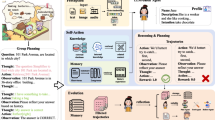
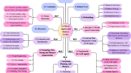

# A survey on large language model based autonomous agents

[Course index](../../README.md) · [Original source](https://link.springer.com/article/10.1007/s11704-024-40231-1?fromPaywallRec=true) · [Raw file](../../raw/readings/ref-19d0abd8cdf3.html)

Retrieved: 2026-11-13T16:49:28.866612+00:00

# A survey on large language model based autonomous agents

- Review Article
- [Open access](https://www.springernature.com/gp/open-science/about/the-fundamentals-of-open-access-and-open-research)
- Published: 22 March 2024

- Volume 18, article number 186345 (2024)
- [Cite this article](arxiv-2308-11432.md)

You have full access to this open access article

[Download PDF](ref-19d0abd8cdf3-pdf.md)

[View saved research](https://link.springer.com/saved-research)

[
Frontiers of Computer Science](https://link.springer.com/journal/11704)
[Aims and scope](https://link.springer.com/journal/11704/aims-and-scope)
[Submit manuscript](https://mc.manuscriptcentral.com/hepfcs)

A survey on large language model based autonomous agents

[Download PDF](ref-19d0abd8cdf3-pdf.md)

- [Lei Wang](arxiv-2308-11432.md)[1](arxiv-2308-11432.md),
- [Chen Ma](arxiv-2308-11432.md)[1](arxiv-2308-11432.md)[na1](arxiv-2308-11432.md),
- [Xueyang Feng](arxiv-2308-11432.md)[1](arxiv-2308-11432.md)[na1](arxiv-2308-11432.md),
- [Zeyu Zhang](arxiv-2308-11432.md)[1](arxiv-2308-11432.md),
- [Hao Yang](arxiv-2308-11432.md)[1](arxiv-2308-11432.md),
- [Jingsen Zhang](arxiv-2308-11432.md)[1](arxiv-2308-11432.md),
- [Zhiyuan Chen](arxiv-2308-11432.md)[1](arxiv-2308-11432.md),
- [Jiakai Tang](arxiv-2308-11432.md)[1](arxiv-2308-11432.md),
- [Xu Chen](arxiv-2308-11432.md)[1](arxiv-2308-11432.md),
- [Yankai Lin](arxiv-2308-11432.md)[1](arxiv-2308-11432.md),
- [Wayne Xin Zhao](arxiv-2308-11432.md)[1](arxiv-2308-11432.md),
- [Zhewei Wei](arxiv-2308-11432.md)[1](arxiv-2308-11432.md) &
- …
- [Jirong Wen](arxiv-2308-11432.md)[1](arxiv-2308-11432.md)

Show authors

- 150k Accesses
- 2597 Citations
- 346 
  Altmetric
- 27 Mentions
- [Explore all metrics](https://link.springer.com/article/10.1007/s11704-024-40231-1/metrics)

## Abstract

Autonomous agents have long been a research focus in academic and industry communities. Previous research often focuses on training agents with limited knowledge within isolated environments, which diverges significantly from human learning processes, and makes the agents hard to achieve human-like decisions. Recently, through the acquisition of vast amounts of Web knowledge, large language models (LLMs) have shown potential in human-level intelligence, leading to a surge in research on LLM-based autonomous agents. In this paper, we present a comprehensive survey of these studies, delivering a systematic review of LLM-based autonomous agents from a holistic perspective. We first discuss the construction of LLM-based autonomous agents, proposing a unified framework that encompasses much of previous work. Then, we present a overview of the diverse applications of LLM-based autonomous agents in social science, natural science, and engineering. Finally, we delve into the evaluation strategies commonly used for LLM-based autonomous agents. Based on the previous studies, we also present several challenges and future directions in this field.

## Article PDF

[Download](ref-19d0abd8cdf3-pdf.md) to read the full article text

### Similar content being viewed by others

### [A survey on LLM-based multi-agent systems: workflow, infrastructure, and challenges](https://link.springer.com/article/10.1007/s44336-024-00009-2?fromPaywallRec=false)

Article
Open access
08 October 2024

### [The rise and potential of large language model based agents: a survey](https://link.springer.com/article/10.1007/s11432-024-4222-0?fromPaywallRec=false)

Article
17 January 2025

### [From language to action: a review of large language models as autonomous agents and tool users](https://link.springer.com/article/10.1007/s10462-025-11471-9?fromPaywallRec=false)

Article
Open access
06 January 2026

### Explore related subjects

Discover the latest articles, books and news in related subjects, suggested using machine learning.

- [Artificial Intelligence](https://link.springer.com/subjects/artificial-intelligence)
- [Formal Languages and Automata Theory](https://link.springer.com/subjects/formal-languages-and-automata-theory)
- [Computational Intelligence](https://link.springer.com/subjects/computational-intelligence)
- [Computational Linguistics](https://link.springer.com/subjects/computational-linguistics)
- [Multiagent Systems](https://link.springer.com/subjects/multiagent-systems)
- [Logic in AI](https://link.springer.com/subjects/logic-in-ai)
- [Natural Language Processing Techniques for Sentiment Analysis](https://link.springer.com/subjects/natural-language-processing-techniques-for-sentiment-analysis)

## References

1. Mnih V, Kavukcuoglu K, Silver D, Rusu A A, Veness J, Bellemare M G, Graves A, Riedmiller M, Fidjeland A K, Ostrovski G, Petersen S, Beattie C, Sadik A, Antonoglou I, King H, Kumaran D, Wierstra D, Legg S, Hassabis D. Human-level control through deep reinforcement learning. Nature, 2015, 518(7540): 529–533

   [Article](https://doi.org/10.1038%2Fnature14236) 
   [Google Scholar](http://scholar.google.com/scholar_lookup?&title=Human-level%20control%20through%20deep%20reinforcement%20learning&journal=Nature&doi=10.1038%2Fnature14236&volume=518&issue=7540&pages=529-533&publication_year=2015&author=Mnih%2CV&author=Kavukcuoglu%2CK&author=Silver%2CD&author=Rusu%2CA%20A&author=Veness%2CJ&author=Bellemare%2CM%20G&author=Graves%2CA&author=Riedmiller%2CM&author=Fidjeland%2CA%20K&author=Ostrovski%2CG&author=Petersen%2CS&author=Beattie%2CC&author=Sadik%2CA&author=Antonoglou%2CI&author=King%2CH&author=Kumaran%2CD&author=Wierstra%2CD&author=Legg%2CS&author=Hassabis%2CD)
2. Lillicrap T P, Hunt J J, Pritzel A, Heess N, Erez T, Tassa Y, Silver D, Wierstra D. Continuous control with deep reinforcement learning. 2019, arXiv preprint arXiv: 1509.02971
3. Schulman J, Wolski F, Dhariwal P, Radford A, Klimov O. Proximal policy optimization algorithms. 2017, arXiv preprint arXiv: 1707.06347
4. Haarnoja T, Zhou A, Abbeel P, Levine S. Soft actor-critic: off-policy maximum entropy deep reinforcement learning with a stochastic actor. In: Proceedings of the 35th International Conference on Machine Learning. 2018, 1861–1870
5. Brown T B, Mann B, Ryder N, Subbiah M, Kaplan J D, Dhariwal P, Neelakantan A, Shyam P, Sastry G, Askell A, Agarwal S, Herbert-Voss A, Krueger G, Henighan T, Child R, Ramesh A, Ziegler D M, Wu J, Winter C, Hesse C, Chen M, Sigler E, Litwin M, Gray S, Chess B, Clark J, Berner C, McCandlish S, Radford A, Sutskever I, Amodei D. Language models are few-shot learners. In: Proceedings of the 34th Conference on Neural Information Processing Systems. 2020, 1877–1901
6. Radford A, Wu J, Child R, Luan D, Amodei D, Sutskever I. Language models are unsupervised multitask learners. OpenAI Blog, 2019, 1(8): 9

   [Google Scholar](http://scholar.google.com/scholar_lookup?&title=Language%20models%20are%20unsupervised%20multitask%20learners&journal=OpenAI%20Blog&volume=1&issue=8&publication_year=2019&author=Radford%2CA&author=Wu%2CJ&author=Child%2CR&author=Luan%2CD&author=Amodei%2CD&author=Sutskever%2CI)
7. OpenAI. GPT-4 technical report. 2024, arXiv preprint arXiv: 2303.08774
8. Anthropic. Model card and evaluations for Claude models. See [Files.anthropic.com/production/images/Model-Card-Claude-2](https://Files.anthropic.com/production/images/Model-Card-Claude-2), 2023
9. Touvron H, Lavril T, Izacard G, Martinet X, Lachaux M A, Lacroix T, Rozière B, Goyal N, Hambro E, Azhar F, Rodriguez A, Joulin A, Grave E, Lample G. LLaMA: open and efficient foundation language models. 2023, arXiv preprint arXiv: 2302.13971
10. Touvron H, Martin L, Stone K, Albert P, Almahairi A, et al. Llama 2: open foundation and fine-tuned chat models. 2023, arXiv preprint arXiv: 2307.09288
11. Chen X, Li S, Li H, Jiang S, Qi Y, Song L. Generative adversarial user model for reinforcement learning based recommendation system. In: Proceedings of the 36th International Conference on Machine Learning. 2019, 1052–1061
12. Shinn N, Cassano F, Gopinath A, rasimhan K, Yao S. Reflexion: language agents with verbal reinforcement learning. NaIn: Proceedings of the 37th Conference on Neural Information Processing Systems. 2023, 36
13. Shen Y, Song K, Tan X, Li D, Lu W, Zhuang Y. HuggingGPT: solving AI tasks with chatGPT and its friends in hugging face. In: Proceedings of the 37th Conference on Neural Information Processing Systems. 2023, 36
14. Qin Y, Liang S, Ye Y, Zhu K, Yan L, Lu Y, Lin Y, Cong X, Tang X, Qian B, Zhao S, Hong L, Tian R, Xie R, Zhou J, Gerstein M, Li D, Liu Z, Sun M. ToolLLM: facilitating large language models to master 16000+ real-world APIs. 2023, arXiv preprint arXiv: 2307.16789
15. Schick T, Dwivedi-Yu J, Dessì R, Raileanu R, Lomeli M, Hambro E, Zettlemoyer L, Cancedda N, Scialom T. Toolformer: language models can teach themselves to use tools. In: Proceedings of the 37th Conference on Neural Information Processing Systems. 2023, 36
16. Zhu X, Chen Y, Tian H, Tao C, Su W, Yang C, Huang G, Li B, Lu L, Wang X, Qiao Y, Zhang Z, Dai J. Ghost in the minecraft: generally capable agents for open-world environments via large language models with text-based knowledge and memory. 2023, arXiv preprint arXiv: 2305.17144
17. Sclar M, Kumar S, West P, Suhr A, Choi Y, Tsvetkov Y. Minding language models’ (lack of) theory of mind: a plug-and-play multicharacter belief tracker. In: Proceedings of the 61st Annual Meeting of the Association for Computational Linguistics. 2023, 13960–13980
18. Qian C, Cong X, Liu W, Yang C, Chen W, Su Y, Dang Y, Li J, Xu J, Li S, Liu Z, Sun M. Communicative agents for software development. 2023, arXiv preprint arXiv: 2307.07924
19. Chen W, Su Y, Zuo J, Yang C, Yuan C, Chan C, Yu H, Lu Y, Hung Y, Qian C, Qin Y, Cong X, Xie R, Liu Z, Sun M, Zhou, J. Agentverse: Facilitating multi-agent collaboration and exploring emergent behaviors in agents. arXiv preprint arXiv:2308.10848.
20. Park J S, O’Brien J, Cai C J, Morris M R, Liang P, Bernstein M S. Generative agents: interactive simulacra of human behavior. In: Proceedings of the 36th Annual ACM Symposium on User Interface Software and Technology. 2023, 2
21. Zhang H, Du W, Shan J, Zhou Q, Du Y, Tenenbaum J B, Shu T, Gan C. Building cooperative embodied agents modularly with large language models. 2024, arXiv preprint arXiv: 2307.02485
22. Hong S, Zhuge M, Chen J, Zheng X, Cheng Y, Zhang C, Wang J, Wang Z, Yau S K S, Lin Z, Zhou L, Ran C, Xiao L, Wu C, Schmidhuber J. MetaGPT: meta programming for a multi-agent collaborative framework. 2023, arXiv preprint arXiv: 2308.00352
23. Dong Y, Jiang X, Jin Z, Li G. Self-collaboration code generation via chatGPT. 2023, arXiv preprint arXiv: 2304.07590
24. Serapio-García G, Safdari M, Crepy C, Sun L, Fitz S, Romero P, Abdulhai M, Faust A, Matarić M. Personality traits in large language models. 2023, arXiv preprint arXiv: 2307.00184
25. Johnson J A. Measuring thirty facets of the five factor model with a 120-item public domain inventory: development of the IPIP-NEO-120. Journal of Research in Personality, 2014, 51: 78–89

    [Article](https://doi.org/10.1016%2Fj.jrp.2014.05.003) 
    [Google Scholar](http://scholar.google.com/scholar_lookup?&title=Measuring%20thirty%20facets%20of%20the%20five%20factor%20model%20with%20a%20120-item%20public%20domain%20inventory%3A%20development%20of%20the%20IPIP-NEO-120&journal=Journal%20of%20Research%20in%20Personality&doi=10.1016%2Fj.jrp.2014.05.003&volume=51&pages=78-89&publication_year=2014&author=Johnson%2CJ%20A)
26. John O P, Donahue E M, Kentle R L. Big five inventory. Journal of personality and social psychology, 1991.
27. Deshpande A, Murahari V, Rajpurohit T, Kalyan A, Narasimhan K. Toxicity in chatGPT: analyzing persona-assigned language models. In: Proceedings of Findings of the Association for Computational Linguistics. 2023, 1236–1270
28. Wang L, Zhang J, Yang H, Chen Z, Tang J, Zhang Z, Chen X, Lin Y, Song R, Zhao W X, Xu J, Dou Z, Wang J, Wen J R. User behavior simulation with large language model based agents. 2024, arXiv preprint arXiv: 2306.02552
29. Argyle L P, Busby E C, Fulda N, Gubler J R, Rytting C, Wingate D. Out of one, many: using language models to simulate human samples. Political Analysis, 2023, 31(3): 337–351

    [Article](https://doi.org/10.1017%2Fpan.2023.2) 
    [Google Scholar](http://scholar.google.com/scholar_lookup?&title=Out%20of%20one%2C%20many%3A%20using%20language%20models%20to%20simulate%20human%20samples&journal=Political%20Analysis&doi=10.1017%2Fpan.2023.2&volume=31&issue=3&pages=337-351&publication_year=2023&author=Argyle%2CL%20P&author=Busby%2CE%20C&author=Fulda%2CN&author=Gubler%2CJ%20R&author=Rytting%2CC&author=Wingate%2CD)
30. Fischer K A. Reflective linguistic programming (RLP): a stepping stone in socially-aware AGI (socialAGI). 2023, arXiv preprint arXiv: 2305.12647
31. Rana K, Haviland J, Garg S, Abou-Chakra J, Reid I, Suenderhauf N. SayPlan: grounding large language models using 3D scene graphs for scalable robot task planning. In: Proceedings of the 7th Conference on Robot Learning. 2023, 23–72
32. Zhu A, Martin L, Head A, Callison-Burch C. CALYPSO: LLMs as dungeon master’s assistants. In: Proceedings of the 19th AAAI Conference on Artificial Intelligence and Interactive Digital Entertainment. 2023, 380–390
33. Wang Z, Cai S, Chen G, Liu A, Ma X, Liang Y. Describe, explain, plan and select: interactive planning with large language models enables open-world multi-task agents. 2023, arXiv preprint arXiv: 2302.01560
34. Lin J, Zhao H, Zhang A, Wu Y, Ping H, Chen Q. AgentSims: an open-source sandbox for large language model evaluation. 2023, arXiv preprint arXiv: 2308.04026
35. Wang B, Liang X, Yang J, Huang H, Wu S, Wu P, Lu L, Ma Z, Li Z. Enhancing large language model with self-controlled memory framework. 2024, arXiv preprint arXiv: 2304.13343
36. Ng Y, Miyashita D, Hoshi Y, Morioka Y, Torii O, Kodama T, Deguchi J. SimplyRetrieve: a private and lightweight retrieval-centric generative AI tool. 2023, arXiv preprint arXiv: 2308.03983
37. Huang Z, Gutierrez S, Kamana H, Macneil S. Memory sandbox: transparent and interactive memory management for conversational agents. In: Proceedings of the 36th Annual ACM Symposium on User Interface Software and Technology. 2023, 97
38. Wang G, Xie Y, Jiang Y, Mandlekar A, Xiao C, Zhu Y, Fan L, Anandkumar A. Voyager: an open-ended embodied agent with large language models. 2023, arXiv preprint arXiv: 2305.16291
39. Zhong W, Guo L, Gao Q, Ye H, Wang Y. MemoryBank: enhancing large language models with long-term memory. 2023, arXiv preprint arXiv: 2305.10250
40. Hu C, Fu J, Du C, Luo S, Zhao J, Zhao H. ChatDB: augmenting LLMs with databases as their symbolic memory. 2023, arXiv preprint arXiv: 2306.03901
41. Zhou X, Li G, Liu Z. LLM as DBA. 2023, arXiv preprint arXiv: 2308.05481
42. Modarressi A, Imani A, Fayyaz M, Schütze H. RET-LLM: towards a general read-write memory for large language models. 2023, arXiv preprint arXiv: 2305.14322
43. Schuurmans D. Memory augmented large language models are computationally universal. 2023, arXiv preprint arXiv: 2301.04589
44. Zhao A, Huang D, Xu Q, Lin M, Liu Y J, Huang G. Expel: LLM agents are experiential learners. 2023, arXiv preprint arXiv: 2308.10144
45. Wei J, Wang X, Schuurmans D, Bosma M, Ichter B, Xia F, Chi E H, Le Q V, Zhou D. Chain-of-thought prompting elicits reasoning in large language models. In: Proceedings of the 36th Conference on Neural Information Processing Systems. 2022, 24824–24837
46. Kojima T, Gu S S, Reid M, Matsuo Y, Iwasawa Y. Large language models are zero-shot reasoners. In: Proceedings of the 36th Conference on Neural Information Processing Systems. 2022, 22199–22213
47. Raman S S, Cohen V, Rosen E, Idrees I, Paulius D, Tellex S. Planning with large language models via corrective re-prompting. In: Proceedings of Foundation Models for Decision Making Workshop at Neural Information Processing Systems. 2022
48. Xu B, Peng Z, Lei B, Mukherjee S, Liu Y, Xu D. ReWOO: decoupling reasoning from observations for efficient augmented language models. 2023, arXiv preprint arXiv: 2305.18323
49. Wang X, Wei J, Schuurmans D, Le Q V, Chi E H, Narang S, Chowdhery A, Zhou D. Self-consistency improves chain of thought reasoning in language models. In: Proceedings of the 11th International Conference on Learning Representations. 2023
50. Yao S, Yu D, Zhao J, Shafran I, Griffiths T L, Cao Y, Narasimhan K. Tree of thoughts: deliberate problem solving with large language models. In: Proceedings of the 37th Conference on Neural Information Processing Systems. 2023, 36
51. Wang Y, Jiang Z, Chen Z, Yang F, Zhou Y, Cho E, Fan X, Huang X, Lu Y, Yang Y. RecMind: Large language model powered agent for recommendation. 2023, arXiv preprint arXiv: 2308.14296
52. Besta M, Blach N, Kubicek A, Gerstenberger R, Podstawski M, Gianinazzi L, Gajda J, Lehmann T, Niewiadomski H, Nyczyk P, Hoefler T. Graph of thoughts: solving elaborate problems with large language models. 2024, arXiv preprint arXiv: 2308.09687
53. Sel B, Al-Tawaha A, Khattar V, Jia R, Jin M. Algorithm of thoughts: enhancing exploration of ideas in large language models. 2023, arXiv preprint arXiv: 2308.10379
54. Huang W, Abbeel P, Pathak D, Mordatch I. Language models as zero-shot planners: extracting actionable knowledge for embodied agents. In: Proceedings of the 39th International Conference on Machine Learning. 2022, 9118–9147
55. Gramopadhye M, Szafir D. Generating executable action plans with environmentally-aware language models. In: Proceedings of 2023 IEEE/RSJ International Conference on Intelligent Robots and Systems. 2023, 3568–3575
56. Hao S, Gu Y, Ma H, Hong J, Wang Z, Wang D, Hu Z. Reasoning with language model is planning with world model. In: Proceedings of 2023 Conference on Empirical Methods in Natural Language Processing. 2023, 8154–8173
57. Liu B, Jiang Y, Zhang X, Liu Q, Zhang S, Biswas J, Stone P. LLM+P: empowering large language models with optimal planning proficiency. 2023, arXiv preprint arXiv: 2304.11477
58. Dagan G, Keller F, Lascarides A. Dynamic planning with a LLM. 2023, arXiv preprint arXiv: 2308.06391
59. Yao S, Zhao J, Yu D, Du N, Shafran I, Narasimhan K R, Cao Y. ReAct: synergizing reasoning and acting in language models. In: Proceedings of the 11th International Conference on Learning Representations. 2023
60. Song C H, Sadler B M, Wu J, Chao W L, Washington C, Su Y. LLM-planner: few-shot grounded planning for embodied agents with large language models. In: Proceedings of 2023 IEEE/CVF International Conference on Computer Vision. 2023, 2986–2997
61. Huang W, Xia F, Xiao T, Chan H, Liang J, Florence P, Zeng A, Tompson J, Mordatch I, Chebotar Y, Sermanet P, Jackson T, Brown N, Luu L, Levine S, Hausman K, Ichter B. Inner monologue: embodied reasoning through planning with language models. In: Proceedings of the 6th Conference on Robot Learning, 2023, 1769–1782
62. Madaan A, Tandon N, Gupta P, Hallinan S, Gao L, Wiegreffe S, Alon U, Dziri N, Prabhumoye S, Yang Y, Gupta S, Majumder B P, Hermann K, Welleck S, Yazdanbakhsh A, Clark P. Self-refine: iterative refinement with self-feedback. Advances in Neural Information Processing Systems, 2024, 36.
63. Miao N, Teh Y W, Rainforth T. SelfCheck: using LLMs to zero-shot check their own step-by-step reasoning. 2023, arXiv preprint arXiv: 2308.00436
64. Chen P L, Chang C S. InterAct: exploring the potentials of chatGPT as a cooperative agent. 2023, arXiv preprint arXiv: 2308.01552
65. Chen Z, Zhou K, Zhang B, Gong Z, Zhao X, Wen J R. ChatCoT: tool-augmented chain-of-thought reasoning on chat-based large language models. In: Proceedings of Findings of the Association for Computational Linguistics. 2023, 14777–14790
66. Nakano R, Hilton J, Balaji S, Wu J, Ouyang L, Kim C, Hesse C, Jain S, Kosaraju V, Saunders W, Jiang X, Cobbe K, Eloundou T, Krueger G, Button K, Knight M, Chess B, Schulman J. WebGPT: browserassisted question-answering with human feedback. 2022, arXiv preprint arXiv: 2112.09332
67. Ruan J, Chen Y, Zhang B, Xu Z, Bao T, Du G, Shi S, Mao H, Li Z, Zeng X, Zhao R. TPTU: large language model-based AI agents for task planning and tool usage. 2023, arXiv preprint arXiv: 2308.03427
68. Patil S G, Zhang T, Wang X, Gonzalez J E. Gorilla: large language model connected with massive APIs. 2023, arXiv preprint arXiv: 2305.15334
69. Li M, Zhao Y, Yu B, Song F, Li H, Yu H, Li Z, Huang F, Li Y. API-bank: a comprehensive benchmark for tool-augmented LLMs. In: Proceedings of 2023 Conference on Empirical Methods in Natural Language Processing. 2023, 3102–3116
70. Song Y, Xiong W, Zhu D, Wu W, Qian H, Song M, Huang H, Li C, Wang K, Yao R, Tian Y, Li S. RestGPT: connecting large language models with real-world RESTful APIs. 2023, arXiv preprint arXiv: 2306.06624
71. Liang Y, Wu C, Song T, Wu W, Xia Y, Liu Y, Ou Y, Lu S, Ji L, Mao S, Wang Y, Shou L, Gong M, Duan N. TaskMatrix.AI: Completing tasks by connecting foundation models with millions of APIs. 2023, arXiv preprint arXiv: 2303.16434
72. Karpas E, Abend O, Belinkov Y, Lenz B, Lieber O, Ratner N, Shoham Y, Bata H, Levine Y, Leyton-Brown K, Muhlgay D, Rozen N, Schwartz E, Shachaf G, Shalev-Shwartz S, Shashua A, Tenenholtz M. MRKL systems: a modular, neuro-symbolic architecture that combines large language models, external knowledge sources and discrete reasoning. 2022, arXiv preprint arXiv: 2205.00445
73. Ge Y, Hua W, Mei K, Tan J, Xu S, Li Z, Zhang Y. OpenAGI: When LLM meets domain experts. In: Proceedings of the 37th Conference on Neural Information Processing Systems, 2023, 36
74. Surís D, Menon S, Vondrick C. ViperGPT: visual inference via python execution for reasoning. 2023, arXiv preprint arXiv: 2303.08128
75. Bran A M, Cox S, Schilter O, Baldassari C, White A D, Schwaller P. ChemCrow: augmenting large-language models with chemistry tools. 2023, arXiv preprint arXiv: 2304.05376
76. Yang Z, Li L, Wang J, Lin K, Azarnasab E, Ahmed F, Liu Z, Liu C, Zeng M, Wang L. MM-REACT: Prompting chatGPT for multimodal reasoning and action. 2023, arXiv preprint arXiv: 2303.11381
77. Gao C, Lan X, Lu Z, Mao J, Piao J, Wang H, Jin D, Li Y. S3: social-network simulation system with large language model-empowered agents. 2023, arXiv preprint arXiv: 2307.14984
78. Ichter B, Brohan A, Chebotar Y, Finn C, Hausman K, et al. Do as I can, not as I say: grounding language in robotic affordances. In: Proceedings of the 6th Conference on Robot Learning. 2023, 287–318
79. Liu H, Sferrazza C, Abbeel P. Chain of hindsight aligns language models with feedback. arXiv preprint arXiv: 2302.02676
80. Yao S, Chen H, Yang J, Narasimhan K. WebShop: towards scalable real-world Web interaction with grounded language agents. In: Proceedings of the 36th Conference on Neural Information Processing Systems. 2022, 20744–20757
81. Dan Y, Lei Z, Gu Y, Li Y, Yin J, Lin J, Ye L, Tie Z, Zhou Y, Wang Y, Zhou A, Zhou Z, Chen Q, Zhou J, He L, Qiu X. EduChat: a large-scale language model-based chatbot system for intelligent education. 2023, arXiv preprint arXiv: 2308.02773
82. Lin B Y, Fu Y, Yang K, Brahman F, Huang S, Bhagavatula C, Ammanabrolu P, Choi Y, Ren X. SwiftSage: a generative agent with fast and slow thinking for complex interactive tasks. In: Proceedings of the 37th Conference on Neural Information Processing Systems. 2023, 36
83. Evans J S B T, Stanovich K E. Dual-process theories of higher cognition: advancing the debate. Perspectives on Psychological Science, 2013, 8(3): 223–241

    [Article](https://doi.org/10.1177%2F1745691612460685) 
    [Google Scholar](http://scholar.google.com/scholar_lookup?&title=Dual-process%20theories%20of%20higher%20cognition%3A%20advancing%20the%20debate&journal=Perspectives%20on%20Psychological%20Science&doi=10.1177%2F1745691612460685&volume=8&issue=3&pages=223-241&publication_year=2013&author=Evans%2CJ%20S%20B%20T&author=Stanovich%2CK%20E)
84. Liu R, Yang R, Jia C, Zhang G, Zhou D, Dai A M, Yang D, Vosoughi S. Training socially aligned language models on simulated social interactions. 2023, arXiv preprint arXiv: 2305.16960
85. Weng X, Gu Y, Zheng B, Chen S, Stevens S, Wang B, Sun H, Su Y. Mind2Web: towards a generalist agent for the Web. In: Proceedings of the 37th Conference on Neural Information Processing Systems. 2023, 36
86. Sun R, Arik S O, Nakhost H, Dai H, Sinha R, Yin P, Pfister T. SQL-PaLm: improved large language model adaptation for text-to-SQL. 2023, arXiv preprint arXiv: 2306.00739
87. Yao W, Heinecke S, Niebles J C, Liu Z, Feng Y, Xue L, Murthy R, Chen Z, Zhang J, Arpit D, Xu R, Mui P, Wang H, Xiong C, Savarese S. Retroformer: retrospective large language agents with policy gradient optimization, 2023, arXiv preprint arXiv: 2308.02151
88. Shu Y, Zhang H, Gu H, Zhang P, Lu T, Li D, Gu N. RAH! RecSys-assistant-human: a human-centered recommendation framework with LLM agents. 2023, arXiv preprint arXiv: 2308.09904
89. Mandi Z, Jain S, Song S. RoCo: dialectic multi-robot collaboration with large language models. 2023, arXiv preprint arXiv: 2307.04738
90. Zhang C, Liu L, Wang J, Wang C, Sun X, Wang H, Cai M. PREFER: prompt ensemble learning via feedback-reflect-refine. 2023, arXiv preprint arXiv: 2308.12033
91. Du Y, Li S, Torralba A, Tenenbaum J B, Mordatch I. Improving factuality and reasoning in language models through multiagent debate. 2023, arXiv preprint arXiv: 2305.14325
92. Zhang C, Yang Z, Liu J, Han Y, Chen X, Huang Z, Fu B, Yu G. AppAgent: multimodal agents as smartphone users. 2023, arXiv preprint arXiv: 2312.13771
93. Madaan A, Tandon N, Clark P, Yang Y. Memory-assisted prompt editing to improve GPT-3 after deployment. In: Proceedings of 2022 Conference on Empirical Methods in Natural Language Processing. 2022, 2833–2861
94. Colas C, Teodorescu L, Oudeyer P Y, Yuan X, Côté M A. Augmenting autotelic agents with large language models. In: Proceedings of the 2nd Conference on Lifelong Learning Agents. 2023, 205–226
95. Nascimento N, Alencar P, Cowan D. Self-adaptive large language model (LLM)-based multiagent systems. In: Proceedings of 2023 IEEE International Conference on Autonomic Computing and Self-Organizing Systems Companion. 2023, 104–109
96. Saha S, Hase P, Bansal M. Can language models teach weaker agents? Teacher explanations improve students via personalization. 2023, arXiv preprint arXiv: 2306.09299
97. Zhuge M, Liu H, Faccio F, Ashley D R, Csordás R, Gopalakrishnan A, Hamdi A, Hammoud H A A K, Herrmann V, Irie K, Kirsch L, Li B, Li G, Liu S, Mai J, Piękos P, Ramesh A, Schlag I, Shi W, Stanić A, Wang W, Wang Y, Xu M, Fan D P, Ghanem B, Schmidhuber J. Mindstorms in natural language-based societies of mind. 2023, arXiv preprint arXiv: 2305.17066
98. Park J S, Popowski L, Cai C, Morris M R, Liang P, Bernstein M S. Social simulacra: creating populated prototypes for social computing systems. In: Proceedings of the 35th Annual ACM Symposium on User Interface Software and Technology. 2022, 74
99. Li G, Hammoud H A A K, Itani H, Khizbullin D, Ghanem B. CAMEL: communicative agents for “mind” exploration of large language model society. 2023, arXiv preprint arXiv: 2303.17760
100. AutoGPT. See [Github.com/Significant-Gravitas/Auto](https://Github.com/Significant-Gravitas/Auto), 2023
101. Chen L, Wang L, Dong H, Du Y, Yan J, Yang F, Li S, Zhao P, Qin S, Rajmohan S, Lin Q, Zhang D. Introspective tips: large language model for in-context decision making. 2023, arXiv preprint arXiv: 2305.11598
102. Aher G V, Arriaga R I, Kalai A T. Using large language models to simulate multiple humans and replicate human subject studies. In: Proceedings of the 40th International Conference on Machine Learning. 2023, 337–371
103. Akata E, Schulz L, Coda-Forno J, Oh S J, Bethge M, Schulz E. Playing repeated games with large language models. 2023, arXiv preprint arXiv: 2305.16867
104. Ma Z, Mei Y, Su Z. Understanding the benefits and challenges of using large language model-based conversational agents for mental well-being support. In: Proceedings of AMIA Symposium. 2023, 1105–1114
105. Ziems C, Held W, Shaikh O, Chen J, Zhang Z, Yang D. Can large language models transform computational social science? 2024, arXiv preprint arXiv: 2305.03514
106. Horton J J. Large language models as simulated economic agents: what can we learn from homo silicus? 2023, arXiv preprint arXiv: 2301.07543
107. Li S, Yang J, Zhao K. Are you in a masquerade? Exploring the behavior and impact of large language model driven social bots in online social networks. 2023, arXiv preprint arXiv: 2307.10337
108. Li C, Su X, Han H, Xue C, Zheng C, Fan C. Quantifying the impact of large language models on collective opinion dynamics. 2023, arXiv preprint arXiv: 2308.03313
109. Kovač G, Portelas R, Dominey P F, Oudeyer P Y. The SocialAI school: insights from developmental psychology towards artificial socio-cultural agents. 2023, arXiv preprint arXiv: 2307.07871
110. Williams R, Hosseinichimeh N, Majumdar A, Ghaffarzadegan N. Epidemic modeling with generative agents. 2023, arXiv preprint arXiv: 2307.04986
111. Shi J, Zhao J, Wang Y, Wu X, Li J, He L. CGMI: configurable general multi-agent interaction framework. 2023, arXiv preprint arXiv: 2308.12503
112. Cui J, Li Z, Yan Y, Chen B, Yuan L. ChatLaw: open-source legal large language model with integrated external knowledge bases. 2023, arXiv preprint arXiv: 2306.16092
113. Hamilton S. Blind judgement: agent-based supreme court modelling with GPT. 2023, arXiv preprint arXiv: 2301.05327
114. Bail C A. Can generative AI improve social science? 2023
115. Boiko D A, MacKnight R, Gomes G. Emergent autonomous scientific research capabilities of large language models. 2023, arXiv preprint arXiv: 2304.05332
116. Kang Y, Kim J. ChatMOF: an autonomous AI system for predicting and generating metal-organic frameworks. 2023, arXiv preprint arXiv: 2308.01423
117. Swan M, Kido T, Roland E, Santos R P D. Math agents: computational infrastructure, mathematical embedding, and genomics. 2023, arXiv preprint arXiv: 2307.02502
118. Drori I, Zhang S, Shuttleworth R, Tang L, Lu A, Ke E, Liu K, Chen L, Tran S, Cheng N, Wang R, Singh N, Patti T L, Lynch J, Shporer A, Verma N, Wu E, Strang G. A neural network solves, explains, and generates university math problems by program synthesis and few-shot learning at human level. Proceedings of the National Academy of Sciences of the United States of America, 2022, 119(32): e2123433119

     [Article](https://doi.org/10.1073%2Fpnas.2123433119) 
     [Google Scholar](http://scholar.google.com/scholar_lookup?&title=A%20neural%20network%20solves%2C%20explains%2C%20and%20generates%20university%20math%20problems%20by%20program%20synthesis%20and%20few-shot%20learning%20at%20human%20level&journal=Proceedings%20of%20the%20National%20Academy%20of%20Sciences%20of%20the%20United%20States%20of%20America&doi=10.1073%2Fpnas.2123433119&volume=119&issue=32&publication_year=2022&author=Drori%2CI&author=Zhang%2CS&author=Shuttleworth%2CR&author=Tang%2CL&author=Lu%2CA&author=Ke%2CE&author=Liu%2CK&author=Chen%2CL&author=Tran%2CS&author=Cheng%2CN&author=Wang%2CR&author=Singh%2CN&author=Patti%2CT%20L&author=Lynch%2CJ&author=Shporer%2CA&author=Verma%2CN&author=Wu%2CE&author=Strang%2CG)
119. Chen M, Tworek J, Jun H, Yuan Q, de Oliveira Pinto H P, et al. Evaluating large language models trained on code. 2021, arXiv preprint arXiv: 2107.03374
120. Liffiton M, Sheese B E, Savelka J, Denny P. CodeHelp: using large language models with guardrails for scalable support in programming classes. In: Proceedings of the 23rd Koli Calling International Conference on Computing Education Research. 2023, 8
121. Matelsky J K, Parodi F, Liu T, Lange R D, Kording K P. A large language model-assisted education tool to provide feedback on open-ended responses. 2023, arXiv preprint arXiv: 2308.02439
122. Mehta N, Teruel M, Sanz P F, Deng X, Awadallah A H, Kiseleva J. Improving grounded language understanding in a collaborative environment by interacting with agents through help feedback. 2024, arXiv preprint arXiv: 2304.10750
123. SmolModels. See [Githubcom/smol-ai/developer](https://Github.com/smol-ai/developer) website, 2023
124. DemoGPT. See [Github.com/melih-unsal/Demo](https://Github.com/melih-unsal/Demo) website, 2023
125. GPT-engineer. See [Github.com/AntonOsika/gpt](https://Github.com/AntonOsika/gpt) website, 2023
126. Li H, Hao Y, Zhai Y, Qian Z. The hitchhiker’s guide to program analysis: a journey with large language models. 2023, arXiv preprint arXiv: 2308.00245
127. He Z, Wu H, Zhang X, Yao X, Zheng S, Zheng H, Yu B. ChatEDA: a large language model powered autonomous agent for EDA. In: Proceedings of the 5th ACM/IEEE Workshop on Machine Learning for CAD. 2023, 1–6
128. Deng G, Liu Y, Mayoral-Vilches V, Liu P, Li Y, Xu Y, Zhang T, Liu Y, Pinzger M, Rass S. PentestGPT: an LLM-empowered automatic penetration testing tool. 2023, arXiv preprint arXiv: 2308.06782
129. Xia Y, Shenoy M, Jazdi N, Weyrich M. Towards autonomous system: flexible modular production system enhanced with large language model agents. In: Proceedings of the 2023 IEEE 28th International Conference on Emerging Technologies and Factory Automation. 2023, 1–8
130. Ogundare O, Madasu S, Wiggins N. Industrial engineering with large language models: a case study of chatGPT’s performance on oil & gas problems. In: Proceedings of the 2023 11th International Conference on Control, Mechatronics and Automation. 2023, 458–461
131. Hu B, Zhao C, Zhang P, Zhou Z, Yang Y, Xu Z, Liu B. Enabling intelligent interactions between an agent and an LLM: a reinforcement learning approach. 2024, arXiv preprint arXiv: 2306.03604
132. Wu Y, Min S Y, Bisk Y, Salakhutdinov R, Azaria A, Li Y, Mitchell T, Prabhumoye S. Plan, eliminate, and track–language models are good teachers for embodied agents. 2023, arXiv preprint arXiv: 2305.02412
133. Zhang D, Chen L, Zhang S, Xu H, Zhao Z, Yu K. Large language models are semi-parametric reinforcement learning agents. In: Proceedings of the 37th Conference on Neural Information Processing Systems. 2023, 36
134. Di P N, Byravan A, Hasenclever L, Wulfmeier M, Heess N, Riedmiller M. Towards a unified agent with foundation models. 2023, arXiv preprint arXiv: 2307.09668
135. Dasgupta I, Kaeser-Chen C, Marino K, Ahuja A, Babayan S, Hill F, Fergus R. Collaborating with language models for embodied reasoning. 2023, arXiv preprint arXiv: 2302.00763
136. Zhou W, Peng X, Riedl M O. Dialogue shaping: empowering agents through NPC interaction. 2023, arXiv preprint arXiv: 2307.15833
137. Nottingham K, Ammanabrolu P, Suhr A, Choi Y, Hajishirzi H, Singh S, Fox R. Do embodied agents dream of pixelated sheep: embodied decision making using language guided world modelling. In: Proceedings of the 40th International Conference on Machine Learning. 2023, 26311–26325
138. Wu Z, Wang Z, Xu X, Lu J, Yan H. Embodied task planning with large language models. 2023, arXiv preprint arXiv: 2307.01848
139. Wu J, Antonova R, Kan A, Lepert M, Zeng A, Song S, Bohg J, Rusinkiewicz S, Funkhouser T. TidyBot: personalized robot assistance with large language models. In: Proceedings of 2023 IEEE/RSJ International Conference on Intelligent Robots and Systems. 2023, 3546–3553
140. AgentGPT. See [Github.com/reworkd/Agent](https://Github.com/reworkd/Agent) website, 2023
141. Ai-legion. See [Github.com/eumemic/ai](https://Github.com/eumemic/ai) website, 2023
142. AGiXT. See [Githubcom/Josh-XT/AGiXT](https://Github.com/Josh-XT/AGiXT) website, 2023
143. Xlang. See [Githubcom/xlang-ai/xlang](https://Github.com/xlang-ai/xlang) website, 2023
144. Babyagi. See [Githubcom/yoheinakajima](https://Github.com/yoheinakajima) website, 2023
145. LangChain. See [Docs.langchaincom/docs/](https://Docs.langchaincom/docs/) website, 2023
146. WorkGPT. See [Githubcom/team-openpm/workgpt](https://Github.com/team-openpm/workgpt) website, 2023
147. LoopGPT. See [Githubcom/farizrahman4u/loopgpt](https://Github.com/farizrahman4u/loopgpt) website, 2023
148. GPT-researcher. See [Github.com/assafelovic/gpt](https://Github.com/assafelovic/gpt) website, 2023
149. Qin Y, Hu S, Lin Y, Chen W, Ding N, Cui G, Zeng Z, Huang Y, Xiao C, Han C, Fung Y R, Su Y, Wang H, Qian C, Tian R, Zhu K, Liang S, Shen X, Xu B, Zhang Z, Ye Y, Li B, Tang Z, Yi J, Zhu Y, Dai Z, Yan L, Cong X, Lu Y, Zhao W, Huang Y, Yan J, Han X, Sun X, Li D, Phang J, Yang X, Wu T, Ji H, Liu Z, Sun M. Tool learning with foundation models. 2023, arXiv preprint arXiv: 2304.08354
150. Transformers agent. See [Huggingface.co/docs/transformers/transformers](https://Huggingface.co/docs/transformers/transformers) website, 2023
151. Mini-agi. See [Github.com/muellerberndt/mini](https://Github.com/muellerberndt/mini) website, 2023
152. SuperAGI. See [Github.com/TransformerOptimus/Super](https://Github.com/TransformerOptimus/Super) website, 2023
153. Wu Q, Bansal G, Zhang J, Wu Y, Li B, Zhu E, Jiang L, Zhang X, Zhang S, Liu J, Awadallah A H, White R W, Burger D, Wang C. AutoGen: enabling next-gen LLM applications via multi-agent conversation. 2023, arXiv preprint arXiv: 2308.08155
154. Grossmann I, Feinberg M, Parker D C, Christakis N A, Tetlock P E, Cunningham W A. AI and the transformation of social science research: careful bias management and data fidelity are key. Science, 2023, 380(6650): 1108–1109

     [Article](https://doi.org/10.1126%2Fscience.adi1778) 
     [Google Scholar](http://scholar.google.com/scholar_lookup?&title=AI%20and%20the%20transformation%20of%20social%20science%20research%3A%20careful%20bias%20management%20and%20data%20fidelity%20are%20key&journal=Science&doi=10.1126%2Fscience.adi1778&volume=380&issue=6650&pages=1108-1109&publication_year=2023&author=Grossmann%2CI&author=Feinberg%2CM&author=Parker%2CD%20C&author=Christakis%2CN%20A&author=Tetlock%2CP%20E&author=Cunningham%2CW%20A)
155. Huang X, Lian J, Lei Y, Yao J, Lian D, Xie X. Recommender AI agent: integrating large language models for interactive recommendations. 2023, arXiv preprint arXiv: 2308.16505
156. Zhang C, Yang K, Hu S, Wang Z, Li G, Sun Y, Zhang C, Zhang Z, Liu A, Zhu S C, Chang X, Zhang J, Yin F, Liang Y, Yang Y. ProAgent: building proactive cooperative agents with large language models. 2024, arXiv preprint arXiv: 2308.11339
157. Xiang J, Tao T, Gu Y, Shu T, Wang Z, Yang Z, Hu Z. Language models meet world models: embodied experiences enhance language models. In: Proceedings of the 37th Conference on Neural Information Processing Systems. 2023, 36
158. Lee M, Srivastava M, Hardy A, Thickstun J, Durmus E, Paranjape A, Gerard-Ursin I, Li X L, Ladhak F, Rong F, Wang R E, Kwon M, Park J S, Cao H, Lee T, Bommasani R, Bernstein M, Liang P. Evaluating human-language model interaction. 2024, arXiv preprint arXiv: 2212.09746
159. Krishna R, Lee D, Fei-Fei L, Bernstein M S. Socially situated artificial intelligence enables learning from human interaction. Proceedings of the National Academy of Sciences of the United States of America, 2022, 119(39): e2115730119

     [Article](https://doi.org/10.1073%2Fpnas.2115730119) 
     [Google Scholar](http://scholar.google.com/scholar_lookup?&title=Socially%20situated%20artificial%20intelligence%20enables%20learning%20from%20human%20interaction&journal=Proceedings%20of%20the%20National%20Academy%20of%20Sciences%20of%20the%20United%20States%20of%20America&doi=10.1073%2Fpnas.2115730119&volume=119&issue=39&publication_year=2022&author=Krishna%2CR&author=Lee%2CD&author=Fei-Fei%2CL&author=Bernstein%2CM%20S)
160. Huang J T, Lam M H, Li E J, Ren S, Wang W, Jiao W, Tu Z, Lyu M R. Emotionally numb or empathetic? Evaluating how LLMs feel using emotionbench. 2024, arXiv preprint arXiv: 2308.03656
161. Chan C M, Chen W, Su Y, Yu J, Xue W, Zhang S, Fu J, Liu Z. ChatEval: towards better LLM-based evaluators through multi-agent debate. 2023, arXiv preprint arXiv: 2308.07201
162. Chen A, Phang J, Parrish A, Padmakumar V, Zhao C, Bowman S R, Cho K. Two failures of self-consistency in the multi-step reasoning of LLMs. 2024, arXiv preprint arXiv: 2305.14279
163. Zhang D, Xu H, Zhao Z, Chen L, Cao R, Yu K. Mobile-env: an evaluation platform and benchmark for LLM-GUI interaction. 2024, arXiv preprint arXiv: 2305.08144
164. Liang Y, Zhu L, Yang Y. Tachikuma: understading complex interactions with multi-character and novel objects by large language models. 2023, arXiv preprint arXiv: 2307.12573
165. Choi M, Pei J, Kumar S, Shu C, Jurgens D. Do LLMs understand social knowledge? Evaluating the sociability of large language models with socKET benchmark. In: Proceedings of 2023 Conference on Empirical Methods in Natural Language Processing. 2023, 11370–11403
166. Liu Z, Yao W, Zhang J, Xue L, Heinecke S, Murthy R, Feng Y, Chen Z, Niebles J C, Arpit D, Xu R, Mui P, Wang H, Xiong C, Savarese S. BOLAA: benchmarking and orchestrating LLM-augmented autonomous agents. 2023, arXiv preprint arXiv: 2308.05960
167. Liu X, Yu H, Zhang H, Xu Y, Lei X, Lai H, Gu Y, Ding H, Men K, Yang K, Zhang S, Deng X, Zeng A, Du Z, Zhang C, Shen S, Zhang T, Su Y, Sun H, Huang M, Dong Y, Tang J. AgentBench: evaluating LLMs as agents. 2023, arXiv preprint arXiv: 2308.03688
168. Kang S, Yoon J, Yoo S. Large language models are few-shot testers: exploring LLM-based general bug reproduction. In: Proceedings of the 45th IEEE/ACM International Conference on Software Engineering. 2023, 2312–2323
169. Jalil S, Rafi S, LaToza T D, Moran K, Lam W. ChatGPT and software testing education: Promises & perils. In: Proceedings of 2023 IEEE International Conference on Software Testing, Verification and Validation Workshops. 2023, 4130–4137
170. Feldt R, Kang S, Yoon J, Yoo S. Towards autonomous testing agents via conversational large language models. In: Proceedings of the 38th IEEE/ACM International Conference on Automated Software Engineering. 2023, 1688–1693
171. Zhou S, Xu F F, Zhu H, Zhou X, Lo R, Sridhar A, Cheng X, Ou T, Bisk Y, Fried D, Alon U, Neubig G. WebArena: a realistic Web environment for building autonomous agents. 2023, arXiv preprint arXiv: 2307.13854
172. Xu B, Liu X, Shen H, Han Z, Li Y, Yue M, Peng Z, Liu Y, Yao Z, Xu D. Gentopia.AI: a collaborative platform for tool-augmented LLMs. In: Proceedings of 2023 Conference on Empirical Methods in Natural Language Processing: System Demonstrations. 2023, 237–245
173. Chalamalasetti K, Götze J, Hakimov S, Madureira B, Sadler P, Schlangen D. clembench: Using game play to evaluate chat-optimized language models as conversational agents. In: Proceedings of 2023 Conference on Empirical Methods in Natural Language Processing. 2023, 11174–11219
174. Banerjee D, Singh P, Avadhanam A, Srivastava S. Benchmarking LLM powered chatbots: methods and metrics. 2023, arXiv preprint arXiv: 2308.04624
175. Lin J, Tomlin N, Andreas J, Eisner J. Decision-oriented dialogue for human-AI collaboration. 2023, arXiv preprint arXiv: 2305.20076
176. Zhao W X, Zhou K, Li J, Tang T, Wang X, Hou Y, Min Y, Zhang B, Zhang J, Dong Z, Du Y, Yang C, Chen Y, Chen Z, Jiang J, Ren R, Li Y, Tang X, Liu Z, Liu P, Nie J Y, Wen J R. A survey of large language models. 2023, arXiv preprint arXiv: 2303.18223
177. Yang J, Jin H, Tang R, Han X, Feng Q, Jiang H, Zhong S, Yin B, Hu X. Harnessing the power of LLMs in practice: a survey on chatGPT and beyond. ACM Transactions on Knowledge Discovery from Data, 2024, doi: <https://doi.org/10.1145/3649506>
178. Wang Y, Zhong W, Li L, Mi F, Zeng X, Huang W, Shang L, Jiang X, Liu Q. Aligning large language models with human: a survey. 2023, arXiv preprint arXiv: 2307.12966
179. Huang J, Chang K C C. Towards reasoning in large language models: a survey. In: Proceedings of Findings of the Association for Computational Linguistics: ACL 2023. 2023, 1049–1065
180. Mialon G, Dessì R, Lomeli M, Nalmpantis C, Pasunuru R, Raileanu R, Rozière B, Schick T, Dwivedi-Yu J, Celikyilmaz A, Grave E, LeCun Y, Scialom T. Augmented language models: a survey. 2023, arXiv preprint arXiv: 2302.07842
181. Chang Y, Wang X, Wang J, Wu Y, Yang L, Zhu K, Chen H, Yi X, Wang C, Wang Y, Ye W, Zhang Y, Chang Y, Yu P S. A survey on evaluation of large language models. ACM Transactions on Intelligent Systems and Technology, 2023, doi: <https://doi.org/10.1145/3641289>
182. Chang T A, Bergen B K. Language model behavior: a comprehensive survey. Computational Linguistics, 2024, doi: <https://doi.org/10.1162/coli_a_00492>
183. Li C, Wang J, Zhu K, Zhang Y, Hou W, Lian J, Xie X. Emotionprompt: Leveraging psychology for large language models enhancement via emotional stimulus. 2023, arXiv preprint arXiv: 2307.11760
184. Zhuo T Y, Li Z, Huang Y, Shiri F, Wang W, Haffari G, Li Y F. On robustness of prompt-based semantic parsing with large pre-trained language model: an empirical study on codex. In: Proceedings of the 17th Conference of the European Chapter of the Association for Computational Linguistics. 2023, 1090–1102
185. Gekhman Z, Oved N, Keller O, Szpektor I, Reichart R. On the robustness of dialogue history representation in conversational question answering: a comprehensive study and a new prompt-based method. Transactions of the Association for Computational Linguistics, 2023, 11(11): 351–366

     [Article](https://doi.org/10.1162%2Ftacl_a_00549) 
     [Google Scholar](http://scholar.google.com/scholar_lookup?&title=On%20the%20robustness%20of%20dialogue%20history%20representation%20in%20conversational%20question%20answering%3A%20a%20comprehensive%20study%20and%20a%20new%20prompt-based%20method&journal=Transactions%20of%20the%20Association%20for%20Computational%20Linguistics&doi=10.1162%2Ftacl_a_00549&volume=11&issue=11&pages=351-366&publication_year=2023&author=Gekhman%2CZ&author=Oved%2CN&author=Keller%2CO&author=Szpektor%2CI&author=Reichart%2CR)
186. Ji Z, Lee N, Frieske R, Yu T, Su D, Xu Y, Ishii E, Bang Y J, Madotto A, Fung P. Survey of hallucination in natural language generation. ACM Computing Surveys, 2023, 55(12): 248

     [Article](https://doi.org/10.1145%2F3571730) 
     [Google Scholar](http://scholar.google.com/scholar_lookup?&title=Survey%20of%20hallucination%20in%20natural%20language%20generation&journal=ACM%20Computing%20Surveys&doi=10.1145%2F3571730&volume=55&issue=12&publication_year=2023&author=Ji%2CZ&author=Lee%2CN&author=Frieske%2CR&author=Yu%2CT&author=Su%2CD&author=Xu%2CY&author=Ishii%2CE&author=Bang%2CY%20J&author=Madotto%2CA&author=Fung%2CP)

[Download references](https://citation-needed.springer.com/v2/references/10.1007/s11704-024-40231-1?format=refman&flavour=references)

## Acknowledgements

This work was supported in part by the National Natural Science Foundation of China (Grant No. 62102420), the Beijing Outstanding Young Scientist Program (No. BJJWZYJH012019100020098), Intelligent Social Governance Platform, Major Innovation & Planning Interdisciplinary Platform for the “Double-First Class” Initiative, Renmin University of China, Public Computing Cloud, Renmin University of China, fund for building world-class universities (disciplines) of Renmin University of China, Intelligent Social Governance Platform.

## Author information

Author notes

1. These authors contributed equally to this work.

### Authors and Affiliations

1. Gaoling School of Artificial Intelligence, Renmin University of China, Beijing, 100872, China

   Lei Wang, Chen Ma, Xueyang Feng, Zeyu Zhang, Hao Yang, Jingsen Zhang, Zhiyuan Chen, Jiakai Tang, Xu Chen, Yankai Lin, Wayne Xin Zhao, Zhewei Wei & Jirong Wen

Authors

1. Lei Wang

   [View author publications](https://link.springer.com/search?sortBy=newestFirst&contributor=Lei%20Wang)

   Search author on:[PubMed](https://www.ncbi.nlm.nih.gov/entrez/query.fcgi?cmd=search&term=Lei%20Wang) [Google Scholar](https://scholar.google.co.uk/scholar?as_q=&num=10&btnG=Search+Scholar&as_epq=&as_oq=&as_eq=&as_occt=any&as_sauthors=%22Lei%20Wang%22&as_publication=&as_ylo=&as_yhi=&as_allsubj=all&hl=en)
2. Chen Ma

   [View author publications](https://link.springer.com/search?sortBy=newestFirst&contributor=Chen%20Ma)

   Search author on:[PubMed](https://www.ncbi.nlm.nih.gov/entrez/query.fcgi?cmd=search&term=Chen%20Ma) [Google Scholar](https://scholar.google.co.uk/scholar?as_q=&num=10&btnG=Search+Scholar&as_epq=&as_oq=&as_eq=&as_occt=any&as_sauthors=%22Chen%20Ma%22&as_publication=&as_ylo=&as_yhi=&as_allsubj=all&hl=en)
3. Xueyang Feng

   [View author publications](https://link.springer.com/search?sortBy=newestFirst&contributor=Xueyang%20Feng)

   Search author on:[PubMed](https://www.ncbi.nlm.nih.gov/entrez/query.fcgi?cmd=search&term=Xueyang%20Feng) [Google Scholar](https://scholar.google.co.uk/scholar?as_q=&num=10&btnG=Search+Scholar&as_epq=&as_oq=&as_eq=&as_occt=any&as_sauthors=%22Xueyang%20Feng%22&as_publication=&as_ylo=&as_yhi=&as_allsubj=all&hl=en)
4. Zeyu Zhang

   [View author publications](https://link.springer.com/search?sortBy=newestFirst&contributor=Zeyu%20Zhang)

   Search author on:[PubMed](https://www.ncbi.nlm.nih.gov/entrez/query.fcgi?cmd=search&term=Zeyu%20Zhang) [Google Scholar](https://scholar.google.co.uk/scholar?as_q=&num=10&btnG=Search+Scholar&as_epq=&as_oq=&as_eq=&as_occt=any&as_sauthors=%22Zeyu%20Zhang%22&as_publication=&as_ylo=&as_yhi=&as_allsubj=all&hl=en)
5. Hao Yang

   [View author publications](https://link.springer.com/search?sortBy=newestFirst&contributor=Hao%20Yang)

   Search author on:[PubMed](https://www.ncbi.nlm.nih.gov/entrez/query.fcgi?cmd=search&term=Hao%20Yang) [Google Scholar](https://scholar.google.co.uk/scholar?as_q=&num=10&btnG=Search+Scholar&as_epq=&as_oq=&as_eq=&as_occt=any&as_sauthors=%22Hao%20Yang%22&as_publication=&as_ylo=&as_yhi=&as_allsubj=all&hl=en)
6. Jingsen Zhang

   [View author publications](https://link.springer.com/search?sortBy=newestFirst&contributor=Jingsen%20Zhang)

   Search author on:[PubMed](https://www.ncbi.nlm.nih.gov/entrez/query.fcgi?cmd=search&term=Jingsen%20Zhang) [Google Scholar](https://scholar.google.co.uk/scholar?as_q=&num=10&btnG=Search+Scholar&as_epq=&as_oq=&as_eq=&as_occt=any&as_sauthors=%22Jingsen%20Zhang%22&as_publication=&as_ylo=&as_yhi=&as_allsubj=all&hl=en)
7. Zhiyuan Chen

   [View author publications](https://link.springer.com/search?sortBy=newestFirst&contributor=Zhiyuan%20Chen)

   Search author on:[PubMed](https://www.ncbi.nlm.nih.gov/entrez/query.fcgi?cmd=search&term=Zhiyuan%20Chen) [Google Scholar](https://scholar.google.co.uk/scholar?as_q=&num=10&btnG=Search+Scholar&as_epq=&as_oq=&as_eq=&as_occt=any&as_sauthors=%22Zhiyuan%20Chen%22&as_publication=&as_ylo=&as_yhi=&as_allsubj=all&hl=en)
8. Jiakai Tang

   [View author publications](https://link.springer.com/search?sortBy=newestFirst&contributor=Jiakai%20Tang)

   Search author on:[PubMed](https://www.ncbi.nlm.nih.gov/entrez/query.fcgi?cmd=search&term=Jiakai%20Tang) [Google Scholar](https://scholar.google.co.uk/scholar?as_q=&num=10&btnG=Search+Scholar&as_epq=&as_oq=&as_eq=&as_occt=any&as_sauthors=%22Jiakai%20Tang%22&as_publication=&as_ylo=&as_yhi=&as_allsubj=all&hl=en)
9. Xu Chen

   [View author publications](https://link.springer.com/search?sortBy=newestFirst&contributor=Xu%20Chen)

   Search author on:[PubMed](https://www.ncbi.nlm.nih.gov/entrez/query.fcgi?cmd=search&term=Xu%20Chen) [Google Scholar](https://scholar.google.co.uk/scholar?as_q=&num=10&btnG=Search+Scholar&as_epq=&as_oq=&as_eq=&as_occt=any&as_sauthors=%22Xu%20Chen%22&as_publication=&as_ylo=&as_yhi=&as_allsubj=all&hl=en)
10. Yankai Lin

    [View author publications](https://link.springer.com/search?sortBy=newestFirst&contributor=Yankai%20Lin)

    Search author on:[PubMed](https://www.ncbi.nlm.nih.gov/entrez/query.fcgi?cmd=search&term=Yankai%20Lin) [Google Scholar](https://scholar.google.co.uk/scholar?as_q=&num=10&btnG=Search+Scholar&as_epq=&as_oq=&as_eq=&as_occt=any&as_sauthors=%22Yankai%20Lin%22&as_publication=&as_ylo=&as_yhi=&as_allsubj=all&hl=en)
11. Wayne Xin Zhao

    [View author publications](https://link.springer.com/search?sortBy=newestFirst&contributor=Wayne%20Xin%20Zhao)

    Search author on:[PubMed](https://www.ncbi.nlm.nih.gov/entrez/query.fcgi?cmd=search&term=Wayne%20Xin%20Zhao) [Google Scholar](https://scholar.google.co.uk/scholar?as_q=&num=10&btnG=Search+Scholar&as_epq=&as_oq=&as_eq=&as_occt=any&as_sauthors=%22Wayne%20Xin%20Zhao%22&as_publication=&as_ylo=&as_yhi=&as_allsubj=all&hl=en)
12. Zhewei Wei

    [View author publications](https://link.springer.com/search?sortBy=newestFirst&contributor=Zhewei%20Wei)

    Search author on:[PubMed](https://www.ncbi.nlm.nih.gov/entrez/query.fcgi?cmd=search&term=Zhewei%20Wei) [Google Scholar](https://scholar.google.co.uk/scholar?as_q=&num=10&btnG=Search+Scholar&as_epq=&as_oq=&as_eq=&as_occt=any&as_sauthors=%22Zhewei%20Wei%22&as_publication=&as_ylo=&as_yhi=&as_allsubj=all&hl=en)
13. Jirong Wen

    [View author publications](https://link.springer.com/search?sortBy=newestFirst&contributor=Jirong%20Wen)

    Search author on:[PubMed](https://www.ncbi.nlm.nih.gov/entrez/query.fcgi?cmd=search&term=Jirong%20Wen) [Google Scholar](https://scholar.google.co.uk/scholar?as_q=&num=10&btnG=Search+Scholar&as_epq=&as_oq=&as_eq=&as_occt=any&as_sauthors=%22Jirong%20Wen%22&as_publication=&as_ylo=&as_yhi=&as_allsubj=all&hl=en)

### Corresponding authors

Correspondence to
[Xu Chen](mailto:xu.chen@ruc.edu.cn) or [Yankai Lin](mailto:yankailin@ruc.edu.cn).

## Ethics declarations

**Competing interests** The authors declare that they have no competing interests or financial conflicts to disclose.

## Additional information

Lei Wang is a PhD candidate at Renmin University of China, China. His research focuses on recommender systems and agent-based large language models.

Chen Ma is currently pursuing a Master’s degree at Renmin University of China, China. His research interests include recommender system, agent based on large language model.

Xueyang Feng is currently studying for a PhD degree at Renmin University of China, China. His research interests include recommender system, agent based on large language model.

Zeyu Zhang is currently pursuing a Master’s degree at Renmin University of China, China. His research interests include recommender system, causal inference, agent based on large language model.

Hao Yang is currently studying for a PhD degree at Renmin University of China, China. His research interests include recommender system, causal inference.

Jingsen Zhang is currently studying for a PhD degree at Renmin University of China, China. His research interests include recommender system.

Zhiyuan Chen is pursuing his PhD in Gaoling school of Artificial Intelligence, Renmin University of China, China. His research mainly focuses on language model reasoning and agent based on large language model.

Jiakai Tang is currently pursuing a Master’s degree at Renmin University of China, China. His research interests include recommender system.

Xu Chen obtained his PhD degree from Tsinghua University, China. Before joining Renmin University of China, he was a postdoc researcher at University College London, UK. In the period from March to September of 2017, he was studying at Georgia Institute of Technology, USA as a visiting scholar. His research mainly focuses on the recommender system, reinforcement learning, and causal inference.

Yankai Lin received his BE and PhD degrees from Tsinghua University, China in 2014 and 2019, respectively. After that, he worked as a senior researcher in Tencent WeChat, and joined Renmin University of China, China in 2022 as a tenure-track assistant professor. His main research interests are pretrained models and natural language processing.

Wayne Xin Zhao received his PhD degree in Computer Science from Peking University, China in 2014. His research interests include data mining, natural language processing and information retrieval in general. The main goal is to study how to organize, analyze and mine user generated data for improving the service of real-world applications.

Zhewei Wei received his PhD degree in Computer Science and Engineering from The Hong Kong University of Science and Technology, China. He did postdoctoral research in Aarhus University, Denmark from 2012 to 2014, and joined Renmin University of China, China in 2014.

Jirong Wen is a full professor, the executive dean of Gaoling School of Artificial Intelligence, and the dean of School of Information at Renmin University of China, China. He has been working in the big data and AI areas for many years, and publishing extensively on prestigious international conferences and journals.

## Rights and permissions

**Open Access** This article is licensed under a Creative Commons Attribution 4.0 International License, which permits use, sharing, adaptation, distribution and reproduction in any medium or format, as long as you give appropriate credit to the original author(s) and the source, provide a link to the Creative Commons licence, and indicate if changes were made.

The images or other third party material in this article are included in the article’s Creative Commons licence, unless indicated otherwise in a credit line to the material. If material is not included in the article’s Creative Commons licence and your intended use is not permitted by statutory regulation or exceeds the permitted use, you will need to obtain permission directly from the copyright holder.

To view a copy of this licence, visit <https://creativecommons.org/licenses/by/4.0/>.

[Reprints and permissions](https://s100.copyright.com/AppDispatchServlet?title=A%20survey%20on%20large%20language%20model%20based%20autonomous%20agents&author=Lei%20Wang%20et%20al&contentID=10.1007%2Fs11704-024-40231-1&copyright=The%20Author%28s%29&publication=2095-2228&publicationDate=2024-03-22&publisherName=SpringerNature&orderBeanReset=true&oa=CC%20BY)

## About this article

[![Check for updates. Verify currency and authenticity via CrossMark](data:image/svg+xml;base64,PHN2ZyBoZWlnaHQ9IjgxIiB3aWR0aD0iNTciIHhtbG5zPSJodHRwOi8vd3d3LnczLm9yZy8yMDAwL3N2ZyI+PGcgZmlsbD0ibm9uZSIgZmlsbC1ydWxlPSJldmVub2RkIj48cGF0aCBkPSJtMTcuMzUgMzUuNDUgMjEuMy0xNC4ydi0xNy4wM2gtMjEuMyIgZmlsbD0iIzk4OTg5OCIvPjxwYXRoIGQ9Im0zOC42NSAzNS40NS0yMS4zLTE0LjJ2LTE3LjAzaDIxLjMiIGZpbGw9IiM3NDc0NzQiLz48cGF0aCBkPSJtMjggLjVjLTEyLjk4IDAtMjMuNSAxMC41Mi0yMy41IDIzLjVzMTAuNTIgMjMuNSAyMy41IDIzLjUgMjMuNS0xMC41MiAyMy41LTIzLjVjMC02LjIzLTIuNDgtMTIuMjEtNi44OC0xNi42Mi00LjQxLTQuNC0xMC4zOS02Ljg4LTE2LjYyLTYuODh6bTAgNDEuMjVjLTkuOCAwLTE3Ljc1LTcuOTUtMTcuNzUtMTcuNzVzNy45NS0xNy43NSAxNy43NS0xNy43NSAxNy43NSA3Ljk1IDE3Ljc1IDE3Ljc1YzAgNC43MS0xLjg3IDkuMjItNS4yIDEyLjU1cy03Ljg0IDUuMi0xMi41NSA1LjJ6IiBmaWxsPSIjNTM1MzUzIi8+PHBhdGggZD0ibTQxIDM2Yy01LjgxIDYuMjMtMTUuMjMgNy40NS0yMi40MyAyLjktNy4yMS00LjU1LTEwLjE2LTEzLjU3LTcuMDMtMjEuNWwtNC45Mi0zLjExYy00Ljk1IDEwLjctMS4xOSAyMy40MiA4Ljc4IDI5LjcxIDkuOTcgNi4zIDIzLjA3IDQuMjIgMzAuNi00Ljg2eiIgZmlsbD0iIzljOWM5YyIvPjxwYXRoIGQ9Im0uMiA1OC40NWMwLS43NS4xMS0xLjQyLjMzLTIuMDFzLjUyLTEuMDkuOTEtMS41Yy4zOC0uNDEuODMtLjczIDEuMzQtLjk0LjUxLS4yMiAxLjA2LS4zMiAxLjY1LS4zMi41NiAwIDEuMDYuMTEgMS41MS4zNS40NC4yMy44MS41IDEuMS44MWwtLjkxIDEuMDFjLS4yNC0uMjQtLjQ5LS40Mi0uNzUtLjU2LS4yNy0uMTMtLjU4LS4yLS45My0uMi0uMzkgMC0uNzMuMDgtMS4wNS4yMy0uMzEuMTYtLjU4LjM3LS44MS42Ni0uMjMuMjgtLjQxLjYzLS41MyAxLjA0LS4xMy40MS0uMTkuODgtLjE5IDEuMzkgMCAxLjA0LjIzIDEuODYuNjggMi40Ni40NS41OSAxLjA2Ljg4IDEuODQuODguNDEgMCAuNzctLjA3IDEuMDctLjIzcy41OS0uMzkuODUtLjY4bC45MSAxYy0uMzguNDMtLjguNzYtMS4yOC45OS0uNDcuMjItMSAuMzQtMS41OC4zNC0uNTkgMC0xLjEzLS4xLTEuNjQtLjMxLS41LS4yLS45NC0uNTEtMS4zMS0uOTEtLjM4LS40LS42Ny0uOS0uODgtMS40OC0uMjItLjU5LS4zMy0xLjI2LS4zMy0yLjAyem04LjQtNS4zM2gxLjYxdjIuNTRsLS4wNSAxLjMzYy4yOS0uMjcuNjEtLjUxLjk2LS43MnMuNzYtLjMxIDEuMjQtLjMxYy43MyAwIDEuMjcuMjMgMS42MS43MS4zMy40Ny41IDEuMTQuNSAyLjAydjQuMzFoLTEuNjF2LTQuMWMwLS41Ny0uMDgtLjk3LS4yNS0xLjIxLS4xNy0uMjMtLjQ1LS4zNS0uODMtLjM1LS4zIDAtLjU2LjA4LS43OS4yMi0uMjMuMTUtLjQ5LjM2LS43OC42NHY0LjhoLTEuNjF6bTcuMzcgNi40NWMwLS41Ni4wOS0xLjA2LjI2LTEuNTEuMTgtLjQ1LjQyLS44My43MS0xLjE0LjI5LS4zLjYzLS41NCAxLjAxLS43MS4zOS0uMTcuNzgtLjI1IDEuMTgtLjI1LjQ3IDAgLjg4LjA4IDEuMjMuMjQuMzYuMTYuNjUuMzguODkuNjdzLjQyLjYzLjU0IDEuMDNjLjEyLjQxLjE4Ljg0LjE4IDEuMzIgMCAuMzItLjAyLjU3LS4wNy43NmgtNC4zNmMuMDcuNjIuMjkgMS4xLjY1IDEuNDQuMzYuMzMuODIuNSAxLjM4LjUuMjkgMCAuNTctLjA0LjgzLS4xM3MuNTEtLjIxLjc2LS4zN2wuNTUgMS4wMWMtLjMzLjIxLS42OS4zOS0xLjA5LjUzLS40MS4xNC0uODMuMjEtMS4yNi4yMS0uNDggMC0uOTItLjA4LTEuMzQtLjI1LS40MS0uMTYtLjc2LS40LTEuMDctLjctLjMxLS4zMS0uNTUtLjY5LS43Mi0xLjEzLS4xOC0uNDQtLjI2LS45NS0uMjYtMS41MnptNC42LS42MmMwLS41NS0uMTEtLjk4LS4zNC0xLjI4LS4yMy0uMzEtLjU4LS40Ny0xLjA2LS40Ny0uNDEgMC0uNzcuMTUtMS4wNy40NS0uMzEuMjktLjUuNzMtLjU4IDEuM3ptMi41LjYyYzAtLjU3LjA5LTEuMDguMjgtMS41My4xOC0uNDQuNDMtLjgyLjc1LTEuMTNzLjY5LS41NCAxLjEtLjcxYy40Mi0uMTYuODUtLjI0IDEuMzEtLjI0LjQ1IDAgLjg0LjA4IDEuMTcuMjNzLjYxLjM0Ljg1LjU3bC0uNzcgMS4wMmMtLjE5LS4xNi0uMzgtLjI4LS41Ni0uMzctLjE5LS4wOS0uMzktLjE0LS42MS0uMTQtLjU2IDAtMS4wMS4yMS0xLjM1LjYzLS4zNS40MS0uNTIuOTctLjUyIDEuNjcgMCAuNjkuMTcgMS4yNC41MSAxLjY2LjM0LjQxLjc4LjYyIDEuMzIuNjIuMjggMCAuNTQtLjA2Ljc4LS4xNy4yNC0uMTIuNDUtLjI2LjY0LS40MmwuNjcgMS4wM2MtLjMzLjI5LS42OS41MS0xLjA4LjY1LS4zOS4xNS0uNzguMjMtMS4xOC4yMy0uNDYgMC0uOS0uMDgtMS4zMS0uMjQtLjQtLjE2LS43NS0uMzktMS4wNS0uN3MtLjUzLS42OS0uNy0xLjEzYy0uMTctLjQ1LS4yNS0uOTYtLjI1LTEuNTN6bTYuOTEtNi40NWgxLjU4djYuMTdoLjA1bDIuNTQtMy4xNmgxLjc3bC0yLjM1IDIuOCAyLjU5IDQuMDdoLTEuNzVsLTEuNzctMi45OC0xLjA4IDEuMjN2MS43NWgtMS41OHptMTMuNjkgMS4yN2MtLjI1LS4xMS0uNS0uMTctLjc1LS4xNy0uNTggMC0uODcuMzktLjg3IDEuMTZ2Ljc1aDEuMzR2MS4yN2gtMS4zNHY1LjZoLTEuNjF2LTUuNmgtLjkydi0xLjJsLjkyLS4wN3YtLjcyYzAtLjM1LjA0LS42OC4xMy0uOTguMDgtLjMxLjIxLS41Ny40LS43OXMuNDItLjM5LjcxLS41MWMuMjgtLjEyLjYzLS4xOCAxLjA0LS4xOC4yNCAwIC40OC4wMi42OS4wNy4yMi4wNS40MS4xLjU3LjE3em0uNDggNS4xOGMwLS41Ny4wOS0xLjA4LjI3LTEuNTMuMTctLjQ0LjQxLS44Mi43Mi0xLjEzLjMtLjMxLjY1LS41NCAxLjA0LS43MS4zOS0uMTYuOC0uMjQgMS4yMy0uMjRzLjg0LjA4IDEuMjQuMjRjLjQuMTcuNzQuNCAxLjA0Ljcxcy41NC42OS43MiAxLjEzYy4xOS40NS4yOC45Ni4yOCAxLjUzcy0uMDkgMS4wOC0uMjggMS41M2MtLjE4LjQ0LS40Mi44Mi0uNzIgMS4xM3MtLjY0LjU0LTEuMDQuNy0uODEuMjQtMS4yNC4yNC0uODQtLjA4LTEuMjMtLjI0LS43NC0uMzktMS4wNC0uN2MtLjMxLS4zMS0uNTUtLjY5LS43Mi0xLjEzLS4xOC0uNDUtLjI3LS45Ni0uMjctMS41M3ptMS42NSAwYzAgLjY5LjE0IDEuMjQuNDMgMS42Ni4yOC40MS42OC42MiAxLjE4LjYyLjUxIDAgLjktLjIxIDEuMTktLjYyLjI5LS40Mi40NC0uOTcuNDQtMS42NiAwLS43LS4xNS0xLjI2LS40NC0xLjY3LS4yOS0uNDItLjY4LS42My0xLjE5LS42My0uNSAwLS45LjIxLTEuMTguNjMtLjI5LjQxLS40My45Ny0uNDMgMS42N3ptNi40OC0zLjQ0aDEuMzNsLjEyIDEuMjFoLjA1Yy4yNC0uNDQuNTQtLjc5Ljg4LTEuMDIuMzUtLjI0LjctLjM2IDEuMDctLjM2LjMyIDAgLjU5LjA1Ljc4LjE0bC0uMjggMS40LS4zMy0uMDljLS4xMS0uMDEtLjIzLS4wMi0uMzgtLjAyLS4yNyAwLS41Ni4xLS44Ni4zMXMtLjU1LjU4LS43NyAxLjF2NC4yaC0xLjYxem0tNDcuODcgMTVoMS42MXY0LjFjMCAuNTcuMDguOTcuMjUgMS4yLjE3LjI0LjQ0LjM1LjgxLjM1LjMgMCAuNTctLjA3LjgtLjIyLjIyLS4xNS40Ny0uMzkuNzMtLjczdi00LjdoMS42MXY2Ljg3aC0xLjMybC0uMTItMS4wMWgtLjA0Yy0uMy4zNi0uNjMuNjQtLjk4Ljg2LS4zNS4yMS0uNzYuMzItMS4yNC4zMi0uNzMgMC0xLjI3LS4yNC0xLjYxLS43MS0uMzMtLjQ3LS41LTEuMTQtLjUtMi4wMnptOS40NiA3LjQzdjIuMTZoLTEuNjF2LTkuNTloMS4zM2wuMTIuNzJoLjA1Yy4yOS0uMjQuNjEtLjQ1Ljk3LS42My4zNS0uMTcuNzItLjI2IDEuMS0uMjYuNDMgMCAuODEuMDggMS4xNS4yNC4zMy4xNy42MS40Ljg0LjcxLjI0LjMxLjQxLjY4LjUzIDEuMTEuMTMuNDIuMTkuOTEuMTkgMS40NCAwIC41OS0uMDkgMS4xMS0uMjUgMS41Ny0uMTYuNDctLjM4Ljg1LS42NSAxLjE2LS4yNy4zMi0uNTguNTYtLjk0LjczLS4zNS4xNi0uNzIuMjUtMS4xLjI1LS4zIDAtLjYtLjA3LS45LS4ycy0uNTktLjMxLS44Ny0uNTZ6bTAtMi4zYy4yNi4yMi41LjM3LjczLjQ1LjI0LjA5LjQ2LjEzLjY2LjEzLjQ2IDAgLjg0LS4yIDEuMTUtLjYuMzEtLjM5LjQ2LS45OC40Ni0xLjc3IDAtLjY5LS4xMi0xLjIyLS4zNS0xLjYxLS4yMy0uMzgtLjYxLS41Ny0xLjEzLS41Ny0uNDkgMC0uOTkuMjYtMS41Mi43N3ptNS44Ny0xLjY5YzAtLjU2LjA4LTEuMDYuMjUtMS41MS4xNi0uNDUuMzctLjgzLjY1LTEuMTQuMjctLjMuNTgtLjU0LjkzLS43MXMuNzEtLjI1IDEuMDgtLjI1Yy4zOSAwIC43My4wNyAxIC4yLjI3LjE0LjU0LjMyLjgxLjU1bC0uMDYtMS4xdi0yLjQ5aDEuNjF2OS44OGgtMS4zM2wtLjExLS43NGgtLjA2Yy0uMjUuMjUtLjU0LjQ2LS44OC42NC0uMzMuMTgtLjY5LjI3LTEuMDYuMjctLjg3IDAtMS41Ni0uMzItMi4wNy0uOTVzLS43Ni0xLjUxLS43Ni0yLjY1em0xLjY3LS4wMWMwIC43NC4xMyAxLjMxLjQgMS43LjI2LjM4LjY1LjU4IDEuMTUuNTguNTEgMCAuOTktLjI2IDEuNDQtLjc3di0zLjIxYy0uMjQtLjIxLS40OC0uMzYtLjctLjQ1LS4yMy0uMDgtLjQ2LS4xMi0uNy0uMTItLjQ1IDAtLjgyLjE5LTEuMTMuNTktLjMxLjM5LS40Ni45NS0uNDYgMS42OHptNi4zNSAxLjU5YzAtLjczLjMyLTEuMy45Ny0xLjcxLjY0LS40IDEuNjctLjY4IDMuMDgtLjg0IDAtLjE3LS4wMi0uMzQtLjA3LS41MS0uMDUtLjE2LS4xMi0uMy0uMjItLjQzcy0uMjItLjIyLS4zOC0uM2MtLjE1LS4wNi0uMzQtLjEtLjU4LS4xLS4zNCAwLS42OC4wNy0xIC4ycy0uNjMuMjktLjkzLjQ3bC0uNTktMS4wOGMuMzktLjI0LjgxLS40NSAxLjI4LS42My40Ny0uMTcuOTktLjI2IDEuNTQtLjI2Ljg2IDAgMS41MS4yNSAxLjkzLjc2cy42MyAxLjI1LjYzIDIuMjF2NC4wN2gtMS4zMmwtLjEyLS43NmgtLjA1Yy0uMy4yNy0uNjMuNDgtLjk4LjY2cy0uNzMuMjctMS4xNC4yN2MtLjYxIDAtMS4xLS4xOS0xLjQ4LS41Ni0uMzgtLjM2LS41Ny0uODUtLjU3LTEuNDZ6bTEuNTctLjEyYzAgLjMuMDkuNTMuMjcuNjcuMTkuMTQuNDIuMjEuNzEuMjEuMjggMCAuNTQtLjA3Ljc3LS4ycy40OC0uMzEuNzMtLjU2di0xLjU0Yy0uNDcuMDYtLjg2LjEzLTEuMTguMjMtLjMxLjA5LS41Ny4xOS0uNzYuMzFzLS4zMy4yNS0uNDEuNGMtLjA5LjE1LS4xMy4zMS0uMTMuNDh6bTYuMjktMy42M2gtLjk4di0xLjJsMS4wNi0uMDcuMi0xLjg4aDEuMzR2MS44OGgxLjc1djEuMjdoLTEuNzV2My4yOGMwIC44LjMyIDEuMi45NyAxLjIuMTIgMCAuMjQtLjAxLjM3LS4wNC4xMi0uMDMuMjQtLjA3LjM0LS4xMWwuMjggMS4xOWMtLjE5LjA2LS40LjEyLS42NC4xNy0uMjMuMDUtLjQ5LjA4LS43Ni4wOC0uNCAwLS43NC0uMDYtMS4wMi0uMTgtLjI3LS4xMy0uNDktLjMtLjY3LS41Mi0uMTctLjIxLS4zLS40OC0uMzctLjc4LS4wOC0uMy0uMTItLjY0LS4xMi0xLjAxem00LjM2IDIuMTdjMC0uNTYuMDktMS4wNi4yNy0xLjUxcy40MS0uODMuNzEtMS4xNGMuMjktLjMuNjMtLjU0IDEuMDEtLjcxLjM5LS4xNy43OC0uMjUgMS4xOC0uMjUuNDcgMCAuODguMDggMS4yMy4yNC4zNi4xNi42NS4zOC44OS42N3MuNDIuNjMuNTQgMS4wM2MuMTIuNDEuMTguODQuMTggMS4zMiAwIC4zMi0uMDIuNTctLjA3Ljc2aC00LjM3Yy4wOC42Mi4yOSAxLjEuNjUgMS40NC4zNi4zMy44Mi41IDEuMzguNS4zIDAgLjU4LS4wNC44NC0uMTMuMjUtLjA5LjUxLS4yMS43Ni0uMzdsLjU0IDEuMDFjLS4zMi4yMS0uNjkuMzktMS4wOS41M3MtLjgyLjIxLTEuMjYuMjFjLS40NyAwLS45Mi0uMDgtMS4zMy0uMjUtLjQxLS4xNi0uNzctLjQtMS4wOC0uNy0uMy0uMzEtLjU0LS42OS0uNzItMS4xMy0uMTctLjQ0LS4yNi0uOTUtLjI2LTEuNTJ6bTQuNjEtLjYyYzAtLjU1LS4xMS0uOTgtLjM0LTEuMjgtLjIzLS4zMS0uNTgtLjQ3LTEuMDYtLjQ3LS40MSAwLS43Ny4xNS0xLjA4LjQ1LS4zMS4yOS0uNS43My0uNTcgMS4zem0zLjAxIDIuMjNjLjMxLjI0LjYxLjQzLjkyLjU3LjMuMTMuNjMuMi45OC4yLjM4IDAgLjY1LS4wOC44My0uMjNzLjI3LS4zNS4yNy0uNmMwLS4xNC0uMDUtLjI2LS4xMy0uMzctLjA4LS4xLS4yLS4yLS4zNC0uMjgtLjE0LS4wOS0uMjktLjE2LS40Ny0uMjNsLS41My0uMjJjLS4yMy0uMDktLjQ2LS4xOC0uNjktLjMtLjIzLS4xMS0uNDQtLjI0LS42Mi0uNHMtLjMzLS4zNS0uNDUtLjU1Yy0uMTItLjIxLS4xOC0uNDYtLjE4LS43NSAwLS42MS4yMy0xLjEuNjgtMS40OS40NC0uMzggMS4wNi0uNTcgMS44My0uNTcuNDggMCAuOTEuMDggMS4yOS4yNXMuNzEuMzYuOTkuNTdsLS43NC45OGMtLjI0LS4xNy0uNDktLjMyLS43My0uNDItLjI1LS4xMS0uNTEtLjE2LS43OC0uMTYtLjM1IDAtLjYuMDctLjc2LjIxLS4xNy4xNS0uMjUuMzMtLjI1LjU0IDAgLjE0LjA0LjI2LjEyLjM2cy4xOC4xOC4zMS4yNmMuMTQuMDcuMjkuMTQuNDYuMjFsLjU0LjE5Yy4yMy4wOS40Ny4xOC43LjI5cy40NC4yNC42NC40Yy4xOS4xNi4zNC4zNS40Ni41OC4xMS4yMy4xNy41LjE3LjgyIDAgLjMtLjA2LjU4LS4xNy44My0uMTIuMjYtLjI5LjQ4LS41MS42OC0uMjMuMTktLjUxLjM0LS44NC40NS0uMzQuMTEtLjcyLjE3LTEuMTUuMTctLjQ4IDAtLjk1LS4wOS0xLjQxLS4yNy0uNDYtLjE5LS44Ni0uNDEtMS4yLS42OHoiIGZpbGw9IiM1MzUzNTMiLz48L2c+PC9zdmc+)](https://crossmark.crossref.org/dialog/?doi=10.1007/s11704-024-40231-1)

### Cite this article

Wang, L., Ma, C., Feng, X. *et al.* A survey on large language model based autonomous agents.
*Front. Comput. Sci.* **18**, 186345 (2024). https://doi.org/10.1007/s11704-024-40231-1

[Download citation](https://citation-needed.springer.com/v2/references/10.1007/s11704-024-40231-1?format=refman&flavour=citation)

- Received: 05 March 2024
- Accepted: 10 March 2024
- Published: 22 March 2024
- Version of record: 22 March 2024
- DOI: https://doi.org/10.1007/s11704-024-40231-1

### Share this article

Anyone you share the following link with will be able to read this content:

Get shareable link

Sorry, a shareable link is not currently available for this article.

Copy shareable link to clipboard

Provided by the Springer Nature SharedIt content-sharing initiative

### Keywords

- [autonomous agent](https://link.springer.com/search?query=autonomous%20agent&facet-discipline="Computer%20Science")
- [large language model](https://link.springer.com/search?query=large%20language%20model&facet-discipline="Computer%20Science")
- [human-level intelligence](https://link.springer.com/search?query=human-level%20intelligence&facet-discipline="Computer%20Science")

Advertisement
