# Attend Workshop on Trustworthy & Responsible AI

[Course index](../../README.md) · [Original source](https://trustworthyresponsible.ai) · [Raw file](../../raw/readings/ref-b6a2e9797c3f.html)

Retrieved: 2026-11-13T16:50:04.887056+00:00

Why we're convening

## Agentic AI is capable enough to design, decide and act. It is not yet trustworthy enough to deploy.

That gap is a research problem, an engineering problem and a judgment problem at once — and no single discipline owns it. Over two days we are bringing together the people working on all three: computer scientists building and verifying agents, engineers who have to validate AI in the physical world, researchers studying human oversight, cognitive impact and the future of work, people writing the governance that decides what an organization will and will not allow, and industry teams already shipping these systems.

This is a working meeting, not a conference. The goal is a community: shared problems, shared benchmarks, shared honesty about what does not work yet.

### Learn the cutting edge — and find partners

See the newest research on making AI trustworthy and responsible, and meet the faculty and students you could partner with to advance your own R&D.

### Build a community of practice

Compare notes with peers across industry on what is actually working, so the hard lessons get shared rather than relearned company by company.

### Form long-term partnerships

Build the relationships now that let us go after upcoming federal and private funding opportunities together, rather than separately.

Why industry should come

## Three reasons to send your team to Boulder in November.

### Learn the state of the art, from the people building it.

Keynotes from **Haifeng Chen** (NEC Labs) on trustworthy enterprise software transformation, and **Dragos Margineantu** (Boeing) on building robust AI-based systems in the wild. Research talks from faculty at CU Boulder, UIUC, UT Austin and Utah cover testing and benchmarking AI agents, verification and guardrails, and AI security at scale.

### See the open problems before they become your problems.

Hallucinations in specialized domains, verifying AI-written code, governance gaps, and expertise erosion on teams. These are the risks companies are running into now.

### Join a community of practice.

Leaders and Practitioners from Amazon AWS, BAE Systems, Boeing, Google, Indeed, Intel, NEC, Workday and others will share what's working, what isn't, and how they're handling it — alongside the researchers who can help solve it.

How the two days work

## Day one is the research. Day two is your work.

This community wants both the frontier and the practicalities, and those are different rooms. So we split them across two days, and you are welcome at either or both.

Day 1Wed 4 Nov

### Research track

For people building, verifying and studying agentic systems.

- **Faculty talks** from CU Boulder, UIUC, UT Austin and the University of Utah — on testing, verification and the systems underneath agents, and equally on the responsible side: cognitive impact, the future of work, and governance.
- **Two industry keynotes** — Haifeng Chen, NEC Laboratories America, on trustworthy enterprise software transformation; and Tristan Ravitch, Amazon AWS, on symbolic analysis of agentic plans.
- **Student research posters** — PhD and postdoc work, with time built in to actually read them.

Day 2Thu 5 Nov

### Practice track

For people who have to use this stuff on Monday.

- **Industry keynote** — Dragos Margineantu, Boeing, on building robust AI-based systems in the wild.
- **Mini-tutorials** — hands-on sessions on the practices teams are adopting now.
- **Industry and academic panels** — where the two views of "trustworthy" disagree, in public, including agentic AI in low-resource, high-constraint domains.
- **Community best practices** — participants presenting what has worked, and what has quietly failed, in their own teams.

Topics our speakers cover

## Ten threads run through both days — more than half of them on the responsible side.

Thread

### Testing and benchmarking agents

Agent harnesses are software, and software has bugs. Reproducible benchmarks of real harness failures, harness-centric test generation, and agents that diagnose and repair other agents — including hundreds of previously unknown bugs found in production open-source agentic systems.

**Yiling Lou** · UIUC
**Lingming Zhang** · UIUC
**Bogdan Stoica** · UIUC
**Aditya Thimmaiah** · UT Austin

Thread

### Constraints, verification and guardrails

What it takes to bound what an agent may do: enforcing temporal and grammatical constraints on generation, hybrid pipelines that pair LLM creativity with static and dynamic program analysis, neurosymbolic reasoning, formal semantics and runtime assurance.

**Saša Misailović** · UIUC
**Sriram Sankaranarayanan** · CU Boulder
**Alvaro Velasquez** · CU Boulder
**Bor-Yuh Evan Chang** · CU Boulder
**Gowtham Kaki** · CU Boulder
**Danny Dig** · CU Boulder

Thread

### Securing and assuring agents

What an agent is allowed to touch, and how you find out when that goes wrong: reasoning symbolically about the plans agents produce, red-teaming the tools and webpages they rely on, automated software vetting, and keeping multi-step workflows predictable in cost and quality.

**Tristan Ravitch** · Amazon AWS
**Guanhong Tao** · University of Utah
**Stefan Nagy** · University of Utah
**Neeraja Yadwadkar** · UT Austin

Thread

### People, trust and consequences

Keeping the human meaningfully in the loop as AI moves off the screen and into the physical world — what makes people trust an AI system in the built environment, what human–robot interaction teaches us about teaming with agents, how agents can adapt to individuals over time, and how to design for people at their most vulnerable.

**Ellen Do** · CU Boulder
**Brad Hayes** · CU Boulder · CTO, Circadence
**Kenneth Marino** · University of Utah
**Amir Behzadan** · CU Boulder
**Jed Brubaker** · CU Boulder

Panel

### AI governance

Turning responsible-AI principles into policies teams can actually follow — what to write down, what to require, what to audit, and who signs off when an agent is allowed to act on the organization's behalf.

Day 1 panel
**Karen Furlani** · Ex-Worley
**Michael Cooper** · Triarcus Systems
**Rajdeep Mukherjee** · Amazon AWS
**Moses Bazzi** · RMCyber
**Brad Hayes** · CU Boulder (moderator)

Panel

### The future of work

What sustained collaboration with AI does to human thinking — to judgment, to memory, to the willingness to sit with a hard problem — and what that means for jobs, teams and professional practice over the next decade. Evidence where we have it, honest uncertainty where we do not.

Day 2 panel
**Ajaykumar Rajasekharan** · Workday
**Carolyn Ujcic** · Google
**Scott James** · SoundlyRun
**Taryn Heilman** · Indeed
**John Regehr** · University of Utah (moderator)

Panel

### Durable skills in the GenAI era

The role is shifting from using AI to supervising it. What engineers and researchers need to be able to do — verify work they did not produce, hold onto hard-won expertise, and stay effective as the tools move underneath them — and what employers and universities owe them.

Day 2 panel
**Bhavna Chhabra** · Ex-Google
**Jaden Garza** · Half as Smart
**Nita Meng** · Google
**Sergio Ortega** · Amazon AWS
**Amir Behzadan** · CU Boulder (moderator)

Panel

### Agentic AI in low-resource environments

Finance, healthcare, manufacturing and defense have the hardest version of this problem: foundation models saw little of their domain data in training, so the general-purpose recipes underperform — and the constraints are strictest exactly where the models are weakest, with HIPAA and comparable privacy regimes, security review, and data that cannot leave the building.

Day 2 panel
**Dragos Margineantu** · Boeing
**Kedar Naik** · BAE Systems
**Yuki Kosaka** · NEC Labs America
**Grzegorz Kakareko** · Workday
**Sriram Sankaranarayanan** · CU Boulder (moderator)

Tutorial

### Tutorial: Responsible AI approaches to Speculative Design

As AI systems are further oriented towards autonomous workflows and interactions with the physical world, engineers and developers should be equipped to anticipate the sociotechnical impacts of their work. This tutorial leverages core concepts from Responsible AI practice to help participants build their capacity to both imagine and mitigate potential risks as they design and build AI systems.

**Chris Persaud** · Intel
**Casey Fiesler** · CU Boulder

Panel

### Teaching, curriculum and the next generation

What changes in a computing education when students arrive already coding with agents — from people who are teaching those courses now. John Regehr teaches Utah's CS 3960 "Vibe Coding" alongside advanced compilers, bringing a compiler-testing researcher's standards for correctness to a classroom where students generate most of their code. Brad Hayes is teaching a new CU course, "Design, Build, and Think AI." Danny Dig has taught three: Building AI Agents, GenAI-augmented Software Engineering, and AI-driven Leadership. Alongside them, Tushar Udeshi is building AI learning tools at Khan Academy.

Day 2 panel
**Tushar Udeshi** · Khan Academy
**John Regehr** · University of Utah
**Brad Hayes** · CU Boulder · CTO, Circadence
**Danny Dig** · CU Boulder
**Bor-Yuh Evan Chang** · CU Boulder (moderator)

Day-two working sessions

## Sessions you can bring back to your team on Monday.

Working sessions rather than talks, shaped by our pre-workshop community survey. Five of them are built directly around what industry teams are wrestling with — those are marked below.

For industry teams

### Agentic coding without the slop

Practices for getting verifiable code from AI agents, including how to review code you didn't write.

For industry teams

### Write your own AI governance

A working session that ends with a draft AI policy for your team.

For industry teams

### Bring your own problem

A clinic where you arrive with a real challenge and leave with an expert contact and a next step.

For industry teams

### Tool triage

A straight assessment of which AI tools are worth adopting, and how to judge new ones six months from now.

For industry teams

### Keeping your own judgment

How teams can collaborate with AI without outsourcing the thinking.

For industry teams

### Agentic AI where data is scarce

Panel. What works in finance, healthcare, manufacturing and defense when the foundation model has barely seen your domain — and privacy, security and data residency bound every option.

### Responsible AI in the classroom

Where AI belongs in a course, where it destroys the learning objective, and how to teach students to tell those apart — with John Regehr, who teaches Utah's "Vibe Coding" course.

Who is speaking

## Leaders in trustworthy and responsible AI from four top research universities and from industry.

More speakers from academia and industry are being confirmed now, particularly on the responsible-AI side — governance, cognitive impact, the future of work and durable skills. To be announced soon.

Keynote · Day 1

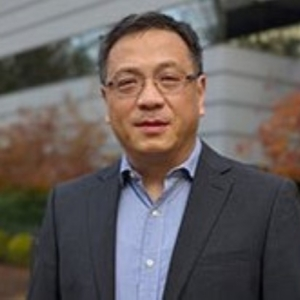

### [Haifeng Chen](https://www.nec-labs.com/research/data-science-system-security/people/haifeng-chen/)

Head, Data Science and System Security · NEC Laboratories America

**Trustworthy Enterprise Software Transformation.** Chen leads NEC's data science department in Princeton, where his team works on LLM agents, uncertainty quantification, privacy, and anomaly detection and root-cause analysis in systems ranging from microservices to spacecraft. Over 80 patents and 100 peer-reviewed publications, earning multiple best paper awards.

Keynote · Day 2

### [Dragos Margineantu](https://www.linkedin.com/in/ddm-aerospace-systems-ai/)

Senior Technical Fellow, AI Chief Technologist · Boeing

**Robust AI-based Systems in the Wild.** What principles for designing and deploying AI systems carry over to new domains, and what has to be answered before those systems are robust at runtime? Dragos works where decisions carry high risk and the data is sparse: the structure of modern AI systems, optimizing for constraints that are not fully specified, acting without a complete model of the real world, and building human-automation systems that are safe. [Full biography (PDF)](https://trustworthyresponsible.ai/dragos-margineantu-bio.pdf)

### CU Boulder

- 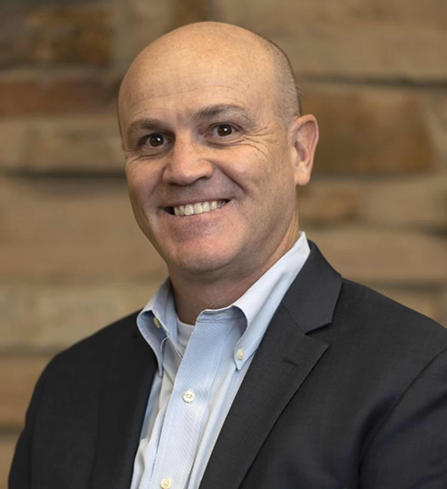
  [Massimo Ruzzene](https://www.colorado.edu/mechanical/massimo-ruzzene)Senior Vice Chancellor for Research and Innovation, Dean of the Institutes — Welcome and Opening
- 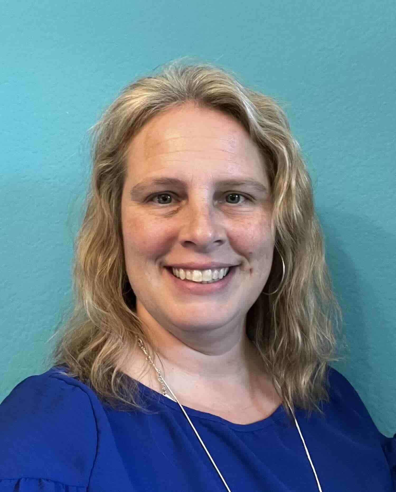
  [Shelley Knuth](https://www.colorado.edu/rc/about/knuth)Assistant Vice Chancellor for Research Computing — Welcome and Opening
- 
  [Michael Gooseff](https://www.colorado.edu/ceae/michael-gooseff)Associate Dean for Research — Welcome and Opening
- 
  [Danny Dig](https://danny.cs.colorado.edu/)Trustworthy Agentic AI for Code Renovation
- 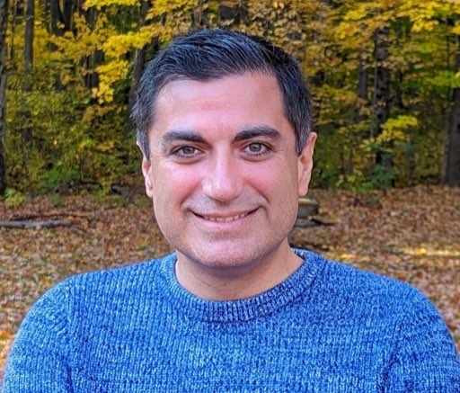
  [Amir Behzadan](https://www.colorado.edu/ceae/amir-behzadan)Understanding Human Trust in AI Systems within the Built Environment
- 
  [Ellen Do](https://www.colorado.edu/atlas/ellen-yi-luen-do)Reality, Refinement, and Agency: Crafting Controllable Human–AI Interactions
- 
  [Brad Hayes](https://bradhayes.info)CTO, Circadence — Creating Agents That Work With Humans: Insights from Human-Robot Interaction
- 
  [Casey Fiesler](https://caseyfiesler.com/)Tutorial: Responsible AI Approaches to Speculative Design and Risk Mitigation
- 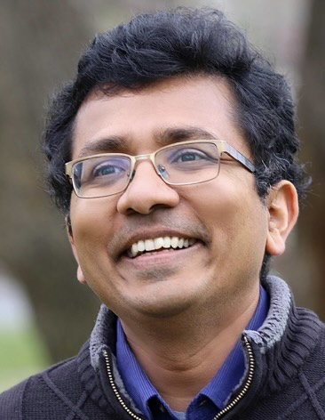
  [Sriram Sankaranarayanan](https://home.cs.colorado.edu/~srirams/)CS Department Chair — Runtime Assurance for Safe Operation of Cyber-Physical Interfaces
- 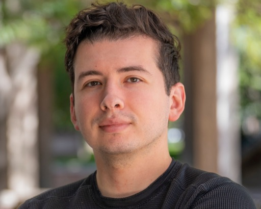
  [Alvaro Velasquez](https://alvarovelasquez.github.io)Neurosymbolic agentic AI and assured autonomy
- 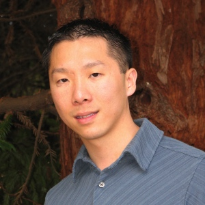
  [Bor-Yuh Evan Chang](https://home.cs.colorado.edu/~bec/)The Next 700 Static Analyzers for Agentic Workflows
- 
  [Gowtham Kaki](https://gowthamk.github.io/)Frugal Intelligence for Reliable Software Development
- 
  [Jed Brubaker](https://www.jedbrubaker.com)Designing human-centered AI for sensitive contexts

### University of Illinois Urbana-Champaign

- 
  [Yiling Lou](https://yilinglou.github.io/)From Models to Systems: Engineering Reliable Agents through Harness-Centric Testing and Debugging
- 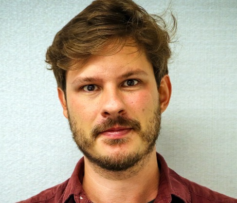
  [Bogdan Stoica](https://bastoica.github.io/)Monitoring and Runtime Intervention on Agentic Trajectories
- 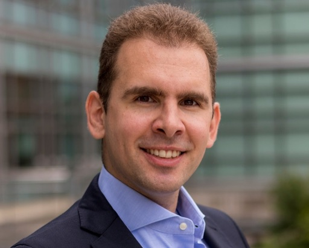
  [Saša Misailović](https://misailo.cs.illinois.edu/)Enforcing Temporal Specifications for LLM Agents
- 
  [Lingming Zhang](https://lingming.cs.illinois.edu/)Designing, training and benchmarking agents for reliable software intelligence

### UT Austin

- 
  [Neeraja Yadwadkar](https://sites.utexas.edu/neeraja/)Making Agentic AI Predictable: A Systems Perspective
- 
  Aditya ThimmaiahTesting Semantic Knowledge of Agents

### University of Utah

- 
  [John Regehr](https://users.cs.utah.edu/~regehr/)AI in the classroom — teaching "Vibe Coding" alongside compiler correctness
- 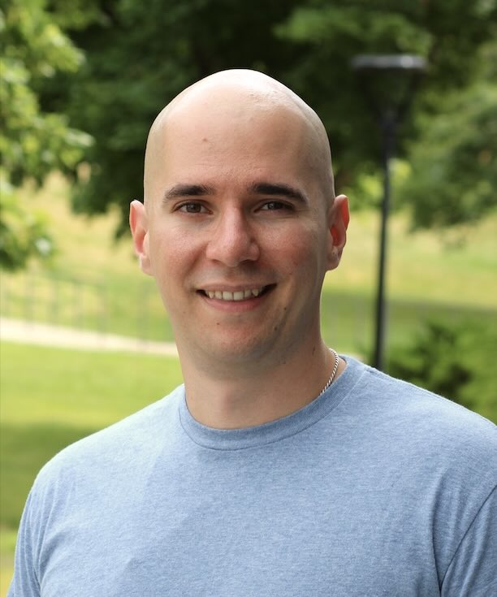
  [Stefan Nagy](https://users.cs.utah.edu/~snagy/)AI in Automatic Software Vetting
- 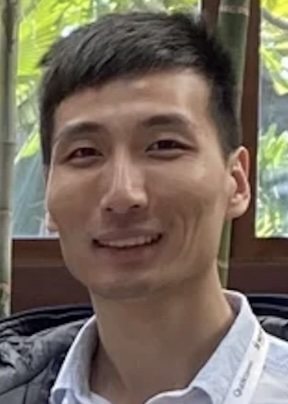
  [Guanhong Tao](https://tao.aisec.world)From Deception to Action: Red-Teaming AI Agents
- 
  [Kenneth Marino](https://kennethmarino.com)Adapting Multimodal AI Agents to Users Over Time

### Industry

- 
  [Haifeng Chen](https://www.nec-labs.com/research/data-science-system-security/people/haifeng-chen/)NEC Labs America — Keynote: Trustworthy Enterprise Software Transformation
- 
  [Dragos Margineantu](https://www.linkedin.com/in/ddm-aerospace-systems-ai/)Boeing — Keynote: Robust AI-based Systems in the Wild
- 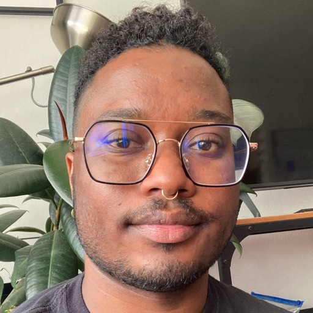
  Chris PersaudIntel — Tutorial: Responsible AI Approaches to Speculative Design and Risk Mitigation
- 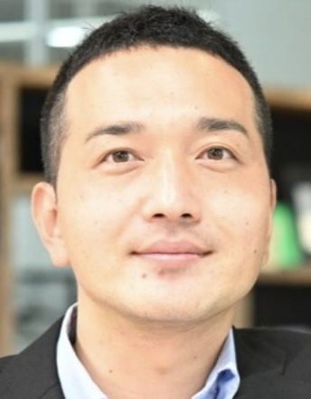
  [Yuki Kosaka](https://www.nec-labs.com/about-us/office-of-the-president/)NEC Laboratories America - Assistant Vice President
- 
  [Rajdeep Mukherjee](https://www.linkedin.com/in/mukherjeerajdeep/)Amazon Web Services (AWS) — Principal Scientist
- 
  [Joelle Rossback-Dahl](https://www.linkedin.com/in/joelle-rossback-dahl-04253a25/)Amazon Web Services (AWS)
- 
  [Sergio Ortega](https://www.linkedin.com/in/sergioortegaai/)Amazon Web Services (AWS) — Business Development GenAI for Public Sector
- 
  [Archit Malpure](https://www.linkedin.com/in/archit14696/)Amazon Web Services (AWS) — Solution Architect
- 
  [Tristan Ravitch](https://nochair.net/about/)Amazon Web Services (AWS), Principal Applied Scientist — Industry Research Keynote: Symbolic Analysis of Agentic Plans
- 
  [Jaden Garza](https://www.linkedin.com/in/jadengarza/)Half as Smart — Chief Executive Officer
- 
  [Nita Meng](https://www.linkedin.com/in/nita-meng/)Google - Technical Program Manager
- 
  [Grzegorz Kakareko](https://www.linkedin.com/in/grzegorz-kakareko/)Workday - Senior Manager, AI Agents
- 
  [Michael Cooper](https://www.linkedin.com/in/michael-cooper1029/)Triarcus Systems - Founder
- 
  [Karen Furlani](https://www.linkedin.com/in/kfurlani/)Ex-Worley - Chief Risk Officer
- 
  [Moses Bazzi](https://www.linkedin.com/in/moses-b-095354182/)RMCyber - AI Cybersecurity Consultant
- 
  [Scott James](https://soundlyrun.ai)SoundlyRun - Founder
- 
  [Ajaykumar Rajasekharan](https://www.linkedin.com/in/ajaykumar-rajasekharan-phd-103927/)Workday - Sr. Manager, AI Engineering
- 
  [Carolyn Ujcic](https://www.linkedin.com/in/carolynu/)Google - Director
- 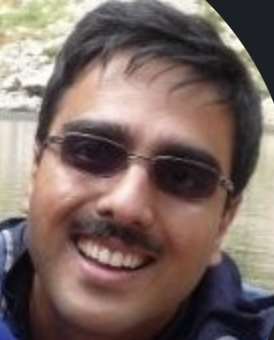
  [Tushar Udeshi](https://www.linkedin.com/in/tushar-udeshi-434186/)Khan Academy - AI Architect
- 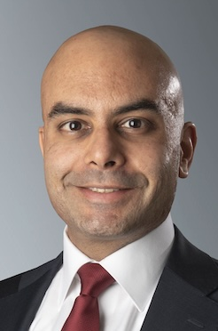
  [Kedar Naik](https://www.linkedin.com/in/kedar-naik-14ab3a447)BAE Systems, Space & Mission Systems - Chief Engineer, AI/ML
- 
  [Taryn Heilman](https://www.linkedin.com/in/tarynheilman/)Indeed - Manager, ML Engineering and Responsible AI
- 
  [Bhavna Chhabra](https://www.linkedin.com/in/bhavna-chhabra/)Ex-Google - Director

Attending

## Registration is closed — the workshop is full.

Both days are at capacity. Thank you to everyone who registered — we are looking forward to seeing you at SEEC.

**If you are registered:** check-in and badge pick-up open at **8:00 am in SEEC Room C120**, with breakfast. The full programme for both days is on the [agenda page](https://trustworthyresponsible.ai/agenda.html), and the Day 1 [poster list is published as a PDF](https://trustworthyresponsible.ai/poster-session.pdf).

**Anything else** — a question, a press enquiry, or interest in where the Center on Trustworthy and Responsible AI goes next — write to Danny Dig at [[email protected]](https://trustworthyresponsible.ai/cdn-cgi/l/email-protection#d9bdb8b7b7a0f7bdb0be99bab6b5b6abb8bdb6f7bcbdac).

Planning your trip

## Where it is, where to park, where to stay, and when to book your flights.

### Getting there

SEEC — Sustainability, Energy and Environment Complex  
**Room C120 — the auditorium**  
4001 Discovery Drive  
Boulder, CO 80303

CU Boulder East Campus. [Open in Maps](https://www.google.com/maps/search/?api=1&query=4001+Discovery+Drive+Boulder+CO+80303) · [SEEC floor plan](https://www.colorado.edu/seec/media/6)

Denver International Airport (DIA) is the nearest airport, with shuttle, rideshare and rental options to Boulder.

### Parking

Space in the lots by SEEC is hit or miss, so **buy a permit sooner rather than later** instead of counting on finding something when you arrive.

- Lot 556 · day permit
  $10 for the day — [buy in advance](https://cuboulder.aimsparking.com/)
- Lot 550 · metered
  Pay at the meter through the ParkMobile app

[SEEC parking map and directions →](https://www.colorado.edu/seec/getting-here/parking)

### Where to stay

The University of Colorado has negotiated reduced rates at a number of hotels in Boulder. If you are travelling in, book from that list rather than at the public rate.

[Hotels with negotiated CU rates →](https://drive.google.com/file/d/1ab4JHokpWxklmc1cFwuVCmgLu0n0EChP/view?usp=sharing)

Boulder fills up in the autumn, so book early and mention the University of Colorado rate when you reserve.

### Booking your flights

- Day 1 · Wed 4 Nov
  8:00 am breakfast → 7:00 pm, close of the banquet
- Day 2 · Thu 5 Nov
  8:00 am breakfast → 3:00 pm finish

Book return flights out of DIA departing **after 7:00 pm on 5 November**. Day 1 runs through the evening banquet, which is where a good deal of the introductions actually happen — worth staying for.

#### Where

SEEC — Sustainability, Energy and Environment Complex  
**Room C120** (the auditorium)  
4001 Discovery Drive, Boulder, CO  
[SEEC floor plan →](https://www.colorado.edu/seec/media/6)

#### When

Wednesday 4 November 2026 — research track  
Thursday 5 November 2026 — practice track  
[See the detailed agenda →](https://trustworthyresponsible.ai/agenda.html)

#### Contact

[[email protected]](https://trustworthyresponsible.ai/cdn-cgi/l/email-protection#e480858a8a9dca808d83a4878b888b9685808bca818091)

Organized by the Center on Trustworthy and Responsible AI initiative at CU Boulder.

#### Support

This workshop is supported by NSF-OAC grant 2138286 and the University of Colorado Boulder.

trustworthyresponsible.ai
University of Colorado Boulder
Programme informed by our pre-workshop community survey
