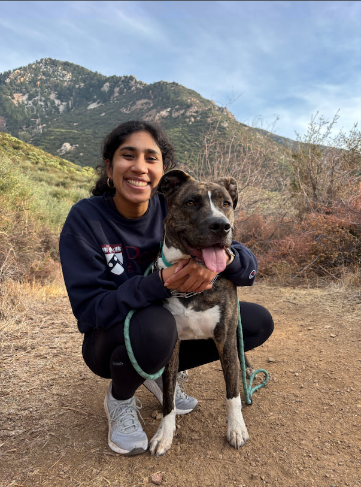

# ← Back to Course Home

[Course index](../../README.md) · [Original source](https://designing-agents.github.io/index.html) · [Raw file](../../raw/pages/index.html)

Retrieved: 2026-11-13T16:40:59.130418+00:00

COMS 4995-15

# Designing LLM Agents

**Professor:** Shreya Havaldar

**Email:** sph2154@columbia.edu

## Class Information

**Time:** Mondays, 7:00 PM - 9:30 PM

**Location:** 415 Schapiro CEPSR

**Term:** Fall 2026

## Description

Welcome to COMS 4995-15! In this course, you will learn how to practically instantiate and apply LLMs by designing intelligent, interactive agents. Moving beyond basic prompting, this course explores the full lifecycle of building LLM-powered applications, from reasoning and planning to extending capabilities with memory, retrieval, and tool integration. Through hands-on projects, you will learn techniques such as Retrieval-Augmented Generation (RAG) and multi-step agent design, while also addressing reliability and safety by diagnosing failure modes, implementing guardrails, and conducting systematic evaluations. The course culminates in a final project where you build and present your own LLM agent. Python proficiency is required, but no prior machine learning background is assumed.

## Important Links

- [Syllabus](syllabus.md)
- [Courseworks](https://courseworks2.columbia.edu/courses/258235)

## Course Schedule

| Week | Date | Lecture Topic | Homework |
| --- | --- | --- | --- |
| Module 1: Interacting with LLMs | | | |
| 1 | Sep 14 | What is an Agent? A brief history of language modeling [[slides]](https://designing-agents.github.io/assets/lecture_slides/week1.pdf) |  |
| 2 | Sep 21 | LLM architectures and training [[slides]](https://designing-agents.github.io/assets/lecture_slides/week2.pdf) [[gradient\_descent.py]](https://designing-agents.github.io/activities/gradient_descent.py) [[solutions]](https://designing-agents.github.io/activities/gradient_descent_solutions.py) | [HW 1 Released](../assignments/hw1.md) |
| 3 | Sep 28 | How does an LLM generate text? [[slides]](https://designing-agents.github.io/assets/lecture_slides/week3.pdf) [[beam\_search.py]](https://designing-agents.github.io/activities/beam_search.py) [[solutions]](https://designing-agents.github.io/activities/beam_search_solutions.py) |  |
| 4 | Oct 5 | Prompting, Reasoning, & Memory [[slides]](https://designing-agents.github.io/assets/lecture_slides/week4.pdf) [[autoprompting.py]](https://designing-agents.github.io/activities/autoprompting.py) [[solutions]](https://designing-agents.github.io/activities/autoprompting_solutions.py) [[gemini.py]](https://designing-agents.github.io/activities/gemini.py) | HW 1 Due [HW 2 Released](../assignments/hw2.md) |
| Module 2: Building an LLM Agent | | | |
| 5 | Oct 12 | Post-training & Retrieval [[slides]](https://designing-agents.github.io/assets/lecture_slides/week5.pdf) [[reward\_model.py]](https://designing-agents.github.io/activities/reward_model.py) [[solutions]](https://designing-agents.github.io/activities/reward_model_solutions.py) |  |
| 6 | Oct 19 | The Agentic Harness [[slides]](https://designing-agents.github.io/assets/lecture_slides/week6.pdf) [[planning.py]](https://designing-agents.github.io/activities/planning.py) [[solutions]](https://designing-agents.github.io/activities/planning_answers.py) | HW 2 Due [HW 3 Released](../assignments/hw3.md) |
| 7 | Oct 26 | Tool Calling, Frameworks, & MCP [[slides]](https://designing-agents.github.io/assets/lecture_slides/week7.pdf) [[web\_search.py]](https://designing-agents.github.io/activities/web_search.py) [[solutions]](https://designing-agents.github.io/activities/web_search_solutions.py) |  |
| - | Nov 2 | Academic Holiday - No Class | HW 3 Due |
| 8 | Nov 9 | AI safety [[slides]](https://designing-agents.github.io/assets/lecture_slides/week9.pdf) | [Final Project Released](../assignments/project.md) |
| 9 | Nov 16 | In-class HW 3 Demos | Project Proposal Due |
| Module 3: LLM Agents in the real world | | | |
| 10 | Nov 23 | Vibe coding |  |
| 11 | Nov 30 | Guest Lectures: LLM agents in industry |  |
| 12 | Dec 7 | Final Project Presentations |  |
| 13 | Dec 14 | Final Project Presentations | Final Project Due |

## Assignments & Grading

Assignments are due at 11:59 PM Eastern Time. Every student has 3 late days that may be used at their discretion across the semester; beyond this allowance, late work will not be accepted. Grades will be 45% homeworks, 35% final project, and 20% participation. Participation is based on attendance + completion of class labs and activities. You are allowed to miss class 2 times without penalty.

## Course Staff

[Shreya Havaldar](https://shreyahavaldar.com/)

Professor

sph2154@columbia.edu

**OH: after class or by appointment**

Shreya is an AI researcher at Bloomberg. She received her PhD in 2026 from UPenn, researching sociotechnical LLM alignment. She likes yoga, baking, NYT's connections, and her dog Plato (pictured above). She dislikes rate limits and celery.

[Aaditya Barve](https://www.linkedin.com/in/aadityabarve)

TA

asb2333@columbia.edu

**OH: Fri 11am-1pm, Schermerholn SLC, 3rd floor**

Aaditya is a computer science master’s student with a background in systems and machine learning. He likes trekking, lifting and anime. He dislikes waking up early for 8 AM classes.
