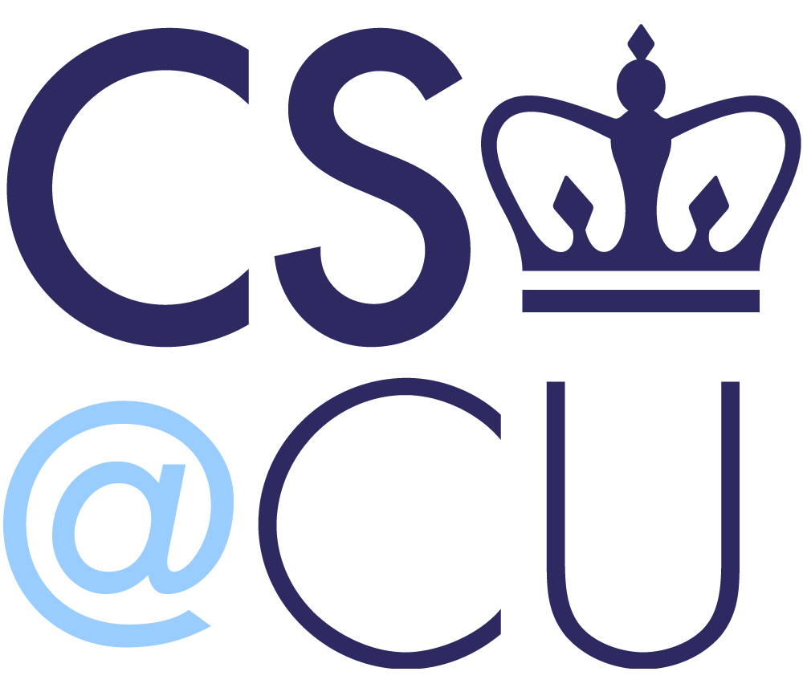

# Principles of Academic Honesty

[Course index](../../README.md) · [Original source](https://www.cs.columbia.edu/academic/academic-honesty/) · [Raw file](../../raw/references/principles-of-academic-honesty.html)

Retrieved: 2026-11-13T16:40:59.601847+00:00

# Academic Honesty

---

# **Principles of Academic Honesty**

The Computer Science Department enforces the general University and school policies on academic honesty, as described in the Bulletins of the School of Engineering and Applied Science, of Columbia College, and of the School of General Studies; in the Honor Code booklet of Barnard College; and in other related publications.

Further, the Department expects conduct appropriate to Computer Science professionals. Additionally, this policy addresses those aspects of academic honesty that are especially related to the use of computers and other electronic devices.

In order to enforce the principles of fairness and proportionality while also ensuring uniform departmental standards, the Department separates disciplinary penalties from academic ones. The penalties of warning, probation, suspension, and expulsion are administered by the deans. Grading penalties are administered by its instructors.

---

## **GENERAL POLICIES**

Unless specifically authorized by the instructor, all coursework is to be done by the student working alone. Unless specifically authorized by the instructor, no external aids or electronic devices are allowed during exams.

An instructor may refine academic honesty as appropriate for the course. As an example, instructors may specify rules regarding the conditions under which work done by other people, or by the student previously, can be incorporated into an assignment, project, or exam. Violations will be subject to the standard academic and disciplinary penalties. If group work is permitted by an instructor, academic honesty policies continue to apply on a student-by-student basis; the full team is not necessarily held responsible for an individual’s violations.

Instructors are asked to promulgate and permit student exploration of the Department’s policy at the beginning of every course. They are to announce in class or by website that, by taking the course, the student is presumed to be aware of the Departmental policy, and that the text of the policy can be found on the Department’s web pages. However, regardless of any question of instructor announcement or student discussion, student understanding of the policy is assumed. Additional documentation concerning academic honesty issues, some provided by the deans, is also available on the Department’s web pages.

The Academic Committee maintains for instructor reference a secure list of academic honesty violators, which records their academic penalties, and also, when permitted by the student’s school, their disciplinary penalties. Among other penalties, students found in violation of academic honesty rules by the deans may be prohibited from serving as departmental Teaching Assistants, from receiving departmental financial support, and from being recognized with departmental awards. However, instructors who wish to refer to such a violation in a letter of recommendation requested by such a student must first ask for the student’s permission to disclose the violation. Instructors must not mention the violation if permission is denied. (As always, writing letters of recommendation is the prerogative of the instructor.)

---

## **PROCEDURES AND PENALTIES**

If an instructor suspects academic dishonesty, the instructor contacts the student or students involved and asks for explanations. The instructor can request a meeting with the student or students, who may be seen individually or as a group, and with or without witnesses. If the explanations appear inadequate, the instructor informs the student or students that academic dishonesty is suspected, applies the appropriate academic penalties and registers the penalties with the Academic Committee, and reports the incident to the appropriate dean or deans together with a written summary of the investigation. An instructor may also choose to defer the academic penalty until the investigation has been completed; in some cases, this may result in a course grade of INC until the matter is resolved.

In general, the academic penalty for a first offense of academic dishonesty within the Department is a grade of zero on the assignment, project, or exam, or reduction of the course grade at the discretion of the instructor. In general, the academic penalty for second and subsequent offenses — across all courses within the Department — results in failure of the course. An instructor may immediately fail a student for sufficiently severe infractions. The appendix to this policy gives examples.

Students may appeal academic penalties in writing to the Academic Committee within 10 business days, or in those cases investigated by the deans, within 10 business days of the deans’ decision. The committee solicits from the instructor and from witnesses additional written statements. The committee then forwards its recommendations to the instructor.

The deans may pursue a separate investigation. This helps expose any pattern of academic dishonesty that occurs across the university’s courses. The deans follow the rules and procedures of their schools, available on their websites or in their bulletins. In general, they conduct a hearing with the students, and if appropriate, with the instructor, and determine the appropriate disciplinary action. The disciplinary penalty may include suspension or expulsion. The deans inform the instructor of their decision; this may further influence any academic penalty, and in particular, may resolve a temporary course grade of INC. The appeals process for disciplinary penalties is specified by each school and is available in each school’s publications.

Academic assessments outside of coursework are covered by this policy.  Examples include exams administered to test a student’s knowledge (e.g., comprehensive exams, qualifying exams, candidacy exams), thesis proposals, and theses. In such a case, the policies and procedures described above apply, with the role of “instructor” played by a person or committee administering the assessment. The University’s [Research Misconduct policy](https://research.columbia.edu/research-misconduct) also applies.

---

## **AUTHORIZATION**

This document has been approved by the faculty of the Department of Computer Science, by the Deans of Student Affairs of the relevant schools of the University, and by the University’s General Counsel.

---

## **APPENDIX: EXAMPLES OF ACADEMIC DISHONESTY**

Academic dishonesty is suspected if an assignment calling for independent design and implementation results in two or more essentially similar solutions, or in a solution that can not be explained to the instructor in terms of general method or specific techniques.

It is impossible to define completely what constitutes academic dishonesty. However, the following examples, while not exhaustive, should almost always be judged to be in their appropriate categories. In cases of uncertainty, it is the student’s responsibility to ascertain from the instructors whether an activity is allowed. In general, that decision is reserved to the instructors, and can not be made by their assistants.

#### ***NOT ACADEMIC DISHONESTY***

- A student submitting original work done alone or with the help of the instructor or the assistants.
- Students solving a problem as a group in which group work is permitted, and submitting one copy of work as group work, identifying each member of the group
- A student receiving help on the use of a feature of the operating system or of system programs such as compilers
- Students discussing the intention, as opposed to the solution method, of a problem
- Students discussing course material for the sake of understanding. However, as a general rule, such discussion becomes suspect as soon as any notes are taken that can be directly incorporated into an assignment

#### ***ACADEMIC DISHONESTY***

- A student submitting work that is not original
- A student submitting someone else’s work, or a modification of that work, with or without that person’s knowledge, regardless of the circumstances under which it was obtained, copied, or modified
- A student allowing someone else to submit the student’s work or a modification of that work
- Students solving a problem as a group in which group work is prohibited and submitting multiple copies, each as individual work
- A student using someone else’s work, including segments of permitted program libraries, without proper attribution

#### ***SEVERE ACADEMIC DISHONESTY***

- A student using another student’s work without the latter’s consent or collaboration
- A student contracting course work out to others
- A student planning or executing with another student a cooperative subterfuge during an exam
- A student obtaining any privileged course-related information from the instructor’s or the assistants’ accounts
- A student lying or failing to give full cooperation to the instructor or the deans during an investigation of dishonesty
- A student making use of unauthorized material during an exam

---

###### *Updated 07/25/2023*
