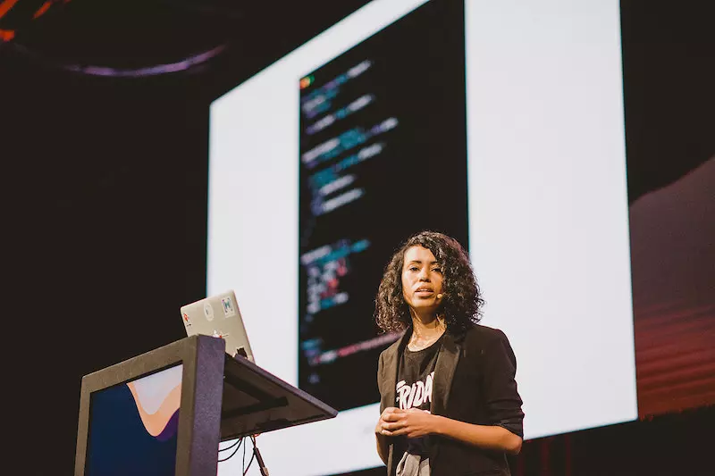
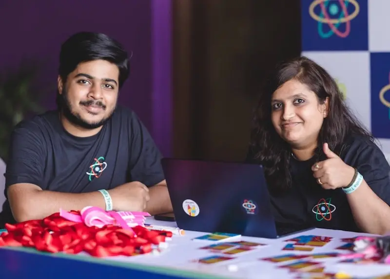

# React

[Course index](../../README.md) · [Original source](https://react.dev) · [Raw file](../../raw/references/react.html)

Retrieved: 2026-11-13T16:41:04.220359+00:00


# React

The library for web and native user interfaces

[Learn React](https://react.dev/learn)[API Reference](https://react.dev/reference/react)

## Create user interfaces from components

React lets you build user interfaces out of individual pieces called components. Create your own React components like `Thumbnail`, `LikeButton`, and `Video`. Then combine them into entire screens, pages, and apps.

### Video.js

```
function Video({ video }) {


return (


<div>


<Thumbnail video={video} />


<a href={video.url}>


<h3>{video.title}</h3>


<p>{video.description}</p>


</a>


<LikeButton video={video} />


</div>


);


}
```

### My video

Video description

Whether you work on your own or with thousands of other developers, using React feels the same. It is designed to let you seamlessly combine components written by independent people, teams, and organizations.

## Write components with code and markup

React components are JavaScript functions. Want to show some content conditionally? Use an `if` statement. Displaying a list? Try array `map()`. Learning React is learning programming.

### VideoList.js

```
function VideoList({ videos, emptyHeading }) {


const count = videos.length;


let heading = emptyHeading;


if (count > 0) {


const noun = count > 1 ? 'Videos' : 'Video';


heading = count + ' ' + noun;


}


return (


<section>


<h2>{heading}</h2>


{videos.map(video =>


<Video key={video.id} video={video} />


)}


</section>


);


}
```

## 3 Videos

### First video

Video description

### Second video

Video description

### Third video

Video description

This markup syntax is called JSX. It is a JavaScript syntax extension popularized by React. Putting JSX markup close to related rendering logic makes React components easy to create, maintain, and delete.

## Add interactivity wherever you need it

React components receive data and return what should appear on the screen. You can pass them new data in response to an interaction, like when the user types into an input. React will then update the screen to match the new data.

### SearchableVideoList.js

```
import { useState } from 'react';


function SearchableVideoList({ videos }) {


const [searchText, setSearchText] = useState('');


const foundVideos = filterVideos(videos, searchText);


return (


<>


<SearchInput


value={searchText}


onChange={newText => setSearchText(newText)} />


<VideoList


videos={foundVideos}


emptyHeading={`No matches for “${searchText}”`} />


</>


);


}
```

example.com/videos.html

# React Videos

A brief history of React

## 5 Videos

[### React: The Documentary

The origin story of React](https://www.youtube.com/watch?v=8pDqJVdNa44)

[### Rethinking Best Practices

Pete Hunt (2013)](https://www.youtube.com/watch?v=x7cQ3mrcKaY)

[### Introducing React Native

Tom Occhino (2015)](https://www.youtube.com/watch?v=KVZ-P-ZI6W4)

[### Introducing React Hooks

Sophie Alpert and Dan Abramov (2018)](https://www.youtube.com/watch?v=V-QO-KO90iQ)

[### Introducing Server Components

Dan Abramov and Lauren Tan (2020)](https://www.youtube.com/watch?v=TQQPAU21ZUw)

You don’t have to build your whole page in React. Add React to your existing HTML page, and render interactive React components anywhere on it.

[Add React to your page](https://react.dev/learn/add-react-to-an-existing-project)

## Go full-stack with a framework

React is a library. It lets you put components together, but it doesn’t prescribe how to do routing and data fetching. To build an entire app with React, we recommend a full-stack React framework like [Next.js](https://nextjs.org) or [React Router](https://reactrouter.com).

### confs/[slug].js

```
import { db } from './database.js';


import { Suspense } from 'react';


async function ConferencePage({ slug }) {


const conf = await db.Confs.find({ slug });


return (


<ConferenceLayout conf={conf}>


<Suspense fallback={<TalksLoading />}>


<Talks confId={conf.id} />


</Suspense>


</ConferenceLayout>


);


}


async function Talks({ confId }) {


const talks = await db.Talks.findAll({ confId });


const videos = talks.map(talk => talk.video);


return <SearchableVideoList videos={videos} />;


}
```

example.com/confs/react-conf-2021

React Conf 2021React Conf 2019


## 19 Videos

[

React Conf](https://www.youtube.com/watch?v=FZ0cG47msEk&list=PLNG_1j3cPCaZZ7etkzWA7JfdmKWT0pMsa&index=1)[### React 18 Keynote

The React Team](https://www.youtube.com/watch?v=FZ0cG47msEk&list=PLNG_1j3cPCaZZ7etkzWA7JfdmKWT0pMsa&index=1)

[

React Conf](https://www.youtube.com/watch?v=ytudH8je5ko&list=PLNG_1j3cPCaZZ7etkzWA7JfdmKWT0pMsa&index=2)[### React 18 for App Developers

Shruti Kapoor](https://www.youtube.com/watch?v=ytudH8je5ko&list=PLNG_1j3cPCaZZ7etkzWA7JfdmKWT0pMsa&index=2)

[

React Conf](https://www.youtube.com/watch?v=pj5N-Khihgc&list=PLNG_1j3cPCaZZ7etkzWA7JfdmKWT0pMsa&index=3)[### Streaming Server Rendering with Suspense

Shaundai Person](https://www.youtube.com/watch?v=pj5N-Khihgc&list=PLNG_1j3cPCaZZ7etkzWA7JfdmKWT0pMsa&index=3)

[

React Conf](https://www.youtube.com/watch?v=qn7gRClrC9U&list=PLNG_1j3cPCaZZ7etkzWA7JfdmKWT0pMsa&index=4)[### The First React Working Group

Aakansha Doshi](https://www.youtube.com/watch?v=qn7gRClrC9U&list=PLNG_1j3cPCaZZ7etkzWA7JfdmKWT0pMsa&index=4)

[

React Conf](https://www.youtube.com/watch?v=oxDfrke8rZg&list=PLNG_1j3cPCaZZ7etkzWA7JfdmKWT0pMsa&index=5)[### React Developer Tooling

Brian Vaughn](https://www.youtube.com/watch?v=oxDfrke8rZg&list=PLNG_1j3cPCaZZ7etkzWA7JfdmKWT0pMsa&index=5)

[

React Conf](https://www.youtube.com/watch?v=lGEMwh32soc&list=PLNG_1j3cPCaZZ7etkzWA7JfdmKWT0pMsa&index=6)[### React without memo

Xuan Huang (黄玄)](https://www.youtube.com/watch?v=lGEMwh32soc&list=PLNG_1j3cPCaZZ7etkzWA7JfdmKWT0pMsa&index=6)

[

React Conf](https://www.youtube.com/watch?v=mneDaMYOKP8&list=PLNG_1j3cPCaZZ7etkzWA7JfdmKWT0pMsa&index=7)[### React Docs Keynote

Rachel Nabors](https://www.youtube.com/watch?v=mneDaMYOKP8&list=PLNG_1j3cPCaZZ7etkzWA7JfdmKWT0pMsa&index=7)

[

React Conf](https://www.youtube.com/watch?v=-7odLW_hG7s&list=PLNG_1j3cPCaZZ7etkzWA7JfdmKWT0pMsa&index=8)[### Things I Learnt from the New React Docs

Debbie O'Brien](https://www.youtube.com/watch?v=-7odLW_hG7s&list=PLNG_1j3cPCaZZ7etkzWA7JfdmKWT0pMsa&index=8)

[

React Conf](https://www.youtube.com/watch?v=5X-WEQflCL0&list=PLNG_1j3cPCaZZ7etkzWA7JfdmKWT0pMsa&index=9)[### Learning in the Browser

Sarah Rainsberger](https://www.youtube.com/watch?v=5X-WEQflCL0&list=PLNG_1j3cPCaZZ7etkzWA7JfdmKWT0pMsa&index=9)

[

React Conf](https://www.youtube.com/watch?v=7cPWmID5XAk&list=PLNG_1j3cPCaZZ7etkzWA7JfdmKWT0pMsa&index=10)[### The ROI of Designing with React

Linton Ye](https://www.youtube.com/watch?v=7cPWmID5XAk&list=PLNG_1j3cPCaZZ7etkzWA7JfdmKWT0pMsa&index=10)

[

React Conf](https://www.youtube.com/watch?v=zL8cz2W0z34&list=PLNG_1j3cPCaZZ7etkzWA7JfdmKWT0pMsa&index=11)[### Interactive Playgrounds with React

Delba de Oliveira](https://www.youtube.com/watch?v=zL8cz2W0z34&list=PLNG_1j3cPCaZZ7etkzWA7JfdmKWT0pMsa&index=11)

[

React Conf](https://www.youtube.com/watch?v=lhVGdErZuN4&list=PLNG_1j3cPCaZZ7etkzWA7JfdmKWT0pMsa&index=12)[### Re-introducing Relay

Robert Balicki](https://www.youtube.com/watch?v=lhVGdErZuN4&list=PLNG_1j3cPCaZZ7etkzWA7JfdmKWT0pMsa&index=12)

[

React Conf](https://www.youtube.com/watch?v=9L4FFrvwJwY&list=PLNG_1j3cPCaZZ7etkzWA7JfdmKWT0pMsa&index=13)[### React Native Desktop

Eric Rozell and Steven Moyes](https://www.youtube.com/watch?v=9L4FFrvwJwY&list=PLNG_1j3cPCaZZ7etkzWA7JfdmKWT0pMsa&index=13)

[

React Conf](https://www.youtube.com/watch?v=NLj73vrc2I8&list=PLNG_1j3cPCaZZ7etkzWA7JfdmKWT0pMsa&index=14)[### On-device Machine Learning for React Native

Roman Rädle](https://www.youtube.com/watch?v=NLj73vrc2I8&list=PLNG_1j3cPCaZZ7etkzWA7JfdmKWT0pMsa&index=14)

[

React Conf](https://www.youtube.com/watch?v=oPfSC5bQPR8&list=PLNG_1j3cPCaZZ7etkzWA7JfdmKWT0pMsa&index=15)[### React 18 for External Store Libraries

Daishi Kato](https://www.youtube.com/watch?v=oPfSC5bQPR8&list=PLNG_1j3cPCaZZ7etkzWA7JfdmKWT0pMsa&index=15)

[

React Conf](https://www.youtube.com/watch?v=dcm8fjBfro8&list=PLNG_1j3cPCaZZ7etkzWA7JfdmKWT0pMsa&index=16)[### Building Accessible Components with React 18

Diego Haz](https://www.youtube.com/watch?v=dcm8fjBfro8&list=PLNG_1j3cPCaZZ7etkzWA7JfdmKWT0pMsa&index=16)

[

React Conf](https://www.youtube.com/watch?v=S4a0QlsH0pU&list=PLNG_1j3cPCaZZ7etkzWA7JfdmKWT0pMsa&index=17)[### Accessible Japanese Form Components with React

Tafu Nakazaki](https://www.youtube.com/watch?v=S4a0QlsH0pU&list=PLNG_1j3cPCaZZ7etkzWA7JfdmKWT0pMsa&index=17)

[

React Conf](https://www.youtube.com/watch?v=b3l4WxipFsE&list=PLNG_1j3cPCaZZ7etkzWA7JfdmKWT0pMsa&index=18)[### UI Tools for Artists

Lyle Troxell](https://www.youtube.com/watch?v=b3l4WxipFsE&list=PLNG_1j3cPCaZZ7etkzWA7JfdmKWT0pMsa&index=18)

[

React Conf](https://www.youtube.com/watch?v=HS6vIYkSNks&list=PLNG_1j3cPCaZZ7etkzWA7JfdmKWT0pMsa&index=19)[### Hydrogen + React 18

Helen Lin](https://www.youtube.com/watch?v=HS6vIYkSNks&list=PLNG_1j3cPCaZZ7etkzWA7JfdmKWT0pMsa&index=19)

React is also an architecture. Frameworks that implement it let you fetch data in asynchronous components that run on the server or even during the build. Read data from a file or a database, and pass it down to your interactive components.

[Get started with a framework](https://react.dev/learn/creating-a-react-app)

## Use the best from every platform

People love web and native apps for different reasons. React lets you build both web apps and native apps using the same skills. It leans upon each platform’s unique strengths to let your interfaces feel just right on every platform.

example.com

#### Stay true to the web

People expect web app pages to load fast. On the server, React lets you start streaming HTML while you’re still fetching data, progressively filling in the remaining content before any JavaScript code loads. On the client, React can use standard web APIs to keep your UI responsive even in the middle of rendering.

4:45 PM

#### Go truly native

People expect native apps to look and feel like their platform. [React Native](https://reactnative.dev) and [Expo](https://github.com/expo/expo) let you build apps in React for Android, iOS, and more. They look and feel native because their UIs *are* truly native. It’s not a web view—your React components render real Android and iOS views provided by the platform.

With React, you can be a web *and* a native developer. Your team can ship to many platforms without sacrificing the user experience. Your organization can bridge the platform silos, and form teams that own entire features end-to-end.

[Build for native platforms](https://reactnative.dev/)

## Upgrade when the future is ready

React approaches changes with care. Every React commit is tested on business-critical surfaces with over a billion users. Over 100,000 React components at Meta help validate every migration strategy.

The React team is always researching how to improve React. Some research takes years to pay off. React has a high bar for taking a research idea into production. Only proven approaches become a part of React.

[Read more React news](https://react.dev/blog)

Latest React News

[## React 19.3

September 9, 2026](https://react.dev/blog/2026/09/09/react-19-3)

[## The React Foundation: A New Home for React Hosted by the Linux Foundation

February 24, 2026](https://react.dev/blog/2026/02/24/the-react-foundation)

[## Additional Vulnerabilities in RSC

December 11, 2025](https://react.dev/blog/2025/12/11/denial-of-service-and-source-code-exposure-in-react-server-components)

[## Vulnerability in React Server Components

December 3, 2025](https://react.dev/blog/2025/12/03/critical-security-vulnerability-in-react-server-components)

[Read more React news](https://react.dev/blog)

## Join a community of millions

You’re not alone. Two million developers from all over the world visit the React docs every month. React is something that people and teams can agree on.








This is why React is more than a library, an architecture, or even an ecosystem. React is a community. It’s a place where you can ask for help, find opportunities, and meet new friends. You will meet both developers and designers, beginners and experts, researchers and artists, teachers and students. Our backgrounds may be very different, but React lets us all create user interfaces together.


## Welcome to the React community

[Get Started](https://react.dev/learn)
