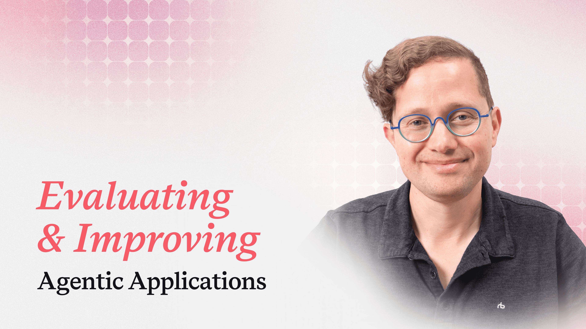
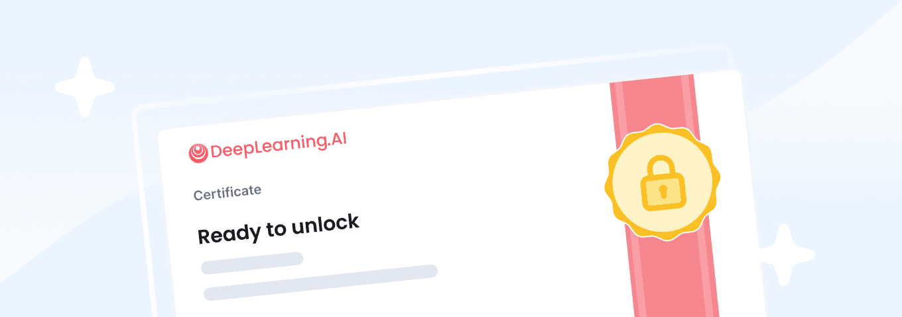
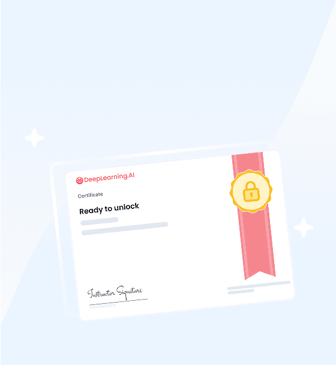

# Official course page

[Course index](../../README.md) · [Original source](https://www.deeplearning.ai/courses/evaluating-and-improving-agentic-applications) · [Raw file](../../raw/pages/course-page.html)

Retrieved: 2026-11-13T17:15:45.062897+00:00

✨ New Course! Enroll in [Tabular Foundation Models for Data Science Agents](https://bit.ly/4BM6ysf)

- [Courses](https://www.deeplearning.ai/courses)
- News
  - [The Batch](https://www.deeplearning.ai/the-batch)
  - [Andrew's Letter](https://www.deeplearning.ai/the-batch/tag/letters)
  - [Data Points](https://www.deeplearning.ai/the-batch/tag/data-points)
  - [ML Research](https://www.deeplearning.ai/the-batch/tag/research)
  - [Blog](https://www.deeplearning.ai/blog)
- Community
  - [Forum](https://community.deeplearning.ai/)
  - [Resources](https://www.deeplearning.ai/resources)
- [Membership](https://www.deeplearning.ai/membership)
- For Business
  - [Overview](https://www.deeplearning.ai/business)
  - [Plans & Pricing](https://www.deeplearning.ai/business/plans-pricing)
  - [Learning Tracks](https://www.deeplearning.ai/business/learningtracks)
  - [Contact Us](https://www.deeplearning.ai/business/contact-us)
- [✨AI Dev](https://ai-dev.deeplearning.ai/)

Intermediate15h7m

# Evaluating and Improving Agentic Applications

Instructor: Laurie Voss

Earn a certificate with [PRO](https://www.deeplearning.ai/membership) · Updated Nov 11, 2026

[Enroll Now](https://www.deeplearning.ai/courses/evaluating-and-improving-agentic-applications/lesson?utm_source=home&utm_medium=course-landing-page&utm_campaign=summary-cta-button)

- Intermediate
- 15h7m
- 28 Video Lessons
- 6 Code Examples
- 10 Graded Assignments PRO
- Earn a certificate with PRO
- Updated Nov 11, 2026
- Instructor: Laurie Voss
- Arize AI
- Learn more about[Membership PRO Plan](https://www.deeplearning.ai/membership)

[Enroll Now](https://www.deeplearning.ai/courses/evaluating-and-improving-agentic-applications/lesson?utm_source=home&utm_medium=course-landing-page&utm_campaign=summary-cta-button)

## Find where your agent fails, and fix it without guesswork

- Error analysis and test sets: Read your agent’s traces, label recurring failures, and turn them into a reusable test set you can rerun after every change.
- Trustworthy evaluators: Automate evaluation with code and LLM judges you can rely on, so you don’t have to review every result by hand.
- Evaluation-driven improvement: Use your evals to check that every change makes your agent better without breaking anything else.

## Why Enroll

Agents can interpret requests, make decisions, and take actions, but they also challenge basic assumptions behind traditional testing. When an agent fails, for example by calling the wrong tool or skipping a required step, the failure is not always obvious, which makes agents hard to trust.

Evals let you measure your agent’s decisions and actions against a clear definition of good behavior, where traditional tests confirm only that your code works.

In hands-on labs, you will take a tool-using agent through the full evaluation process, from tracing its behavior to testing changes that improve it. You will build an evaluation suite with Arize Phoenix and open-source tracing tools, using methods you can apply to your own agents.

Built in partnership with Arize AI, the team behind the open-source Phoenix platform, and taught by Laurie Voss, Arize’s Head of Developer Relations and co-founder of npm.

Here’s what you’ll learn:

- **Foundations of Evals:** Learn why agents are hard to evaluate and how the evals process fits together. You will see why one successful run does not establish reliability, and you will read traces to inspect the model and tool calls at each step.
- **Observing & Benchmarking Agents:** Build a reusable benchmark for your agent. You will define what your application must do, review its behavior to find and label recurring failures, prioritize them by frequency and potential harm, and fill coverage gaps with real and synthetic cases.
- **Building Evaluators You Can Trust:** Automate evaluation with code evaluators for clear pass/fail rules and LLM judges for checks that need interpretation. You will write custom rubrics where built-in judges don’t fit, then measure a judge’s reliability using precision, recall, and Cohen’s kappa.
- **Evaluating Agent Actions and Outcomes:** Evaluate the work behind a response. You will check the agent’s tool calls and the order of its steps, learn how to test whether instructions hold across a conversation, and verify that tasks were actually completed in the systems the agent updates.
- **Improving Agentic Applications:** Use evaluation results to choose changes and test them. You will compare agent versions on the same cases and evaluators, refine changes after a regression, and turn production failures into new regression tests.

## Who should join?

Anyone who builds AI agents or LLM applications and wants a reliable way to know whether they work, and whether a change actually made them better.

This course assumes comfort reading and writing Python, basic familiarity with pandas, and prior experience calling an LLM API. Familiarity with tool calling is helpful but not required. No prior experience with evaluation, tracing, or statistics is needed.

## Course Outline

### Evaluating and Improving Agentic Applications

Module 1: Foundations of Evals

- [A Conversation Between Laurie Voss and Andrew Ng

  Video

  ・

  8m](https://learn.deeplearning.ai/courses/evaluating-and-improving-agentic-applications/lesson/53tpudpi/a-conversation-between-laurie-voss-and-andrew-ng)
- [Why Evals Matter

  Video

  ・

  6m](https://learn.deeplearning.ai/courses/evaluating-and-improving-agentic-applications/lesson/ldijc37i/why-evals-matter)
- [The Evals Process Part 1

  Video

  ・

  6m](https://learn.deeplearning.ai/courses/evaluating-and-improving-agentic-applications/lesson/bvl0kh83/the-evals-process-part-1)
- [The Evals Process Part 2

  Video

  ・

  5m](https://learn.deeplearning.ai/courses/evaluating-and-improving-agentic-applications/lesson/eg5nacsy/the-evals-process-part-2)
- [Traces

  Video

  ・

  6m](https://learn.deeplearning.ai/courses/evaluating-and-improving-agentic-applications/lesson/gy3a4e/traces)
- [Reading Lab 1: How Tracing Works

  Reading

  ・

  10m](https://learn.deeplearning.ai/courses/evaluating-and-improving-agentic-applications/lesson/bvl0k28r/reading-lab-1%3A-how-tracing-works)
- [Lab 1: Trace an Agent with Python

  Code Example

  ・

  30m](https://learn.deeplearning.ai/courses/evaluating-and-improving-agentic-applications/lesson/3sxuzjlf/lab-1%3A-trace-an-agent-with-python)
- [Lab 2: Trace an Agent with Phoenix

  Code Example

  ・

  30m](https://learn.deeplearning.ai/courses/evaluating-and-improving-agentic-applications/lesson/79ywr3/lab-2%3A-trace-an-agent-with-phoenix)
- [Join the Deeplearning.AI Forum!

  Reading

  ・

  10m](https://learn.deeplearning.ai/courses/evaluating-and-improving-agentic-applications/lesson/cno79b0z/join-the-deeplearning.ai-forum!)

Graded Assignments

Optional Material

Module 2: Observing and Benchmarking Agents

- [Define Application Requirements

  Video

  ・

  7m](https://learn.deeplearning.ai/courses/evaluating-and-improving-agentic-applications/lesson/a4ui1p/define-application-requirements)
- [Turn Requirements into Test Cases

  Video

  ・

  4m](https://learn.deeplearning.ai/courses/evaluating-and-improving-agentic-applications/lesson/sh7zq0bk/turn-requirements-into-test-cases)
- [Analyze and Label Failures

  Video

  ・

  6m](https://learn.deeplearning.ai/courses/evaluating-and-improving-agentic-applications/lesson/9i8rmo/analyze-and-label-failures)
- [Build a Test Set You Can Trust

  Video

  ・

  5m](https://learn.deeplearning.ai/courses/evaluating-and-improving-agentic-applications/lesson/a4ui13bl/build-a-test-set-you-can-trust)
- [Build the Northwind Benchmark

  Video

  ・

  9m](https://learn.deeplearning.ai/courses/evaluating-and-improving-agentic-applications/lesson/txe2f9/build-the-northwind-benchmark)
- [Lab 1: Build the Northwind Benchmark

  Code Example

  ・

  40m](https://learn.deeplearning.ai/courses/evaluating-and-improving-agentic-applications/lesson/i1bmo7ob/lab-1%3A-build-the-northwind-benchmark)

Graded Assignments

Optional Material

Module 3: Building Evaluators You Can Trust

- [Building Code Evaluators

  Video

  ・

  6m](https://learn.deeplearning.ai/courses/evaluating-and-improving-agentic-applications/lesson/jcmx7x/building-code-evaluators)
- [Using an LLM Judge

  Video

  ・

  6m](https://learn.deeplearning.ai/courses/evaluating-and-improving-agentic-applications/lesson/hl9qj2/using-an-llm-judge)
- [Writing a Custom Rubric

  Video

  ・

  5m](https://learn.deeplearning.ai/courses/evaluating-and-improving-agentic-applications/lesson/pu28bj/writing-a-custom-rubric)
- [Validating LLM Judges

  Video

  ・

  8m](https://learn.deeplearning.ai/courses/evaluating-and-improving-agentic-applications/lesson/79ywrq/-validating-llm-judges)
- [Applying Evaluators to Northwind

  Video

  ・

  8m](https://learn.deeplearning.ai/courses/evaluating-and-improving-agentic-applications/lesson/y8s465/applying-evaluators-to-northwind)
- [Lab 1: Build Evaluators You Can Trust

  Code Example

  ・

  40m](https://learn.deeplearning.ai/courses/evaluating-and-improving-agentic-applications/lesson/8bh609rg/lab-1%3A-build-evaluators-you-can-trust)

Graded Assignments

Optional Material

Module 4: Evaluating Agent Actions and Outcomes

- [Evaluating the Work Behind a Response

  Video

  ・

  4m](https://learn.deeplearning.ai/courses/evaluating-and-improving-agentic-applications/lesson/8bh60i/evaluating-the-work-behind-a-response)
- [Evaluating Actions and Tool Calls

  Video

  ・

  6m](https://learn.deeplearning.ai/courses/evaluating-and-improving-agentic-applications/lesson/60q53a/evaluating-actions-and-tool-calls)
- [Evaluating Trajectories

  Video

  ・

  6m](https://learn.deeplearning.ai/courses/evaluating-and-improving-agentic-applications/lesson/jcmx7u/evaluating-trajectories)
- [Evaluating Across Conversation Turns

  Video

  ・

  9m](https://learn.deeplearning.ai/courses/evaluating-and-improving-agentic-applications/lesson/46z155/evaluating-across-conversation-turns)
- [Verifying Task Outcomes

  Video

  ・

  6m](https://learn.deeplearning.ai/courses/evaluating-and-improving-agentic-applications/lesson/53tpu7/verifying-task-outcomes)
- [Interpreting Evaluation Results Together

  Video

  ・

  4m](https://learn.deeplearning.ai/courses/evaluating-and-improving-agentic-applications/lesson/txe2fim/interpreting-evaluation-results-together)
- [Lab 1: Evaluate What the Agent Does

  Code Example

  ・

  40m](https://learn.deeplearning.ai/courses/evaluating-and-improving-agentic-applications/lesson/sh7zqa8/lab-1%3A-evaluate-what-the-agent-does)

Graded Assignments

Optional Material

Module 5: Improving Agentic Applications

- [Planning an Improvement Test

  Video

  ・

  6m](https://learn.deeplearning.ai/courses/evaluating-and-improving-agentic-applications/lesson/k2csh8/planning-an-improvement-test)
- [Comparing Versions and Assessing Tradeoffs

  Video

  ・

  7m](https://learn.deeplearning.ai/courses/evaluating-and-improving-agentic-applications/lesson/de1cnr/comparing-versions-and-assessing-tradeoffs)
- [Choosing Where to Intervene

  Video

  ・

  7m](https://learn.deeplearning.ai/courses/evaluating-and-improving-agentic-applications/lesson/2fnhlq/choosing-where-to-intervene)
- [Refining a Change After a Regression

  Video

  ・

  6m](https://learn.deeplearning.ai/courses/evaluating-and-improving-agentic-applications/lesson/15vop8/refining-a-change-after-a-regression)
- [Improving Agents After Deployment

  Video

  ・

  8m](https://learn.deeplearning.ai/courses/evaluating-and-improving-agentic-applications/lesson/zqwvtn/improving-agents-after-deployment)
- [Turning Production Failures into Regression Tests

  Video

  ・

  8m](https://learn.deeplearning.ai/courses/evaluating-and-improving-agentic-applications/lesson/hl9qjqa/turning-production-failures-into-regression-tests)
- [Lab 1: Evaluate What the Agent Does

  Code Example

  ・

  50m](https://learn.deeplearning.ai/courses/evaluating-and-improving-agentic-applications/lesson/ldijcwt7i/lab-1%3A-evaluate-what-the-agent-does)
- [A Conversation with Aparna Dhinakaran, Co-founder of Arize AI

  Video

  ・

  24m](https://learn.deeplearning.ai/courses/evaluating-and-improving-agentic-applications/lesson/mo0gyiw/a-conversation-with-aparna-dhinakaran%2C-co-founder-of-arize-ai)

Graded Assignments

Optional Resources

#### Elevate your learning experience with Pro

Upgrade to Pro and gain unlimited accomplishments on your resume

[Learn More](https://www.deeplearning.ai/membership)

## Instructor

### Laurie Voss

Head of Developer Relations, Arize AI

## What Learners From Previous Courses Say About DeepLearning.AI

### Jan Zawadzki

“Within a few minutes and a couple slides, I had the feeling that I could learn any concept. I felt like a superhero after this course. I didn’t know much about deep learning before, but I felt like I gained a strong foothold afterward.”

View More

### Kritika Jalan

“The whole specialization was like a one-stop-shop for me to decode neural networks and understand the math and logic behind every variation of it. I can say neural networks are less of a black box for a lot of us after taking the course.”

View More

### Chris Morrow

“During my Amazon interview, I was able to describe, in detail, how a prediction model works, how to select the data, how to train the model, and the use cases in which this model could add value to the customer.”

View More

Previous slideNext slide

## Learner Reviews

###

close

## Frequently Asked Questions

I have questions about my DeepLearning.AI Pro subscription, whom can I ask?

Please send an email to [[email protected]](https://www.deeplearning.ai/cdn-cgi/l/email-protection#88fbfdf8f8e7fafcc8ecededf8e4ede9fae6e1e6efa6e9e1) to receive assistance.

How much does a Pro membership cost?

The DeepLearning.AI Pro membership costs $25/mo billed annually and $30/mo billed monthly.

More pricing details are available on the [membership page](https://learn.deeplearning.ai/membership).

**Important details:**

- All prices are listed in USD
- Payments are processed securely via Stripe
- Taxes may apply depending on your location

Will I receive a certificate at the end of the course?

Yes! If you’re a DeepLearning.AI Pro member, you’ll earn a certificate upon completing the course, recognizing your skills in context engineering.

## Evaluating and Improving Agentic Applications

- Intermediate
- 15h7m
- 28 Video Lessons
- 6 Code Examples
- 10 Graded Assignments PRO
- Earn a certificate with PRO
- Updated Nov 11, 2026
- Instructor: Laurie Voss
- Arize AI
- Learn more about[Membership PRO Plan](https://www.deeplearning.ai/membership)

[Enroll Now](https://www.deeplearning.ai/courses/evaluating-and-improving-agentic-applications/lesson?utm_source=home&utm_medium=course-landing-page&utm_campaign=summary-cta-button)

Additional learning features, such as quizzes and projects, are included with DeepLearning.AI Pro. Explore it today

[Get Started](https://www.deeplearning.ai/courses/context-engineering?utm_source=home&utm_medium=course-landing-page&utm_campaign=summary-cta-button)

## Want to learn more about AI?

Keep learning with updates on curated AI news, courses, and events, as well as Andrew Ng’s thoughts from DeepLearning.AI!

[Enroll Now](https://www.deeplearning.ai/courses/evaluating-and-improving-agentic-applications/lesson?utm_source=home&utm_medium=course-landing-page&utm_campaign=summary-cta-button)

[Learn More](https://www.deeplearning.ai/membership)Keep Current Plan

close
