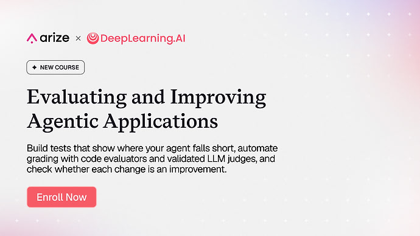

# Official course launch announcement

[Course index](../../README.md) · [Original source](https://community.deeplearning.ai/t/new-course-enroll-in-evaluating-and-improving-agentic-applications/896149) · [Raw file](../../raw/pages/launch-announcement.html)

Retrieved: 2026-11-13T17:15:48.239220+00:00

### [Evaluating and Improving Agentic Applications](https://www.deeplearning.ai/courses/evaluating-and-improving-agentic-applications?utm_medium=headband&utm_source=dlai-homepage)

Build tests that show where your agent falls short, automate grading with code evaluators and validated LLM judges, and check whether each change is an improvement.
