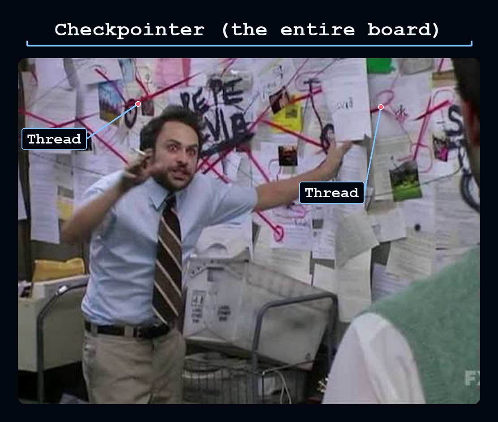

# Lesson: m1.7-messages-threads-checkpointers

[Course index](../../README.md) · [Original source](https://github.com/langchain-ai/lca-deepagents/blob/HEAD/thinkific/src/m1/m1.7-messages-threads-checkpointers.md) · [Raw file](../../raw/repositories/lca-deepagents/thinkific/src/m1/m1.7-messages-threads-checkpointers.md)

Retrieved: 2026-11-13T16:50:31.645872+00:00

[For translation, open lesson in new tab and use Chrome translate](m1.7-messages-threads-checkpointers.md)

Python TypeScript

<a id="messages-threads-and-checkpointers"></a>


# Messages, Threads, and Checkpointers

```text
<button class="lt-tab active" data-p="msg" role="tab" aria-selected="true">Messages</button>
```

```text
<button class="lt-tab" data-p="lab" role="tab" aria-selected="false">Lab</button>
```

```text
<button class="lt-tab" data-p="quiz" role="tab" aria-selected="false">Quiz</button>
```

```text
<button class="lt-tab" data-p="homework" role="tab" aria-selected="false">Homework</button>
```

<a id="p-msg"></a>


Lesson Video Walkthrough

[Public video walkthrough](../videos/5EJh5GgcPFz.md)

Deep agents keep track of more than one model call. To understand multi-turn behavior, we need three runtime ideas: **messages**, **threads**, and **checkpointers**. You have already used messages in every lab, but now we will name the pieces and show how they fit together.

<a id="messages"></a>


## Messages

A deep agent is invoked with a list of messages:

```text
result = agent.invoke({
    "messages": [{"role": "user", "content": "What is an LLM?"}]
})
```

That list is the conversation history the model sees. Each turn adds more messages:

| Message | Where it comes from |
| --- | --- |
| **User message** | The human’s input, such as `{“role”: “user”, “content”: “…”}`. |
| **AIMessage** | The model’s response. It can contain text or `tool_calls`. |
| **ToolMessage** | The result returned after the Tool Node runs a tool. |

The final response is usually the last message:

```text
print(result["messages"][-1].text)
```

The key idea: the agent builds and updates a message history as it runs.

---

<a id="threads"></a>


## Threads

A **thread** is one ongoing conversation or run history. If you want an agent to remember previous turns across separate `invoke()` calls, give those calls the same `thread_id`:

```text
from langchain_core.runnables import RunnableConfig

config: RunnableConfig = {"configurable": {"thread_id": "my-thread"}}

agent.invoke(
    {"messages": [{"role": "user", "content": "Remember my favorite colour is blue."}]},
    config=config,
)

agent.invoke(
    {"messages": [{"role": "user", "content": "What is my favorite colour?"}]},
    config=config,
)
```

Use a different `thread_id` when you want a separate conversation. Same thread: shared history. Different thread: separate history.

---

<a id="checkpointers"></a>


## Checkpointers

A **checkpointer** saves thread state between calls. Without a checkpointer, there is nowhere to store the history for later. A `thread_id` is just an address; the checkpointer is the storage system that knows how to save and load whatever’s at that address, and a single checkpointer instance holds many threads at once. For local development, the simplest checkpointer is `MemorySaver()`:

```text
from langgraph.checkpoint.memory import MemorySaver

agent = create_deep_agent(
    model=model,
    checkpointer=MemorySaver(),
)
```

`MemorySaver()` stores checkpoints in this Python process only. It is perfect for local demos, but it does not survive a process restart and can’t be shared across multiple server instances.

In production, swap in a persistent checkpointer backed by real infrastructure instead, such as `PostgresSaver` from `langgraph-checkpoint-postgres`, a Redis-backed checkpointer, or LangSmith Agent Server’s managed persistence. The `checkpointer=` argument doesn’t change; only which implementation you pass in does.

This is what makes multi-turn state reliable: the checkpointer saves the current thread, and the next call with the same `thread_id` can continue from that saved state.

When the docs say a checkpointer is for “a single thread,” they mean what it remembers: each thread’s history stays in that thread, even though one checkpointer stores many threads. To share memory across threads, you use a store instead.

Checkpointers vs. Threads



If you’ve seen this scene from *It’s Always Sunny in Philadelphia*, this is basically it:

- **Checkpointer:** the board. It keeps track of every thread’s state at once.
- **Thread:** each red string. One conversation’s state, saved separately from every other thread on the same board.
  - **State:** the notes pinned along that string (the actual saved content the checkpointer is tracking for that thread).
- **`thread_id`:** the identifier the checkpointer uses to know which thread’s state to load or save.


---

<a id="time-travel"></a>


## Time Travel

A checkpointer keeps every checkpoint it saves, from the first step to the latest.

You can list them and resume from any one of them:

```text
history = list(agent.get_state_history(thread_a))
```

Each item in `history` is a snapshot of the thread at that step, ordered most recent first (so `history[0]` is the latest, `history[1]` is one step before it, and so on):

- It has its own `config`, which includes a `checkpoint_id` pointing to that step.
- Passing `config` to `invoke()` continues the thread from that point, not the latest one.
- Nothing is deleted, the newer checkpoints are still there.

```python {5} older\_snapshot = history[1]

agent.invoke( {“messages”: [{“role”: “user”, “content”: “Actually, make it green.”}]}, config=older\_snapshot.config, )

````text

This is useful for correcting a bad turn, trying a different response from an earlier point, or checking exactly what state the agent had at a given step. This is sometimes called "time travel."

---

## Optional: Live Demo

<div class="demo-tip" markdown="1">
<svg viewBox="0 0 24 24" fill="none" stroke="currentColor" stroke-width="2" stroke-linecap="round" stroke-linejoin="round"><path d="M22 14a8 8 0 0 1-8 8"/><path d="M18 11v-1a2 2 0 0 0-2-2 2 2 0 0 0-2 2"/><path d="M14 10V9a2 2 0 0 0-2-2 2 2 0 0 0-2 2v1"/><path d="M10 9.5V4a2 2 0 0 0-2-2 2 2 0 0 0-2 2v10"/><path d="M18 11a2 2 0 1 1 4 0v3a8 8 0 0 1-8 8h-2c-2.8 0-4.5-.86-5.99-2.34l-3.6-3.6a2 2 0 0 1 2.83-2.82L7 15"/></svg>

<div markdown="1">

Try it yourself: send a message, then pick an earlier checkpoint from the timeline on the right and resume from there.

</div>
</div>

<iframe src="https://ui-patterns.langchain.com/react/?source=lca-deepagents&lesson=m1.7#/time-travel" style="width:100%;height:640px;border:1px solid #CCE9FF;border-radius:12px;display:block;margin:1.25rem 0 1.5rem;" title="Time travel demo: send a message, then resume from an earlier checkpoint"></iframe>

<p style="font-size:0.85em;color:#6b7280;margin-top:-0.75rem;"><em>* This demo runs a plain LangGraph agent (<code>create_agent</code>), not <code>create_deep_agent</code>, but both are built on the same LangGraph checkpoint, thread, and state history mechanics.</em></p>

<div class="demo-tip" markdown="1">
<svg viewBox="0 0 24 24" fill="none" stroke="currentColor" stroke-width="2" stroke-linecap="round" stroke-linejoin="round"><path d="M22 14a8 8 0 0 1-8 8"/><path d="M18 11v-1a2 2 0 0 0-2-2 2 2 0 0 0-2 2"/><path d="M14 10V9a2 2 0 0 0-2-2 2 2 0 0 0-2 2v1"/><path d="M10 9.5V4a2 2 0 0 0-2-2 2 2 0 0 0-2 2v10"/><path d="M18 11a2 2 0 1 1 4 0v3a8 8 0 0 1-8 8h-2c-2.8 0-4.5-.86-5.99-2.34l-3.6-3.6a2 2 0 0 1 2.83-2.82L7 15"/></svg>

<div markdown="1">

For example, try sending these messages in order:

1. What is the weather in Paris?
2. What is the weather in Taipei?
3. What is the weather in Reykjavik?
4. What is the weather in Bangkok?

Then go back to an earlier checkpoint (from before you had sent all four) and ask:

*"Which cities have I asked about the weather for?"*

The answer will only include the cities asked about up to that checkpoint, since the messages sent after it are not part of that snapshot's history.

</div>
</div>

---

## Recap

- **Messages** are the conversation items passed into and returned from the agent.
- A **thread** is an ongoing conversation identified by `thread_id`.
- A **checkpointer** saves thread state so later calls with the same `thread_id` can continue from the same history.
- This same mechanism lets workflows pause and resume reliably.
- A checkpointer keeps every checkpoint it saves, so you can list a thread's history and resume from an earlier point instead of only the latest one.

---

## References

**Documentation:**

- [Persistence and checkpointers](../readings/docs-langchain-com-oss-python-langgraph-persistence-99e58642.md)
- [Deep Agents overview](../readings/docs-langchain-com-oss-python-deepagents-overview-6f3fda49.md)

<div markdown="1" style="background:#F2FAFF;border:1px solid #CCE9FF;border-radius:8px;padding:14px 20px;margin:1rem 0;">

**Go deeper: read the source** *(optional)*

*The lesson shows how to use this. To see how it's implemented, start with these files:*

- [`checkpoint/base/__init__.py`](../readings/github-e63292ac8153.md): `BaseCheckpointSaver`, the interface every checkpointer implements
- [`checkpoint/memory/__init__.py`](../readings/github-25f4e3af0a44.md): `InMemorySaver`: checkpoints stored per thread ID

</div>

</div>

<div data-lang="typescript" markdown="1">

<details style="border:2.5px solid #000;border-radius:6px;background:#fff;margin:1rem 0;"><summary style="padding:10px 16px;cursor:pointer;font-weight:500;font-family:'IBM Plex Mono',monospace;font-size:14px;">Lesson Video Walkthrough</summary><div style="padding:12px 16px 16px;"><div class="video-container" style="max-width:750px;"><div class="video-wrapper"><iframe src="https://share.descript.com/embed/5EJh5GgcPFz" frameborder="0" allow="autoplay; fullscreen; encrypted-media; picture-in-picture" allowfullscreen></iframe></div></div></div></details>

Deep agents keep track of more than one model call. To understand multi-turn behavior, we need three runtime ideas: **messages**, **threads**, and **checkpointers**. You have already used messages in every lab, but now we will name the pieces and show how they fit together.

## Messages

A deep agent is invoked with a list of messages:

```typescript
const result = await agent.invoke({
  messages: [{ role: "user", content: "What is an LLM?" }],
});
````

That list is the conversation history the model sees. Each turn adds more messages:

| Message | Where it comes from |
| --- | --- |
| **User message** | The human’s input, such as `{ role: “user”, content: “…” }`. |
| **AIMessage** | The model’s response. It can contain text or `tool_calls`. |
| **ToolMessage** | The result returned after the Tool Node runs a tool. |

The final response is usually the last message:

```text
console.log(result.messages.at(-1)?.text);
```

The key idea: the agent builds and updates a message history as it runs.

---

<a id="threads-1"></a>


## Threads

A **thread** is one ongoing conversation or run history. If you want an agent to remember previous turns across separate `invoke()` calls, give those calls the same `thread_id`:

```text
const config = { configurable: { thread_id: "my-thread" } };

await agent.invoke(
  { messages: [{ role: "user", content: "Remember my favorite colour is blue." }] },
  config
);

await agent.invoke(
  { messages: [{ role: "user", content: "What is my favorite colour?" }] },
  config
);
```

Use a different `thread_id` when you want a separate conversation. Same thread: shared history. Different thread: separate history.

---

<a id="checkpointers-1"></a>


## Checkpointers

A **checkpointer** saves thread state between calls. Without a checkpointer, there is nowhere to store the history for later. A `thread_id` is just an address; the checkpointer is the storage system that knows how to save and load whatever’s at that address, and a single checkpointer instance holds many threads at once. For local development, the simplest checkpointer is `MemorySaver()`:

```text
import { MemorySaver } from "@langchain/langgraph";

const agent = createDeepAgent({
  model,
  checkpointer: new MemorySaver(),
});
```

`MemorySaver()` stores checkpoints in this Node process only. It is perfect for local demos, but it does not survive a process restart and can’t be shared across multiple server instances.

In production, swap in a persistent checkpointer backed by real infrastructure instead, such as `PostgresSaver` from `@langchain/langgraph-checkpoint-postgres`, a Redis-backed checkpointer, or LangSmith Agent Server’s managed persistence. The `checkpointer:` option doesn’t change; only which implementation you pass in does.

This is what makes multi-turn state reliable: the checkpointer saves the current thread, and the next call with the same `thread_id` can continue from that saved state.

When the docs say a checkpointer is for “a single thread,” they mean what it remembers: each thread’s history stays in that thread, even though one checkpointer stores many threads. To share memory across threads, you use a store instead.

Checkpointers vs. Threads


If you’ve seen this scene from *It’s Always Sunny in Philadelphia*, this is basically it:

- **Checkpointer:** the board. It keeps track of every thread’s state at once.
- **Thread:** each red string. One conversation’s state, saved separately from every other thread on the same board.
  - **State:** the notes pinned along that string (the actual saved content the checkpointer is tracking for that thread).
- **`thread_id`:** the identifier the checkpointer uses to know which thread’s state to load or save.


---

<a id="time-travel-1"></a>


## Time Travel

A checkpointer keeps every checkpoint it saves, from the first step to the latest.

You can list them and resume from any one of them:

```text
const history = [];
for await (const snapshot of agent.getStateHistory(threadA)) {
  history.push(snapshot);
}
```

Each item in `history` is a snapshot of the thread at that step, ordered most recent first (so `history[0]` is the latest, `history[1]` is one step before it, and so on):

- It has its own `config`, which includes a `checkpoint_id` pointing to that step.
- Passing `config` to `invoke()` continues the thread from that point, not the latest one.
- Nothing is deleted, the newer checkpoints are still there.

```typescript {5} const olderSnapshot = history[1];

await agent.invoke( { messages: [{ role: “user”, content: “Actually, make it green.” }] }, olderSnapshot.config );

````text

This is useful for correcting a bad turn, trying a different response from an earlier point, or checking exactly what state the agent had at a given step. This is sometimes called "time travel."

---

## Optional: Live Demo

<div class="demo-tip" markdown="1">
<svg viewBox="0 0 24 24" fill="none" stroke="currentColor" stroke-width="2" stroke-linecap="round" stroke-linejoin="round"><path d="M22 14a8 8 0 0 1-8 8"/><path d="M18 11v-1a2 2 0 0 0-2-2 2 2 0 0 0-2 2"/><path d="M14 10V9a2 2 0 0 0-2-2 2 2 0 0 0-2 2v1"/><path d="M10 9.5V4a2 2 0 0 0-2-2 2 2 0 0 0-2 2v10"/><path d="M18 11a2 2 0 1 1 4 0v3a8 8 0 0 1-8 8h-2c-2.8 0-4.5-.86-5.99-2.34l-3.6-3.6a2 2 0 0 1 2.83-2.82L7 15"/></svg>

<div markdown="1">

Try it yourself: send a message, then pick an earlier checkpoint from the timeline on the right and resume from there.

</div>
</div>

<iframe src="https://ui-patterns.langchain.com/react/?source=lca-deepagents&lesson=m1.7#/time-travel" style="width:100%;height:640px;border:1px solid #CCE9FF;border-radius:12px;display:block;margin:1.25rem 0 1.5rem;" title="Time travel demo: send a message, then resume from an earlier checkpoint"></iframe>

<p style="font-size:0.85em;color:#6b7280;margin-top:-0.75rem;"><em>* This demo runs a plain LangGraph agent (<code>create_agent</code>), not <code>create_deep_agent</code>, but both are built on the same LangGraph checkpoint, thread, and state history mechanics.</em></p>

<div class="demo-tip" markdown="1">
<svg viewBox="0 0 24 24" fill="none" stroke="currentColor" stroke-width="2" stroke-linecap="round" stroke-linejoin="round"><path d="M22 14a8 8 0 0 1-8 8"/><path d="M18 11v-1a2 2 0 0 0-2-2 2 2 0 0 0-2 2"/><path d="M14 10V9a2 2 0 0 0-2-2 2 2 0 0 0-2 2v1"/><path d="M10 9.5V4a2 2 0 0 0-2-2 2 2 0 0 0-2 2v10"/><path d="M18 11a2 2 0 1 1 4 0v3a8 8 0 0 1-8 8h-2c-2.8 0-4.5-.86-5.99-2.34l-3.6-3.6a2 2 0 0 1 2.83-2.82L7 15"/></svg>

<div markdown="1">

For example, try sending these messages in order:

1. What is the weather in Paris?
2. What is the weather in Taipei?
3. What is the weather in Reykjavik?
4. What is the weather in Bangkok?

Then go back to an earlier checkpoint (from before you had sent all four) and ask:

*"Which cities have I asked about the weather for?"*

The answer will only include the cities asked about up to that checkpoint, since the messages sent after it are not part of that snapshot's history.

</div>
</div>

---

## Recap

- **Messages** are the conversation items passed into and returned from the agent.
- A **thread** is an ongoing conversation identified by `thread_id`.
- A **checkpointer** saves thread state so later calls with the same `thread_id` can continue from the same history.
- This same mechanism lets workflows pause and resume reliably.
- A checkpointer keeps every checkpoint it saves, so you can list a thread's history and resume from an earlier point instead of only the latest one.

---

## References

**Documentation:**

- [Persistence and checkpointers](../readings/docs-langchain-com-oss-javascript-langgraph-persistence-f26bc9ba.md)
- [Deep Agents overview](../readings/docs-langchain-com-oss-javascript-deepagents-overview-9687b9be.md)

<div markdown="1" style="background:#F2FAFF;border:1px solid #CCE9FF;border-radius:8px;padding:14px 20px;margin:1rem 0;">

**Go deeper: read the source** *(optional)*

*The lesson shows how to use this. To see how it's implemented, start with these files:*

- [`checkpoint/src/base.ts`](../readings/github-e18e0fcccebb.md): `BaseCheckpointSaver`, the interface every checkpointer implements
- [`checkpoint/src/memory.ts`](../readings/github-b6a937e46db1.md): `MemorySaver`: checkpoints stored per thread ID

</div>

</div>

</div>

<div class="lt-panel" id="p-lab" markdown="1" role="tabpanel">

<div data-lang="python" markdown="1">

## Lab: Same Thread vs New Thread

<Tip>

<details style="border:2.5px solid #000;border-radius:6px;background:#fff;margin:1rem 0;"><summary style="padding:10px 16px;cursor:pointer;font-weight:500;font-family:'IBM Plex Mono',monospace;font-size:14px;">Lab Video Walkthrough</summary><div style="padding:12px 16px 16px;"><div class="video-container" style="max-width:750px;"><div class="video-wrapper"><iframe src="https://share.descript.com/embed/bQv1hQ2zPP0" frameborder="0" allow="autoplay; fullscreen; encrypted-media; picture-in-picture" allowfullscreen></iframe></div></div></div></details>

**Inspect your own run in LangSmith.** Notice turn 2 reuses `thread_a` and already knows the favorite colour from turn 1.

**Inspect your own run in LangSmith.** Notice `thread_b` has a different `thread_id`, so it starts with no memory of the favorite colour.

<details style="border:2.5px solid #000;border-radius:6px;background:#E5F4FF;margin:1rem 0;"><summary style="padding:10px 16px;cursor:pointer;font-weight:500;font-family:'IBM Plex Mono',monospace;font-size:14px;">LangSmith Video Walkthrough</summary><div style="padding:12px 16px 16px;"><div class="video-container" style="max-width:750px;"><div class="video-wrapper"><iframe src="https://share.descript.com/embed/LqdM9KRzLX7" frameborder="0" allow="autoplay; fullscreen; encrypted-media; picture-in-picture" allowfullscreen></iframe></div></div></div></details>

</Tip>

Open `python/m1/m1.7_messages_threads_checkpointers.py`.

```python
from deepagents import create_deep_agent
from langchain_core.runnables import RunnableConfig
from langgraph.checkpoint.memory import MemorySaver

from models import model

agent = create_deep_agent(
    model=model,
    checkpointer=MemorySaver(),
)

thread_a: RunnableConfig = {"configurable": {"thread_id": "m1-7-thread-a"}}
thread_b: RunnableConfig = {"configurable": {"thread_id": "m1-7-thread-b"}}
````

The script uses `thread_a` for two turns. The second turn can use the first turn’s saved history:

```text
result = agent.invoke(
    {"messages": [{"role": "user", "content": "Remember that my favorite colour is blue."}]},
    config=thread_a,
)

result = agent.invoke(
    {"messages": [{"role": "user", "content": "What is my favorite colour?"}]},
    config=thread_a,
)
```

Then it asks the same question in `thread_b`, a separate thread:

```text
result = agent.invoke(
    {"messages": [{"role": "user", "content": "What is my favorite colour?"}]},
    config=thread_b,
)
```

Run it from the repo root:

```text
cd python
uv run python m1/m1.7_messages_threads_checkpointers.py
```

Expected behavior:

- Thread A turn 2 should know the favorite colour is blue.
- Thread B should not know, because it has a different `thread_id`.

<a id="lab-same-thread-vs-new-thread"></a>


## Lab: Same Thread vs New Thread

Lab Video Walkthrough

[Public video walkthrough](../videos/bQv1hQ2zPP0.md)

**Inspect your own run in LangSmith.** Notice turn 2 reuses `threadA` and already knows the favorite colour from turn 1.

**Inspect your own run in LangSmith.** Notice `threadB` has a different `thread_id`, so it starts with no memory of the favorite colour.

LangSmith Video Walkthrough

[Public video walkthrough](../videos/LqdM9KRzLX7.md)

Open `typescript/m1/m1.7_messages_threads_checkpointers.ts`.

```text
import { MemorySaver } from "@langchain/langgraph";
import { createDeepAgent } from "deepagents";

import { model } from "../models.js";

const agent = createDeepAgent({
  model,
  checkpointer: new MemorySaver(),
});

const threadA = { configurable: { thread_id: "m1-7-thread-a" } };
const threadB = { configurable: { thread_id: "m1-7-thread-b" } };
```

The script uses `threadA` for two turns. The second turn can use the first turn’s saved history:

```text
let result = await agent.invoke(
  { messages: [{ role: "user", content: "Remember that my favorite colour is blue." }] },
  threadA
);

result = await agent.invoke(
  { messages: [{ role: "user", content: "What is my favorite colour?" }] },
  threadA
);
```

Then it asks the same question in `threadB`, a separate thread:

```text
result = await agent.invoke(
  { messages: [{ role: "user", content: "What is my favorite colour?" }] },
  threadB
);
```

Run it from the repo root:

```text
cd typescript
pnpm tsx ./m1/m1.7_messages_threads_checkpointers.ts
```

Expected behavior:

- Thread A turn 2 should know the favorite colour is blue.
- Thread B should not know, because it has a different `thread_id`.

<a id="p-quiz"></a>


## Check your understanding

## Check your understanding

<a id="p-homework"></a>


<a id="design-your-own-multi-thread-scenario"></a>


## Design Your Own Multi-Thread Scenario

The lab used one topic (favorite colour) across two threads to show that `thread_a` remembers it and `thread_b` doesn’t. This homework asks you to design your own multi-turn scenario and prove three things:

1. that state persists within a thread across separate `invoke()` calls,
2. that a different `thread_id` starts with no memory of it, and
3. that this persistence lives in the `MemorySaver` instance rather than the `thread_id` string itself, by asking a brand-new agent with its own fresh `MemorySaver` the same question on `thread_a`’s `thread_id`.

Open `python/m1/m1.7_homework.py`.

1. **TODO 1**: pick your own topic/fact for the agent to remember, and set up two or more of your own thread configs (different `thread_id`s).
2. **TODO 2**: run the turns that demonstrate persistence (same thread remembers), isolation (a different thread doesn’t), and checkpointer scope (a fresh `MemorySaver` on the same `thread_id` doesn’t either).

<a id="run-it"></a>


### Run it

```text
cd python
uv run ./m1/m1.7_homework.py
```

Stuck, or want to see the finished shape before you start? `m1.7_homework_filled.py` is a reference copy with every TODO filled in (using a pet iguana’s name and diet as the fact to remember); run it the same way to see what “done” looks like end to end.

Try to avoid peeking unless you’re really stuck, you’ll get more out of this by working through the TODOs yourself first.

---


Optional Extension: Want To Code From Scratch?

**What you’ll build:** two divergent futures branched from the same past checkpoint.

**Requirements:**

- Write your own `create_deep_agent(model=model, checkpointer=MemorySaver())` call from scratch, in a new file under `python/m1/`.
- On a single thread, send a few turns, then call `agent.get_state_history(thread)` and pick an older snapshot (not the latest).
- Resume from that snapshot’s `config` twice, sending a different message each time, so you get two branches that share the same earlier history but diverge from that point on.
- Call `get_state_history` again and confirm you can see checkpoints from both branches tracing back to the shared snapshot you picked.

**⚠ Troubleshooting:** `get_state_history` returns a generator, not a list, and it comes back newest-first. Wrap it in `list(…)` before indexing into it, or you’ll hit `TypeError: ‘generator’ object is not subscriptable`.

<a id="design-your-own-multi-thread-scenario-1"></a>


## Design Your Own Multi-Thread Scenario

The lab used one topic (favorite colour) across two threads to show that `threadA` remembers it and `threadB` doesn’t. This homework asks you to design your own multi-turn scenario and prove three things:

1. that state persists within a thread across separate `invoke()` calls,
2. that a different `thread_id` starts with no memory of it, and
3. that this persistence lives in the `MemorySaver` instance rather than the `thread_id` string itself, by asking a brand-new agent with its own fresh `MemorySaver` the same question on `threadA`’s `thread_id`.

Open `typescript/m1/m1.7_homework.ts`.

1. **TODO 1**: pick your own topic/fact for the agent to remember, and set up two or more of your own thread configs (different `thread_id`s).
2. **TODO 2**: run the turns that demonstrate persistence (same thread remembers), isolation (a different thread doesn’t), and checkpointer scope (a fresh `MemorySaver` on the same `thread_id` doesn’t either).

<a id="run-it-1"></a>


### Run it

```text
cd typescript
pnpm tsx ./m1/m1.7_homework.ts
```

Stuck, or want to see the finished shape before you start? `m1.7_homework_filled.ts` is a reference copy with every TODO filled in (using a pet iguana’s name and diet as the fact to remember); run it the same way to see what “done” looks like end to end.

Try to avoid peeking unless you’re really stuck, you’ll get more out of this by working through the TODOs yourself first.

---


Optional Extension: Want To Code From Scratch?

**What you’ll build:** two divergent futures branched from the same past checkpoint.

**Requirements:**

- Write your own `createDeepAgent({ model, checkpointer: new MemorySaver() })` call from scratch, in a new file under `typescript/m1/`.
- On a single thread, send a few turns, then iterate `agent.getStateHistory(thread)` and pick an older snapshot (not the latest).
- Resume from that snapshot’s `config` twice, sending a different message each time, so you get two branches that share the same earlier history but diverge from that point on.
- Call `getStateHistory` again and confirm you can see checkpoints from both branches tracing back to the shared snapshot you picked.

**⚠ Troubleshooting:** `getStateHistory` returns an async iterable, not an array, and it comes back newest-first. Collect it into an array first (e.g. `for await (const s of agent.getStateHistory(thread)) snapshots.push(s)`) before indexing into it.

```javascript

(function () {
  var tabs = document.querySelectorAll('.lt-tab');
  function show(p) {
    tabs.forEach(function (t) {
      var on = t.getAttribute('data-p') === p;
      t.classList.toggle('active', on);
      t.setAttribute('aria-selected', on ? 'true' : 'false');
    });
    document.querySelectorAll('.lt-panel').forEach(function (panel) {
      panel.classList.toggle('active', panel.id === 'p-' + p);
    });
  }
  tabs.forEach(function (t) {
    t.addEventListener('click', function () { show(t.getAttribute('data-p')); });
  });
})();

```
