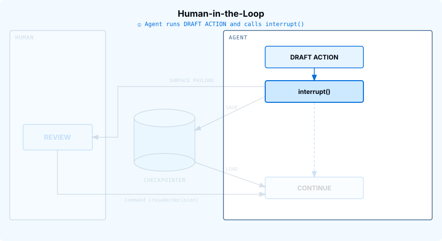
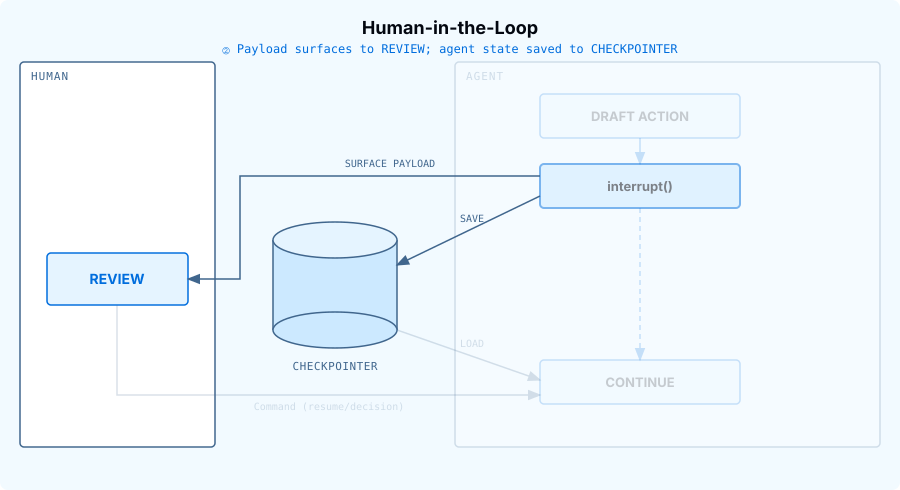
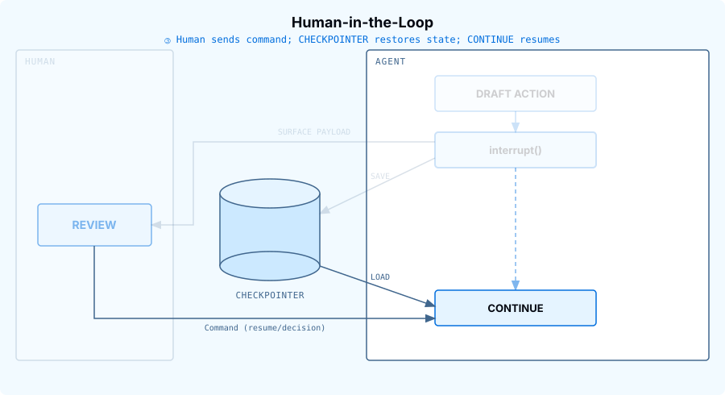

# Lesson: m1.8-hitl

[Course index](../../README.md) · [Original source](https://github.com/langchain-ai/lca-deepagents/blob/HEAD/thinkific/src/m1/m1.8-hitl.md) · [Raw file](../../raw/repositories/lca-deepagents/thinkific/src/m1/m1.8-hitl.md)

Retrieved: 2026-11-13T16:50:31.645872+00:00

[For translation, open lesson in new tab and use Chrome translate](m1.8-hitl.md)

Python TypeScript

<a id="human-in-the-loop"></a>


# Human-in-the-Loop

```text
<button class="lt-tab active" data-p="hitl" role="tab" aria-selected="true">Human-in-the-Loop</button>
```

```text
<button class="lt-tab" data-p="lab" role="tab" aria-selected="false">Lab 1</button>
<button class="lt-tab" data-p="lab2" role="tab" aria-selected="false">Lab 2</button>
```

```text
<button class="lt-tab" data-p="quiz" role="tab" aria-selected="false">Quiz</button>
```

```text
<button class="lt-tab" data-p="homework" role="tab" aria-selected="false">Homework</button>
```

<a id="p-hitl"></a>


Lesson Video Walkthrough

[Public video walkthrough](../videos/iKsrBQZlPN3.md)

In the tools lesson, you saw that tools can do more than retrieve information: they can also take actions. In the previous lesson, you saw how messages, threads, and checkpointers let an agent save and resume state. Human-in-the-Loop (HITL) combines those ideas: pause before a sensitive action and let a person approve, edit, reject, or respond to it.

The main reason is safety. If an agent is about to send an email, update a database, or delete a file, you may want a human checkpoint before the side effect happens. HITL also lets the agent suspend execution while it waits instead of staying active indefinitely.

---

<a id="how-it-works"></a>


## How it works

Step through the sequence to see each phase:

<a id="hitl-concept-python"></a>

### Slideshow: hitl-concept-python

#### ① Tool call proposed



The model asks to call a sensitive tool, such as send\_email. Because that tool is listed in interrupt\_on, the tool does not execute yet.

#### ② Review &amp; Save



The agent pauses and returns the pending tool call for human review. The checkpointer saves the agent state so the run can resume later from the same point.

#### ③ Continue &amp; Load



The human sends a resume command with a decision. On approve, the tool executes. On edit, revised arguments execute. On reject, the tool does not run and the agent receives a cancellation result. On respond, the tool does not run either; the human's message is returned to the model as if the tool had produced it.

There are four pieces to remember:

| Piece | What it does |
| --- | --- |
| `interrupt_on` | Names the tools that require human review before execution. |
| `checkpointer` | Saves the paused agent state. For local development, use `MemorySaver()`. |
| `thread_id` | Identifies the saved run state. Resume with the same `thread_id`. |
| `Command(resume=…)` | Continues the paused run with the human decision. |

---

<a id="decision-types"></a>


## Decision types

Lesson Video Walkthrough

[Public video walkthrough](../videos/KZb6UyoCWiX.md)

The `allowed_decisions` list controls what actions a human can take when reviewing a tool call:

| Decision Type | Description | Example Use Case |
| --- | --- | --- |
| `approve` | Execute the tool with the original arguments as proposed by the agent. | Send an email draft exactly as written |
| `edit` | Modify the tool arguments before execution. | Change the recipient before sending an email |
| `reject` | Skip executing this tool call entirely and return rejection feedback to the agent. | Deny file deletion and explain why |
| `respond` | Return the human’s message directly as a synthetic tool result, skipping execution, for “ask user” style tools. | The agent calls `ask_user(“What’s your budget?”)`; the human types “$500”, and that becomes the tool’s result. |

`reject` blocks an action the tool would otherwise perform, like deleting a file.

`respond` is different: it’s for tools where the human’s answer *is* the result, like `ask_user`. Never use `respond` to block a side-effecting tool such as `send_email` or `delete_file`; the model will read the human’s message as a successful result, not a denial, and may believe the action already happened.

When **editing** tool arguments, make changes conservatively. Significant modifications to the original arguments may cause the model to re-evaluate its approach and potentially execute the tool multiple times or take unexpected actions.

<a id="recap"></a>


## Recap

- HITL pauses the agent before a sensitive tool runs, so a person can review the call before any side effect happens.
- `interrupt_on` names the tools to gate, a `checkpointer` saves the paused state, and resuming on the same `thread_id` with `Command(resume=...)` continues the run.
- Four decisions: **approve** runs the call as proposed, **edit** runs it with changed arguments, **reject** skips it and tells the agent, and **respond** skips it and returns the human’s message as the tool result.
- Use `reject` to block a side-effecting tool. `respond` is only for tools like `ask_user`, where the human’s answer is the result; the model reads it as a success.
- Keep argument edits small. Big changes can make the model rethink its plan and call the tool again.

---

<a id="optional-live-demo"></a>


## Optional: Live Demo

Try it yourself: ask the agent to send an email, then approve/edit/reject the pending call.

[Human-in-the-loop demo: approve, edit, or reject a pending tool call](https://ui-patterns.langchain.com/react/?source=lca-deepagents&lesson=m1.8#/human-in-the-loop)

*\* This demo runs a plain LangGraph agent (`create_agent` with `HumanInTheLoopMiddleware`), not `create_deep_agent`, but both pause and resume using the same interrupt mechanics.*

For example, try: “Send an email to team@acme.com with subject ‘Q4 Results’ saying revenue grew 15% this quarter.”

When the pending `send_email` call appears, you can:

- **Approve** it to send the email as drafted.
- **Edit** the recipient, subject, or body before it sends.
- **Reject** it so the email never sends.

---

<a id="references"></a>


## References

**Documentation:**

- [Human-in-the-Loop (Deep Agents)](../readings/docs-langchain-com-oss-python-deepagents-human-in-the-loop-65328403.md)
- [Deep Agents overview](../readings/docs-langchain-com-oss-python-deepagents-overview-6f3fda49.md)

**Go deeper: read the source** *(optional)*

*The lesson shows how to use this. To see how it’s implemented, start with these files:*

- [`agents/middleware/human_in_the_loop.py`](../readings/github-373e1f8574dc.md): `HumanInTheLoopMiddleware`, which `interrupt_on` configures

**Going further:** [Building a harness with Jev](../readings/www-langchain-com-blog-building-a-harness-with-jev-9e45c053.md) shows how a System One model can gate risky tool calls automatically, instead of pausing for a person every time.

Jev, from TypeSafe AI, doesn’t generate text: it answers narrow questions (pick an option, give a score, or yes/no) with probabilities, which makes it much faster and cheaper than an LLM for quick checks like “is this tool call risky?”

Lesson Video Walkthrough

[Public video walkthrough](../videos/iKsrBQZlPN3.md)

In the tools lesson, you saw that tools can do more than retrieve information: they can also take actions. In the previous lesson, you saw how messages, threads, and checkpointers let an agent save and resume state. Human-in-the-Loop (HITL) combines those ideas: pause before a sensitive action and let a person approve, edit, reject, or respond to it.

The main reason is safety. If an agent is about to send an email, update a database, or delete a file, you may want a human checkpoint before the side effect happens. HITL also lets the agent suspend execution while it waits instead of staying active indefinitely.

---

<a id="how-it-works-1"></a>


## How it works

Step through the sequence to see each phase:

<a id="hitl-concept-typescript"></a>

### Slideshow: hitl-concept-typescript

#### ① Tool call proposed


The model asks to call a sensitive tool, such as send\_email. Because that tool is listed in interruptOn, the tool does not execute yet.

#### ② Review &amp; Save


The agent pauses and returns the pending tool call for human review. The checkpointer saves the agent state so the run can resume later from the same point.

#### ③ Continue &amp; Load


The human sends a resume command with a decision. On approve, the tool executes. On edit, revised arguments execute. On reject, the tool does not run and the agent receives a cancellation result. On respond, the tool does not run either; the human's message is returned to the model as if the tool had produced it.

There are four pieces to remember:

| Piece | What it does |
| --- | --- |
| `interruptOn` | Names the tools that require human review before execution. |
| `checkpointer` | Saves the paused agent state. For local development, use `MemorySaver()`. |
| `thread_id` | Identifies the saved run state. Resume with the same `thread_id`. |
| `Command({ resume: … })` | Continues the paused run with the human decision. |

---

<a id="decision-types-1"></a>


## Decision types

Lesson Video Walkthrough

[Public video walkthrough](../videos/KZb6UyoCWiX.md)

The `allowedDecisions` list controls what actions a human can take when reviewing a tool call:

| Decision Type | Description | Example Use Case |
| --- | --- | --- |
| `approve` | Execute the tool with the original arguments as proposed by the agent. | Send an email draft exactly as written |
| `edit` | Modify the tool arguments before execution. | Change the recipient before sending an email |
| `reject` | Skip executing this tool call entirely and return rejection feedback to the agent. | Deny file deletion and explain why |
| `respond` | Return the human’s message directly as a synthetic tool result, skipping execution, for “ask user” style tools. | The agent calls `askUser(“What’s your budget?”)`; the human types “$500”, and that becomes the tool’s result. |

`reject` blocks an action the tool would otherwise perform, like deleting a file.

`respond` is different: it’s for tools where the human’s answer *is* the result, like `ask_user`. Never use `respond` to block a side-effecting tool such as `send_email` or `delete_file`; the model will read the human’s message as a successful result, not a denial, and may believe the action already happened.

When **editing** tool arguments, make changes conservatively. Significant modifications to the original arguments may cause the model to re-evaluate its approach and potentially execute the tool multiple times or take unexpected actions.

<a id="recap-1"></a>


## Recap

- HITL pauses the agent before a sensitive tool runs, so a person can review the call before any side effect happens.
- `interruptOn` names the tools to gate, a `checkpointer` saves the paused state, and resuming on the same `thread_id` with `Command({ resume: ... })` continues the run.
- Four decisions: **approve** runs the call as proposed, **edit** runs it with changed arguments, **reject** skips it and tells the agent, and **respond** skips it and returns the human’s message as the tool result.
- Use `reject` to block a side-effecting tool. `respond` is only for tools like `ask_user`, where the human’s answer is the result; the model reads it as a success.
- Keep argument edits small. Big changes can make the model rethink its plan and call the tool again.

---

<a id="optional-live-demo-1"></a>


## Optional: Live Demo

Try it yourself: ask the agent to send an email, then approve/edit/reject the pending call.

[Human-in-the-loop demo: approve, edit, or reject a pending tool call](https://ui-patterns.langchain.com/react/?source=lca-deepagents&lesson=m1.8#/human-in-the-loop)

*\* This demo runs a plain LangGraph agent (`create_agent` with `HumanInTheLoopMiddleware`), not `create_deep_agent`, but both pause and resume using the same interrupt mechanics.*

For example, try: “Send an email to team@acme.com with subject ‘Q4 Results’ saying revenue grew 15% this quarter.”

When the pending `send_email` call appears, you can:

- **Approve** it to send the email as drafted.
- **Edit** the recipient, subject, or body before it sends.
- **Reject** it so the email never sends.

---

<a id="references-1"></a>


## References

**Documentation:**

- [Human-in-the-Loop (Deep Agents)](../readings/docs-langchain-com-oss-javascript-deepagents-human-in-the-loop-d73b6063.md)
- [Deep Agents overview](../readings/docs-langchain-com-oss-javascript-deepagents-overview-9687b9be.md)

**Go deeper: read the source** *(optional)*

*The lesson shows how to use this. To see how it’s implemented, start with these files:*

- [`agents/middleware/hitl.ts`](../readings/github-3b1aba08317c.md): `humanInTheLoopMiddleware`, which `interruptOn` configures

**Going further:** [Building a harness with Jev](../readings/www-langchain-com-blog-building-a-harness-with-jev-9e45c053.md) shows how a System One model can gate risky tool calls automatically, instead of pausing for a person every time.

Jev, from TypeSafe AI, doesn’t generate text: it answers narrow questions (pick an option, give a score, or yes/no) with probabilities, which makes it much faster and cheaper than an LLM for quick checks like “is this tool call risky?”

<a id="p-lab"></a>


<a id="lab-reviewing-an-email-tool"></a>


## Lab: Reviewing an Email Tool

Lab Video Walkthrough

[Public video walkthrough](../videos/FXc8O0Aoa62.md)

**Inspect your own run in LangSmith.** Notice the run pausing on the `send_email` tool call and resuming after the human decision.

LangSmith Video Walkthrough

[Public video walkthrough](../videos/6S9gpfxnmMD.md)

Open `python/m1/m1.8_hitl.py`. It defines a mock `send_email` tool. The tool does not contact a real email service; it returns a string so the lab is safe to run.

<a id="define-an-action-tool"></a>


### 1. Define an action tool

```text
from langchain_core.tools import tool

@tool
def send_email(to: str, subject: str, body: str) -> str:
    """Send an email to a recipient."""
    return f"Email sent to {to} with subject {subject!r}. Body: {body}"
```

<a id="configure-hitl-on-that-tool"></a>


### 2. Configure HITL on that tool

```text
from deepagents import create_deep_agent
from langgraph.checkpoint.memory import MemorySaver

agent = create_deep_agent(
    model=model,
    tools=[send_email],
    system_prompt=SYSTEM_PROMPT,
    interrupt_on={"send_email": True},
    checkpointer=MemorySaver(),
)
```

`interrupt_on={"send_email": True}` means: if the agent tries to call `send_email`, pause before the tool executes and surface the pending action for review.

The checkpointer is required because the agent needs somewhere to save the paused state. Without it, there is nothing to resume.

<a id="invoke-with-a-stable-thread-id"></a>


### 3. Invoke with a stable thread ID

```text
from langchain_core.runnables import RunnableConfig

config: RunnableConfig = {"configurable": {"thread_id": "m1-8-hitl-demo"}}

result = agent.invoke(
    {
        "messages": [
            {
                "role": "user",
                "content": "Send an email to jane@example.com saying I will be 10 minutes late.",
            }
        ]
    },
    config=config,
    version="v2",
)
```

The `thread_id` is how the checkpointer finds this paused run again. When you resume, pass the same `config`.

<a id="review-and-resume"></a>


### 4. Review and resume

```text
from langgraph.types import Command

while result.interrupts:
    pending = result.interrupts[0].value
    decisions = []
    for req in pending["action_requests"]:
        print(f"\nApproval required for {req['name']}:")
        print(req["args"])

        choice = input("\nApprove, edit, or reject? (approve/edit/reject): ").strip().lower()
        if choice in ("approve", "yes", "y"):
            decisions.append({"type": "approve"})
        elif choice in ("edit", "e"):
            edited_args = dict(req["args"])
            edited_args["body"] = input("New email body: ")
            decisions.append(
                {
                    "type": "edit",
                    "edited_action": {"name": req["name"], "args": edited_args},
                }
            )
        else:
            decisions.append(
                {"type": "reject", "message": "User rejected this email draft."}
            )

    result = agent.invoke(Command(resume={"decisions": decisions}), config=config, version="v2")
```

If you approve, `send_email` runs as proposed. If you edit, the tool runs with your revised arguments. If you reject, the tool never runs; the agent receives a cancellation result and should respond accordingly.

**What is `Command`, and why resume with it?**

When the agent tries to call `send_email`, `HumanInTheLoopMiddleware` calls LangGraph’s `interrupt()` function. That stops the graph partway through a step and saves the run, including the pending tool call, to the checkpointer. The run is waiting for a value.

`Command` is the LangGraph object you use to hand it that value. Passing `Command(resume=...)` to `invoke` tells LangGraph: don’t start a new turn, instead continue the paused one. LangGraph loads the checkpoint for this `thread_id` and runs the paused step again from the start. This time, `interrupt()` returns your resume value and the step carries on.

Inside the middleware, that line reads `decisions = interrupt(hitl_request)["decisions"]`. So the resume value has to be a dict with a `decisions` list, holding one decision per pending tool call. This is also why the `thread_id` must match. A different one points at a thread with no paused run to continue.

<a id="run-it"></a>


### Run it

From the repo root:

```text
cd python
uv run python m1/m1.8_hitl.py
```

Try all three paths:

- run once and type `approve`;
- run again and type `edit`, then provide a new email body;
- run again and type `reject`.

You should see the pending tool arguments before each decision. That is the safety checkpoint: the side effect is visible before it happens.

<a id="lab-reviewing-an-email-tool-1"></a>


## Lab: Reviewing an Email Tool

Lab Video Walkthrough

[Public video walkthrough](../videos/FXc8O0Aoa62.md)

**Inspect your own run in LangSmith.** Notice the run pausing on the `send_email` tool call and resuming after the human decision.

LangSmith Video Walkthrough

[Public video walkthrough](../videos/6S9gpfxnmMD.md)

Open `typescript/m1/m1.8_hitl.ts`. It defines a mock `sendEmail` tool. The tool does not contact a real email service; it returns a string so the lab is safe to run.

<a id="define-an-action-tool-1"></a>


### 1. Define an action tool

```text
import { tool } from "langchain";
import { z } from "zod";

const sendEmail = tool(
  ({ to, subject, body }) =>
    `Email sent to ${to} with subject ${JSON.stringify(subject)}. Body: ${body}`,
  {
    name: "send_email",
    description: "Send an email to a recipient.",
    schema: z.object({
      to: z.string(),
      subject: z.string(),
      body: z.string(),
    }),
  }
);
```

<a id="configure-hitl-on-that-tool-1"></a>


### 2. Configure HITL on that tool

```text
import { createDeepAgent } from "deepagents";
import { MemorySaver } from "@langchain/langgraph";

const agent = createDeepAgent({
  model,
  tools: [sendEmail],
  systemPrompt: SYSTEM_PROMPT,
  interruptOn: { send_email: true },
  checkpointer: new MemorySaver(),
});
```

`interruptOn: { send_email: true }` means: if the agent tries to call `send_email`, pause before the tool executes and surface the pending action for review.

The checkpointer is required because the agent needs somewhere to save the paused state. Without it, there is nothing to resume.

<a id="invoke-with-a-stable-thread-id-1"></a>


### 3. Invoke with a stable thread ID

```text
const config = { configurable: { thread_id: "m1-8-hitl-demo" } };

let result = await agent.invoke(
  {
    messages: [
      {
        role: "user",
        content: "Send an email to jane@example.com saying I will be 10 minutes late.",
      },
    ],
  },
  config
);
```

The `thread_id` is how the checkpointer finds this paused run again. When you resume, pass the same `config`.

<a id="review-and-resume-1"></a>


### 4. Review and resume

```text
import { Command, INTERRUPT, isInterrupted } from "@langchain/langgraph";
import { createInterface } from "node:readline/promises";

const rl = createInterface({ input: process.stdin, output: process.stdout });

while (isInterrupted(result) && result[INTERRUPT].length) {
  const pending = result[INTERRUPT][0].value!;
  const decisions = [];

  for (const req of pending.actionRequests) {
    console.log(`\nApproval required for ${req.name}:`);
    console.log(req.args);

    const choice = (
      await rl.question("\nApprove, edit, or reject? (approve/edit/reject): ")
    )
      .trim()
      .toLowerCase();

    if (["approve", "yes", "y"].includes(choice)) {
      decisions.push({ type: "approve" });
    } else if (["edit", "e"].includes(choice)) {
      const editedArgs = { ...req.args };
      editedArgs.body = await rl.question("New email body: ");
      decisions.push({
        type: "edit",
        editedAction: { name: req.name, args: editedArgs },
      });
    } else {
      decisions.push({ type: "reject", message: "User rejected this email draft." });
    }
  }

  result = await agent.invoke(new Command({ resume: { decisions } }), config);
}
```

If you approve, `sendEmail` runs as proposed. If you edit, the tool runs with your revised arguments. If you reject, the tool never runs; the agent receives a cancellation result and should respond accordingly.

**What is `Command`, and why resume with it?**

When the agent tries to call `sendEmail`, the human-in-the-loop middleware calls LangGraph’s `interrupt()` function. That stops the graph partway through a step and saves the run, including the pending tool call, to the checkpointer. The run is waiting for a value.

`Command` is the LangGraph object you use to hand it that value. Passing `new Command({ resume: ... })` to `invoke` tells LangGraph: don’t start a new turn, instead continue the paused one. LangGraph loads the checkpoint for this `thread_id` and runs the paused step again from the start. This time, `interrupt()` returns your resume value and the step carries on.

The middleware reads the `decisions` array from that value. So the resume value has to be an object with a `decisions` array, holding one decision per pending tool call. This is also why the `thread_id` must match. A different one points at a thread with no paused run to continue.

<a id="run-it-1"></a>


### Run it

From the repo root:

```text
cd typescript
pnpm tsx ./m1/m1.8_hitl.ts
```

Try all three paths:

- run once and type `approve`;
- run again and type `edit`, then provide a new email body;
- run again and type `reject`.

You should see the pending tool arguments before each decision. That is the safety checkpoint: the side effect is visible before it happens.

<a id="p-lab2"></a>


<a id="lab-2-asking-the-user-a-question"></a>


## Lab 2: Asking the User a Question

The first lab reviewed a single tool with `approve`, `edit`, and `reject`. This lab adds a second tool, `ask_user`, whose only allowed decision is `respond`.

All four decision types live on the same `allowed_decisions` list; a tool is not “a respond tool” or “an approve/edit/reject tool” by nature. `ask_user` is restricted to `respond` here because that is the only decision that makes sense for a tool whose entire job is answering a question, not because `respond` belongs to some separate system.

**Scenario:** “Email professor.weng@university.edu that I’ll be late, but first check whether I should just apologize or ask for a short extension.” The agent cannot draft a good email until it knows which one you want, so it calls `ask_user` before it ever calls `send_email`.

Lab Video Walkthrough

[Public video walkthrough](../videos/RZpyOTGLtaB.md)

**Inspect your own run in LangSmith.** Notice the run pausing on the `ask_user` tool call, then again on `send_email`, resuming after each human decision.

LangSmith Video Walkthrough

[Public video walkthrough](../videos/UVi0Mf9NUwx.md)


In the trace, look at the `ask_user` tool call: it never actually runs. `respond` simulates the tool call for it, and the tool’s output in the trace is not the placeholder string from the function body, it’s the human’s answer, inserted as if the tool had returned it.


**Why not just put this in the system prompt?** You could instruct the model to “ask the user to pick an option before continuing.” The difference is enforcement. A system prompt only shapes what the model *tends* to do; it can still skip the question, phrase it as free text, or drift off-script.

`allowed_decisions=["respond"]` is enforced by the framework itself: the tool call always pauses, and the only valid decision is a `respond` message. That guarantee is what lets you safely render the choices as real UI, like buttons or a dropdown, instead of a plain-text chat box, because you know the interrupt will always be there to catch the answer.

Open `python/m1/m1.8_hitl_respond.py`. It defines two tools: `ask_user` and `send_email`.

<a id="define-the-clarifying-question-tool"></a>


### 1. Define the clarifying-question tool

```text
from langchain_core.tools import tool

@tool
def ask_user(question: str, choices: list[str]) -> str:
    """Ask the user a clarifying question with a fixed set of choices."""
    return f"[No response recorded for: {question}]"
```

The function body is a placeholder. Because `ask_user` will always be configured to only allow `respond`, the tool itself never actually runs; the human’s answer is returned in its place.

<a id="restrict-each-tool-to-its-own-decisions"></a>


### 2. Restrict each tool to its own decisions

```text
agent = create_deep_agent(
    model=model,
    tools=[ask_user, send_email],
    system_prompt=SYSTEM_PROMPT,
    interrupt_on={
        "ask_user": {"allowed_decisions": ["respond"]},
        "send_email": {"allowed_decisions": ["approve", "edit", "reject"]},
    },
    checkpointer=MemorySaver(),
)
```

`ask_user` can only be answered with `respond`. `send_email` can only be approved, edited, or rejected. Passing an `edit` decision for `ask_user`, for example, would raise an error; the framework enforces the boundary between “answer a question” and “review a side effect” for you.

<a id="render-the-choices-as-an-actual-menu"></a>


### 3. Render the choices as an actual menu

```text
import questionary

while result.interrupts:
    pending = result.interrupts[0].value
    decisions = []
    for req in pending["action_requests"]:
        if req["name"] == "ask_user":
            selected = questionary.select(
                req["args"]["question"],
                choices=req["args"]["choices"],
            ).ask()
            decisions.append({"type": "respond", "message": selected})

        elif req["name"] == "send_email":
            ...  # same approve/edit/reject handling as Lab 1

    result = agent.invoke(Command(resume={"decisions": decisions}), config=config, version="v2")
```

`questionary` is a third-party CLI library, not part of deepagents or LangGraph. `questionary.select(question, choices=...)` just renders an arrow-key menu in the terminal and returns whichever choice the user picks. It’s here purely as a stand-in UI; a real app could swap in a web form or a Slack button and the agent-side code would not change.

This is the payoff of restricting `ask_user` to `respond`: because the tool’s args always carry a `question` and a fixed `choices` list, the CLI can hand them to `questionary.select(...)` and render a real arrow-key menu instead of a free-text `input()` prompt. Whatever the student picks becomes the `respond` message verbatim, so the model receives an unambiguous answer, not a string it has to interpret.

<a id="run-it-2"></a>


### Run it

```text
cd python
uv run python m1/m1.8_hitl_respond.py
```

You will be asked to pick “apologize” or “ask for a short extension” before the agent drafts anything. Whichever you choose, watch how it changes the drafted email that then goes through the `send_email` approve/edit/reject review.

<a id="lab-2-asking-the-user-a-question-1"></a>


## Lab 2: Asking the User a Question

The first lab reviewed a single tool with `approve`, `edit`, and `reject`. This lab adds a second tool, `ask_user`, whose only allowed decision is `respond`.

Every tool chooses its decisions from the same `allowedDecisions` list. Here, `ask_user` allows only `respond`, because its whole job is to ask a question and `respond` is the one decision that fits.

**Scenario:** “Email professor.weng@university.edu that I’ll be late, but first check whether I should just apologize or ask for a short extension.” The agent can’t draft a good email until it knows which one you want, so it calls `ask_user` before it ever calls `send_email`.

Lab Video Walkthrough

[Public video walkthrough](../videos/RZpyOTGLtaB.md)

**Inspect your own run in LangSmith.** Notice the run pausing on the `ask_user` tool call, then again on `send_email`, resuming after each human decision.

LangSmith Video Walkthrough

[Public video walkthrough](../videos/UVi0Mf9NUwx.md)


In the trace, look at the `ask_user` tool call: it never actually runs. `respond` fills in the tool result with the human’s answer, so the trace shows that answer where the placeholder string from the function body would be.


**Could a system prompt do this?** You could tell the model to “ask the user to pick an option before continuing,” but it can still skip the question, phrase it as free text, or drift off-script.

`allowedDecisions: ["respond"]` is enforced by the framework: the tool call always pauses, and the only valid decision is a `respond` message. Because that pause is guaranteed, you can render the choices as real UI, like buttons or a dropdown, and know the interrupt will catch the answer.

Open `typescript/m1/m1.8_hitl_respond.ts`. It defines two tools: `askUser` and `sendEmail`.

<a id="define-the-clarifying-question-tool-1"></a>


### 1. Define the clarifying-question tool

```text
const askUser = tool(
  ({ question }) => `[No response recorded for: ${question}]`,
  {
    name: "ask_user",
    description: "Ask the user a clarifying question with a fixed set of choices.",
    schema: z.object({
      question: z.string(),
      choices: z.array(z.string()),
    }),
  }
);
```

The function body is a placeholder. Because `ask_user` only allows `respond`, the tool itself never runs; the human’s answer is returned in its place.

<a id="restrict-each-tool-to-its-own-decisions-1"></a>


### 2. Restrict each tool to its own decisions

```text
const agent = createDeepAgent({
  model,
  tools: [askUser, sendEmail],
  systemPrompt: SYSTEM_PROMPT,
  interruptOn: {
    ask_user: { allowedDecisions: ["respond"] },
    send_email: { allowedDecisions: ["approve", "edit", "reject"] },
  },
  checkpointer: new MemorySaver(),
});
```

`ask_user` can only be answered with `respond`. `send_email` can only be approved, edited, or rejected. Sending an `edit` decision for `ask_user`, for example, would raise an error, so the framework keeps “answer a question” and “review a side effect” separate for you.

<a id="render-the-choices-as-an-actual-menu-1"></a>


### 3. Render the choices as an actual menu

```text
import { select } from "@inquirer/prompts";
import { type Decision } from "langchain";

while (isInterrupted<ApprovalRequest>(result) && result[INTERRUPT].length) {
  const pending = result[INTERRUPT][0].value!;
  const decisions: Decision[] = [];

  for (const req of pending.actionRequests) {
    if (req.name === "ask_user") {
      const { question, choices } = req.args as { question: string; choices: string[] };
      const selected = await select({
        message: question,
        choices: choices.map((choice) => ({ name: choice, value: choice })),
      });
      decisions.push({ type: "respond", message: selected });
    } else if (req.name === "send_email") {
      // same approve/edit/reject handling as Lab 1
    }
  }

  result = await agent.invoke(new Command({ resume: { decisions } }), config);
}
```

`@inquirer/prompts` is a third-party CLI library, not part of deepagents or LangGraph. `select({ message, choices })` renders an arrow-key menu in the terminal and returns whichever choice the user picks. It’s a stand-in UI; a real app could swap in a web form or a Slack button without changing the agent-side code.

Restricting `ask_user` to `respond` pays off here. The tool’s args always include a `question` and a fixed `choices` list, so the CLI can pass them to `select(...)` and show an arrow-key menu instead of a free-text prompt. Whatever the student picks becomes the `respond` message word for word, so the model gets a clear answer with nothing to interpret.

<a id="run-it-3"></a>


### Run it

From the repo root:

```text
cd typescript
pnpm tsx ./m1/m1.8_hitl_respond.ts
```

You’ll be asked to pick “apologize” or “ask for a short extension” before the agent drafts anything. Whichever you choose, watch how it changes the drafted email that then goes through the `send_email` approve/edit/reject review.

<a id="p-quiz"></a>


## Check your understanding

## Check your understanding

<a id="p-homework"></a>


<a id="gate-your-own-action-tool"></a>


## Gate Your Own Action Tool

Lab 1 gated one action tool, `send_email`, behind `interrupt_on` and walked through approve/edit/reject on it. This homework asks you to do the same thing for an action tool of your own choosing: post a tweet, book a meeting room, place an order, delete a file, whatever you like.

Open `python/m1/m1.8_homework.py`.

1. **TODO 1**: define your own `@tool`-decorated action tool. Pick any side-effecting action you like; the function body can just return a confirmation string, the same way Lab 1’s `send_email` did.
2. **TODO 2**: configure `interrupt_on` for your tool with an `allowed_decisions` list of your choosing, and write a system prompt plus an initial user request that would lead the model to propose calling it.

The review loop in the file (borrowed from Lab 1, unchanged) prints any pending tool call and asks you to approve, edit, or reject it. Run the script more than once, picking a different choice each time, to see both an approve/edit path and a reject path.

<a id="run-it-4"></a>


### Run it

```text
cd python
uv run ./m1/m1.8_homework.py
```

Stuck, or want to see the finished shape before you start? `m1.8_homework_filled.py` is a reference copy with every TODO filled in (using a `post_tweet` action tool); run it the same way to see what “done” looks like end to end.

Try to avoid peeking unless you’re really stuck, you’ll get more out of this by working through the TODOs yourself first.

---


Optional Extension: Want To Code From Scratch?

**What you’ll build:** one action tool that only pauses for review when its arguments look risky, auto-approving everything else.

**Requirements:**

- Write your own `create_deep_agent(model=model, tools=[...], system_prompt=..., interrupt_on={...}, checkpointer=MemorySaver())` call from scratch, in a new file under `python/m1/`.
- Define one action tool whose argument you can judge as “risky” or “safe”, e.g. `send_message(channel: str, content: str)` where `#alerts` is risky, or `delete_file(path: str)` where paths under `/etc` are risky.
- Instead of gating the tool unconditionally, gate it with a `when` predicate: `interrupt_on = {"your_tool": {"allowed_decisions": ["approve", "reject"], "when": lambda req: <risky condition on req.tool_call["args"]>}}`. Returning `False` auto-approves the call with no interrupt at all.
- Write a system prompt and two initial requests: one that should hit the risky condition (and pause for review) and one that shouldn’t (and should run straight through).
- Run both and confirm only the risky one produces an interrupt.

**⚠ Troubleshooting:** if your “risky” request never produces an interrupt, check whether the model even called the tool at all; for genuinely alarming-sounding arguments (e.g. deleting `/etc/passwd`), the model may refuse to call the tool in the first place, which never reaches your `when` predicate. That’s a different failure mode than the predicate itself misfiring. If you hit this, tone the example down (the `#alerts` version above avoids it).

<a id="gate-your-own-action-tool-1"></a>


## Gate Your Own Action Tool

Lab 1 gated one action tool, `sendEmail`, behind `interruptOn` and walked through approve/edit/reject on it. This homework asks you to do the same thing for an action tool of your own choosing: post a tweet, book a meeting room, place an order, delete a file, whatever you like.

Open `typescript/m1/m1.8_homework.ts`.

1. **TODO 1**: define your own action tool with `tool(...)` and a Zod schema. Pick any side-effecting action you like; the function body can just return a confirmation string, the same way Lab 1’s `sendEmail` did.
2. **TODO 2**: configure `interruptOn` for your tool with an `allowedDecisions` list of your choosing, and write a system prompt plus an initial user request that would lead the model to propose calling it.

The review loop in the file (borrowed from Lab 1, unchanged) prints any pending tool call and asks you to approve, edit, or reject it. Run the script more than once, picking a different choice each time, to see both an approve/edit path and a reject path.

<a id="run-it-5"></a>


### Run it

```text
cd typescript
pnpm tsx ./m1/m1.8_homework.ts
```

Stuck, or want to see the finished shape before you start? `m1.8_homework_filled.ts` is a reference copy with every TODO filled in (using a `post_tweet` action tool); run it the same way to see what “done” looks like end to end.

Try to avoid peeking unless you’re really stuck, you’ll get more out of this by working through the TODOs yourself first.

---


Optional Extension: Want To Code From Scratch?

**What you’ll build:** one action tool that only pauses for review when its arguments look risky, auto-approving everything else.

**Requirements:**

- Write your own `createDeepAgent({ model, tools: [...], systemPrompt: ..., interruptOn: {...}, checkpointer: new MemorySaver() })` call from scratch, in a new file under `typescript/m1/`.
- Define one action tool whose argument you can judge as “risky” or “safe”, e.g. `sendMessage({ channel, content })` where `#alerts` is risky, or `deleteFile({ path })` where paths under `/etc` are risky.
- Instead of gating the tool unconditionally, gate it with a `when` predicate: `interruptOn: { yourTool: { allowedDecisions: ["approve", "reject"], when: (request) => <risky condition on request.toolCall.args> } }`. Returning `false` auto-approves the call with no interrupt at all.
- Write a system prompt and two initial requests: one that should hit the risky condition (and pause for review) and one that shouldn’t (and should run straight through).
- Run both and confirm only the risky one produces an interrupt.

**⚠ Troubleshooting:** if your “risky” request never produces an interrupt, check whether the model even called the tool at all; for genuinely alarming-sounding arguments (e.g. deleting `/etc/passwd`), the model may refuse to call the tool in the first place, which never reaches your `when` predicate. That’s a different failure mode than the predicate itself misfiring. If you hit this, tone the example down (the `#alerts` version above avoids it).

```javascript

(function () {
  var tabs = document.querySelectorAll('.lt-tab');
  function show(p) {
    tabs.forEach(function (t) {
      var on = t.getAttribute('data-p') === p;
      t.classList.toggle('active', on);
      t.setAttribute('aria-selected', on ? 'true' : 'false');
    });
    document.querySelectorAll('.lt-panel').forEach(function (panel) {
      panel.classList.toggle('active', panel.id === 'p-' + p);
    });
  }
  tabs.forEach(function (t) {
    t.addEventListener('click', function () { show(t.getAttribute('data-p')); });
  });
})();

```
