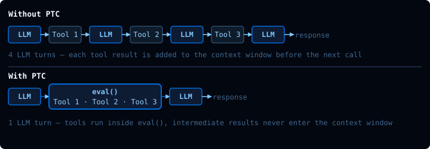
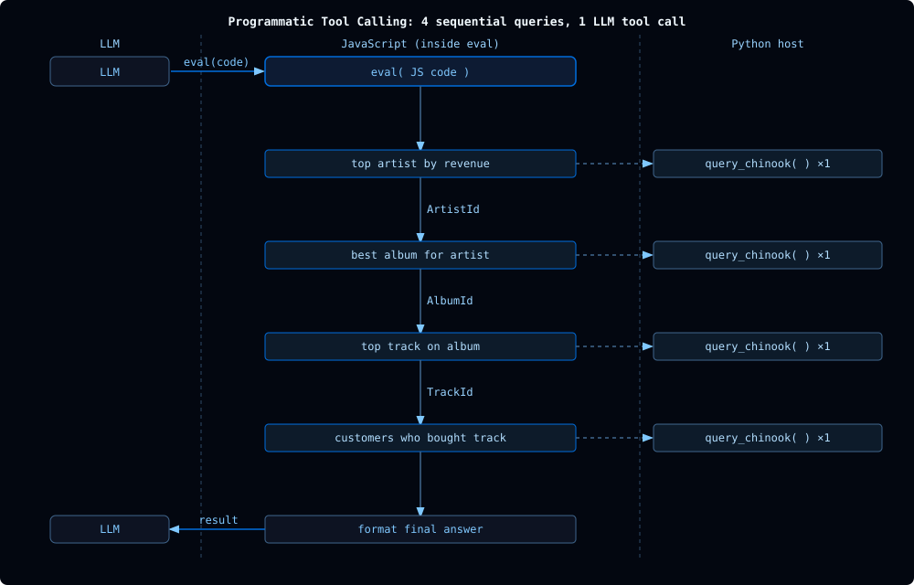

# Lesson: m2.4-interpreter

[Course index](../../README.md) · [Original source](https://github.com/langchain-ai/lca-deepagents/blob/HEAD/thinkific/src/m2/m2.4-interpreter.md) · [Raw file](../../raw/repositories/lca-deepagents/thinkific/src/m2/m2.4-interpreter.md)

Retrieved: 2026-11-13T16:50:31.645872+00:00

[For translation, open lesson in new tab and use Chrome translate](m2.4-interpreter.md)

Python TypeScript

<a id="interpreters"></a>


# Interpreters

```text
<button class="lt-tab active" data-p="exec" role="tab" aria-selected="true">Interpreters</button>
```

```text
<button class="lt-tab" data-p="lab1" role="tab" aria-selected="false">Lab 1</button>
<button class="lt-tab" data-p="lab2" role="tab" aria-selected="false">Lab 2</button>
```

```text
<button class="lt-tab" data-p="quiz" role="tab" aria-selected="false">Quiz</button>
```

```text
<button class="lt-tab" data-p="homework" role="tab" aria-selected="false">Homework</button>
```

```text
<button class="lt-tab" data-p="read" role="tab" aria-selected="false">Extra Reading</button>
```

<a id="p-exec"></a>


Lesson Video Walkthrough

[Public video walkthrough](../videos/qIeyaZ9HbAO.md)

Code execution is a powerful capability for agents. The previous lesson introduced shell-capable backends: environments where the agent can use `execute` to run commands, scripts, installs, and tests.

**Interpreters are a lighter-weight code execution option.** They embed a JavaScript runtime directly in the agent loop with no cloud infrastructure and no API calls to spin up a shell environment. The tradeoff is a narrower direct capability set: JavaScript standard library only, no external packages, no direct filesystem, and no direct network access.

Client LLM Interpreter        {}       1 REQUEST    2 CODE BLOCK  const results = search(query) const relevant = check(results) createTicket(relevant) …  3 EXECUTE    4 RETURN FINAL RESULT    5 FINAL RESPONSE

*The LLM writes code; the Interpreter runs it and returns the real result.*

Unlike shell-capable backends, the interpreter is not a backend service. It operates in the agent loop like other tools.

---

<a id="the-eval-tool"></a>


## The eval tool

When `CodeInterpreterMiddleware` is added to an agent, it provides a single new tool: **`eval`**. The agent calls it with a string of JavaScript to execute.

When `createCodeInterpreterMiddleware` is added to an agent, it provides a single new tool: **`eval`**. The agent calls it with a string of JavaScript to execute.

```text
eval(code=`
const prices = [0.99, 1.29, 0.99, 1.99, 0.99];
const avg = prices.reduce((a, b) => a + b, 0) / prices.length;
\`Average price: $\${avg.toFixed(2)}\`
`)
```

The middleware runs the code in a [QuickJS](../readings/bellard-org-quickjs-35fd6326.md) runtime, a lightweight JavaScript engine designed for embedded execution. The result of the last expression, plus any `console.log` output, comes back as the tool result.

The string `"Average price: $1.25"` comes back as the tool result on the next LLM call.

---

<a id="the-quickjs-runtime"></a>


## The QuickJS runtime

QuickJS exposes the JavaScript standard library and nothing else directly.

**Available:**

- Array methods: `map`, `filter`, `reduce`, `sort`, `flat`, `find`
- `Map`, `Set`, `JSON`, `Math`, `Promise`
- `Date` and other standard JavaScript globals
- `console.log` (captured and returned as output)
- String and number methods, destructuring, `async`/`await`

**Not directly available:**

- Filesystem (`fs`)
- Network (`fetch`)
- Node.js APIs
- `npm` packages

With Programmatic Tool Calling, JavaScript can still reach outside the interpreter indirectly through tools you explicitly allow. That allowlist is the safety boundary.

The interpreter keeps its state between `eval` calls, so a variable defined in one call is still there in the next (at least within the same turn). What happens after the turn ends depends on the SDK. By default, Python’s middleware saves a snapshot of the interpreter in the agent’s state and restores it on the next turn, so a later `invoke` on the same thread picks up where the last one left off, as long as a checkpointer keeps that thread’s state. TypeScript’s middleware discards the interpreter at the end of each turn.

Interpreter execution is bounded by runtime limits such as timeout, memory, output size, and PTC call limits. Those limits keep runaway loops or huge results from taking over the agent run.

---

<a id="use-cases"></a>


## Use cases

There are two patterns where interpreters shine.

Lesson Video Walkthrough

[Public video walkthrough](../videos/ma8zcRLkFWk.md)

<a id="data-transformation"></a>


### 1. Data transformation

When the agent has data in context and needs to compute something (sort, group, aggregate, reformat), `eval` is faster and more reliable than asking the LLM to do arithmetic in prose.

```text
const invoices = [
  {month: "2024-01", total: 42.50},
  {month: "2024-02", total: 38.75},
  {month: "2024-03", total: 61.20},
];
const best = invoices.reduce((a, b) => a.total > b.total ? a : b);
`Best month: ${best.month} ($${best.total})`
```

<a id="programmatic-tool-calling-ptc"></a>


### 2. Programmatic Tool Calling (PTC)

This is the most powerful pattern. When PTC is enabled, the JavaScript code can call the agent’s tools directly, without those intermediate results ever entering the LLM’s context window.



Without PTC, each tool result is returned to the LLM as a new message, consuming context space. The LLM must examine it and decide on the next tool call, incurring additional latency and cost with every turn.

In contrast, with PTC, when an agent is able to write code to chain tool calls successively, the number of iterations and the associated cost and latency can be reduced.

```text
// Tool 1 — fetch top genres by revenue
const genres = JSON.parse(await tools.queryChinook({ sql: `
    SELECT Genre.GenreId, Genre.Name, SUM(InvoiceLine.UnitPrice * InvoiceLine.Quantity) AS rev
    FROM InvoiceLine
    JOIN Track USING(TrackId)
    JOIN Genre USING(GenreId)
    GROUP BY Genre.GenreId
    ORDER BY rev DESC LIMIT 3
`}));

// Tool 2 — result from Tool 1 drives this query
const topGenreId = Number(genres[0].GenreId);
const topTrack = JSON.parse(await tools.queryChinook({ sql: `
    SELECT Track.Name, SUM(InvoiceLine.UnitPrice * InvoiceLine.Quantity) AS rev
    FROM InvoiceLine
    JOIN Track USING(TrackId)
    WHERE Track.GenreId = ${topGenreId}
    GROUP BY Track.TrackId
    ORDER BY rev DESC LIMIT 1
`}));

// Tool 3 — fetch overall revenue total
const totals = JSON.parse(await tools.queryChinook({ sql: `
    SELECT SUM(InvoiceLine.UnitPrice * InvoiceLine.Quantity) AS total FROM InvoiceLine
`}));

// Combine — only this string is returned to the LLM
`Top genre: ${genres[0].Name} ($${genres[0].rev.toFixed(2)})
 Top track: ${topTrack[0].Name}
 Catalog total: $${totals[0].total.toFixed(2)}`;
```

The model writes the JavaScript once. The interpreter executes it, calling the Python `query_chinook` tool on the host, receiving the JSON result, processing it, and returning only the final formatted string to the LLM.

Tools are exposed as `tools.<camelCaseName>(input)` async functions. Results come back as strings; use `JSON.parse()` when the tool returns JSON.

> **Note:** Only tools explicitly listed in the `ptc` argument to `CodeInterpreterMiddleware` are callable from JavaScript. Keep this allowlist narrow. PTC tool calls run inside the interpreter bridge, so do not expose broad or sensitive tools unless you are comfortable with code calling them programmatically.

> **Note:** Only tools explicitly listed in the `ptc` option to `createCodeInterpreterMiddleware` are callable from JavaScript. Keep this allowlist narrow. PTC tool calls run inside the interpreter bridge, so do not expose broad or sensitive tools unless you are comfortable with code calling them programmatically.

\*Lab 2 walks through a fully sequential version of this pattern: each query depends entirely on the result of the previous one, rather than fanning out to several genres at once.

---

<a id="interpreter-vs-shell-capable-backend"></a>


## Interpreter vs shell-capable backend

|  | Interpreter | Shell-capable backend / sandbox |
| --- | --- | --- |
| Language | JavaScript (QuickJS) | Any shell command or installed runtime |
| External libraries | JS standard library directly; more only through allowlisted tools | Packages available in the environment |
| Filesystem | No direct filesystem API; can only access files through allowlisted tools | Filesystem tools plus shell access when supported |
| Network | No direct network API; can only access network through allowlisted tools | Depends on backend and sandbox/network configuration |
| Infrastructure | Embedded in the agent process | Local shell or external sandbox resource |
| State | Persists across `eval` calls (per turn in TS; per thread by default in Python) | Persists within the shell/sandbox workspace until reset or deleted |
| Best for | Computation, loops, PTC orchestration | Scripts, packages, file I/O, builds, tests, arbitrary shell work |

Use an interpreter when the task is logic and orchestration. Use a shell-capable backend or sandbox when the task requires packages, filesystem operations from code, network access, or arbitrary command execution.

---

<a id="configuring-the-interpreter"></a>


## Configuring the interpreter

Add `CodeInterpreterMiddleware` to any agent via `middleware=`. Enable PTC by passing a list of tool names to `ptc=`.

```text
# python/m2/m2.4_interpreter_agent.py
from langchain_quickjs import CodeInterpreterMiddleware
from deepagents import create_deep_agent

agent = create_deep_agent(
    model=model,
    tools=[query_chinook],
    middleware=[CodeInterpreterMiddleware(ptc=["query_chinook"])],
)
```

Add `createCodeInterpreterMiddleware` to any agent via `middleware:`. Enable PTC by passing a list of tool names to `ptc:`.

```text
// typescript/m2/m2.4_interpreter_agent.ts
import { createCodeInterpreterMiddleware } from "@langchain/quickjs";
import { createDeepAgent } from "deepagents";

const agent = createDeepAgent({
  model,
  tools: [queryChinook],
  middleware: [createCodeInterpreterMiddleware({ ptc: ["query_chinook"] })],
});
```

The middleware injects the `eval` tool and adds instructions to the system prompt describing how to use it and which tools are available via PTC.

**⚠ Troubleshooting:** PTC compliance comes from system-prompt instructions. The model can still call an allowlisted tool directly instead of chaining it inside `eval()`, particularly on complex tasks; a weaker model may follow this pattern less reliably. Check the LangSmith trace: if the tool call shows up as its own step outside `eval`, the model skipped PTC that turn.

---

<a id="recap"></a>


## Recap

- `CodeInterpreterMiddleware` adds an `eval` tool that runs JavaScript in an embedded QuickJS runtime
- QuickJS provides the JS standard library directly: no packages, no direct filesystem, no direct network
- Programmatic Tool Calling (PTC) lets JavaScript code call explicitly allowlisted Python tools on the host; intermediate results stay in the interpreter and never enter the LLM context window
- Use an interpreter for computation and PTC orchestration; use a shell-capable backend or sandbox when you need packages, file I/O from code, or arbitrary shell work

- `createCodeInterpreterMiddleware` adds an `eval` tool that runs JavaScript in an embedded QuickJS runtime
- QuickJS provides the JS standard library directly: no packages, no direct filesystem, no direct network
- Programmatic Tool Calling (PTC) lets JavaScript code call explicitly allowlisted TypeScript tools on the host; intermediate results stay in the interpreter and never enter the LLM context window
- Use an interpreter for computation and PTC orchestration; use a shell-capable backend or sandbox when you need packages, file I/O from code, or arbitrary shell work

<a id="next"></a>


## Next

Complete the **Labs** and **Quiz** above, then continue to the next lesson on context engineering: managing what the agent sees as conversations grow long.

---

<a id="references"></a>


## References

**Documentation:**

- [Interpreters in Deep Agents](../readings/docs-langchain-com-oss-python-deepagents-interpreters-be33ab25.md)
- [QuickJS](../readings/bellard-org-quickjs-35fd6326.md)

**Go deeper: read the source** *(optional)*

*The lesson shows how to use this. To see how it’s implemented, start with these files:*

- [`libs/partners/quickjs`](../readings/github-41b96b4615a9.md): the QuickJS interpreter package

**Documentation:**

- [Interpreters in Deep Agents](../readings/docs-langchain-com-oss-javascript-deepagents-interpreters-93bbaecd.md)
- [QuickJS](../readings/bellard-org-quickjs-35fd6326.md)

**Go deeper: read the source** *(optional)*

*The lesson shows how to use this. To see how it’s implemented, start with these files:*

- [`libs/providers/quickjs`](../readings/github-fee995f0f2d6.md): the QuickJS interpreter package

<a id="p-lab1"></a>


<a id="lab-1-fibonacci-with-eval"></a>


## Lab 1: Fibonacci with eval

Lab Video Walkthrough

[Public video walkthrough](../videos/wSwgLsOL9uy.md)

**Inspect your own run in LangSmith.** Notice the `eval` tool call running the Fibonacci computation directly, with no sandbox or `execute` step involved.

LangSmith Video Walkthrough

[Public video walkthrough](../videos/f0tbdzAGkfj.md)

Compute the first 15 Fibonacci numbers, the same task as Lab 1 in the previous lesson, but using the interpreter instead of a sandbox. No cloud environment, no `execute` tool, no infrastructure. Just `eval`.

---

```python {10} # python/m2/m2.4\_eval\_agent.py from deepagents import create\_deep\_agent from langchain\_quickjs import CodeInterpreterMiddleware from models import model

agent = create\_deep\_agent( model=model, middleware=[CodeInterpreterMiddleware()], )

result = agent.invoke( { “messages”: [ { “role”: “user”, “content”: “Use the eval tool to compute and return the first 15 Fibonacci numbers.”, } ] } )

print(result[“messages”][-1].text)

````text

```bash
cd python
uv run ./m2/m2.4_eval_agent.py
````

```typescript {9} // typescript/m2/m2.4\_eval\_agent.ts import { createCodeInterpreterMiddleware } from “@langchain/quickjs”; import { createDeepAgent } from “deepagents”;

import { model } from “../models.js”;

const agent = createDeepAgent({ model, middleware: [createCodeInterpreterMiddleware()], });

const result = await agent.invoke({ messages: [ { role: “user”, content: “Use the eval tool to compute and return the first 15 Fibonacci numbers.”, }, ], });

console.log(result.messages.at(-1)?.text);

````text

```bash
cd typescript
pnpm tsx ./m2/m2.4_eval_agent.ts
````

Compare this to the sandbox version in lesson 2.3: the agent still calls a tool and gets back output, but there’s no sandbox to spin up, no `write_file` → `execute` sequence, and no separate runtime involved. One middleware line is all it takes.

**Example output:**

```text
The first 15 Fibonacci numbers are: **[0, 1, 1, 2, 3, 5, 8, 13, 21, 34, 55, 89, 144, 233, 377]**
```

<a id="p-lab2"></a>


<a id="lab-2-programmatic-tool-calling-with-chinook"></a>


## Lab 2: Programmatic Tool Calling with Chinook

Lab Video Walkthrough

[Public video walkthrough](../videos/xtGr4FJFVbo.md)

**With interpreter: inspect your own run in LangSmith.** Notice the four sequential `query_chinook` calls inside a single `eval` tool call, for two LLM round trips in total.

**Without interpreter: inspect your own run in LangSmith.** Notice the five LLM round trips, one per query plus the final answer.

LangSmith Video Walkthrough

[Public video walkthrough](../videos/xuBB1zLLUm7.md)

**The result of each SQL query is used to form the input to the next (and so on)**, all without the model having to write new code or form a new query.

The script runs two agents on the same question. The first uses `CodeInterpreterMiddleware` with PTC: four SQL queries run inside a single `eval()` call, each one using the ID produced by the previous. Two LLM round trips total. The second uses plain tool calls: the LLM sees each query result as a new message and must decide on the next query itself.



*Each query result feeds directly into the next; only the final formatted answer is returned to the LLM.*

---

```python {51,53-58,72-75} # python/m2/m2.4\_interpreter\_agent.py import json import sqlite3 import uuid from pathlib import Path

from deepagents import create\_deep\_agent from langchain.tools import tool from langchain\_quickjs import CodeInterpreterMiddleware

from models import model

DB\_PATH = Path(**file**).resolve().parent / “chinook.db”

TASK = ( “Who is our top-selling artist, what is their best-selling album,” “what is the most-purchased track on that album,” “and how many distinct customers have bought that track?” “Each answer depends on the result of the previous query.” )

SYSTEM = ( “You are a sales analyst for Chinook Digital Music Store.” “Use the query\_chinook tool to query the database.” “Key tables: Artist(ArtistId, Name), Album(AlbumId, Title, ArtistId),” “Track(TrackId, Name, AlbumId),” “InvoiceLine(InvoiceLineId, InvoiceId, TrackId, UnitPrice, Quantity).” “Revenue is InvoiceLine.UnitPrice \* InvoiceLine.Quantity.” )

@tool def query\_chinook(sql: str) -> str: “““Execute a read-only SQL query against the Chinook database. Returns a JSON-encoded string.”“” conn = sqlite3.connect(DB\_PATH) conn.row\_factory = sqlite3.Row try: cursor = conn.execute(sql) rows = [dict(row) for row in cursor.fetchall()] return json.dumps(rows) finally: conn.close()

<a id="agent-with-interpreter"></a>


# — Agent with interpreter —

<a id="additional-information-is-added-to-the-system-prompt-to-guide-the-agent-to-use"></a>


# Additional information is added to the system prompt to guide the agent to use

<a id="the-interpreter-as-well-as-some-hints-on-how-to-use-it."></a>


# the interpreter as well as some hints on how to use it.

agent\_with = create\_deep\_agent( model=model, tools=[query\_chinook], middleware=[CodeInterpreterMiddleware(ptc=[“query\_chinook”])], system\_prompt=( SYSTEM + ” The eval tool supports Programmatic Tool Calling (PTC): JavaScript” ” running inside eval() can call query\_chinook via tools.queryChinook().” ” For dependent queries where each answer requires a result from the” ” previous, prefer a single eval() call that chains all queries in” ” JavaScript — intermediate values stay in variables and never return to the model.” ), )

result\_with = agent\_with.invoke( {“messages”: [{“role”: “user”, “content”: TASK}]}, config={“configurable”: {“thread\_id”: str(uuid.uuid4())}}, )

print(“=== With interpreter ===”) print(result\_with[“messages”][-1].text)

<a id="agent-without-interpreter"></a>


# — Agent without interpreter —

agent\_without = create\_deep\_agent( model=model, tools=[query\_chinook], system\_prompt=SYSTEM, )

result\_without = agent\_without.invoke( {“messages”: [{“role”: “user”, “content”: TASK}]}, config={“configurable”: {“thread\_id”: str(uuid.uuid4())}}, )

print(“=== Without interpreter ===”) print(result\_without[“messages”][-1].text)

````text

```bash
cd python
uv run ./m2/m2.4_interpreter_agent.py
````

```typescript {54,56-61,74-77} // typescript/m2/m2.4\_interpreter\_agent.ts import { randomUUID } from “node:crypto”; import { DatabaseSync } from “node:sqlite”; import { dirname, join } from “node:path”; import { fileURLToPath } from “node:url”;

import { z } from “zod”; import { context, tool } from “langchain”; import { createDeepAgent } from “deepagents”; import { createCodeInterpreterMiddleware } from “@langchain/quickjs”;

import { model } from “../models.js”;

const \_\_dirname = dirname(fileURLToPath(import.meta.url)); const DB\_PATH = join(\_\_dirname, “chinook.db”);

const TASK = context`Who is our top-selling artist, what is their best-selling album, what is the most-purchased track on that album, and how many distinct customers have bought that track? Each answer depends on the result of the previous query.`;

const SYSTEM = context`You are a sales analyst for Chinook Digital Music Store. Use the query_chinook tool to query the database. Key tables: Artist(ArtistId, Name), Album(AlbumId, Title, ArtistId), Track(TrackId, Name, AlbumId), InvoiceLine(InvoiceLineId, InvoiceId, TrackId, UnitPrice, Quantity). Revenue is InvoiceLine.UnitPrice * InvoiceLine.Quantity.`;

const queryChinook = tool( ({ sql }) => { const db = new DatabaseSync(DB\_PATH); try { const rows = db.prepare(sql).all(); return JSON.stringify(rows); } finally { db.close(); } }, { name: “query\_chinook”, description: “Execute a read-only SQL query against the Chinook database. Returns a JSON-encoded string.”, schema: z.object({ sql: z.string() }), } );

// — Agent with interpreter — // Additional information is added to the system prompt to guide the agent to use // the interpreter as well as some hints on how to use it.

const agentWith = createDeepAgent({ model, tools: [queryChinook], middleware: [createCodeInterpreterMiddleware({ ptc: [“query\_chinook”] })], systemPrompt: context`${SYSTEM} The eval tool supports Programmatic Tool Calling (PTC): JavaScript running inside eval() can call query_chinook via tools.queryChinook(). For dependent queries where each answer requires a result from the previous, prefer a single eval() call that chains all queries in JavaScript — intermediate values stay in variables and never return to the model.`, });

const resultWith = await agentWith.invoke( { messages: [{ role: “user”, content: TASK }] }, { configurable: { thread\_id: randomUUID() } } );

console.log(“=== With interpreter ===”); console.log(resultWith.messages[resultWith.messages.length - 1].text);

// — Agent without interpreter —

const agentWithout = createDeepAgent({ model, tools: [queryChinook], systemPrompt: SYSTEM, });

const resultWithout = await agentWithout.invoke( { messages: [{ role: “user”, content: TASK }] }, { configurable: { thread\_id: randomUUID() } } );

console.log(“=== Without interpreter ===”); console.log(resultWithout.messages[resultWithout.messages.length - 1].text);

````text

```bash
cd typescript
pnpm tsx ./m2/m2.4_interpreter_agent.ts
````

**Example output:**

Both agents reach the same answers; formatting may vary slightly.

```text
=== With interpreter ===
Here are the answers to your dependent queries:

1. **Top-selling artist:** Iron Maiden ($138.60 total revenue)
2. **Best-selling album:** The X Factor ($10.89 revenue)
3. **Most-purchased track:** The Aftermath (2 units purchased, $1.98 revenue)
4. **Distinct customers:** 2 customers have purchased "The Aftermath"

=== Without interpreter ===
**Results:**

1. **Top-selling artist:** Iron Maiden (140 total units sold)
2. **Their best-selling album:** The X Factor (11 units sold)
3. **Most-purchased track on that album:** The Aftermath (2 units sold)
4. **Distinct customers who bought that track:** 2
```

**What to watch for in LangSmith:** Open both traces. The with-interpreter trace shows one `eval` tool call; inside it, the PTC bridge fires `query_chinook` four times in sequence — two LLM round trips total. The without-interpreter trace shows five LLM round trips: the model calls `query_chinook` once per turn, reading each result before deciding the next query. Both agents reach the same answer; the interpreter eliminates the intermediate context switches.

<a id="p-quiz"></a>


## Check your understanding

<a id="p-homework"></a>


<a id="ask-your-own-question-then-grade-it"></a>


## Ask Your Own Question, Then Grade It

Lab 2 asked one fixed question about the Chinook database. This homework asks you to pose your own question, and write your own eval check that judges whether the agent’s answer looks right.

Open `python/m2/m2.4_homework.py`.

1. **TODO 1**: write your own natural-language question about the Chinook database for the interpreter agent to answer using `eval()` and `query_chinook`. A question with a couple of dependent steps is a good excuse to use PTC, but a single-query question works too.
2. **TODO 2**: write a small `eval_answer(...)` function that independently checks whether the agent’s final answer looks correct, however you want to do that: rerun your own SQL query and compare, check for an expected keyword or number, or just print both side by side.

<a id="run-it"></a>


### Run it

```text
cd python
uv run ./m2/m2.4_homework.py
```

Stuck, or want to see the finished shape before you start? `m2.4_homework_filled.py` is a reference copy with every TODO filled in (using a country-revenue and best-selling-track question, graded with an independent SQL check); run it the same way to see what “done” looks like end to end.

Try to avoid peeking unless you’re really stuck. You’ll get more out of this by working through the TODOs yourself first.

---


Optional Extension: Want To Code From Scratch?

**What you’ll build:** an interpreter agent with two tools, but only one exposed to `eval()` through `ptc=`, so you can confirm that allowlist is actually enforced.

**Requirements:**

- Write your own `create_deep_agent(model=model, tools=[query_chinook, your_other_tool], middleware=[CodeInterpreterMiddleware(ptc=["query_chinook"])])` call from scratch, in a new file under `python/m2/`.
- Write a second, unrelated tool (e.g. a `convert_currency(amount: float, rate: float)` stub) and leave it out of `ptc=`.
- Write a task that explicitly tells the agent to try calling your second tool from inside `eval()` (via `globalThis.tools`), not as a normal top-level tool call, right after it uses `query_chinook` through `eval()` as usual. Being explicit about “inside eval()” matters: without it, the model can sidestep the whole point of the exercise by just calling your second tool normally instead. Confirm the in-`eval()` call fails: `globalThis.tools` only ever contains the names you listed in `ptc=`, so nothing else is reachable no matter what the agent tries.

<a id="ask-your-own-question-then-grade-it-1"></a>


## Ask Your Own Question, Then Grade It

Lab 2 asked one fixed question about the Chinook database. This homework asks you to pose your own question, and write your own eval check that judges whether the agent’s answer looks right.

Open `typescript/m2/m2.4_homework.ts`.

1. **TODO 1**: write your own natural-language question about the Chinook database for the interpreter agent to answer using `eval()` and `queryChinook`. A question with a couple of dependent steps is a good excuse to use PTC, but a single-query question works too.
2. **TODO 2**: write a small `evalAnswer(...)` function that independently checks whether the agent’s final answer looks correct, however you want to do that: rerun your own SQL query and compare, check for an expected keyword or number, or just print both side by side.

<a id="run-it-1"></a>


### Run it

```text
cd typescript
pnpm tsx ./m2/m2.4_homework.ts
```

Stuck, or want to see the finished shape before you start? `m2.4_homework_filled.ts` is a reference copy with every TODO filled in (using a country-revenue and best-selling-track question, graded with an independent SQL check); run it the same way to see what “done” looks like end to end.

Try to avoid peeking unless you’re really stuck. You’ll get more out of this by working through the TODOs yourself first.

---


Optional Extension: Want To Code From Scratch?

**What you’ll build:** an interpreter agent with two tools, but only one exposed to `eval()` through `ptc:`, so you can confirm that allowlist is actually enforced.

**Requirements:**

- Write your own `createDeepAgent({ model, tools: [queryChinook, yourOtherTool], middleware: [createCodeInterpreterMiddleware({ ptc: ["query_chinook"] })] })` call from scratch, in a new file under `typescript/m2/`.
- Write a second, unrelated tool (e.g. a `convertCurrency({ amount, rate })` stub) and leave it out of `ptc:`.
- Write a task that explicitly tells the agent to try calling your second tool from inside `eval()` (via `globalThis.tools`), not as a normal top-level tool call, right after it uses `queryChinook` through `eval()` as usual. Being explicit about “inside eval()” matters: without it, the model can sidestep the whole point of the exercise by just calling your second tool normally instead. Confirm the in-`eval()` call fails: `globalThis.tools` only ever contains the names you listed in `ptc:`, so nothing else is reachable no matter what the agent tries.

<a id="p-read"></a>


<a id="extra-reading-ptc-vs.-json-tool-calling"></a>


## Extra Reading: PTC vs. JSON Tool Calling

This section is optional and not covered on the quiz.

This lesson’s PTC pattern (Lab 2) let JavaScript running in `eval()` call `query_chinook` directly, so the intermediate query results never became LLM messages, only the final formatted string did.

A recent paper, [*The Bitter Lesson of Tool Calling*](https://arxiv.org/abs/2608.06370) (Patel, Sen, Lumer & Subbiah, 2026), benchmarks that same idea, programmatic tool calling (tools exposed as callable stubs invoked through code) against standard JSON tool calling, across 14 models on the BFCL v4 benchmark:

- Programmatic tool calling matches or beats native JSON tool calling on 11 of 14 models, with one model family showing a 10.6% improvement.
- Under parallel fan-out (several tool calls needed at once), it matches or outperforms the JSON baseline on 13 of 14 models.
- Under “context rot” conditions (long, noisy context), programmatic tool calling holds stable while JSON tool calling degrades by 2.3% on average.

As you saw in Lab 2, keeping intermediate tool results out of the LLM’s context makes the agent more robust as context grows.

```javascript

(function () {
  var tabs = document.querySelectorAll('.lt-tab');
  function show(p) {
    tabs.forEach(function (t) {
      var on = t.getAttribute('data-p') === p;
      t.classList.toggle('active', on);
      t.setAttribute('aria-selected', on ? 'true' : 'false');
    });
    document.querySelectorAll('.lt-panel').forEach(function (panel) {
      panel.classList.toggle('active', panel.id === 'p-' + p);
    });
  }
  tabs.forEach(function (t) {
    t.addEventListener('click', function () { show(t.getAttribute('data-p')); });
  });
})();

```
