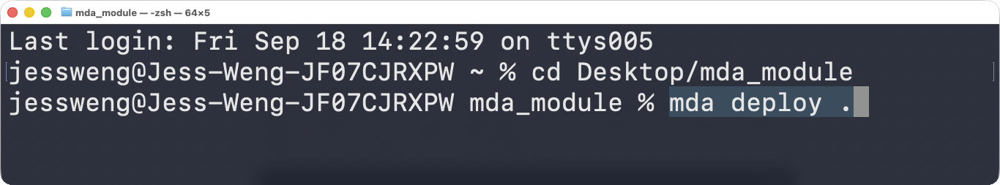

# Lesson: m6.1-what-is-managed-deep-agents

[Course index](../../README.md) · [Original source](https://github.com/langchain-ai/lca-deepagents/blob/HEAD/thinkific/src/m6/m6.1-what-is-managed-deep-agents.md) · [Raw file](../../raw/repositories/lca-deepagents/thinkific/src/m6/m6.1-what-is-managed-deep-agents.md)

Retrieved: 2026-11-13T16:50:31.645872+00:00

[For translation, open lesson in new tab and use Chrome translate](m6.1-what-is-managed-deep-agents.md)

<a id="what-is-managed-deep-agents"></a>


# What Is Managed Deep Agents?

↓ click to celebrate ↓

<a id="get-started-btn"></a>
 Welcome to Managed Deep Agents

<a id="confetti-canvas"></a>

```javascript

(function () {
  var canvas, ctx, particles = [], running = false, animId;

  var COLORS = [
    '#006DDD','#3399FF','#7FC8FF','#CCE9FF','#60B0FF'
  ];

  function drawStar(ctx, cx, cy, spikes, outerRadius, innerRadius) {
    var rot = (Math.PI / 2) * 3, step = Math.PI / spikes;
    ctx.beginPath();
    ctx.moveTo(cx, cy - outerRadius);
    for (var i = 0; i < spikes; i++) {
      ctx.lineTo(cx + Math.cos(rot) * outerRadius, cy + Math.sin(rot) * outerRadius);
      rot += step;
      ctx.lineTo(cx + Math.cos(rot) * innerRadius, cy + Math.sin(rot) * innerRadius);
      rot += step;
    }
    ctx.lineTo(cx, cy - outerRadius);
    ctx.closePath();
    ctx.fill();
  }

  function Star(x, y) {
    this.x = x; this.y = y;
    this.vx = (Math.random() - 0.5) * 1.5;
    this.vy = 1.5 + Math.random() * 2;
    this.gravity = 0.015 + Math.random() * 0.02;
    this.maxVy = 5 + Math.random() * 2;
    this.rotation = Math.random() * Math.PI * 2;
    this.rotationSpeed = (Math.random() - 0.5) * 0.1;
    this.size = 6 + Math.random() * 7;
    this.color = COLORS[Math.floor(Math.random() * COLORS.length)];
    this.swayPhase = Math.random() * Math.PI * 2;
    this.swaySpeed = 0.015 + Math.random() * 0.02;
    this.swayAmount = 0.4 + Math.random() * 0.6;
  }

  Star.prototype.update = function () {
    if (this.vy < this.maxVy) this.vy += this.gravity;
    this.swayPhase += this.swaySpeed;
    this.x += this.vx + Math.sin(this.swayPhase) * this.swayAmount;
    this.y += this.vy;
    this.rotation += this.rotationSpeed;
  };

  Star.prototype.dead = function () {
    return this.y > (canvas ? canvas.height + 40 : 1e9);
  };

  Star.prototype.draw = function (ctx) {
    ctx.save();
    ctx.translate(this.x, this.y);
    ctx.rotate(this.rotation);
    ctx.fillStyle = this.color;
    drawStar(ctx, 0, 0, 5, this.size, this.size * 0.45);
    ctx.restore();
  };

  function spawnStar() {
    var x = Math.random() * window.innerWidth;
    var y = -20 - Math.random() * 60;
    particles.push(new Star(x, y));
  }

  function loop() {
    ctx.clearRect(0, 0, canvas.width, canvas.height);
    particles = particles.filter(function (p) { return !p.dead(); });
    particles.forEach(function (p) { p.update(); p.draw(ctx); });
    if (running || particles.length > 0) animId = requestAnimationFrame(loop);
    else { canvas.style.display = 'none'; }
  }

  window.launchConfetti = function () {
    if (!canvas) {
      canvas = document.getElementById('confetti-canvas');
      ctx = canvas.getContext('2d');
    }
    canvas.width = window.innerWidth;
    canvas.height = window.innerHeight;
    canvas.style.display = 'block';

    var btn = document.getElementById('get-started-btn');
    if (!btn.style.width) btn.style.width = btn.offsetWidth + 'px';
    btn.textContent = 'Again!';

    particles = [];
    running = true;

    var waves = 0, maxWaves = 28;
    function fire() {
      if (waves >= maxWaves) { running = false; return; }
      var count = 6 + Math.floor(Math.random() * 6);
      for (var i = 0; i < count; i++) spawnStar();
      waves++;
      setTimeout(fire, 80 + Math.random() * 120);
    }

    if (animId) cancelAnimationFrame(animId);
    fire();
    loop();
  };
})();

```

**Managed Deep Agents (MDA)** is the easiest way to deploy deep agents. It bundles the Deep Agents harness with a managed runtime beneath it, including LangSmith Agent Server: you provide the business logic (instructions, tools, skills, and model), and MDA handles the rest.


Providing that business logic means a folder of files rather than a single script (each piece in a place MDA expects), which `mda init` scaffolds for you:

- The agent definition, its model, and its tools go in `agent.py`.
- The system prompt goes in `instructions.md`.
- Skills go in `skills/`.
- Sandbox setup goes in `sandbox/`.

```text
uvx --from managed-deepagents==0.8.3 mda init research-assistant
cd research-assistant
```

The lab in the next lesson clones a finished project instead, so you can read every file already filled in.

Once those pieces exist as files, MDA can find them and deploy the whole project with one command: `mda deploy .`.

- That command is a loop. As you add tools, change the model, or reshape the sandbox, you run it again and the same deployment updates in place.

Testing the agent locally before you deploy

- `mda dev` compiles the project and runs it on a local LangGraph dev server, so you can try it out before anything ships.
- `mda chat` talks to that local agent from the terminal, if you’d rather not open Studio.



MDA runs it on a hosted runtime built on [LangSmith](https://smith.langchain.com), managing the sandbox, the deploy pipeline, live prompt editing, and the tracing dashboard.

```python {4} # What you already know from deepagents import create\_deep\_agent

agent = create\_deep\_agent( name=“dvd-rental-analyst”, model=“anthropic:claude-sonnet-5-5”, tools=[email\_report], # a regular @tool, defined in the next lesson )

````text

```python {4}
# The managed equivalent
from managed_deepagents import define_deep_agent

agent = define_deep_agent(
    name="dvd-rental-analyst",
    model="anthropic:claude-sonnet-5-5",
    tools=[email_report],
)
````

- `name` doubles as a deploy id
- No server to stand up yourself; a single `mda deploy .` ships it

For more information about the different components that make up MDA, check out our [docs](../readings/docs-langchain-com-langsmith-managed-deep-agents-75c0af16.md).

This module is an introductory tour, and a dedicated **Managed Deep Agents course is coming soon**, going deeper on deployments, Context Hub, channels, schedules, and evaluation.

<a id="the-example-project"></a>


## The example project

In the next lesson, you’ll deploy a **dvd-rental-analyst** as a Slack bot using MDA. It answers business questions by writing SQL and Python against a sandboxed copy of the Sakila database, and it can produce a Quarterly Business Review on demand.

<a id="recap"></a>


## Recap

- Managed Deep Agents (MDA) bundles the Deep Agents harness with a managed runtime on LangSmith. You provide the business logic (instructions, tools, skills, and model), and MDA handles the rest.
- A project is a folder in the layout MDA expects: `agent.py` for the agent, model, and tools, `instructions.md` for the system prompt, `skills/`, and `sandbox/`. `mda init` scaffolds a starter project.
- `define_deep_agent` is the managed equivalent of `create_deep_agent`. Its `name` is the agent’s ID and the default deployment name.
- `mda deploy .` ships the project, and running it again updates the same deployment in place. `mda dev` and `mda chat` let you test locally first.

<a id="references"></a>


## References

**Documentation:**

- [Managed Deep Agents docs](../readings/docs-langchain-com-langsmith-managed-deep-agents-75c0af16.md)
- [managed-deepagents (PyPI)](../readings/pypi-org-project-managed-deepagents-52c66e3d.md)
- [Deep Agents overview (open-source SDK)](../readings/docs-langchain-com-oss-python-deepagents-overview-6f3fda49.md)
- [LangSmith](https://smith.langchain.com)
